# mat-plan — Architecture Diagrams

Visual overview of the system — **v0 is built and live on Vercel + Neon; v1 (the generalized activity
model) is in progress** (V1-1). Detail in [spec.md](./spec.md); roadmap in [plan.md](./plan.md); the
v1 schema plan is [plans/v1-1-generalize-schema.md](./plans/v1-1-generalize-schema.md). Diagrams
render on GitHub (Mermaid).

## 1. System architecture (containers)

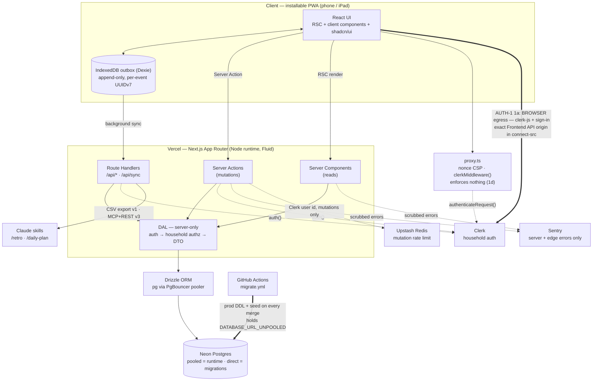

⚠️ **This is the containers view, not the egress list.** Sentry, Upstash and GitHub Actions are drawn
now because each receives something, and **GitHub Actions holding the production database credential**
is the edge people miss. But **Vercel is where every value entered actually passes through**, and its
platform logs hold IP + path. The complete, cited list of who receives what is
[privacy/data-inventory.md](./privacy/data-inventory.md) §7, which owns it.

🔴 **`AUTH-1` 1a added the thick `UI ==> CLERK` edge, and it is the only BROWSER→third-party edge in
this diagram.** Clerk was previously drawn as a dashed server-side `auth()` dependency only, which was
the whole picture while `@clerk/nextjs` was not installed. It is now: the sign-in screen is a
browser-side SDK, so once an instance is configured the browser fetches `clerk-js` from the instance's
Frontend API host and talks to it for the sign-in exchange. **Today that edge is dormant** — both keys
are optional and unset, `lib/clerk.ts` renders no provider without them, and the CSP is not widened at
all; `e2e/theme.spec.ts` asserts zero requests to any Clerk host. The dashed `proxy.ts ⇢ Clerk` edge
is the other half 1a wired: `clerkMiddleware()` is composed **inside** `proxy.ts` so `auth()` can
answer at all, and 1a removed the `api` exclusion from its matcher for that reason.

## 2. Write path — logging one entry

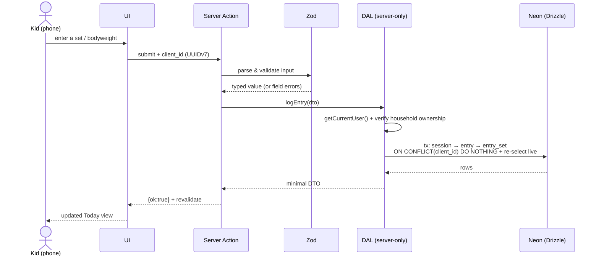

## 2g. Resolving a movement — the id decides, ids before inserts (PICK-1 PR 2)

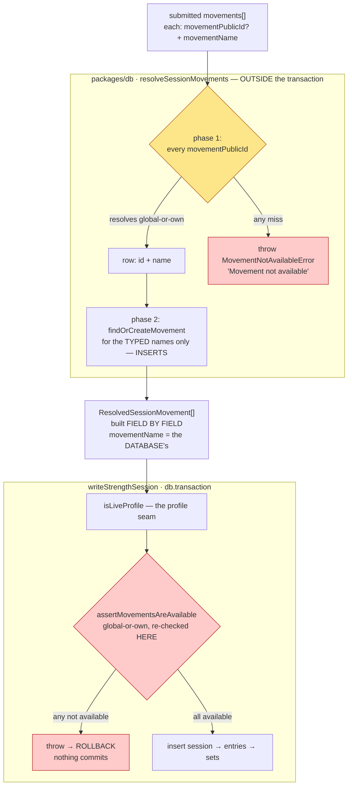

**Two shapes to read off it:** phase 2 is the only phase that writes, which is why phase 1 comes
first; and the **red node is the seam** — phase 1 reads outside the transaction, so the re-check is
what the rollback protects.

The invariant itself — the phase order, the seam, what the refusal may and may not say, and the one
bounded consequence the id path creates — is [write-path.md](./features/write-path.md) → **14**. This
section is the shape; that one is the rule. (§2f above is its neighbour and the two compose: §2g
resolves the `movement_id` that §2f freezes.)

## 2c. Batch write path — logging a day's check-ins (V1-5)

The first **batch multi-row** write and the first writer to insert `kind = NULL` (unblocked by
V1-1c). Differs from §2 in three ways worth seeing at a glance: the action derives its fields from a
**server-side registry** rather than the request body, results are **per-item**, and the conflict
policy is `DO NOTHING` (not §2's LWW `DO UPDATE` — editing a check-in is V1-9).

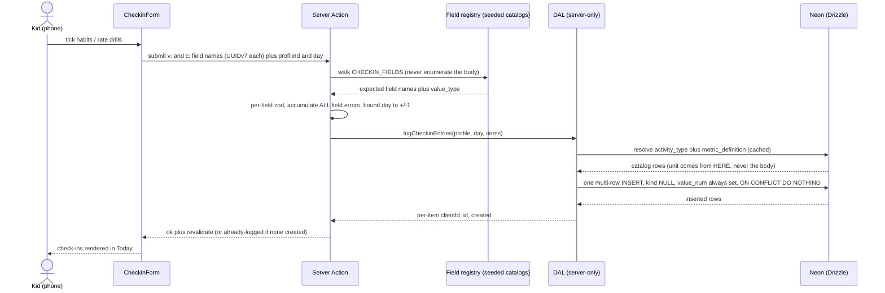

> ⚠️ **The Check-ins form is off the day page since V1-24 3b-page (2026-11-15, #418)**;
> `logCheckinsAction` and this write path stay, tested, until FAM-1 12f.

## 2b. Profile routing — landing → picker → scoped Today (V1-3, OSS-2, PRIV-2)

`/` is the **public landing** (OSS-2): no cookie read, no DB query — and since `AUTH-1` 1c-3b
**every caller sees it**, signed in or not.

🔴 **Every non-public surface requires a Clerk session whose principal holds a `household_members`
row, re-checked in-process — and as of `1d` that is the ONLY requirement.**
`app/pages-need-a-session.test.ts` reports the offender by name, asking the question differently per kind:
a **page** or **Route Handler** names the check itself, while an **action** must call `enterMutation`
and **return its refusal** — the session check, the limiter and their order are asserted once inside
that helper.

**Why in-process, and why it matters MORE now.** `1c-3b` required the access code AND a session
because `getHouseholdScope()` did not consult the principal until `1c-4`, so a session alone meant
_"anyone this Clerk instance admits"_ — deleting the gate first would have **widened** access.
`1c-4` discharged that and `1d` deleted the gate. ⚠️ **What `1d` also removed is the backup**: the
proxy's bounce used to stand between a stranger and a page, so these per-surface checks are now the
only thing there. SEC-1's scar was a prefetch header missing the matcher, CVE-2025-29927 is the
general case, and [SECURITY.md](../.github/SECURITY.md) refuses to call middleware a boundary.
[beta-1](./milestones/beta-1.md) records the ordering as a security obligation rather than a
preference.
🔴 **The proxy now enforces nothing, literally.** The gate bounce was the one thing it enforced
itself; its matcher stays wide for a different reason — `auth()` must be able to answer and the
security headers must land.

⚠️ **Two routing arms were deleted, one per chunk, and neither was authorization.** `1c-3b` removed
the forward that sent a cookie-holder from `/` or `/gate` to `/p`: it **looped** once the pages also
required a session, and meant such a visitor could never reach the landing at all. `1d` removed the
bounce itself, with the gate:

```text
1c-3b deleted:  /sign-in → footer "mat-plan" → /     → (forward) → /p → requireSession() → /sign-in
1d    deleted:  any un-gated request         → /gate?from=…  (the bounce, and /gate with it)
```

Nothing security-relevant went with either: an unauthenticated caller never reached the forward, and
the bounce was never the boundary.

**`PUBLIC_PATHS` holds TWO routes since PRIV-2**: `/` and `/privacy`. The notice at `/privacy` is a
compiled copy of [`docs/privacy/notice.md`](./privacy/notice.md) — rendered from a committed data
module, so it reads **no cookie, no database and no request input** (no `params`, no `searchParams`,
no `fs`), and a byte-exact drift test fails when the page and the reviewed source disagree. It
exists because the Clerk and Google consent screens need a privacy-policy **URL**.

⚠️ **Both public routes now render in place for every caller** — the asymmetry that once sent `/`
to the picker went with the forward above. Keep its reasoning in mind before re-adding any bounce: a
public path that jumped into the app would be unreadable to the person who most needs it, and the
notice is the URL the Clerk and Google consent screens point at. ✅ **From `1d` the notice is also
`index`able** — the reason it was not (publishing a description of a lock whose limiter could fail
open) is dissolved rather than satisfied, because the lock is deleted. `/privacy` owns **no
subtree**: `/privacy/x` is NOT public (`PUBLIC_PATH_TREES` is the separate opt-in a route with
children joins) and now simply 404s, and `/privacy/` 308s to `/privacy` before the proxy runs.

The picker at `/p` lists profiles; a tile routes to `/p/[profileId]` (the profile's UUIDv7 `public_id`). The
selection lives entirely in the URL — no client state. The `profileId` rides the log forms as a hidden
field, and every Server Action **re-validates it server-side** via `getProfileByPublicId`. Profile
tiles are a **UX switch, not a security boundary**; an unknown/malformed id resolves to `notFound()`
(404), never a 500.

**The household scope is where that re-validation now happens, and it is ONE point (TEN-1).**
[ADR 0006](./decisions/0006-household-addressing.md) decided the address stays `/p/<profileId>` with
**no household segment**, so `/p` is byte-identical for every household and the picker query is the
whole front-door isolation boundary. `lib/dal/household.ts` → `getHouseholdScope()` is the **one**
function that decides whose request this is; every DAL read and write resolves it there and passes it
into `packages/db`, so no page, action or Route Handler signature carries a scope.
`isLiveProfile(publicId, scope)` is the single predicate they all share, its `scope` parameter
**required and positional** so an unconverted call site is a compile error.

- **A wrong-household id is a 404, byte-identical to an unknown id** — the same `notFound()` /
  `NO_PROFILE_LOG` path, no new error shape and no new copy. The signal the scoped predicate destroys
  is recovered on the miss path only, as a structured `cross_household` / `unknown_resource` event
  (ADR 0006 obligation 3), never in the response.
- 🔴 **FIVE outcomes since `AUTH-1` 1c-4**, not the two this said. The resolver reads the principal,
  then the membership — never a household count:

  | #   | condition                      | answer                                               |
  | --- | ------------------------------ | ---------------------------------------------------- |
  | A   | one live membership            | that household's scope                               |
  | B   | no principal                   | `null`, silently — 1c-3b refused the caller upstream |
  | B′  | `household_members` missing    | `null` + `scope_outcome: schema_missing`             |
  | C   | principal, no membership       | `null` + `scope_outcome: no_membership`              |
  | D   | principal, **two** memberships | **THROW** — "pick one" is a silent cross-wire        |

  `null` and the throw must stay different paths: `null` for both would tell a parent their data does
  not exist and suggest a production write. ⚠️ **`no_household` is retired** — nothing counts
  households now, so an event carrying it is pre-1c-4.

- ✅ **`1c-4` replaced only `getHouseholdScope()`'s body** (session → `household_members` →
  household). Nothing else moved, which is the whole reason the seam landed before its consumers —
  no page, action or Route Handler signature carries a scope.
- ✅ **Scoping IS authorization now, and that is what unblocked `1d` — which has landed.** Until 1c-4
  the scope came from the single live household, so a session proved only that the caller was someone
  this Clerk instance admits, and deleting the access gate then would have **widened** access. A
  session now decides _whose_ data you get, and `1d` deleted the gate. ⚠️ **At the household boundary
  only** — inside one household there is still no per-profile authorization, and there is not meant to
  be: profile tiles are a UX switch, not a security boundary (AGENTS.md). ⚠️ **The consequence of the
  gate going:** a request that bypasses the proxy now meets only the in-process check, so that check
  is the whole boundary (SEC-1's scar; CVE-2025-29927).
- ⚠️ **The ≥2-live-households throw is gone with the old body**, and was not ported to an alert: two
  live households is the intended end state once a family is invited, so it would fire on every
  request forever. The creator is closed instead — `seed.ts` refuses to insert when a live household
  exists, which matters because `migrate.yml` seeds production on every merge.
- ✅ **`movements` came inside the seam at `TEN-2b`.** Movement resolution takes a
  `HouseholdScope` (`findOrCreateMovement`, and `resolveMovementByPublicId` since `PICK-1` PR 2;
  the `findOrCreateMovementId` wrapper that used to sit in the DAL is deleted) and resolves
  **global-first** — the curated namespace (`household_id IS NULL`),
  then this household's own, then an insert into this household's own — so a name a household types
  belongs to it and is deleted with it. ✅ **`TEN-2c` (migration `0017`) dropped the non-partial
  `movements_slug_unique`, so two households each hold their OWN row for one slug and the denial
  window is closed** — and with it the cross-household `entries.movement_id` that blocked household
  deletion, which was the fallback's measured price. ⚠️ **One residual survives, and it is not the
  constraint:** the **pre-`TEN-2b`** rows still at `household_id IS NULL`, which global-first serves
  to every household — closing at **`TEN-2c-1`** (the split backfill). `0017` only stops it growing,
  via `movements_global_row_has_pattern`. Status:
  [data-inventory.md](./privacy/data-inventory.md) §4; the resolver's shape is in §4 below. TEN-1
  chunk 1d **proved** the original defect rather than assuming it, and its verdict now names both
  halves rather than reading `LEAKS`.

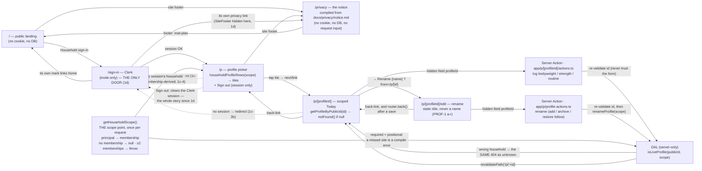

## 2e. The app shell — one frame, two layouts, one `<main>` (UI-5)

Every authenticated **app screen** renders inside `components/layout/app-shell.tsx`. Below `lg` the
shell is the single centred column the app has always had; at `lg` and up it adds a nav rail — **the
athlete switcher**, so a laptop changes kid without a round trip through `/p`.

⚠️ **Two authenticated routes are deliberately outside it**, both named in `OWN_MAIN` or its sibling
list in `app/pages-need-a-session.test.ts`: `/design/tokens` (a full-width token gallery, not an app
screen) and the root error boundary (`app/error.tsx`, which replaces the page rather than filling
it). Both declare their own `<main>`, and the error boundary renders `SiteFooter` itself — ⚠️ this
PR's footer move is what made that necessary, and it **supersedes `PRIV-2`'s "one `<footer>` in the
root layout, not three use sites"**: a layout cannot know the pathname, so the choice was three use
sites or two `contentinfo` landmarks on `/sign-in`.

**The shell is a seam, which is why it is here.** `<main>`, the `<footer>` and the skip link are
declared in exactly one file instead of nine, and two things depend on that: `sheet.tsx` patches
`tabIndex` onto `document.querySelector('main')` for its focus fallback, and `privacy.spec.ts`
clicks `getByRole('contentinfo')` — a `<footer>` nested inside `<main>` is not exposed as
`contentinfo` at all. ⚠️ **No automated check would catch a second `<main>`:** axe's
`landmark-no-duplicate-main` is tagged `best-practice` and the scan runs `wcag2a`/`wcag2aa`, so the
guard is a source scan in `app/pages-need-a-session.test.ts`.

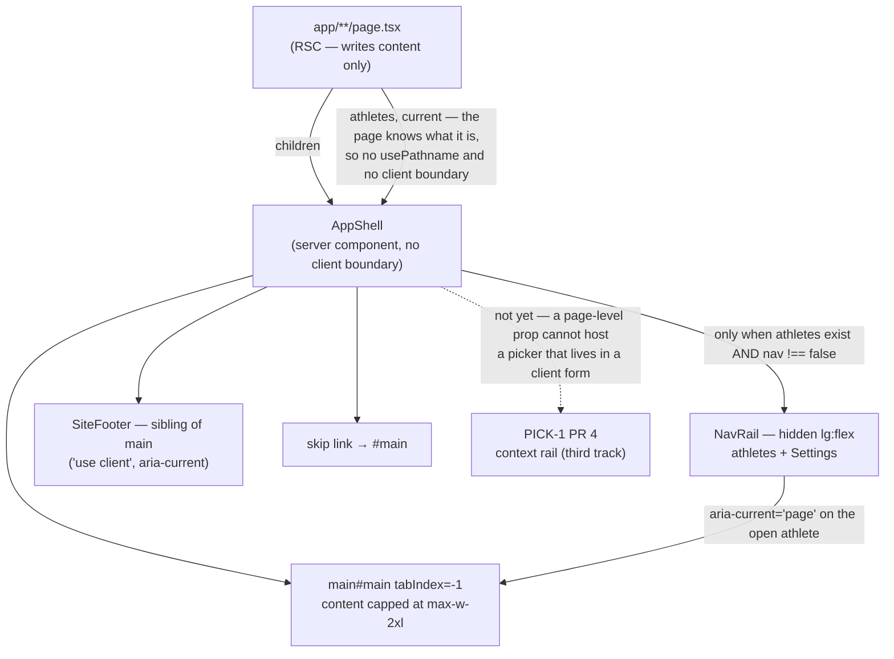

⚠️ **`/p` passes `nav={false}`** in all three of its states: it _is_ the athlete switcher, so a rail
there would render a second link to every athlete beside the tile it duplicates. The no-household
branch was already excluded for the adjacent reason — a rail pointing at the page you are on.

## 2h. Hide and restore — what "delete" does to a row (V1-9b B1-1)

`deleted_at` is a tombstone, not a deletion: the row keeps its values, its `public_id`, its
`created_at` and its `client_id`, and stays restorable until `PRIV-3`'s purge. The invariants and the
full reader audit are in [delete-and-restore.md](./features/delete-and-restore.md); this is the shape.

🔴 **Two things decide everything else here.** A hide event is `(profile, day, deleted_at)` carried
as **fixed-format UTC text** — one transaction shares one `now()`, so a folded row is one event, and
the token never passes through a JS `Date` (Postgres keeps microseconds, a `Date` keeps
milliseconds). And `ON DELETE CASCADE` is **hard-delete only**, so a hidden entry keeps **live
children**: every reader must reach ownership through the parent, or it returns the sets of a row
the person deleted.

**The app's first caller (V1-24 3b-bw).** A blank Save on a weigh-in reaches `writers/hide.ts`
through `writers/single-value.ts`'s `clearBodyweight`: it opens the transaction, locks the one row
`FOR UPDATE OF entries`, compares unit and seen-value after the lock (a concurrent amend answers
`stale`), and calls `hideEntries` for that row on its own day. The diagram below is the general shape;
the clear is one item, with no restore offered for it.

**Clear this day (V1-9b B2-0).** `clearDay` hides every live entry of the day as one event and
stamps each `hide_reason = 'clear_day'`; `restoreClear` brings back exactly that event's rows. Both
work out the rows on the server (no id list, no cap). Every un-hide sets `UNHIDE`, so the reason
leaves with the tombstone, and a CHECK refuses a live row that kept one. **B1-2:** one predicate
(`clearEventOn`, `queries/clear-events.ts`) serves `clearDay`'s replay, `restoreClear` and the
banner's read `clearEventsForDay` (every clear of a day, newest first, as a token and a count), so the
banner offers exactly what Restore all restores. Restore all's action answers counts, counted in the
DAL so no `heldBy.value` leaves it; 0 and 0 means nothing left to restore. The diagram below gains
the banner when B2 renders it.

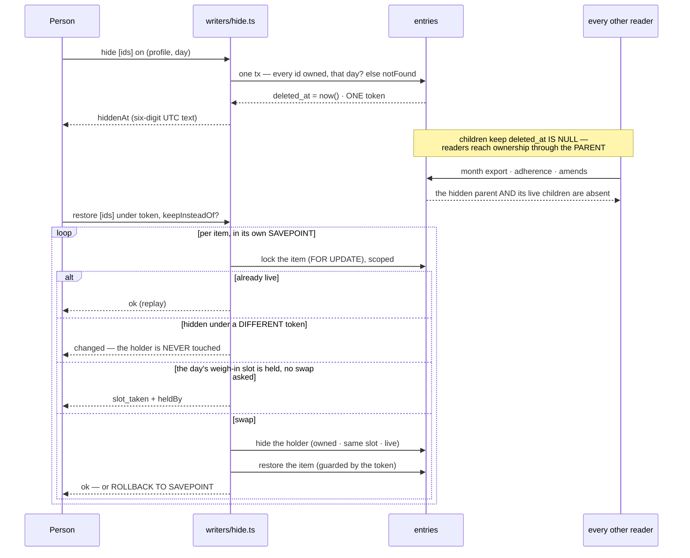

⚠️ **The savepoint is the half-swap guard.** "Use this one instead" hides a live weigh-in to make room
for the one being restored; without a per-item savepoint, a restore that then failed would commit the
holder's hide and leave the item hidden too — the person loses both. A refusal therefore leaves by
`throw`, because returning it would commit.

## 2f. The `prescribed` column — frozen at log time, live only as a fallback (V1-22 chunk 2)

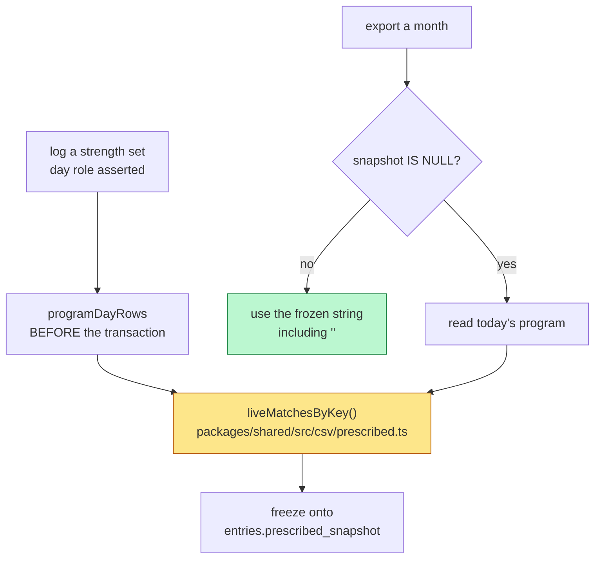

🔴 **The highlighted node is one function with two callers, and that is the point.** Both paths must
answer "what was prescribed" identically; while the composer was private to a `server-only` async
function, `packages/db` could not call it and the agreement could only be asserted by a test.

⚠️ **`''` is an answer, not a missing value** — it is what an `open()` prescription renders, and 11 of
the 13 seeded are open. Only `IS NULL` takes the fallback branch. NULL means "logged before chunk 2,
or logged with no day role"; everything else freezes, so chunk 4's edits cannot rewrite history.

**Since FAM-1 11b the snapshot has two freezing paths.** The flow above is the strength writer's (a
day-role prescription, matched by movement). A program row (§2i) freezes its own prescription's text
inside its transaction, through `prescribedText` (`@mat-plan/shared/program/prescribed-text`), the
renderer the day page and the export share; its `''` (a Check) is the same real value as above. The
export's NULL fallback reaches only the first path's rows: a program row is never written NULL.

## 2i. Logging a program row — `logRow` (FAM-1 11b)

```mermaid
sequenceDiagram
  autonumber
  participant A as Server Action (12b)
  participant W as logRow (packages/db)
  participant DB as Postgres (one transaction)
  A->>W: scope, today, workout_item id, RowWrite
  W->>DB: profile in scope (isLiveProfile); archived?
  Note over W: outside the window (today, yesterday) → closed_day
  W->>DB: who holds clientId? (unguarded, pinned)
  alt held by this write
    DB-->>W: live → ok with stored values · hidden → own_hidden
  else held by anything else
    DB-->>W: not_found
  end
  W->>DB: workout: templateBlockIn(scope) ∧ programBlockOfProfile
  W->>DB: prescription IN that workout + live quantities
  W->>DB: movement available to the household
  W->>DB: scheduledOn(block, workout, weekday of the day)
  Note over W: set and values: fillRowValues(prescribedTarget) → else bad_value
  W->>DB: INSERT session ON CONFLICT DO NOTHING → re-select exactly one
  W->>DB: INSERT superset (if grouped) → re-select exactly one
  W->>DB: INSERT entry ON CONFLICT DO NOTHING (client_id, row arbiter)
  alt not inserted
    W->>DB: classify the holder again; else a live row on the set → slot_taken
  else inserted
    W->>DB: INSERT entry_sets + entry_set_quantities
  end
  W-->>A: RowResult (a refusal after an insert rolls back by RowRefused)
```

🔴 **The order is the contract**, and every step has a `db:verify` proof with its own mutation
(`scripts/verify/day.ts`). The replay answers before the program checks, so a retry after the program
changed answers as the first call did. A refusal is thrown as `RowRefused` and caught at the
transaction's edge, so a session the call created is never left behind. Un-tick and re-tick are the
same profile and window steps, then `hideEntries` / `restoreHidden` (§2h) on a program row of that
athlete and day only. Step 8, "on the program that day", is `isOnProgramThatDay`, on the same
`onProgramOn` conjunct the day resolver reads (§2d), so the page and the ✓ agree.

## 2d. Program read path — the day resolver, `resolveDayPlan` (FAM-1 12a)

An athlete and a day → the `DayPlan` the day page shows (`packages/shared/src/program/day-shapes.ts`),
every field but `athletes`, which 12b's DAL adds. A read only, in `packages/db/src/queries/day/`; the
invariants are in [day-writers.md](./features/day-writers.md) (E1–E7) and the decisions in
[the plan](./plans/fam-1-12a-day-resolver.md).

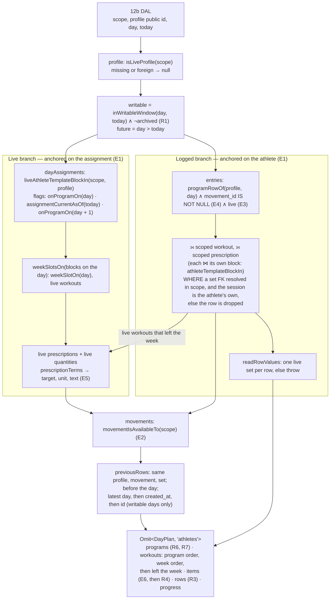

🔴 **Two anchors, one scope.** What is on the day comes from the athlete's assignments on live template
blocks of the scope and of the athlete's own household; what was logged comes from the athlete's own
program rows, whose workout and prescription pointers are resolved through scoped subqueries. A
pointer that is set but does not resolve in scope (runbook pre-flight (f), (g)), or a session of
another profile ((i)), drops the row; a NULL one (a purge) keeps it with null ids. A logged workout of
a hidden program or a hidden workout carries an id only for what is still live (C21); a live one logged
on a day no assignment covers any more keeps its ids, read from the live block (C24). A weigh-in, a practice or a check-in never enters a `DayPlan`
(E4). Every rule has a `db:verify` proof in `scripts/verify/day-plan.ts`, against the contract's
fixtures with ids mapped exactly.

> **The V1-10 program card before it** (`resolveDayRole` → `getProgramDay` → `programDayRows`) is
> unmounted from the day page since V1-24 3b-page (#418). `programDayRows` still feeds the export and
> the legacy snapshot writer (§2f) until FAM-1 12f deletes it; its history is in
> [ADR 0007](./decisions/0007-scheduling-model.md).

## 3. Offline outbox → sync

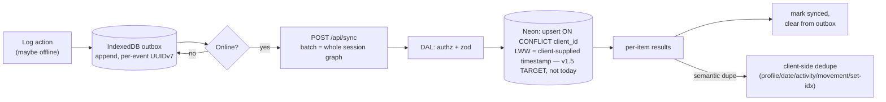

## 4. Data model — v1 generalized model (target of V1-1)

The concrete tables the v0 thin slice (`units · profiles · entries · entry_sets`) generalizes into.
`households` is the authz root; the catalogs (`activity_types · movements · metric_definitions`, all
keyed by natural keys and seeded from `@mat-plan/shared` in V1-2) classify each `entry`; `sessions`
group a training day's entries. Full column detail in [spec.md](./spec.md) §4a.

📌 **`household_members` (AUTH-1 1b) is how a person reaches a household at all**, and it ships
**dark**: nothing reads it until 1c replaces `getHouseholdScope()`'s body with
session → `household_members` → household. It holds Clerk's own `user_…` and **no email** — the
address lives in Clerk, which is the point of using Clerk. One partial unique index on
`clerk_user_id WHERE deleted_at IS NULL` is **both** the one-live-household-per-account rule and the
resolver's access path. ⚠️ Its FK to `households` is `ON DELETE NO ACTION`, which makes it the **19th**
table in the deletion runbook's hand-maintained order — step 13, before `households`, or the whole
delete transaction aborts.

⚠️ **`households` is the authz root for everything that hangs off `profiles` — and two of the three
catalogs hang off nothing.** Global is right for `activity_types` and `metric_definitions` (seeded,
never written by the app) and **was wrong for `movements`**, which the strength form writes from free
text. TEN-1 1d proved the consequence: one household's typed name resolved to another household's
row, the first typist pinned that slug's `name` / `is_bodyweight` / `unit_default` for everyone, and
the row survived a session write the household seam refused.

**`TEN-2a` added the edge the ERD below draws** — `movements.household_id`, nullable, where `NULL`
means _reference data owned by no household_ (the seeded catalog) and a value means _this household
typed this name_ — plus the two partial unique indexes that give the table two namespaces.
✅ **`TEN-2b` lit it up**, so the edge is now in the behaviour as well as the schema: the resolver is
global-first (flowchart below), `seedProgram` reads the global namespace only, and the FK is
validated. **Two of 1d's three defects are closed**: a refused session's row lands in the caller's own
namespace, and a prescription can no longer resolve another household's movement — `seedProgram`
refuses loudly instead.

🔴 **One is not, and it is a schema window, not a code gap.** While the **non-partial**
`movements_slug_unique` lives, at most one row per slug exists in the whole table, so two households
cannot both hold one. `TEN-2a` chose, for that window, to hand the second household the first's row
(the pre-existing read leak) rather than fail its write forever with `23505` — availability over
confidentiality, bounded by the named invite precondition. ⚠️ **Its price:** the resulting
cross-household `entries.movement_id` **aborts the household-deletion procedure** (`23503`, measured),
which is why `runbooks.md` pre-flight (d) carries a repair step and `schema.ts` no longer claims the
reference is "prevented by construction". **`TEN-2c` dropped the constraint, and `db:verify` now
asserts pre-flight (d) reads ZERO across `entries` and `prescriptions` while step 11's `DELETE`
completes instead of aborting** — both assertions inverted rather than retired.

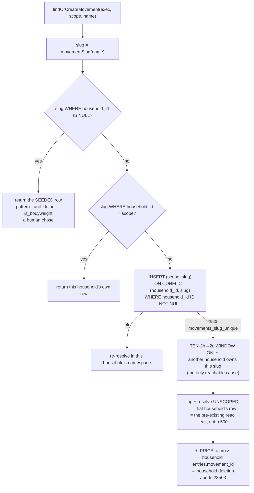

**Why global-first and not household-first** — the question a reader will ask: the only writer can
author `{publicId, slug, name, isBodyweight: false}` and never `pattern` or `unit_default`, so a
household row is always a **strictly worse** version of a curated one, and `programDayRows` reads
exactly those columns as _"the movement's declaration"_.

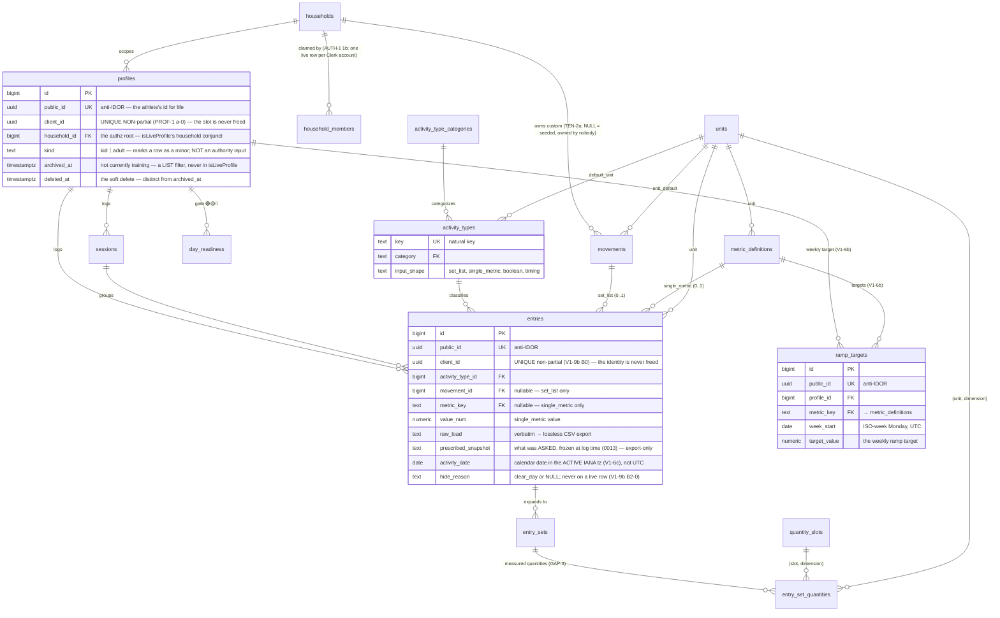

> **Ramp targets (V1-6b):** `ramp_targets` holds a per-profile, per-week TARGET value for a calisthenics
> metric, so weekly adherence (actual `entries` vs target) is computable in **SQL** (spec.md §4). A
> coach-authored weekly calendar, not engine-computed progression — see
> [ADR 0002](./decisions/0002-calisthenics-ramp-targets.md). Config data → no `client_id`; idempotency
> is the partial natural-key UNIQUE `(profile_id, metric_key, week_start) WHERE deleted_at IS NULL`.

> **Tagged union (V1-1b):** an `entry` carries **at most one** of `{movement_id, metric_key}` —
> `CHECK (movement_id IS NULL OR metric_key IS NULL)`. `boolean`/`timing` activities (e.g. `wake`,
> `brain_rep`) reference **neither** and are typed by `activity_type_id` alone.

### 4a. How one activity maps to an entry (the tagged union)

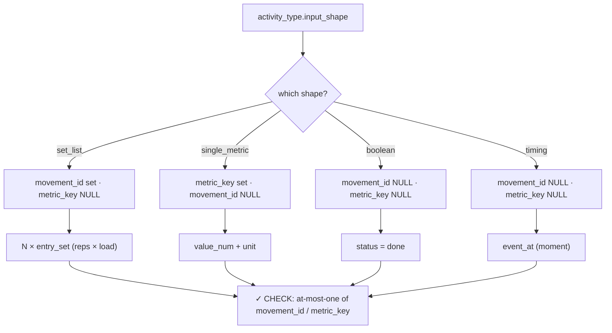

### 4b. The program tables (FAM-1, through step 5)

A household's program is a `program_blocks` row (`kind` is `template` for a block built in the
app, `legacy` for the seeded one). Its workouts are `workouts`; the week template places them on weekdays through
`block_day_workouts`; a workout's items are `prescriptions`, with typed targets in
`prescription_quantities`. Two links run from the log side back to the plan: `sessions.workout_id`
and `entries.prescription_id`. Both are `ON DELETE SET NULL` and identity only: what was asked
is frozen on the log row (`sessions.workout_name`, `entries.prescribed_snapshot`), so a rename or
purge never rewrites history. Who is on which program is `program_assignments` (FAM-1 step 5): one
row per athlete and program from `active_from` through `active_to` (inclusive; NULL while open), with
`program_assignment_weekdays` saying which days it is due. A template block reaches an athlete only
through an assignment; "on day D" and "due on D" are spelled once, in
`packages/db/src/queries/program-assignments.ts`.

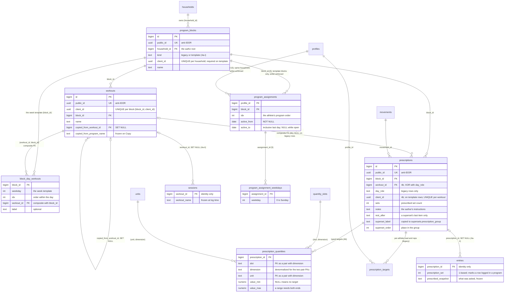

## 5. Deploy & CI topology

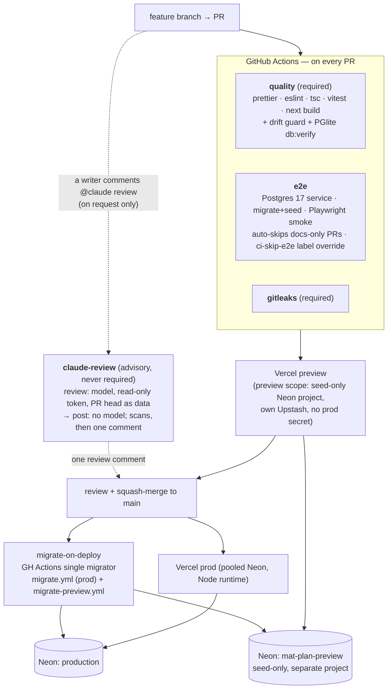

> `e2e` soaks as non-blocking until **PR 28**, then becomes a required check. Squawk (migration lint)
> and a Neon-branch apply are documented gates not yet wired into `ci.yml` (a follow-up).
>
> ⚠️ **Previews do NOT get a Neon branch of production, and never did.** This diagram said
> "Neon branch (prod-shaped)" in the present tense for months. A preview reads a **separate,
> seed-only Neon project** — a branch is a copy-on-write clone, so it would put every family's
> bodyweight in every preview ([OPS-1](./plans/ops-1-preview-isolation.md)). The unwired
> prod-shaped rehearsal is a different thing, and when it is built it must branch the **preview**
> project or use an anonymized snapshot, for the same reason.

## 6. Roadmap to MVP and beyond

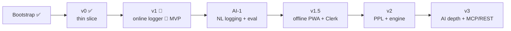

## 7. v1 build order & parallelization

The serial spine (schema → catalogs) must land first; then the feature slices are additive on the
settled model and **fan out in parallel**, before the serial tail (edit → prefill → export → capstone).

```mermaid
flowchart LR
  V11["V1-1<br/>generalize schema<br/>(a → b → c)"] --> V12["V1-2<br/>seed catalogs<br/>+ coverage test"]
  V12 --> BAND
  subgraph BAND["parallelizable — additive on the generalized model"]
    direction TB
    V13["V1-3 profile tiles"]
    V14["V1-4 weigh-ins"]
    V15["V1-5 checkins / habits"]
    V16["V1-6 calisthenics totals"]
    V17["V1-7 life activities"]
    V18["V1-8 strength session"]
  end
  BAND --> V19["V1-9 fix-a-set (LWW)"]
  V19 --> V110["V1-10 block-template prefill"]
  V110 --> V111["V1-11 copy-set-to-kid"]
  V111 --> V112["V1-12 a11y pass"]
  V112 --> V113["V1-13 CSV export"]
  V113 --> V114["V1-14 full-day E2E<br/>🎯 MVP complete"]
```

> Migrations serialize by rule (one per PR, drift-checked, forward-only), so schema-touching PRs stay
> on the spine; the parallel band is app-layer (no new migrations). The **training-log day**
> (`2026-07-20`) becomes fully loggable once V1-4 + V1-8 + V1-5 + V1-6 land, and V1-13 exports it.

## 8. Household deletion — the only path that removes rows (PRIV-1)

The procedure is [runbooks.md](./runbooks.md) → "Delete a household and everyone in it"; this is its
shape. It spans three systems and is irreversible, which is why the ordering is drawn rather than
left in prose. Two edges carry the non-obvious constraints: **Clerk ids are captured before the
transaction** (after AUTH-1 the mapping lives in the rows the transaction destroys), and **`entries`
is deleted before `sessions` and `supersets`** (it holds FKs to both).

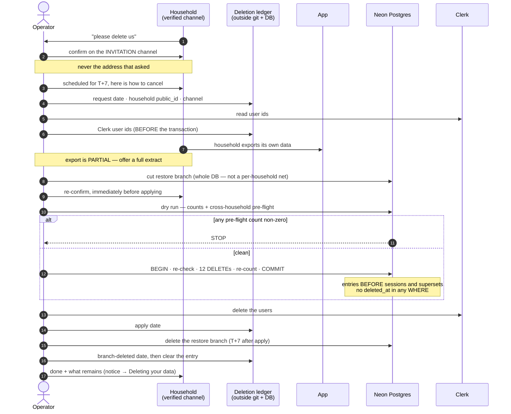

⛔ **Two preconditions this diagram assumes**: the household is **not in the seed** (`db:seed` runs on
every merge and would re-create it — `OPS-2`), and **`OPS-3`'s per-household restore has been
rehearsed** (without it a mistaken deletion is not practically recoverable, because the branch above
restores _everyone_).

### 8a. The erasure graph — one list, read by every deletion (PRIV-3)

`PRIV-3` turns the step-4 table above into code: `HOUSEHOLD_GRAPH` in
`packages/db/src/erasure/graph.ts`, proved against the catalog by `db:verify` (P1, P2, P7, P8 in
`packages/db/scripts/verify/erasure.ts`). The guide is [erasure.md](./features/erasure.md). Only the
graph exists today; the core, the two corrections and the ledger replay are planned (PRIV-3 PR 2a, 2b
and 3). The athlete grain is the graph's 11 tables reachable from `profiles`, which is `ATHLETE_GRAPH`.

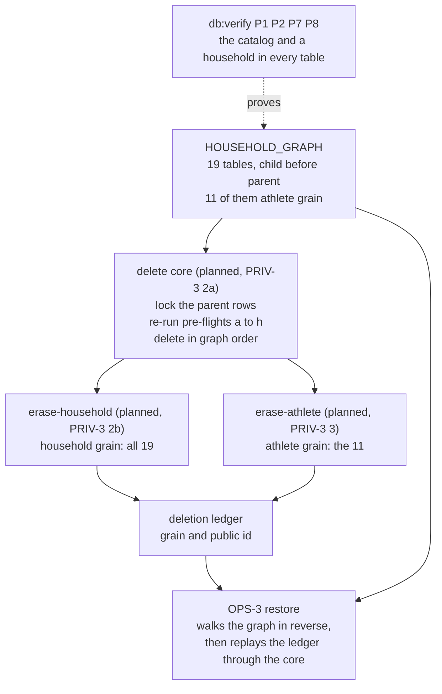
