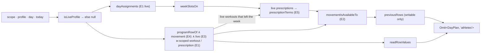

# Day writers and reads

**Read this before adding or changing how a program row is logged, changed or read back for a
day.** This is **lane E** of the [FAM-1 plan](../plans/fam-1-family-program.md) (§5, "Lane E").

## What this is

An athlete ticks a row of a workout and it is logged: one writer for every tracking type, a second
that changes a logged row's numbers, and the resolver that turns an athlete and a day into the
`DayPlan` the day page shows. The lane starts when the plan's migration 4a-ii is applied.

🚧 **Steps 11a, 11b, 12a-i and 11c-i are in** (the row writer, with its un-tick and re-tick; the
day resolver and PREVIOUS; Change), and 12a-ii's replays; 11c-ii and 14 add their files, diagrams and
invariants here. The row
writer's sequence diagram is [architecture.md §2i](../architecture.md), the day resolver's read path
[§2d](../architecture.md) and [below](#the-read-path); the plans are
[fam-1-11b-row-writer.md](../plans/fam-1-11b-row-writer.md) and
[fam-1-12a-day-resolver.md](../plans/fam-1-12a-day-resolver.md) and
[fam-1-11c-change-and-revive.md](../plans/fam-1-11c-change-and-revive.md).

## The map

| Step | Adds                                                                                                                                                                  |
| ---- | --------------------------------------------------------------------------------------------------------------------------------------------------------------------- |
| 11a  | `writers/session-rows.ts`, extracted from the strength writer. A seam: it owes [write-path.md](./write-path.md) and [strength-logging.md](./strength-logging.md).     |
| 11b  | `writers/day/log-row.ts`, `queries/day/{scheduled,stored-row-values}.ts`. Seams: `hide.ts` (lane S), `ownership.ts`, `session-rows.ts`, `unique-violation.ts`.        |
| 12a  | `queries/day/{day-plan,previous,prescription-terms,program-rows}.ts`, `scripts/verify/day-plan.ts`: the day resolver and PREVIOUS (12a-i); the edit replays (12a-ii). |
| 11c  | `writers/day/{amend-row,row-steps}.ts`: Change (11c-i), with the steps it shares with the ✓; the D35 revive in `log-row.ts` (11c-ii). Seam: `session-rows.ts`.        |
| 14   | The export. Seams: `apps/web/lib/dal/export.ts`, `queries/export-month.ts`, `packages/shared/src/csv/`.                                                               |

## Files

| File                                                  | What it is for                                                                                                                                                                                                                                                                                                                                                                                                                                                                                                                                                                                                                                                                                                                                               |
| ----------------------------------------------------- | ------------------------------------------------------------------------------------------------------------------------------------------------------------------------------------------------------------------------------------------------------------------------------------------------------------------------------------------------------------------------------------------------------------------------------------------------------------------------------------------------------------------------------------------------------------------------------------------------------------------------------------------------------------------------------------------------------------------------------------------------------------ |
| `packages/db/src/writers/day/index.ts`                | The directory's exports: `logRow`, `untickRow`, `retickRow` and `amendRow`, re-exported from the package index for steps 12b's and 12d's actions.                                                                                                                                                                                                                                                                                                                                                                                                                                                                                                                                                                                                            |
| `packages/db/src/writers/day/log-row.ts`              | **The row writer** (11b): the three writers, `classifyRowHolder`, `rowWorkout`, `RowRefused`. It imports its conjuncts from `queries/day/program-rows.ts` and its prescription's terms from `queries/day/prescription-terms.ts` (12a moved both out, so a read never imports the row writer, `writers/day/`). It refuses `closed_day` on `rowDayOpen` and finds the workout on `athleteTemplateBlockIn` and `workoutIsLive` (`writers/ownership.ts`), the resolver's own rules.                                                                                                                                                                                                                                                                              |
| `packages/db/src/writers/day/row-steps.ts`            | The steps the row writers share (11c-i, plan S1): `RowRefused`, `refuse`, `rowTransaction`, `openProfile`, `storedValues`, `fitsItsType`, and `rowItem` (steps 5 and 6: the prescription, pinned to its workout, and its movement under `movementIsAvailableTo`). Not exported from the directory.                                                                                                                                                                                                                                                                                                                                                                                                                                                           |
| `packages/db/src/writers/day/amend-row.ts`            | **Change** (11c-i): `amendRow(db, { scope, today, input: RowAmend })`. One scoped, locked read of the entry (this athlete's, a program row, in the athlete's own session), the window from the entry's day, then the ✓'s own workout, schedule and `rowItem` checks (steps shared through `row-steps.ts`'s `ById` selectors), the values against the unit the row was LOGGED in (`loggedRowUnit`, C28), and an in-place write through `updateEntrySetRows`. Mutations 348–356 and 358–363 (357 is 11c-ii’s).                                                                                                                                                                                                                                                 |
| `packages/db/src/queries/day/program-rows.ts`         | The day's row conjuncts: `programRow` (`prescription_set IS NOT NULL`), `programRowOf(profileId, day)`, and the natural keys `workoutSessionSlot`, `workoutSupersetSlot`, `programRowSlot`.                                                                                                                                                                                                                                                                                                                                                                                                                                                                                                                                                                  |
| `packages/db/src/queries/day/prescription-terms.ts`   | E5: `liveQuantities` (numeric conversion, two-in-one-slot throw) and `prescriptionTerms` (`target`, `itemUnit`, the one renderer's text). The row writer's snapshot and the resolver's heading both call it.                                                                                                                                                                                                                                                                                                                                                                                                                                                                                                                                                 |
| `packages/db/src/queries/day/day-window.ts`           | `rowDayOpen(day, today, archivedAt)`: inside the writable window and not archived. The writer's `closed_day` and the resolver's `writable` (R1).                                                                                                                                                                                                                                                                                                                                                                                                                                                                                                                                                                                                             |
| `packages/db/src/queries/day/day-plan.ts`             | **The day resolver** (12a): `resolveDayPlan(exec, { scope, profilePublicId, day, today })` → `Omit<DayPlan, 'athletes'>`, or `null` for a profile not live in scope. Also `currentPrograms` (R7), for 6c.                                                                                                                                                                                                                                                                                                                                                                                                                                                                                                                                                    |
| `packages/db/src/queries/day/previous.ts`             | PREVIOUS: `previousRows(exec, profileId, day, keys)`, one query for the day, keyed on movement and set (R5).                                                                                                                                                                                                                                                                                                                                                                                                                                                                                                                                                                                                                                                 |
| `packages/db/src/queries/day/prescription-live-in.ts` | `prescriptionLiveIn(exec, scope, prescriptionPublicId)`: whether a public id names a live prescription of one of this household's live programs (`liveTemplateBlockIn`); a malformed id is `false`. The prescription half of 12b's scope-miss report, asked after lane P's `workoutInHousehold` (`queries/program/exists.ts`, #545), in the writer's order. Exported from the package by name. Mutations 251–254.                                                                                                                                                                                                                                                                                                                                            |
| `packages/db/src/queries/day/scheduled.ts`            | `scheduledOn(blockId, workoutId, day)`: a live week slot on the day's weekday (`localWeekday`), as a conjunct; `isScheduledOn(exec, …)` asks it as a boolean (the ✓ and the un-tick). The writer, 11c and the resolver's week read (`weekSlotsOn`) share its half that names no workout, `weekSlotOn(day)`. `isOnProgramThatDay(exec, profileId, blockId, day)`: step 8, "the athlete is on this program on this day", on `onProgramOn(profileId, day)` (step 5's `assignmentOnDay`; on the program, not due on the weekday; see its docblock), the conjunct the resolver reads too. 12a adds `weekSlotOn`, `dayAssignments` (E1's live anchor) and `weekSlotsOn`; the step-5 tables are named in this one lane E file (`program-tables-stay-dark.test.ts`). |
| `packages/db/src/queries/day/stored-row-values.ts`    | `readRowValues`: a logged row's live set and its live quantities, as `RowValues`. Throws on two live sets (D3). A second copy of the DAL's read (`docs/tech-debt.md`).                                                                                                                                                                                                                                                                                                                                                                                                                                                                                                                                                                                       |
| `packages/db/src/writers/day/owed.test.ts`            | The lane's `it.todo` list: the tests steps 12a-ii, 11c and 14 still owe the contract. Delete a line in the PR that writes its test.                                                                                                                                                                                                                                                                                                                                                                                                                                                                                                                                                                                                                          |
| `packages/db/src/queries/day/index.ts`                | The directory's exports. **The package index re-exports only `prescriptionLiveIn` (a public-id read), and `resolveDayPlan` and `ResolvedDayPlan`, by name (E7)**, never `export *`: the other functions take internal ids the caller must already have proved owned.                                                                                                                                                                                                                                                                                                                                                                                                                                                                                         |
| `packages/db/scripts/verify/day.ts`                   | The lane's `db:verify` proofs: 11b's, then 11c-i's (`verifyAmend`), then `verifyDayPlan`. Its header lists what each step owes. The end-of-proof sweep reads lane A's (f), (g), mismatched-pair, session-type and day-role detectors, and runbook pre-flight (i) (`entriesInAnotherProfilesSession`, shared with `./day-plan.ts`).                                                                                                                                                                                                                                                                                                                                                                                                                           |
| `packages/db/scripts/verify/day-plan.ts`              | 12a's proofs (12a-i's fixtures and rules; 12a-ii's replays, `verifyReplays`, and the rules only a replay reaches, `verifyReplayRules`: R2's two halves, the closed-day heading, R4's own-item, key and lowest-set text, one movement twice; mutations 255–259 and 340), and 12b's `prescriptionLiveIn` proof (the end of `verifyRules`): the fixture seeder (direct inserts in reverse order, entries through `logRow` in descending `n`, rising hand-written `created_at`), the exact-id comparison and round trip, and the rules no fixture reaches (ownership (f)/(g)/(h), E2, PREVIOUS, hidden rows, E6, R7, look-ahead, E4).                                                                                                                            |
| `packages/db/scripts/verify/fixture-groups.ts`        | The fixture lists the proofs share: `FIXED_WORLD_FIXTURES`, `ARCHIVE_ONLY_FIXTURES` and 12a-ii's `REPLAY_FIXTURES`.                                                                                                                                                                                                                                                                                                                                                                                                                                                                                                                                                                                                                                          |

## Invariants

1. 🔴 **New files go in these three paths. Anything else the lane touches is a seam** with a merge
   order in the plan's §6 table: `session-rows.ts`, `hide.ts` and the export files owe
   [write-path.md](./write-path.md) or [delete-and-restore.md](./delete-and-restore.md)
   (`session-rows.ts` also owes [strength-logging.md](./strength-logging.md)), one PR in
   review at a time with lane S. The lane never edits `schema.ts`; a missing column is a **column
   request** to lane A.
2. 🔴 **The resolver deep-equals every `DayPlan` fixture**, with ids mapped exactly: the seeder
   returns fixture id → the `public_id` each insert returned, the fixture is translated through it
   (an unknown UUID throws), and `assert.deepStrictEqual` compares after a JSON round trip. **Never
   through `normalize-fixture.ts`**, which relabels every UUID and would let a returned `client_id`
   pass. 12a-i proves the eleven fixtures with no `before`, and the two whose only change is an archive (`archived-athlete-today`, `archived-athlete-nothing-logged`); 12a-ii the other four, **replayed** after logging, three through lane P's writers and the reorder by a direct `idx` update (Q6) (plan 12a § 12a-ii, and its Built notes). The shapes and fixtures are
   [the contract's](./program-contract.md); a shape that is wrong or short is a contract change,
   not an edit here.
3. 🔴 **The prescribed text a row is frozen against comes from one renderer**,
   `@mat-plan/shared/program/prescribed-text`. The day page, the row's snapshot and the export all
   call it.
4. **Every refusal is a typed `RowResult`, never a throw**, and the reasons are the contract's
   `ROW_REFUSALS`. The preview route's fake answers the same reasons by the same rules
   (`apps/web/app/design/program/fakes.ts`), so a difference between the two is a bug in one.
5. **Every proof goes in `verify/day.ts` or `verify/day-plan.ts`**, never in `verify.ts` or another lane's module. **Another lane** that needs a real program row builds lane E's fixture through the exported `programRowFixture(tx)` (`verify/day.ts`), rather than a copy; its own proofs stay in its own module (lane S's B2-0 is the first).
6. **Start on open, merge on applied** (plan §6).
7. **[write-path.md](./write-path.md)'s invariants still apply to these files**, though the guide
   gate no longer sends a PR there: ownership proven by `public_id` inside the transaction (2), the
   writer shared with `db:verify` (3), and idempotency by a client id, a database UNIQUE and
   `ON CONFLICT` (5).

8. 🔴 **The row writer's check order is the contract**: profile (archived → `closed_day`) → window
   (`inWritableWindow`, D32) → replay → workout → prescription → movement → scheduled → on the
   program that day → set → values → writes. Every step has a proof in `verify/day.ts`, and every one but two has a
   mutation that turns it red (`scripts/mutations/README.md`, 110–119, 121–129 and 170–186; 120 is unused). The two:
   the quantity's derived `dimension` in
   `insertEntrySetRows` has no patch of its own, because hard-coding it reddens `verify.ts`'s GAP-3
   hold proof first; and the replay pin's `prescription_set IS NOT NULL` (3d) is implied by
   `prescription_set = write.set`. Reorder nothing without moving its proof.
9. 🔴 **The replay answers first, and it is pinned.** `classifyRowHolder` finds the entry holding the
   `clientId`, live or hidden (unguarded, so a hidden holder answers `own_hidden`, D18), and it is
   this write only if it is `programRowOf(profile, day)` for this set, prescription and workout.
   Anything else answers `not_found`, never `ok` with another row's values (3c–3h). A replay after a
   purge answers `not_found`: the purge cleared `prescription_id`.
10. **`programRowOf(profileId, day)` is "a program row of this athlete on this day"**
    (`prescription_set IS NOT NULL`): the one conjunct for the pin, un-tick and re-tick, so a weigh-in
    is never reached through a row action (10a, 10b).
11. 🔴 **A refusal reached after the first insert leaves by `RowRefused`**, thrown inside the
    transaction and caught at its edge (`hide.ts`'s `ItemRefused` pattern), so a session or superset
    the call created is rolled back. Every refusal uses it. Proved on one connection by 8a: a ✓
    whose fresh superset insert is followed by the row arbiter's `slot_taken` leaves no superset
    (mutation 178 returns the refusal instead of throwing it). Only a concurrent double-fire, which
    reaches the insert's classification from a race, needs a second connection.
12. **Ownership.** Every public id resolves inside the scope; the workout lookup also ties the block
    to the profile's own household (`programBlockOfProfile`, runbook pre-flight (f), proof 4d,
    mutation 111), so it holds whatever a scope widens to. A foreign id, hidden or not, answers
    `not_found`. ⚠️ **`not_found` is uniform for public ids, not for `clientId`**: a `clientId` held
    by another household's row also answers `not_found`, which tells a caller the id is in use.
    Guessing one needs the 74 random bits of a UUIDv7, so that is accepted, and said here rather than
    claimed away.

13. 🔴 **E1 — two anchors.** The resolver's live branch starts from the athlete's assignments, on
    `liveAthleteTemplateBlockIn(scope, profileId)` (`dayAssignments`; mutation 246 drops it, which
    the planted (h) proof catches). Its logged branch starts from `programRowOf(profileId, day)`, and
    LEFT JOINs a SCOPED workout and a SCOPED prescription, each joined to its OWN block under
    `athleteTemplateBlockIn(scope, profileId)` (`writers/ownership.ts`: `templateBlockIn` ∧
    `programBlockOfProfile`, one spelling for the writer and the resolver). **The drop is a WHERE on the raw FK testing the subquery's projected
    id**: `(sessions.workout_id IS NULL OR scoped_workout.id IS NOT NULL) AND (entries.prescription_id
IS NULL OR scoped_prescription.id IS NOT NULL)`. A foreign pointer (runbook (f), (g)) drops the
    row; a purged (NULL) one keeps it with null ids. Never move the scope into an ON clause, which can
    only null the joined columns. Mutations 234, 235. ⚠️ After a purge, foreign and purged look
    alike; pre-flight (f)/(g) is then the only control. A purged workout's rows show with null ids
    and the session's frozen name (mutation 245). **And the session must be the athlete's own**
    (`entries.session_id IS NULL OR sessions.profile_id = the athlete`, runbook (i), mutation 242),
    so another profile's session never lends its frozen name.
14. **E2 — the movement is read under `movementIsAvailableTo(scope)`** (one read, for live items and
    logged rows), so an item is absent exactly where the writer answers `not_found`. Mutation 236.
15. **E3 — a hidden entry is never a logged row**, and a session counts only through its live
    entries. A live entry with no live set throws, with internal ids only. Mutation 231.
16. 🔴 **E4 — program rows only**: the day read adds `entries.movement_id IS NOT NULL` beside
    `programRowOf` (not inside it: 11b relies on its behaviour). A weigh-in, a practice or a check-in
    never enters a `DayPlan`, even one carrying a `prescription_set` and a live session. Bodyweight
    is privileged. Mutation 238.
17. **E5 — one function for a prescription's terms**, `prescriptionTerms`: the page's live heading
    and the row's frozen snapshot cannot diverge.
18. **E6 — superset placement**: a group sits at its first member's `idx`; members by
    `(superset_order, idx)`; `superset.order` is the place in the group; a rest only for a shown group
    of two or more, off its last member. Mutations 232, 244, 249.
19. **E7 — exports**: `resolveDayPlan`, its type and `prescriptionLiveIn` (which takes a public id), by name only.
    **C21 — ids only for what is live**: a logged workout under a hidden program or a hidden workout
    shows like one that left the week, but built from its entries alone (no description, every item a
    removed item, progress 0 of 0; mutation 248), with `programPublicId` only while its block is live
    and `workoutPublicId` only while the workout and its block are (mutation 247).
    **C24 — the ids come from the live block, not the day's assignments**: a live workout of a live
    program, logged on a day no live assignment covers any more, shows as left the week with both
    ids, its description, live items and count, and its program is not in `programs` (mutation 250).
    So only a SCHEDULED workout's program is always one of `programs`; `verify/day-plan.ts`'s
    `resolve()` asserts that on every read.
20. **R1 in one place**: `future` first (the preview, no rows, archived or not; mutation 239); else
    `writable = rowDayOpen(day, today, archivedAt)` (`queries/day/day-window.ts`, the writer's rule
    too; mutation 240 drops the archive at the resolver's call); else logged rows only, and a workout
    with none is absent (mutation 241). An archived athlete's day shows only what was logged
    (`archived-athlete-today`). A workout that left the week has `label: null` (R2).
21. **PREVIOUS** (`previous.ts`): the same `profile_id` (mutation 230), movement and set; a live
    program row before the day; the latest day, then `created_at`, then id. `null` on a day that is
    not writable and on a removed item. A hidden row is skipped (mutation 243). Its program-row
    conjunct has no mutation of its own: the `prescription_set = N` key implies it.
22. **Look-ahead** reads `onProgramOn(day + 1)` (mutation 237); `onProgram` reads `onProgramOn(day)`
    (mutation 233), the conjunct `isOnProgramThatDay` uses, so the page and the ✓ agree.
    `programBlockOfProfile` in the logged join has no mutation through the resolver (the profile's
    household always equals the scope's there); it is proven in 11b's 4d (mutation 111).

23. **Change (`amendRow`) runs the ✓'s own steps, in the fake's order** (plan 11c A1), each with
    the mutation that proves it:
    - `not_found`: a hidden row (349); another athlete's row under this athlete's id (350); a row in
      another athlete's session, runbook (i) (351); not a program row (358); a row on another
      household's workout, refused only by `rowWorkout`'s scope (359). Another household's profile,
      or an unknown one, stops at `openProfile` (`isLiveProfile`): a second guard behind
      `rowWorkout`'s scope, proved by assertion only, since no patch can redden it through Change.
    - `closed_day`: the entry's own day outside the window, or an archived athlete (348).
    - `not_scheduled`: off the week (354); a purged workout (352). The workout is read through
      `rowWorkout` BEFORE the schedule, so a foreign block's week is never read.
    - `program_changed`: a hidden workout or block (355); a purged prescription (363). A hidden
      prescription is `rowItem`'s refusal, proved by 11b.
    - `bad_value`: a number not in the unit the row was LOGGED in, or a blank (353; C28). The
      prescription's own fit (`fitsItsType`) is NOT checked: Change judges the row as logged.
    - The write is `updateEntrySetRows` (`session-rows.ts`): the one LIVE set (356) and its
      quantities by slot and stored unit, each UPDATE asserting one row, `updated_at` advanced to
      server `now()` on the set, its quantities and the entry (360–362). The text the row was logged
      against is kept. The unit conjunct is defence in depth: `amendRow` refuses another unit first,
      so no patch can redden it through Change.

### The read path

## Fake parity

The preview's fake (`apps/web/app/design/program/fakes.ts`) and the writer answer the same input the
same way, except:

- The fake has no household or archive, so `not_found` for a foreign id and `closed_day` for an
  archived athlete are the writer's alone. The fake answers `program_changed` for an unknown
  workout; the writer, `not_found` (it cannot tell unknown from foreign).
- A replay after the window has closed answers `closed_day` in both. A replay after a purge answers
  `not_found` in the writer only (the fake has no purge).
- **A mismatched workout and prescription** answers `program_changed` in the fake (the item is not
  in that workout) and `not_found` in the writer (plan M2).
- The writer answers the values **as stored**: `numeric(8,3)` rounds a quantity to three decimals,
  so 40.12345 answers 40.123, where the fake answers what was typed.
- The writer's "on the program that day" check (step 8) reads `program_assignments` through
  `onProgramOn` (`assignmentOnDay`); the fake reads it from the fixture. The resolver's `onProgram`
  reads the same conjunct.
- **Change** answers alike in both (C28 aligned the fake's unit to the row's stored one), but for
  the fake's missing household and archive, as above.
- ⚠️ **The item's unit is one rule**, `itemUnit` (`@mat-plan/shared`, C13): the type's fixed unit
  first, else the slot's prescribed unit. `DayItem.unit` calls it through `prescriptionTerms` for a
  live prescription (a removed one takes the unit its entry was stored in), so a row's placeholder
  and its ✓ agree.

## Changing it

Start from the step's row in the plan (§5) and the decisions it cites (D3 and D20 for how a row is
stored, D7 for a logged day, D13 for an empty ✓, D18 for a replay after Clear day). Re-run
`pnpm db:verify` and `pnpm db:mutations`.
