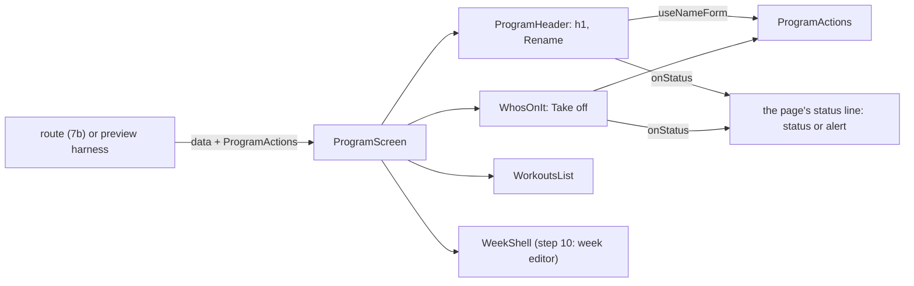

# The program builder

**Read this before changing a builder screen, its route or its data access.** This is **lane B**
of the [FAM-1 plan](../plans/fam-1-family-program.md) (§5, "Lane B").

## What this is

Where a parent builds the household's program: the Programs list, a program's page (who is on it,
its workouts, its week), and the workout editor with its item picker. The lane builds each screen
against fixtures and fakes on the preview route first, then wires it to real data.

🚧 **Built through step 8a.** The Programs list and the program page are real screens on the
preview route; the workout editor is still a stub. Each step below adds its files and its
invariants here.

## The map

| Step | Adds                                                                                                                |
| ---- | ------------------------------------------------------------------------------------------------------------------- |
| 8a   | The Programs list and the program page, in `programs-list-screen.tsx` and `program-screen.tsx`, and their parts.    |
| 8    | The workout editor, in `workout-editor-screen.tsx`, and its parts. 8b: supersets and rest.                          |
| 9    | `program-builder/item-picker/`. It also edits `components/movements/movement-picker.tsx`, a seam.                   |
| 10   | `program-builder/week-editor/`. 10b: the Copy and Put-on dialogs.                                                   |
| 7a   | `apps/web/app/programs/actions.ts` (the real `ProgramActions`) with its registry file; `apps/web/lib/dal/program/`. |
| 7b   | `apps/web/app/programs/**/page.tsx`; the Programs link on Home. 15: Put on and Take off, wired.                     |

### How a screen is put together (8a)

## Files

| File                                                            | What it is for                                                                                                                      |
| --------------------------------------------------------------- | ----------------------------------------------------------------------------------------------------------------------------------- |
| `apps/web/components/program-builder/programs-list-screen.tsx`  | `ProgramsListScreen({ programs, actions })`: the list, "← Home", and `CreateProgram`.                                               |
| `apps/web/components/program-builder/create-program.tsx`        | "+ Create a program": a name, then `createProgram`, then the program's page. One `clientId` per opened form.                        |
| `apps/web/components/program-builder/program-screen.tsx`        | `ProgramScreen({ program, actions })`: composes the parts below and holds the page's one status line.                               |
| `apps/web/components/program-builder/program-header.tsx`        | The `<h1>` and Rename (a stacked form; Cancel, Escape).                                                                             |
| `apps/web/components/program-builder/whos-on-it.tsx`            | "Who's on it" and Take off, shown only when `actions.takeOff` exists.                                                               |
| `apps/web/components/program-builder/workouts-list.tsx`         | The workouts, each a link to its editor; "+ New workout". 10b adds "Copy to…" as a sibling of each link.                            |
| `apps/web/components/program-builder/week-shell.tsx`            | The week, read-only. Step 10's week editor takes its place.                                                                         |
| `apps/web/components/program-builder/name-field.tsx`            | A name input with its counter (outside the label, by `aria-describedby`) and its refusal. Step 8 reuses it.                         |
| `apps/web/components/program-builder/builder-text.ts`           | The builder's words (the prototype's), the refusal messages, and the small rules that pick between them.                            |
| `apps/web/components/program-builder/routes.ts`                 | The builder's paths. The screens link with them; 7b builds its pages at them.                                                       |
| `apps/web/components/program-builder/group-list.tsx`            | The prototype's grouped list: `GroupList` and `GroupRowLink` (title, lines, `›`).                                                   |
| `apps/web/components/program-builder/use-name-form.ts`          | A name form's state and submit: cleans the name, refuses an empty one, drops an answer that arrives after Cancel. Step 8 reuses it. |
| `apps/web/components/program-builder/workout-editor-screen.tsx` | `WorkoutEditorScreen({ draft, picker, actions })`; `picker` is the picker's own `MovementPickerData`. A stub until 8.               |
| `apps/web/components/program-builder/*-screen.test.tsx`         | Each screen's tests. The workout editor's is still the stub's own output until step 8 replaces it.                                  |
| `apps/web/components/program-builder/owed.test.ts`              | The lane's `it.todo` list: the tests its steps still owe the contract. Delete a line in the PR that writes its test.                |
| `apps/web/app/programs/index.ts`                                | A placeholder so the directory exists. Not a route.                                                                                 |
| `apps/web/lib/dal/program/index.ts`                             | A placeholder so the directory exists.                                                                                              |

## Invariants

1. 🔴 **One mount point per page** (plan §6). A route mounts one screen with the contract's data
   and the contract's actions object, and nothing else ever mounts a screen's parts. What a later
   step adds lives inside the screen, so widening a screen never touches a route or the preview
   harness. A screen's props are its contract with both: change them through the contract owner.
2. 🔴 **A screen writes only through `ProgramActions`.** A member that is `undefined` is an action
   not wired yet, and the screen hides its control: Put on and Take off arrive that way at step 15.
3. 🔴 **No production file imports a fixture or a fake.** They are preview and test data
   ([program-contract.md](./program-contract.md) invariant 4, held by a source scan). A screen's
   own `*.test.tsx` may.
4. **Each screen step is checked against its prototype states** (plan §8): the preview route at
   360px beside the prototype's "Jump to…" state, in the PR. `/design/program` lists the states;
   the a11y scan walks all of them, so a step never edits a spec to add one.
5. **The rules every screen step carries** are the plan's (§5, end): keyed components and no full
   redraw; a counter outside its label, linked by `aria-describedby`; week days as headings; 44px
   targets; the layout at 360px.
6. **The DAL resolves the household scope itself.** Every function under `lib/dal/program/` calls
   `getHouseholdScope()` and returns a contract shape. The tenancy scan (`lib/dal/scoped.test.ts`)
   reaches sub-directories, so it holds this directory to that. [write-path.md](./write-path.md) invariants 1, 2 and 8 still apply to the actions
   and the DAL, though the guide gate no longer sends a PR there.
7. **A new Server Action module brings its own registry and test files**, so the lane edits no
   shared table ([write-path.md](./write-path.md) invariant 1 names the three files).
8. **A screen links by `routes.ts`, and 7b's pages live at those paths** _(maintainer, 2026-11-15)_.
   The props carry only data and actions, so the screens build their own links; until 7b they
   lead nowhere on the preview route.
9. **"Used by … Changes apply to …" counts everyone in `athletes`**, someone whose last day is
   today included: they are on it through today, so an edit now still changes their day.
10. **Focus has somewhere to go after Take off.** The button unmounts: focus moves to the athlete's
    row, or to the section's heading when they had not started and leave the list. The message is
    set after the move.

## Traps

- **Until 7b, the preview route never reaches `networkidle`.** The screens link to `/programs/...`
  pages that do not exist yet; Next prefetches each link, the 404 answers, and the response body
  stays open. `pnpm --filter web screenshot:ephemeral` waits for `networkidle`, so it times out on
  these states. Capture with a throwaway `e2e/<step>-capture.a11y.spec.ts` that waits for `load`
  and the `<h1>` instead (the lane brief's capture recipe), and never commit it. Once 7b builds the
  pages, the prefetches complete.
- **A hook result that holds a ref is read as a ref by the React compiler's lint.** Destructure
  `useNameForm()` (`const { name, fieldRef, … } = …`); `form.name` in JSX fails `react-hooks/refs`.
- **Focus a field in the same tap that opens it.** Mount the form with `flushSync`, then focus: a
  focus deferred to a frame may not raise the iPhone keyboard.

## Changing it

Start from the step's row in the plan (§5) and its prototype states (§8). A screen step gets a UX
panel before it is built ([AGENTS.md](../../AGENTS.md) → "UI PR rules"). Re-run `pnpm test`, and
`pnpm e2e:local e2e/program-preview-a11y.spec.ts` for the screens on the preview route.
