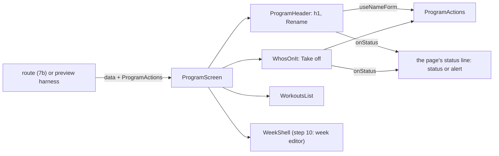

# The program builder

**Read this before changing a builder screen, its route or its data access.** This is **lane B**
of the [FAM-1 plan](../plans/fam-1-family-program.md) (§5, "Lane B").

## What this is

Where a parent builds the household's program: the Programs list, a program's page (who is on it,
its workouts, its week), and the workout editor with its item picker. The lane builds each screen
against fixtures and fakes on the preview route first, then wires it to real data.

🚧 **Built through step 8.** The Programs list, the program page and the workout editor are real
screens on the preview route; the editor links no supersets yet (8b) and adds no items (9). Each
step below adds its files and its invariants here.

## The map

| Step | Adds                                                                                                                |
| ---- | ------------------------------------------------------------------------------------------------------------------- |
| 8a   | The Programs list and the program page, in `programs-list-screen.tsx` and `program-screen.tsx`, and their parts.    |
| 8    | The workout editor, in `workout-editor-screen.tsx`, and its parts. 8b: supersets and rest.                          |
| 9    | `program-builder/item-picker/`. It also edits `components/movements/movement-picker.tsx`, a seam.                   |
| 10   | `program-builder/week-editor/`. 10b: the Copy and Put-on dialogs.                                                   |
| 7a   | `apps/web/app/programs/actions.ts` (the real `ProgramActions`) with its registry file; `apps/web/lib/dal/program/`. |
| 7b   | `apps/web/app/programs/**/page.tsx`; the Programs link on Home. 15: Put on and Take off, wired.                     |

### How a screen is put together (8a)

## Files

| File                                                            | What it is for                                                                                                                   |
| --------------------------------------------------------------- | -------------------------------------------------------------------------------------------------------------------------------- |
| `apps/web/components/program-builder/programs-list-screen.tsx`  | `ProgramsListScreen({ programs, actions })`: the list, "← Home", and `CreateProgram`.                                            |
| `apps/web/components/program-builder/create-program.tsx`        | "+ Create a program": a name, then `createProgram`, then the program's page. One `clientId` per opened form.                     |
| `apps/web/components/program-builder/program-screen.tsx`        | `ProgramScreen({ program, actions })`: composes the parts below and holds the page's one status line.                            |
| `apps/web/components/program-builder/program-header.tsx`        | The `<h1>` and Rename (a stacked form; Cancel, Escape).                                                                          |
| `apps/web/components/program-builder/whos-on-it.tsx`            | "Who's on it" and Take off, shown only when `actions.takeOff` exists.                                                            |
| `apps/web/components/program-builder/workouts-list.tsx`         | The workouts, each a link to its editor; "+ New workout". 10b adds "Copy to…" as a sibling of each link.                         |
| `apps/web/components/program-builder/week-shell.tsx`            | The week, read-only. Step 10's week editor takes its place.                                                                      |
| `apps/web/components/program-builder/name-field.tsx`            | A short text field with its counter (outside the label, by `aria-describedby`) and its refusal; `multiline` for a note.          |
| `apps/web/components/program-builder/status-line.tsx`           | A screen's one status line: `useStatusLine()` (clear, then set a frame later) and `StatusLine` (an `Announcer` and an alert).    |
| `apps/web/components/program-builder/builder-text.ts`           | The builder's words (the prototype's), the refusal messages, and the small rules that pick between them.                         |
| `apps/web/components/program-builder/routes.ts`                 | The builder's paths. The screens link with them; 7b builds its pages at them.                                                    |
| `apps/web/components/program-builder/group-list.tsx`            | The prototype's grouped list: `GroupList` and `GroupRowLink` (title, lines, `›`).                                                |
| `apps/web/components/program-builder/use-name-form.ts`          | A name form's state and submit (Create, Rename): refuses an empty name, drops an answer that arrives after Cancel.               |
| `apps/web/components/program-builder/use-attempt.ts`            | `useAttempt()` (one write's attempt; a late answer is dropped) and `focusField`, shared by the name forms and the editor's Save. |
| `apps/web/components/program-builder/field-label.tsx`           | A field's label with "(optional)".                                                                                               |
| `apps/web/components/program-builder/workout-editor-screen.tsx` | `WorkoutEditorScreen({ draft, picker, actions, program? })`: the cards, one Save, and the save bar with its status line.         |
| `apps/web/components/program-builder/item-card.tsx`             | One item's card: fields by type (`TRACKING_TYPE_FIELDS`), a unit select, instructions, Up, Down, Remove.                         |
| `apps/web/components/program-builder/editor-draft.ts`           | The editor's typed draft (`toCards`) and `readDraft`: every refusal the writer would make, per field, before Save calls.         |
| `apps/web/components/program-builder/supersets.ts`              | `normalizeSupersets` (after every move and remove) and `supersetLabels` (ordinal A1, A2).                                        |
| `apps/web/components/program-builder/*.test.ts(x)`              | Each screen's and module's tests, beside it.                                                                                     |
| `apps/web/components/program-builder/owed.test.ts`              | The lane's `it.todo` list: the tests its steps still owe the contract. Delete a line in the PR that writes its test.             |
| `apps/web/app/programs/index.ts`                                | A placeholder so the directory exists. Not a route.                                                                              |
| `apps/web/lib/dal/program/index.ts`                             | A placeholder so the directory exists.                                                                                           |

## Invariants

1. 🔴 **One mount point per page** (plan §6). A route mounts one screen with the contract's data
   and the contract's actions object, and nothing else ever mounts a screen's parts. What a later
   step adds lives inside the screen, so widening a screen never touches a route or the preview
   harness. A screen's props are its contract with both: change them through the contract owner.
2. 🔴 **A screen writes only through `ProgramActions`.** A member that is `undefined` is an action
   not wired yet, and the screen hides its control: Put on and Take off arrive that way at step 15.
3. 🔴 **No production file imports a fixture or a fake.** They are preview and test data
   ([program-contract.md](./program-contract.md) invariant 4, held by a source scan). A screen's
   own `*.test.tsx` may.
4. **Each screen step is checked against its prototype states** (plan §8): the preview route at
   360px beside the prototype's "Jump to…" state, in the PR. `/design/program` lists the states;
   the a11y scan walks all of them, so a step never edits a spec to add one.
5. **The rules every screen step carries** are the plan's (§5, end): keyed components and no full
   redraw; a counter outside its label, linked by `aria-describedby`; week days as headings; 44px
   targets; the layout at 360px.
6. **The DAL resolves the household scope itself.** Every function under `lib/dal/program/` calls
   `getHouseholdScope()` and returns a contract shape. The tenancy scan (`lib/dal/scoped.test.ts`)
   reaches sub-directories, so it holds this directory to that. [write-path.md](./write-path.md) invariants 1, 2 and 8 still apply to the actions
   and the DAL, though the guide gate no longer sends a PR there.
7. **A new Server Action module brings its own registry and test files**, so the lane edits no
   shared table ([write-path.md](./write-path.md) invariant 1 names the three files).
8. **A screen links by `routes.ts`, and 7b's pages live at those paths** _(maintainer, 2026-11-15)_.
   The props carry only data and actions, so the screens build their own links; until 7b they
   lead nowhere on the preview route.
9. **"Used by … Changes apply to …" counts everyone in `athletes`**, someone whose last day is
   today included: they are on it through today, so an edit now still changes their day.
10. **Focus has somewhere to go after Take off.** The button unmounts: focus moves to the athlete's
    row, or to the section's heading when they had not started and leave the list. The message is
    set after the move. Focus moves only if it is still where the tap left it: an answer that lands
    after the person moved on (into Rename, say) leaves their focus alone.
11. **A name form, and the editor's Save, drop a late answer, but not the write** (`useAttempt`).
    Cancel, Escape, a fresh open or leaving the screen ends the attempt, so a late answer neither
    navigates nor shows an alert. The create, rename or save it sent may still have landed; 6a and
    7a inherit that.
12. **A saved draft's supersets are always well formed** _(maintainer, 2026-11-16)_.
    `normalizeSupersets` runs after every move and remove: a group is a run of neighbours, a group
    of one dissolves (D14), `order` runs 1..n, and the rest is on the last item. **The rest is the
    group's**: it stays with the run that held it, passes to the group's surviving run, and is
    dropped only when no run of the group survives (a Remove of the rest's holder hands it on
    first). The status line says when a group ends, an item leaves one, or a rest goes. 8b adds
    linking and the rest field on top of it.
13. **The editor refuses on the client what the writer refuses**, field by field (`readDraft`), so
    `invalid` is not the normal path: Sets 1..`MAX_SETS_PER_MOVEMENT` on a set-based type, Reps a
    whole number or blank _(maintainer, 2026-11-16)_, a quantity a plain decimal under its unit's
    ceiling (blank: the unit with no target), notes one line. An item loaded with no quantity is
    saved with none until a unit is chosen: the machine never picks the unit a kid logs in. What
    `readDraft` returns is parsed by `saveWorkoutSchema` before Save calls. Enter never saves. The
    editor reads its `draft` once, when it opens, so a refreshed page never moves the ids a retry
    sends.
14. **The editor differs from the prototype on purpose** (each a decision, 2026-11-16): fields two
    to a row on a phone (four in one row leave 43px of text at 360px); "Used by …" under the
    heading (a lb→kg switch changes everyone's load); the back link names the program only when
    the route passes `program` (the preview does not; 7b does); "(optional)" on the fields a blank
    is allowed in; a superset shows its letter and a rule, not the prototype's tinted pill; "type
    locked, it has logs" is not shown (the draft carries no logs). Remove has no undo but Cancel,
    as the prototype; a second Remove within `REMOVE_DEBOUNCE_MS` is taken as the same tap. **7b must
    pass `program`** (`owed.test.ts`).
15. **Leaving with changes asks first, from Cancel and the back link only.** A reload asks too
    (`beforeunload`). The phone's back gesture and Android Back do not: the App Router has no hook
    for a history navigation, so a swipe back discards the draft. Recorded, not built.

## Traps

- **The editor's decimal rule is restated.** `editor-draft.ts`'s `PLAIN_DECIMAL` is the day page's
  (`components/day/row-values.ts`, lane C's, not exported). Change both, until the contract owner
  moves the one rule into `@mat-plan/shared`.

- **A name form assumes leaving the screen unmounts it.** `useNameForm` ends the attempt in an
  effect cleanup and leaves `pending` set. With `cacheComponents` on, Next hides a route in
  `<Activity>` instead of unmounting it, so a create answered while hidden would be dropped and
  the form would come back stuck on "Creating…". Revisit this if that flag is turned on.
- **Until 7b, the preview route never reaches `networkidle`.** The screens link to `/programs/...`
  pages that do not exist yet; Next prefetches each link, the 404 answers, and the response body
  stays open. `pnpm --filter web screenshot:ephemeral` waits for `networkidle`, so it times out on
  these states. Capture with a throwaway `e2e/<step>-capture.a11y.spec.ts` that waits for `load`
  and the `<h1>` instead (the lane brief's capture recipe), and never commit it. Once 7b builds the
  pages, the prefetches complete.
- **A hook result that holds a ref is read as a ref by the React compiler's lint.** Destructure
  `useNameForm()` (`const { name, fieldRef, … } = …`); `form.name` in JSX fails `react-hooks/refs`.
- **Focus a field in the same tap that opens it.** Mount the form with `flushSync`, then focus: a
  focus deferred to a frame may not raise the iPhone keyboard.

## Changing it

Start from the step's row in the plan (§5) and its prototype states (§8). A screen step gets a UX
panel before it is built ([AGENTS.md](../../AGENTS.md) → "UI PR rules"). Re-run `pnpm test`, and
`pnpm e2e:local e2e/program-preview-a11y.spec.ts` for the screens on the preview route.
