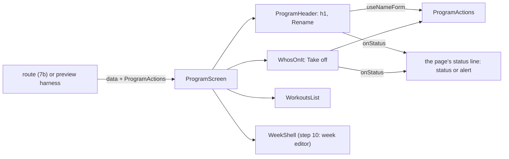

# The program builder

**Read this before changing a builder screen, its route or its data access.** This is **lane B**
of the [FAM-1 plan](../plans/fam-1-family-program.md) (§5, "Lane B").

## What this is

Where a parent builds the household's program: the Programs list, a program's page (who is on it,
its workouts, its week), and the workout editor with its item picker. The lane builds each screen
against fixtures and fakes on the preview route first, then wires it to real data.

🚧 **Built through step 10b and wired through 15 PR 3.** The Programs list, a program's page and the
workout editor are real pages (`/programs`, `/programs/[programId]`, `…/workouts/[workoutId]` and
`…/workouts/new`), opened from Home's Programs row, on the household's own data; every builder
action is registered, Put on and Take off included (15 PR 1). The add-athlete form says a new
athlete starts with no program, and an athlete on none, if live, gets a Programs link (on any day;
maintainer, 2026-11-19) from their day page (15 PR 2). Home's tiles name each athlete's programs
(15 PR 3). Each step below adds its files and its invariants here.

## The map

| Step  | Adds                                                                                                                          |
| ----- | ----------------------------------------------------------------------------------------------------------------------------- |
| 8a    | The Programs list and the program page, in `programs-list-screen.tsx` and `program-screen.tsx`, and their parts.              |
| 8     | The workout editor, in `workout-editor-screen.tsx`, and its parts. 8b: supersets and rest.                                    |
| 9     | `program-builder/item-picker/`. It also edits `components/movements/movement-picker.tsx`, a seam.                             |
| 10    | `program-builder/week-editor/`. 10b: the Copy and Put-on dialogs.                                                             |
| 7a-i  | `apps/web/app/programs/actions.ts`: create, rename and save a workout, with its registry file; `apps/web/lib/dal/program/`.   |
| 7a-ii | The same module: save the week, copy a workout, a new item; and the picker's options read.                                    |
| 7b-i  | `app/programs/page.tsx`, `[programId]/page.tsx`, `not-found.tsx`, `loading.tsx`; the list and view reads; Home and rail rows. |
| 7b-ii | The two workout pages, `getProgramEntry`, the editor's client-minted id and its cap words.                                    |
| 15    | 15 PR 1: Put on and Take off, wired (`putOnAction`, `takeOffAction`, their DAL and miss report); the dialog on real data.     |
| 15    | 15 PR 3: `getProgramsByAthlete`, Home's one read for its tiles' programs lines (`components/profiles/profile-tile.tsx`).      |

### How a screen is put together (8a)

## Files

| File                                                                    | What it is for                                                                                                                                                                                                                                                                                                                                                                                                                                     |
| ----------------------------------------------------------------------- | -------------------------------------------------------------------------------------------------------------------------------------------------------------------------------------------------------------------------------------------------------------------------------------------------------------------------------------------------------------------------------------------------------------------------------------------------- |
| `apps/web/components/program-builder/programs-list-screen.tsx`          | `ProgramsListScreen({ programs, actions })`: the list, "← Home", and `CreateProgram`.                                                                                                                                                                                                                                                                                                                                                              |
| `apps/web/components/program-builder/create-program.tsx`                | "+ Create a program": a name, then `createProgram`, then the program's page. One `clientId` per opened form.                                                                                                                                                                                                                                                                                                                                       |
| `apps/web/components/program-builder/program-screen.tsx`                | `ProgramScreen({ program, actions })`: composes the parts below and holds the page's one status line.                                                                                                                                                                                                                                                                                                                                              |
| `apps/web/components/program-builder/program-header.tsx`                | The `<h1>` and Rename (a stacked form; Cancel, Escape).                                                                                                                                                                                                                                                                                                                                                                                            |
| `apps/web/components/program-builder/whos-on-it.tsx`                    | "Who's on it": each name a link to the athlete's day page; Take off when `actions.takeOff` exists; "Put someone on" under it when `actions.putOn` does.                                                                                                                                                                                                                                                                                            |
| `apps/web/components/program-builder/put-on-dialog.tsx`                 | "Put someone on this program": who, from today or tomorrow, and what that day changes.                                                                                                                                                                                                                                                                                                                                                             |
| `apps/web/components/program-builder/workouts-list.tsx`                 | The workouts, each a link to its editor, with "Copy to…" beside it when `copyWorkout` is wired; "+ New workout".                                                                                                                                                                                                                                                                                                                                   |
| `apps/web/components/program-builder/copy-dialog.tsx`                   | "Copy to…": one Sheet for every row. To, the optional days and label, who will see it.                                                                                                                                                                                                                                                                                                                                                             |
| `apps/web/components/program-builder/week-editor/week-editor.tsx`       | The week, edited in place: per day its slots (↑ ↓ ✕, the label by a tap), "+ Add", Undo; saves the whole week at once.                                                                                                                                                                                                                                                                                                                             |
| `apps/web/components/program-builder/week-editor/add-form.tsx`          | "+ Add" on a day: a workout (no default), a label, the days.                                                                                                                                                                                                                                                                                                                                                                                       |
| `apps/web/components/program-builder/week-editor/days-label-fields.tsx` | A slot's label (`SlotLabelField`) and its days (`DaysFieldset`, its legend and hint the caller's): the week's add form and the Copy dialog.                                                                                                                                                                                                                                                                                                        |
| `apps/web/components/program-builder/week-editor/week-draft.ts`         | The week's changes as pure functions: add to days (skipping those that have it), move, remove, label, and Undo's insert.                                                                                                                                                                                                                                                                                                                           |
| `apps/web/components/program-builder/test-taps.ts`                      | Tests only: taps at stated `event.timeStamp`s (`tapAt`, `tapClock`) for the double-tap guards, so no test sleeps past `DOUBLE_TAP_MS`.                                                                                                                                                                                                                                                                                                             |
| `apps/web/components/program-builder/name-field.tsx`                    | A short text field with its counter (outside the label, by `aria-describedby`) and its refusal; `multiline` for a note.                                                                                                                                                                                                                                                                                                                            |
| `apps/web/components/program-builder/status-line.tsx`                   | A screen's one status line: `useStatusLine()` (clear, then set a frame later) and `StatusLine` (an `Announcer` and an alert).                                                                                                                                                                                                                                                                                                                      |
| `apps/web/components/program-builder/builder-text.ts`                   | The builder's words (the prototype's), the refusal messages, and the small rules that pick between them. `home` is `HOME_LINK` (`lib/constants.ts`), shared with Household settings.                                                                                                                                                                                                                                                               |
| `apps/web/components/program-builder/routes.ts`                         | The builder's paths. The screens link with them; 7b builds its pages at them, and `howToPath` is the How to read's.                                                                                                                                                                                                                                                                                                                                |
| `apps/web/app/programs/how-to/[optionId]/route.ts`                      | "How to" for one picker option (7b): the session in-process, `getHowTo`, the strict `CatalogHowTo` or one byte-identical 404; `force-dynamic` and `no-store`. Its miss and its `no-store` come from `lib/route-miss.ts`, shared with the export.                                                                                                                                                                                                   |
| `apps/web/components/program-builder/how-to-loader.ts`                  | The client loader for that route: a 404 is `null`, any other failure rejects (movement-picker invariant 14).                                                                                                                                                                                                                                                                                                                                       |
| `apps/web/components/program-builder/workout-editor-page.tsx`           | The editor as a real page mounts it, with `howToLoader` (a page cannot pass a function to a client screen), `program` required, and a new workout's `workoutClientId` minted on the device, once per opened editor (7b-ii).                                                                                                                                                                                                                        |
| `apps/web/components/program-builder/arrival.ts`                        | The editor's one-shot message to the program page after a Save (`noteArrival`, `takeArrival`): focus on the Workouts heading, `workoutSavedText` in the bar, within `ARRIVAL_MS` (15 PR 1).                                                                                                                                                                                                                                                        |
| `apps/web/components/program-builder/group-list.tsx`                    | The prototype's grouped list: `GroupList` and `GroupRowLink` (title, lines, `›`).                                                                                                                                                                                                                                                                                                                                                                  |
| `apps/web/app/programs/[programId]/workouts/[workoutId]/page.tsx`       | A workout's editor (7b-ii): the draft first (`getWorkoutDraft`, which reports its miss), then the picker's data and `getProgramEntry`; any `null` is `notFound()`. Title "Edit workout".                                                                                                                                                                                                                                                           |
| `apps/web/app/programs/[programId]/workouts/new/page.tsx`               | A new workout (7b-ii): `getProgramEntry` and the picker's data; the draft it passes has no client id. Title "New workout".                                                                                                                                                                                                                                                                                                                         |
| `apps/web/components/program-builder/use-name-form.ts`                  | A name form's state and submit (Create, Rename): refuses an empty name, drops an answer that arrives after Cancel.                                                                                                                                                                                                                                                                                                                                 |
| `apps/web/components/program-builder/use-attempt.ts`                    | `useAttempt()` (one write's attempt; a late answer is dropped), `focusField`, `isSameTap` (the double-tap guards) and `holdUnderThumb` (a moved control kept under the thumb, clear of a bottom bar), shared by the name forms, the workout editor and the week editor.                                                                                                                                                                            |
| `apps/web/components/program-builder/field-label.tsx`                   | A field's label with "(optional)".                                                                                                                                                                                                                                                                                                                                                                                                                 |
| `apps/web/components/program-builder/workout-editor-screen.tsx`         | `WorkoutEditorScreen({ draft, picker, actions, program? })`: the cards, one Save, and the save bar with its status line.                                                                                                                                                                                                                                                                                                                           |
| `apps/web/components/program-builder/item-card.tsx`                     | One item's card: fields by type, a unit select, instructions, Up, Down, Remove; the link to the next card; the group's rest.                                                                                                                                                                                                                                                                                                                       |
| `apps/web/components/program-builder/editor-draft.ts`                   | The editor's typed draft (`toCards`) and `readDraft`: every refusal the writer would make, per field, before Save calls.                                                                                                                                                                                                                                                                                                                           |
| `apps/web/components/program-builder/item-picker/item-picker.tsx`       | "Add items": the movement picker's multi mode, the selection's summary, "Add n items" and the new-item form. Its test holds that searching runs no action until Create is tapped (CAT-3 P6's caller side).                                                                                                                                                                                                                                         |
| `apps/web/components/program-builder/supersets.ts`                      | `normalizeSupersets`, after every move, remove, link and unlink. The letters are the contract's `supersetLabels`.                                                                                                                                                                                                                                                                                                                                  |
| `apps/web/components/program-builder/*.test.ts(x)`                      | Each screen's and module's tests, beside it.                                                                                                                                                                                                                                                                                                                                                                                                       |
| `apps/web/components/program-builder/owed.test.ts`                      | The lane's `it.todo` list: the tests its steps still owe the contract. Delete a line in the PR that writes its test.                                                                                                                                                                                                                                                                                                                               |
| `apps/web/app/programs/actions.ts`                                      | The builder's Server Actions (7a-i: create, rename, save a workout; 7a-ii: week, copy, new item; 15: Put on, Take off); each one's steps are in the module's header. Only a page under `app/programs/` imports it (since 7b-i).                                                                                                                                                                                                                    |
| `apps/web/app/programs/actions.registry.ts`                             | Each action's refusal set and scope, read by the boundary matrices ([write-path.md](./write-path.md) invariant 1).                                                                                                                                                                                                                                                                                                                                 |
| `apps/web/lib/dal/program/writes.ts`                                    | One function per write: the caller's scope, then lane P's writer inside `quietDbErrors`. A `not_found` for an id the input carries goes through its `report-miss.ts` report. Put on and Take off take `today` from their action.                                                                                                                                                                                                                   |
| `apps/web/lib/dal/program/new-item-lock.test.ts`                        | Through the recording pool, the order `newItem` emits: `begin`, then the transaction-local `lock_timeout` (`set_config(…, true)`, bound to `LOCK_TIMEOUT`), then the household-items lock. `db:verify` proves the setting is set; only the emitted SQL shows it comes first.                                                                                                                                                                       |
| `apps/web/app/programs/page.tsx`                                        | The Programs list (7b-i): `requireSession`, `getProgramList(today)`, `ProgramsListScreen` with `PROGRAM_ACTIONS`; no household goes Home.                                                                                                                                                                                                                                                                                                          |
| `apps/web/app/programs/[programId]/page.tsx`                            | A program's page (7b-i): `getProgramView(id, today, tz)`, `ProgramScreen`; a miss is `notFound()`. Title "Program", never its name.                                                                                                                                                                                                                                                                                                                |
| `apps/web/app/programs/not-found.tsx` · `loading.tsx` · `layout.tsx`    | The builder's 404 ("← Programs", its own `AppShell`, since `notFound()` replaces the page) its busy frame, and its `ClerkRoot` (#626: Clerk loads per segment, never in the root layout).                                                                                                                                                                                                                                                          |
| `apps/web/e2e/program-builder.spec.ts` · `program-builder.a11y.spec.ts` | From `/p`: create, rename, copy a seeded workout, Copy at 360px, a random id's 404; a new workout with two items, Save, then Back (7b-ii); another program's workout is a 404; a new athlete's day page linking to Programs, then put on this run's program, a ✓ logged, Take off and back on (15); the four routes' a11y walk at 360px, the Copy and Put-on dialogs (in-sheet overflow, `expectNoOverflowWithin`), and one desktop axe pass each. |
| `apps/web/lib/dal/program/reads.ts`                                     | `getProgramList`, `getProgramView` (7b-i, primitive arguments for `cache()`), `getProgramEntry` (7b-ii: one entry of the list, by the id lower-cased), `getProgramsByAthlete` (15 PR 3: Home's tiles, `null` with no household) and `getWorkoutDraft`: the editor's read. A non-uuid id is `null` with no query; a miss is reported; the read goes through `quietDbErrors`, as the writes do.                                                      |
| `apps/web/lib/dal/program/report-miss.ts`                               | `reportProgramMiss`, `reportWeekMiss`, `reportCopyMiss`, `reportAssignMiss` (15): on a miss only, which id missed the household, reported once through `reportScopeMiss`.                                                                                                                                                                                                                                                                          |

## Invariants

1. 🔴 **One mount point per page** (plan §6). A route mounts one screen with the contract's data
   and the contract's actions object, and nothing else ever mounts a screen's parts. What a later
   step adds lives inside the screen, so widening a screen never touches a route or the preview
   harness. A screen's props are its contract with both: change them through the contract owner.
2. 🔴 **A screen writes only through `ProgramActions`.** A member that is `undefined` is an action
   not wired yet, and the screen hides its control: Put on and Take off arrived that way, wired at
   step 15.
3. 🔴 **No production file imports a fixture or a fake.** They are preview and test data
   ([program-contract.md](./program-contract.md) invariant 4, held by a source scan). A screen's
   own `*.test.tsx` may.
4. **Each screen step is checked against its prototype states** (plan §8): the preview route at
   360px beside the prototype's "Jump to…" state, in the PR. `/design/program` lists the states;
   the a11y scan walks all of them, so a step never edits a spec to add one.
5. **The rules every screen step carries** are the plan's (§5, end): keyed components and no full
   redraw; a counter outside its label, linked by `aria-describedby`; week days as headings; 44px
   targets; the layout at 360px.
6. **The DAL resolves the household scope itself.** Every function under `lib/dal/program/` that
   reaches the database calls `getHouseholdScope()`, or takes the `HouseholdScope` its caller
   resolved (`reportProgramMiss`); the shared `lib/dal/quiet-db-errors.ts` (moved there at FAM-1 12b, for the day page's writes too) touches no data. The tenancy scan (`lib/dal/scoped.test.ts`)
   reaches sub-directories, so it holds this directory to that. [write-path.md](./write-path.md) invariants 1, 2 and 8 still apply to the actions
   and the DAL, though the guide gate no longer sends a PR there.
7. **A new Server Action module brings its own registry and test files**, so the lane edits no
   shared table ([write-path.md](./write-path.md) invariant 1 names the three files).
8. **A screen links by `routes.ts`, and 7b's pages live at those paths** _(maintainer, 2026-11-15)_.
   The props carry only data and actions, so the screens build their own links; on the preview
   route they lead nowhere. Since 7b-ii every path has its page (`routes.test.ts` holds a
   `page.tsx` or `route.ts` per path).
9. **"Used by … Changes apply to …" counts everyone in `athletes`**, someone whose last day is
   today included: they are on it through today, so an edit now still changes their day.
10. **Focus has somewhere to go after Take off.** The button unmounts: focus moves to the athlete's
    row, or to the section's heading when they leave the list. Which one, and the message, come from
    Take off's answer (`lastDay`, C15): a day means they come off after it, `null` that they never
    start (a start dated today included). Never from the screen's own reading of the dates. The message is
    set after the move. Focus moves only if it is still where the tap left it: an answer that lands
    after the person moved on (into Rename, say) leaves their focus alone. A Take off that throws is
    a refusal (`retry`), so no button is left pending (15 PR 1); a `not_found` is a stale page: it
    refreshes and says `BUILDER_COPY.takeOffStale`, focus on the heading, never "try again". The
    message is `takenOffText`: a started one says how to undo it before midnight.
11. **A name form, and the editor's Save, drop a late answer, but not the write** (`useAttempt`).
    Cancel, Escape, a fresh open or leaving the screen ends the attempt, so a late answer neither
    navigates nor shows an alert. The create, rename or save it sent may still have landed; 6a and
    7a inherit that.
12. **A saved draft's supersets are always well formed** _(maintainer, 2026-11-16)_.
    `normalizeSupersets` runs after every move and remove: a group is a run of neighbours, a group
    of one dissolves (D14), `order` runs 1..n, and the rest is on the last item. **The rest is the
    group's**: it stays with the run that held it, passes to the group's surviving run, and is
    dropped only when no run of the group survives (a Remove of the rest's holder hands it on
    first). The status line says when a group ends, an item leaves one, or a rest goes.
    **Linking (8b, `linkWithNext` / `unlinkFromNext`)** _(maintainer, 2026-11-16)_: a link joins the
    pair to whichever group either is in, and two groups become one under the earlier key; **the
    later group's rest is kept** and a different earlier one is named as dropped. An unlink splits
    the group between the two cards and **copies the rest to both sides**, so it is lost only when
    neither side stays a superset. **The opposite tap undoes a tap**: straight after a link or unlink, the opposite tap on the same
    card, with nothing else changed in between, puts the cards back exactly (a one-step undo held
    outside the draft). Any other edit ends it, so a rest a join removed never comes back over one
    typed since. "Changed" also compares group keys by order of first appearance, so a key minted
    on the way is not a change. The rest is edited on the group's last card, labelled "Rest"
    (the day page prints "Rest " before it), and cleaned at Save like a note.
13. **The editor refuses on the client what the writer refuses**, field by field (`readDraft`), so
    `invalid` is not the normal path: Sets 1..`MAX_SETS_PER_MOVEMENT` on a set-based type, Reps a
    whole number or blank _(maintainer, 2026-11-16)_, a quantity a plain decimal under its unit's
    ceiling (blank: the unit with no target), notes one line. **A quantity needs its unit** (contract C16): a
    Count, Weight × reps or Distance card with no unit is refused at Save, number or not, because no
    ✓ could ever be stored for it. The refusal is the unit select's ("Weight: choose a unit."), so
    focus goes where the fix is; typing a number does not clear it, choosing a unit does. The bar
    counts the fields to fix (a name alone says its own message). A type with a fixed unit (Duration, Time per set) loaded bare saves
    that unit with no target, never no quantity. A loaded quantity in its type's slot (`slotQuantity`; one outside it is not read) is kept only in
    a unit the type can hold; otherwise the number is not shown and never converted, and the card
    says what it was (`EditorCard.dropped`): a fixed-unit type keeps its own unit, any other starts unset. The machine never picks the unit a kid logs in. **One exception, decided** _(maintainer, 2026-11-16)_: a card added from the item picker takes the item's own declared unit (`newCard`), so left alone it saves "log in that unit, no target"; the unit is the item's, not the machine's choice. What
    `readDraft` returns is parsed by `saveWorkoutSchema` before Save calls. Enter never saves. The
    editor reads its `draft` once, when it opens, so a page re-rendered (`router.refresh`) never moves the ids a retry
    sends.
14. **The editor differs from the prototype on purpose** (each a decision, 2026-11-16): fields two
    to a row on a phone (four in one row leave 43px of text at 360px); "Used by …" under the
    heading (a lb→kg switch changes everyone's load); the back link names the program only when
    the route passes `program` (the preview does not; 7b does); "(optional)" on the fields a blank
    is allowed in; a superset shows its letter and a rule, not the prototype's tinted pill; "type
    locked, it has logs" is not shown (the draft carries no logs). Remove has no undo but Cancel,
    as the prototype; a second Remove or link within `DOUBLE_TAP_MS` is taken as the same tap. The
    link control reads "Superset with next", "Unlink from next" or "Join supersets A and B", never
    the next item's name (up to 100 characters at 360px); its accessible name adds both items, its own first ("Superset with next: DB bench press and Pull-up"). It sits in
    its own row below the tools, and the rest field last in the card, so what a link moves is
    always below the tapped control, which is held where the thumb is and kept clear of the save
    bar. A link or unlink message names supersets by letter ("Linked: superset B now has 3 items."), never
    items by name, and the next edit clears it; the bar keeps two lines for it. Also unlike v12:
    the link control has a link glyph and sits in the card's foot under a rule; the placeholder is
    "e.g. 90 s after each round"; the hint ("A superset is items done back to back…") sits under
    Items, not below the list. Three 8b answers differ from v12, as plan §8 records: an unlink
    copies the rest to both sides (v12: the first part only); a join keeps the later group's rest
    and names the dropped one (v12: the earlier one, silently); the field is "Rest", e.g. "90 s
    after each round" (v12: "Rest after each round", e.g. "90 s"). **A real page passes `program`**: `WorkoutEditorPage` requires it (7b-ii).
15. **Leaving with changes asks first, from Cancel and the back link only.** A reload asks too
    (`beforeunload`). The phone's back gesture and Android Back do not: the App Router has no hook
    for a history navigation, so a swipe back discards the draft. Recorded, not built (a guard is
    owed before the first invite, 7b plan §Risks).
    🔴 **Every way out REPLACES the editor's history entry** (7b-ii; plan U1-1): Save, Discard,
    Cancel with no changes and the back link (`replace`). So Back after a Save lands on the program
    page, never on `/workouts/new` or on an editor holding the draft from before the save. A new
    workout's `workoutClientId` is minted by `WorkoutEditorPage` when it opens, never by the page,
    so a second "+ New workout" is a second workout (`workout-editor-page.test.tsx`; the e2e's Back
    probe). **The trade-off, accepted** (7b-ii review): the replaced entry is the program page, so
    the first Back after Save, Cancel or Discard shows the program page again, and only the next
    one leaves it. A Back that reopened an editor holding the pre-save draft could overwrite the
    save, which costs more than one extra tap.
    **After a Save, focus lands on the program page's Workouts heading** and the bar says
    `workoutSavedText` (15 PR 1, owed by 7b-ii): Save leaves the editor, its button unmounts, and
    Next's router leaves focus alone, so the editor hands the next program page a one-shot message
    (`arrival.ts`, module state: kept across a client navigation, empty after a reload, taken once,
    only by the program it names and only within `ARRIVAL_MS`). The page moves focus only from
    `<body>`. The back link's accessible name is `backToLabel(program)`; it shows "← {program}".

16. **The item picker** (step 9) _(maintainer, 2026-11-16)_:
    - **The selection is the editor's**, in pick order, kept across a Close or a back swipe until
      Add; items made in the picker are kept too, so a reopened picker lists them.
    - **Each row's second line is the movement picker's own** since CAT-3 B2-i (what it tracks,
      then what it needs; movement-picker invariant 14), so the item picker passes no `describe`.
    - **With no query the list is the movement picker's browse tree** since CAT-3 B3 (movement-picker
      invariant 11): the preview's list is longer than `BROWSE_OPEN_AT_MOST`, so its kinds and
      families start closed, and `item-picker.test.tsx`'s `openPicker` opens them all first with
      `expandBrowse` (`test/movement-picker-fixtures.ts`). The create-and-focus test and the Enter
      test open the sheet plainly (`openSheet`), so only the new selection's seed can open the
      groups above the row. `closeForm` sets the picker's `reveal` to the row it focuses, so a row
      the selection does not change (already ticked, or made but not ticked at the cap) is on screen
      too; two tests close its group first.
    - **Add** appends a card per item in pick order (`newCard`): a fresh `prescriptionClientId`, **no
      numbers**, and the unit the type fixes, else the item's own declared unit when the type allows
      it, else none. Focus goes to the first new card's heading; the status line says how many, from
      the sheet's `onReturned` (the bar is hidden from a screen reader while the sheet is open), once
      per Add: a plain Close says nothing. The once-per-Add is unit-tested; the ORDER (after the
      sheet is gone, not before) only a browser can show, since jsdom closes the sheet before the
      next frame either way: `e2e/program-builder.spec.ts` (7b-ii) records whether a dialog was
      still in the page when the line was said.
    - **The new-item form takes over the sheet**, and **what it tracks has no default**: Create is
      inactive until a type is chosen, with a line explaining the chosen type, and the warning that
      the item can't be deleted or renamed and its type can't change.
    - **A name already in the list selects that item**, by the picker's own rule (aliases
      included): "RDL" selects Romanian Deadlift. If the server still answers `existed` for an item
      the list does not have (another parent got there first), the item it names is added under its
      stored name, and the status line says what happened: "… already exists (Reps), so nothing new
      was made. Selected." (`existedUnlistedText`, 7a-ii; "is in the list" would be false, and the
      type chosen was not used). **Except a retry whose first try landed**: when the last Create on
      the form got no answer (a failure that is not the name's) and this one, for the same name and
      type, answers `existed`, the first try made it, so it says "created" (`unanswered`, 7a-ii
      review). The status text is chosen in one place, `said`. The name is the answer's `name`
      (contract C8).
    - **Every link a screen draws is `BuilderLink`** (`route-link.tsx`, 7a-ii), never `next/link`
      itself (a scan): it prefetches as Next does, unless the `BuilderLinkPrefetch` context says
      `false`. The design preview's harness provides `false` around every screen (#593), so its
      fixture ids are never prefetched and never 404; a real page provides nothing.
    - **A workout stops at `MAX_WORKOUT_ITEMS`**; a tap past it says why. At the cap "+ Add items"
      looks stopped (`aria-disabled` + `PENDING_CLASS`) with `workoutFullText` under it (7b-ii; it
      looked live, #460).
    - **A household stops at `MAX_HOUSEHOLD_ITEMS` of its own** (7b-ii, plan §Caps), counted from the
      options (the contract's `householdItemsFull`, never the library's): the footer says `ITEM_PICKER_COPY.householdFull`
      before any typing, and the form's Create is inactive except for a name that selects an
      existing item (never capped, contract invariant 30); a tap says why and sends nothing. A race
      the stop did not see answers `limit_reached`, said in the form's footer (`newItemRefusal`).
    - **It is mounted outside the editor's `<form>`**: a portal's React events bubble to React
      ancestors, so a form in the sheet would also submit the workout.
    - **Focus and messages**: after Create or "Select …", focus is on that item's row, scrolled into
      view; after Cancel, on the create button; an inactive Create moves to what is missing. A
      message (created, selected, the cap) is seen in the footer and heard in the sheet's status, a failure to reach the server is seen above Create in the form with focus left on Create, an empty name says why once Create is pressed, and a made item is listed once per id;
      and the next search clears it. Closing the sheet drops the form; the ticks and items made
      stay. A full workout says so at "+ Add items" and opens nothing. A tap on Add within
      `DOUBLE_TAP_MS` of the tap that closed the form is ignored (Add sits under the left half of the
      form's Cancel; both times are `event.timeStamp`s, one clock); a second tap on Create lands on
      the footer's text lines. A double tap on Cancel's right half lands on Close, which closes the
      sheet: accepted, since Close keeps the ticks _(maintainer, 2026-11-16)_. A name the same-movement rule folds to nothing ("S")
      is refused by the contract's own `newItemSchema` (C8), shown once Create is pressed rather
      than on the first keystroke; an empty name is the lane's plainer "Give the item a name." **A create in flight ends** with Cancel, a closed sheet or a
      fresh form (invariant 11): its answer leaves the screen alone, but a new item it made is still
      listed, since the write may have landed. At the cap, an item made or found is listed but not
      ticked, and the message says so.
    - Differences from v12, each a decision above or recorded here: the selection survives Close;
      the form takes over the sheet; the type has no default; added cards have no numbers (v12
      prefilled 3 × 10 and 20 lb); a ticked row is outlined with a ✓ box, not green (the `done`
      green means "logged"); rows are grouped under the picker's headings, not one A–Z list; the
      search is pinned in the header; a ✕ in the header and Close in the footer; the footer lists
      the picks ("2 picked: …", one line, read in full with Add) and the cap; an item already on a card says
      "already in this workout"; with no match, the household's list empties under "New item: “…”" (the catalog's browse groups, once 6a supplies them, stay).

17. **The week editor** (step 10) _(maintainer, 2026-11-16)_:
    - **Every change saves at once**, sending the whole week (`saveWeek`); there is no Save on the
      program page. The change shows at once and one save is in flight at a time; a change made
      meanwhile is sent when it returns. A refused save, or one that throws (a dropped connection
      is a `retry`), puts the week back as the page has it and drops anything queued on top of it.
    - **The editor's own week shows while its saves are out, and after, until the page's week
      changes**: a week another write brought (10b's Copy, another parent) is what shows next, even
      one that arrived mid-save. A week that is one of the editor's OWN earlier saves (its refresh,
      arriving while a later change is out) does not replace that later change. **The last change
      wins**: no version check; a refusal that can only mean a stale page (`once_per_day`,
      `not_found`) refreshes the page and says the change was not saved.
    - **✕ leaves "… removed · Undo" in place** until the next change. Undo puts that slot back into
      the week **as it is now**, never the week before the removal, so a change that arrived since is
      kept. The double-tap guard runs both ways: a second tap on ✕ is not an Undo, and a second tap
      on Undo is not a removal (focus goes to the restored slot's text, not its ✕). A refused
      removal puts focus on the slot it puts back.
    - **A slot's label is edited by tapping its text**, focused in the same tap, with the add form's
      suggestions (one `SlotLabelField`). A label the endpoint would refuse is said on the field
      (`slotLabelSchema`, checked first), so it never costs the week.
    - **"+ Add"**: the workout has no default unless one alone is not on that day; days that have
      the chosen workout show ticked and inactive ("has it"), and the message names the days that
      took it and the days skipped, Monday first.
    - **The page's status line is a bar pinned to the bottom of the screen**, for Rename, Take off
      and the week alike, one line tall from the first paint ("Changes save as you make them." until
      a message), so it never appears, or blinks away, over what was just tapped. A moved control is
      held clear of it (`holdUnderThumb`), and focused controls scroll 7rem clear of it.
    - Also different from v12: the label stacked over the workout's name, "+ Label" or ✎ beside it;
      "· today" on today's day; one line, not seven "+ Add", when there are no workouts; ↑ on the
      first slot and ↓ on the last dimmed (`aria-disabled`); the week capped at `max-w-2xl`.

18. **The Copy and Put-on dialogs** (step 10b; UX panel and maintainer, 2026-11-16):
    - **Each is one `Sheet` (`variant="sheet"`) with a constant id**, its action a `type=submit`
      button in the footer (action first, Cancel last). Its own refusals are said in a visible
      footer `Announcer` tied to the action; the success line goes to the page's bar from
      `onReturned`, once focus is back. A stale refusal closes, refreshes and says nothing was done; a
      throw (a dropped connection) is a `retry`. The Sheet stays mounted when its trigger goes (the
      last person put on): it closes as a sheet, and focus returns to the line that replaced it.
    - **Copy's To starts on "Choose a program"** unless only one is offered: a copy cannot be
      deleted. Under it, who is on that program. Days are optional; the label shows once a day is
      ticked, prefilled from this program's week only when the copy stays in it. Someone on both
      programs who already does the workout on a picked day is named, and heard. **A Name field**
      (C15) shows for a copy into this program, and for another program once it answers
      `name_taken`; it is prefilled with the shared `copyName` ("Heavy A (copy)", within
      `WORKOUT_NAME_MAX`), and a name already in this program is said on it before anything is
      sent. A label typed by the person stays when To changes; only the prefill follows it. One
      `clientId` per opening, reused on a retry. "Put them on it
      instead" shows only when `putOn` is wired and the copy goes elsewhere.
    - **Put on lists every candidate**: someone on it is ticked and inactive ("on it"); someone taken
      off shows their last day and can be ticked, which undoes the Take off (C15); the rest say what
      they keep, stacked under the name. **Starting** is two
      radios, Today or Tomorrow, with a line saying what that day changes from this program's week.
      Start names its count and is inactive until someone new is ticked. The order and "to switch
      instead" lines show only when someone ticked keeps another program. With everyone on it, the
      button is replaced by a line saying so. A start today is undoable the same day: Take off
      removes it when nothing is logged (C15).
    - **Put on on real data** (15 PR 1; the 15 plan's UX panel): `startingNamesText` and, when
      someone new shares targets (the program has athletes, or two start together),
      `sameTargetsText`, both in the footer (`SheetFormFooter`'s `lead`, which describes the action),
      in view with Start. Start counts only who starts (`startLabel(fresh)`). A last day is
      `lastDayText(day, today)`, one rule with "Who's on it". When only athletes taken off today are
      ticked, the radios give way to `PUT_ON_COPY.stayOnNoGap` and the action is `keepLabel` (their
      day is ignored, C15); mixed ticks add `stayOnEitherWayText`. With no athlete at all the page
      says `PUT_ON_COPY.addAthleteBefore`…`addAthleteAfter`, never `everyoneOn`. **Who was
      just put on is held locally** (`justPutOn`, cleared when the page's data changes), so the
      trigger becomes the line and focus returns to it in the same render as the close, not when the
      refresh lands. The success line names the start's day against the **device's** today
      (`deviceToday`), since the page's `today` is stale past midnight and Put on answers no day.
      `orderHintText` says a new start goes in by the Programs list's order and the others keep theirs (6d-iii, D41); it is not shown for someone ticked back on, who returns to their old place.
    - Differences from v12, each a decision above: To has no default; who will see a copy; the
      double-workout warning; the label only after a day; Starting as radios with what it changes;
      the hints shown only when they apply; Start's count; "last day …", tickable, in place of "on it";
      the Name field.

19. 🔴 **The actions and the program DAL** (step 7a-i; engineering panel, 2026-11-16):
    - Only `lib/dal/program/` imports lane P's writers and reads; everything else reaches them
      through it (`apps/web/test/program-tables-stay-dark.test.ts`). The one exception is
      `workoutInHousehold`, which the day DAL (`lib/dal/day/`, 12b) may import as well, for its
      scope-miss report.
    - A miss is reported only after a writer or read has said "not here", never on a success, and
      once per request: the program first, then the workout; an item's miss reports nothing. A
      failed check reports nothing and never changes the answer.
    - **Only a page under `app/programs/` imports `actions.ts` or `actions.contract.ts`** (since
      7b-i, when the stay-dark pin lifted with the privacy list it owed). A component gets the
      actions as props; no client component imports lane P's reads or `lib/dal/program/`. The same
      test holds the notice and inventory to the sentences 7b-i rewrote.
    - **The page reads** (`getProgramList`, `getProgramView`, 7b-i) take primitives, because
      `cache()` compares by identity. The view keeps `getWorkoutDraft`'s order: a non-uuid id is
      `null` with no report; no scope or a miss is reported once. The list names no id, so a missing
      scope reports nothing and the page sends the caller Home.
    - **Home's programs lines are ONE read for the page** (`getProgramsByAthlete(today)`, 15 PR 3),
      never one per tile; Home skips it with no household or no athletes. A tile with no entry
      shows no line rather than "No program yet". The line uses the day page's words
      (`PROGRAM_COPY.line`), `startsText` for a program that has not begun (`hasStarted`, the
      program page's rule), `lastDayText` for one taken off today (dates with no-break spaces,
      `unbrokenDay`) and `NO_PROGRAM_YET_LINE` for none. The tile's link is named by
      `aria-labelledby` (name and kind) and described by the line, so a program named after an
      athlete never changes what the link is called.
    - **The real `ProgramActions` is `PROGRAM_ACTIONS`** (`actions.contract.ts`, 7a-ii), the six
      required members, and `putOn` and `takeOff` since step 15. Not in `actions.ts`: a
      `'use server'` module exports only async functions.
    - **Put on and Take off** (15 PR 1) read today in the action (`getActiveLocalDay`) and hand it
      to the DAL and lane P's writer, which is the one check of `from` (today or tomorrow); the
      action does not check it again. A success revalidates the builder, Home and the day page of
      each athlete named. Take off answers the writer's `lastDay`, never its own. A `not_found`
      reports the program, then the first athlete id (input order) not among the household's
      athletes, archived ones included (`reportAssignMiss`, one `listHouseholdAthletes` read): an
      archived athlete of this household names nothing outside it, so it is not reported.
    - **A week that names a workout twice on a day is `once_per_day`**, not `invalid`, before the
      DAL (`weekRepeatsAWorkout`), as the preview's fake and lane P's writer answer (C25); the
      editor reads it as a stale page.
    - **The caps stop at their entry points, and `limit_reached` has words per screen** (contract
      C35; 7b plan §Caps). On the program page (7b-i): "+ New workout" at `MAX_PROGRAM_WORKOUTS` is
      an `aria-disabled` button with `programFullText` under it; a day's "+ Add" at
      `MAX_DAY_SLOTS` is `aria-disabled` + `PENDING_CLASS`, a tap says `dayFullText` and opens no
      form, the hint sits under the header row (`aria-describedby` only while full), and focus stays
      on it after the 30th add; a full day's checkbox in the add form and in Copy (this program
      only) is inactive, "Tuesday, full". `weekRefusal(reason, sent)` names the full days and does
      not refresh; `copyRefusal` names both causes (D13), or only the program's into this program
      with no day picked, on To (`aria-invalid`, focused). The words come from the shared consts and
      say "is full … holds at most N". In the editor (7b-ii): `saveRefusal(limit_reached)` says the
      program is full and the workout wasn't saved; `newItemRefusal(limit_reached)` and the
      "+ New item" stop are invariant 16's. `saveWeekAction`
      answers a day past `MAX_DAY_SLOTS` as `limit_reached`, after `once_per_day` and before
      `invalid`, as the preview's fake does.
    - **Each miss report walks its ids in the writer's order** (`report-miss.ts`, one first-miss
      helper): a week's program, then each workout it names (distinct, every one, looked up in
      one read of the program's live workout ids, lane P's `programWorkoutIds`, 6c-ii); a copy's
      TARGET program, then its source workout by id alone
      (`workoutInHousehold`).
    - **"How to"** (`getHowTo`, `lib/dal/program/picker.ts`, 7b): one option's steps, resolved
      among the caller's own options (one cached `householdMovementRows` read, shared with the
      picker's data), or `null`; served by `app/programs/how-to/[optionId]/route.ts`.
    - **The item picker's data** (`lib/dal/program/picker.ts`, CAT-3 P11-i): the household's own
      items and, ⏳ **until the catalog's fresh start (CAT-3 chunk R), every old built-in**
      (maintainer, 2026-11-17: "Show all 35 until reset", which suspends "only ones with library
      data": hidden built-ins made search say a movement did not exist that `newItem` then
      selected). A built-in the library has an entry for is the library's taxonomy on the DATABASE
      ROW's name, tracking type, unit and bodyweight flag, since the row is what a save and a log use
      (board, 2026-11-17); its aliases are the row's joined with the library's, so the client
      withholds at least what the server selects. One without an entry is `BuiltInWithoutLibrary`
      (`lib/movements/movement-option.ts`): the row with no taxonomy at all, so no filter passes it
      and it has no "How to". The slug never leaves the DAL (a keys test). TODO at chunk R: list only
      rows the library has, and drop that arm.

## Traps

- **The sheet pops its history entry on close, and in jsdom that `popstate` lands in the next
  test**, closing its sheet. A test file that opens a sheet stubs `history.back` (as
  `sheet.test.tsx` does).

- **A name form assumes leaving the screen unmounts it.** `useNameForm` ends the attempt in an
  effect cleanup and leaves `pending` set. With `cacheComponents` on, Next hides a route in
  `<Activity>` instead of unmounting it, so a create answered while hidden would be dropped and
  the form would come back stuck on "Creating…". Revisit this if that flag is turned on.
- **Capturing the preview route: wait for `load`, not `networkidle`.** Before #593 the screens
  prefetched `/programs/<fixture id>` pages that 404, and the route never went idle under `next
start`. #593 stopped those prefetches; whether the route now reaches `networkidle` is unverified,
  so `screenshot:ephemeral`'s picker states keep `waitUntil: 'load'` and wait on elements
  (`scripts/capture.ts`). A throwaway `e2e/<step>-capture.a11y.spec.ts` does the same, and is never
  committed.
- **A hook result that holds a ref is read as a ref by the React compiler's lint.** Destructure
  `useNameForm()` (`const { name, fieldRef, … } = …`); `form.name` in JSX fails `react-hooks/refs`.
- **Focus a field in the same tap that opens it.** Mount the form with `flushSync`, then focus: a
  focus deferred to a frame may not raise the iPhone keyboard.

## Changing it

Start from the step's row in the plan (§5) and its prototype states (§8). A screen step gets a UX
panel before it is built ([AGENTS.md](../../AGENTS.md) → "UI PR rules"). Re-run `pnpm test`, and
`pnpm e2e:local e2e/program-preview-a11y.spec.ts` for the screens on the preview route.
