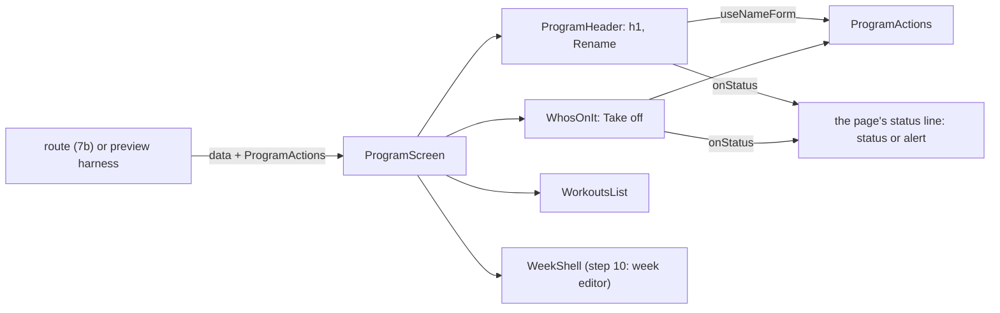

# The program builder

**Read this before changing a builder screen, its route or its data access.** This is **lane B**
of the [FAM-1 plan](../plans/fam-1-family-program.md) (§5, "Lane B").

## What this is

Where a parent builds the household's program: the Programs list, a program's page (who is on it,
its workouts, its week), and the workout editor with its item picker. The lane builds each screen
against fixtures and fakes on the preview route first, then wires it to real data.

🚧 **Built through step 10.** The Programs list, the program page with its week editor, and the
workout editor with its supersets and its item picker are real screens on the preview route. Each
step below adds its files and its invariants here.

## The map

| Step | Adds                                                                                                                |
| ---- | ------------------------------------------------------------------------------------------------------------------- |
| 8a   | The Programs list and the program page, in `programs-list-screen.tsx` and `program-screen.tsx`, and their parts.    |
| 8    | The workout editor, in `workout-editor-screen.tsx`, and its parts. 8b: supersets and rest.                          |
| 9    | `program-builder/item-picker/`. It also edits `components/movements/movement-picker.tsx`, a seam.                   |
| 10   | `program-builder/week-editor/`. 10b: the Copy and Put-on dialogs.                                                   |
| 7a   | `apps/web/app/programs/actions.ts` (the real `ProgramActions`) with its registry file; `apps/web/lib/dal/program/`. |
| 7b   | `apps/web/app/programs/**/page.tsx`; the Programs link on Home. 15: Put on and Take off, wired.                     |

### How a screen is put together (8a)

## Files

| File                                                                    | What it is for                                                                                                                                                                                                                                                          |
| ----------------------------------------------------------------------- | ----------------------------------------------------------------------------------------------------------------------------------------------------------------------------------------------------------------------------------------------------------------------- |
| `apps/web/components/program-builder/programs-list-screen.tsx`          | `ProgramsListScreen({ programs, actions })`: the list, "← Home", and `CreateProgram`.                                                                                                                                                                                   |
| `apps/web/components/program-builder/create-program.tsx`                | "+ Create a program": a name, then `createProgram`, then the program's page. One `clientId` per opened form.                                                                                                                                                            |
| `apps/web/components/program-builder/program-screen.tsx`                | `ProgramScreen({ program, actions })`: composes the parts below and holds the page's one status line.                                                                                                                                                                   |
| `apps/web/components/program-builder/program-header.tsx`                | The `<h1>` and Rename (a stacked form; Cancel, Escape).                                                                                                                                                                                                                 |
| `apps/web/components/program-builder/whos-on-it.tsx`                    | "Who's on it" and Take off, shown only when `actions.takeOff` exists.                                                                                                                                                                                                   |
| `apps/web/components/program-builder/workouts-list.tsx`                 | The workouts, each a link to its editor; "+ New workout". 10b adds "Copy to…" as a sibling of each link.                                                                                                                                                                |
| `apps/web/components/program-builder/week-editor/week-editor.tsx`       | The week, edited in place: per day its slots (↑ ↓ ✕, the label by a tap), "+ Add", Undo; saves the whole week at once.                                                                                                                                                  |
| `apps/web/components/program-builder/week-editor/add-form.tsx`          | "+ Add" on a day: a workout (no default), a label, the days.                                                                                                                                                                                                            |
| `apps/web/components/program-builder/week-editor/days-label-fields.tsx` | A slot's label and its days; 10b's Copy dialog takes the same fields.                                                                                                                                                                                                   |
| `apps/web/components/program-builder/week-editor/week-draft.ts`         | The week's changes as pure functions: add to days (skipping those that have it), move, remove, label, and Undo's insert.                                                                                                                                                |
| `apps/web/components/program-builder/test-taps.ts`                      | Tests only: taps at stated `event.timeStamp`s (`tapAt`, `tapClock`) for the double-tap guards, so no test sleeps past `DOUBLE_TAP_MS`.                                                                                                                                  |
| `apps/web/components/program-builder/name-field.tsx`                    | A short text field with its counter (outside the label, by `aria-describedby`) and its refusal; `multiline` for a note.                                                                                                                                                 |
| `apps/web/components/program-builder/status-line.tsx`                   | A screen's one status line: `useStatusLine()` (clear, then set a frame later) and `StatusLine` (an `Announcer` and an alert).                                                                                                                                           |
| `apps/web/components/program-builder/builder-text.ts`                   | The builder's words (the prototype's), the refusal messages, and the small rules that pick between them.                                                                                                                                                                |
| `apps/web/components/program-builder/routes.ts`                         | The builder's paths. The screens link with them; 7b builds its pages at them.                                                                                                                                                                                           |
| `apps/web/components/program-builder/group-list.tsx`                    | The prototype's grouped list: `GroupList` and `GroupRowLink` (title, lines, `›`).                                                                                                                                                                                       |
| `apps/web/components/program-builder/use-name-form.ts`                  | A name form's state and submit (Create, Rename): refuses an empty name, drops an answer that arrives after Cancel.                                                                                                                                                      |
| `apps/web/components/program-builder/use-attempt.ts`                    | `useAttempt()` (one write's attempt; a late answer is dropped), `focusField`, `isSameTap` (the double-tap guards) and `holdUnderThumb` (a moved control kept under the thumb, clear of a bottom bar), shared by the name forms, the workout editor and the week editor. |
| `apps/web/components/program-builder/field-label.tsx`                   | A field's label with "(optional)".                                                                                                                                                                                                                                      |
| `apps/web/components/program-builder/workout-editor-screen.tsx`         | `WorkoutEditorScreen({ draft, picker, actions, program? })`: the cards, one Save, and the save bar with its status line.                                                                                                                                                |
| `apps/web/components/program-builder/item-card.tsx`                     | One item's card: fields by type, a unit select, instructions, Up, Down, Remove; the link to the next card; the group's rest.                                                                                                                                            |
| `apps/web/components/program-builder/editor-draft.ts`                   | The editor's typed draft (`toCards`) and `readDraft`: every refusal the writer would make, per field, before Save calls.                                                                                                                                                |
| `apps/web/components/program-builder/item-picker/item-picker.tsx`       | "Add items": the movement picker's multi mode, the selection's summary, "Add n items" and the new-item form.                                                                                                                                                            |
| `apps/web/components/program-builder/supersets.ts`                      | `normalizeSupersets`, after every move, remove, link and unlink. The letters are the contract's `supersetLabels`.                                                                                                                                                       |
| `apps/web/components/program-builder/*.test.ts(x)`                      | Each screen's and module's tests, beside it.                                                                                                                                                                                                                            |
| `apps/web/components/program-builder/owed.test.ts`                      | The lane's `it.todo` list: the tests its steps still owe the contract. Delete a line in the PR that writes its test.                                                                                                                                                    |
| `apps/web/app/programs/index.ts`                                        | A placeholder so the directory exists. Not a route.                                                                                                                                                                                                                     |
| `apps/web/lib/dal/program/index.ts`                                     | A placeholder so the directory exists.                                                                                                                                                                                                                                  |

## Invariants

1. 🔴 **One mount point per page** (plan §6). A route mounts one screen with the contract's data
   and the contract's actions object, and nothing else ever mounts a screen's parts. What a later
   step adds lives inside the screen, so widening a screen never touches a route or the preview
   harness. A screen's props are its contract with both: change them through the contract owner.
2. 🔴 **A screen writes only through `ProgramActions`.** A member that is `undefined` is an action
   not wired yet, and the screen hides its control: Put on and Take off arrive that way at step 15.
3. 🔴 **No production file imports a fixture or a fake.** They are preview and test data
   ([program-contract.md](./program-contract.md) invariant 4, held by a source scan). A screen's
   own `*.test.tsx` may.
4. **Each screen step is checked against its prototype states** (plan §8): the preview route at
   360px beside the prototype's "Jump to…" state, in the PR. `/design/program` lists the states;
   the a11y scan walks all of them, so a step never edits a spec to add one.
5. **The rules every screen step carries** are the plan's (§5, end): keyed components and no full
   redraw; a counter outside its label, linked by `aria-describedby`; week days as headings; 44px
   targets; the layout at 360px.
6. **The DAL resolves the household scope itself.** Every function under `lib/dal/program/` calls
   `getHouseholdScope()` and returns a contract shape. The tenancy scan (`lib/dal/scoped.test.ts`)
   reaches sub-directories, so it holds this directory to that. [write-path.md](./write-path.md) invariants 1, 2 and 8 still apply to the actions
   and the DAL, though the guide gate no longer sends a PR there.
7. **A new Server Action module brings its own registry and test files**, so the lane edits no
   shared table ([write-path.md](./write-path.md) invariant 1 names the three files).
8. **A screen links by `routes.ts`, and 7b's pages live at those paths** _(maintainer, 2026-11-15)_.
   The props carry only data and actions, so the screens build their own links; until 7b they
   lead nowhere on the preview route.
9. **"Used by … Changes apply to …" counts everyone in `athletes`**, someone whose last day is
   today included: they are on it through today, so an edit now still changes their day.
10. **Focus has somewhere to go after Take off.** The button unmounts: focus moves to the athlete's
    row, or to the section's heading when they had not started and leave the list. The message is
    set after the move. Focus moves only if it is still where the tap left it: an answer that lands
    after the person moved on (into Rename, say) leaves their focus alone.
11. **A name form, and the editor's Save, drop a late answer, but not the write** (`useAttempt`).
    Cancel, Escape, a fresh open or leaving the screen ends the attempt, so a late answer neither
    navigates nor shows an alert. The create, rename or save it sent may still have landed; 6a and
    7a inherit that.
12. **A saved draft's supersets are always well formed** _(maintainer, 2026-11-16)_.
    `normalizeSupersets` runs after every move and remove: a group is a run of neighbours, a group
    of one dissolves (D14), `order` runs 1..n, and the rest is on the last item. **The rest is the
    group's**: it stays with the run that held it, passes to the group's surviving run, and is
    dropped only when no run of the group survives (a Remove of the rest's holder hands it on
    first). The status line says when a group ends, an item leaves one, or a rest goes.
    **Linking (8b, `linkWithNext` / `unlinkFromNext`)** _(maintainer, 2026-11-16)_: a link joins the
    pair to whichever group either is in, and two groups become one under the earlier key; **the
    later group's rest is kept** and a different earlier one is named as dropped. An unlink splits
    the group between the two cards and **copies the rest to both sides**, so it is lost only when
    neither side stays a superset. **The opposite tap undoes a tap**: straight after a link or unlink, the opposite tap on the same
    card, with nothing else changed in between, puts the cards back exactly (a one-step undo held
    outside the draft). Any other edit ends it, so a rest a join removed never comes back over one
    typed since. "Changed" also compares group keys by order of first appearance, so a key minted
    on the way is not a change. The rest is edited on the group's last card, labelled "Rest"
    (the day page prints "Rest " before it), and cleaned at Save like a note.
13. **The editor refuses on the client what the writer refuses**, field by field (`readDraft`), so
    `invalid` is not the normal path: Sets 1..`MAX_SETS_PER_MOVEMENT` on a set-based type, Reps a
    whole number or blank _(maintainer, 2026-11-16)_, a quantity a plain decimal under its unit's
    ceiling (blank: the unit with no target), notes one line. An item loaded with no quantity is
    saved with none until a unit is chosen: the machine never picks the unit a kid logs in. **One exception, decided** _(maintainer, 2026-11-16)_: a card added from the item picker takes the item's own declared unit (`newCard`), so left alone it saves "log in that unit, no target"; the unit is the item's, not the machine's choice. What
    `readDraft` returns is parsed by `saveWorkoutSchema` before Save calls. Enter never saves. The
    editor reads its `draft` once, when it opens, so a refreshed page never moves the ids a retry
    sends.
14. **The editor differs from the prototype on purpose** (each a decision, 2026-11-16): fields two
    to a row on a phone (four in one row leave 43px of text at 360px); "Used by …" under the
    heading (a lb→kg switch changes everyone's load); the back link names the program only when
    the route passes `program` (the preview does not; 7b does); "(optional)" on the fields a blank
    is allowed in; a superset shows its letter and a rule, not the prototype's tinted pill; "type
    locked, it has logs" is not shown (the draft carries no logs). Remove has no undo but Cancel,
    as the prototype; a second Remove or link within `DOUBLE_TAP_MS` is taken as the same tap. The
    link control reads "Superset with next", "Unlink from next" or "Join supersets A and B", never
    the next item's name (up to 100 characters at 360px); its accessible name adds both items, its own first ("Superset with next: DB bench press and Pull-up"). It sits in
    its own row below the tools, and the rest field last in the card, so what a link moves is
    always below the tapped control, which is held where the thumb is and kept clear of the save
    bar. A link or unlink message names supersets by letter ("Linked: superset B now has 3 items."), never
    items by name, and the next edit clears it; the bar keeps two lines for it. Also unlike v12:
    the link control has a link glyph and sits in the card's foot under a rule; the placeholder is
    "e.g. 90 s after each round"; the hint ("A superset is items done back to back…") sits under
    Items, not below the list. Three 8b answers differ from v12, as plan §8 records: an unlink
    copies the rest to both sides (v12: the first part only); a join keeps the later group's rest
    and names the dropped one (v12: the earlier one, silently); the field is "Rest", e.g. "90 s
    after each round" (v12: "Rest after each round", e.g. "90 s"). **7b must pass `program`** (`owed.test.ts`).
15. **Leaving with changes asks first, from Cancel and the back link only.** A reload asks too
    (`beforeunload`). The phone's back gesture and Android Back do not: the App Router has no hook
    for a history navigation, so a swipe back discards the draft. Recorded, not built.

16. **The item picker** (step 9) _(maintainer, 2026-11-16)_:
    - **The selection is the editor's**, in pick order, kept across a Close or a back swipe until
      Add; items made in the picker are kept too, so a reopened picker lists them.
    - **Add** appends a card per item in pick order (`newCard`): a fresh `prescriptionClientId`, **no
      numbers**, and the unit the type fixes, else the item's own declared unit when the type allows
      it, else none. Focus goes to the first new card's heading; the status line says how many, from
      the sheet's `onReturned` (the bar is hidden from a screen reader while the sheet is open), once
      per Add: a plain Close says nothing. ⚠️ The once-per-Add is unit-tested; the ORDER (after the
      sheet is gone, not before) is not: jsdom closes the sheet before the next frame either way, so
      only a browser can show it (owed to 7b's e2e, `owed.test.ts`).
    - **The new-item form takes over the sheet**, and **what it tracks has no default**: Create is
      inactive until a type is chosen, with a line explaining the chosen type, and the warning that
      the item can't be deleted or renamed and its type can't change.
    - **A name already in the list selects that item**, by the picker's own rule (aliases
      included): "RDL" selects Romanian Deadlift. If the server still answers `existed` (a stale
      list, or another parent got there first), the item it names is added under its stored name
      and the status line says "… is in the list (Reps). Selected." (v12 has no such line). The
      name is the answer's `name` (contract C8).
    - **A workout stops at `MAX_WORKOUT_ITEMS`**; a tap past it says why.
    - **It is mounted outside the editor's `<form>`**: a portal's React events bubble to React
      ancestors, so a form in the sheet would also submit the workout.
    - **Focus and messages**: after Create or "Select …", focus is on that item's row, scrolled into
      view; after Cancel, on the create button; an inactive Create moves to what is missing. A
      message (created, selected, the cap) is seen in the footer and heard in the sheet's status, a failure to reach the server is seen above Create in the form with focus left on Create, an empty name says why once Create is pressed, and a made item is listed once per id;
      and the next search clears it. Closing the sheet drops the form; the ticks and items made
      stay. A full workout says so at "+ Add items" and opens nothing. A tap on Add within
      `DOUBLE_TAP_MS` of the tap that closed the form is ignored (Add sits under the left half of the
      form's Cancel; both times are `event.timeStamp`s, one clock); a second tap on Create lands on
      the footer's text lines. A double tap on Cancel's right half lands on Close, which closes the
      sheet: accepted, since Close keeps the ticks _(#478's review, 2026-11-16)_. A name the same-movement rule folds to nothing ("S")
      is refused by the contract's own `newItemSchema` (C8), shown once Create is pressed rather
      than on the first keystroke; an empty name is the lane's plainer "Give the item a name." **A create in flight ends** with Cancel, a closed sheet or a
      fresh form (invariant 11): its answer leaves the screen alone, but a new item it made is still
      listed, since the write may have landed. At the cap, an item made or found is listed but not
      ticked, and the message says so.
    - Differences from v12, each a decision above or recorded here: the selection survives Close;
      the form takes over the sheet; the type has no default; added cards have no numbers (v12
      prefilled 3 × 10 and 20 lb); a ticked row is outlined with a ✓ box, not green (the `done`
      green means "logged"); rows are grouped under the picker's headings, not one A–Z list; the
      search is pinned in the header; a ✕ in the header and Close in the footer; the footer lists
      the picks ("2 picked: …", one line, read in full with Add) and the cap; an item already on a card says
      "already in this workout"; with no match, the household's list empties under "New item: “…”" (the catalog's browse groups, once 6a supplies them, stay).

17. **The week editor** (step 10) _(maintainer, 2026-11-16)_:
    - **Every change saves at once**, sending the whole week (`saveWeek`); there is no Save on the
      program page. The change shows at once and one save is in flight at a time; a change made
      meanwhile is sent when it returns. A refused save, or one that throws (a dropped connection
      is a `retry`), puts the week back as the page has it and drops anything queued on top of it.
    - **The editor's own week shows while its saves are out, and after, until the page's week
      changes**: a week another write brought (10b's Copy, another parent) is what shows next, even
      one that arrived mid-save. A week that is one of the editor's OWN earlier saves (its refresh,
      arriving while a later change is out) does not replace that later change. **The last change
      wins**: no version check; a refusal that can only mean a stale page (`once_per_day`,
      `not_found`) refreshes the page and says the change was not saved.
    - **✕ leaves "… removed · Undo" in place** until the next change. Undo puts that slot back into
      the week **as it is now**, never the week before the removal, so a change that arrived since is
      kept. The double-tap guard runs both ways: a second tap on ✕ is not an Undo, and a second tap
      on Undo is not a removal (focus goes to the restored slot's text, not its ✕). A refused
      removal puts focus on the slot it puts back.
    - **A slot's label is edited by tapping its text**, focused in the same tap, with the add form's
      suggestions (one `SlotLabelField`). A label the endpoint would refuse is said on the field
      (`slotLabelSchema`, checked first), so it never costs the week.
    - **"+ Add"**: the workout has no default unless one alone is not on that day; days that have
      the chosen workout show ticked and inactive ("has it"), and the message names the days that
      took it and the days skipped, Monday first.
    - **The page's status line is a bar pinned to the bottom of the screen**, for Rename, Take off
      and the week alike, one line tall from the first paint ("Changes save as you make them." until
      a message), so it never appears, or blinks away, over what was just tapped. A moved control is
      held clear of it (`holdUnderThumb`), and focused controls scroll 7rem clear of it.
    - Also different from v12: the label stacked over the workout's name, "+ Label" or ✎ beside it;
      "· today" on today's day; one line, not seven "+ Add", when there are no workouts; ↑ on the
      first slot and ↓ on the last dimmed (`aria-disabled`); the week capped at `max-w-2xl`.

## Traps

- **The sheet pops its history entry on close, and in jsdom that `popstate` lands in the next
  test**, closing its sheet. A test file that opens a sheet stubs `history.back` (as
  `sheet.test.tsx` does).

- **A name form assumes leaving the screen unmounts it.** `useNameForm` ends the attempt in an
  effect cleanup and leaves `pending` set. With `cacheComponents` on, Next hides a route in
  `<Activity>` instead of unmounting it, so a create answered while hidden would be dropped and
  the form would come back stuck on "Creating…". Revisit this if that flag is turned on.
- **Until 7b, the preview route never reaches `networkidle`.** The screens link to `/programs/...`
  pages that do not exist yet; Next prefetches each link, the 404 answers, and the response body
  stays open. `pnpm --filter web screenshot:ephemeral` waits for `networkidle`, so it times out on
  these states. Capture with a throwaway `e2e/<step>-capture.a11y.spec.ts` that waits for `load`
  and the `<h1>` instead (the lane brief's capture recipe), and never commit it. Once 7b builds the
  pages, the prefetches complete.
- **A hook result that holds a ref is read as a ref by the React compiler's lint.** Destructure
  `useNameForm()` (`const { name, fieldRef, … } = …`); `form.name` in JSX fails `react-hooks/refs`.
- **Focus a field in the same tap that opens it.** Mount the form with `flushSync`, then focus: a
  focus deferred to a frame may not raise the iPhone keyboard.

## Changing it

Start from the step's row in the plan (§5) and its prototype states (§8). A screen step gets a UX
panel before it is built ([AGENTS.md](../../AGENTS.md) → "UI PR rules"). Re-run `pnpm test`, and
`pnpm e2e:local e2e/program-preview-a11y.spec.ts` for the screens on the preview route.
