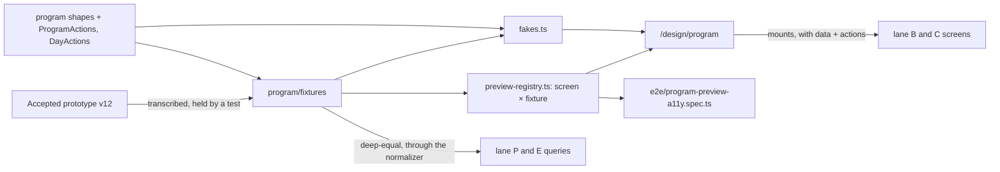

# The program contract

**Read this before changing a shape, a fixture, a fake or the preview route.** Everything here is
what two FAM-1 lanes agree on, so a change is felt by every lane that reads it.

## What this is

The program builder and the day page are built by several lanes at once
([FAM-1 plan](../plans/fam-1-family-program.md) §5 to §7). The contract is what lets them: the
shapes that pass between a screen and its data, named fixtures of each shape, in-memory fakes of the
two actions objects, and a route that mounts any screen with any fixture. A screen is built and
checked on a phone before its tables exist; a query is checked against the same fixture the screen
renders.

**Owner: the contract owner** (plan §5), not a lane. After step 0 it only makes contract changes.

## The map

## Files

| File                                              | What it is for                                                                                                                                                                                                                                                                                                                                                                                                                                                                             |
| ------------------------------------------------- | ------------------------------------------------------------------------------------------------------------------------------------------------------------------------------------------------------------------------------------------------------------------------------------------------------------------------------------------------------------------------------------------------------------------------------------------------------------------------------------------ |
| `packages/shared/src/program/pieces.ts`           | `RowValues`, `Superset`, the bounded texts, `TRACKING_TYPE_FIELDS` (which fields each tracking type has).                                                                                                                                                                                                                                                                                                                                                                                  |
| `packages/shared/src/program/program-shapes.ts`   | The builder's shapes and action inputs: `WorkoutDraft`, `WeekDraft`, `ProgramList`, `ProgramView`, the dialog drafts.                                                                                                                                                                                                                                                                                                                                                                      |
| `packages/shared/src/program/day-shapes.ts`       | `DayPlan`, the row writes, `RowResult` and its refusals.                                                                                                                                                                                                                                                                                                                                                                                                                                   |
| `packages/shared/src/program/actions.ts`          | `ProgramActions` and `DayActions`: the only way a screen writes.                                                                                                                                                                                                                                                                                                                                                                                                                           |
| `packages/shared/src/program/prescribed-text.ts`  | One renderer of a prescription as text, for all seven types. Its own subpath, not the root barrel.                                                                                                                                                                                                                                                                                                                                                                                         |
| `packages/shared/src/program/fixtures/`           | The named fixtures (`@mat-plan/shared/program/fixtures`): the prototype's data, transcribed in `world.ts`.                                                                                                                                                                                                                                                                                                                                                                                 |
| `packages/shared/src/program/owed.test.ts`        | The `it.todo` tests still owed by lane A and the contract owner. Each lane with a guide keeps its own list in its own directory (invariant 9). Lane A has no remaining line: 4a-i and 4b proved the constants' columns in `verify/schema.ts` (a legacy prescription's `target_reps` and `sets` stay unbounded on purpose, as the file says); step 3 wrote its three (in `units.test.ts` and `verify/schema.ts`), and adjusted `shapes.test.ts`' unit pins for `mi` and `(primary, count)`. |
| `apps/web/app/design/program/fakes.ts`            | `createFakeProgramActions`, `createFakeDayActions`: the prototype's rules over one fixture, with a `failNext()` switch. The program fake's clock is `ProgramView.today`.                                                                                                                                                                                                                                                                                                                   |
| `apps/web/app/design/program/picker-options.ts`   | The `picker-options` fixture. Here because its shape is the web's `MovementOptionDTO`.                                                                                                                                                                                                                                                                                                                                                                                                     |
| `apps/web/app/design/program/preview-registry.ts` | Which screens exist and which fixtures each takes; the route's URL scheme. Data only.                                                                                                                                                                                                                                                                                                                                                                                                      |
| `apps/web/app/design/program/preview-harness.tsx` | The client component that mounts a screen with a fixture and a fake, and feeds a fake's changes back as props.                                                                                                                                                                                                                                                                                                                                                                             |
| `apps/web/app/design/program/page.tsx`            | `/design/program`: the index of states, or one state. Behind `requireSession()`, `noindex`, linked from nowhere.                                                                                                                                                                                                                                                                                                                                                                           |
| `apps/web/e2e/program-preview-a11y.spec.ts`       | Walks every state of the registry: axe, 44px targets, no sideways scroll at 360px.                                                                                                                                                                                                                                                                                                                                                                                                         |

**The preview route's URLs:** `/design/program` lists every state.
`/design/program?screen=<programs-list|program|workout-editor|day>&fixture=<name>` mounts one, and
`&fail=next` makes the fake's next write answer `retry` (the "✓ that fails" state).

**The screens it mounts** are the lanes' own: `apps/web/components/program-builder/`
([program-builder.md](./program-builder.md)) and `apps/web/components/day/`
([day-page.md](./day-page.md)). The data lanes are [program-writers.md](./program-writers.md) and
[day-writers.md](./day-writers.md).

### Helpers the lanes import

Small rules and names that more than one lane needs. 🔴 **Import these from `@mat-plan/shared`; do
not write your own.** A lane's own copy is a second definition that drifts (the first lane PRs each
wrote some of these, which is why they are here). All but `rolledBack` are in the root barrel and
safe in a `'use client'` component; `rolledBack` is the proof modules' and comes from the
`db:verify` harness. If a lane needs one that is missing, it asks the contract owner (invariant 1).

| Export                                   | Where                                           | What it is                                                                                                                                                                                                                                                                                                                                                                                                     |
| ---------------------------------------- | ----------------------------------------------- | -------------------------------------------------------------------------------------------------------------------------------------------------------------------------------------------------------------------------------------------------------------------------------------------------------------------------------------------------------------------------------------------------------------- |
| `quantityText(value, unit)`              | `packages/shared/src/program/quantity-text.ts`  | One quantity as text: `25 lb`, `30 s`, `7` for the plain `count`. The spelling `prescribedText` is built from, so a logged value and its prescription read alike.                                                                                                                                                                                                                                              |
| `slotQuantity(item, quantities)`         | `packages/shared/src/program/pieces.ts`         | The tracking type's quantity out of a list (`TRACKING_TYPE_FIELDS[type].slot`), or `null`. `item` is anything with a `trackingType`.                                                                                                                                                                                                                                                                           |
| `DayWorkout`, `DayItem`, `DayRow`        | `packages/shared/src/program/day-shapes.ts`     | The parts of a `DayPlan`, by name.                                                                                                                                                                                                                                                                                                                                                                             |
| `hasStarted(athlete, today)`             | `packages/shared/src/program/program-shapes.ts` | An athlete has started on a program when `since <= today`.                                                                                                                                                                                                                                                                                                                                                     |
| `MONDAY_FIRST`                           | `packages/shared/src/day.ts`                    | The weekdays in the order a week is shown (1, 2, … 6, 0). Each member is still a `Weekday` (0 = Sunday).                                                                                                                                                                                                                                                                                                       |
| `supersetLabels(items)`                  | `packages/shared/src/program/pieces.ts`         | The label each item shows for its superset (`A1`, `A2`, `B1`), as a parallel array; `null` for an item on its own. Letters are ordinal among the items passed, the number is the place among that group's items passed, and the `group` key is never shown. Pass the items a screen shows. After Z it goes on as AA (a saved workout has at most 15 groups, so only a draft of single-item groups gets there). |
| `PLAIN_DECIMAL`, `isPlainDecimal(text)`  | `packages/shared/src/units.ts`                  | The shape of a quantity typed into a text field: a plain decimal with at most `QUANTITY_DECIMALS` places (`5`, `5.5`, `.5`; not `-5`, `1e3`, `0x10`, `5.`, `5 min`). The shape only: trim first, and check the unit's `quantityCeiling` after. Owned by [strength-logging.md](./strength-logging.md).                                                                                                          |
| `WHOLE_NUMBER`, `isWholeNumber(text)`    | `packages/shared/src/units.ts`                  | The shape of reps as typed: digits only. It does not trim and sets no range (`repsSchema` holds 1..1000).                                                                                                                                                                                                                                                                                                      |
| `ProgramListEntry`                       | `packages/shared/src/program/program-shapes.ts` | One program of a `ProgramList` (`ProgramList[number]`), by name.                                                                                                                                                                                                                                                                                                                                               |
| `TRANSPORT_REFUSALS`, `TransportRefusal` | `packages/shared/src/program/actions.ts`        | What a transport answers before the action runs: no session is `not_found`, over the rate limit is `retry`. A real action hands it to `enterMutation` and returns the refusal untouched (invariant 14).                                                                                                                                                                                                        |
| `existingItem(options, name)`            | `packages/shared/src/program/pieces.ts`         | The item a typed name already names, or `undefined`: its name's key or one of its aliases matches (`push ups` is Push-ups, `RDL` is Romanian Deadlift). Each option carries `isCatalog` (required: the picker's tie-break). The one rule for "this item exists" in `newItem`, for the real writer and the fake; it is the picker's `exact` or `aliasHit` (invariant 15).                                       |
| `DEFAULT_TRACKING_TYPE`                  | `packages/shared/src/movements.ts`              | The type an item gets when none is named: `weight_reps`, the `movements.tracking_type` column's default. `packages/db/src/tracking-type-default.test.ts` holds the const and the schema's default equal.                                                                                                                                                                                                       |
| `rolledBack(fn)`                         | `packages/db/scripts/verify/harness.ts`         | For `db:verify` proof modules, not the app: runs a proof's writes in a transaction that is always rolled back, and rethrows the proof's own failure. Imported from `./harness`, beside `asTx` and `expectRejectedBy`.                                                                                                                                                                                          |

`quantityText` is client-safe because it reads its two primitives (`formatNumeric`, and seconds
spelled `s`) from `packages/shared/src/quantity-spelling.ts`, which imports nothing; `csv/value.ts`
re-exports `formatNumeric` from there and reads the same `s` into `CSV_UNIT_SUFFIX`, so the CSV's
bytes did not change. **This guide owns `quantity-spelling.ts`**: a change to `SECONDS_SUFFIX` or
`formatNumeric` changes the text frozen on every later logged row and every exported month, so it
is a contract change. `quantity-text.test.ts` scans every module `quantityText` reaches, and the
root barrel's whole graph, for `csv/` and for any package outside a short allowlist (`zod`; the
barrel adds `uuid`), so a `node:` builtin, `server-only` or `@mat-plan/shared/csv` fails it.

`quantityText` is for stored quantities: 0 to `MAX_STORABLE_QUANTITY` (99999.999), at most
`QUANTITY_DECIMALS` (3) decimals. Outside that range `formatNumeric` is not defined.

### The sets rule on save

`saveWorkoutSchema` refuses a draft whose items break this rule; `workoutDraftSchema`, which the
editor loads, does not (a card mid-edit may have no set count yet).

- An item whose tracking type is logged set by set (`TRACKING_TYPE_FIELDS[type].sets`: Reps,
  Weight × reps, Time per set, Distance) has `sets`, a whole number from 1 to
  `MAX_SETS_PER_MOVEMENT`.
- Every other item (Check, Count, Duration) has `sets: null`.

The issue is on the item's field (`['items', index, 'sets']`), so an editor can point at the card.
The fake's `saveWorkout` parses with the same schema and answers `invalid`, so the preview route
refuses what the real action will. Every `WorkoutDraft` fixture and every workout in the
prototype's world already keeps the rule (`save-workout.test.ts` holds that). The rule reads the
`trackingType` the draft carries; the writer still checks the item's real type.

## Invariants

1. 🔴 **A shape change goes through the contract owner, and the lanes reading it wait** (plan §4).
   A lane that finds the contract wrong or short stops and says what it needs
   ([parallel-work](../parallel-work.md) → "Once lanes run", 5). It does not widen a shape in its
   own PR: this guide is owed by every file here, so such a PR fails `guides:check` without it.
2. 🔴 **The fixtures are the accepted prototype's data, state for state** (plan §8).
   `fixtures/prototype.test.ts` runs the prototype's own data functions and requires the
   transcription to equal them. A fixture is changed by changing the prototype first.
3. **A fixture is tested from both sides.** The screen renders it; the data lane seeds the state it
   describes and asserts its query deep-equals it, through `packages/db/scripts/verify/normalize-fixture.ts`.
4. 🔴 **Fakes on the preview route, real actions in production, never a mix** (plan §6). Nothing
   outside `apps/web/app/design/program/` imports the fakes, `picker-options` or the fixtures
   subpath, and nothing outside it names the route: `fakes.test.ts` and `preview-registry.test.ts`
   scan for both.
5. **A fake follows the prototype's rules and each rule has a test** (`fakes.test.ts`; plan §8,
   "Behaviour"). A fake and a real action parse an input with the same schema, so a screen sees the
   same refusal on the preview route and in production.
6. **An optional action that is not supplied is `undefined`, and the screen hides its control.** The
   fakes supply every member.
7. **The preview route reads no data.** Its only DAL call is the session check. It renders inside
   `AppShell` with `nav={false}`, so a screen gets production's measure and its one `<main>`, and
   the rail's real athletes are not shown beside fixture ones.
8. **One list of states, three readers.** The index, the route's parser and the a11y spec all read
   `preview-registry.ts`, which reads the contract's fixture lists. A new fixture is on the route
   and in the scan with no further edit.
9. 🔴 **No lane's step edits a file this guide owns.** If one had to, every lane would owe this
   guide and they would be one queue again. (One recorded exception: FAM-1 step 3 added the unit
   `mi` and `(primary, count)`, which the plan assigns to it, and so adjusted the unit pins in
   `shapes.test.ts`; maintainer-approved, 2026-11-15.) Two things keep it so. The harness test
   (`preview-harness.test.tsx`) mocks the four screens and asserts only what the harness hands
   them, so filling a stub in changes no file here; a screen's own output is tested beside the
   screen. And each lane's list of owed tests is a file in its own directory:
   `packages/db/src/writers/program/owed.test.ts` (P), `packages/db/src/writers/day/owed.test.ts`
   (E), `apps/web/components/program-builder/owed.test.ts` (B) and
   `apps/web/components/day/owed.test.ts` (C). Lanes A and S have no guide, so their lines stay in
   `packages/shared/src/program/owed.test.ts` and are edited under the seam rule, one PR at a time.
10. **Every text a person types is refused if it holds a control character** (a NUL reaches Postgres,
    which refuses it, and the action then throws instead of answering `invalid`).
    `control-chars.test.ts` sweeps every typed field of the write schemas; a field added to one
    joins that table. `freeTextNoteSchema` and `movementNameSchema` refuse only a line break (and a
    comma), so the contract adds the rule where it builds on them.
11. **The day case mounts what the page will, in the page's order** (plan D34): the `<h1>`, then
    `AthleteSwitcher`, `ProgramLine` and `NotOnAProgram`, then `DayScreen`. All four get the same
    `plan` object and the two that write get the same `actions`; the harness passes no `className` (it
    has no nav rail) and no `programsHref` until the Programs page exists (7b). The switcher's links
    come from `dayPreviewHrefFor`, which reads the fixture list, so each is a state the route lists.
    The parts are lane C's; their props are a contract with the page and this harness.
12. **The workout-editor case passes the draft's own program** (`program`, a `ProgramListEntry`), read
    from the fake's Programs list by the draft's `programPublicId`, as the real page will load it
    (7b). The screen's prop is optional; the harness always supplies it.
13. **An added set is a row only while it is logged**, in the fake as in the contract
    (`dayItemSchema.rows`, `rowWriteSchema`). ✓ on any set number with no logged row adds
    its row, and only that row (a type without set rows has no set past 1: `bad_value`); un-ticking an
    added set takes the row away, so the numbers may have a gap, and ticking it back returns it. ⚠️ A set that was
    already past the prescription in a fixture stays a row when un-ticked: a `DayItem` does not carry
    the prescribed set count, so the fake cannot tell it from a prescribed one.
14. **A transport refuses in two of the contract's own words, and they are named once**
    (`TRANSPORT_REFUSALS`, `program/actions.ts`): no session answers `not_found`, the same as an id
    from another household; over the rate limit answers `retry`. Both are members of
    `PROGRAM_REFUSALS` and `ROW_REFUSALS`, so one value is a `ProgramResult` and a `RowResult`. The
    web app's entry check returns them (`enterMutation(TRANSPORT_REFUSALS)`,
    [write-path.md](./write-path.md) invariant 1); a later API transport returns the same two.
    Neither list gains a "signed out" or "forbidden" member (ADR 0006). A fake calls no
    transport, so it never answers either word for these two reasons.

15. **`newItem` makes no second item for a name or an alias that already names one in the
    household's list, and it answers with the item's own name.** A typed name that `existingItem` matches selects that item
    (`existed: true`); it is not a refusal. The picker withholds "add as new" for the same two cases
    (`matchMovementOptions`' `exact` and `aliasHit`), so the client's guard and the server's answer
    are one rule: the guard saves a round trip, the server holds when the page is stale or the call
    did not come from the picker. `name` is on every success (the stored name, which is not always
    what was typed), so a card never shows `rdl` for Romanian Deadlift.
    Three limits, each on purpose: the options passed must carry `isCatalog` (the picker's
    tie-break, so the type requires it); a name whose key is empty (`S`) is refused by
    `newItemSchema`, since it could be matched to nothing; and the check is a read before the
    insert, so two calls in the same moment with names that share a key but not a slug can both
    insert (plan D25).

16. **A slot holds at most one entry** (plan D35, maintainer, 2026-11-16; a slot is one athlete,
    day, prescription and set). Program rows only: bodyweight and practice are not slots in this
    sense and keep "re-entry is a new row". A new ✓ on a set whose entry was un-ticked, or hidden by
    Clear day, brings that entry back: same `entryPublicId`, no second entry, however many times a
    row is un-ticked and ticked. The revived entry is what a new ✓ would have made but for its id:
    this ✓'s numbers and the prescription's text as it reads now. The rules are on `rowWriteSchema`
    (and, for a late re-tick, `rowRetickSchema`) and in the fake: the entry answers to the reviving
    ✓'s `clientId`; that id never revives its own hidden entry (`own_hidden`); a refused ✓ leaves the
    hidden entry untouched; a re-tick that arrives after the revive answers with the live entry.
    ⚠️ **One known limit:** the entry stores one `clientId`, so an id a revive replaced is forgotten.
    Replayed after the set is un-ticked again, it revives the entry with that old attempt's numbers
    (`fakes.test.ts` pins it). No screen re-sends such an attempt and there is no offline queue;
    closing it means keeping the replaced ids, which is a table. The real writer gets all of this at
    step 11c. Until then 11b inserts where 11c will revive, so two answers differ between the two
    steps: a re-tick after a new ✓ (`slot_taken` under 11b), and a replay of the first ✓'s id while
    its entry is hidden (`own_hidden` under 11b, and under 11c once that id has been replaced it
    is the limit above).

## Traps

- **`@mat-plan/shared`'s root barrel does not export the fixtures or `prescribedText`.** They are
  the `/program/fixtures` and `/program/prescribed-text` subpaths, because `'use client'`
  components import the barrel. That is a rule about the barrel: `prescribed-text.ts` is pure, so a
  client component may import its subpath directly for a whole prescription's line. For one
  quantity, `quantityText` is in the barrel.
- **`packages/shared` has no typecheck project of its own** ([AGENTS.md](../../AGENTS.md) → "Local
  hooks vs CI merge-gates"). Its files are checked through what `apps/web` and `packages/db` import.
- **The fixtures are deep-frozen.** Clone one before changing it (`structuredClone`); the fakes do.

## Changing it

- **A new state:** add the fixture to `fixtures/index.ts` and to the list of its shape
  (`DAY_PLAN_FIXTURES` and the like). The route, its index and the scan pick it up.
- **A new screen:** add it to `PREVIEW_SCREENS` and a `case` to `preview-harness.tsx`.
- **A new rule in a fake:** write its test in `fakes.test.ts` first, against a named fixture.
- Re-run: `pnpm test`, and `pnpm e2e:local e2e/program-preview-a11y.spec.ts` for the route.
