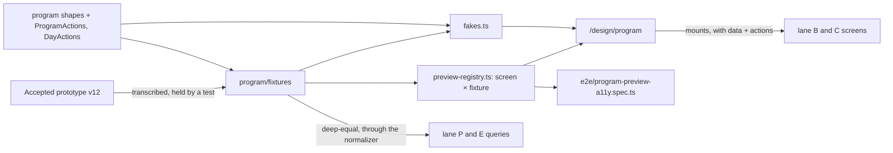

# The program contract

**Read this before changing a shape, a fixture, a fake or the preview route.** Everything here is
what two FAM-1 lanes agree on, so a change is felt by every lane that reads it.

## What this is

The program builder and the day page are built by several lanes at once
([FAM-1 plan](../plans/fam-1-family-program.md) §5 to §7). The contract is what lets them: the
shapes that pass between a screen and its data, named fixtures of each shape, in-memory fakes of the
two actions objects, and a route that mounts any screen with any fixture. A screen is built and
checked on a phone before its tables exist; a query is checked against the same fixture the screen
renders.

**Owner: the contract owner** (plan §5), not a lane. After step 0 it only makes contract changes.

## The map

## Files

| File                                              | What it is for                                                                                                                                                                                                                                                                                                                                                                                                                                                                                                                                                      |
| ------------------------------------------------- | ------------------------------------------------------------------------------------------------------------------------------------------------------------------------------------------------------------------------------------------------------------------------------------------------------------------------------------------------------------------------------------------------------------------------------------------------------------------------------------------------------------------------------------------------------------------- |
| `packages/shared/src/program/pieces.ts`           | `RowValues`, `Superset`, the bounded texts, `TRACKING_TYPE_FIELDS` (which fields each tracking type has).                                                                                                                                                                                                                                                                                                                                                                                                                                                           |
| `packages/shared/src/program/program-shapes.ts`   | The builder's shapes and action inputs: `WorkoutDraft`, `WeekDraft`, `ProgramList`, `ProgramView`, the dialog drafts.                                                                                                                                                                                                                                                                                                                                                                                                                                               |
| `packages/shared/src/program/day-shapes.ts`       | `DayPlan`, the row writes, `RowResult` and its refusals.                                                                                                                                                                                                                                                                                                                                                                                                                                                                                                            |
| `packages/shared/src/program/actions.ts`          | `ProgramActions` and `DayActions`: the only way a screen writes.                                                                                                                                                                                                                                                                                                                                                                                                                                                                                                    |
| `packages/shared/src/program/prescribed-text.ts`  | One renderer of a prescription as text, for all seven types. Its own subpath, not the root barrel.                                                                                                                                                                                                                                                                                                                                                                                                                                                                  |
| `packages/shared/src/program/fixtures/`           | The named fixtures (`@mat-plan/shared/program/fixtures`): the prototype's data, transcribed in `world.ts`.                                                                                                                                                                                                                                                                                                                                                                                                                                                          |
| `packages/shared/src/program/owed.test.ts`        | The `it.todo` tests still owed by lane A and the contract owner. Each lane with a guide keeps its own list in its own directory (invariant 9). Lane A has no remaining line: 4a-i and 4b proved the constants' columns in `verify/schema.ts` (a legacy prescription's `target_reps` and `sets` stay unbounded on purpose, as the file says; `program_blocks.name` is bounded on every row (0029, validated by 0031)); step 3 wrote its three (in `units.test.ts` and `verify/schema.ts`), and adjusted `shapes.test.ts`' unit pins for `mi` and `(primary, count)`. |
| `apps/web/app/design/program/fakes.ts`            | `createFakeProgramActions`, `createFakeDayActions`: the prototype's rules over one fixture, with a `failNext()` switch. The program fake's clock is `ProgramView.today`.                                                                                                                                                                                                                                                                                                                                                                                            |
| `apps/web/app/design/program/picker-options.ts`   | The `picker-options` fixture: the test library as library rows (`catalogOptionOf` over `CATALOG_FIXTURE`) and the prototype's items as the household's own, one row a name (a name in both is the library's row under the item's id when the two log alike, else the household's item); and `previewHowTo(publicId)`, the preview's "How to" read. Here because its shape is the web's `MovementOptionDTO`.                                                                                                                                                         |
| `apps/web/app/design/program/preview-registry.ts` | Which screens exist and which fixtures each takes; the route's URL scheme. Data only.                                                                                                                                                                                                                                                                                                                                                                                                                                                                               |
| `apps/web/app/design/program/preview-harness.tsx` | The client component that mounts a screen with a fixture and a fake, and feeds a fake's changes back as props. It hands the picker `previewHowTo` as its "How to" loader. It wraps every screen in `<BuilderLinkPrefetch value={false}>`, so no builder link prefetches a fixture id's page (a 404).                                                                                                                                                                                                                                                                |
| `apps/web/app/design/program/page.tsx`            | `/design/program`: the index of states, or one state. Behind `requireSession()`, `noindex`, linked from nowhere.                                                                                                                                                                                                                                                                                                                                                                                                                                                    |
| `apps/web/e2e/program-preview-a11y.spec.ts`       | Walks every state of the registry: axe, 44px targets, no sideways scroll at 360px.                                                                                                                                                                                                                                                                                                                                                                                                                                                                                  |

**The preview route's URLs:** `/design/program` lists every state.
`/design/program?screen=<programs-list|program|workout-editor|day>&fixture=<name>` mounts one, and
`&fail=next` makes the fake's next write answer `retry` (the "✓ that fails" state).

**The screens it mounts** are the lanes' own: `apps/web/components/program-builder/`
([program-builder.md](./program-builder.md)) and `apps/web/components/day/`
([day-page.md](./day-page.md)). The data lanes are [program-writers.md](./program-writers.md) and
[day-writers.md](./day-writers.md).

### Helpers the lanes import

Small rules and names that more than one lane needs. 🔴 **Import these from `@mat-plan/shared`; do
not write your own.** A lane's own copy is a second definition that drifts (the first lane PRs each
wrote some of these, which is why they are here). All but `rolledBack` and `asDb` are in the root barrel and
safe in a `'use client'` component; those two are the proof modules' and come from the
`db:verify` harness. If a lane needs one that is missing, it asks the contract owner (invariant 1).

| Export                                                                                                                                                                                                                                       | Where                                                                             | What it is                                                                                                                                                                                                                                                                                                                                                                                                                                                                                                                                 |
| -------------------------------------------------------------------------------------------------------------------------------------------------------------------------------------------------------------------------------------------- | --------------------------------------------------------------------------------- | ------------------------------------------------------------------------------------------------------------------------------------------------------------------------------------------------------------------------------------------------------------------------------------------------------------------------------------------------------------------------------------------------------------------------------------------------------------------------------------------------------------------------------------------ |
| `quantityText(value, unit)`                                                                                                                                                                                                                  | `packages/shared/src/program/quantity-text.ts`                                    | One quantity as text: `25 lb`, `30 s`, `7` for the plain `count`. The spelling `prescribedText` is built from, so a logged value and its prescription read alike.                                                                                                                                                                                                                                                                                                                                                                          |
| `slotQuantity(item, quantities)`                                                                                                                                                                                                             | `packages/shared/src/program/pieces.ts`                                           | The tracking type's quantity out of a list (`TRACKING_TYPE_FIELDS[type].slot`), or `null`. `item` is anything with a `trackingType`.                                                                                                                                                                                                                                                                                                                                                                                                       |
| `DayWorkout`, `DayItem`, `DayRow`                                                                                                                                                                                                            | `packages/shared/src/program/day-shapes.ts`                                       | The parts of a `DayPlan`, by name.                                                                                                                                                                                                                                                                                                                                                                                                                                                                                                         |
| `hasStarted(athlete, today)`                                                                                                                                                                                                                 | `packages/shared/src/program/program-shapes.ts`                                   | An athlete has started on a program when `since <= today`.                                                                                                                                                                                                                                                                                                                                                                                                                                                                                 |
| `MONDAY_FIRST`                                                                                                                                                                                                                               | `packages/shared/src/day.ts`                                                      | The weekdays in the order a week is shown (1, 2, … 6, 0). Each member is still a `Weekday` (0 = Sunday).                                                                                                                                                                                                                                                                                                                                                                                                                                   |
| `supersetLabels(items)`                                                                                                                                                                                                                      | `packages/shared/src/program/pieces.ts`                                           | The label each item shows for its superset (`A1`, `A2`, `B1`), as a parallel array; `null` for an item on its own. Letters are ordinal among the items passed, the number is the place among that group's items passed, and the `group` key is never shown. Pass the items a screen shows. After Z it goes on as AA (a saved workout has at most 15 groups, so only a draft of single-item groups gets there).                                                                                                                             |
| `PLAIN_DECIMAL`, `isPlainDecimal(text)`                                                                                                                                                                                                      | `packages/shared/src/units.ts`                                                    | The shape of a quantity typed into a text field: a plain decimal with at most `QUANTITY_DECIMALS` places (`5`, `5.5`, `.5`; not `-5`, `1e3`, `0x10`, `5.`, `5 min`). The shape only: trim first, and check the unit's `quantityCeiling` after. Owned by [strength-logging.md](./strength-logging.md).                                                                                                                                                                                                                                      |
| `WHOLE_NUMBER`, `isWholeNumber(text)`                                                                                                                                                                                                        | `packages/shared/src/units.ts`                                                    | The shape of reps as typed: digits only. It does not trim and sets no range (`repsSchema` holds 1..1000).                                                                                                                                                                                                                                                                                                                                                                                                                                  |
| `ProgramListEntry`                                                                                                                                                                                                                           | `packages/shared/src/program/program-shapes.ts`                                   | One program of a `ProgramList` (`ProgramList[number]`), by name.                                                                                                                                                                                                                                                                                                                                                                                                                                                                           |
| `TRANSPORT_REFUSALS`, `TransportRefusal`                                                                                                                                                                                                     | `packages/shared/src/program/actions.ts`                                          | What a transport answers before the action runs: no session is `not_found`, over the rate limit is `retry`. A real action hands it to `enterMutation` and returns the refusal untouched (invariant 14).                                                                                                                                                                                                                                                                                                                                    |
| `existingItem(options, name)`                                                                                                                                                                                                                | `packages/shared/src/program/pieces.ts`                                           | The item a typed name already names, or `undefined`: its name's key or one of its aliases matches (`push ups` is Push-ups, `RDL` is Romanian Deadlift), or it spells the item once its short forms are expanded (`db row` is Dumbbell row; C30). Each option carries `isCatalog` (required: the picker's tie-break). The one rule for "this item exists" in `newItem`, for the real writer and the fake; it is the picker's `exact`, `aliasHit` or `shortFormHit`, and the picker's first row (invariant 15; search invariants 10 and 11). |
| `fillRowValues(item, typed, target)`                                                                                                                                                                                                         | `packages/shared/src/program/pieces.ts`                                           | What a ✓ or a Change stores, or `null` for `bad_value`: typed numbers, else the prescription's (an amend passes `target: null`). The one value-fill rule, for the row writer, the amend and the fake (invariant 16).                                                                                                                                                                                                                                                                                                                       |
| `loggedRowUnit(trackingType, logged)`                                                                                                                                                                                                        | `packages/shared/src/program/pieces.ts`                                           | The unit a logged row's numbers are in: its stored quantity's, `null` for a type with none. What a Change is judged in (invariant 27).                                                                                                                                                                                                                                                                                                                                                                                                     |
| `prescribedTarget(targetReps, quantities)`, `PrescribedTarget`                                                                                                                                                                               | `packages/shared/src/program/pieces.ts`                                           | A prescription's numbers as `DayItem.target` holds them: whole-number reps or `null`; a quantity with a `valueMax` (a range) has `value: null`. The day's read and the row writer both build the target with it.                                                                                                                                                                                                                                                                                                                           |
| `entryUnitFor(type, prescribedUnit)`, `ENTRY_UNIT_WITHOUT_QUANTITY`                                                                                                                                                                          | `packages/shared/src/program/pieces.ts`                                           | The unit a logged row's entry stores: `bool` for a Check, `count` for Reps, else the prescribed unit (plan §2). For the row writer and the export.                                                                                                                                                                                                                                                                                                                                                                                         |
| `itemUnit(trackingType, quantities)`                                                                                                                                                                                                         | `packages/shared/src/program/pieces.ts`                                           | The unit an item logs in, which is `DayItem.unit`: `null` for a Check or Reps, the type's fixed unit, else the prescription's unit in the type's slot. One definition for the day's read and the row writer, because `fillRowValues` refuses a quantity in any other unit.                                                                                                                                                                                                                                                                 |
| `DAY_PLAN_FIXTURE_SOURCES`, `DayPlanFixtureSource`, `PROGRAM_VIEW_FIXTURE_SOURCES`, `ProgramViewFixtureSource`, `PROGRAM_LIST_FIXTURE_SOURCES`, `ProgramListFixtureSource`, `World`, `workoutDraft`, `programView`, `programOf`, `workoutOf` | `packages/shared/src/program/fixtures/index.ts` (the `/program/fixtures` subpath) | What each `DayPlan` fixture was built from: `{ world, athlete, day, before }`. A data lane's proof seeds `world` and deep-equals the fixture of the same name. `before` is the world before an edit, or `null`. `workoutDraft(world, programId, wid)` gives a workout as a `WorkoutDraft`, ready for the writer. `programView(world, programId)` gives a program's page as a `ProgramView`; its `week` is a `WeekDraft['days']`, ready for `saveWeek` (C27).                                                                               |
| `showsOnlyLogged(day)`                                                                                                                                                                                                                       | `packages/shared/src/program/day-shapes.ts`                                       | Whether a day shows only what was logged: not writable and not a future day (a day before yesterday; an archived athlete's today or yesterday). There, an unlogged workout or item is absent and PREVIOUS is `null`. The fixture builder, the day resolver and the day screen all ask it (C23).                                                                                                                                                                                                                                            |
| `programsByStay(programs)`                                                                                                                                                                                                                   | `packages/shared/src/program/day-shapes.ts`                                       | A day's current programs split by `endsToday`: `{ staying, ending }`, each in the order given, the members' own type kept. `[...staying, ...ending]` is the order `currentPrograms` is in. The fixture builder and the fake's reorder use it; the Program order dialog lists `staying` with arrows and `ending` below with none (invariant 33).                                                                                                                                                                                            |
| `lowerCaseUuidSchema`                                                                                                                                                                                                                        | `packages/shared/src/program/pieces.ts`                                           | An id as every shape here reads it: any uuid, handed back in lower case, so two spellings of one id compare equal after the parse (invariant 26). For an action or a query that parses an id of its own (a page's route parameter, say) and then compares it in JS.                                                                                                                                                                                                                                                                        |
| `weekRepeatsAWorkout(draft)`                                                                                                                                                                                                                 | `packages/shared/src/program/program-shapes.ts`                                   | Whether a week names one workout twice on a day, asked of a draft `weekDraftSchema` refused: `saveWeek` answers `once_per_day` when it does, else `invalid`. Takes the raw input (anything), counts only slots whose id is a uuid, and reads two spellings of one id as one workout. Any repeat counts, whatever else is wrong. One definition for the fake and the writer (invariant 26).                                                                                                                                                 |
| `emptyWeek()`                                                                                                                                                                                                                                | `packages/shared/src/program/program-shapes.ts`                                   | A week with nothing on any day: every weekday present, each `[]`, as a `WeekDraft['days']`. A new object and new arrays on every call, so a caller may fill it. For a week read with no slots yet and a week editor's starting state (C26). `emptyWeek<Slot>()` is the same week for another slot type.                                                                                                                                                                                                                                    |
| `inWritableWindow(day, today)`, `WRITABLE_DAY_RADIUS`                                                                                                                                                                                        | `packages/shared/src/day.ts`                                                      | Today and yesterday, never a day after today (plan D20, D32): what `DayPlan.writable` means and what a row write is held to. Pure; the caller supplies `today`. ⚠️ The older forms' `isWritableDay` (web) also accepts tomorrow until step 12c.                                                                                                                                                                                                                                                                                            |
| `dayOpenFor(athlete, day, today)`                                                                                                                                                                                                            | `packages/shared/src/day.ts`                                                      | "The day is open" for one athlete: inside the writable window and not archived (C34). What `DayPlan.writable` means, what the row writer takes a ✓ on, and what a day's Restore all is held to. As of C34 only the fixture world calls it: lane E's `rowDayOpen` and lane S's `dayIsOpen` are the same rule and switch in their own PRs. Pure; the caller supplies `today` and `{ archived }`. Call this wherever the athlete is known, never `inWritableWindow` plus a second archived check.                                             |
| `DEFAULT_TRACKING_TYPE`                                                                                                                                                                                                                      | `packages/shared/src/movements.ts`                                                | The type an item gets when none is named: `weight_reps`, the `movements.tracking_type` column's default. `packages/db/src/tracking-type-default.test.ts` holds the const and the schema's default equal.                                                                                                                                                                                                                                                                                                                                   |
| `rolledBack(fn)`                                                                                                                                                                                                                             | `packages/db/scripts/verify/harness.ts`                                           | For `db:verify` proof modules, not the app: runs a proof's writes in a transaction that is always rolled back, and rethrows the proof's own failure. Imported from `./harness`, beside `asTx` and `expectRejectedBy`.                                                                                                                                                                                                                                                                                                                      |
| `asDb(tx)`                                                                                                                                                                                                                                   | `packages/db/scripts/verify/harness.ts`                                           | A proof's transaction as the database handle a query or a seed helper takes, where `asTx(tx)` is the handle a writer takes. Not in a barrel: import it from the harness, as `rolledBack`.                                                                                                                                                                                                                                                                                                                                                  |

`quantityText` is client-safe because it reads its two primitives (`formatNumeric`, and seconds
spelled `s`) from `packages/shared/src/quantity-spelling.ts`, which imports nothing; `csv/value.ts`
re-exports `formatNumeric` from there and reads the same `s` into `CSV_UNIT_SUFFIX`, so the CSV's
bytes did not change. **This guide owns `quantity-spelling.ts`**: a change to `SECONDS_SUFFIX` or
`formatNumeric` changes the text frozen on every later logged row and every exported month, so it
is a contract change. `quantity-text.test.ts` scans every module `quantityText` reaches, and the
root barrel's whole graph, for `csv/` and for any package outside a short allowlist (`zod`; the
barrel adds `uuid`), so a `node:` builtin, `server-only` or `@mat-plan/shared/csv` fails it.

`quantityText` is for stored quantities: 0 to `MAX_STORABLE_QUANTITY` (99999.999), at most
`QUANTITY_DECIMALS` (3) decimals. Outside that range `formatNumeric` is not defined.

### The sets rule on save

`saveWorkoutSchema` refuses a draft whose items break this rule; `workoutDraftSchema`, which the
editor loads, does not (a card mid-edit may have no set count yet).

- An item whose tracking type is logged set by set (`TRACKING_TYPE_FIELDS[type].sets`: Reps,
  Weight × reps, Time per set, Distance) has `sets`, a whole number from 1 to
  `MAX_SETS_PER_MOVEMENT`.
- Every other item (Check, Count, Duration) has `sets: null`.

The issue is on the item's field (`['items', index, 'sets']`), so an editor can point at the card.
The fake's `saveWorkout` parses with the same schema and answers `invalid`, so the preview route
refuses what the real action will. Every `WorkoutDraft` fixture and every workout in the
prototype's world already keeps the rule (`save-workout.test.ts` holds that). The rule reads the
`trackingType` the draft carries; the writer still checks the item's real type.

### The unit rule on save

`saveWorkoutSchema` also refuses an item that could be saved and never logged (contract change
C16). `workoutDraftSchema` does not: a card whose type was just chosen has no unit yet.

- A type with a quantity (`TRACKING_TYPE_FIELDS[type].slot`) must have a unit, as `itemUnit` finds
  it: the type's fixed unit, or the unit of the prescribed quantity in the type's slot.
- So a **Count**, a **Weight × reps** and a **Distance** item each carry a quantity in their slot.
  Its `value` may be `null` ("log in this unit, no target"); the unit may not be missing.
- A **Duration** and a **Time per set** have a fixed unit and pass with no quantity. A **Check** and
  **Reps** measure nothing and pass with none.

- **The quantity in the type's slot is in a unit the type logs in** (`unitsForTrackingType`, what
  the editor's unit select offers; plan D27). A Count in `bool` could store no ✓, and a Duration
  prescribed in seconds would refuse an empty ✓, because a Duration logs in minutes.
- **A target is a number an empty ✓ can store.** Where the quantity has a `value`, the rule asks
  `fillRowValues` itself whether an empty ✓ on that target is stored. Today that refuses a value
  over its unit's ceiling (`quantityCeiling`: 1,001 of a count, 1,441 minutes). A blank target is
  not judged: the row asks for the number.

The issue is on the item's quantities (`['items', index, 'quantities']`), beside any `sets` issue on
the same card. The rule reads the `trackingType` the draft carries, as the sets rule does; the
writer still checks the item's real type. It looks at the type's own slot only: a quantity in
another slot, or a second one in the same slot, is the writer's to refuse.

## Invariants

1. 🔴 **A shape change goes through the contract owner, and the lanes reading it wait** (plan §4).
   A lane that finds the contract wrong or short stops and says what it needs
   ([parallel-work](../parallel-work.md) → "Once lanes run", 5). It does not widen a shape in its
   own PR: this guide is owed by every file here, so such a PR fails `guides:check` without it.
2. 🔴 **The fixtures are the accepted prototype's data, state for state** (plan §8).
   `fixtures/prototype.test.ts` runs the prototype's own data functions and requires the
   transcription to equal them. A fixture is changed by changing the prototype first. **Eleven fixtures are not prototype states and say so**: `every-type-once`, `closed-day-program-since-left` (C17), `archived-athlete-today` (C18), `closed-day-nothing-logged` and `archived-athlete-nothing-logged` (C22), `family-program-archived-athlete` and `programs-list-archived-athlete` (C36), `family-program-full-weekday` (C35), `coach-label-program-ending-today` (C32, C37), `today-three-programs-one-ending` (C37) and `unit-edited-after-logging` (C28). Each is the
   prototype's data arranged to reach a rule no prototype state reaches. **And one field of one
   fixture differs from the prototype's own state, by the maintainer's decision** (2026-11-17):
   the workout that left the week in `workout-left-the-week` has no label, where v12 shows the
   label its slot had.
3. **A fixture is tested from both sides.** The screen renders it; the data lane seeds the state it
   describes and asserts its query deep-equals it, through `packages/db/scripts/verify/normalize-fixture.ts`
   or, stricter, with ids compared exactly through a fixture-id to public-id map the proof's seeder
   returns (12a does this: the normalizer cannot tell a public id from a client id).
4. 🔴 **Fakes on the preview route, real actions in production, never a mix** (plan §6). Nothing
   in `apps/web` outside `apps/web/app/design/program/` imports the fakes, `picker-options` or the
   fixtures subpath, and nothing outside it names the route: `fakes.test.ts` and
   `preview-registry.test.ts` scan `apps/web` for both. The data lanes' proofs in
   `packages/db/scripts/verify/` do import the fixtures subpath: that is invariant 3. So may a
   test: the unit tests are not in the scan, and the end-to-end tests under `apps/web/e2e/` are
   left out of the fakes-and-fixtures scan by directory, so a spec reads a fixture's names and
   never re-types them. In return nothing in the app may import from `e2e/` or from `scripts/` (the
   same test file checks it), or a helper there could carry a fixture into a route.
5. **A fake follows the prototype's rules and each rule has a test** (`fakes.test.ts`; plan §8,
   "Behaviour"). A fake and a real action parse an input with the same schema, so a screen sees the
   same refusal on the preview route and in production.
6. **An optional action that is not supplied is `undefined`, and the screen hides its control.** The
   fakes supply every member.
7. **The preview route reads no data.** Its only DAL call is the session check. It renders inside
   `AppShell` with `nav={false}`, so a screen gets production's measure and its one `<main>`, and
   the rail's real athletes are not shown beside fixture ones.
8. **One list of states, three readers.** The index, the route's parser and the a11y spec all read
   `preview-registry.ts`, which reads the contract's fixture lists. A new fixture is on the route
   and in the scan with no further edit.
9. 🔴 **No lane's step edits a file this guide owns.** If one had to, every lane would owe this
   guide and they would be one queue again. (One recorded exception: FAM-1 step 3 added the unit
   `mi` and `(primary, count)`, which the plan assigns to it, and so adjusted the unit pins in
   `shapes.test.ts`; maintainer-approved, 2026-11-15.) Two things keep it so. The harness test
   (`preview-harness.test.tsx`) mocks the four screens and asserts only what the harness hands
   them, so filling a stub in changes no file here; a screen's own output is tested beside the
   screen. And each lane's list of owed tests is a file in its own directory:
   `packages/db/src/writers/day/owed.test.ts`
   (E), `apps/web/components/program-builder/owed.test.ts` (B) and
   `apps/web/components/day/owed.test.ts` (C). Lane P's list is empty and its file is gone (6d-ii, #633). Lanes A and S have no guide, so their lines stay in
   `packages/shared/src/program/owed.test.ts` and are edited under the seam rule, one PR at a time.
10. **Every text a person types is refused if it holds a control character** (a NUL reaches Postgres,
    which refuses it, and the action then throws instead of answering `invalid`).
    `control-chars.test.ts` sweeps every typed field of the write schemas; a field added to one
    joins that table. `freeTextNoteSchema` and `movementNameSchema` refuse only a line break (and a
    comma), so the contract adds the rule where it builds on them.
11. **The day case mounts what the page will, in the page's order** (plan D34): the `<h1>`, then
    `AthleteSwitcher`, `ProgramLine` and `NotOnAProgram`, then `DayScreen`. All four get the same
    `plan` object and the two that write get the same `actions`; the harness passes no `className` (it
    has no nav rail). **`NotOnAProgram` gets `programsHref` as the page gives it** (since 15 PR 2,
    #679): under the page's own rule, `offersProgramsLink` (lane C's, in `components/day/`), so the
    preview cannot drift from the page: a change to what the rule answers needs no edit here, and a
    change to its arguments fails to compile here. The preview has no `/programs`, so
    its link opens the preview's own Programs list. `preview-harness.test.tsx` holds the value
    for every day fixture, a live athlete's and an archived one's. The rule today: a live athlete,
    on any day (plan D48, #683). The switcher's links
    come from `dayPreviewHrefFor`, which reads the fixture list, so each is a state the route lists.
    The parts are lane C's; their props are a contract with the page and this harness.
12. **The workout-editor case passes the draft's own program** (`program`, a `ProgramListEntry`), read
    from the fake's Programs list by the draft's `programPublicId`, as the real page will load it
    (7b). The screen's prop is optional; the harness always supplies it.
13. **An added set is a row only while it is logged**, in the fake as in the contract
    (`dayItemSchema.rows`, `rowWriteSchema`). ✓ on any set number with no logged row adds
    its row, and only that row (a type without set rows has no set past 1: `bad_value`); un-ticking an
    added set takes the row away, so the numbers may have a gap, and ticking it back returns it. ⚠️ A set that was
    already past the prescription in a fixture stays a row when un-ticked: a `DayItem` does not carry
    the prescribed set count, so the fake cannot tell it from a prescribed one.
14. **A transport refuses in two of the contract's own words, and they are named once**
    (`TRANSPORT_REFUSALS`, `program/actions.ts`): no session answers `not_found`, the same as an id
    from another household; over the rate limit answers `retry`. Both are members of
    `PROGRAM_REFUSALS` and `ROW_REFUSALS`, so one value is a `ProgramResult` and a `RowResult`. The
    web app's entry check returns them (`enterMutation(TRANSPORT_REFUSALS)`,
    [write-path.md](./write-path.md) invariant 1); a later API transport returns the same two.
    Neither list gains a "signed out" or "forbidden" member (ADR 0006). A fake calls no
    transport, so it never answers either word for these two reasons.

15. **`newItem` makes no second item for a name or an alias that already names one in the
    household's list, and it answers with the item's own name.** A typed name that `existingItem` matches selects that item
    (`existed: true`); it is not a refusal. The picker withholds "add as new" for the same
    three cases (`exact`, `aliasHit`, and since C30 and CAT-3 chunk B1 `shortFormHit`: `db row`
    is Dumbbell row). So the client's guard and the server's answer
    are one rule: the guard saves a round trip, the server holds when the page is stale or the call
    did not come from the picker. `name` is on every success (the stored name, which is not always
    what was typed), so a card never shows `rdl` for Romanian Deadlift.
    Three limits, each on purpose: the options passed must carry `isCatalog` (the picker's
    tie-break, so the type requires it); a name whose key is empty (`S`) is refused by
    `newItemSchema`, since it could be matched to nothing, with a sentence a form shows as it is
    (`NEW_ITEM_NAME_MESSAGES.noKey`: "Give the item a longer name."; only a name of the letter `s`
    alone reaches it, so it must not ask for a letter); and the check is a read before the
    insert, so two calls in the same moment with names that share a key but not a slug can both
    insert (plan D25).

16. **One rule says what a row stores, and the fake uses the writer's** (`fillRowValues`, contract
    change C10). An empty ✓ takes the prescription's numbers; a number the type has no field for, a
    slot named twice, a quantity in another unit, a value over the unit's ceiling, and a missing
    number the prescription cannot supply are each `bad_value`. **The values are judged before the
    set**: the real writer has no slot pre-check and learns a set is taken from the database's
    arbiter at the insert, so a bad number on a logged set answers `bad_value`, not `slot_taken`,
    and the fake answers the same. A range (`valueMax`) is not a number an empty ✓ can accept
    (`prescribedTarget`); no FAM-1 screen writes one, and `prescribedText` does not render one.
    ⚠️ What a person sees follows from that order: a bad number on a set another phone has already
    logged is told the number is wrong, not that the page is out of date, so no Reload is offered
    until the number is fixed and the next ✓ answers `slot_taken`. `entryUnitFor` answers plan §2's
    table whatever unit it is handed for a type whose unit is fixed.

17. **A required name is not made only of characters that fold away** (`shortTextSchema`: a
    program's name, a workout's, a superset's group key and the keys of a day's `restAfter`;
    contract change C12). A name of zero-width or format characters only, or of combining marks
    only, is one character long, so a length check alone takes it; it must also fold to something
    (`foldName`). `invalid` otherwise. ⚠️ This is narrower than "can be seen": the braille blank and
    the Hangul filler characters draw as nothing and still pass, because `foldName` keeps them; they
    are named on the schema. An item's name is held to more by `movementNameSchema` (a letter) and
    `newItemSchema` (a key, invariant 15).

18. **A slot holds at most one entry** (plan D35, maintainer, 2026-11-16; a slot is one athlete,
    day, prescription and set). Program rows only: bodyweight and practice are not slots in this
    sense and keep "re-entry is a new row". A new ✓ on a set whose entry was un-ticked, or hidden by
    Clear day, brings that entry back: same `entryPublicId`, no second entry, however many times a
    row is un-ticked and ticked. The revived entry is what a new ✓ would have made but for its id:
    this ✓'s numbers and the prescription's text as it reads now. The rules are on `rowWriteSchema`
    (and, for a late re-tick, `rowRetickSchema`) and in the fake: the entry answers to the reviving
    ✓'s `clientId`; that id never revives its own hidden entry (`own_hidden`); a refused ✓ leaves the
    hidden entry untouched; a re-tick that arrives after the revive answers with the live entry.
    ⚠️ **One known limit:** the entry stores one `clientId`, so an id a revive replaced is forgotten.
    Replayed after the set is un-ticked again, it revives the entry with that old attempt's numbers
    (`fakes.test.ts` pins it). No screen re-sends such an attempt and there is no offline queue;
    closing it means keeping the replaced ids, which is a table. The maintainer accepted the limit
    (2026-11-16); it is revisited when an offline sync queue arrives. The real writer gets all of
    this at step 11c. Until then 11b inserts where 11c will revive, so two answers differ between the two
    steps: a re-tick after a new ✓ (`slot_taken` under 11b), and a replay of the first ✓'s id while
    its entry is hidden (`own_hidden` under 11b, and under 11c once that id has been replaced it
    is the limit above).

19. **Take off says what it did, and a same-day Put on is undone by it** (`takeOffSchema`,
    maintainer, 2026-11-16). A start that has not begun is removed. A start dated today with no
    live row logged under it is removed too, as if Put on had not been tapped. Any other start ends
    today. The answer's `lastDay` is today, or `null` for a removed start, and the screen words its
    message from that: a start dated today can be either, so `hasStarted` alone cannot say. ⚠️ The
    program fake holds no logged rows, so in the preview a start dated today is always removed.
    **A repeat of a Take off that removed the start answers `{ ok: true, lastDay: null }` again**,
    not `not_found` (a double tap, a retry: a replay answers as the first call did; plan review
    log L51). It holds while the removed start's day is today or later; after that day the call
    is `not_found`, as it is for an athlete who was never on the program. The fake remembers the
    starts it removed, and its today never moves.
20. **A copy may carry its own name, and no program ever holds two workouts with one name**
    (`CopyDraft.name`, optional; maintainer, 2026-11-16). Without a name, a copy into the workout's
    own program is named with " (copy)" and a copy into another program keeps the name. A name
    already used in the program it is copied into answers `name_taken`, in any program. The dialog
    then shows its Name field, prefilled, and the person copies again; it needs no list of the other
    program's workouts. ⚠️ The fake knows another program's names only by what it has copied there,
    so in the preview the clash is a second copy of one workout into the same other program.
21. **Put on undoes a Take off whose last day is today** (`assignDraftSchema`; maintainer,
    2026-11-16). An athlete already on a program is skipped by Put on, except one with a last day:
    that is cleared, and they stay on with no gap, one stretch, whichever day was picked. Such an
    athlete is still `on` in `candidates` and has `lastDay` in `athletes`; the dialog joins the two
    to list them as available.
    ⚠️ **Where a program lands in the athlete's order differs between the fake and the real
    writer.** The fake places a program by the household's list in `candidates[].keeps`, a list
    of names: it holds no end dates for an athlete's other programs, and it keeps a reopened
    program where it was. **The writer places by the household's list too since lane P's 6d-iii
    (#641)**: a new program goes before the first program the athlete keeps that comes later in
    the list, or last, and a hidden program is never "later"; Put on and the Programs list read
    one order (`programListOrder()`). A few rare cases still differ, each put right by the
    athlete's Reorder. Two are accepted: (1) a program earlier in the household's list
    is put on between a same-day Take off and its Put on: the writer reopens by its own rule, the
    fake leaves the program in place (the maintainer, 2026-11-18); (2) a program is put on the
    day another of the athlete's programs, later in the household's list, was taken off: the
    writer places it among the programs that stay, the fake still counts the one ending today
    (the contract owner, 2026-11-19: the real order is the writer's, and the fake cannot know
    without a contract change). There is no third: two of an athlete's programs taken off the
    same day and both put back come back where they were, because a reopened program goes after
    the programs that were ahead of it and are still on (plan D41; the maintainer, 2026-11-19:
    "A: after the ones still ahead").

22. **An item that is saved can be logged in its unit** (`saveWorkoutSchema`, contract change C16).
    The save, the row writer and the day's read ask one function, `itemUnit`, for the unit an item
    logs in. The save refuses an item for which it answers `null` while the type has a quantity,
    one whose quantity is in a unit its type does not log in (`unitsForTrackingType`), and one
    whose target `fillRowValues` would not store (over its unit's ceiling), so the row writer never
    meets a prescription whose empty ✓ it must refuse for its unit or its number.
    `save-workout.test.ts` holds that against `fillRowValues` for every type and unit, at a small
    value, a fraction, the unit's ceiling and one past it. Reps are outside the rule: reps text
    that is not a whole number is legal, and the row then asks for them. The workout
    editor asks for the unit before Save (lane B, #493), and the preview's fake parses with this
    schema; the program writer (6a-ii) refuses the same draft with `invalid`.

23. **A `DayPlan` fixture is built from an exported source, and the builder keeps the shape's own
    rules** (contract change C17). `DAY_PLAN_FIXTURE_SOURCES[name]` is the world a fixture was
    built from; the fixture is that source run through `dayPlan`, so the two cannot differ
    (`fixtures.test.ts`). A data lane seeds the source and deep-equals the fixture (invariant 3).
    Three rules the builder now keeps, each of which `day-shapes.ts` already stated or implied:
    - **Rows:** every prescribed set, plus each logged set beyond them. A gap below a logged extra
      set is not a row and is not counted.
    - **One order for a day's programs and its workouts:** current programs in the athlete's order,
      then any program since left (`order: null`), those in their own order (`idx`, then id).
      Current is a property of the program, not of an assignment row.
      `closed-day-program-since-left` holds it.
    - **Where only logged rows show, a workout has the name it was logged under**, not its name
      now. The same fixture holds a workout renamed after logging.
      The day resolver, not the DAL, sets `writable`, `future` and `canGoForward`, from the `today`
      it is given; the DAL adds `athletes`.

24. **`DayPlan.writable` is true exactly where the row writer would accept a ✓, and a workout
    whose slot is gone has no label** (contract change C18; the maintainer, 2026-11-17).
    - An archived athlete's day is never writable: today and yesterday read like a closed day,
      with only what was logged and no PREVIOUS. `archived-athlete-today` holds it. So a page
      never offers a ✓ the writer refuses with `closed_day`.
    - **The rule is one function, `dayOpenFor(athlete, day, today)`** (`packages/shared/src/day.ts`,
      contract change C34): the window and the archived half together. The fixture world calls
      it; the day resolver, the row writer and Restore all switch to it in their own
      lanes' PRs, so no caller writes the pair out again.
    - **The plan carries no `archived` field.** The page has the fact from the profile and says
      it once, in its own notice (maintainer, 2026-11-17: "One merged notice"; a field was
      proposed as C19 and dropped, #509). The preview harness shows that notice from the
      fixture's world, in the page's words (C20), with "Household settings" as plain text: a
      link there would leave the preview route (invariant 7). A future day is the same for an archived
      athlete as for anyone: `fixtures.test.ts` holds that.
    - `DayPlan.athletes` is the switcher's list: the household's athletes who are not archived,
      as the picker lists them. An archived athlete is not in it on their own day either, so a
      page takes the heading's name from the profile, never from this list (the preview harness
      reads it from the fixture's world).
    - A workout that left the week has `label: null`. The label is its slot's heading; the
      database keeps the workout's name on the session and has nowhere to keep that label.

25. **An id in a `DayWorkout` is one the household can use now** (contract change C21, from 12a-i's
    code review). `programPublicId` is non-null only for a live program; `workoutPublicId` only for
    a live workout of a live program. Hidden or purged, the id is `null` and the frozen name
    remains. `DayPlan.programs` and `currentPrograms` hold live programs only. A logged workout
    that is no longer live has `scheduled: false` and no label, as one that left the week does,
    and further has no description, every item built as a removed item is, and `progress` 0 of 0,
    so a hidden program's own text never reappears. (A workout that merely left the week is still
    live and keeps its description, its live items and its count.) **Liveness decides, never the
    assignment** (C24): a live workout logged on a day no live assignment covers any more is
    shown as one that left the week, ids kept, though its program is not in that day's
    `programs`; `onProgram` still follows the assignments. No FAM-1 action hides a
    program, and no fixture holds this: the day resolver's own proof does.
26. **An id has one spelling after the parse: lower case** (contract change C25, from 6a-ii's
    review). Every id in the shapes, a public id or a client id, is `lowerCaseUuidSchema`
    (`pieces.ts`): any uuid, handed back in lower case. Postgres reads `0193A2B4-…` and
    `0193a2b4-…` as one uuid and answers in lower case; `===`, a `Map` and a `Set` read them as
    two. So the "no two the same" checks (a workout's cards, a day's slots, a program order, a
    Put on's athletes) refuse one id written in two cases, and a replay under the other spelling
    of its client id is still a replay, in the fakes as in the writers. 🔴 **Read ids from the
    parsed value, never from the raw input after parsing it**, and do not name `uuidSchema` in
    `program-shapes.ts` or `day-shapes.ts`. **A refused parse hands back no value**, so the one
    place that must look at a refused draft, `saveWeek` deciding between `once_per_day` and
    `invalid`, asks `weekRepeatsAWorkout(draft)`, which folds the case itself; the fake does, and
    6b's writer is to. `id-case.test.ts` sweeps every schema that reads an
    id and scans both files for the case-keeping schema; a schema added with an id belongs in its
    table. Nothing changes for an id the app made (`newId`, `crypto.randomUUID` and Postgres all
    write lower case). A writer may still lower-case for itself; it is then doing nothing.
27. 🔴 **A Change is judged in the unit the row was logged in, never the item's unit now**
    (`loggedRowUnit`, contract change C28, from step 11c's plan). Saving a workout can edit a
    prescription's unit in place, so a row logged in lb can sit under an item that now reads kg.
    A Change fixes a number; it does not restate one in a new unit. Judged against the item, a
    kg number would be stored on a row still labelled lb: a load in the wrong unit. So an amend
    passes `fillRowValues` the row's own unit (`{ trackingType, unit: loggedRowUnit(…) }`, with
    no target), in the fake as in the writer: the lb row is changed in lb and a kg number answers
    `bad_value`. A new ✓ is not a Change and is still in the item's unit. The screen offers
    such a row's reps only (`changeableFields`, 12d-iii): the load stays text in the unit it was
    logged in and is sent back unchanged, and the Change is judged in that unit, as the writer
    judges it (C28). A distance or count row logged in another unit has no reps and stays text.
    **`unit-edited-after-logging` holds the state**: `yesterday-half-done` after the bench press
    and the vest weight went from lb to kg. Each item reads kg (`unit`, `target`, its text); the
    rows logged before the edit keep their pounds and the text they were logged against; two of
    the bench's sets are not logged. No other fixture holds a logged row in another unit than its
    item's (`fixtures.test.ts`). In a fixture world a weight is in pounds unless its item names
    a `unit`, and only this fixture's edit names one.
    **A row that does not hold what its type now logs has no unit to be changed in**
    (`loggedRowUnit` is `null`: no quantity in the type's slot, or one in a unit the type cannot
    be in), so a Change that sends a quantity for it is `bad_value`. No FAM-1 screen changes an
    item's type (plan D25), so nothing makes such a row today.
28. **A copy's default name is cut by whole characters, counted as the name's schema counts**
    (`copyName`, contract change C33, from step 6a-iii-b's review: the first writer to store
    one). The schema limits a name's `length`, which counts an emoji as two, so a plain `slice`
    at that length can keep half of one, and a database stores that half as a replacement mark.
    `copyName` takes the name a character at a time while it fits. Only where it cut, it drops
    what the cut left hanging: a trailing space (or the copy would read `Heavy  (copy)`, with
    two spaces) and a joiner that joins nothing. A name with room is kept exactly as it is. The
    cut is by character, not by what a person sees as one emoji, so the browser's prefill and
    the server's default are the same string on any engine; a cut inside a flag or a family
    leaves a plainer emoji, never a broken one. The dialog's prefill and the writer's default
    are this one function (invariant 20 is the rule for the copy's name).
29. **A row action answers `bad_value` for input its schema refuses, in the fake as in the real
    action** (contract change C31, from #547's review). The real actions parse first and answer
    `bad_value` for anything the schema refuses (12b's `writeRow`); the fake's un-tick and re-tick
    answered `not_found` there and now answer the same word. `not_found` stays for an entry that
    is not this athlete's on that day. **A hide token is one the app could have written**: `hiddenAtSchema`
    (`packages/shared/src/hide.ts`, lane S's) refuses 30 February, month 13 and year 0000, which
    have the token's shape and fail the database's cast, and hour 24 and second 60, which pass
    the cast as the next midnight or minute and so are a second spelling of an instant.
    Refusing all five keeps each token to one spelling, and `rowRetickSchema` takes that rule whole
    (`shapes.test.ts` pins it, so a looser token schema fails the contract's own test). The
    real action refuses before anything is read, and the fake changes nothing.
30. **A household's own items, a program's workouts and a weekday's workouts each have a cap, and
    passing one is `limit_reached`** (contract change C35; maintainer, 2026-11-18: "Approve 500 /
    50 / 30"). `MAX_HOUSEHOLD_ITEMS` (500: the items a household made, never the library's),
    `MAX_PROGRAM_WORKOUTS` (50: a saved new workout and a copy alike) and `MAX_DAY_SLOTS` (30: one
    weekday of one program's week), in `program-shapes.ts`. The refusal is its own word because
    `invalid` reads as "something typed is wrong" and a screen marks a field for it.
    - **The item cap is `newItem`'s.** The old Strength form's logger also makes a household item
      for a typed name (`resolveSessionMovements`), outside this cap and its lock, and stays so
      until that form is retired (step 12f) or the library's fresh start: refusing a set
      mid-workout over an item count would cost more than it protects (decided overnight,
      2026-11-18; an accepted gap).
    - **One function counts a household's items: `householdItemsFull(options)`**
      (`program-shapes.ts`), from the picker's options: an option whose `owner` is `household`
      counts, a library movement never does. The fake and the picker's "full" line ask it (the picker since 15 PR 1, #664).
      `newItem` (lane P, `new-item.ts`) still counts for itself, and agrees with it today; it
      moves to it in a PR of its own, so the three cannot drift when the library's fresh start
      changes which rows are listed.
    - **Never capped:** an edit of a workout that exists; a replay of a create (the same client
      id answers as the first call did); `newItem` for a name that already names an item, which
      selects it (invariant 15).
    - **For a create the cap is judged before the name**, so a full program says so and nobody
      renames a workout only to be told the program is full.
    - **The weekday cap is in `weekDaysSchema`**, so a week past it fails the parse.
      `weekExceedsDaySlots(draft)` tells that from any other failure, as `weekRepeatsAWorkout`
      does for a repeat, and **a repeat is asked first**: `once_per_day`, then `limit_reached`,
      then `invalid`. The fake, the real action (#603) and lane P's writer (#605) all answer this way.
    - **The workouts cap is the program's the write lands in.** For a copy into another program
      that is the other program's, never the source's. ⚠️ The fake holds only the program on
      screen, so it counts that one alone: a copy into another program is never refused by the
      fake, and a save for a program that is not on screen is not counted either. The real
      writers count the destination.
    - **A read of a week is held to the weekday cap too**, because `ProgramView.week` is
      `weekDaysSchema`. That is safe because no real writer stores a longer day: `saveWeek` parses the draft, and **`copyWorkout`, which adds a slot to each weekday it names without parsing a week, refuses the whole copy with `limit_reached` when one of them is already full** (the destination program's week; judged with the workouts cap; lane P's writer, #605). The fake refuses it the same way for the program on screen, and `family-program-full-weekday` is the Family program with Monday at the cap. The week's table is new with FAM-1, so no stored week is longer. No other read shape has a `.max` for these
      caps (`ProgramView.workouts` has none), and how many programs a household has is not
      capped.
31. **An archived athlete is on no program page and no Programs list** (contract change C36;
    decided under the maintainer's overnight delegation, 2026-11-18, on lane P's question from
    6c-ii's review). `ProgramView.athletes`, `ProgramView.candidates` and the names of a
    `ProgramList` entry hold the household's athletes who are not archived, as the day page's
    switcher does (invariant 24).
    - **The assignment is untouched**, so they are back on the page when restored. A program
      with only an archived athlete on it keeps its page and its list entry, with no names.
    - **Put on refuses an archived athlete with `not_found`, for the whole draft**, as for any
      athlete it cannot put on (lane P's writer, 6c-i; the fake answers the same because they
      are no candidate). So a candidate is always someone Put on would take.
    - **Take off answers `not_found` for an archived athlete too**, though their assignment
      exists: they are not on the page, so a Take off for them can only come from a page opened
      before the archive. The fake answers it (they are not among `athletes`); lane P's 6d
      writer answers the same, and does not end the assignment.
    - `family-program-archived-athlete` and `programs-list-archived-athlete` hold it: one world,
      the seeded family with Athlete Two archived while still on the Family program.
    - **`PROGRAM_VIEW_FIXTURE_SOURCES` and `PROGRAM_LIST_FIXTURE_SOURCES`** give every program
      fixture's world (`{ world, program, before }` and `{ world, before }`), as
      `DAY_PLAN_FIXTURE_SOURCES` does for the day's (invariant 3): `before` is the world the
      fixture changes from, or `null` when it is the seeded world itself. A proof seeds
      `before ?? world`, makes the change with the real writers, and deep-equals the fixture.
32. **A day's item carries the library's coach label, and only a library movement can**
    (contract change C32; plan D40, maintainer 2026-11-17: the label shows on the day page too).
    `DayItem.supervision` is `'coach'` exactly when the item is a library movement whose library
    entry carries the label.
    - **Absent otherwise, never `null`.** The schema refuses `null`, so no fixture without a
      labelled item changed, and a screen tests for the key.
    - **A library movement is one no household owns.** A household's own item never carries a
      label, whatever its name: a family that types "Hang power clean" has made its own item.
    - **The label follows the movement, not the prescription.** An item whose prescription was
      removed (logged rows only) carries what a live item of that movement would.
    - **In a fixture world, `catalog[key].library` says an item IS a movement of the test
      library** (`CATALOG_FIXTURE`), by its slug. The builder reads the label from that entry and
      throws when the world's name or tracking type is not the entry's. A data lane's proof seeds
      such an item as a library row (under a proof-only slug, with the library it hands the
      resolver re-slugged to match, so a proof's rows never collide with the seeded library) and
      resolves the label from the library it is handed, never from the world. The item's id is `fixtureIds.item(key)` like any other.
    - `coach-label-program-ending-today` holds all four cases: a labelled library movement, an
      unlabelled one, the household's own item, and a labelled movement whose prescription left.
33. **A program the athlete comes off after today is last in `currentPrograms`, and says so**
    (contract change C37; ADR 0007 Amendment 5, maintainer 2026-11-18). Each entry may carry
    `endsToday: true`, present exactly on a program whose last day is today and absent on one
    that stays; the schema refuses `false`. The day's read ranks a row "has an end and has
    started", which is the same set: Take off is the only writer of an end and it ends on
    today. A fixture world with a started program ending later is refused by the builder. Such a program sorts after every program that
    stays, whatever the athlete's order says, and the day's `programs` and `workouts` follow.
    - **The Reorder dialog cannot move it**, so it lists it with no arrows (plan §8 and review
      log L49). ⚠️ Until lane C's dialog reads the flag, it still shows arrows there, and the
      fake ignores that move as the real order would.
    - **`reorderPrograms` still takes the full list**, the program ending today included, and the
      fake puts it last whatever place it was given, as the day's read does.
    - **The list holds at most 50 ids** (`MAX_ORDER_PROGRAMS` in `program-shapes.ts`; maintainer,
      2026-11-19: "cap at 50"): `programOrderSchema` refuses a longer one, so the action and the
      fake answer `invalid` before anything is read or written. It bounds the body and is not one of
      invariant 30's caps: nothing limits how many programs an athlete is on, so an athlete on
      more than 50 could not reorder, which is accepted as far above any real use.
    - **The split has one definition: `programsByStay(programs)`** (`day-shapes.ts`). It answers
      `{ staying, ending }`, split on `endsToday`, each in the order given. The fixture builder
      ranks with it and the fake's reorder puts `ending` last with it. A screen that lists the
      two groups apart calls it too.
    - ⚠️ **A known gap in the fake:** it accepts a reorder for an archived athlete, where the real
      writer answers `not_found`. `DayPlan` carries no `archived` field on purpose (invariant
      24), so the fake cannot tell.
    - `coach-label-program-ending-today` holds it: the program ending today is first in the
      athlete's own order and reads back last.
    - `today-three-programs-one-ending` holds the dialog's state: `today-two-programs` with a
      third program, second in the athlete's own order, whose last day is today. Two programs
      move and one stays below them. Each of the three has a workout that day.

## Traps

- **`@mat-plan/shared`'s root barrel does not export the fixtures or `prescribedText`.** They are
  the `/program/fixtures` and `/program/prescribed-text` subpaths, because `'use client'`
  components import the barrel. That is a rule about the barrel: `prescribed-text.ts` is pure, so a
  client component may import its subpath directly for a whole prescription's line. For one
  quantity, `quantityText` is in the barrel.
- **`packages/shared` has no typecheck project of its own** ([AGENTS.md](../../AGENTS.md) → "Local
  hooks vs CI merge-gates"). Its files are checked through what `apps/web` and `packages/db` import.
- **The fixtures are deep-frozen.** Clone one before changing it (`structuredClone`); the fakes do.

## The movement library's contract (CAT-3)

The second contract this guide owns. [Its spec](../specs/cat-3-movement-library.md) is the source of
truth; this section is the map. The library's lanes (schema, data, picker) meet at these files as
FAM-1's lanes meet at the program shapes, and the same rule holds: **no lane edits a file listed
here; a change goes through the contract owner.**

| File                                            | What it holds                                                                                                                                                                                                                                                                                                                                                                                                                                                                                                                                                                                                                                               |
| ----------------------------------------------- | ----------------------------------------------------------------------------------------------------------------------------------------------------------------------------------------------------------------------------------------------------------------------------------------------------------------------------------------------------------------------------------------------------------------------------------------------------------------------------------------------------------------------------------------------------------------------------------------------------------------------------------------------------------- |
| `packages/shared/src/catalog/vocabulary.ts`     | `EQUIPMENT` (53 codes), `MUSCLES`, `MODALITIES`, `SUPERVISION` (each with a zod enum, named members and labels), `MEDIA_KINDS`, and `QUERY_SHORT_FORMS`. In the root barrel.                                                                                                                                                                                                                                                                                                                                                                                                                                                                                |
| `packages/shared/src/catalog/entry.ts`          | `catalogMovementSchema` / `CatalogMovement` (one library entry: strict, no id), `catalogInstructionsSchema`, `catalogMediaSchema`, their caps, and `requiresNoEquipment`. In the root barrel.                                                                                                                                                                                                                                                                                                                                                                                                                                                               |
| `packages/shared/src/catalog/fixture.ts`        | `CATALOG_FIXTURE` (24 generic entries), `CATALOG_FIXTURE_IDS` and `CATALOG_FIXTURE_OPTIONS` (the entries as picker options). The subpath `@mat-plan/shared/catalog/fixture`. What a test, CI or preview database holds in place of the real library.                                                                                                                                                                                                                                                                                                                                                                                                        |
| `packages/shared/src/catalog/approvals.ts`      | `entryHash`, `lockfileIssues`, `approvalIssues`: the checks behind `data/shipped.json` and `data/approved.json`. `node:crypto`, so server and test code only; not exported from the module's index.                                                                                                                                                                                                                                                                                                                                                                                                                                                         |
| `packages/shared/src/catalog/data/`             | **The data lane's directory.** `CATALOG_MOVEMENTS` (empty until the first reviewed batch), `CATALOG_SLUGS`, `shipped.json`, `approved.json`. The subpath `@mat-plan/shared/catalog/data`. C0a created the files; the lane fills them and writes its guide.                                                                                                                                                                                                                                                                                                                                                                                                  |
| `.github/scripts/check-catalog-append-only.mjs` | The step in CI's quality job that compares the two record files with the PR's base (`pnpm catalog:check` locally).                                                                                                                                                                                                                                                                                                                                                                                                                                                                                                                                          |
| `packages/shared/src/catalog/catalog.test.ts`   | Criteria V1 to V3, V5, V6 and D2, and what the fixture covers. `approvals.test.ts` holds V4 and D3 (the lockfile, the approvals, the merge-base comparison). `owed.test.ts` lists only the criteria no test holds yet; lane B's proofs live in its picker's and the item picker's tests (`apps/web/components/movements/`, `apps/web/lib/movements/`, `apps/web/components/program-builder/item-picker/`).                                                                                                                                                                                                                                                  |
| `packages/shared/src/movement-search.ts`        | `matchMovementOptions` (the plain match, best match first), `searchMovementOptions` (the library's search: short forms, part of another name, `near`, `shortFormHit`, `foundByAlias`, and under filters `hits`, `hitsOutsideFilters`, `custom`, `outsideFilters`, `enterTarget`), `movementFilterCounts`, `equipmentFilterOrder`, `editsWithin`, `SEARCH_WORDS_MAX`. Beside `foldMovementQuery` and `movementNameKey`, which [movement-picker.md](./movement-picker.md) describes. `catalog/search.test.ts` holds criteria P1 to P4, P17 and the contract's half of P6; `catalog/filters.test.ts` the contract's half of P5 and P7 to P10.                  |
| `packages/shared/src/movement-filters.ts`       | `MovementFilters` (equipment as one choice of three, the ticked items, the main muscles), `NO_MOVEMENT_FILTERS`, `movementFiltersOn`, `passesMovementFilters`, `filterMovementOptions` (the list with no query), `EQUIPMENT_FILTER_SHOWN_FIRST`. Pure, client-safe, in the root barrel.                                                                                                                                                                                                                                                                                                                                                                     |
| `packages/shared/src/catalog/option.ts`         | `CatalogOptionTaxonomy` (what the picker knows about a library movement beyond its name), `CatalogOption`, `catalogOptionOf(entry, publicId)` (the one mapping from an entry to an option), `equipmentInOrder` and `musclesInOrder` (the vocabulary's order, which the mapping and the option read both list equipment and secondary muscles in), `catalogHowToSchema` and `CatalogHowTo` (what the "How to" read answers: name, steps, coach label, strict so nothing else rides along), `catalogHowToOf(entries, slug)` (the steps and the supervision label, read by slug). In the root barrel. `catalog/option.test.ts` holds them and the browse tree. |
| `packages/shared/src/catalog/families.ts`       | How "All movements" opens (spec P12): `BROWSE_KINDS`, `MOVEMENT_FAMILY_LABELS`, `MUSCLE_BODY_AREA`, `movementFamilyOf`, `browseTree`, `byFoldedName` (the order a list of movements is read in, for a list beside the tree), `BROWSE_OPEN_AT_MOST`, `BROWSE_FLAT_KINDS`. In the root barrel.                                                                                                                                                                                                                                                                                                                                                                |

Invariants (the spec's rules, as they bind code here). **This list has its own numbers.** A bare
"program-contract invariant N" anywhere else means the family program's list above; this one is
cited as "the movement library's invariant N" (the data lane's guide says "contract invariant N"
under its own CAT-3 heading).

1. **A vocabulary is one const array**, and `EQUIPMENT`, `MUSCLES` and `MODALITIES` become stored
   data when the schema lane's tables ship: from then on a new, renamed or removed member is a
   migration, never an edit to `vocabulary.ts` alone.
2. **An entry has no id and no source.** `catalogMovementSchema` is strict. A catalog row's
   `public_id` is minted when it is seeded; the library is authored and reviewed in-house.
3. **A slug is set once.** It is `movementSlug` of the name or of an alias: a corrected name keeps
   its slug and the old name becomes an alias. It holds no comma and no line break, because the
   CSV export prints it. `shipped.json` pins every shipped slug to its tracking type.
4. **"No equipment" is computed** (`requiresNoEquipment`: the required set is empty) and stored
   nowhere. A scan of every package's source, the migrations and the app holds that nothing is
   named `noEquipment` or `no_equipment`, so the picker's filter switch needs another name.
5. **Every entry, and every edit to one, needs an approval line.** `approved.json` holds the
   SHA-256 of each entry the maintainer approved, by batch; an entry whose content has no matching
   hash fails `approvals.test.ts`, whichever field changed. Both record files only grow, which the
   merge-base check holds; a base it cannot read fails the check. A batch PR is merged by the
   maintainer. **An entry is written exactly as it parses** (no stray spaces): the hash and the
   seed read it as written.
6. **The library stays out of the browser.** The root barrel reaches the vocabularies and the
   entry schema and never `catalog/data/` or `approvals.ts` (a scan). Import the data through its
   subpath, on the server.
7. **`CATALOG_FIXTURE` shares no slug and no name key with the legacy `MOVEMENT_SEED_ROWS`, and no
   alias with the legacy picker's**, which a fixtures database also holds until those lists are
   retired. So its short alias is `SLRDL`, not `RDL`.
8. **A data file imports the entry type and its own directory, nothing else**: `catalog/data/`
   holds literal entries, never code.
9. **Instructions are our own words, written as they will be read; media is reserved.** An
   entry's optional `instructions` is one or more plain lines (no blank line, no space at a line's
   end, at most `CATALOG_INSTRUCTIONS_MAX` characters, **no character a reader cannot see and no
   web address**), reviewed and hashed with the entry. Its
   optional `media` is a kind and a key into the app's own store, **never a URL**, and no entry in
   the library or the fixture may set it until a media plan lifts that test. Both stay in the
   const and are read by slug, like aliases: no column holds them.
10. 🔴 **Three signals say a typed name is already in the list, and the server answers the same
    three** (CAT-3 spec P1; contract change C30). `exact` and `aliasHit` are always
    `matchMovementOptions`' own, for the query as typed. `shortFormHit` is the movement the query
    spells once its short forms are expanded: `db row` is Dumbbell row _(maintainer, 2026-11-17)_.
    Any of the three means the movement is already in the list: a picker on
    `searchMovementOptions` withholds "Use as typed" (both pickers since CAT-3 chunk B1), and `existingItem`
    (`program/pieces.ts`) returns
    that item. Nothing else does: part of an alias and a near miss find a movement and still let
    a household make its own item of that name.
11. **Best match first, one rule for every list** (spec P2). A match has a quality: it is the
    query; it starts with it; a word of it starts with it; it only holds the letters mid-word.
    Within one quality: found by its own name, then by another name, then through a short form;
    then the shorter spelling that matched, counted without its spaces (`Push-ups` and `Pushups`
    tie, so the catalog's is first whichever was typed); then a catalog row before a household's; then by
    name. A movement is listed once, by its best way of being found. `matchMovementOptions`
    orders by this rule, and with no short form and no alias matched as typed
    `searchMovementOptions`' `matches` and `someWords` are its own. 🔴 **`existingItem` returns
    the first row** when two items answer to a name, the row Enter picks, so the server and the
    picker never name different items. A household item literally named `RDL` (made before
    the family program's invariant 15, above) is therefore what `RDL` means in that household; until C30 the
    catalog's item won that case.
12. **A short form is equipment, not a movement.** `QUERY_SHORT_FORMS` expands a whole query word
    inside the search only: never in `movementNameKey`, and never as an entry's alias. A row
    found that way has the quality its expanded words would have had, and among such rows one
    whose name the words spell comes before one whose alias they spell, so `db row` and
    `dumbbell row` mean the same movement. The two old picker aliases that are short forms (`KB`,
    `DB bench`, in `movement-picker-catalog.ts`) were retired by B1, which moved the pickers
    onto `searchMovementOptions`.
13. **Part of another name finds a movement, and never outranks an own name** (spec P17). From
    three letters, a query whose every word is in an alias finds the movement; the alias's best
    quality is "a word starts with it". `foundByAlias` gives the alias a row was found through
    (an exact alias, part of one, or an alias's word a near miss needed), so the row can say
    "also called …" without re-deriving it.
14. **A near miss is offered only when nothing matches, and never picked by Enter.** Every query
    word must be in the option: part of its name, or within its edits of a word of its name or
    of an alias that starts alike: one edit from four letters (a four-letter word needs its
    first two letters to agree), two from nine; three letters or fewer are never a near miss. Or
    the same test on the whole query and a whole name or alias with the spaces out. The edit
    count is banded (it computes about five cells a row). The search reads `MOVEMENT_NAME_MAX` characters of
    a query; a query of more than `SEARCH_WORDS_MAX` words gets the plain match only; and it
    builds no `RegExp` from a query or a name. `someWords` never repeats a row of `near`.
15. **A filter removes rows and never reorders them, and three things are outside its reach**
    (spec P7 to P10; chunk C0b-2). The query is read over every option first, so `exact`,
    `aliasHit`, `shortFormHit`, `foundByAlias` and `hits` do not depend on the filters. Then,
    with a filter on: (a) **`hits` stay first in `matches`**, and those outside the filters are
    named in `hitsOutsideFilters` so the row can say "not in your filters" (the picker refuses to
    make an item of that name, so it must show the item it means); (b) **a household's own item
    is never judged**: it has no equipment and no muscle, so the custom rows the query found
    move to `custom`, one section after the filtered matches (a custom item that is a hit stays
    first in `matches`), and `passesMovementFilters` answering `false` for one is never a reason
    to hide it; (c) **what the filters removed is counted** in `outsideFilters`, and the screen
    never falls back to the whole list. ⏳ Until the catalog's fresh start `outsideWithoutData` says how
    many of those have no taxonomy at all (the old built-ins with no library entry, spec K22),
    so the screen can tell "needs something else" from "nothing is known"; after the fresh start
    it is always zero and the field goes. With no filter on (`movementFiltersOn` is zero, which
    includes "chosen" with nothing ticked) the result is the unfiltered one and a custom item
    sits among `matches`.
16. **Equipment is one choice of three, and changing it clears nothing.** `any`, `none` (the set
    is empty) or `chosen`, which keeps a movement that uses **at least one** ticked item. The
    ticked items stay in `chosenEquipment` whatever the choice and count only under `chosen`.
    Muscles filter by the primary muscle. 🔴 The option carries the equipment **set**
    (`CatalogOptionTaxonomy`), never an answer about it: "needs nothing beyond what I have" is a
    different rule over the same set. (A scan in `catalog.test.ts` refuses a field or a column
    named `noEquipment` or `no_equipment`; it knows no other spelling, so the rule is this
    sentence and the scan is its tripwire.) A library row with no `equipment` field at all
    passes no filter: its taxonomy was not read, which is not the same as needing nothing.
17. **A choice that would leave nothing on the screen is greyed** _(maintainer, 2026-11-17)_.
    `movementFilterCounts` gives the number beside every choice: what the list would show if that
    choice alone of its kind were ticked, with the other kind's filters and the query as they
    are. With a query that counts the hits and the custom items the query found, which are shown
    whatever the filters, so while an exact name is typed nothing greys; with no query it counts
    the library movements that fit. Zero means greyed and not tickable, unless it is already
    ticked. `equipmentFilterOrder` lists the items most first, the zero ones last. The three
    equipment choices each have their number in the same answer (`equipmentAny`, `equipmentNone`,
    `equipmentChosen`: the last counts the items already ticked, which stay ticked while another
    choice is on), so the panel calls `movementFilterCounts` once, not once per choice
    _(maintainer, 2026-11-17)_.
18. **Enter picks a hit, or the only match when it was found by its own name or through a short
    form** (`enterTarget` on the result, spec P5). Never a row found by another name, a near
    miss or a some-words row, 🔴 and a filter does not change that: a custom item set apart
    under a filter counts as something to pick only if it MATCHED. One filtered match beside
    one custom match is two to choose from.
19. **One mapping from an entry to an option** (`catalogOptionOf`, spec P11). The option read is
    compared with it, the preview's options are built with it (`CATALOG_FIXTURE_OPTIONS`), and it
    never carries the instructions: an option says `hasInstructions`, and `catalogHowToOf` reads
    the steps by slug when "How to" is opened, 🔴 always with the supervision label (K17).
    **Equipment and secondary muscles are listed in the vocabulary's order** (`EQUIPMENT`,
    `MUSCLES`; `equipmentInOrder`, `musclesInOrder`; spec K31, maintainer 2026-11-19), whatever
    order an entry or a table row gives them, so a mapping and a read cannot word one movement's
    "what it needs" two ways. A read that builds an option from the tables calls the same two
    functions. Aliases keep the entry's order.
20. **"All movements" opens to the kind of training, then a family** (`browseTree`, spec P12):
    for strength the lift pattern under a plain label, for the other kinds the body area of the
    primary muscle. Kinds in `BROWSE_KINDS`' order; families biggest first, then by label;
    movements by name; nothing empty is listed. A new muscle code does not compile without a
    body area, and a new lift pattern not without a label. **A kind in `BROWSE_FLAT_KINDS`
    (Conditioning, and Skill since 2026-11-19) has no family level** (spec K27, K30): `browseTree` gives it one family whose
    `family` and `label` are `null`, its movements by name, and a screen lists them straight
    under the kind. `BROWSE_OPEN_AT_MOST` applies with a filter on or not (K26).

## Changing it

- **A new state:** add the fixture to `fixtures/index.ts` and to the list of its shape
  (`DAY_PLAN_FIXTURES` and the like). The route, its index and the scan pick it up.
- **A new screen:** add it to `PREVIEW_SCREENS` and a `case` to `preview-harness.tsx`.
- **A new rule in a fake:** write its test in `fakes.test.ts` first, against a named fixture.
- Re-run: `pnpm test`, and `pnpm e2e:local e2e/program-preview-a11y.spec.ts` for the route.
