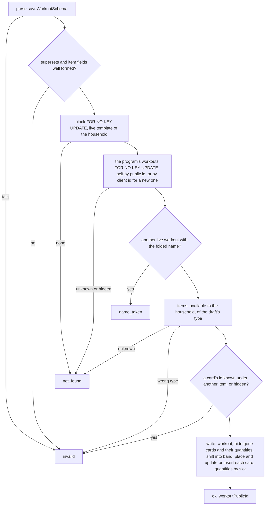

# Program writers and reads

**Read this before adding or changing how a program, a workout, a week or an assignment is written
or read.** This is **lane P** of the [FAM-1 plan](../plans/fam-1-family-program.md) (§5, "Lane P").

## What this is

A parent builds a program: named workouts of items, a week of slots, and who is on it. These are
the writers that store it and the reads the builder's screens load. They start when the plan's
migration 4b is applied.

🚧 **Written at step 0b, before the lane's first step.** It names the lane's directories and the
rules it starts under. Each step below adds its files, its diagram and its invariants here.

## The map

| Step   | Adds                                                                                                                                |
| ------ | ----------------------------------------------------------------------------------------------------------------------------------- |
| 6a-i   | `writers/program/{create-program,rename-program,program-name}.ts` ✅                                                                |
| 6a-ii  | `writers/program/{save-workout,shift-band,index}.ts`; `queries/program/workout.ts` ✅                                               |
| 6a-iii | the copy path; `queries/program/movement-options.ts`; `writers/program/new-item.ts` (after contract change C8)                      |
| 6b     | `writers/program/save-week.ts`; `queries/program/week.ts` ✅                                                                        |
| 6c     | `writers/program/assign.ts` (put on); `queries/program/{program-view,program-list}.ts`; fills in `writers/program/seed-fixtures.ts` |
| 6d     | take off and reorder, in `assign.ts`                                                                                                |

## Files

| File                                                | What it is for                                                                                                                                                                                                                            |
| --------------------------------------------------- | ----------------------------------------------------------------------------------------------------------------------------------------------------------------------------------------------------------------------------------------- |
| `packages/db/src/writers/program/create-program.ts` | `createProgram`: a program is a TEMPLATE block, created by naming it. Replay first, then the name, then a free slug.                                                                                                                      |
| `packages/db/src/writers/program/rename-program.ts` | `renameProgram`: `not_found` (any block that is not this household's live template), then `name_taken`, then the name and a new slug.                                                                                                     |
| `packages/db/src/writers/program/program-name.ts`   | What both share: `programNameTaken` (folded, live templates only), `freeProgramSlug` (`-2`, `-3`… past every live block) and `lostSlugRace`, which recognises the race by `schema.ts`'s `PROGRAM_BLOCK_SLUG_UNIQUE_INDEX` (FAM-1 step 5). |
| `packages/db/src/writers/program/save-workout.ts`   | `saveWorkout`: the editor's full draft. Matches rows by `prescriptionClientId` (D19), hides gone cards, places through the band.                                                                                                          |
| `packages/db/src/writers/program/save-week.ts`      | `saveWeek`: the week editor's full week. A slot keeps its row while its workout stays on that day; a gone slot is hidden; places go through the band.                                                                                     |
| `packages/db/src/writers/program/shift-band.ts`     | `shiftIntoBand`: move a set of placed rows out of the way (`idx + SHIFT_BAND`) so their final places can be written.                                                                                                                      |
| `packages/db/src/writers/program/index.ts`          | The writers behind `ProgramActions`, by name: what `packages/db/src/index.ts` publishes.                                                                                                                                                  |
| `packages/db/src/queries/program/exists.ts`         | `programIn`, `workoutIn`: scoped existence, for the DAL's scope-miss report after a `not_found` and for 7b's pages.                                                                                                                       |
| `packages/db/src/queries/program/workout.ts`        | `readWorkoutDraft`: a saved workout as the editor loads it. Deep-equals the contract's `heavy-a-draft`.                                                                                                                                   |
| `packages/db/src/queries/program/week.ts`           | `readWeek`: a program's week as `WeekDraft['days']`, every weekday present, live slots of live workouts in order.                                                                                                                         |
| `packages/db/src/writers/program/seed-fixtures.ts`  | `seedProgramFixtures`: seeds the fixture family's programs with the real writers. Writes nothing until step 6c.                                                                                                                           |
| `packages/db/src/writers/program/owed.test.ts`      | The lane's `it.todo` list: the tests steps 6a to 6d still owe the contract. Delete a line in the PR that writes its test.                                                                                                                 |
| `packages/db/src/queries/program/index.ts`          | The lane's reads, by name: what `packages/db/src/index.ts` publishes.                                                                                                                                                                     |
| `packages/db/scripts/verify/program.ts`             | The lane's `db:verify` proofs. Its header lists what each step owes and how to compare a read with a fixture.                                                                                                                             |

## Invariants

1. 🔴 **The lane's files go in these three paths and nowhere else.** It never edits `seed.ts`,
   `writers/ownership.ts` or `schema.ts` (plan §5): those are lane A's. A column the plan missed is
   a **column request** to lane A, added expand-only in its next migration (plan §6). The one
   exception is a **seam turn the board grants**: 6a-ii's line in `packages/db/src/index.ts` and its
   case in `apps/web/test/program-tables-stay-dark.test.ts`.
2. 🔴 **A read deep-equals the contract's fixture.** Seed the state the fixture describes, run the
   query, and compare through `scripts/verify/normalize-fixture.ts`: `workout` with `heavy-a-draft`
   (6a), `program-view` with `family-program` (6c). The shapes and fixtures are
   [the contract's](./program-contract.md); a shape that is wrong or short is a contract change,
   not an edit here.
3. **Every proof goes in `verify/program.ts`**, never in `verify.ts` or another lane's module.
4. **Start on open, merge on applied** (plan §6). A step may be written on top of an open PR it is
   gated on; it merges only when that gate has merged and, for a migration, been observed applied.
5. **[write-path.md](./write-path.md)'s invariants still apply to these files**, though the guide
   gate no longer sends a PR there: ownership proven by `public_id` inside the query (2), the
   writer shared with `db:verify` (3), idempotency by a client id, a database UNIQUE and
   `ON CONFLICT` (5), and a create that is replay-first with a named conflict target (12).
6. 🔴 **Every writer behind a `ProgramActions` member takes `input: unknown` and parses it with the
   contract's schema**, answering `invalid`; it never throws for a refusal (`ProgramActions`: "None
   throws for a refusal"). Its refusals come in the preview fake's order
   (`apps/web/app/design/program/fakes.ts`), so a screen sees the same answer on the preview route
   and in production. **Each is correct on a bare `db`**: the DAL need not wrap it in a transaction.
7. 🔴 **A create answers its replay before any check** (invariant 5): `createProgram` looks up
   `clientId` first, so a retry is never told its own name is taken (mutation
   `create-checks-name-before-replay`). Its name check also leaves out its own `clientId`, for a retry
   that races its first attempt; that interleaving is not yet staged (`program-name.ts`). A replay of
   a program removed since answers `not_found`; the key is spent.
8. **Program names are compared folded, among live TEMPLATE blocks only** (plan D5). The seeded
   block's name is not a program's; its **slug** still is, since `uq_program_blocks_household_slug`
   spans both kinds (D9; mutations `program-name-not-folded`, `program-slug-counts-removed`,
   `program-slug-ignores-household`). **A rename re-slugs**, so a renamed program keeps no trace of
   its old name (mutation `rename-slug-counts-itself`).
9. **Two races are accepted, and written on the functions.** Two names written at the same moment
   (creates or renames of different programs) can both pass the name check. Two writes that pick one
   slug at the same moment: the loser fails the slug index, and `lostSlugRace` answers it (a create's
   replay, or `retry`) instead of throwing. PGlite has one connection, so neither interleaving is
   staged by two connections; `verify/program.ts` stages the slug race on one by writing the
   colliding row as the writer opens its savepoint (mutations `rename-lets-slug-race-escape`,
   `create-lets-slug-race-escape`).
10. 🔴 **A save is the workout's full state, matched by card** (D19). A card's
    `prescriptionClientId` keeps its row, and so the entries logged against it, whatever its place;
    a gone card is hidden with its quantities, never deleted; a swapped item arrives under a new id
    (the editor mints it), so its old row is hidden and a new one written. A known id under another
    item, or a hidden card's id, is `invalid`. Quantities are matched by place `(prescription, slot)`,
    so a replayed save adds no row, hidden ones included (mutation
    `quantities-replaced-every-save`).
11. 🔴 **Places go through the band** (`shift-band.ts`; mutation `save-skips-the-band`):
    `uq_prescriptions_workout_idx` is checked row by row, so two cards swapping places collide
    unless every placed row first moves to `idx + SHIFT_BAND`. 6b's week and 6c's program order use the same helper. Its `where` is required (an unscoped one would move every household's rows), and ⚠️ a table placed through it must not CHECK an upper bound on `idx`.
12. **Every refusal comes before the first write**, and the whole save is one transaction (a
    savepoint inside the caller's). 🔴 **Its locks, the order every writer touching a program keeps:** the block `FOR NO KEY UPDATE`, then the program's workouts `FOR NO KEY UPDATE` in id order, then prescriptions, then quantities. The block lock serialises every save of one program, creates included, so a double tap of a new workout is a replay and two new workouts cannot both take one name; `NO KEY UPDATE` still lets a foreign-key check (`FOR KEY SHARE`, a ✓ naming the workout) through. No gate proves a lock: PGlite has one connection. Items must be available to the household (mutation
    `save-takes-any-households-item`) and of the type the draft says; a type's fields are
    `TRACKING_TYPE_FIELDS`' (Reps a whole number 1 to 1000; at most one quantity, in the type's slot
    and units); supersets are neighbours, numbered 1..n, at least two, with the rest on the last.

13. **The reads take ids from URLs and answer a malformed one as a miss** (`null` or `false`), never
    a `22P02`. `not_found` from a writer is one answer for a program, workout or item that missed;
    the DAL that wants to say which calls `programIn` / `workoutIn`.

14. ⚠️ **Trap, latent: an item that is hidden later.** `readWorkoutDraft` joins `movements` without
    `deleted_at`, so a card whose item was hidden still loads, while `saveWorkout` requires every item
    to be available (`movementIsAvailableTo`) and answers the whole save `not_found`. Nothing hides a
    movement today. The step that first does (RETIRE-1) decides: check availability only for new cards
    and changed items, or drop such cards from the read.

15. 🔴 **A week is saved whole, matched by (weekday, workout)** (6b). A slot keeps its row while its
    workout stays on that day; only its place and label change. A slot taken off a day is hidden,
    which frees both partial keys (`uq_block_day_workouts_slot`, `uq_block_day_workouts_once_per_day`),
    so the workout can go back on that day as a new row (mutations `week-keeps-a-removed-slot`,
    `week-replaces-every-slot`). A week saved unchanged writes nothing. Moved slots go through the
    band (`week-skips-the-band`). Refusals, in order: `invalid` (the schema), `once_per_day` (a
    workout twice on a day, also when the ids differ only in case; the schema's own repeat check is
    answered `once_per_day` too), `not_found` (the program, or a workout that is not one of its live
    workouts: `week-takes-any-programs-workout`). It locks the block only: it writes no workout row,
    and the block lock already serialises it with `saveWorkout`.

## Changing it

Start from the step's row in the plan (§5) and the decisions it cites (D19 for matching a saved
workout to its rows). Re-run `pnpm db:verify` and `pnpm db:mutations`.
