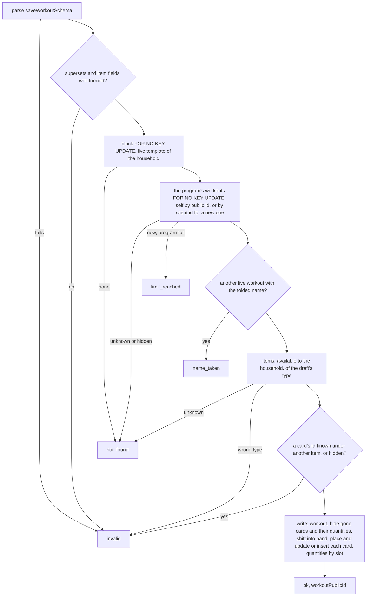
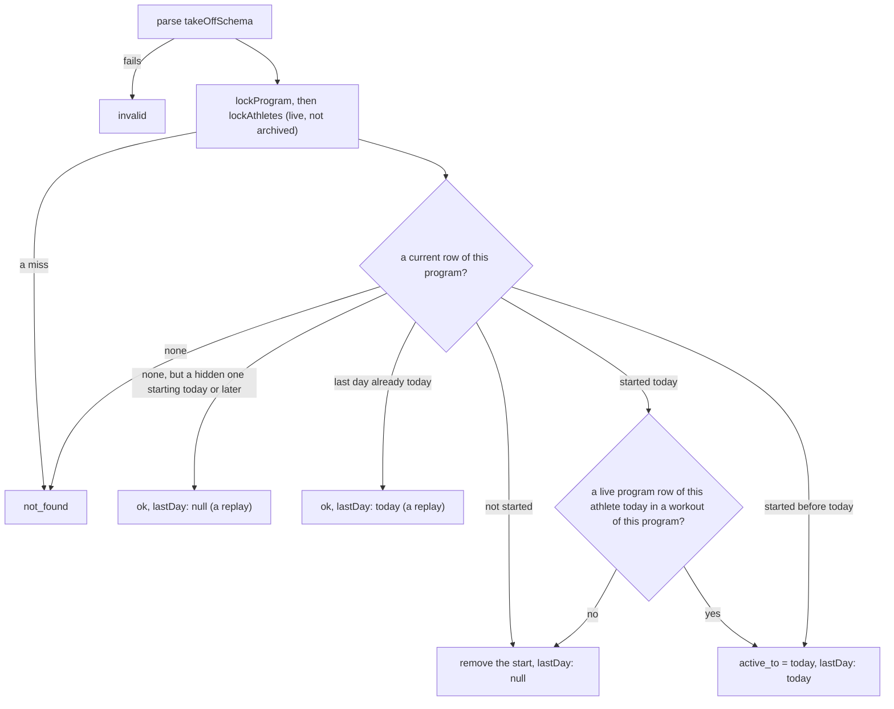

# Program writers and reads

**Read this before adding or changing how a program, a workout, a week or an assignment is written
or read.** This is **lane P** of the [FAM-1 plan](../plans/fam-1-family-program.md) (§5, "Lane P").

## What this is

A parent builds a program: named workouts of items, a week of slots, and who is on it. These are
the writers that store it and the reads the builder's screens load. They start when the plan's
migration 4b is applied.

🚧 **Written at step 0b, before the lane's first step.** It names the lane's directories and the
rules it starts under. Each step below adds its files, its diagram and its invariants here.

## The map

| Step     | Adds                                                                                            |
| -------- | ----------------------------------------------------------------------------------------------- |
| 6a-i     | `writers/program/{create-program,rename-program,program-name}.ts` ✅                            |
| 6a-ii    | `writers/program/{save-workout,shift-band,index}.ts`; `queries/program/workout.ts` ✅           |
| 6a-iii-a | `queries/program/movement-options.ts`; `writers/program/new-item.ts` (contract change C8) ✅    |
| 6a-iii-b | `writers/program/copy-workout.ts` (`copyWorkout`, C15) ✅                                       |
| 6b       | `writers/program/save-week.ts`; `queries/program/week.ts` ✅                                    |
| 6c-i     | `writers/program/assign.ts` (put on, C15's reopen); fills in `writers/program/seed-fixtures.ts` |
| 6c-ii    | `queries/program/{program-view,program-list,athletes}.ts`; `programWorkoutIds` in `exists.ts`   |
| 6d-i     | `writers/program/take-off.ts` (Take off); `lockProgram`, `lockAthletes` shared in `assign.ts`   |
| 6d-ii    | `reorderPrograms` (an athlete's program order), after #601                                      |

## Files

| File                                                  | What it is for                                                                                                                                                                                                                                                                                                                                                                                                                                          |
| ----------------------------------------------------- | ------------------------------------------------------------------------------------------------------------------------------------------------------------------------------------------------------------------------------------------------------------------------------------------------------------------------------------------------------------------------------------------------------------------------------------------------------- |
| `packages/db/src/writers/program/create-program.ts`   | `createProgram`: a program is a TEMPLATE block, created by naming it. Replay first, then the name, then a free slug.                                                                                                                                                                                                                                                                                                                                    |
| `packages/db/src/writers/program/rename-program.ts`   | `renameProgram`: `not_found` (any block that is not this household's live template), then `name_taken`, then the name and a new slug.                                                                                                                                                                                                                                                                                                                   |
| `packages/db/src/writers/program/program-name.ts`     | What both share: `programNameTaken` (folded, live templates only), `freeProgramSlug` (`-2`, `-3`… past every live block) and `lostSlugRace`, which recognises the race by `schema.ts`'s `PROGRAM_BLOCK_SLUG_UNIQUE_INDEX` (FAM-1 step 5).                                                                                                                                                                                                               |
| `packages/db/src/writers/program/save-workout.ts`     | `saveWorkout`: the editor's full draft. Matches rows by `prescriptionClientId` (D19), hides gone cards, places through the band.                                                                                                                                                                                                                                                                                                                        |
| `packages/db/src/writers/program/save-week.ts`        | `saveWeek`: the week editor's full week. A slot keeps its row while its workout stays on that day; a gone slot is hidden; places go through the band.                                                                                                                                                                                                                                                                                                   |
| `packages/db/src/writers/program/refuse.ts`           | `refuse`: the writers' typed refusal.                                                                                                                                                                                                                                                                                                                                                                                                                   |
| `packages/db/src/writers/program/shift-band.ts`       | `shiftIntoBand`: move a set of placed rows out of the way (`idx + SHIFT_BAND`) so their final places can be written.                                                                                                                                                                                                                                                                                                                                    |
| `packages/db/src/writers/program/index.ts`            | The writers behind `ProgramActions`, by name: what `packages/db/src/index.ts` publishes.                                                                                                                                                                                                                                                                                                                                                                |
| `packages/db/src/queries/program/exists.ts`           | `programIn`, `workoutIn`, `workoutInHousehold` (a workout of any of the household's live programs, for a caller with no program id: 7a-ii's copy, 12b), `programWorkoutIds` (a program's live workout ids in one read, two queries, for the week's scope-miss report, 6c-ii): scoped existence (and `liveProgramBlockId`, the program's internal id for a read, not published), for the DAL's scope-miss report after a `not_found` and for 7b's pages. |
| `packages/db/src/queries/program/program-list.ts`     | `readProgramList`: the household's live programs, in the order they were made, each with the athletes on it as of `today`. Deep-equals `programs-list` and `programs-list-archived-athlete`. `readProgramsByAthlete`: each live, not archived athlete's current programs, by public id (7b's Home tiles).                                                                                                                                               |
| `packages/db/src/queries/program/program-view.ts`     | `readProgramView`: the program page: who's on it, the candidates, the workouts (item counts, weekdays, a copy's source and day in the household's zone), the week, the other programs. Deep-equals `family-program` and the four other `ProgramView` fixtures (`family-program-archived-athlete` from C36).                                                                                                                                             |
| `packages/db/src/queries/program/athletes.ts`         | `athletesOnPrograms`: the household's live, not archived athletes, each with their current programs in their own order, through the day page's `dayAssignments` and `currentPrograms`.                                                                                                                                                                                                                                                                  |
| `packages/db/src/queries/program/workout.ts`          | `readWorkoutDraft`: a saved workout as the editor loads it. Deep-equals the contract's `heavy-a-draft`.                                                                                                                                                                                                                                                                                                                                                 |
| `packages/db/src/queries/program/week.ts`             | `readWeek`: a program's week as `WeekDraft['days']`, every weekday present, live slots of live workouts in order.                                                                                                                                                                                                                                                                                                                                       |
| `packages/db/src/queries/program/movement-options.ts` | `movementOptions`: every item the household can pick, catalog rows (with group and aliases) first, then its own live items no catalog slug shadows, used or not.                                                                                                                                                                                                                                                                                        |
| `packages/db/src/writers/program/new-item.ts`         | `newItem`: selects the item a name already names (`existingItem`, then the slug), with its stored name and own type; else makes a household item typed as asked.                                                                                                                                                                                                                                                                                        |
| `packages/db/src/writers/program/copy-workout.ts`     | `copyWorkout`: an independent copy of a workout into one of the household's programs, named by C15, with frozen provenance, optionally onto weekdays.                                                                                                                                                                                                                                                                                                   |
| `packages/db/src/writers/program/seed-fixtures.ts`    | `seedProgramFixtures`: the test seed's fixture programs (`SEED_FIXTURES=1` only), built with the real writers, and the seed's athletes on them. A program the household already has, by its fixed `client_id`, is left as it is.                                                                                                                                                                                                                        |
| `packages/db/src/writers/program/assign.ts`           | `putOn`: athletes onto a template program from today or tomorrow, one row last in their order and all seven weekday rows; already on is skipped; a last day of today is reopened on the same row.                                                                                                                                                                                                                                                       |
| `packages/db/src/writers/program/take-off.ts`         | `takeOff`: removes a start not begun, or begun today with nothing logged under it (`lastDay: null`); otherwise ends the stretch today (`lastDay: today`). A replay answers the same (D15).                                                                                                                                                                                                                                                              |
| `packages/db/src/writers/program/owed.test.ts`        | The lane's `it.todo` list: the tests steps 6a to 6d still owe the contract. Delete a line in the PR that writes its test.                                                                                                                                                                                                                                                                                                                               |
| `packages/db/src/queries/program/index.ts`            | The lane's reads, by name: what `packages/db/src/index.ts` publishes.                                                                                                                                                                                                                                                                                                                                                                                   |
| `packages/db/scripts/verify/program.ts`               | The lane's `db:verify` proofs. Its header lists what each step owes and how to compare a read with a fixture.                                                                                                                                                                                                                                                                                                                                           |

## Invariants

1. 🔴 **The lane's files go in these three paths and nowhere else.** It never edits `seed.ts`,
   `writers/ownership.ts` or `schema.ts` (plan §5): those are lane A's. A column the plan missed is
   a **column request** to lane A, added expand-only in its next migration (plan §6). The one
   exception is a **seam turn the board grants**: 6a-ii's line in `packages/db/src/index.ts` and its
   case in `apps/web/test/program-tables-stay-dark.test.ts`, and (board, 2026-11-17) that test's
   allowance for `lib/dal/day/` to import `workoutInHousehold` alone.
2. 🔴 **A read deep-equals the contract's fixture.** Seed the state the fixture describes, run the
   query, and compare through `scripts/verify/normalize-fixture.ts`: `workout` with `heavy-a-draft`
   (6a), `program-view` with `family-program` (6c). The shapes and fixtures are
   [the contract's](./program-contract.md); a shape that is wrong or short is a contract change,
   not an edit here.
3. **Every proof goes in `verify/program.ts`**, never in `verify.ts` or another lane's module.
4. **Start on open, merge on applied** (plan §6). A step may be written on top of an open PR it is
   gated on; it merges only when that gate has merged and, for a migration, been observed applied.
5. **[write-path.md](./write-path.md)'s invariants still apply to these files**, though the guide
   gate no longer sends a PR there: ownership proven by `public_id` inside the query (2), the
   writer shared with `db:verify` (3), idempotency by a client id, a database UNIQUE and
   `ON CONFLICT` (5), and a create that is replay-first with a named conflict target (12).
6. 🔴 **Every writer behind a `ProgramActions` member takes `input: unknown` and parses it with the
   contract's schema**, answering `invalid`; it never throws for a refusal (`ProgramActions`: "None
   throws for a refusal"). Its refusals come in the preview fake's order
   (`apps/web/app/design/program/fakes.ts`), so a screen sees the same answer on the preview route
   and in production. **Each is correct on a bare `db`**: the DAL need not wrap it in a transaction.
7. 🔴 **A create answers its replay before any check** (invariant 5): `createProgram` looks up
   `clientId` first, so a retry is never told its own name is taken (mutation
   `create-checks-name-before-replay`). Its name check also leaves out its own `clientId`, for a retry
   that races its first attempt; that interleaving is not yet staged (`program-name.ts`). A replay of
   a program removed since answers `not_found`; the key is spent.
8. **Program names are compared folded, among live TEMPLATE blocks only** (plan D5). The seeded
   block's name is not a program's; its **slug** still is, since `uq_program_blocks_household_slug`
   spans both kinds (D9; mutations `program-name-not-folded`, `program-slug-counts-removed`,
   `program-slug-ignores-household`). **A rename re-slugs**, so a renamed program keeps no trace of
   its old name (mutation `rename-slug-counts-itself`).
9. **Two races are accepted, and written on the functions.** Two names written at the same moment
   (creates or renames of different programs) can both pass the name check. Two writes that pick one
   slug at the same moment: the loser fails the slug index, and `lostSlugRace` answers it (a create's
   replay, or `retry`) instead of throwing. PGlite has one connection, so neither interleaving is
   staged by two connections; `verify/program.ts` stages the slug race on one by writing the
   colliding row as the writer opens its savepoint (mutations `rename-lets-slug-race-escape`,
   `create-lets-slug-race-escape`).
10. 🔴 **A save is the workout's full state, matched by card** (D19). A card's
    `prescriptionClientId` keeps its row, and so the entries logged against it, whatever its place;
    a gone card is hidden with its quantities, never deleted; a swapped item arrives under a new id
    (the editor mints it), so its old row is hidden and a new one written. A known id under another
    item, or a hidden card's id, is `invalid`. Quantities are matched by place `(prescription, slot)`,
    so a replayed save adds no row, hidden ones included (mutation
    `quantities-replaced-every-save`).
11. 🔴 **Places go through the band** (`shift-band.ts`; mutation `save-skips-the-band`):
    `uq_prescriptions_workout_idx` is checked row by row, so two cards swapping places collide
    unless every placed row first moves to `idx + SHIFT_BAND`. 6b's week and 6c's program order use the same helper. Its `where` is required (an unscoped one would move every household's rows), and ⚠️ a table placed through it must not CHECK an upper bound on `idx`.
12. **Every refusal comes before the first write**, and the whole save is one transaction (a
    savepoint inside the caller's). 🔴 **Its locks, the order every writer touching a program keeps:** the block `FOR NO KEY UPDATE`, then the program's workouts `FOR NO KEY UPDATE` in id order, then prescriptions, then quantities, then the week's slots (`block_day_workouts`). `saveWeek` takes the block lock alone: it writes no workout row. `putOn` takes the block, then the athletes' `profiles` rows `FOR NO KEY UPDATE` in id order, so two put-ons of one athlete number their order one after the other (6d-i's take off takes the same two, through the shared `lockProgram` and `lockAthletes`; 6d-ii's reorder takes the profile alone, since it writes no program's rows; reviewed, not proven: PGlite has one connection). The block lock serialises every save of one program, creates included, so a double tap of a new workout is a replay and two new workouts cannot both take one name; `NO KEY UPDATE` still lets a foreign-key check (`FOR KEY SHARE`, a ✓ naming the workout) through. No gate proves a lock: PGlite has one connection. Items must be available to the household (mutation
    `save-takes-any-households-item`) and of the type the draft says; a type's fields are
    `TRACKING_TYPE_FIELDS`' (Reps a whole number 1 to 1000; at most one quantity, in the type's slot
    and units); supersets are neighbours, numbered 1..n, at least two, with the rest on the last.

13. **The reads take ids from URLs and answer a malformed one as a miss** (`null` or `false`), never
    a `22P02`. `not_found` from a writer is one answer for a program, workout or item that missed;
    the DAL that wants to say which calls `programIn` / `workoutIn`.

14. ⚠️ **Trap, latent: an item that is hidden later.** `readWorkoutDraft` joins `movements` without
    `deleted_at`, so a card whose item was hidden still loads, while `saveWorkout` requires every item
    to be available (`movementIsAvailableTo`) and answers the whole save `not_found`. Nothing hides a
    movement today. The step that first does (RETIRE-1) decides: check availability only for new cards
    and changed items, or drop such cards from the read.

15. **A writer reads its ids from the parsed draft, and the parse has already lower-cased them**
    (contract change C25, [program-contract.md](./program-contract.md) invariant 26). Postgres
    compares a uuid in any case and answers in lower case, while a writer's maps and `===` do not,
    so one spelling has to hold from the parse on. `saveWorkout` did this itself until C25 and no
    longer does; do not add a second lower-casing or a second "no two the same" check to a writer,
    and do not read an id from the raw `input` after parsing it. The two 6a-ii proofs (an upper-case
    save, and two cards whose ids differ only in case) still run the writer against the database;
    mutation patches `142` and `143` now break the schema to redden them.

16. 🔴 **A week is saved whole, matched by (weekday, workout)** (6b). A slot keeps its row while its
    workout stays on that day; only its place and label change, together when both do
    (`week-moved-slot-keeps-old-label`). A slot taken off a day is hidden **before** anything is
    placed, so one save can take a slot off and fill its place (`week-keeps-a-removed-slot`,
    `week-hides-gone-slots-last`); the workout can go back on that day later as a new row. Only the
    program's own slots are read and written (`week-reads-every-blocks-slots`). A week saved
    unchanged writes nothing, proved by `ctid`, since `updated_at` cannot see a rewrite inside one
    transaction (`week-rewrites-kept-slots`, `week-replaces-every-slot`). Moved slots, and only
    those, go through the band (`week-skips-the-band`, `week-band-moves-unmoved-slots`); added slots are inserted after that, so a slot can go in front of a kept one (`week-inserts-before-the-band`). A moved or relabelled slot is stamped with `updated_at` (`week-move-skips-the-stamp`).
    **Refusals, in the preview fake's order:** `once_per_day` when a day names a workout twice,
    whatever else is wrong with the draft and also when the ids differ only in case (after a refused
    parse, shared `weekRepeatsAWorkout`, the fake's own rule: `week-repeat-loses-to-other-errors`); then `limit_reached` for a day past
    `MAX_DAY_SLOTS` (`weekExceedsDaySlots`, C35, the contract's invariant 30); then `invalid` (the schema); then `not_found` (the program, or a workout that is not one of its live workouts:
    `week-takes-any-programs-workout`, `week-takes-a-hidden-workout`). `readWeek` leaves out a hidden
    workout's slot (`week-read-shows-a-hidden-workout`), and saving the week as read hides it.
    ⚠️ **An accepted race:** a ✓ checks `isScheduledOn` unlocked, so a `saveWeek` that takes the
    workout off that day can commit between the check and the entry. The log keeps a real entry, and
    the day resolver already shows a logged workout that left the week. A lock would make every ✓
    wait on program saves.

17. 🔴 **`newItem` never makes a second item for a name the household already has** (6a-iii-a;
    contract change C8). It asks the picker's own rule first (`existingItem` over `movementOptions`: the same name key, a catalog alias, or an abbreviation that spells the item, `db row` for Dumbbell row, C30), then the resolver's slug (an available
    catalog row the picker does not list), and only then makes a household item. A selected item
    answers with **its stored name and its own type** (D25: nothing retypes an item). So the read
    must list **every** live household item, used or not (maintainer, 2026-11-17), or an item made
    and not yet used could be added again under a re-spelled name (mutations
    `options-list-shadowed-items`, `options-list-hidden-items`, `options-list-any-households-items`,
    `new-item-skips-the-pickers-rule`, `new-item-returns-the-typed-name`, `new-item-skips-the-slug`, `new-item-drops-the-catalog-tie-break`, `new-item-slug-answers-the-typed-name`, `options-household-items-unsorted`, `new-item-answers-the-asked-type`, `new-item-slug-reads-household-first`). Since C30, an item's own name ranks before another item's alias: a household item literally named `RDL` is what `RDL` means in that household, and the catalog's Romanian Deadlift is found by its own name. The list is ordered by folded name in code, not by the database's collation. What the picker shows, and in what order, is the DAL's (`apps/web/lib/dal/program/picker.ts`, lane B's 7a-ii): every catalog row this read returns, the old built-ins included, until the fresh start (CAT-3's R2) replaces them with the library, plus the household's own (maintainer, 2026-11-17, "Show all 35 until reset"). `newItem` checks against this same read, so an old built-in is never duplicated. A catalog option carries its `slug` (CAT-3 P11-i), for the DAL to attach the taxonomy and "How to" from the catalog const; a household option never does, and the slug stops at the DAL (`options-catalog-slug-is-the-name`, `options-household-items-carry-a-slug`).
    ⚠️ Latent, and gated by the constraint on `movements.deleted_at` in `schema.ts` (nothing may
    set it until the indexes and the resolver change together): once something hides a movement
    (`MOV-1`'s merge, or C4m), `newItem`'s step 2 misses the hidden row, and the resolver
    (`findOrCreateTypedMovement`, no `deleted_at` filter) returns it with `existed: false`;
    `saveWorkout` then refuses its id as `not_found`, and the household slug index (no `deleted_at`
    predicate) stops the name being made again. The PR that first hides a movement revisits that
    constraint's list and adds `newItem`'s step 2 and `movementOptions`' catalog and shadow
    `deleted_at` filters to it.

18. 🔴 **A copy is independent of its source, and never a second workout of one name** (6a-iii-b;
    contract change C15). It writes a new workout, new prescription rows (new client ids) and new
    quantity rows; only `copied_from_workout_id` and the source program's name, frozen, point back
    (mutations `copy-leaves-out-the-items`, `copy-leaves-out-the-quantities`). Its name is
    `CopyDraft.name` when given, else `copyName` in its own program and the workout's own name in
    another (`copy-name-ignores-the-program`); a name a live workout of the target has, folded, is
    `name_taken` (`copy-name-not-folded`). A replay is answered once the target program is found, before the source and the name, so it still answers after the source was removed (`copy-checks-name-before-replay`, `copy-checks-the-source-before-replay`). A live card's hidden quantity stays out (`copy-takes-hidden-quantities`), and a copy into another program carries its items too (`copy-elsewhere-leaves-out-the-items`). The source must be a live workout of a live program of the
    household (`copy-takes-a-removed-programs-workout`; `insertWorkoutOwnedBy` refuses another
    household's source by itself). It goes last on each weekday named (`copy-puts-itself-first`). Removed cards stay out and the stored order is kept (`copy-takes-removed-cards`, `copy-ignores-the-order`); every quantity column travels, a range included (`copy-drops-the-range`); the provenance names the SOURCE program, frozen (`copy-records-the-targets-name`); a name a removed workout had is free (`copy-name-counts-removed-workouts`). The source is read in one statement, not locked: locking it would let a copy P→Q and a copy Q→P deadlock.
19. 🔴 **Put on looks for the athlete's row of this program before it inserts** (6c-i; ADR 0007
    Amendment 4, C15). Already on it (an open row, started or still to start): skipped, so a replay
    is one effect without a client id. Its last day is today (Take off was tapped today): the
    **same row** is reopened (`active_to` cleared, its start kept), whatever `from` says. Otherwise a
    new row from `from`. A blind insert would either hit the start key on the closed row or put the
    program on twice today (`schema.ts` → `programAssignments`). Each put on closes up the gaps a
    take off left in the athlete's order and takes the last place, through the band; it writes all
    seven weekday rows; `from` is today or tomorrow of the `today` the caller passes, and an
    archived athlete is `not_found` (mutations `put-on-takes-any-start-day`,
    `put-on-takes-an-archived-athlete`, `put-on-athletes-unscoped`, `put-on-takes-a-legacy-block`,
    `put-on-never-reopens`, `put-on-leaves-the-gap`, `put-on-six-weekdays`,
    `put-on-reopens-an-ended-stretch`, `put-on-reopens-before-closing-the-gap`,
    `put-on-takes-a-removed-athlete`, `put-on-takes-a-removed-program`,
    `put-on-reopens-only-a-start-today`). ⚠️ **A reopen writes no
    weekday rows: it trusts take off to leave them live.** 6d's take off must not hide them, or a
    reopened program is on but never due (`assignmentDueOn`), and 6d proves a reopen after a real
    take off is due today. The seed passes each start day as `today`, so its past
    starts are ones a person made that day; it puts an athlete on in their own order and writes a
    program once (`seed-fixtures-reverses-the-order`, `seed-fixtures-rewrites-a-seeded-program`).
    State a person can make in the app is a warning, never a throw: an archived seed athlete is put
    on nothing, and a program whose item the household has under another type, or whose name a
    program of the household already has, is left out, since `migrate-preview.yml` seeds the long-lived preview
    database on every push (`seed-fixtures-puts-on-an-archived-athlete`,
    `seed-fixtures-uses-a-wrongly-typed-item`). An item the catalog has is the catalog's in the
    seeded workouts (`newItem`): "DB bench press" is seeded as the catalog's Dumbbell Bench Press.

20. 🔴 **The program page and the day page agree on who is on what** (6c-ii). Both reads take each
    athlete's programs from `athletesOnPrograms`, which calls the day page's own `dayAssignments` and
    `currentPrograms` (lane E exported them for this second consumer), so "current as of today"
    (on it now or starting later), the athlete's order and the one-row-per-program rule cannot
    differ between the two pages. An archived or removed athlete is listed on neither program page and is not a candidate. A program's
    order is the order it was made (`program_blocks.id`: no column orders them); athletes are
    earliest made first. Both reads take `today` (and `readProgramView` the household's `tz`, for a
    copy's day) from the caller and parse their answer with the contract's schema. Each proof seeds
    the fixture world into a household of its own and compares ids exactly; it never reads the seed
    household (mutations `program-list-any-households-blocks`, `program-list-newest-first`,
    `program-reads-list-archived-athletes`, `program-reads-any-households-athletes`,
    `program-view-any-households-programs`, `program-view-counts-removed-cards`,
    `program-view-copy-day-in-utc`, `program-view-drops-the-last-day`,
    `program-view-lists-removed-workouts`, `program-workout-ids-keep-removed`,
    `program-view-also-on-includes-itself`, `program-reads-drop-upcoming-starts`,
    `program-reads-list-removed-athletes`, `programs-by-athlete-drops-the-unassigned`). A copy's day is computed in JS with `Intl.formatToParts`, as the app's
    `localDayIso` is, not with Postgres's `at time zone`, which reads a bare offset with the sign
    reversed.
21. 🔴 **The caps are counted under a lock, before the name** (C35; the contract's invariant 30).
    `newItem` stops the household's own items at `MAX_HOUSEHOLD_ITEMS` (counted as the picker lists
    them, so the library and an item a catalog row shadows never count),
    under a transaction-scoped advisory lock keyed on the household (`ADVISORY_LOCK.householdItems` in `writers/locks.ts`, reached through
    `householdRowIs`, so the tenant id is not unwrapped here): two adds at once count one after the
    other. `saveWorkout` (a new workout only: an edit and a replay have their row) and `copyWorkout`
    (the program it lands in, never the source's) stop a program at `MAX_PROGRAM_WORKOUTS` live
    workouts, under the block lock both take first; `copyWorkout` also refuses a weekday it would
    go on that already holds `MAX_DAY_SLOTS`, since it writes slots without a week to parse. `saveWeek` answers a weekday past
    `MAX_DAY_SLOTS` as `limit_reached`, after `once_per_day` and before `invalid`. Each answers
    before the name check, so a full program says so even for a taken name, and none writes
    anything. A proof checks the lock is taken under its namespace and key; no gate proves the waiting
    (PGlite has one connection) (mutations `new-item-uncapped`,
    `new-item-counts-every-household`, `save-workout-caps-a-replay`,
    `save-workout-counts-removed-workouts`, `save-workout-cap-off-by-one`, `copy-uncapped`,
    `save-week-long-day-is-invalid`, `save-week-cap-before-repeat`, `copy-onto-a-full-weekday`,
    `copy-cap-after-the-name`, `save-workout-cap-before-not-found`,
    `copy-cap-before-the-source`, `copy-weekday-cap-after-the-name`, `new-item-takes-no-lock`,
    `new-item-counts-shadowed-items`, `new-item-counts-without-its-household`, `copy-counts-removed-workouts-slots`). A household whose row is gone
    takes no lock, so `newItem` answers `not_found` before it counts.

22. 🔴 **Take off decides by where the start stands, and never ends an archived athlete's
    assignment** (6d-i; ADR 0007 Amendment 4, C15, D15, contract invariant 31).

    "Logged" is `programRowOf(profileId, today)` on a live session whose workout is one of this
    program's, live or removed; an un-ticked row does not count, and a purged workout's rows stop
    counting. Take off never hides the weekday rows (invariant 19) and never moves the athlete's
    other programs. ⚠️ **An accepted limit:** "nothing logged" is read without a lock against the row
    writers, so a ✓ racing it, or a re-tick or Restore all of a row hidden before it (no race needed),
    leaves a logged row under a removed start: contract change C24's state, which the day page shows as
    a workout that left the week (mutations 521–531, `take-off-*`).

## Changing it

Start from the step's row in the plan (§5) and the decisions it cites (D19 for matching a saved
workout to its rows). Re-run `pnpm db:verify` and `pnpm db:mutations`.
