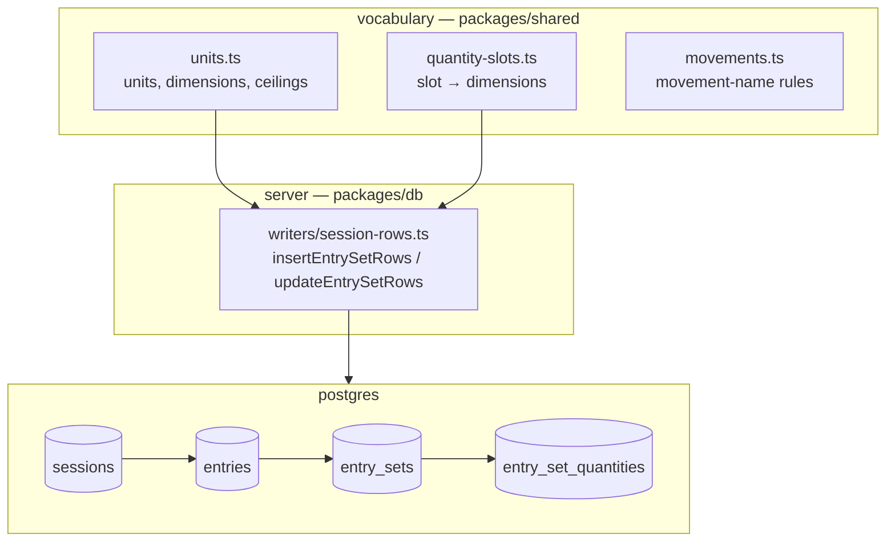

# Strength logging

**Read this before changing the set vocabulary: units, quantity slots, the movement-name rules, or
the set rows.**

> ⚠️ **The legacy strength write path is gone.** FAM-1 12f PR 3 removed the actions that called it;
> [`LEGACY-1`](../plan.md#legacy-1) deleted the DAL (C1), the writer's `db:verify` proofs (C2a) and
> the writer, its movement resolver, its frozen-snapshot helper and its session and set schemas
> (C2b) ([plan](../plans/legacy-1-retire-strength-path.md)). The day page logs and changes strength
> rows through the FAM-1 row writer ([day-writers.md](./day-writers.md)). What this guide still
> covers is the vocabulary that writer and the export share, and the rows production already holds.

## What this is

A logged strength row: a number of reps against some kind of load. "Some kind of load" is the whole
difficulty. A load is not always a number: it can be bodyweight, a band, a box height, a hold
duration, or bodyweight **plus** a weighted vest.

## The map

## Files

| File                         | What it is for                                                                                                                                                                                                                                                                                                                                                                                               |
| ---------------------------- | ------------------------------------------------------------------------------------------------------------------------------------------------------------------------------------------------------------------------------------------------------------------------------------------------------------------------------------------------------------------------------------------------------------ |
| `shared/strength.ts`         | `numericSetSchema`, reps only: its `shape.reps` is the one rep-count rule (`program/pieces.ts` reads it).                                                                                                                                                                                                                                                                                                    |
| `shared/strength-session.ts` | `MAX_SETS_PER_MOVEMENT` only, which the program and day shapes read. The legacy session schema it once held is deleted.                                                                                                                                                                                                                                                                                      |
| `shared/movements.ts`        | The movement-name rules (invariant 9) and the movement patterns. **Also `TRACKING_TYPES`** (FAM-1 0a): how an item is tracked, with its labels, and `DEFAULT_TRACKING_TYPE`. Since FAM-1 step 3, `movements.tracking_type` carries it, CHECK-pinned to the array (a change is a migration); the shapes that read it are in `packages/shared/src/program/` ([plan §2, §4](../plans/fam-1-family-program.md)). |
| `shared/quantity-slots.ts`   | The measurement-role vocabulary (`primary`/`vest`/`ankle`/`wrist`/`distance`) + legal dimensions. `primary` accepts `count` since FAM-1 step 3 (a Count item's plain number).                                                                                                                                                                                                                                |
| `shared/units.ts`            | Units, their dimensions, `QUANTITY_DECIMALS` / `PLAIN_DECIMAL`, and the per-unit ceiling (`MAX_QUANTITY_BY_UNIT` / `quantityCeiling`).                                                                                                                                                                                                                                                                       |
| `writers/session-rows.ts`    | `insertEntrySetRows` (FAM-1 11a): an entry's `entry_sets` rows and each set's quantities, for the row writer (and its revive, 11c-ii) and `db:verify`'s legacy-row fixture. `updateEntrySetRows` (11c-i) beside it, for the day page's Change ([day-writers.md](./day-writers.md) invariant 23).                                                                                                             |

## Invariants

These hold **across** files and are invisible from any single one. Breaking one is how this feature
regresses. The numbers are kept, because other docs cite them.

1. **The LLM never authors a load.** AGENTS.md's one inviolable product rule. Nothing on the write
   path copies a prescribed load into a set; a frozen prescription is a rendering stored on the
   entry, never a set's value. `packages/evals`' invariant class holds both live row writes to
   it, the ✓ (`rowWriteSchema`) and Change (`rowAmendSchema`): a prescription string is not a number,
   so it cannot be stored as one.

_Invariants 2 and 3, the legacy set and edit guards, went with the legacy writer (LEGACY-1)._

4. **Every magnitude lives in `entry_set_quantities`, never on the set.** Since GAP-3 (#139) there is
   no `weight_num`, no `weight_label`, no `seconds`. The two MODES (`is_bodyweight`, `is_band`) are
   booleans on the set because neither is a quantity, and they can coexist with a magnitude, which is
   what makes `BW+8 (vest)` expressible.

4b. **A quantity's dimension is DERIVED from its unit.** `UNIT_DIMENSION_BY_CODE[unit]` is the single
source, so the pair can never disagree with `units(code, dimension)`. That every unit a tracking type
offers reaches the export is `csv/strength-log-types.test.ts`; that every bodyweight unit does is
`units.test.ts`.

Two rules follow the unit:

- **One precision for every unit.** `QUANTITY_DECIMALS = 3` in `packages/shared/src/units.ts`.
  **`PLAIN_DECIMAL` / `isPlainDecimal`** (same file, FAM-1 contract change C2) are built from it: the
  shape of a quantity typed into a TEXT field (`5`, `5.5`, `.5`; not `-5`, `1e3`, `5.`), for the day
  page and the workout editor. **`WHOLE_NUMBER` / `isWholeNumber`** (same file) is the matching shape
  check for reps as typed: digits only.
- **V1-30b-ii — the stored-value ceiling is PER UNIT.** `3219` is a real distance in metres and an
  absurd one in inches, so only the unit tells them apart. `MAX_QUANTITY_BY_UNIT` / `quantityCeiling`
  live in `units.ts`; a caller must treat a missing cap as **refuse**, never "no cap"
  (`n > undefined` is false). `units.test.ts` requires a cap for every unit a tracking type offers.

5. **A quantity's unit is guarded by TWO composite FKs sharing its `dimension` column.** `lb` in a
   box-jump height is rejected by the database. A writer must therefore derive `dimension` from the
   unit it is actually writing, which `insertEntrySetRows` does.

_Invariants 6 and 7, the legacy writer's replay and profile resolve, went with it._

8. **Absent ≠ default on the wire.** A set's `status` and modes are omitted, never defaulted, when
   not supplied: `insertEntrySetRows` omits the column and Postgres applies its own default. One
   default, in one place. Adding a zod `.default()` forks it and changes every stored row.

9. 🔴 **A typed movement name earns rules a stored one does not** (`PICK-1` PR 2). Every name keeps
   the label shape (`movementLabelSchema`: trim, non-empty, `MOVEMENT_NAME_MAX`). The comma/line-break
   guard and the at-least-one-letter rule live in `typedMovementNameIssues` and apply only to text a
   person typed (`movementNameSchema`). 🔴 **A name the database supplied is never refused for those
   rules** — the household may not be able to fix it, and refusing it would make a row unusable by
   its owner. Since FAM-1 14a the comma rule is an input rule only: the export quotes a comma in the
   `movement` column (RFC 4180, `csv/row.ts`) instead of failing. Both halves are pinned in
   `movements.test.ts`, including a blank name earning **exactly one** message.
   ⚠️ `MOVEMENT_NAME_MESSAGES.missing` reads **"Choose a movement."** — the field it names is a
   picker, so "enter" names an interaction no screen offers.

## Traps

Real ones, each with the file to look at.

- **⚠️ A legacy row has no in-app fix.** Rows the old form wrote (a mis-tapped `20 × BW`, a `300 sec`
  typo) sit on days before yesterday, which the day page shows read-only, and the old edit path is
  deleted. Recovery is a correction in `packages/db/scripts/corrections/registry.ts`
  ([tech-debt](../tech-debt.md) → "Older days have no in-app fix").

- **`formatValueUnit` (`lib/entries/format-value-unit.ts`, V1-24 PR 1a) is NOT `@mat-plan/shared/csv`'s
  `formatQuantity`, and the two must not be merged.** The CSV one emits a **bare** number for `lb`,
  `85kg` for `kg`, and `20s` for seconds, because those are contract bytes a downstream workflow diffs
  (and a bare number there means pounds). Using it on screen would drop the unit off every weight;
  using the display one there would corrupt the export. A test pins the difference.

- **`findOrCreateMovement` has no app caller, and global-first is still its rule.** It is kept,
  proof-held (`db:verify` → _"TEN-1 1d: the catalog verdict"_), as a wrapper over the live
  `findOrCreateTypedMovement`; [write-path](./write-path.md) invariant 2 has the tenancy reasoning.

- **`packages/db` is typechecked, but only since DX-7 — and `engine` still is not directly.**
  `pnpm typecheck` runs `apps/web`, `packages/db` (its own `tsconfig.json`, covering `scripts/**`
  where the `db:verify` proofs live), `packages/evals` and `packages/shared` (tests included).
  `packages/engine` is still checked only _transitively_, through the app's imports, so a file in it
  that nothing imports is unchecked.

- **Fixture athletes are role-named, and the name is a const.** `SEED_PROFILE_NAME` /
  `SEED_PROFILE_2_NAME` (`packages/shared/src/seed-ids.ts`) hold `Athlete One` / `Athlete Two`. Never
  re-type the literal and never put a real first name in a fixture, a comment or a test — this repo is
  public and holds minors' data (AGENTS.md → "No personal names"; `OSS-1`). `db:verify` pins the
  literal **once**, on the assertion side, so a real name cannot come back unnoticed. Prose about a
  real logged incident says "an athlete", not a fixture name — the fixture is not the child.

## Changing it

| If you are…                   | Start here                                                                        |
| ----------------------------- | --------------------------------------------------------------------------------- |
| adding a unit                 | `shared/units.ts` (code, dimension, ceiling) → seed → `csv/value.ts` spelling     |
| adding a measurement role     | `shared/quantity-slots.ts` (const + dimensions) → seed → `db:verify` parity proof |
| changing a movement-name rule | `shared/movements.ts` → `movements.test.ts`                                       |

Then: `pnpm verify` (includes `db:verify` on PGlite, no Docker).

## Background

- [GAP-3 census + design](../plans/gap3-typed-measurements.md) — why the free-text load died
- [GAP-3 PR 3](../plans/gap3-pr3-entry-set-quantities.md) — the typed model (#139)
- [ADR 0004](../decisions/0004-typed-measurements.md) — superseded in part; read the banner
- [LEGACY-1](../plans/legacy-1-retire-strength-path.md) — what was deleted, and what the schema keeps
- [lessons.md](../lessons.md) — before debugging anything
