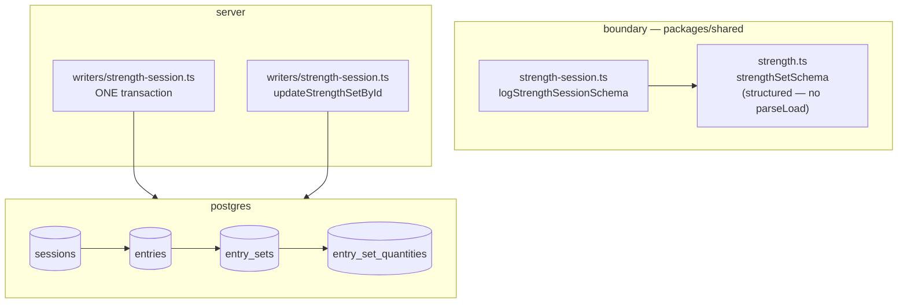

# Strength logging

**Read this before changing the set schema, the session schema, or the strength writer.**

> ⚠️ **No screen logs through this path.** The day page logs and changes strength rows through the
> FAM-1 row writer ([day-writers.md](./day-writers.md)). FAM-1 12f PR 3 removed the two actions
> that called it (`logStrengthSessionAction`, `editStrengthSetAction`); the two DAL
> functions went in [`LEGACY-1`](../plan.md#legacy-1) C1 (2026-11-21). The schemas and the writer
> below stay with their Vitest and `db:verify` coverage, with no caller, until LEGACY-1 C2 deletes
> them ([plan](../plans/legacy-1-retire-strength-path.md)).

## The prescription is frozen when the set is logged (V1-22 chunk 2)

`writeStrengthSession` reads the athlete's program **before it opens the transaction** and freezes
the rendered prescription onto each entry's `prescribed_snapshot`. The export reads that value and
falls back to the live program only where it `IS NULL`.

🔴 **Two one-word guards carry the whole chunk, and both are the opposite of what a tidy-up reaches
for.** The insert spreads on `!== undefined`, and the export resolves with `??`, never `||`. An
`open()` prescription renders `''` — 11 of the 13 seeded — so either truthiness check silently
collapses the dominant shape and sends those rows back to today's program, where chunk 4's first
edit rewrites them. That writer's `db:verify` proof and mutation `34` were deleted by LEGACY-1 C2a,
ahead of the writer itself (C2b); the live writer's freeze is `verify/day.ts` "9" (mutation `129`).

⚠️ **A session logged as "Not a programmed day" takes no snapshot at all**, because the legacy
fallback keys on `sessions.day_role` and emits `''` for the whole session — snapshotting it would
make the two paths disagree on a shape the schema accepts. Everything else with an
asserted day role freezes, including a movement the day does not program.

## What this is

A strength session: some movements, each with some sets, each set a number of reps against some kind
of load, validated at the boundary and written in one transaction.

"Some kind of load" is the whole difficulty. A load is not always a number: it can be bodyweight, a
band, a box height, a hold duration, or bodyweight **plus** a weighted vest.

## The map

## Files

| File                          | What it is for                                                                                                                                                                                                                                                                                                                                                                                                                                                                                                                                                                                                                                                                                                                |
| ----------------------------- | ----------------------------------------------------------------------------------------------------------------------------------------------------------------------------------------------------------------------------------------------------------------------------------------------------------------------------------------------------------------------------------------------------------------------------------------------------------------------------------------------------------------------------------------------------------------------------------------------------------------------------------------------------------------------------------------------------------------------------- |
| `shared/strength.ts`          | `strengthSetSchema` — reps, an optional magnitude and the two mode flags.                                                                                                                                                                                                                                                                                                                                                                                                                                                                                                                                                                                                                                                     |
| `shared/strength-session.ts`  | The session envelope: movements, supersets, client ids, the pairing refines.                                                                                                                                                                                                                                                                                                                                                                                                                                                                                                                                                                                                                                                  |
| `shared/movements.ts`         | The movement-name rules (invariant 9) and the movement patterns. **Also `TRACKING_TYPES`** (FAM-1 0a): how an item is tracked, with its labels, and `DEFAULT_TRACKING_TYPE`, the type an item made with none named gets (the column's default). Since FAM-1 step 3, `movements.tracking_type` carries it, CHECK-pinned to the array (a change is a migration); the shapes that read it are in `packages/shared/src/program/` ([plan §2, §4](../plans/fam-1-family-program.md)).                                                                                                                                                                                                                                               |
| `shared/quantity-slots.ts`    | The measurement-role vocabulary (`primary`/`vest`/`ankle`/`wrist`/`distance`) + legal dimensions. ⚠️ **`primary` accepts `count` since FAM-1 step 3** (a Count item's plain number), but `LOGGABLE_DIMENSIONS` (`units.ts`) excludes it **by name**, so the session schema is unchanged: it still accepts mass, length and time only, and the five length units it had (the new `mi` is excluded by name too).                                                                                                                                                                                                                                                                                                                |
| `writers/strength-session.ts` | The only writer. One transaction, per-row `ON CONFLICT` at every level, plus `updateStrengthSetById`. Its set and quantity rows are written by `insertEntrySetRows` in `writers/session-rows.ts` (FAM-1 11a, extracted for the 11b row writer), which since 11b takes each set's quantities: this writer maps a set's weight to one PRIMARY quantity in the movement's unit (none for a set with no weight), so the rows it writes are unchanged. FAM-1 11c-i adds `updateEntrySetRows` beside it, for the day page's Change ([day-writers.md](./day-writers.md) invariant 23). Since 11c-ii the row writer's revive also calls `insertEntrySetRows`, on the entry it brings back, after soft-deleting that entry's live set. |

## Invariants

These hold **across** files and are invisible from any single one. Breaking one is how this feature
regresses.

1. **The LLM never authors a load.** AGENTS.md's one inviolable product rule. The session schema
   carries only what the request typed; nothing in this path copies `prescription_targets.load` into
   a set. The frozen prescription (above) is a rendering stored on the entry, never a set's value.

2. **A set must carry a load, and blank is unrepresentable.** Enforced by `strengthSetSchema`'s
   superRefine — `weight !== null || isBodyweight || isBand`. A set with reps and no load has no
   quantity, and `updateStrengthSetById` then refuses to fix it: permanently unrecoverable, because **there is
   no delete action in this app.** This was `parseLoad`'s first branch until PR 4a split the load
   across three fields, which removed the single-field invariant and made the rule explicit.

   **On a time or distance the rule is split across two files (V1-30)**, because a mode is not a load
   there: the set refine (`strength.ts`) rejects a BLANK set with no mode, and the session refine
   (`strength-session.ts`, check 6) rejects BW / band, where it can see the movement's unit. Each
   skips the other's case, which is what gives exactly one message per FAULT, each naming its set
   (a BW set with an out-of-range number has two faults and gets two messages). Moving the blank
   check into the session refine would double it (probed by the V1-30 panel).

3. **`updateStrengthSetById`'s WHERE is the whole edit guard.** It edits only a live, owned, `done`
   set with reps, no mode, and one live PRIMARY quantity in a mass unit; anything else matches no row
   and answers `null`, a typed refusal. Change what a set can be, and decide here whether it stays
   editable.
   Nothing on the client mirrors it: the old form's `isEditableSet` was deleted at FAM-1 12f, and the
   comments in `shared/strength.ts` and `shared/units.ts` now say "the edit path", and the writer's
   say its WHERE is the boundary.
   🔴 **It also refuses a PROGRAM row** (`programRow()`, which a purge leaves set). A program row's
   numbers belong to the day page's Change (`amendRow`), which holds the writable window and the
   program checks. Its proof (the "TD fix-a-set" block, mutations `449` and `450`) was deleted by
   LEGACY-1 C2a; the function goes in C2b.

4. **Every magnitude lives in `entry_set_quantities`, never on the set.** Since GAP-3 (#139) there is
   no `weight_num`, no `weight_label`, no `seconds`. The two MODES (`is_bodyweight`, `is_band`) are
   booleans on the set because neither is a quantity — and since PR 4a they can coexist with a
   magnitude, which is what makes `BW+8 (vest)` expressible.

4b. **The unit belongs to the MOVEMENT; its dimension is DERIVED from it.** There is no per-set unit
and no stored dimension on the movement — `UNIT_DIMENSION_BY_CODE[unit]` is the single source, so
the pair can never disagree with `units(code, dimension)`. **The request names the unit; the catalog's
`unit_default` is only a suggestion**, and the server never checks one against the other (ADR 0004
addendum, V1-30). **Offerable ⊆ accepted ⊆ exportable** is enforced by the chain test in
`packages/shared/src/units.test.ts`, which runs the wired `sessionMovementSchema.shape.unit`
([V1-30 plan](../plans/v1-30-loggable-units.md)). On a non-mass movement BW / band are refused: they
are modes of a weight (see invariant 2 for where each half of that lives).

Two rules follow the unit:

- **One precision for every unit.** `QUANTITY_DECIMALS = 3` in `packages/shared/src/units.ts` feeds
  the server's format-check regex. It replaced a `step="0.5"` sized for barbell plates that blocked
  `6.25 ft`, `1.25 min` and `61.25 kg`. **`PLAIN_DECIMAL` / `isPlainDecimal`** (same file, FAM-1 contract
  change C2) are built from it too: the shape of a quantity typed into a TEXT field (`5`, `5.5`,
  `.5`; not `-5`, `1e3`, `5.`), for the FAM-1 day page and workout editor. ⚠️ Not the strength
  schema's check: `strength.ts` keeps its own pattern, which refuses `.5`. Do not merge the two without
  deciding that on purpose. **`WHOLE_NUMBER` / `isWholeNumber`** (same file) is the matching shape
  check for reps as typed: digits only.
- **V1-30b-ii — the stored-value ceiling is PER UNIT, and it lives in the SESSION refine.** A set
  schema cannot judge a magnitude: `3219` is a real distance in metres and an absurd one in inches, so
  only the unit tells them apart. The shared `> 2000` on `strengthSetSchema` is **deleted**;
  `MAX_QUANTITY_BY_UNIT` / `quantityCeiling` live in `units.ts` and are enforced once, in
  `strength-session.ts`, in **its own loop** — the mode refine above it `continue`s on mass units, so
  the cap cannot share that pass. Two things there are load-bearing: `typeof set.weight === 'number'`
  (the refine still runs after a format failure, when `weight` is the raw string, and an unguarded
  compare stacks "too high" onto "Enter a plain number"), and a missing cap **refusing** rather than
  reading as "no cap" (`n > undefined` is false). ⚠️ That second branch is unreachable by
  construction — `loggableUnitSchema` and the completeness test in `units.test.ts` both stand in
  front of it — which a mutation test proved: swapping it for `?? Infinity` kills nothing, while
  deleting one unit's cap kills two tests. It stays as defence in depth, and the test says so rather
  than claiming a proof it does not have.

5. **A quantity's unit is guarded by TWO composite FKs sharing its `dimension` column.** `lb` in a
   box-jump height is rejected by the database. The writer must therefore derive `dimension` from the
   unit it is actually writing — the movement's unit for the primary, the row's own for anything else.

6. **Idempotency is per-row `ON CONFLICT` at every level, with no parent short-circuit.** A crash
   after the session commit would otherwise orphan it. A replay dedupes row by row; a replay that adds
   a new movement attaches it to the re-selected session.
   🔴 **Since `V1-9b` B0 (migration `0021`) a replay of a HIDDEN row is a REFUSAL, not a
   duplicate.** The five `client_id` uniques were `WHERE deleted_at IS NULL`, so a hidden row left
   the index and the replay inserted a twin; they are now non-partial, so the hidden row still
   **holds** the id, the insert no-ops on conflict, and `reselectLiveByClientId` throws
   `no live row for client_id`. ⚠️ **Today that throw reaches `error.tsx`** —
   `V1-9b` B1-2 is the chunk that turns it into a typed envelope. The strength case's `db:verify`
   proof was deleted by LEGACY-1 C2a; B0's weigh-in case (mutation `39`) is what remains. Why an
   identity and not a slot:
   `write-path.md` invariant 6.
   🔴 **A replay is answered only by a row the request owns.** `client_id` is unique per table, not
   per athlete, so the conflict can be with another athlete's row. `reselectLiveByClientId` takes a
   required `owner` conjunct: the session by the profile resolved in the transaction and the day, a superset
   and an entry by that session. Any other holder gets the same `no live row for client_id` refusal
   as a hidden row, and the transaction rolls back ([plan](../plans/td-strength-replay-scope.md)).
   Its proof (the replay-owner block, mutations `440`–`443`) was deleted by LEGACY-1 C2a.

7. **The profile is resolved by `public_id` INSIDE the transaction.** Never a raw internal id from the
   request. That is the BOLA seam.

8. **Absent ≠ default on the wire.** `status` is `.optional()`, never `.default('done')` — an omitted
   status means the writer omits the column and Postgres applies its own default. One default, in one
   place. Adding `.default()` anywhere here forks it and changes every stored row.

9. 🔴 **The MOVEMENT id decides which row an entry references; `movementName` is a label**
   (`PICK-1` PR 2). `sessionMovementSchema` carries an optional `movementPublicId`: present ⇒ the
   movement is resolved by public id in `packages/db` and the writer receives `movements.name` **from
   the row**; absent ⇒ today's typed path (`findOrCreateMovement`) runs, which is what the picker's
   "use as typed" becomes. The full rule, the two phases and the in-transaction re-check live in
   [write-path.md](./write-path.md) invariant 14 — this guide owns only what it means for the
   schema:

   - **The typed-name rules apply ONLY to a typed name.** `movementName` keeps a label shape
     (`movementLabelSchema`: trim, non-empty, `MOVEMENT_NAME_MAX`); the comma/line-break guard and the
     at-least-one-letter rule live in `typedMovementNameIssues` and are applied by the session
     `superRefine`'s check (7) **only where there is no `movementPublicId`**. 🔴 **An id-resolved
     movement is never refused for its own name** — that name is whatever the catalog row holds, and
     the household cannot fix it until `MOV-1`. Refusing it would make a row unusable by its owner.
     Since FAM-1 14a the comma rule is an input rule only: the export quotes a comma in the
     `movement` column (RFC 4180, `csv/row.ts`) instead of failing, as it once did.
   - **The path is `['movements', i, 'movementName']`.** The removed action's `Movement N: <message>`
     mapping keyed on a numeric `path[1]`; any future caller that maps issues to rows must too.
   - **The field is OPTIONAL on the wire.** It rides inside `parsed.data.movements`, forwarded
     wholesale. ⚠️ **zod strips unknown keys**, so a field missing from the schema vanishes silently
     and every picked movement falls back to the typed path with every gate green — which is why
     `strength-session-schema.test.ts` pins the strip-mode trap (the action test that asserted the DAL
     received the value went with the action in FAM-1 12f PR 3).
   - ⚠️ **Two deliberate copy/behaviour changes.** An emoji- or digit-only typed name is now refused,
     and `MOVEMENT_NAME_MESSAGES.missing` reads **"Choose a movement."** — the field it names is a
     picker, so "enter" names an interaction no screen offers.

## Traps

Real ones, each with the file to look at.

- **⚠️ A BODYWEIGHT set cannot be corrected, by anyone, ever.** `updateStrengthSetById`'s WHERE
  refuses a set with `is_bodyweight` — and there is **no delete action in the app**. So a mis-tapped BW
  is permanent data. Found by real use on 2026-09-28 (V1-24): an athlete logged `20 × BW` KB swings
  that were `10 × 20 lb` and had no way back. The guard is correct in intent — a numeric edit would
  misrepresent a genuinely bodyweight set — but "refuse the edit" plus "no delete" adds up to
  "unrecoverable", which is not what either half intended. The fix is V1-26 PR-B.

- **`formatValueUnit` (`lib/entries/format-value-unit.ts`, V1-24 PR 1a) is NOT `@mat-plan/shared/csv`'s
  `formatQuantity`, and the two must not be merged.** The CSV one emits a **bare** number for `lb`,
  `85kg` for `kg`, and `20s` for seconds, because those are contract bytes a downstream workflow diffs
  (and a bare number there means pounds). Using it on screen would drop the unit off every weight;
  using the display one there would corrupt the export. A test pins the difference.

- **A time or distance set is not editable, and recovery means WRITING a correction (V1-30).** The edit
  guard is mass-only (`updateStrengthSetById`, invariant 3). Before V1-30 no non-mass set could be
  saved, so this population is new. A typo (`300 sec`) needs a new entry in
  `packages/db/scripts/corrections/registry.ts`, since there is no generic "fix a set" correction.
  Making non-mass sets editable is its own backlog row. `db:verify` pins the refusal.

- **`updateStrengthSetById`'s ownership subselect is `writers/ownership.ts`.** Same predicate as the
  bodyweight amend, extracted when the second caller arrived — which means V1-9's existing
  cross-profile `db:verify` proof now covers the shared helper too.

  **Since TEN-1 1b the set-edit also takes a `scope`** (`updateStrengthSetById(exec, { …, scope })`),
  which rides into `ownedEntryIds` → `isLiveProfile` and adds `profiles.household_id = $n` to the
  guarded UPDATE. The app DAL that resolved it (`editStrengthSet`) is deleted (LEGACY-1 C1). `db:verify`'s TEN-1 write matrix proves the refusal in **both**
  directions with no side effect.

- **`writeStrengthSession`'s in-transaction profile resolve is household-scoped too (TEN-1 1c).** It
  takes a **required** `scope` and runs the same single-sourced `isLiveProfile`, so a profile outside
  the scope resolves to nothing and the core throws `Profile not found` — byte-identical to the shape
  an unknown or soft-deleted profile already got, with the **whole multi-table graph rolled back**.
  `db:verify` asserts both directions and that no `sessions` row survived a refusal: a refusal that
  wrote half a session would be worse than a leak, because the athlete's next replay would attach to
  it. The app DAL that resolved the scope and passed it down (`logStrengthSession`) is deleted
  (LEGACY-1 C1).

  ✅ **Movement resolution still runs BEFORE this, and it is SCOPED as of `TEN-2b`** — the DAL's
  `findOrCreateMovementId` wrapper is gone (`PICK-1` PR 2 deleted it); `resolveSessionMovements`
  took the same `HouseholdScope` the deleted `logStrengthSession` resolved and reaches
  `findOrCreateMovement` for a typed name, which resolves **global-first**. So a movement a
  household types belongs to that household, and a session the seam then refuses leaves its catalog
  row in the **caller's own** namespace: garbage the deletion procedure removes, not a cross-tenant
  write. `TEN-2b-1` would have moved the call inside the transaction; it closed as overtaken
  (LEGACY-1 C1), and `entries.test.ts`'s ordering pin was retired with a record. ✅ **`TEN-2c` dropped the non-partial `movements_slug_unique`, so the second
  typist now gets their own row and the denial window is closed.** ⚠️ One residual survives — the
  **pre-`TEN-2b`** rows still at `household_id IS NULL`, which global-first serves to every household
  — closing at **`TEN-2c-1`** (the split backfill). `0017` only stops it growing, via
  `movements_global_row_has_pattern`. `db:verify` → _"TEN-1 1d: the catalog verdict"_ names both
  halves. It runs that core in both directions and asserts, against a real database:

  - **the read leak** — one household typing a movement is handed another household's row, with its
    `name`, `is_bodyweight` and `unit_default`. A free-text name that slugs onto a **catalog** row
    comes back `is_bodyweight: true`, a declaration this function can never write, which is the
    clearest statement that the row's metadata is not the caller's;
  - **the write/poison, which is strictly worse** — whoever types a name first pins that slug
    permanently (`ON CONFLICT (slug) DO NOTHING` discards the second household's text, and the seed
    only ever touches its own slugs, so nothing repairs it). Since this function can only ever write
    `is_bodyweight: false` and no `unit_default`, a movement one household typed is declared
    loaded-with-no-default-unit for everybody — and the **other** household's program, read under
    its own correct scope, carries that string and that declaration
    ([programming](./programming.md) invariant 4c). Given the inviolable load rule that is
    safety-adjacent, not cosmetic: a typo in one household changes how a movement is declared in
    another;
  - **the refused write still commits** — the DAL resolves every movement before
    `writeStrengthSession`, whose in-transaction re-resolve is the actual seam, so a POST the seam
    **refuses** has already written globally-visible caller-supplied text. A cross-tenant **write**
    primitive surviving its own refusal, categorically different from a read leak.

  **`TEN-2` is the fix** (a `household_id` column plus partial unique indexes, three PRs; see
  `plan.md` → TEN-2a/2b/2c), and the recorded verdict is that it belongs in **Beta 0**, before a
  second household exists: [the plan](../plans/ten-1-household-scope.md) → _"1d as built — the catalog verdict"_. Do
  not read "the writer is scoped" as "the strength write path is tenant-isolated". See
  [write-path](./write-path.md) invariant 2.

- **`packages/db` is typechecked, but only since DX-7 — and `engine` still is not directly.**
  `pnpm typecheck` runs `apps/web`, `packages/db` (its own `tsconfig.json`, covering `scripts/**`
  where the `db:verify` proofs live), `packages/evals` and `packages/shared` (tests included).
  `packages/engine` is still checked only _transitively_, through the app's imports, so a file in it
  that nothing imports is unchecked. A stale
  reference in `writers/` or `verify.ts` used to surface only as a runtime crash in `db:verify`; it is
  now a compile error. Run `pnpm verify`.

- **A Server Action is a public POST.** Page auth does not protect one. Any future caller of this
  path re-validates every field at the boundary: a DB constraint reached by a crafted body is a 500
  that discards the athlete's whole session unless the action catches the writer's error (the
  removed `logStrengthSessionAction` did not).

- **Fixture athletes are role-named, and the name is a const.** `SEED_PROFILE_NAME` /
  `SEED_PROFILE_2_NAME` (`packages/shared/src/seed-ids.ts`) hold `Athlete One` / `Athlete Two`. Never
  re-type the literal and never put a real first name in a fixture, a comment or a test — this repo is
  public and holds minors' data (AGENTS.md → "No personal names"; `OSS-1`). `db:verify` pins the
  literal **once**, on the assertion side, so a real name cannot come back unnoticed. Prose about a
  real logged incident says "an athlete", not a fixture name — the fixture is not the child.

## Changing it

| If you are…                 | Start here                                                                        |
| --------------------------- | --------------------------------------------------------------------------------- |
| adding a field to a set     | `strengthSetSchema` → `writeStrengthSession` → `insertEntrySetRows`               |
| changing what a load can be | `shared/strength.ts`, then the writer, then `updateStrengthSetById`'s WHERE       |
| adding a measurement role   | `shared/quantity-slots.ts` (const + dimensions) → seed → `db:verify` parity proof |
| touching the edit path      | nothing: `updateStrengthSetById` is uncalled and deleted in LEGACY-1 C2b          |

Then: `pnpm verify` (includes `db:verify` on PGlite, no Docker).

## Background

- [GAP-3 census + design](../plans/gap3-typed-measurements.md) — why the free-text load died
- [GAP-3 PR 3](../plans/gap3-pr3-entry-set-quantities.md) — the typed model (#139)
- [ADR 0004](../decisions/0004-typed-measurements.md) — superseded in part; read the banner
- [lessons.md](../lessons.md) — before debugging anything
