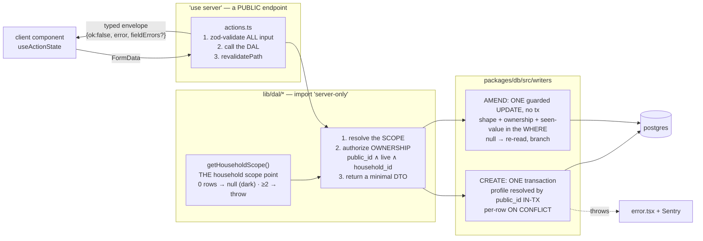

# The write path

**Read this before adding a Server Action, a DAL function, or anything that writes.**

## What this is

Every mutation in the app goes through the same three-layer seam: a thin Server Action validates, a
`server-only` DAL function authorizes and shapes, and a writer in `packages/db` performs the actual
SQL in one transaction. Reads that are batch or external go through Route Handlers instead.

The layering is not ceremony — it is what makes ownership checks testable and what keeps a crafted
POST from reaching the database.

## The map



## Files

| File / dir                                | What it is for                                                                                                                                                                                                                                                                                                                                                                                                                                                                                                                                                                                                                                                                                                                                                                                                                                                                                                                                                                                                                                                                                                                                                                                                                                                                                                                                                                                                                                                                                                                                                                                                                       |
| ----------------------------------------- | ------------------------------------------------------------------------------------------------------------------------------------------------------------------------------------------------------------------------------------------------------------------------------------------------------------------------------------------------------------------------------------------------------------------------------------------------------------------------------------------------------------------------------------------------------------------------------------------------------------------------------------------------------------------------------------------------------------------------------------------------------------------------------------------------------------------------------------------------------------------------------------------------------------------------------------------------------------------------------------------------------------------------------------------------------------------------------------------------------------------------------------------------------------------------------------------------------------------------------------------------------------------------------------------------------------------------------------------------------------------------------------------------------------------------------------------------------------------------------------------------------------------------------------------------------------------------------------------------------------------------------------ |
| `app/p/[profileId]/actions.ts`            | The **per-athlete DAY** Server Actions — seven, each addressed by the route's `profileId`: six log, one saves a routine. Thin by contract: validate → DAL → revalidate. (This read "the **logging** Server Actions", which `editRoutineAction` is not.)                                                                                                                                                                                                                                                                                                                                                                                                                                                                                                                                                                                                                                                                                                                                                                                                                                                                                                                                                                                                                                                                                                                                                                                                                                                                                                                                                                              |
| `app/p/profile-actions.ts`                | The **athlete-management** Server Actions (PROF-1): `renameAthleteAction`, `archiveAthleteAction`, `restoreAthleteAction`, and **`addAthleteAction` — the first HOUSEHOLD-scoped action** (a-1w): no `profileId` in its body, so see invariant 13 for what proves its isolation. 🔴 **The two id-only actions share one local helper, and the ONE thing it does not absorb is `enterMutation`** — each action opens with its own, because `app/pages-need-a-session.test.ts` scans each exported action's own body and a boundary check hidden one call deep is one a reader of the action cannot see. **Share the plumbing; never share the boundary.** A separate module because these manage athletes rather than log against one, and a-1's `addAthleteAction` carries no `profileId` at all — so it cannot live under a segment named by one. ⚠️ Its refusal is `NO_ATHLETE_SAVE`, deliberately a different string from `NO_PROFILE_*` (PUX-8: "athlete" is the human noun, "profile" the schema's).                                                                                                                                                                                                                                                                                                                                                                                                                                                                                                                                                                                                                            |
| `packages/db/src/writers/profile.ts`      | `renameProfile` — one guarded `UPDATE profiles SET name`. 🔴 **It is in `packages/db` while `updateProfileRoutine` is not, and the reason is specific:** acceptance criterion 4 is a **row count** ("write nothing"), which only a real database can report — so `db:verify` runs this function against two households, in both directions. Read its docblock before adding a second writer here.                                                                                                                                                                                                                                                                                                                                                                                                                                                                                                                                                                                                                                                                                                                                                                                                                                                                                                                                                                                                                                                                                                                                                                                                                                    |
| `action-state.ts`                         | The shared typed envelope + `INITIAL_ACTION_STATE` that `useActionState` starts from.                                                                                                                                                                                                                                                                                                                                                                                                                                                                                                                                                                                                                                                                                                                                                                                                                                                                                                                                                                                                                                                                                                                                                                                                                                                                                                                                                                                                                                                                                                                                                |
| `lib/dal/`                                | All Drizzle access and all `process.env` reads. `import 'server-only'`. Returns DTOs, not rows.                                                                                                                                                                                                                                                                                                                                                                                                                                                                                                                                                                                                                                                                                                                                                                                                                                                                                                                                                                                                                                                                                                                                                                                                                                                                                                                                                                                                                                                                                                                                      |
| `lib/dal/profiles.ts`                     | ⚠️ **Holds `updateProfileRoutine`, the one writer still DAL-local.** 🔴 **That is a BOUND, not a principle:** it stays here until ACT-1 retires the routine editor, because moving a shipped writer is a diff with no behavioural question in it and that editor is on its way out. Do **not** read it as _"a writer is shared iff its refusal was phrased as an acceptance criterion"_ — that is how `renameProfile`'s placement happened to be argued, and the next author (`createProfile`, archive/restore, V1-9b) cannot apply it from the code. **The usable rule is the `writers/` row's: a write whose REFUSAL is itself the behaviour under test belongs there, because a row count needs a real database.** Also the one READ that resolves untrusted JSONB: `getProfileByPublicId` maps `routine_config` through `resolveProfileRoutine`, which pairs the membership set (the whole catalog) with the neutral first-run fallback — see [programming](./programming.md) invariant 5. Never pass those two lists by hand.                                                                                                                                                                                                                                                                                                                                                                                                                                                                                                                                                                                                   |
| `lib/dal/household.ts`                    | **`getHouseholdScope()`** — the ONE place in the repo that derives a household from a request, plus `reportScopeMiss` (ADR 0006's miss-path event). AUTH-1 replaces only this body.                                                                                                                                                                                                                                                                                                                                                                                                                                                                                                                                                                                                                                                                                                                                                                                                                                                                                                                                                                                                                                                                                                                                                                                                                                                                                                                                                                                                                                                  |
| `lib/dal/recording-db.ts`                 | TEST SUPPORT: a Drizzle client over a recording pg pool, for emitted-SQL proofs of reads `db:verify` cannot execute (they are `server-only`). Rows are ARRAYS — drizzle queries with `rowMode: 'array'`.                                                                                                                                                                                                                                                                                                                                                                                                                                                                                                                                                                                                                                                                                                                                                                                                                                                                                                                                                                                                                                                                                                                                                                                                                                                                                                                                                                                                                             |
| `packages/db/src/scope.ts`                | `HouseholdScope` (branded, carrying **`householdId` AND `role`** since `PROF-1 b-s`) + `householdScopeForRequest`. 🔴 **The role is AUTHORITY, so two modules may name `scope.role` and `src/scope.test.ts` lists both with a reason:** this file _narrows the type_ (`ownerScope()` → `OwnerScope`, a second brand), and `writers/ownership.ts` _turns it into SQL_ (`isOwnerOf`). ⚠️ **The brand is not the whole guard and must not be sold as one** — it makes a non-owner caller a COMPILE error (pinned by an `@ts-expect-error`, which fails as `TS2578` if the brand erodes), while a **one-word** `as OwnerScope` still compiles (a subtype cast), which is why `src/scope.test.ts` guards that cast lexically: `ownerScope()` and one named `verify.ts` forgery are its only allowed sites. 🔴 **`isOwnerOf` is NOT a database-side check** — this row called the SQL conjunct "the half that survives a forgery", and it is not: it emits `$1 = $2` over the scope's own role field, reads no column, and a forgery that writes `role: 'owner'` passes it. The **only** authority is the single live-row read in `queries/household-membership.ts`. What the conjunct buys is that a lost narrowing matches **0 rows** instead of writing, which `db:verify` proves and patch `14` proves can fail; patch `15` pins the role's source. `householdScopeForScript` lives in `writers/household-scope-script.ts`, which the package barrel does **not** re-export — so `apps/web` cannot reach it by **module resolution**, which is why the one `apps/web` fixture script that needs a scope _derives_ one instead (below). |
| `packages/shared/src/csv/prescribed.ts`   | **The `prescribed` column, defined once** (V1-22 chunk 2). `formatPrescribedForExport` renders `SETSxREPS [@ load]`, hoisted VERBATIM from an inline composer in `export.ts` — truthiness included, because it renders bytes that already exist in every exported month. `liveMatchesByKey` folds a day's program to `movement_id → string`, with the ambiguity rule (a movement programmed twice in one day renders `''`, never an arbitrary pick). 🔴 **Both the log-time writer and the export call these**, which is what makes "the frozen path and the live path agree" structural rather than a test's assertion — while the composer was private to a `server-only` async function, `packages/db` could not reach it and the equality could only be claimed.                                                                                                                                                                                                                                                                                                                                                                                                                                                                                                                                                                                                                                                                                                                                                                                                                                                                 |
| `apps/web/lib/csv/prescribed-snapshot.ts` | `resolvePrescribed` — **frozen first, live only on NULL**. 🔴 Pure, and in its own module, because the expression it holds is the most dangerous in the chunk: `\|\|` in place of `??` sends every frozen `''` back to today's program, and `''` is what 11 of the 13 seeded prescriptions render. Inline in the DAL it had no unit-level pin; a probe proved the equivalent mutation at the _writer_ is harmless, so only this one needed the module.                                                                                                                                                                                                                                                                                                                                                                                                                                                                                                                                                                                                                                                                                                                                                                                                                                                                                                                                                                                                                                                                                                                                                                               |
| `packages/db/src/queries/`                | The single-sourced, security-load-bearing reads: `household-profiles.ts` (the picker — the whole isolation boundary under ADR 0006), `household-scope.ts` (the resolver's own probe), `weekly-adherence.ts`, `export-month.ts`. Owned by name, not by prefix: `program-day.ts` belongs to [programming](./programming.md).                                                                                                                                                                                                                                                                                                                                                                                                                                                                                                                                                                                                                                                                                                                                                                                                                                                                                                                                                                                                                                                                                                                                                                                                                                                                                                           |
| `packages/db/src/writers/`                | The write cores — transactional creates, single guarded-UPDATE amends — shared so the DAL **and** `db:verify` prove the same guard.                                                                                                                                                                                                                                                                                                                                                                                                                                                                                                                                                                                                                                                                                                                                                                                                                                                                                                                                                                                                                                                                                                                                                                                                                                                                                                                                                                                                                                                                                                  |
| `…/writers/movement-catalog.ts`           | **Every way a movement is resolved, and the whole of it.** `findOrCreateMovement` — household-scoped since `TEN-2b`, resolving **GLOBAL-FIRST**: the curated namespace (`household_id IS NULL`), then this household's own, then an insert into this household's own. `resolveMovementByPublicId` + `resolveSessionMovements` + `MovementNotAvailableError` — `PICK-1` PR 2's id path, ids before inserts. 🔴 **Read its docblocks before touching it** — they hold why the order is not household-first, why the two phases are ordered, and why a refusal interpolates nothing. ⚠️ The `23505` fallback this row used to describe is **gone since `TEN-2d`**; what survives it is DATA (a cross-household `entries.movement_id` that blocks household deletion), measured at zero and asserted in `db:verify`. Status: [data-inventory.md](../privacy/data-inventory.md) §4.                                                                                                                                                                                                                                                                                                                                                                                                                                                                                                                                                                                                                                                                                                                                                       |
| `apps/web/lib/dal/scoped.test.ts`         | TEN-1 1d's structural guard: nothing in `lib/dal` reaches `db` unscoped, and nothing builds its own ownership predicate. Two exception lists, both enumerated with a reason, both final. Not to be confused with `packages/db/src/scope.test.ts`, which guards the scope **type**.                                                                                                                                                                                                                                                                                                                                                                                                                                                                                                                                                                                                                                                                                                                                                                                                                                                                                                                                                                                                                                                                                                                                                                                                                                                                                                                                                   |
| `packages/db/src/client.ts`               | Pool + schema binding. Node runtime, Fluid `attachDatabasePool`, pooled string through PgBouncer. Also `withVerifiedTls` — upgrades a hosted `sslmode=require` to `verify-full`, leaves a no-TLS local string alone.                                                                                                                                                                                                                                                                                                                                                                                                                                                                                                                                                                                                                                                                                                                                                                                                                                                                                                                                                                                                                                                                                                                                                                                                                                                                                                                                                                                                                 |

## Invariants

1. **Every Server Action is a PUBLIC endpoint.** Page middleware does not protect it — it is a POST
   anyone can craft. Re-authenticate, re-authorize ownership, and zod-validate **inside** each one.
   Re-authenticating means **`sessionUserOrNull()`** (`lib/dal/session.ts`) as the action's **first**
   line, returning the action's not-found copy. Until SEC-1 no action re-authenticated at all, and
   requests carrying a prefetch header skipped the proxy, so every action was reachable without any
   check.

   🔴 **As of `AUTH-1` 1d this is ONE check, and the history matters because it explains the shape.**
   `1c-1` landed the session DARK beside the gate; `1c-3b` made it an **addition, not a swap**,
   because `getHouseholdScope()` did not consult the principal until `1c-4`, so a session alone meant
   _"anyone this Clerk instance admits"_; `1c-4` discharged that; `1d` deletes the gate.
   ⚠️ **Dropping a conjunct narrowed the CHECK, not the boundary** — the gate was a SHARED code, so
   it never identified a caller. ⚠️ The action refusal returns the **principal, not a boolean**: a
   boolean cannot supply the `userId` that `checkMutationLimit()` keys on, and two shapes asking one
   question at one call site is how the source guard ends up matching the weaker call.

   🔴 **It is ONE function, `enterMutation`, not seven copies** (`app/p/[profileId]/mutation-entry.ts`
   — collapsed on review of #323). Seven pasted copies of a security predicate is seven places to land
   one conjunct short, and six of those are only caught by a reviewer noticing an absence.

   ```
   // mutation-entry.ts — the two checks, in this order, once (a third, the gate, went at 1d):
   const user = await sessionUserOrNull();              // AUTH-1 1c-3b
   if (!user) return { ok: false, error: refusal };     // the SAME bytes: 404-never-403, ADR 0006
   const limit = await checkMutationLimit(user.userId); // keyed on the principal, so it comes second

   // every action — and `refusal` is a PARAMETER because six answer NO_PROFILE_LOG and the
   // routine editor answers NO_PROFILE_SAVE, and both of a caller's branches use the same string:
   const entry = await enterMutation(NO_PROFILE_LOG);
   if (!entry.ok) return entry;
   ```

   🔴 **The in-process call is MORE load-bearing after `1d`, not less.** The proxy's gate bounce used
   to be a second, independent thing standing between a stranger and an action; it is gone, so these
   calls are the only thing there. The proxy was never the boundary anyway — CVE-2025-29927, and
   SEC-1's own scar was a prefetch header skipping the matcher.

   🔴 **The export handler checks a session like everything else.** It hand-rolled the gate predicate's
   exact body — `isValidGateCookie(cookies().get(GATE_COOKIE_NAME), env.…)` — from V1-13b until the
   follow-up to 1c-3b, which is the duplication this chunk's argument is against; `1d` removed the
   predicate entirely. ⚠️ **One consequence to know before editing that file:** its
   `export const dynamic = 'force-dynamic'` is now the ONLY thing marking the handler dynamic, because
   the gate's unconditional `cookies()` read is gone. Remove it and a cached response is one
   household's CSV served to another. The Route-Handler guard in `pages-need-a-session.test.ts` narrowed
   with each step and must stay a single named helper, never an alternation.

   📌 **`lib/rate-limit.ts`'s MUTATION limiter and `lib/dal/session.ts` landed DARK in `1c-1` and are
   LIVE from `1c-3b`.** ⚠️ Said "not the whole of `rate-limit.ts` — its **gate** limiter has been live since
   V1-14a"; `1d` deletes that limiter, so the mutation limiter is the whole file. Live since
   V1-14a. Both carried "ships dark" / "nothing imports this module yet" contracts for two chunks
   after that stopped being true. Their docblocks are the ones a future author reads before touching either, so
   when a chunk switches a module on, its contract docblock moves in the same PR — a module that
   documents itself as unused while it holds the mutation boundary makes an unprotected surface and a
   protected one look identical in the docs.

   **The source guard is SPLIT, and both halves are the claim.** `pages-need-a-session.test.ts` requires,
   **per action**, the awaited `enterMutation()` call, that its refusal is returned, and that
   `actions.ts` imports the helper from `./mutation-entry` (so a local function of the same name
   satisfies nothing); and **once, in the helper**, that the two conjuncts (three until `1d`) appear there **in
   order**. That order assertion only became expressible when the copies collapsed — seven slices with
   three independent presence checks could not say it — and it is load-bearing rather than stylistic:
   the limiter is keyed on the principal, so it must follow the session, and both must precede the
   caller's zod parse and DB read. ⚠️ It must be a **source** guard because the limiter fails open and
   is `unconfigured` under vitest, so a call placed after the write passes every behavioural test.

   ✅ **This is now enforced, not requested** (`AUTH-1` 1b-bis). The old wording here —
   _"a new action without it fails the unauth suite only if you add it to that suite: do"_ — was an
   invariant that depended on remembering, which is not an invariant. Two guards close it from both
   sides, and **neither alone is sufficient**:
   - `app/pages-need-a-session.test.ts` → _"every Server Action re-checks the boundary itself"_ enumerates
     every `'use server'` module **under `apps/web`** (not just `app/`) and asserts the call appears
     **inside each exported function**, sliced per function so one check cannot cover the module. It is
     a **source-text** guard: it proves the call is present, not that it runs before the DAL.
   - `app/p/[profileId]/actions.test.ts` proves the ordering — `getProfileByPublicId` is not called
     when the action refuses — and cross-checks its own list against the module on disk.

   The action list has one source, `app/p/[profileId]/mutating-actions.ts`. Adding an action to
   **any** Server Action module without adding it there turns the cross-check red; adding it there
   without binding a function is a **type** error.
   🔴 **The cross-check reads EVERY module since WP-1, not just `actions.ts`.** It used to hard-code
   that one file, which made the whole refusal apparatus single-module: a new `app/p/*-actions.ts`
   could pass the pinned module list and the source-text guard and face **no** unauth, rate-limit,
   wrong-household or byte-identical test. Reading the scan forces every exported action into the
   registry, where `Record<MatrixActionName, Binding>` then forces a binding and every matrix runs
   it. ⚠️ Detecting an _unlisted module_ would not be equivalent — that is bookkeeping, and the
   action would still be untested.
   **Each registry entry is `{ refusal, scope }` or `{ excluded: { reason, provenBy } }`** — one
   discriminated union, not a list beside a list. `scope` is **addressing**, never `HouseholdScope`:
   `profile` means the body carries a `profileId` the wrong-household matrix can make foreign;
   `household` means it does not, so a household matrix drives a DAL scope miss instead. Because the
   two members are exclusive — **which required `excluded?: never` on one and `scope?: never` on the
   other; WP-1 claimed exclusivity without them and it was not true, since TypeScript's
   excess-property check on a non-discriminated union only needs each property to exist in SOME
   member** — **"a household-addressed action may never be excluded" is a type error rather than a
   rule in prose**, and `excludedActionNames()` is pinned empty so every future
   exclusion is an edit a human reads.
   **New actions go in a per-feature `*-actions.ts` module under `app/p/`**, never appended to
   `actions.ts`. The settled list of module names lives in the CRUD-1 spec's seams table — it calls
   itself "the one home", so it is not copied here. ⚠️ **`1c` switched the asserted call to the session check and `1d`
   left it as the only one; it must never widen the regex to an alternation** — one matching either
   passes on either and proves neither.
   🔴 **WP-1 tested that rule and kept it.** Moving `mutation-entry.ts` up to `app/p/` made
   `'./mutation-entry'` wrong from the route folder, and the obvious edit was to accept `'./'` OR
   `'../'`. That is the forbidden shape, and here it would open a concrete hole: a NEW local
   `app/p/[profileId]/mutation-entry.ts` — a weaker `enterMutation` with no limiter — satisfies the
   relative form from `actions.ts` while the order assertion inspects only the canonical file. The
   fix is **one pinned specifier, the alias `@/app/p/mutation-entry`**, which is depth-independent
   and cannot be satisfied by a sibling. It also survives the third depth the spec already plans
   (`app/p/[profileId]/program/` for V1-22's edit actions). That rule is why the gate conjunct was DELETED at `1d` rather
   than folded into an `||` with the session one.

   ⚠️ **`programBlockInHousehold(scope)` is the second PREFIXED helper (`PROF-1` a-g)**, per the
   naming convention in `writers/ownership.ts`: `program_blocks` carries its own `household_id`, so
   it gets a prefix rather than reaching through `profiles`. Its one consumer is
   `householdHasProgram`, and it reads `scope.householdId` — which is why it lives in that module and
   nowhere else.

2. **Ownership is proven by `public_id`, resolved inside the transaction.** Never trust an internal
   `bigint` id from a request. This is the BOLA/IDOR seam and it is why writers take
   `profilePublicId`, not `profileId`.

   **Since TEN-1 that predicate also carries the HOUSEHOLD.** `isLiveProfile(publicId, scope)` emits
   three conjuncts — `public_id` ∧ `deleted_at IS NULL` ∧ `household_id = scope` — and the scope
   parameter is **required and positional on purpose**: an unconverted call site is a **compile
   error**, which is the only mechanism that makes a sweep this wide safe. **Never** default it or
   make it optional; `packages/db/src/scope.test.ts` fails the build if you do.

   - **`lib/dal/*` resolves the scope; nothing above it holds one.** Each DAL function calls
     `getHouseholdScope()` itself and passes the result down. Page, action and Route Handler
     signatures carry no scope — invariant 8 already makes `lib/dal` the one layer allowed ambient
     server state, and a threading mistake one layer up is a leak the compiler cannot see (the
     parameter is present, just wrong).
   - **`ScopeMissEvent.actor` is `'clerk_session'` from 1c-3b** — a constant, never the id. The
     requester's Clerk id in a third-party store is the same cross-tenant linkage the owning
     household id is forbidden for, and a new personal-data flow besides.
   - 🔴 **`getCurrentUser()` can return a principal Clerk never issued** (`AUTH-1` 1c-3a), and
     anything reasoning about the principal has to know it. `lib/dal/session.ts` reads
     `sessionBypassUserId()` **before** `clerkIsConfigured()`, so in a local harness every request
     carries a committed fixture id (`E2E_SESSION_BYPASS_USER`) with no Clerk involvement at all.
     That is what lets `e2e:local`, `screenshot:ephemeral` and CI's smoke reach a `requireSession()`
     page with no keys and no egress — and it is why the smoke proves _the call sites_, never _Clerk_.
     **The arming decision is `lib/env.ts`'s alone** and is keyed on **database locality**, not on
     `VERCEL`: those are system variables gated on a dashboard toggle, so a rule keyed on them
     silently no-ops when it is off — which for an auth bypass means default-OPEN on a real
     deployment. It **refuses at module import**, so a mis-wired deployment fails its build rather
     than promoting and serving. `apps/web/test/bypass-is-contained.test.ts` pins one armer, one
     reader and two injectors; `lib/env-session-bypass.test.ts` pins the refusals — including the one
     OPS-1 deliberately allows and this does not (`ALLOW_LIVE_DB` + a remote database, i.e.
     `pnpm dev:prod`).
   - 🔴 **A page NEVER calls `getHouseholdScope()`** (`AUTH-1` 1c-2). The picker needs to tell "no
     household" from "a household with no athletes yet" — `listProfiles` returns `[]` for both — and
     the obvious patch is to have `p/page.tsx` resolve the scope and branch on it. That puts a
     `HouseholdScope` in `app/`, breaking invariant 2. **`householdState(): 'none' | 'resolved'`** is
     the discriminator instead: it rides the same `cache()`d resolver and returns **no scope**, so the
     capability never leaves the DAL. **`packages/db/src/scope.test.ts` fails the build** if any file
     under `app/` or `components/` names `getHouseholdScope` — nothing is minted and nothing is
     unwrapped on that path, so the three older guards all stay green while a `HouseholdScope` lands
     in `app/`. ⚠️ It is deliberately coarser than the resolver, which has **three** outcomes (a
     scope, `null`, a throw); the **five** are the causes that collapse into `null`, and they share
     one honest screen, while the ones that differ for an operator are carried by `scope_outcome` in
     Sentry. Widening that union to put a cause on screen is how a family gets told something only an
     operator can act on. 🔴 **Callers must establish a principal first** (`requireSession()` /
     `sessionUserOrNull()`): after 1c-4, `'none'` also covers _no session_, so a sessionless caller
     would be shown a wrong-Google-account explanation.
   - **`scope.householdId` is read in exactly ONE MODULE** (`writers/ownership.ts`), which
     `packages/db/src/scope.test.ts` pins by name as `UNWRAPS_SCOPE`. The scope is a **capability**,
     not a tenant id: a call site that unwraps it to build its own `eq()` has turned it back into a
     number, and COACH-1's _"not mine, but shared with me"_ would then have to widen every such site
     instead of one function (ADR 0006, fwd-1).
     ⚠️ **"One MODULE", never "one function"** — TEN-2b made that distinction matter, and `AUTH-1` 1b
     tested it again: `insertHouseholdMember` landed **in this module** rather than the separate
     `writers/household-members.ts` its plan proposed, precisely because a scoped insert must unwrap
     the scope and a new module would have forced that allowlist to grow. `insertMovementOwnedBy` is
     the same shape for the same reason. **If you are writing a scoped insert, it belongs here** — and
     if you think it does not, the guard will tell you before review does.
   - **A wrong-household id is a 404, never a 403**, and never a new error shape: it takes the exact
     path an unknown id already takes (`notFound()` / `NO_PROFILE_LOG`, now in `lib/constants.ts` so
     the byte-identity is structural). The threat is not enumeration but a _leak_ — an id an attacker
     holds came from a shared link or a screenshot, and 403 would confirm the leak is live.
   - **Zero live households → `null` (the app goes dark); ≥2 → THROW.** Different states, different
     paths: `null` for both would render _"Seed the database to get started"_ for an invariant
     violation, telling a parent their data does not exist and suggesting a production write.
   - **One fixture script outside `lib/dal/` names a constructor, and it is named in the guard**
     (TEN-1 1c). `apps/web/scripts/screenshot-ephemeral.ts` writes fixtures through `packages/db`'s
     write cores into a throwaway embedded Postgres, so since 1c it needs a scope — and the module
     boundary above means it cannot use the _script_ constructor. It **derives** one from the
     throwaway database through `liveHouseholdIds` — ⚠️ **no longer "the resolver's own probe"**, since
     `AUTH-1` 1c-4 moved the resolver onto the membership lookup; `liveHouseholdIds` survives for this
     script and `db:verify` only — and throws on anything
     but exactly one live household. `scope.test.ts` allowlists that one path **and** adds a second,
     absolute assertion that nothing under `app/`, `lib/` or `components/` mints a scope at all. If
     you need a scope in a script, put the script under `scripts/` and derive — never name an id.
   - ⚠️ **Scoping is not authorization.** Before AUTH-1 the principal is a shared access code, so
     TEN-1 buys _consistent scoping_ — B's data is unreachable from a request scoped to A. It does
     not prove the requester is who they claim. That is the most likely thing to over-claim here.
   - ✅ **THE ONE WRITE PATH THAT WAS OUTSIDE THIS INVARIANT IS NOW INSIDE IT.** `findOrCreateMovementId`
     took no scope at all through TEN-2a (`movements.household_id` existed but nothing read it);
     `TEN-2b` gave the core a `HouseholdScope`, and **`PICK-1` PR 2 deleted the app-side wrapper** —
     every way a movement is resolved now lives in `packages/db/src/writers/movement-catalog.ts` and
     takes a scope positionally. **The history below is kept because it is the measured verdict, not
     a worry**, and because the record of what a shared catalog namespace costs is the argument
     against re-introducing one. TEN-1 chunk 1d **proved** the consequence in both directions against a real
     database — `db:verify` → _"TEN-1 1d: the catalog verdict"_ — rather than asserting it:
     - one household typing a movement is handed another household's row, inheriting its `name`,
       `is_bodyweight` and `unit_default`, and `programDayRows` renders those on the **other**
       household's Today card under its own correct scope;
     - whoever types a name **first** pins that slug permanently (`ON CONFLICT (slug) DO NOTHING`
       discards the second household's text, and the seed only ever touches its own slugs, so nothing
       repairs it);
     - this function can only ever write `is_bodyweight: false` and no `unit_default`, so a movement
       first typed by one household is declared loaded-with-no-default-unit for everybody — and given
       the inviolable load rule that is safety-adjacent, not cosmetic;
     - 🔴 **a session write the seam REFUSES has already committed the caller's text**, because the
       DAL resolves every movement before `writeStrengthSession`, whose in-transaction re-resolve is
       the actual seam. A cross-tenant **write** primitive surviving its own refusal, which is
       categorically worse than a read leak. ⚠️ **Two vehicles, not one proof:** `db:verify`'s
       refused-write case is a **fixture reproducing the DAL's call order** (it calls
       `findOrCreateMovement` itself, so its last assertion cannot fail); the order itself is pinned
       by `apps/web/lib/dal/entries.test.ts` → _"find-or-create runs, and commits, before the refused
       write"_, which asserts on the SQL `logStrengthSession` emits that the movement `INSERT` precedes
       the session transaction's `BEGIN` and the profile resolve that refuses.
       ✅ **`PICK-1` PR 2 narrowed this, and did not close it.** `resolveSessionMovements` resolves
       every submitted movement **id** before it creates any typed name, so a body refused _for its
       id_ now commits nothing at all — proved by `db:verify` (a), whose typed sibling is chosen to
       slug onto no existing row so phase 2 really would insert, and by `37-typed-before-ids.patch`.
       What survives is the original case: a typed name in a session the **profile** seam then
       refuses. `TEN-2b-1` is the row that closes it, and since V1-22 chunk 2 it must carry the
       snapshot read with it (see that row).

     **`TEN-2` is the fix**, and the recorded verdict is that it belongs in Beta 0 — before a second
     household exists: [the plan](../plans/ten-1-household-scope.md) → _"1d as built"_. Do not read
     "the writer is scoped" as "the strength write path is tenant-isolated".

3. **The writer is shared with `db:verify`.** A guard that exists only in the DAL is a guard no proof
   covers. When a writer's WHERE encodes a rule, `packages/db/scripts/verify.ts` exercises the **same
   function** — cross-profile, wrong-shape, soft-deleted — against PGlite.

4. **Expected errors return a typed envelope; unexpected ones throw.** `{ok:false, error, fieldErrors?}`
   for anything a user can cause, surfaced through `useActionState`. Throwing for those would drop the
   athlete into `error.tsx` and lose the form. Conversely, never leak internals into the envelope.

5. **Idempotency is a client UUIDv7 + a DB UNIQUE + `ON CONFLICT`** — never an app-level "does it
   exist?" check, which races. Per-row at every level of a graph, with no parent short-circuit.

6. **A partial unique index needs its predicate repeated in `ON CONFLICT`.** Every `client_id` unique
   in this schema is `WHERE deleted_at IS NULL`, so the arbiter must say so too or Postgres rejects the
   statement outright. drizzle: `onConflictDoUpdate({ target, targetWhere })`.
   ⚠️ **Bodyweight's CREATE is the exception: target-less `ON CONFLICT DO NOTHING` (V1-24 PR 1e).**
   It has two uniques, `uq_entries_client_id` and 1d's natural key `uq_entries_profile_day_bodyweight`
   (one live weigh-in per `(profile, day, coalesce(context, 'morning'))`, an EXPRESSION drizzle's
   `target` cannot name). `insertBodyweightEntry` (`packages/db/src/writers/bodyweight.ts`) uses NO
   target, so every unique index is an arbiter: there is no spec to mis-infer, and a concurrent re-POST
   waits and does nothing instead of raising `23505`. It pays the three costs explicitly, and a change
   to it must keep paying them:
   - **(a) `RETURNING` is empty on any conflict** → it re-selects; it never assumes a row.
   - **(b) a second device's different weight must not read as success** → the re-select branches: the
     row is THIS submit's (`client_id` AND profile match, live, AND a weigh-in) → `{ id }`; the day's slot
     — the SAME `coalesce(context, 'morning')` key as the index — holds another
     submit's row → `{ dayTaken: true }`, the typed "already logged" envelope.
   - **(c) it swallows a violation of ANY unique**, including future ones → a no-op that is neither
     THROWS. Adding a unique index to `entries` means deciding how this writer answers it.
     The replay lookup is scoped to the profile (the pre-1e fallback looked up `client_id` alone and could
     hand back another profile's public id). `db:verify` ("V1-24 1e") drives the app's own statement for
     insert, replay, other-device, soft-delete, the foreign-`client_id` throw, a soft-deleted submit's
     replay (→ `dayTaken`, never the dead row's id), another metric's `client_id` (→ throws), and an
     evening slot (not read as the default slot taken). The metric pin on the replay lookup is the same
     lesson as the amend's: a POST reusing a check-in's `client_id` must not be answered with that row.
   - **Two caveats that would silently change it:** (1) under **REPEATABLE READ / SERIALIZABLE**, DO
     NOTHING against a conflicting row the snapshot cannot see raises a serialization failure (40001)
     instead of doing nothing — `logBodyweight` runs autocommit at READ COMMITTED, keep it there; (2) a
     **DEFERRABLE** unique constraint on `entries` cannot be an arbiter, and with a target-less ON
     CONFLICT that makes **every** bodyweight insert error ("ON CONFLICT does not support deferrable
     unique constraints as arbiters"). Never add one to `entries`.
   - **Concurrency is proven against real Postgres, not PGlite** (one connection, so `db:verify` can only
     run the cases in sequence): see the plan's "1e as built" for the two-connection probe.

7. **`ON DELETE CASCADE` is hard-delete only, and this app soft-deletes.** A soft-deleted parent leaves
   live children. Every read must filter through a live parent, or it counts rows whose owner is gone.

8. **Nothing outside `lib/dal/*` imports `db` or reads `process.env`.** Enforced by review and by the
   `server-only` import; breaking it is how a secret reaches a client bundle.

9. **⚠️ NO household-scoped read may enter a cache without the household id in the key** (ADR 0006's
   obligation 2). Under option A the household comes from the session, so `/p` and `/p/<profileId>`
   are **byte-identical URLs for every household** — _nothing in any cache key distinguishes
   tenants._ `export const dynamic = 'force-dynamic'` in `app/layout.tsx` is the only thing between
   that and serving one family's athletes to another, and since TEN-1 that directive is load-bearing
   for **tenancy**, not just for the CSP nonce. `app/tenancy-is-not-cached.test.ts` pins it, the
   export handler's own dynamism (a Route Handler inherits **no** segment config — it is dynamic only
   because it calls `cookies()`), and the rule that no `unstable_cache` / `'use cache'` /
   `export const revalidate` appears in `apps/web` at all. `revalidatePath` is **not** affected:
   profile public ids are globally unique, so the 12 call sites cannot collide across households —
   non-obvious, and the reason TEN-1 needed no route sweep.

10. 🔴 **`archived_at` is a LIST FILTER, never a conjunct in `isLiveProfile`** (PROF-1 b). Archive
    means "not currently training", not "gone" and not "locked". So the ownership predicate ignores
    it entirely, and an archived athlete still resolves, still renames, still exports and still
    accepts a write from an offline queue that was already in flight. What changes is which **lists**
    include them: `listProfiles` (the picker) drops them in the DAL; `listHouseholdAthletes`
    (Household settings) keeps them. **Both come from one query** — the tenancy predicate those two
    share is defined exactly once, in `queries/household-profiles.ts`.
    ⚠️ **Folding archive into `isLiveProfile` would be the plausible "tidy-up" that breaks the
    feature**: a typo in an archived athlete's name would become unfixable without restoring them
    first, and their history would stop exporting — which is the opposite of what the privacy notice
    promises. Mutation patch `13` exists because that is the fix a future author is most likely to
    reach for, and `db:verify` asserts the rename and the export path against an archived row.

11. 🔴 **Owner authority is a PARAMETER TYPE, and the refusal ORDER belongs to the DAL** (PROF-1 b).
    `archiveProfile` takes `OwnerScope`; `restoreProfile` takes a plain `HouseholdScope`, because
    restore is any-member (decision M1) — requiring owner authority to undo an owner's mistake is the
    failure mode, not the protection. And because `archiveProfile`'s predicate is
    `isLiveProfile ∧ isOwnerOf`, **0 rows cannot distinguish "unknown id" from "not owner"**: the
    distinct refusal exists only because `archiveAthlete` resolves, _then_ narrows, _then_ writes.
    That order is in the DAL and not in the action, for invariant 3's reason — a guard that exists
    only in the action is one a second caller can skip. ⚠️ `isOwnerOf` is **not** a database-side
    check (it compares the scope's own role field as a bound parameter, reading no column); see its
    docblock for what it does buy.

12. 🔴 **A create is REPLAY-FIRST, its conflict target is NAMED, and its two scoped reads are the
    whole cross-household boundary** (PROF-1 a-1w). `createProfile` looks the `client_id` up **inside
    the scope** before inserting, checks the quota **after** that lookup and before the insert (so a
    replay at the cap still succeeds), inserts `ON CONFLICT (client_id) DO NOTHING`, then re-reads
    through **the same scoped lookup**.
    ⚠️ **`uq_profiles_client_id` is GLOBAL and non-partial**, so a caller-chosen key collides across
    households by design — which makes `profileByClientId`'s `inHousehold` the only thing standing
    between household B and household A's row. **Without it, B's replay of A's key returns A's
    `public_id`**, which the action then redirects B to: a cross-household identifier in the other
    household's URL bar, with **no row created**. So a proof that counts rows cannot see it —
    `db:verify` asserts the **returned value**, and mutation patch `20` removes the conjunct.
    ⚠️ **Two further edits are forbidden by patches rather than by prose:** `DO UPDATE` on that
    conflict (patch `21`) would let B **rewrite** A's row through the conflict path with every scoped
    read intact; and a **bare** `onConflictDoNothing()` with no target swallows every unique
    violation — `profiles_public_id_unique` included — turning an unrelated failure into a silent
    no-op a parent reads as "couldn't add this athlete".
    ⚠️ **`public_id` is minted inside `insertProfileOwnedBy`**, never taken from the body, so a
    crafted request cannot choose an athlete's URL.

13. 🔴 **A HOUSEHOLD-addressed action has no `profileId` to make foreign, so its matrix drives a
    SCOPE MISS instead** (PROF-1 a-1w). Every mutating action before `addAthleteAction` carries an id
    the wrong-household suite can point at another household. This one carries none. The household
    matrix in `app/p/[profileId]/actions.test.ts` therefore makes the DAL answer `no_scope` and
    asserts the refusal is **byte-identical** to the unauthenticated one, that nothing was
    revalidated, and that nothing navigated.
    ⚠️ **Its binding is a discriminated union for a reason:** `scopeMiss` is required for a household
    entry and meaningless for a profile one, because only the action's own author knows which DAL
    function to make miss. And the suite opens with a **non-vacuity floor** — `it.each([])` passes
    silently, so a registry filter that matches nothing would report success.

14. 🔴 **A MOVEMENT is resolved in `packages/db`, ids before inserts, and re-checked inside the
    transaction** (`PICK-1` PR 2, `writers/movement-catalog.ts`). Three parts, each load-bearing:

    - **The id decides; the name is a label.** A submitted `movementPublicId` resolves through
      `resolveMovementByPublicId`, and the writer receives `movements.name` **from the row** — never
      the client's `movementName`. So the resolved movement is built **field by field**, not
      `{ ...m, movementId }`: a spread would carry the client's label into
      `entries.movement_name`, and silently undo this. `db:verify` (c) is what proves the
      database's name arrives. ⚠️ **That column is NOT a CSV column** — the export's `movement`
      column reads `movements.slug` through the entry's `movement_id`
      (`queries/export-month.ts` → `csvMovement`) and never selects `movement_name`, which only
      the day page reads (`lib/entries/entry-label.ts`). So the stake here is the day page's
      label and the household's own record of what it logged, not a shifted CSV row.
    - **Phase 1 resolves every id; only then does phase 2 find-or-create the typed names.** Phase 2
      is the only phase that writes, so a body refused for a bad id commits **nothing** — not even
      a typed sibling in the same submission. Swap the phases and the refusal still happens, just
      after a catalog row nothing can remove has committed: `37-typed-before-ids.patch` is that
      swap, and the assertion it reddens is "the refusal wrote NOTHING", never the refusal itself.
    - **The seam is `assertMovementsAreAvailable`, inside the transaction** (`writers/strength-session.ts`),
      after the profile resolve and before the first insert — exactly where `isLiveProfile` already
      is, and for the same reason. Phase 1 is a pre-check **outside** the transaction, so between its
      read and the write a movement can be soft-deleted or (once `MOV-1`/`C4m` exist) repointed. It
      guards the typed path too, because the writer takes `movementId: number` from its caller.

    **A refused id THROWS**, with a message that interpolates neither id nor name and is
    byte-identical for "unknown" and "another household's" — the 404-never-403 rule ADR 0006 applies
    to profiles, applied to the catalog, and the Sentry-verbatim rule `findOrCreateMovement`'s
    docblock gives at length. It throws rather than returning a typed envelope because **no screen
    can produce one**: the picker offers only rows its read returned, movements are never deleted,
    and no merge exists. ⚠️ **`C4m` (merge) makes a dead id reachable and owns turning this into a
    typed refusal.**

    ⚠️ **One bounded consequence, recorded rather than built for.** `resolveMovementByPublicId`
    deliberately accepts a household row whose slug a **global** row shadows (`PICK-1` Decision 2,
    correctness S3): it is the household's own row with its own history, and refusing it would make
    a row unusable by the only people who own it. Since V1-22 chunk 2 the frozen `prescribed`
    snapshot keys on `movement_id`, so an entry on the **household** row misses a prescription
    naming the **global** one and freezes `''` — where the typed path's global-first resolution
    matches. Bounded three ways: production holds **zero** household-owned movements (census
    2026-10-13, [data-inventory.md](../privacy/data-inventory.md)); `PICK-1` PR 4's list excludes
    such a row, so the picker cannot offer one; and the CSV's `movement` column is unaffected,
    because a shadowing slug is the same string. Two paths reach it — a crafted id, or a catalog
    seed landing **after** a pick (`CAT-2` runs `db:seed` on merge).

    ⚠️ **This note STAYS here, and `movement-picker.md` links to it** — an earlier draft said PR 3
    would move it, which would have made PR 3 edit this file and quietly falsified the "PR 3 is not
    gated on PR 2, any merge order" claim in the plan, the roadmap, the milestone and `status.md`
    (`docs/parallel-work.md` Gate 1 is disjoint file globs, **feature guides included**). It belongs
    here anyway: the behaviour is `resolveMovementByPublicId`'s, and this guide owns `writers/`.

## Traps

- **A DB constraint reached by a crafted body is a 500 that discards the whole transaction.** For a
  gym-floor session that is the worst possible failure — the athlete loses everything they logged.
  Validate at the boundary so the constraint is a backstop, not the error message.

- **⚠️ An AMEND is a different verb from a CREATE, and its guard is the WHERE (V1-24 PR 1b).**
  `updateBodyweightEntryById` / `updateStrengthSetById` do not re-check ownership in the action — the
  guarded UPDATE _is_ the check, and it lives in `packages/db/src/writers/` so `db:verify` runs the
  same code the app does. Every pin in that WHERE refuses a crafted POST, and the metric pin matters
  most: **without `metric_key = 'bodyweight'` the endpoint rewrites any entry the profile owns** — a
  push-up bout, a sleep reading — into a bodyweight. It is a **constant, never an argument**, because
  a parameter can be passed wrong by a future caller.

  Two more rules that WHERE encodes:
  - **The live-profile predicate is `writers/ownership.ts`, and since TEN-1 it carries the household.**
    It had 11 hand-typed copies; the amends, `listEntriesForDay` and `weeklyAdherenceRows` converted at
    V1-24/DAL-1, TEN-1 1b converted the three profile-resolution sites plus everything `ownedEntryIds`
    reaches, and **TEN-1 1c converted the tail: the hand-written count is now ZERO.** 1c's seven sites
    were `logCheckinEntries`, `writeStrengthSession`'s in-transaction resolve, `programDayRows`'s
    `isThisProfile`, `export-month`'s three reads, and `seed.ts`'s plural variant (`inArray` where
    `isLiveProfile` has `eq`, so it takes the household half, `inHousehold`, directly). A security
    predicate is the last thing that should drift between call sites, so a new read or write uses the
    helper — never an eighth copy, and never a hand-written `household_id =` beside it.

    **THREE deliberate exceptions, each documented where it lives, none a copy of this predicate.**
    `reportScopeMiss` in `lib/dal/household.ts` is an _existence-only_ probe that reaches `db` with no
    scope on purpose (it is how the miss path tells `cross_household` from `unknown_resource`) and
    returns `void` so it cannot be copied into something that returns data. `getActivityTypeByKey` and
    `getMetricDefinition` in `catalog.ts` are global reference reads.
    ✅ **`findOrCreateMovementId` was a fourth and is not any more** — `TEN-2b` scoped it, and
    `scoped.test.ts`'s dead-entry assertion is what forced its allowlist entry out rather than letting
    it stand as coverage nobody re-earned. **`PICK-1` PR 2 then deleted the function itself**, so
    `catalog.ts` holds no write path at all. ✅ **`TEN-2c` dropped `movements_slug_unique`**, so each
    household now holds its own row for a slug, and `TEN-2d` (0018) **deleted** the resolver's `23505`
    fallback — 0017 had already made it unreachable, and it outlived the drop by one PR only because
    nothing couples `migrate.yml` to the Vercel deploy. The denial window is closed. ⚠️ **That is still
    not "no residual":** the pre-`TEN-2b` rows at `household_id IS NULL` are served to every
    household by global-first, closing at `TEN-2c-1`. It was a **schema window, not a scoping gap**,
    which is why it was never an allowlist entry — see `writers/movement-catalog.ts`'s docblock and
    [data-inventory.md](../privacy/data-inventory.md) §4.
    The canonical lists are `ALLOWED_UNSCOPED` and `PROBE` in `apps/web/lib/dal/scoped.test.ts` —
    read them there rather than trusting this restatement.

    **Since TEN-1 1d those exceptions are a TEST rather than this paragraph** —
    `apps/web/lib/dal/scoped.test.ts`, two assertions with one exception list each: (1) nothing in
    `lib/dal` reaches `db` without resolving or being handed a `HouseholdScope` (exceptions:
    `catalog.ts`'s **two** reference reads, since `TEN-2b` scoped the third), and (2) nothing builds
    its own ownership predicate (exception:
    `household.ts#reportScopeMiss`, the probe). Two lists rather than one because assertion 1 **cannot** see the
    probe: it resolves a scope to classify the outcome and then queries without it, so it reads as
    scoped there. The unit is a **top-level declaration, exported or not**, because a private helper
    reaching `db` unscoped is the same leak as a public one (`export.ts` → `prescribedFor` is that
    shape). Comments are stripped, so a `// TODO: getHouseholdScope()` cannot satisfy it. And a
    **dead-entry** assertion fails if an allowlisted function stops needing its entry, so `TEN-2` has
    to delete `findOrCreateMovementId`'s rather than leave it standing — the
    `household-synthetic-is-dark.test.ts` lesson: an allowlist that cannot go stale.

    ⚠️ **It is a call-site guard, so it cannot see SQL.** Delete the household conjunct from
    `isLiveProfile` and the `db:verify` matrix goes red in both directions while that file stays
    **green** (`db:mutations`' patch 01 demonstrates exactly that). Three vehicles, none of them the
    proof alone. The other half of the containment — the scope **type** — is
    `packages/db/src/scope.test.ts`, and the two deliberately do not overlap.

    ✅ **`packages/db/scripts/corrections/registry.ts`'s three copies are gone too (1d).** They were
    outside the domain the `lib/dal` guard inspects, so they were stated rather than claimed away;
    they now ride `isLiveProfile` / `inHousehold`, and no correction holds a raw `household_id`. See
    "When the app cannot fix the data" below.

  - **The amend's re-read (`findAmendableBodyweight`) shares the UPDATE's shape predicate**, so the
    three-way branch can only ever see a row the UPDATE could have written. It lives in the writer, not
    the app DAL, so `db:verify` proves it.
  - **Zero rows means four different things** — wrong owner, stale id, wrong shape, someone got there
    first — and the action must tell them apart. `editBodyweightAction` re-selects under the same
    ownership scope and branches three ways, including the **replay** case: a lost response on gym
    wifi retries the POST, the row has already moved, and answering _"someone else changed this"_
    would be a conflict with nobody, over a value that is already correct.

- **⚠️ `logBodyweight` dedupes ONLY on `client_id`, so the UI is what prevents a second submit
  (V1-24 PR 1a).** `entries` has no natural-key uniqueness — the only unique index is
  `uq_entries_client_id`. The bodyweight form used to reset itself **and mint a fresh `client_id`**
  on every success, which made a second submit a second ROW, over an input the reset had just
  emptied. That is how prod ended up with duplicate weigh-ins.

  `BodyweightSection` (`app/p/[profileId]/bodyweight-section.tsx`) now renders the form only when
  the day has no weigh-in, the form's `client_id` is **stable for the life of the mount**, and the
  form is keyed on the **day** so a day change remounts it (a mount surviving a client-side day change
  replays one day's key for another — an `ON CONFLICT DO NOTHING` no-op that reports success). **Do
  not re-introduce key rotation or drop that key.** This removes the second-submit path; it does
  **not** make a duplicate impossible — two mounts (two phones, two tabs) hold two keys and can still
  write two rows until V1-24 PR 1d's index. So the receipt lists every live row, and nothing may
  assume one weigh-in per day yet. ⚠️ That index must be scoped `WHERE metric_key = 'bodyweight'`:
  `metric_key` is the discriminant for **every** metric, and the accumulating calisthenics log
  several rows a day by design.

- **The bodyweight plausibility bound lives in the shared schema, keyed on the unit** —
  `BODYWEIGHT_BOUNDS` in `packages/shared/src/bodyweight.ts` (20–500 lb, 10–230 kg), checked in a
  `superRefine` whose issue is filed on `value` so `flatten().fieldErrors.value` carries it to the
  form. Any spec or fixture that logs a bodyweight through the action must use an in-range value (the
  e2e warm-up used `0.5`).

- **`logStrengthSessionAction` returns the session's PUBLIC id as `savedId` (V1-24 3a-ii).** The form
  announces and focuses its save from it, so it must stay a public id (never an internal one) and be
  returned on a replay too (the writer re-selects the session, so a retried submit still lands focus).

- **A strength-session zod issue renders as `<movement name>, set M: <message>` (V1-30).** `flatten()`
  loses the index, so `logStrengthSessionAction` rebuilds each message from the issue path: `path[1]`
  is the movement — **named, never numbered**, because `path[1]` indexes the SUBMITTED list, which
  drops untouched scaffolded cards, so a number can point at the wrong card on screen (`Movement N`
  only when the name is empty), and `path[2] === 'sets'` with a numeric `path[3]` adds the set. A refine that wants
  a message to point at a row must file its issue on that path (the non-mass BW/band check uses
  `['movements', i, 'sets', j, 'weight']`). Without the set number, three bad sets repeat one string,
  which is unlocatable and also a duplicate React key in the form's error list.

- **⚠️ React 19 resets UNCONTROLLED fields in a `<form action>` when the action settles — even when
  it returns `{ ok: false }`.** A rejection that names the typed value ("check the decimal point")
  then points at an empty input, and a `<select>` snaps back to its `defaultValue`. On the weigh-in
  that turned a kg user's corrected `84.5` into a saved 84.5 **lb** — in range, so nothing caught
  it. `bodyweight-form.tsx` therefore holds `value` and `unit` in state (`checkin-form.tsx` is the
  older precedent); `e2e/a11y.spec.ts` pins that both survive a rejection. Any form whose fields
  must outlive a rejected submit needs the same. **⚠️ Controlling a `<select>` is not enough:** the
  reset is a native `form.reset()`, and React keeps a controlled input's `value` attribute in sync
  but never a select's `defaultSelected`, so the select shows the first option while state holds
  another. The form re-asserts it in a layout effect. (`strength-form.tsx`'s Measuring/Unit selects
  are controlled the same bare way inside `<form action>`; their data rides a JSON field built from
  state, so the payload stays right, but the visible select may not after a rejection — unverified.)
  🔴 **A RADIO is the same family, and `defaultChecked` is the fix — not a layout effect** (PROF-1
  a-1u). React freezes a controlled radio's `defaultChecked` at mount, so a native `form.reset()`
  returns it to unchecked no matter what `checked` renders. Probed three ways on the add-athlete form:
  `checked={kind === v}` → **wiped**; `defaultChecked={kind === v}` driven by state → **survives**;
  `checked` plus a `useEffect` that re-asserts `.checked` → survives, but pokes the DOM after React
  has committed and paints a frame of unchecked radios. So: hold the value in state, render it as
  `defaultChecked`, and keep `onChange`. ⚠️ **"Controlled" is not one property here** — React syncs a
  text input's `value` attribute (so a controlled text field survives) and neither a select's
  `defaultSelected` nor a radio's `defaultChecked`, which is why the three cases need three different
  answers and why `a-1u` shipped the wrong one first. The e2e assertion that the radio survives a
  name-only refusal is what caught it.

- **⚠️ A duplicate-name warning is ADVISORY, and the write path says so (PROF-1 a-1d).**
  `createProfile` folds the name (`foldName`, NFKD + `\p{M}` + `\p{Cf}`) and answers
  `{ reason: 'duplicate', match, atCap }` **before** the quota — deliberately, because an archived
  twin occupies a slot and a full household must still be offered **Restore**, which needs none.
  Three things about it are load-bearing and easy to undo by accident:
  **(1) the fold is compared in JS inside `ownership.ts`**, never as `lower(name) = $1`, or the
  folding rule forks into a weaker SQL copy;
  **(2) the `client_id` exclusion is NULL-SAFE** — `profiles.client_id` is nullable and the seed
  writes none, so a bare `ne()` drops every pre-`a-1w` athlete and the warning dies for every
  household that exists, while fixtures built through `createProfile` keep passing;
  **(3) the acknowledgement is a FOLDED NAME, compared server-side to `foldName(parsed.name)`** — a
  boolean would let consent to "Ada" wave "Bea" through.
  🔴 **It prevents nothing.** Two requests with different keys and the same name both insert; a
  unique index on a folded name is impossible because "Add another" is a feature. Do not describe it
  as a constraint.

  🔴 **(4) RENAME runs the same check, but gated on the FOLD — not on the id** (PROF-1 a-1d-ren).
  `renameProfile` reads the stored name and skips the lookup entirely when
  `foldName(new) === foldName(stored)`. ⚠️ **Excluding the athlete being renamed is NOT equivalent
  and was the plan's first answer:** two live athletes sharing a name is the _designed_ case, so a
  parent fixing `ada` → `Ada` on Ada #1 would be warned about **Ada #2** — a collision that already
  existed and that this edit does not create. The fold guard also makes an exclusion parameter
  unreachable **sequentially**, which is why `findNameMatch` has none: with the fold unchanged the
  lookup never runs, and with it changed the row's stored name folds to the OLD value and cannot
  match. ⚠️ **Under concurrency the match CAN be self** — two renames of the same row to the same new
  name, where the second's lookup finds the row after the first commits. The stored name is correct
  either way (the rename is idempotent on the fold), so that is advisory copy being wrong rather than
  corruption, and an exclusion parameter would not have helped: the write had already landed. ⚠️ The rename
  envelope carries **no `atCap`** — a rename creates nothing, so the quota is never consulted and the
  field would always be `false`; it is optional in `ActionState` for exactly that reason.

  🔴 **(5) And the fifth one lives in the FORM, which this guide does not own** — recorded here
  because it is the only place both halves are visible. The acknowledgement travels as a submit
  button's `name`/`value`, so **which button is the form's default decides whether an unacknowledged
  Enter silently acknowledges.** HTML activates the first submit button in **tree order** on every
  implicit submission (Enter in a text field, Enter on a focused radio, a soft keyboard's Go, an IME
  confirm) — and while the warning shows, the primary "Add" is unmounted, which promoted the
  callout's "Add another" to default and created the second athlete from a stray Enter.
  `add-athlete-form.tsx` therefore renders a **hidden submit sentinel first in the form**, carrying
  the _unacknowledged_ label, so implicit submission re-warns instead. Two traps follow from it: a
  **keydown handler is not a substitute** (it guards only the element it is attached to, and the
  radio path slips past), and **jsdom cannot prove any of this** — it implements no implicit
  submission, so "no submit fired" is vacuously true there. The unit test is structural (the
  sentinel is first, and unacknowledged); the real key is driven in `e2e/athletes.spec.ts`.
  ⚠️ If a later change re-introduces a visible submit above the sentinel, or makes the sentinel
  conditional on something other than "a warning is showing", the Enter hazard returns silently.

- **`revalidatePath` is not optional.** Per-user data is dynamic and must never be cached across
  users; forgetting the revalidate after a mutation shows the athlete stale data and looks like the
  write failed, which prompts a duplicate submit.

- **Server Actions are not HTTP routes and cannot be tested as such.** Test them as plain async
  functions with Clerk's `auth()` and Drizzle mocked. Async Server Components need Playwright, not
  Vitest. This is why logic belongs in the (synchronous, testable) DAL.

- **`packages/db` is typechecked since DX-7 — `verify.ts` included.** `pnpm typecheck` runs
  `apps/web` **and** `packages/db` (`packages/db/tsconfig.json`), so `scripts/**` — unreachable from any
  app import, and where the `db:verify` proofs live — is finally covered. Before that a writer's `sets`
  parameter type could say a field was REQUIRED while `db:verify`'s fixtures omitted it, and nothing
  objected until Postgres reported `invalid input syntax for type numeric: "undefined"`; DX-7 found
  exactly that, three times. **Still handle both** (`=== null || === undefined`) in a writer taking
  values from both zod output and hand-written fixtures — the writer's inner signature deliberately
  permits omission, and the type only covers callers the compiler can see.
  ⚠️ **`packages/shared` and `packages/engine` have no tsconfig of their own**: they are checked only
  _transitively_, via the app's imports, so a file nothing imports is still checked by nothing.

- **A derived column must be derived from the value actually being written.** `entry_set_quantities`
  stores `dimension` alongside `unit` and a composite FK checks the pair. Hard-coding `'mass'` there
  was correct while movements were lb/kg-only and became an FK violation — surfacing as a 500 — the
  moment a movement could be logged in `sec`. Derive it (`UNIT_DIMENSION_BY_CODE[unit]`).

- **✅ The proxy matcher INCLUDES `/api` — since `AUTH-1` 1a, and this bullet said the opposite until
  2026-11-01.** It did exclude `/api` and `/api/*`, which is why V1-13b's export lives at
  `/p/[profileId]/export`. 1a dropped the exclusion (`auth()` throws when `clerkMiddleware()` did not
  run, so an excluded handler could not authenticate at all), and ⚠️ **what has NOT changed is the
  rule:** the matcher is not an authorization boundary, so a handler under `/api` still owes its own
  in-process **session** check, and `/api/sync` additionally owes an origin or token check.
  `app/pages-need-a-session.test.ts` requires that check of every Route Handler it discovers — **one named
  helper, never an alternation**. ⚠️ At `1d` the matcher's own justification changed too: it is no
  longer "what decides whether the gate runs" but "`auth()` must be able to answer and the headers
  must land".

  🔴 **This is the ONE list of where the stale claims lived** — both classes, since the sweeps kept
  finding them together: the `/api`-matcher claim, and the auth-state claim ("no auth until Clerk
  v1.5", "actions are deliberately unlimited"). Everything else cites this list rather than keeping a
  copy, and nothing here is counted, because two attempts at a count were both wrong:

  - `apps/web/app/p/[profileId]/export/route.ts` — the handler's own docblock, quoting a matcher that
    was no longer in the file
  - `.github/SECURITY.md` — the `/api/sync` paragraph, contradicting the top of the same file
  - `apps/web/e2e/export-csv.spec.ts` — the justification comment on the gating test for that handler
  - `docs/runbooks.md` — the preview section, as an operational fact
  - `docs/status.md` — the MVP record
  - `docs/plans/ops-1-preview-isolation.md` — a merged plan: annotated, original text kept
  - `docs/plans/ai-1-nl-logging.md` — ⚠️ **not history**: the design doc whose S8 security argument
    rested on the premise, for an endpoint nobody has built yet
  - `.claude/agents/security-reviewer.md` (twice) and `.claude/skills/review-pr/SKILL.md` — handed to
    a reviewer **as fact**, citing a `tech-debt.md` entry that no longer exists
  - `.claude/skills/add-server-action/SKILL.md` — the same class aimed at the **author**: "no auth
    until Clerk (v1.5)", "actions are deliberately unlimited", "nothing to test yet"
  - `.claude/skills/review-pr/reporting-contract.md` — a second copy of the auth state, reaching a
    reviewer **before** the corrected one

  ✅ **RECONCILED at `AUTH-1` 1d (2026-11-05)**, which is exactly what this note asked for: when the
  gate conjunct went, every copy became a separate place to get it wrong. Updated in the same PR —
  `.github/SECURITY.md`, `AGENTS.md`'s rate-limit line, `.claude/agents/security-reviewer.md`,
  `.claude/skills/review-pr/SKILL.md`, `.claude/skills/add-server-action/SKILL.md`,
  `apps/web/e2e/export-csv.spec.ts`, `apps/web/app/p/[profileId]/export/route.ts`, `docs/runbooks.md`,
  `docs/status.md` and `docs/plans/ai-1-nl-logging.md` (not history — a live design doc).
  ⚠️ **Dated plans and changelog fragments are NOT rewritten**, so a grep for the old claim still
  finds them; that is the policy, not an oversight. Still no count here: two attempts at one were
  both wrong.

- **⚠️ The bodyweight export carries each row's UNIT; `kg` is converted, everything but `lb`/`kg`
  throws (CSV-1).** The legacy column is `weight_lb`, so a kg weigh-in written bare reads as pounds
  downstream. `lib/dal/export.ts` must keep mapping `unit` from `bodyweightMonthRows`. A kg row writes
  the pounds equivalent (one decimal) and keeps `logged <value> kg` in notes — Ray's decision
  (2026-10-02), because a kg weigh-in is ordinary and cannot be repaired in the app (the amend keeps the
  unit; there is no delete), so refusing would have 500'd the whole export (EXP-1). A NEW bodyweight unit
  must get its own rule in `buildBodyweight`, or it throws.

- **`sslmode=require` encrypts but does NOT verify the certificate.** Neon's strings ship `require`,
  which leaves the connection open to an active machine-in-the-middle. `createDbPool` upgrades it to
  `verify-full`, and deliberately leaves a string with **no** `sslmode` untouched — local Postgres has
  no TLS, and forcing it there would break every local run to fix a hosted-only concern.

- **The UI must never be STRICTER than the endpoint it fronts.** `resolveDeclaredDay` accepts a write
  within ±1 day (`WRITABLE_DAY_RADIUS`), so the page gates its forms on the _same_ exported constant
  (`isWritableDay`) rather than a re-typed `1`. V1-15 hit this twice: hiding yesterday's forms would
  have refused what the server allows, and flooring day-navigation at `profiles.created_at` alone
  would have clamped away a day that was still writable.

- **Sentry does NOT auto-instrument Server Actions.** They must be wrapped in
  `withServerActionInstrumentation` or the failure is invisible.

- **⚠️ A boundary test that cannot fail is worse than none, and `db:verify` has a gate for that
  (TEN-1 1b).** `pnpm db:mutations` applies each committed patch in
  `packages/db/scripts/mutations/`, runs `db:verify`, asserts it goes **RED**, and reverts; it runs
  inside `pnpm verify`. **Five mutations today**: deleting the household conjunct (must redden 18
  assertions), pointing `verify.ts`'s `A_SCOPE` at the household next door (the "dual" — it catches
  the half the first cannot, because a **negative** assertion like _"refuses a non-done row"_ still
  returns `null` when threaded with the wrong scope and would silently stop proving its own message),
  **undoing 1c's seven conversions**, dropping the **correction's** household conjunct, and — for
  1d's catalog verdict — removing the shared `movementSlug` derivation. **Each patch names the
  assertion that must fail FIRST in a sibling `.expect` file, and the runner compares it**, so a patch
  that reddens the wrong proof fails the gate rather than passing as "something went red". And since
  1d the TEN-1 block in `verify.ts` runs **1b-then-1c** (`ten1ReadMatrix` over two lists), so patch
  03's full claim — _every 1b assertion green, then a 1c one_ — is what one run shows; before the
  reorder the 1b rows below a 1c failure were unreached rather than green, because `db:verify` is
  fail-fast. **Order is load-bearing there: do not interleave a 1c proof back above a 1b one.**

  **Patch 04 is deliberately NOT "scope the catalog".** That is `TEN-2`, not a one-line break, and a
  leak assertion driven by the same name on both sides cannot be falsified by any change that keeps
  the signature. It breaks the property the verdict actually rests on — that one derivation is the
  single **global arbiter** two households' different spellings converge on. Without it the verdict
  would be measuring fixture ordering.
  **Patches, never a runtime flag:** a switch that can disable a BOLA predicate must not exist in
  shipped `packages/db` source. Editing a mutated line means regenerating its patch — the gate then
  fails loudly with _"does not apply"_ rather than passing vacuously.

- **⚠️ Every new `db:verify` leak assertion ships with its POSITIVE twin.** `verify.ts` learned this at
  V1-10: _"asking only one way would pass even with the household scoping deleted, since the
  globally-newest block happens to be the verify one — the assertion would then be proving fixture
  ordering, not ownership."_ So a zero-rows assertion always comes with one proving the same call
  returns rows for the right household. ⚠️ **`PROF-1 b-s` found the sharp edge of that rule and did
  NOT widen it:** a proof needed a member-roled scope, which would have been a third mint. The fix
  was to **spread** `{ ...A_SCOPE, role: 'member' }` instead — and that is a better test, because the
  case under test is a _forgery_, which is what a spread-and-overwrite is; a minted member scope
  would have been a legitimately-made one, a weaker thing. A guard that pushes back is sometimes
  right about more than it was written for.
  And `verify.ts` mints **exactly two** scopes, `A_SCOPE` and
  `B_SCOPE`: a scope minted at a call site makes an assertion pass for the wrong reason, invisibly.

## When the app cannot fix the data

Some shapes are **deliberately not editable** (a bodyweight set, a labelled set, a non-`done` set) and
there is **no delete action anywhere in the app** — so a mis-tap can be unrecoverable through the UI.
For data already on the board, use a **correction**:

```bash
pnpm --filter @mat-plan/db db:correct            # list
pnpm --filter @mat-plan/db db:correct <name>     # dry run (default — writes nothing)
```

Guarded, idempotent, dry-run-by-default, targeted by `public_id`. Add one in
`packages/db/scripts/corrections/registry.ts`; rules in its README, runbook in
[runbooks.md](../runbooks.md). **A correction treats the data — the bug that produced it still needs
its own PR.**

- **A correction NAMES its household, and that is the per-era guard (TEN-1 1b + 1d).** It has no
  request to derive a scope from, so `liveHouseholdScope(db, SEED_HOUSEHOLD_PUBLIC_ID)` resolves one
  by `public_id` — never an internal id — and every predicate in the file rides it:
  `isLiveProfile(publicId, scope)` where there is a `public_id`, `inHousehold(scope)` for the one
  **bulk** shape (a whole household's profiles). After 1d there is **no hand-written ownership
  predicate left in the registry**, and no correction holds a raw `household_id`, so ADR 0006's
  capability rule holds in this script too.

  Why the conjunct matters more here than anywhere else: a `WHERE` guarded only by the value being
  corrected **from** is idempotent per ROW but not per ERA. `routine_config IS NULL` is the correct
  state for a newly-created athlete after PROF-1, so an unscoped `--apply` later would stamp this
  household's routine onto somebody else's brand-new kid — a write with no delete action behind it,
  i.e. exactly the unrecoverable class corrections exist to repair rather than cause. The household
  predicate makes the correction **expire on its own**, and `db:verify` proves it in both directions
  by running the registry entry's own dry run.

- **Fixture athletes are role-named, and the name is a const.** `SEED_PROFILE_NAME` /
  `SEED_PROFILE_2_NAME` (`packages/shared/src/seed-ids.ts`) hold `Athlete One` / `Athlete Two`. Never
  re-type the literal and never put a real first name in a fixture, a comment or a test — this repo is
  public and holds minors' data (AGENTS.md → "No personal names"; `OSS-1`). `db:verify` pins the
  literal **once**, on the assertion side, so a real name cannot come back unnoticed. Prose about a
  real logged incident says "an athlete", not a fixture name — the fixture is not the child.

## Changing it

| If you are…                  | Start here                                                                      |
| ---------------------------- | ------------------------------------------------------------------------------- |
| adding a mutation            | a writer in `packages/db/src/writers/` first, so `db:verify` can prove it       |
| adding a read                | `lib/dal/` — and decide DTO shape before the query, not after                   |
| changing a request/response  | the shared zod schema in `packages/shared` in the SAME PR (types via `z.infer`) |
| adding a batch/external read | a Route Handler, not a Server Action — actions dispatch sequentially            |

Mandatory boundary tests in the same PR: **unauth → reject · wrong-owner → forbid · bad body →
zod-reject**, plus replay → one effect. Then `pnpm verify` and `pnpm e2e:local`.

## Background

- [AGENTS.md](../../AGENTS.md) → "Server conventions" and "Backend / API PR rules"
- [.github/SECURITY.md](../../.github/SECURITY.md) — BOLA-first
- [spec.md](../spec.md) §4 — the data model
