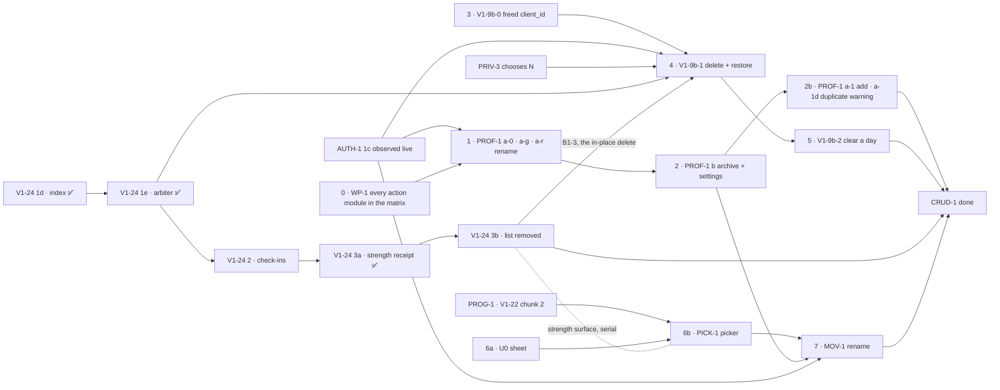

# CRUD-1 — fix it yourself

> **Status: proposed 2026-10-23, awaiting the maintainer's approval of the plans.** A cross-PR milestone,
> not an implementation plan: every step still gets its own branch, PR and (where significant) plan and
> panels. **What** each step must make true lives in the
> [spec](../specs/crud-1-fix-it-yourself.md) (its acceptance criteria are numbered there and cited here,
> never restated); this file orders the steps and defines "done". The screens were approved as a
> prototype (v8, the maintainer, 2026-10-23; v9 changes only the target fields, which are PROG-1's):
> [docs/prototypes/crud-1/](../prototypes/crud-1/index.html). Its sibling is
> [PROG-1 — programs and scheduling](./prog-1-programs-and-scheduling.md).

## The goal

A household fixes its own mistakes without asking the maintainer to run a script. A parent can:

1. add an athlete, rename them, and archive one added by mistake;
2. delete a mis-logged entry or clear a day, and restore either, from the place it was logged;
3. correct a logged value where it was logged — the section you log in is the record, with no second
   list (M26);
4. log a movement by **choosing** it rather than retyping it, and rename one the household mis-typed.

Today none of this exists in the app: there is no create, rename, archive or delete endpoint for a
profile or an entry, and every fix is a correction file in `packages/db/scripts/corrections/` (spec →
Why this exists). The milestone is done when that directory stops growing for family #1's data
([success signals](../specs/crud-1-fix-it-yourself.md#success-signals)).

It closes two boxes in [beta-1.md](./beta-1.md): Beta 0's _"sign in → add an athlete → log a day →
delete a mis-logged entry"_ (steps 1–2 below) and Beta 1's _"Every logged thing can be corrected or
deleted in the app"_ (`beta-1.md:441`, the whole milestone).

## Decisions

**Made** (each recorded, with its quote, in the spec's review-response log):

| Decision                                                                                                             | Where                |
| -------------------------------------------------------------------------------------------------------------------- | -------------------- |
| Two milestones: CRUD-1 is fix-it-yourself; programs and scheduling are [PROG-1](./prog-1-programs-and-scheduling.md) | M21                  |
| Correcting a logged value is **in** (V1-24's remaining PRs join as track E)                                          | M23                  |
| Logs live in place; V1-24 3b **removes** the "Logged entries" list instead of folding it into `
`            | M26, disagreement 12 |
| Delete is a hide, restorable until `N` days; "Hidden on this day" names it                                           | ADR 0008, Q10        |
| Archive and delete an athlete live in Household settings; delete is **later** (Beta 1 step-up)                       | Q1, Q6               |
| A kid-only guard on the newest block until PROG-1's ASSIGN-READ                                                      | Q15                  |
| The activities editor has **no link anywhere** until ACT-1; saved activities keep logging                            | M30, criterion 41    |
| A household renames its own movement; **merge** is later                                                             | PM-4                 |

**To decide — before the step that depends on it:**

| Question                                                              | Decide by     | Recommendation                                                          |
| --------------------------------------------------------------------- | ------------- | ----------------------------------------------------------------------- |
| **`N`**, the restore window (PRIV-3's number)                         | before step 4 | Start now; it is a decision with no code, and B1 cannot ship without it |
| Narrow `write-path.md`'s `owns:` so action lanes can run in parallel? | before step 1 | Per the [WP-1 plan](../plans/wp-1-shard-actions.md)                     |
| Does a movement rename change past CSV rows?                          | step 7's plan | Per the [MOV-1 plan](../plans/mov-1-rename-movement.md)                 |

## The steps

**This is the canonical chart.** Every PR in this milestone embeds it with its own step marked
(AGENTS.md → "Milestone PRs also embed a progress chart"). If a PR's position disagrees with it, the
chart is what gets fixed, in that PR.

| Step | What                                                                                                                                            | Plan                                                                                                                                                  | Gate                                                                                          | Beta | Spec criteria         |
| ---- | ----------------------------------------------------------------------------------------------------------------------------------------------- | ----------------------------------------------------------------------------------------------------------------------------------------------------- | --------------------------------------------------------------------------------------------- | ---- | --------------------- |
| 0    | **WP-1** — every Server Action module, household-addressed ones included, is in the boundary-test matrix; new actions go in per-feature modules | [wp-1-shard-actions](../plans/wp-1-shard-actions.md)                                                                                                  | not concurrent with AUTH-1 1b or 1c (both edit `write-path.md`)                               | 0    | none (no behaviour)   |
| 1    | **PROF-1a** — add an athlete, rename, kind; the kid-only guard                                                                                  | [prof-1-athletes](../plans/prof-1-athletes.md)                                                                                                        | **AUTH-1 1c observed live**                                                                   | 0    | 1–5, 7, 39, 41        |
| 2    | **PROF-1b** — archive and restore an athlete                                                                                                    | [prof-1-athletes](../plans/prof-1-athletes.md)                                                                                                        | step 1; the archive marker                                                                    | 0    | 5, 47                 |
| 3    | **V1-9b-0** — the freed `client_id`                                                                                                             | [v1-9b-delete-and-restore](../plans/v1-9b-delete-and-restore.md)                                                                                      | nothing; takes the next free migration number at merge                                        | 0    | 9                     |
| 4    | **V1-9b-1** — delete one entry, restore it, refuse a taken slot                                                                                 | [v1-9b-delete-and-restore](../plans/v1-9b-delete-and-restore.md)                                                                                      | step 3 + AUTH-1 1c + **`N` chosen** (V1-24 1e ✅ is met); its UI PR B1-3 also waits on 3b     | 0    | 9–13, 15–16           |
| 5    | **V1-9b-2** — clear a day, restore it as one event                                                                                              | [v1-9b-delete-and-restore](../plans/v1-9b-delete-and-restore.md)                                                                                      | step 4                                                                                        | 0    | 14                    |
| E    | **V1-24 2 → 3b** — correct a logged value (1d #210, 1e #214, 3a #211/#212 ✅ shipped)                                                           | [v1-24-form-is-the-day](../plans/v1-24-form-is-the-day.md), [3a](../plans/v1-24-3a-strength-receipt.md); **3b's plan is not written** and carries M26 | per that plan's Staging; 1e before step 4                                                     | 1    | 48 (3b), V1-24's own  |
| 6a   | **U0** — the shared sheet primitive                                                                                                             | [pick-1-movement-picker](../plans/pick-1-movement-picker.md)                                                                                          | nothing                                                                                       | 1    | 37, 46                |
| 6b   | **PICK-1** — choose an existing movement                                                                                                        | [pick-1-movement-picker](../plans/pick-1-movement-picker.md)                                                                                          | 6a + **PROG-1's V1-22 chunk 2 merged** (both edit `strength-form.tsx`)                        | 1    | 17–18, 19 (alias), 34 |
| 7    | **MOV-1** — rename the household's own movement                                                                                                 | [mov-1-rename-movement](../plans/mov-1-rename-movement.md)                                                                                            | step 6b + step 2 (its `/settings` page) + AUTH-1 1c; the CSV question answered at plan review | 1    | spec unowned 3        |

**Beta 0 vs Beta 1.** Steps 0–5 are Beta 0 (`beta-1.md` → step 4 "PROF-1, ONB-2, V1-9b" and the
"delete a mis-logged entry" exit box). Track E, 6a, 6b and 7 are Beta 1's "in-place correction" and
the picker. Nothing here waits on Beta 1's human gate; only PROG-1's scheduling does.

## Parallel lanes

Settled by [parallel-work.md](../parallel-work.md)'s six gates, run when the plans were approved — see
[the gate run](#gate-run). The shape it found:

- **Lane A — Profiles & Tenancy:** steps 1 → 2.
- **Lane B — Logging, delete:** step 3, then 4 → 5.
- **Lane C — Logging, strength surface:** E (3a, 3b) and 6b serialize with PROG-1's V1-22 chunk 2 on
  `strength-form.tsx` and `strength-logging.md`. Step 6a is free.
- **Start now, before AUTH-1 1c:** `N` (a decision), step 0, step 3 (after AUTH-1 1b's migration
  number), 6a, and every plan's panel.

### Gate run

_Pending — run once the plans' panels have reconciled, because a panel can move a file between steps.
Recorded here when done, with each pair of lanes and the glob intersection that clears or blocks it,
feature guides' `owns:` included._

## CRUD-1 exit criteria — done when

- [ ] On iOS Safari and Android Chrome, with no help: add an athlete → log a day → delete a mis-logged
      entry → restore it → archive a test athlete (steps 1–5).
- [ ] Every logged thing can be corrected or deleted in the app, where it was logged (track E, steps
      4–5); there is no second list of the day's entries (criterion 48).
- [ ] Every spec criterion tagged CRUD-1 has a test in the step that owns it: 1–5, 7–18, 39, 41, 47, 48.
- [ ] A household's mis-typed movement is renamed in the app, and choosing an existing movement is the
      easy path (steps 6b, 7).
- [ ] `notice.md` describes hide-then-purge with the real `N`, and `data-inventory.md` matches what
      steps 1–5 store (step 4).
- [ ] No new correction file for family #1's data in their first two weeks (the success signals'
      first row), or each one names the step that should have prevented it.

## Risks

- **AUTH-1 1c is the gate for steps 1 and 4, and it is a one-way door.** Plans written before it lands
  name what to re-verify after it (each plan → "AUTH-1"). If 1c changes the principal, those steps
  re-plan; they do not proceed on the old shape.
- **`N` is unstarted and gates step 4.** A decision with no code is the easiest thing to leave until
  it is the critical path (spec, PM-9).
- **One file, many lanes.** Every mutating step edits the write path under one feature guide, so the
  action-adding steps serialize on `write-path.md` (WP-1's finding).
- **Removing the list (3b) costs five e2e locators** and needs an "Also logged" bucket so no entry
  vanishes (disagreement 12). 3b's plan must name the "four other things" the V1-24 plan says the list
  renders.

## Review log

_Pending: written when the plans' panels have reconciled._
