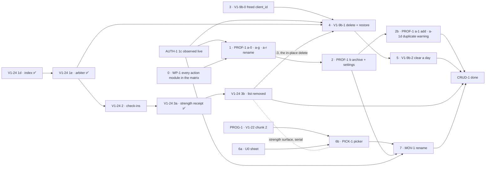

# CRUD-1 — fix it yourself

> **Status: proposed 2026-10-23, awaiting the maintainer's approval of the plans.** A cross-PR milestone,
> not an implementation plan: every step still gets its own branch, PR and (where significant) plan and
> panels. **What** each step must make true lives in the
> [spec](../specs/crud-1-fix-it-yourself.md) (its acceptance criteria are numbered there and cited here,
> never restated); this file orders the steps and defines "done". The screens were approved as a
> prototype (v8, the maintainer, 2026-10-23; v9 changes only the target fields, which are PROG-1's):
> [docs/prototypes/crud-1/](../prototypes/crud-1/index.html). Its sibling is
> [PROG-1 — programs and scheduling](./prog-1-programs-and-scheduling.md).

## The goal

A household fixes its own mistakes without asking the maintainer to run a script. A parent can:

1. add an athlete, rename them, and archive one added by mistake;
2. delete a mis-logged entry or clear a day, and restore either, from the place it was logged;
3. correct a logged value where it was logged — the section you log in is the record, with no second
   list (M26);
4. log a movement by **choosing** it rather than retyping it, and rename one the household mis-typed.

Today none of this exists in the app: there is no create, rename, archive or delete endpoint for a
profile or an entry, and every fix is a correction file in `packages/db/scripts/corrections/` (spec →
Why this exists). The milestone is done when that directory stops growing for family #1's data
([success signals](../specs/crud-1-fix-it-yourself.md#success-signals)).

It closes two boxes in [beta-1.md](./beta-1.md): Beta 0's _"sign in → add an athlete → log a day →
delete a mis-logged entry"_ (steps 1–2 below) and Beta 1's _"Every logged thing can be corrected or
deleted in the app"_ (`beta-1.md:441`, the whole milestone).

## Decisions

**Made** (each recorded, with its quote, in the spec's review-response log):

| Decision                                                                                                                            | Where                |
| ----------------------------------------------------------------------------------------------------------------------------------- | -------------------- |
| Two milestones: CRUD-1 is fix-it-yourself; programs and scheduling are [PROG-1](./prog-1-programs-and-scheduling.md)                | M21                  |
| Correcting a logged value is **in** (V1-24's remaining PRs join as track E)                                                         | M23                  |
| Logs live in place; V1-24 3b **removes** the "Logged entries" list instead of folding it into `
`                           | M26, disagreement 12 |
| Delete is a hide, restorable until PRIV-3's purge removes it (no date shown until the purge is live); "Hidden on this day" names it | ADR 0008, Q10        |
| Archive and delete an athlete live in Household settings; delete is **later** (Beta 1 step-up)                                      | Q1, Q6               |
| A kid-only guard on the newest block until PROG-1's ASSIGN-READ                                                                     | Q15                  |
| The activities editor has **no link anywhere** until ACT-1; saved activities keep logging                                           | M30, criterion 41    |
| A household renames its own movement; **merge** is later                                                                            | PM-4                 |

**To decide — before the step that depends on it:**

| Question                                                              | Decide by                   | Recommendation                                                                                           |
| --------------------------------------------------------------------- | --------------------------- | -------------------------------------------------------------------------------------------------------- |
| **`N`**, the restore window (PRIV-3's number)                         | before PRIV-3's purge ships | No longer gates step 4 (V1-9b's panel): until the purge is live, the bar says "Restorable until removed" |
| Narrow `write-path.md`'s `owns:` so action lanes can run in parallel? | before step 1               | Per the [WP-1 plan](../plans/wp-1-shard-actions.md)                                                      |
| Does a movement rename change past CSV rows?                          | step 7's plan               | Per the [MOV-1 plan](../plans/mov-1-rename-movement.md)                                                  |

## The steps

**This is the canonical chart.** Every PR in this milestone embeds it with its own step marked
(AGENTS.md → "Milestone PRs also embed a progress chart"). If a PR's position disagrees with it, the
chart is what gets fixed, in that PR.

| Step | What                                                                                                                                            | Plan                                                                                                                                                  | Gate                                                                                                                       | Beta | Spec criteria         |
| ---- | ----------------------------------------------------------------------------------------------------------------------------------------------- | ----------------------------------------------------------------------------------------------------------------------------------------------------- | -------------------------------------------------------------------------------------------------------------------------- | ---- | --------------------- |
| 0    | **WP-1** — every Server Action module, household-addressed ones included, is in the boundary-test matrix; new actions go in per-feature modules | [wp-1-shard-actions](../plans/wp-1-shard-actions.md)                                                                                                  | not concurrent with AUTH-1 1b or 1c (both edit `write-path.md`)                                                            | 0    | none (no behaviour)   |
| 1    | **PROF-1a** — add an athlete, rename, kind; the kid-only guard                                                                                  | [prof-1-athletes](../plans/prof-1-athletes.md)                                                                                                        | **AUTH-1 1c observed live**                                                                                                | 0    | 1–5, 7, 39, 41        |
| 2    | **PROF-1b** — archive and restore an athlete                                                                                                    | [prof-1-athletes](../plans/prof-1-athletes.md)                                                                                                        | step 1; the archive marker                                                                                                 | 0    | 5, 47                 |
| 3    | **V1-9b-0** — the freed `client_id`                                                                                                             | [v1-9b-delete-and-restore](../plans/v1-9b-delete-and-restore.md)                                                                                      | PROG-1's V1-22 chunk 2 merged (both edit `writers/strength-session.ts`; gate run); the next free migration number at merge | 0    | 9                     |
| 4    | **V1-9b-1** — delete one entry, restore it, refuse a taken slot                                                                                 | [v1-9b-delete-and-restore](../plans/v1-9b-delete-and-restore.md)                                                                                      | step 3 + AUTH-1 1c (V1-24 1e ✅ is met); its UI PR B1-3 also waits on 3b                                                   | 0    | 9–13, 15–16           |
| 5    | **V1-9b-2** — clear a day, restore it as one event                                                                                              | [v1-9b-delete-and-restore](../plans/v1-9b-delete-and-restore.md)                                                                                      | step 4                                                                                                                     | 0    | 14                    |
| E    | **V1-24 2 → 3b** — correct a logged value (1d #210, 1e #214, 3a #211/#212 ✅ shipped)                                                           | [v1-24-form-is-the-day](../plans/v1-24-form-is-the-day.md), [3a](../plans/v1-24-3a-strength-receipt.md); **3b's plan is not written** and carries M26 | per that plan's Staging; 1e before step 4                                                                                  | 1    | 48 (3b), V1-24's own  |
| 6a   | **U0** — the shared sheet primitive                                                                                                             | [pick-1-movement-picker](../plans/pick-1-movement-picker.md)                                                                                          | nothing                                                                                                                    | 1    | 37, 46                |
| 6b   | **PICK-1** — choose an existing movement                                                                                                        | [pick-1-movement-picker](../plans/pick-1-movement-picker.md)                                                                                          | 6a + **PROG-1's V1-22 chunk 2 merged** (both edit `strength-form.tsx`)                                                     | 1    | 17–18, 19 (alias), 34 |
| 7    | **MOV-1** — rename the household's own movement                                                                                                 | [mov-1-rename-movement](../plans/mov-1-rename-movement.md)                                                                                            | step 6b + step 2 (its `/settings` page) + AUTH-1 1c; the CSV question answered at plan review                              | 1    | spec unowned 3        |

**Beta 0 vs Beta 1.** Steps 0–5 are Beta 0 (`beta-1.md` → step 4 "PROF-1, ONB-2, V1-9b" and the
"delete a mis-logged entry" exit box). Track E, 6a, 6b and 7 are Beta 1's "in-place correction" and
the picker. Nothing here waits on Beta 1's human gate; only PROG-1's scheduling does.

## Parallel lanes

Settled by [parallel-work.md](../parallel-work.md)'s six gates, run 2026-10-23 — see
[the gate run](#gate-run). **Gate 1 fails for every pair** (each lane's mutating PRs edit
`write-path.md`), so these lanes are orders of work, not concurrent tracks: at most one
`write-path.md` PR is in review at a time, and the other lanes plan, panel and prepare meanwhile.
_(Corrected by the gate run: the earlier text read as three parallel lanes.)_

- **Lane A — Profiles & Tenancy:** steps 1 → 2 → 2b (a-0, a-g, a-r, b, a-1, a-1d). a-g waits on
  PROG-1's V1-22 chunk 2 (both edit `program-day.ts` and `programming.md`).
- **Lane B — Logging, delete:** step 3, then 4 → 5. **Step 3 is not free:** B0 edits
  `writers/strength-session.ts`, as V1-22 chunk 2 does, so it goes after chunk 2.
- **Lane C — Logging, strength surface:** E (V1-24 2 → 3b; 3a ✅), 6a, 6b, then step 7 (MOV-1, which
  also waits on lane A's step 2). E, 6b and step 3 serialize with V1-22 chunk 2 on the strength-form
  files and `strength-logging.md`; 6b, B1-2 and V1-24 2 take turns on `lib/dal/entries.ts`. Step 6a
  (U0) is the one free step.
- **Start now, before AUTH-1 1c:** step 6a, and every plan's panel. Step 0 slots
  between AUTH-1 1b and 1c, never beside them. Step 3 follows V1-22 chunk 2 and takes the next
  migration number at merge.

### Gate run

_Run 2026-10-23._ The repo was read at `origin/main@27847ca`, along with what is in flight
(`git worktree list`, `gh pr list --state open`). The plans were read as they stand on `docs/crud-spec`
(`637bce1` plus its uncommitted edits). A cite `<id>:<n>` means `docs/plans/<id>-….md`, line `n`.
`wp-1`, `prof-1`, `v1-9b`, `pick-1`, `mov-1`, `v1-24` (form-is-the-day), `v1-22-2`, `sched-1`,
`assign-1`, `a4` (v1-22-a4), `clone-1`, `retire-1`, `hist-1`, `tgt-1` and `auth-1` (clerk-google) are
those plans. Guides' `owns:` were expanded as prefixes: `write-path.md:4,7,14` covers
`apps/web/lib/dal/`, `packages/db/src/writers/` and `seed.ts`; `programming.md:4-10` covers
`programming.ts`, `program-day.ts`, `lib/programming/` and `routine/`; `strength-logging.md:4-19`
covers the strength-form files.

**Gate 1 fails for every pair, on the guide alone.** Every lane's mutating PRs edit
`docs/features/write-path.md` (`prof-1:431,456,479,501`; `v1-9b:286,366,398,459`;
`pick-1:522,568`; `mov-1:461,483,503`). So the lanes below are **orders of work, not concurrency**.
At most one PR that edits `write-path.md` is in review at a time (`wp-1:142`). Plans, panels and
guide-free PRs run beside anything; those PRs are U0 (`pick-1:493-498`) and, nearly, PICK-1 PR 3
(`pick-1:529-537`, which shares only `packages/shared/src/index.ts`).

**Gates that fail for whole lanes** are not repeated in the table:

- **Gate 2** fails for V1-24 3b, which has no plan (`:96` above). It also fails for V1-24 2, whose plan
  has no file table: tables exist only for 1a, 1b and 1c (`v1-24:206,240,381`).
- **Gate 3:** AUTH-1 1c has not started. No worktree or PR exists for it, and the roadmap's next items
  are 1c-pre and 1b (`docs/roadmap.md:54` at `origin/main`; 1c-pre landed as #302). 1c gates steps 1,
  4 and 7 (`:91,94,99`).
- **Gate 5:** the plans await approval (`:3`). ADR 0008 is only proposed
  (`docs/roadmap.md:55`). MOV-1's open question 1 is unanswered (`mov-1:412`).
- **Gate 4** passes: `docs/specs/crud-1-fix-it-yourself.md:40`.
- **Gate 6** fails repo-wide. Every migration PR appends to `packages/db/migrations/meta/_journal.json`
  and takes the next number at merge. `packages/db/scripts/mutations/` numbers are shared too: `06-`
  is already taken on main, yet `prof-1:427` claims it, and `07-` is claimed five times
  (`prof-1:490`, `v1-9b:284`, `pick-1:565`, `mov-1:458`, `assign-1:1195`). Four more files take
  nearly every PR, and no guide owns them: `packages/db/scripts/verify.ts`,
  `apps/web/lib/constants.ts`, `apps/web/e2e/a11y.spec.ts` and `apps/web/app/p/[profileId]/page.tsx`.
  The page alone is edited by 12 PRs across both milestones (`prof-1:429,452,475`; `v1-9b:396,426`;
  `pick-1:554`; `assign-1:1208`; `a4:384`; `hist-1:296`; `sched-1:450`; `auth-1:1708`; 3b).

| Lane pair                                          | Shared files / guides (beyond `write-path.md`)                                                                                                                                                                                                                                                                                                                                                                                                                            | Gates failing | Verdict                                                                                                                                                                                                                        |
| -------------------------------------------------- | ------------------------------------------------------------------------------------------------------------------------------------------------------------------------------------------------------------------------------------------------------------------------------------------------------------------------------------------------------------------------------------------------------------------------------------------------------------------------- | ------------- | ------------------------------------------------------------------------------------------------------------------------------------------------------------------------------------------------------------------------------ |
| Step 0 (WP-1) × AUTH-1 1b, 1c (in flight next)     | `write-path.md` (`wp-1:171`; `auth-1:1668,1717`). With 1c: `actions.test.ts` and `pages-are-gated.test.ts` (`wp-1:165-166`; `auth-1:1710-1713`)                                                                                                                                                                                                                                                                                                                           | 1             | **Serialize: 1b → WP-1 → 1c.** WP-1's test edits are written against the pre-1c files (`wp-1:166`). If 1c is ready first, 1c goes first, because it is the critical path, and WP-1 rebases.                                    |
| Step 0 × open PR #304                              | `docs/plans/auth-1-clerk-google.md` (`wp-1:172`; #304's file list)                                                                                                                                                                                                                                                                                                                                                                                                        | 1             | **Serialize: #304 → WP-1.** #304 is open and docs-only.                                                                                                                                                                        |
| Step 0 × every other lane, both milestones         | `mutating-actions.ts`, `actions.test.ts`, the registry, `VALID_BODY` (`wp-1:133`)                                                                                                                                                                                                                                                                                                                                                                                         | 1, 6          | **Serialize: WP-1 first.** It names each new action module and the registry entry that every action-adding PR then appends to (`wp-1:171`).                                                                                    |
| A (PROF-1) × B (V1-9b)                             | `[profileId]/page.tsx` (`prof-1:429,452,475`; `v1-9b:396,426`). `mutating-actions.ts` and `actions.test.ts` (`prof-1:448`; `v1-9b:389`). `schema.ts` and the migration journal (`prof-1:410-412`; `v1-9b:281-282`). `constants.ts` (`prof-1:454`; `v1-9b:397`). `data-inventory.md`, `notice.md` and `a11y.spec.ts`                                                                                                                                                       | 1, 3, 5, 6    | **Serialize, PR by PR.** a-0 and B0 go in either order, the journal number taken at merge. Then a-g → a-r → b before B1-2: PROF-1 waits only on 1c, while B1 also waits on `N` and ADR 0008.                                   |
| A × C (V1-24 2→3b, U0, PICK-1, MOV-1)              | `programming.md` (`prof-1:430,457`; `pick-1:569`). `packages/db/src/queries/program-day.ts` (`prof-1:424`; `pick-1:552`). `packages/shared/src/text.ts` (`prof-1:441`; `pick-1:506`). `app/settings/page.tsx`, NEW at `prof-1:470` and edited at `mov-1:497`. `page.tsx` (`pick-1:554`)                                                                                                                                                                                   | 1, 6          | **Serialize.** PROF-1 a-g goes before PICK-1 PR 4: it is Beta 0, and both edit `program-day.ts`. PROF-1 b goes before MOV-1b, because b creates `/settings` (`:99`).                                                           |
| B × C                                              | `lib/dal/entries.ts` (`v1-9b:391`; `pick-1:511`; `mov-1:481`; V1-24 2 by 1b's precedent, `wp-1:130`). `packages/db/src/writers/strength-session.ts` (`v1-9b:285`; `pick-1:510`). `strength-logging.md` (`v1-9b:287,435`; `pick-1:521,566`). `movement-line.tsx` and `strength-session-receipt.tsx` (`v1-9b:428`) against 3b's list. `page.tsx`                                                                                                                            | 1, 2, 6       | **Serialize.** V1-24 2 → 3b → B1-3 (`:94`). On `entries.ts`, one PR at a time, Beta 0 first: B1-2, then V1-24 2, PICK-1 PR 2 and MOV-1a2. B0 goes before PICK-1 PR 2 (`writers/strength-session.ts`).                          |
| A × PROG-1 A (Authoring)                           | `programming.md`. `packages/shared/src/programming.ts` (`prof-1:423`; `tgt-1:377,407`; `a4:275`). `queries/program-day.ts` (`prof-1:424`; `v1-22-2:440`; `tgt-1:409`). `lib/dal/programming.ts` (`prof-1:428`; `tgt-1:412`). `text.ts` (`tgt-1:328`)                                                                                                                                                                                                                      | 1, 6          | **Serialize: V1-22 chunk 2 → PROF-1 a-g → TGT-1d.** Chunk 2 is the roadmap's next item and is unblocked (`docs/roadmap.md:52`); a-g waits on 1c.                                                                               |
| A × PROG-1 B (Scheduling)                          | `packages/db/src/writers/profile.ts`, `shared/src/profiles.ts` and `app/p/profile-actions.ts` (`prof-1:444,447,464,486,527`; `assign-1:1304-1306`). `writers/ownership.ts` (`prof-1:425,487`; `assign-1:1284`). `lib/dal/programming.ts` (`assign-1:1205,1272`). `settings/page.tsx` (`retire-1:537`). `components/undo-line.tsx`, NEW at `prof-1:472` and imported at `retire-1:536`                                                                                     | 1, 3, 5, 6    | **Serialize: all of PROF-1, a-1d included, before ASSIGN-1 1b-h.** a-1d edits `writers/profile.ts` (`prof-1:527`); PROG-1 gates only on a-1 and b. a-g goes before READ-2a, which replaces it (`:42`).                         |
| B × PROG-1 A                                       | `writers/strength-session.ts` (`v1-9b:285`; `v1-22-2:443`). `lib/dal/entries.ts` (`v1-22-2:450`). `strength-logging.md` (`v1-22-2:464`; `tgt-1:318,333`). Migration journal (TGT-1a, TGT-1c, A4-1)                                                                                                                                                                                                                                                                        | 1, 6          | **Serialize: V1-22 chunk 2 → V1-9b B0 → B1-2.** This contradicts step 3's "nothing" (`:93`). Chunk 2 is planned and next, and B0 has no deadline before B1.                                                                    |
| B × PROG-1 B                                       | `page.tsx`. `docs/decisions/0008-deletion.md` (`retire-1:489`). Migration journal (SCHED-1 1c, ASSIGN-1 1a-db, RETIRE-1 a)                                                                                                                                                                                                                                                                                                                                                | 1, 5, 6       | **Serialize, at no cost.** V1-9b is Beta 0, and all of Scheduling waits on Beta 1's gate (`prog-1-programs-and-scheduling.md:81`).                                                                                             |
| C × PROG-1 A                                       | `strength-form.tsx`, `strength-form-scaffold.ts` and `strength-form.test.tsx` (`pick-1:556-558`; `v1-22-2:451-454`; `tgt-1:331`). `shared/strength-session.ts` (`pick-1:508`; `v1-22-2:439`). `writers/strength-session.ts` and `entries.ts`. Both `program-day.ts` (`pick-1:552-553`; `v1-22-2:440,445`). `e2e/steps.ts` and `export-full-day.spec.ts` (`pick-1:559,561`; `v1-22-2:461-462`; 3b's locators, `v1-24:898-900`). `programming.md` and `strength-logging.md` | 1, 3, 6       | **Serialize: V1-22 chunk 2 → PICK-1 PR 2 → PR 4 → V1-22 chunks 5–6.** Chunks 5–6 need the same picker (`prog-1…:80`). TGT-1b and PICK-1 PR 4 share `strength-form-scaffold.ts`, so one at a time. V1-24 3b goes after chunk 2. |
| C × PROG-1 B                                       | `page.tsx`. `strength-section.tsx` (`pick-1:555`; `assign-1:1209`). `program-day.ts` (`assign-1:1192,1206`). `steps.ts` and `screenshot-ephemeral.ts` (`sched-1:176`). `docs/csv-export-contract.md` (`mov-1:506`; `assign-1:1224`). `settings/page.tsx` (`retire-1:537`). U0 is a dependency of ASSIGN-1, not a collision                                                                                                                                                | 1, 5, 6       | **Serialize at no cost.** PICK-1 PR 4 goes before READ-2a, and MOV-1b before RETIRE-1 d. Beta 1's gate already orders them.                                                                                                    |
| Parked worktree `logout` (closed #303) × A, step 0 | `app/p/page.tsx` (`prof-1:474,495`) and `pages-are-gated.test.ts` (`wp-1:166`). A third Server Action module, `app/p/lock-device-action.ts`, which WP-1's two-module lists do not expect (`wp-1:186-196`)                                                                                                                                                                                                                                                                 | (1)           | **Not in flight.** If it is revived, it lands before WP-1, and WP-1 adds the module to the registry.                                                                                                                           |

**Serial chains:**

1. **`write-path.md`, one PR in review at a time** (`wp-1:142`). Before 1c: AUTH-1 1b → WP-1 → 1c, with
   V1-22 chunk 2 and V1-9b B0 in any free slot (B0 after chunk 2). After 1c: PROF-1 a-g → a-r → b →
   a-1 → a-1d, interleaved with V1-9b B1-1 → B1-2 → B2 and V1-24 2. Then PICK-1 PR 2 and PR 4, then
   MOV-1a → a2 → b.
2. **The strength surface** (`strength-logging.md`, `strength-form*`, `writers/strength-session.ts`):
   V1-22 chunk 2 → {V1-9b B0, TGT-1a → 1b, PICK-1 PR 2 → PR 4, V1-24 2 → 3b}, one at a time. Then
   V1-9b B1-3 (after 3b) and V1-22 chunks 5–6 (after PICK-1).
3. **Profiles:** PROF-1 a-0 → a-g → a-r → b → a-1 → a-1d. MOV-1b (`settings/page.tsx`), RETIRE-1 d
   (`settings/page.tsx`, `undo-line.tsx`) and ASSIGN-1 1b-h and 1d (`writers/profile.ts`) follow it.
4. **Movements:** U0 → PICK-1 PR 2 → PR 3 → PR 4 → MOV-1a → a2 → b. MOV-1's table re-creates two of
   PICK-1's files: `lib/dal/movements.ts` is NEW at both `pick-1:551` and `mov-1:489`, and
   `lib/movements/movement-picker-copy.ts` is NEW at both `pick-1:533` and `mov-1:499`. It also edits a
   `picker-copy.ts` that PICK-1 never creates (`mov-1:500`). MOV-1's plan fixes these rows to EDIT
   before it is implemented.
5. **Migrations, gate 6:** AUTH-1 1b, PROF-1 a-0, V1-9b B0, TGT-1a, TGT-1c, then PROG-1's. One at a
   time, with the number taken at merge. The plans' numbers are stale: `auth-1:1657` says `0015`, and
   main is at `0018`. Mutation-patch prefixes are taken at merge in the same way.

## CRUD-1 exit criteria — done when

- [ ] On iOS Safari and Android Chrome, with no help: add an athlete → log a day → delete a mis-logged
      entry → restore it → archive a test athlete (steps 1–5).
- [ ] Every logged thing can be corrected or deleted in the app, where it was logged (track E, steps
      4–5); there is no second list of the day's entries (criterion 48).
- [ ] Every spec criterion tagged CRUD-1 has a test in the step that owns it: 1–5, 7–18, 39, 41, 47, 48.
- [ ] A household's mis-typed movement is renamed in the app, and choosing an existing movement is the
      easy path (steps 6b, 7).
- [ ] `notice.md` describes hide-then-purge with the real `N`, and `data-inventory.md` matches what
      steps 1–5 store (step 4).
- [ ] No new correction file for family #1's data in their first two weeks (the success signals'
      first row), or each one names the step that should have prevented it.

## Risks

- **AUTH-1 1c is the gate for steps 1 and 4, and it is a one-way door.** Plans written before it lands
  name what to re-verify after it (each plan → "AUTH-1"). If 1c changes the principal, those steps
  re-plan; they do not proceed on the old shape.
- **`N` is unstarted.** It no longer gates step 4, but the notice cannot name a real purge date until
  PRIV-3 chooses it; the notice exit box above waits on it.
- **One file, many lanes.** Every mutating step edits the write path under one feature guide, so the
  action-adding steps serialize on `write-path.md` (WP-1's finding).
- **Removing the list (3b) costs five e2e locators** and needs an "Also logged" bucket so no entry
  vanishes (disagreement 12). 3b's plan must name the "four other things" the V1-24 plan says the list
  renders.

## Review log

Every plan this milestone cites went through the engineering panel (the four standing lenses, plus the
dedicated lenses its subject required — named in its log) and, where a person sees it, the
three UX lenses — then a reconcile and, where a blocker reshaped the plan, a light round-2 re-review.
Each plan's own `## Review-response log` is the record; this is the index.

| Plan                                          | Panels      | Round 2 | Outcome that moved this milestone                                                           |
| --------------------------------------------- | ----------- | ------- | ------------------------------------------------------------------------------------------- |
| [WP-1](../plans/wp-1-shard-actions.md)        | per its log | yes     | Household-scoped binding; per-feature action modules (the seams table)                      |
| [PROF-1](../plans/prof-1-athletes.md)         | per its log | yes     | Order a-0 → a-g → a-r → b → a-1 → a-1d; `foldName`, `programBlockInHousehold`               |
| [V1-9b](../plans/v1-9b-delete-and-restore.md) | per its log | —       | `N` gates nothing until PRIV-3's purge; B1-3 waits on V1-24 3b; LifeButton lost write fixed |
| [PICK-1](../plans/pick-1-movement-picker.md)  | per its log | yes     | Resolver in `packages/db` with an in-tx re-check; `prescriptionId` carried; fold rule fixed |
| [MOV-1](../plans/mov-1-rename-movement.md)    | per its log | yes     | Rename split a/a2/b; merge sketched as c                                                    |

The shared seams these settled are in the spec → "Seams the plans settled (2026-10-23)".
