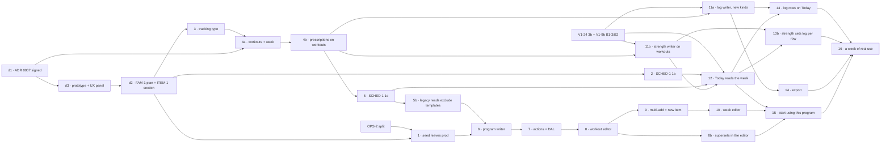

# FAM-1 — the family program

> **Status: draft, 2026-11-14, not yet panelled.** A cross-PR milestone, not an implementation plan:
> each step still gets its own branch, PR and, where significant, plan and panels. **What** each step
> must make true comes from the
> [PROG-1 re-scope](../specs/crud-1-fix-it-yourself.md#prog-1-re-scope-2026-11-13) (R1–R11), cited by
> number and not restated. This file takes the **thinnest slice** of that re-scope, orders it and
> defines "done". It is the last milestone of **Beta 0** _(maintainer, 2026-11-14)_. Its siblings are
> [PROG-1](./prog-1-programs-and-scheduling.md), which keeps everything this slice leaves out, and
> [CRUD-1](./crud-1-fix-it-yourself.md).

## The goal

Beta 0 is the maintainer's household only, and _"no one will use the app in this stage, until we can
program our own workouts"_ ([beta-1 → Beta 0](./beta-1.md#beta-0--one-invited-family)). This
milestone is that point: the household can move its real program into the app and run it from
there. A parent can:

1. create a program with **any number of named workouts**, each with a description, and reuse a
   workout on several days (R1);
2. arrange a **week**: for each weekday, **0, 1 or many workouts in order**, each slot with an
   optional label such as "Morning", "All day" or "Night" (R2);
3. build each workout on **one screen of item cards**. Each item has a **tracking type** from the
   closed menu (R6), its prescribed values, and the author's **instructions** (R8, first half).
   Check-off-only items sit alongside counted, timed, distance and weight × reps ones, and a "write
   it" number is a Count item placed after the work it describes (R7);
4. put the household's athletes on it **from a chosen date**, and see each day's workouts, in order,
   on Today;
5. let each athlete **check items off and fill them in** on a phone, and edit the program later
   without rewriting what an earlier day says was prescribed.

The household's program is the acceptance test. It is also the re-scope's "complex" shape: a
different session on most weekdays and a rest day; several workouts a day in a fixed order (for
example a morning conditioning block, sets spread across the day, an evening session, a nightly
stretch); more than a dozen distinct workouts, some reused on most days; and items that are only
ever checked off. The re-scope's "simple" shape (three workouts pinned to Monday, Wednesday and
Friday) has to fit too.

## What the slice leaves out, and why that is safe

Every athlete in the household runs the same program on the same days, and the program prescribes
no per-athlete loads. So the slice needs **no** per-athlete weekday sets, several programs per
athlete, rotation for created programs, Move / Change days / Take off / Undo, copy, archive,
history, typed per-athlete targets, supersets in the program, or the athlete's note. They all stay in
[PROG-1](./prog-1-programs-and-scheduling.md), in Beta 1. Existing programs keep the legacy
`day_role` read and are **not migrated**: the slice is the expand half of ADR 0007 decision 3's
`workouts` arc, with no backfill and no contract step.

Out of scope here because they are out of the re-scope itself: timers (`TIMER-1`), conditional days,
progression rules, partner rotation, a weekly check-in and reference cards. Each is an instruction or
a description until it has its own row.

## Decisions

**Made** _(maintainer)_:

| Decision                                                                                                                                                                                         | Where                                                                       |
| ------------------------------------------------------------------------------------------------------------------------------------------------------------------------------------------------ | --------------------------------------------------------------------------- |
| Beta 0 is the maintainer's household only; this milestone ends it                                                                                                                                | 2026-11-14, [beta-1 → Beta 0](./beta-1.md#beta-0--one-invited-family)       |
| No workout cap; a week template on the block; the resolver returns an ordered list                                                                                                               | R1, R2, R5; [ADR 0007](../decisions/0007-scheduling-model.md) Amendment 1   |
| Seven tracking types; every item can be checked off; "write it" numbers are Count items                                                                                                          | R6, R7; [plan.md → ITEM-1](../plan.md#item-1)                               |
| Instructions per item, always shown; the athlete's note is the author's switch, default off                                                                                                      | R8                                                                          |
| No timers in the first version: intervals are logged, not timed                                                                                                                                  | re-scope, "Out of this re-scope"                                            |
| The builder edits in place on one screen; on a phone, adding opens a full-screen, multi-select picker                                                                                            | R10                                                                         |
| The byte-faithful CSV no longer constrains any of this; an export stays                                                                                                                          | R11, [ADR 0009](../decisions/0009-retire-the-byte-faithful-csv-contract.md) |
| Today picks the program through an **assignment** ("Start using this program"), never the newest block                                                                                           | 2026-11-14                                                                  |
| **Supersets are in the slice**: the program groups items, and the log inherits the grouping (SUPERSET-1's first half). Changing a superset mid-workout and saving it back stays Beta 1           | 2026-11-14, reversing the draft's "No"                                      |
| **"Row completed = logged" for every kind, strength sets included.** No Log button anywhere; a set row writes when it is completed, and later sets append to the same workout's session that day | 2026-11-14, reversing the draft's "new kinds only"                          |
| The athlete's note stays out of the slice                                                                                                                                                        | 2026-11-14                                                                  |
| A worn load (vest, ankle or wrist weights) is a Count item with a unit; the structured form is Beta 1                                                                                            | 2026-11-14                                                                  |
| `PROGRAM_SEED` leaves production in step 1, right after OPS-2's split                                                                                                                            | 2026-11-14; answers [OPS-2](../plan.md) Q3                                  |
| V1-22 chunks 4 and 5 are dropped; chunk 3 goes to Beta 1 with HIST-1                                                                                                                             | 2026-11-14                                                                  |
| One FAM-1 plan that cites the PROG-1 plans, rather than five revisions                                                                                                                           | 2026-11-14                                                                  |
| The phone run-through and `PRIV-1`'s sign-off move after this milestone                                                                                                                          | 2026-11-14                                                                  |

**To decide** (recommendations are this draft's, for the maintainer):

| Question                                                                                                        | Decide by | Recommendation                                                                                                                                                                                                         |
| --------------------------------------------------------------------------------------------------------------- | --------- | ---------------------------------------------------------------------------------------------------------------------------------------------------------------------------------------------------------------------- |
| How a superset looks and logs: linked cards with their own sets (Hevy's pattern), or rows interleaved by round  | step d3   | **Linked cards**: each item keeps its card and its sets, a bar and a letter (A1, A2) join them, and the rest note sits after the last card. It reuses the card, and the log already groups by `superset_id` (ADR 0003) |
| Whether V1-24 2b (correct a logged number in place) folds into step 13b, now that a strength set is its own row | step d2   | **Decide in d2.** On a writable day, editing a completed row may already be the amend                                                                                                                                  |
| How long the instructions may be (TGT-1c planned 80 characters)                                                 | step d2   | **~500 characters**; real instructions run to ~150                                                                                                                                                                     |

## The steps

**This is the canonical chart.** Every PR in this milestone embeds it, with its own step marked.

**Every migration step (3, 4a, 4b, 5, and 11a if it needs one) merges when the database is idle,
and `migrate.yml` must be seen applied before the next deploy.** Drizzle's INSERT names every
column in the schema, and requests already insert into `movements` and `sessions`. So a new column
on either table is not dark (see the [A4 plan](../plans/v1-22-a4-create-program.md), Staging).
Step 4a also takes over A4-1's source-scan check for `program_blocks`.

| Step    | What                                                                                                                                                                                                                                                                                                                                                                                                                                                                                      | Plan                                                                | Gate                                       | ~PRs · lines             |
| ------- | ----------------------------------------------------------------------------------------------------------------------------------------------------------------------------------------------------------------------------------------------------------------------------------------------------------------------------------------------------------------------------------------------------------------------------------------------------------------------------------------- | ------------------------------------------------------------------- | ------------------------------------------ | ------------------------ |
| **d1**  | **ADR 0007 signed with Amendment 1**, plus A4-0's authorization re-scoped: `workouts`, the block's week template, a block-kind marker (legacy or template), `prescriptions.workout_id` with typed prescribed values (expand only), `program_blocks.client_id`, and SCHED-1's two tables. **Narrows decision 4**: a template block is reached only through an assignment and never by a legacy read (step 5b), so no exported cell moves                                                   | [A4](../plans/v1-22-a4-create-program.md) A4-0, **needs revision**  | the maintainer's signature                 | 1 docs · ~80             |
| **d3**  | **Builder and log-row prototype, and its UX panel**: the workout editor, the full-screen multi-add picker with "new item" and its type, the week editor, and the Check / Duration / Count rows. Fixtures only. **Before d2**, per R10                                                                                                                                                                                                                                                     | **needs writing**                                                   | d1 drafted                                 | 1                        |
| **d2**  | **The FAM-1 plan**: it cites SCHED-1, ASSIGN-1, A4, TGT-1 and PICK-1 and takes only this slice. It includes **ITEM-1's spec section** (for each of the seven types: its fields, how it is prescribed, how it is logged, and the type lock; Count gets a unit), the **entries model for the new kinds** (today's entry CHECKs allow only bodyweight and strength), and the **length of the instructions** (TGT-1c's 80 characters is too short). Engineering, DB-safety and privacy panels | **needs writing**                                                   | d3's panel                                 | 1–2 docs                 |
| **1**   | **`PROGRAM_SEED` leaves the production seed.** The household-scoped ramp schedule stays. Existing program rows stay as data. `RESERVED_PROGRAM_SLUGS` keeps reading the const. `seed.ts` is serialized with PRIV-3 PR 2 and OPS-2 PR 2                                                                                                                                                                                                                                                    | in d2; answers [OPS-2](../plan.md) Q3                               | OPS-2's split merged                       | 1 · ~120                 |
| **2**   | **SCHED-1 1a**: the day primitives and `WEEKDAYS` move to `packages/shared`                                                                                                                                                                                                                                                                                                                                                                                                               | [SCHED-1](../plans/sched-1-scheduling-model.md), unaffected         | d2                                         | 1 · ~150                 |
| **3**   | **Tracking type** on items: the seven-value CHECK, the shared menu, Count's unit, `db:verify`. The **global catalog rows are typed in the reference seed**, because a household cannot retype a shared row                                                                                                                                                                                                                                                                                | in d2                                                               | d2                                         | 1 migration · ~350       |
| **4a**  | **Workouts and the week** (A4-1, revised): `workouts` (name, description), the week template (weekday, order, label), the block-kind marker, `program_blocks.client_id`, and the session's workout, frozen at log time                                                                                                                                                                                                                                                                    | A4's A4-1, **needs revision**                                       | d1 signed · 3 applied                      | 1 migration · ~400       |
| **4b**  | **Prescriptions keyed on workouts**, expand only: `prescriptions.workout_id`, with `day_role` relaxed to XOR with it; `prescriptions.note` (instructions); and **typed prescribed values** for Duration, Time per set, Distance and Count, so ✓ can accept them; and **the superset grouping** on a workout's prescriptions (a nullable group and order). No backfill                                                                                                                     | in d2                                                               | 4a applied                                 | 1 migration · ~350       |
| **5**   | **SCHED-1 1c**: the assignment and weekday tables, shipped dark                                                                                                                                                                                                                                                                                                                                                                                                                           | [SCHED-1](../plans/sched-1-scheduling-model.md), **needs revision** | d1 signed · 4b applied                     | 1 migration · ~450       |
| **5b**  | **Legacy reads exclude template blocks**: every consumer of the newest-block read (Today, the export, the snapshot writer, the DAL modules) skips them. Byte-identical on legacy data                                                                                                                                                                                                                                                                                                     | in d2                                                               | 4a applied · 5                             | 1 · ~250                 |
| **6**   | **Program writer**: create a program; save a workout's items, order, typed prescriptions and instructions in one transaction; save the week; rename; mint an item with its type, locked once it has history; save superset groups                                                                                                                                                                                                                                                         | in d2 (from A4-3a and V1-22 chunks 4/6)                             | 5b · step 1                                | 1 · ~400                 |
| **7**   | **Actions and DAL**, boundary tests, rate limit, page gate                                                                                                                                                                                                                                                                                                                                                                                                                                | in d2                                                               | 6 · WP-1                                   | 1 · ~300                 |
| **8**   | **The workout editor**: one screen of item cards, edited in place; move up / down as well as drag; remove; one Save                                                                                                                                                                                                                                                                                                                                                                       | in d2 + d3                                                          | 7                                          | 1 · ~400                 |
| **8b**  | **Supersets in the editor**: group adjacent items into a superset, ungroup, and a rest note after the group. 2026-11-14 decision                                                                                                                                                                                                                                                                                                                                                          | in d2 + d3                                                          | 8                                          | 1 · ~300                 |
| **9**   | **Multi-add and "new item"** in the picker (PICK-1 PR 3's component)                                                                                                                                                                                                                                                                                                                                                                                                                      | in d2 + d3                                                          | 8                                          | 1 · ~350                 |
| **10**  | **The week editor**: per weekday, ordered slots with labels                                                                                                                                                                                                                                                                                                                                                                                                                               | in d2 + d3                                                          | 9                                          | 1 · ~300                 |
| **11a** | **Log writer for the new kinds**: it writes per row and is idempotent. Un-checking hides the row (V1-9b's tombstone). It writes the prescribed snapshot and the workout at log time. It may carry the entries migration d2 finds owed                                                                                                                                                                                                                                                     | in d2                                                               | 4b applied · V1-9b B1-3/B2 · V1-24 3b      | 1 (+1 migration?) · ~350 |
| **11b** | **The strength writer learns workouts**: for set-based items in a template program, the snapshot comes from the workout's prescription and the session records its workout. **Per-row writes** (2026-11-14): completing a set row writes it, later sets that day **append** to the same workout's session, un-completing hides the set (V1-9b's tombstone), and a prescribed superset carries into `superset_id` (ADR 0003)                                                               | in d2                                                               | 4b applied · V1-9b B1-3 · V1-24 3b         | 1 · ~500                 |
| **12**  | **Today reads the week**: an athlete with an open assignment gets that program's workouts due today, in order, with labels, descriptions, instructions and superset grouping. Any other athlete gets the legacy read. READ-2a's gates are moot here: no legacy block is edited, unassigned athletes keep the legacy read, and the export bytes do not move                                                                                                                                | in d2 (a thin cut of ASSIGN-READ)                                   | 2, 5, 11b · V1-24 3b and V1-9b B1-3 merged | 1 · ~400                 |
| **13**  | **Log rows on Today** for Check, Duration and Count, with a done state                                                                                                                                                                                                                                                                                                                                                                                                                    | in d2 + d3                                                          | 11a, 12                                    | 1 · ~400                 |
| **13b** | **Strength sets log per row on Today**: a ✓ per set, the PREVIOUS value, green done rows, **no Log button**; superset cards linked. Replaces V1-24 3b's strength form for athletes on a template program                                                                                                                                                                                                                                                                                  | in d2 + d3                                                          | 11b, 12                                    | 1 · ~450                 |
| **14**  | **Export** carries the new kinds and the workout, with RFC 4180 quoting (ADR 0009 §3). May fold into 11a                                                                                                                                                                                                                                                                                                                                                                                  | in d2                                                               | 11a                                        | 0–1 · ~200               |
| **15**  | **"Start using this program"**: puts the chosen athletes on the program from a date, on every weekday. No Move, Change days or Undo                                                                                                                                                                                                                                                                                                                                                       | in d2 (a thin cut of ASSIGN-1 1b-w)                                 | 12 (read before write) · 10                | 1 · ~300                 |
| **16**  | **Acceptance**: the household enters its program, runs it for a week and writes a findings note                                                                                                                                                                                                                                                                                                                                                                                           | —                                                                   | everything above                           | manual                   |

**≈ 3–4 docs PRs + 20 code PRs** (4–5 of them migrations), ≈ 7,000 lines of source and tests. The
docs steps can start now, in the order d1 → d3 → d2, alongside Beta 0's ops work. Steps 2–10 need
only the docs and the migration queue; 5b and 6 also need step 1, which waits on OPS-2. Steps
11a–13b wait on the V1-24 3b / V1-9b B1-3 strength surfaces.

**Serial chains.** Migrations take the next number at merge: 3 → 4a → 4b → 5. `programming.md` takes
one PR in review at a time ([PROG-1 → gate run](./prog-1-programs-and-scheduling.md#gate-run)): 4a,
4b, 5b, 6, 7, 8b, 10, 11b, 12 and 15.

## What moves to Beta 1

From [PROG-1](./prog-1-programs-and-scheduling.md), everything not listed above:

- SCHED-1 1b, 1d and 1e;
- ASSIGN-READ and ASSIGN-1 in full: per-athlete days, several programs, Move, Change days, Take off
  and Undo;
- rotation for created programs (R3);
- V1-22 A4-3c and A4-4, with ONB-2;
- CLONE-1, RETIRE-1 and HIST-1;
- TGT-1, except the instructions column that step 4b takes;
- changing a superset during a workout and saving it back (SUPERSET-1's add-on), and the athlete's note;
- structured worn load (GAP-3 PR 4b and movement-declared load slots);
- FEED-0, the personal feed;
- ITEM-1's convergence with ACT-1;
- PICK-1 PR 4 and MOV-1;
- PROGS-1/2;
- V1-22 chunk 3.

[beta-1 → Beta 1](./beta-1.md#beta-1--35-families-all-the-major-features) proposes the order.

## Gaps this milestone found

These needs had no row before this draft. Each now has a home:

- **Removing `PROGRAM_SEED` from production** had no owner (OPS-2 Q3). It is now step 1.
- **The export with new item kinds** is owed by ADR 0009 §3, but no row carried it. It is now step 14.
- **Typed prescribed values** beyond sets and reps: `prescriptions` has no place for a duration, a
  hold or a distance. They are now step 4b.
- **Template blocks would leak into every legacy read.** The newest-block read feeds Today, the
  export and the snapshot writer. Excluding template blocks is now step 5b.
- **The strength writer and the snapshot assume `day_role`.** Teaching them about workouts is now
  step 11b.
- **The entries model for the new kinds**: today's CHECKs allow only bodyweight and strength. d2
  decides, and it may add a migration to 11a.
- **A worn load on a timed item** (vest, ankle or wrist weights): none of the seven types names it,
  and the log form cannot record it yet. The slice uses Count items with a unit; the structured form
  is Beta 1.
- **Sets spread across the day**: each strength submit makes a new session, and there is no way to
  append to an earlier entry. Since 2026-11-14 the slice appends: step 11b writes per row into the
  workout's session for that day.
- **An optional workout on a rest day**: it doesn't matter for logging, but it must be settled with
  ADR 0007's nothing-due-day rule **before MOT-1 stores a streak**.
- **Later, not needed here:** load on a Distance item, "each side" as structure, a day-level title,
  duplicating a workout, program-level reference text, and time ranges as typed targets (TGT-1).

## FAM-1 exit criteria — done when

- [ ] A parent creates a program with more workouts than the old cap of three, each with a
      description, and uses one workout on several weekdays (steps 4a, 6–10).
- [ ] A weekday shows **0, 1 or many** workouts in the order arranged, with their slot labels, and a
      weekday with none is a rest day (steps 4a, 10, 12).
- [ ] Every item has one of the seven tracking types, and the global catalog's rows are typed. A
      type change is refused once the item has history. A Count item logs one number with its unit
      (steps 3, 6, 11a).
- [ ] On a phone, an athlete checks off a Check item in one tap. ✓ on an untouched item accepts what
      was prescribed, of any type. Per-item instructions are shown (steps 4b, 11a–13).
- [ ] Two items grouped as a superset in the builder show linked on Today, and their logged sets
      carry the grouping (steps 4b, 8b, 11b, 13b).
- [ ] A strength set logs when its row is completed, with no Log button, and a set done after school
      joins the morning's session for that workout (steps 11b, 13b).
- [ ] A program can be built **before** anyone is on it. Saving it changes nothing for any athlete,
      and the export does not move. "Start using this program" switches the chosen athletes from a
      date (steps 5, 5b, 12, 15).
- [ ] Editing a workout after a day is logged leaves that day's prescribed snapshot unchanged, for
      set-based items and the new kinds alike (steps 6, 11a, 11b).
- [ ] No push re-writes a program: `PROGRAM_SEED` no longer reaches production (step 1).
- [ ] The export contains every logged item kind and opens in a common spreadsheet app (step 14).
- [ ] Both shapes fit: the re-scope's "simple" one, and the household's own program run for a week
      (step 16).
- [ ] Every new route is in the a11y scan, works at 360px, and has ≥44px targets.

## Risks

- **Step 4b is the riskiest PR.** It relaxes a NOT NULL and adds an XOR CHECK on a live
  `prescriptions` table.
- **Steps 5b and 12 change the busiest read.** For legacy blocks, its output must be byte-identical
  to today's, and that has to be proved, not assumed.
- **The new columns are not dark** (Drizzle's INSERT). Each migration merges idle and is observed
  applied before the next deploy.
- **d3 may take more than one round**, and d2 and every UI step wait on it.
- **The new tables are household config, not personal data**, but each migration still owes its
  data-inventory row in the same PR. The privacy review sees the change (see "To decide").

## Review log

Not yet panelled. One independent reviewer read this draft against the household's program and the
plans' dependencies on 2026-11-14. It found 4 blockers: worn load is not shipped; nothing stores
non-rep prescribed values; the strength writer assumes `day_role`; and template blocks leak into the
newest-block read. It also found 8 should-fixes and 3 nits. All were accepted, and steps 4b, 5b and
11b, the migration gate, and the d3-before-d2 order come from them. The full panel comes with d2.

**2026-11-14, the maintainer's decisions:** the assignment, the worn load as Count, step 1, dropping
V1-22 chunks 4 and 5, one plan, and the run-through after FAM-1, as recommended. **Supersets and
per-row strength logging are in**, against the draft. That adds steps 8b and 13b and grows 4b, 6,
11b and 12: ≈ +2 code PRs and ≈ +1,100 lines.
