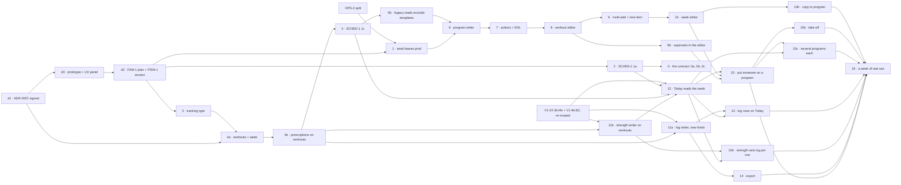

---
# The lanes that run at the same time, read by `pnpm guides:check` (plan §6; the format is
# .claude/skills/write-spec/SKILL.md → Lanes). Each list holds only what its lane owns alone: a
# file two lanes change is a seam, ordered in the plan's §6 table, and is in no list. Lane S (the
# feature thread) works in shared files and declares none; the contract owner is not a lane.
# Lane A's `seed.ts` and `writers/ownership.ts` are under `write-path.md`, which other lanes' seam
# steps also owe; the two FILES are lane A's alone (plan §5), so they are listed.
lane-a-schema:
  - packages/db/scripts/verify/schema.ts
  - packages/db/src/seed.ts
  - packages/db/src/writers/ownership.ts
lane-p-program-data:
  - packages/db/src/writers/program/
  - packages/db/src/queries/program/
  - packages/db/scripts/verify/program.ts
lane-e-day-data:
  - packages/db/src/writers/day/
  - packages/db/src/queries/day/
  - packages/db/scripts/verify/day.ts
lane-b-builder:
  - apps/web/components/program-builder/
  - apps/web/app/programs/
  - apps/web/lib/dal/program/
  - apps/web/e2e/program-builder.spec.ts # arrives at step 7b
lane-c-day-page:
  - apps/web/components/day/
  - apps/web/lib/dal/day/
  - apps/web/app/p/[profileId]/row-actions.ts # arrives at step 12b, with the two beside it
  - apps/web/app/p/[profileId]/row-actions.registry.ts
  - apps/web/app/p/[profileId]/row-actions.test.ts
  - apps/web/e2e/day-page.spec.ts # arrives at step 12c
---

# FAM-1 — the family program

> **Status: draft, 2026-11-14, not yet panelled.** A cross-PR milestone, not an implementation plan:
> each step still gets its own branch, PR and, where significant, plan and panels. **What** each step
> must make true comes from the
> [PROG-1 re-scope](../specs/crud-1-fix-it-yourself.md#prog-1-re-scope-2026-11-13) (R1–R11), cited by
> number and not restated. This file takes the **thinnest slice** of that re-scope, orders it and
> defines "done". It is the last milestone of **Beta 0** _(maintainer, 2026-11-14)_. Its siblings are
> [PROG-1](./prog-1-programs-and-scheduling.md), which keeps everything this slice leaves out, and
> [CRUD-1](./crud-1-fix-it-yourself.md).

## The goal

Beta 0 is the maintainer's household only, and _"no one will use the app in this stage, until we can
program our own workouts"_ ([beta-1 → Beta 0](./beta-1.md#beta-0--one-invited-family)). This
milestone is that point: the household can move its real program into the app and run it from
there. A parent can:

1. create a program with **any number of named workouts**, each with a description, and reuse a
   workout on several days (R1);
2. arrange a **week**: for each weekday, **0, 1 or many workouts in order**, each slot with an
   optional label such as "Morning", "All day" or "Night" (R2);
3. build each workout on **one screen of item cards**. Each item has a **tracking type** from the
   closed menu (R6), its prescribed values, and the author's **instructions** (R8, first half).
   Check-off-only items sit alongside counted, timed, distance and weight × reps ones, and a "write
   it" number is a Count item placed after the work it describes (R7);
4. put the household's athletes on it **from a chosen date**, alongside any other programs they are
   on, and see each day's workouts from all of them, in order, on Today;
5. let each athlete **check items off and fill them in** on a phone, and edit the program later
   without rewriting what an earlier day says was prescribed.

The household's program is the acceptance test. It is also the re-scope's "complex" shape: a
different session on most weekdays and a rest day; several workouts a day in a fixed order (for
example a morning conditioning block, sets spread across the day, an evening session, a nightly
stretch); more than a dozen distinct workouts, some reused on most days; and items that are only
ever checked off. The re-scope's "simple" shape (three workouts pinned to Monday, Wednesday and
Friday) has to fit too.

**The accepted prototype** is [Beta 0's, v12](../prototypes/beta-0/index.html) (2026-11-15: v10 after d3; v11 with #412's read-only older days; v12 in line with the plan).
Every FAM-1 step is checked against it ([prototypes README](../prototypes/README.md#the-accepted-prototype-for-each-release)).

## What the slice leaves out, and why that is safe

Every athlete on a program runs it on the same days, and the program prescribes no per-athlete
loads. So the slice needs **no** per-athlete weekday sets, rotation for created programs, Move /
Change days / Undo, copying or archiving a whole program, history, typed per-athlete targets, or the
athlete's note. They all stay in
[PROG-1](./prog-1-programs-and-scheduling.md), in Beta 1. Existing programs keep the legacy
`day_role` read and are **not migrated**: the slice is the expand half of ADR 0007 decision 3's
`workouts` arc, with no backfill and no contract step.

Out of scope here because they are out of the re-scope itself: timers (`TIMER-1`), conditional days,
progression rules, partner rotation, a weekly check-in and reference cards. Each is an instruction or
a description until it has its own row.

## Decisions

**Made** _(maintainer)_:

| Decision                                                                                                                                                                                                                                                                                                                                                                                                                       | Where                                                                       |
| ------------------------------------------------------------------------------------------------------------------------------------------------------------------------------------------------------------------------------------------------------------------------------------------------------------------------------------------------------------------------------------------------------------------------------ | --------------------------------------------------------------------------- |
| Beta 0 is the maintainer's household only; this milestone ends it                                                                                                                                                                                                                                                                                                                                                              | 2026-11-14, [beta-1 → Beta 0](./beta-1.md#beta-0--one-invited-family)       |
| No workout cap; a week template on the block; the resolver returns an ordered list                                                                                                                                                                                                                                                                                                                                             | R1, R2, R5; [ADR 0007](../decisions/0007-scheduling-model.md) Amendment 1   |
| Seven tracking types; every item can be checked off; "write it" numbers are Count items                                                                                                                                                                                                                                                                                                                                        | R6, R7; [plan.md → ITEM-1](../plan.md#item-1)                               |
| Instructions per item, always shown; the athlete's note is the author's switch, default off                                                                                                                                                                                                                                                                                                                                    | R8                                                                          |
| No timers in the first version: intervals are logged, not timed                                                                                                                                                                                                                                                                                                                                                                | re-scope, "Out of this re-scope"                                            |
| The builder edits in place on one screen; on a phone, adding opens a full-screen, multi-select picker                                                                                                                                                                                                                                                                                                                          | R10                                                                         |
| The byte-faithful CSV no longer constrains any of this; an export stays                                                                                                                                                                                                                                                                                                                                                        | R11, [ADR 0009](../decisions/0009-retire-the-byte-faithful-csv-contract.md) |
| Today picks the program through an **assignment** ("Start using this program"), never the newest block                                                                                                                                                                                                                                                                                                                         | 2026-11-14                                                                  |
| **Supersets are in the slice**: the program groups items, and the log inherits the grouping (SUPERSET-1's first half). Changing a superset mid-workout and saving it back stays Beta 1                                                                                                                                                                                                                                         | 2026-11-14, reversing the draft's "No"                                      |
| **"Row completed = logged" for every kind, strength sets included.** No Log button anywhere; a set row writes when it is completed, and later sets append to the same workout's session that day                                                                                                                                                                                                                               | 2026-11-14, reversing the draft's "new kinds only"                          |
| The athlete's note stays out of the slice                                                                                                                                                                                                                                                                                                                                                                                      | 2026-11-14                                                                  |
| A worn load (vest, ankle or wrist weights) is a Count item with a unit; the structured form is Beta 1                                                                                                                                                                                                                                                                                                                          | 2026-11-14                                                                  |
| `PROGRAM_SEED` leaves production in step 1, right after OPS-2's split                                                                                                                                                                                                                                                                                                                                                          | 2026-11-14; answers [OPS-2](../plan.md) Q3                                  |
| V1-22 chunks 4 and 5 are dropped; chunk 3 goes to Beta 1 with HIST-1                                                                                                                                                                                                                                                                                                                                                           | 2026-11-14                                                                  |
| One FAM-1 plan that cites the PROG-1 plans, rather than five revisions                                                                                                                                                                                                                                                                                                                                                         | 2026-11-14                                                                  |
| The phone run-through and `PRIV-1`'s sign-off move after this milestone                                                                                                                                                                                                                                                                                                                                                        | 2026-11-14                                                                  |
| A superset shows as **linked cards** (each item keeps its card and sets; a bar and letters join them) and can link **any number** of adjacent items (A1, A2, A3…)                                                                                                                                                                                                                                                              | 2026-11-14, after the prototype                                             |
| **V1-24 2b folds into step 13b**: changing a number on a completed row is the amend                                                                                                                                                                                                                                                                                                                                            | 2026-11-14, after the prototype                                             |
| The workout editor has one Save; the week saves each change                                                                                                                                                                                                                                                                                                                                                                    | 2026-11-14, after the prototype                                             |
| **Look ahead**: on a program, the day page pages forward into future days as a read-only preview of that weekday's workouts (step 12)                                                                                                                                                                                                                                                                                          | 2026-11-14, after the prototype                                             |
| **No hidden "current athlete"**: Home tiles show each athlete's program; **Programs** is a list showing who is on each; a program page says who its changes apply to; the day page links to its program and has an athlete switcher. No "Your program"                                                                                                                                                                         | 2026-11-14, after UX research (11 rounds) and the prototype                 |
| **Several programs per athlete are in the slice** (for example a family program and a stretching program). The day page lists workouts in **each athlete's own program order**, then each program's week order; labels are optional headings and never sort (2026-11-15, replacing time-of-day order); a newly added program defaults to its place in the household's Programs list. **Take off** ends a program after today   | 2026-11-14, moved from ASSIGN-1                                             |
| **Copy to program…**: a workout is copied, independently, into another program (or the same one) with optional weekdays and a label, and shows where it came from ("Copied from Family program · 14 Nov"). Editing either never changes the other                                                                                                                                                                              | 2026-11-14, from CLONE-1's first half                                       |
| **No linked workouts.** To get every change someone makes, an athlete goes **on that program**; a workout shared by two groups becomes its own small program. Following a program across households is the club pilot's                                                                                                                                                                                                        | 2026-11-14                                                                  |
| **Wake leaves the day page.** The tap time is not the wake time, and nothing reads it. Wake times already logged stay in history and the export. **"Up on time"** is not built in for Beta 0 _(2026-11-15: a built-in item needs a movement pattern, and a habit has none)_; a family that wants it adds its own Check item                                                                                                    | 2026-11-14, after the prototype                                             |
| **The new day page on every day.** No Log buttons anywhere, and no old Check-ins or Strength forms: nobody depends on the old layout yet. This re-scopes V1-24 2a (cut; moved to Beta 1), V1-24 3b and V1-9b B1-3 (see the rows below)                                                                                                                                                                                         | 2026-11-15, after the prototype sweep                                       |
| **Repeated work is sets**: an item has set rows with reps, plus "Add set". Push-ups in the morning and the evening are two workouts (or two programs), each with its sets. There are no free-floating bouts                                                                                                                                                                                                                    | 2026-11-15                                                                  |
| **Single-value entries are edit-only**: bodyweight, practice minutes and any one-line Life field are entered once with ✓, then **Change**. No Delete, no Undo, no tomb, under any circumstance; Change to blank clears it. A second weigh-in exists only if a program defines it (morning and evening)                                                                                                                         | 2026-11-15, after the d3 panel; widens the bodyweight-only rule             |
| **Practice minutes start empty** unless the program's author set a default: practices differ in length                                                                                                                                                                                                                                                                                                                         | 2026-11-15                                                                  |
| **Old entries are out of scope until FAM-1 is done**: no read-only past rows, own-name sections or deleting past entries, since nobody uses the app yet. The maintainer is asked again when FAM-1 closes. This **cuts V1-9b B1-3** from Beta 0 and shrinks **V1-24 3b to Life and Bodyweight**, edit-only                                                                                                                      | 2026-11-15                                                                  |
| **A logged day keeps its frozen workout** on the day page: the first ✓ of a workout on a day fixes what that day shows, whatever the program becomes, and a workout later removed from the week still shows there ([ADR 0007](../decisions/0007-scheduling-model.md) Amendment 2 §6–7). Prototypes v6–v9 redrew past days from the current program; v10 fixes it                                                               | 2026-11-15, d3 panel                                                        |
| **Life sits under Bodyweight**, above the workouts                                                                                                                                                                                                                                                                                                                                                                             | 2026-11-15, d3 panel                                                        |
| **A logged row keeps its own prescription; nothing else is frozen.** Editing a workout after logging part of it changes only the rows not yet logged; logged rows keep what they were logged against, and a removed item's logged rows still show. v10 froze the whole workout at the first ✓; this replaces that ([d2 → D7](../plans/fam-1-family-program.md), [ADR 0007 Amendment 3](../decisions/0007-scheduling-model.md)) | 2026-11-15, after the d2 panel                                              |
| **Viewing past workouts moves to the feed** (FEED-0, Beta 1), so the day page may later stop paging into past days. FAM-1 keeps today's navigation; past days show only their logged rows                                                                                                                                                                                                                                      | 2026-11-15                                                                  |
| **What leaves the day page when every athlete gets the new one**: the Check-ins form (habits and 1–10 ratings become Check and Count items in a program), the "Calisthenics today" totals, the "This week" ramp card, the session's "How did it feel?" note, and the bodyweight and band toggles on a set. Their data stays ([d2 → D21](../plans/fam-1-family-program.md))                                                     | 2026-11-15                                                                  |
| **V1-24 3b and V1-9b B1–B2 keep their own merged plans (#412) and run as a lane of this milestone's plan** (Life and Bodyweight rows, Clear this day), so one set of lanes covers the day page (d2 → D22). **Days before yesterday are read-only** (#412)                                                                                                                                                                      | 2026-11-15                                                                  |
| **An athlete's routine page, trimmed to Life items, stays the place that turns Wrestling practice on** (d2 → D28)                                                                                                                                                                                                                                                                                                              | 2026-11-15                                                                  |

**To decide** (recommendations are this draft's, for the maintainer):

| Question                                                        | Decide by | Recommendation                                     |
| --------------------------------------------------------------- | --------- | -------------------------------------------------- |
| How long the instructions may be (TGT-1c planned 80 characters) | step d2   | **~500 characters**; real instructions run to ~150 |

## The steps

> ⚠️ **Superseded 2026-11-15 — see [the FAM-1 plan](../plans/fam-1-family-program.md) §5–§7** for the
> step ids, gates, lanes and delivery slices. The plan split and re-homed several steps (4a, 6, 11,
> 12), added the ones this table lacks, and redid the slices. What follows is kept as the record of
> the reasoning.
>
> 🔴 **Do not copy a step's label from this chart or table.** Several ids mean something else in the
> plan: here 11a is "log writer, new kinds" and 11b is "strength writer on workouts"; in the plan
> 11a is a refactor that extracts the session helpers, **11b is the one row writer for every type**,
> and 11c-i is Change (11c-ii is the revive). A PR
> title, a branch name or a step note takes its id and its wording from the plan's §5 _(a lane copied
> the old labels by mistake, 2026-11-16)_.

**This is the canonical chart.** Every PR in this milestone embeds it, with its own step marked.

**Every migration step (3, 4a, 4b, 5, and 11a if it needs one) merges when the database is idle,
and `migrate.yml` must be seen applied before the next deploy.** Drizzle's INSERT names every
column in the schema, and requests already insert into `movements` and `sessions`. So a new column
on either table is not dark (see the [A4 plan](../plans/v1-22-a4-create-program.md), Staging).
Step 4a also takes over A4-1's source-scan check for `program_blocks`.

**Who merges a PR** _(maintainer, orchestrator's chat, 2026-11-17: "Lanes can mark ready for review, review (unless trivial), ship then merge")_. The lane that wrote a PR merges it, in this order: mark it ready for review; an independent review ([review-pr](../../.claude/skills/review-pr/SKILL.md)), unless the change is trivial; fix what the review finds; the reviewer's shipit; merge. Two conditions: CI is green, and the branch is current with `main` or behind only by unrelated commits ([AGENTS.md](../../AGENTS.md), "Keep the branch up to date with `main` before merge"). **Nothing merges with a P0 or P1 finding open** _(maintainer, the same day: "ensure after they're reviewed that there are no outstanding p0/p1 items. P2 you can report back to this thread and ask me if I want to add to tech-debt backlog")_: a P2 the lane does not fix goes to the board, and the maintainer decides whether it joins [tech-debt.md](../tech-debt.md). The lane then tells the board what merged. The contract owner merges contract and plan PRs the same way. The rule is about who merges: a question that was the maintainer's to decide still goes to them, through the board. A movement-library batch has its own form of the review: it merges once every row of its review tab reads `lgtm` ([CAT-3 spec](../specs/cat-3-movement-library.md), D3).

| Step    | What                                                                                                                                                                                                                                                                                                                                                                                                                                                                                                                                                                                                                                  | Plan                                                                                                                             | Gate                                                                                                                                                     | ~PRs · lines             |
| ------- | ------------------------------------------------------------------------------------------------------------------------------------------------------------------------------------------------------------------------------------------------------------------------------------------------------------------------------------------------------------------------------------------------------------------------------------------------------------------------------------------------------------------------------------------------------------------------------------------------------------------------------------- | -------------------------------------------------------------------------------------------------------------------------------- | -------------------------------------------------------------------------------------------------------------------------------------------------------- | ------------------------ |
| **d1**  | **ADR 0007 signed with Amendments 1 and 2**, plus A4-0's authorization re-scoped: `workouts`, the block's week template, a block-kind marker (legacy or template), `prescriptions.workout_id` with typed prescribed values (expand only), `program_blocks.client_id`, and SCHED-1's two tables. **Narrows decision 4**: a template block is reached only through an assignment and never by a legacy read (step 5b), so no exported cell moves                                                                                                                                                                                        | [ADR 0007 Amendment 2](../decisions/0007-scheduling-model.md#amendment-2-2026-11-14-what-fam-1-needs-authorized), replacing A4-0 | the maintainer's signature                                                                                                                               | 1 docs · ~80             |
| **d3**  | **Builder and log-row prototype, and its UX panel**: the workout editor, the full-screen multi-add picker with "new item" and its type, the week editor, and the Check / Duration / Count rows. Fixtures only. **Before d2**, per R10                                                                                                                                                                                                                                                                                                                                                                                                 | **done** 2026-11-15: v10 and a three-lens UX panel ([round notes](../prototypes/beta-0/d3-round-1.md))                           | d1 drafted                                                                                                                                               | 1                        |
| **d2**  | **The FAM-1 plan**: it cites SCHED-1, ASSIGN-1, A4, TGT-1 and PICK-1 and takes only this slice. It includes **ITEM-1's spec section** (for each of the seven types: its fields, how it is prescribed, how it is logged, and the type lock; Count gets a unit), the **entries model for the new kinds** (today's entry CHECKs allow only bodyweight and strength), and the **length of the instructions** (TGT-1c's 80 characters is too short). Engineering, DB-safety and privacy panels                                                                                                                                             | [the FAM-1 plan](../plans/fam-1-family-program.md), in review                                                                    | d3's panel                                                                                                                                               | 1–2 docs                 |
| **1**   | **`PROGRAM_SEED` leaves the production seed.** The household-scoped ramp schedule stays. Existing program rows stay as data. `RESERVED_PROGRAM_SLUGS` keeps reading the const. `seed.ts` is serialized with PRIV-3 PR 2 and OPS-2 PR 2                                                                                                                                                                                                                                                                                                                                                                                                | in d2; answers [OPS-2](../plan.md) Q3                                                                                            | none: its own `SEED_FIXTURES` flag (plan D10), not OPS-2                                                                                                 | 1 · ~120                 |
| **2**   | **SCHED-1 1a**: the day primitives and `WEEKDAYS` move to `packages/shared`                                                                                                                                                                                                                                                                                                                                                                                                                                                                                                                                                           | [SCHED-1](../plans/sched-1-scheduling-model.md), unaffected; **done** 2026-11-15                                                 | d2                                                                                                                                                       | 1 · ~150                 |
| **3**   | **Tracking type** on items: the seven-value CHECK, the shared menu, Count's unit, `db:verify`. The **global catalog rows are typed in the reference seed**, because a household cannot retype a shared row                                                                                                                                                                                                                                                                                                                                                                                                                            | in d2                                                                                                                            | d2                                                                                                                                                       | 1 migration · ~350       |
| **4a**  | **Workouts and the week** (A4-1, revised): `workouts` (name, description), the week template (weekday, order, label), the block-kind marker, `program_blocks.client_id`, and the session's workout, frozen at log time                                                                                                                                                                                                                                                                                                                                                                                                                | A4's A4-1, **needs revision**                                                                                                    | d1 signed · 3 applied                                                                                                                                    | 1 migration · ~400       |
| **4b**  | **Prescriptions keyed on workouts**, expand only: `prescriptions.workout_id`, with `day_role` relaxed to XOR with it; `prescriptions.notes` (instructions); and **typed prescribed values** for Duration, Time per set, Distance and Count, so ✓ can accept them; and **the superset grouping** on a workout's prescriptions (a nullable group and order). No backfill                                                                                                                                                                                                                                                                | in d2                                                                                                                            | 4a applied                                                                                                                                               | 1 migration · ~350       |
| **5**   | **SCHED-1 1c**: the assignment and weekday tables, shipped dark                                                                                                                                                                                                                                                                                                                                                                                                                                                                                                                                                                       | [SCHED-1](../plans/sched-1-scheduling-model.md), **needs revision**                                                              | d1 signed · 4b applied                                                                                                                                   | 1 migration · ~450       |
| **5b**  | **Legacy reads exclude template blocks**: every consumer of the newest-block read (Today, the export, the snapshot writer, the DAL modules) and `householdHasProgram` filter on `kind = 'legacy'`. Byte-identical on legacy data                                                                                                                                                                                                                                                                                                                                                                                                      | in d2                                                                                                                            | 4a applied · 5                                                                                                                                           | 1 · ~250                 |
| **6**   | **Program writer**: create a program; save a workout's items, order, typed prescriptions and instructions in one transaction; save the week; rename; mint an item with its type, locked once it has history; save superset groups                                                                                                                                                                                                                                                                                                                                                                                                     | in d2 (from A4-3a and V1-22 chunks 4/6)                                                                                          | 5b · step 1                                                                                                                                              | 1 · ~400                 |
| **7**   | **Actions and DAL**, boundary tests, rate limit, page gate                                                                                                                                                                                                                                                                                                                                                                                                                                                                                                                                                                            | in d2                                                                                                                            | 6 · WP-1                                                                                                                                                 | 1 · ~300                 |
| **8**   | **The workout editor**: one screen of item cards, edited in place; move up / down as well as drag; remove; one Save                                                                                                                                                                                                                                                                                                                                                                                                                                                                                                                   | in d2 + d3                                                                                                                       | 7                                                                                                                                                        | 1 · ~400                 |
| **8b**  | **Supersets in the editor**: group adjacent items into a superset, ungroup, and a rest note after the group. 2026-11-14 decision                                                                                                                                                                                                                                                                                                                                                                                                                                                                                                      | in d2 + d3                                                                                                                       | 8                                                                                                                                                        | 1 · ~300                 |
| **9**   | **Multi-add and "new item"** in the picker (PICK-1 PR 3's component)                                                                                                                                                                                                                                                                                                                                                                                                                                                                                                                                                                  | in d2 + d3                                                                                                                       | 8                                                                                                                                                        | 1 · ~350                 |
| **10**  | **The week editor**: per weekday, ordered slots with labels                                                                                                                                                                                                                                                                                                                                                                                                                                                                                                                                                                           | in d2 + d3                                                                                                                       | 9                                                                                                                                                        | 1 · ~300                 |
| **10b** | **Copy to program…**: copy a workout, independently, into any program with optional weekdays and a label; it records where it came from. Reuses step 6's writer                                                                                                                                                                                                                                                                                                                                                                                                                                                                       |
| **11a** | **Log writer for the new kinds**: it writes per row and is idempotent. Un-checking hides the row (V1-9b's tombstone). It writes the prescribed snapshot and the workout at log time. It may carry the entries migration d2 finds owed                                                                                                                                                                                                                                                                                                                                                                                                 | in d2                                                                                                                            | 4b applied · V1-9b B2 (re-scoped)                                                                                                                        | 1 (+1 migration?) · ~350 |
| **11b** | **The strength writer learns workouts**: for set-based items in a template program, the snapshot comes from the workout's prescription and the session records its workout. **Per-row writes** (2026-11-14): completing a set row writes it, later sets that day **append** to the same workout's session, un-completing hides the set (V1-9b's tombstone), and a prescribed superset carries into `superset_id` (ADR 0003)                                                                                                                                                                                                           | in d2                                                                                                                            | 4b applied                                                                                                                                               | 1 · ~500                 |
| **12**  | **Today reads the week**: an athlete with an open assignment gets that program's workouts due today, in order, with labels, descriptions, instructions and superset grouping, and **future days as a read-only preview**. Any other athlete gets the same page with Bodyweight and Life only; the legacy read leaves the day page (d2, D17). **Every day uses the new day page** (2026-11-15): an athlete with no open assignment sees Bodyweight and Life, with no workouts and no Log buttons (old entries are deferred until FAM-1 is done). READ-2a's gates are moot: no legacy block is edited, and the export bytes do not move | in d2 (a thin cut of ASSIGN-READ)                                                                                                | 2, 5, 11b · V1-24 3b-life (re-scoped) merged                                                                                                             | 1 · ~400                 |
| **13**  | **Log rows on Today** for Check, Duration and Count, with a done state                                                                                                                                                                                                                                                                                                                                                                                                                                                                                                                                                                | in d2 + d3                                                                                                                       | 11a, 12                                                                                                                                                  | 1 · ~400                 |
| **13b** | **Strength sets log per row on Today**: a ✓ per set, the PREVIOUS value, green done rows, **no Log button**; superset cards linked. The old strength form leaves the day page (2026-11-15), so this is the only one                                                                                                                                                                                                                                                                                                                                                                                                                   | in d2 + d3                                                                                                                       | 11b, 12                                                                                                                                                  | 1 · ~450                 |
| **14**  | **Export** carries the new kinds and the workout (its frozen `workout_name`, never an id), with RFC 4180 quoting (ADR 0009 §3), and updates the privacy notice's export paragraph. May fold into 11a                                                                                                                                                                                                                                                                                                                                                                                                                                  | in d2                                                                                                                            | 11a                                                                                                                                                      | 0–1 · ~200               |
| **15**  | **"Put someone on this program"**: adds the program to the chosen athletes from a date, on every weekday, keeping their other programs. No Move, Change days or Undo                                                                                                                                                                                                                                                                                                                                                                                                                                                                  |
| **15b** | **Take off**: ends an athlete's program after today; logged days keep what they had                                                                                                                                                                                                                                                                                                                                                                                                                                                                                                                                                   |
| **15c** | **Several programs per athlete**: Today merges every open assignment's workouts, by label then the athlete's own program order; the athlete reorders; a new program defaults to the household order. Each workout names its program                                                                                                                                                                                                                                                                                                                                                                                                   |
| **16**  | **Acceptance**: the household enters its program, runs it for a week and writes a findings note                                                                                                                                                                                                                                                                                                                                                                                                                                                                                                                                       | —                                                                                                                                | everything above · `CAT-3`'s fresh start _(2026-11-17: the household builds its program on the new library, [spec](../specs/cat-3-movement-library.md))_ | manual                   |

**≈ 3–4 docs PRs + 23 code PRs** (4–5 of them migrations), ≈ 8,000 lines of source and tests
(steps 10b, 15b and 15c added ≈ 3 PRs and ≈ 1,000 lines on 2026-11-14). The
docs steps can start now, in the order d1 → d3 → d2, alongside Beta 0's ops work. Steps 2–10 need
only the docs and the migration queue; 5b and 6 also need step 1, which waits on OPS-2. Steps
11a–13b wait on the re-scoped V1-24 3b-life (2026-11-15): the old Check-ins and Strength forms leave the day page, and single values are edit-only, so only Life and Bodyweight need it. V1-9b B1-3 is cut: the new day page has no Delete.

**Serial chains.** Migrations take the next number at merge: 3 → 4a → 4b → 5. `programming.md` takes
one PR in review at a time ([PROG-1 → gate run](./prog-1-programs-and-scheduling.md#gate-run)): 4a,
4b, 5b, 6, 7, 8b, 10, 10b, 11b, 12, 15 and 15c.

## The schedule: in a row, and in lanes

The same 53 PRs drawn twice: one after another, and in the lanes of
[the plan's wave table](../plans/fam-1-family-program.md#7-waves-and-slices). **One unit is one
PR-length**: the time one PR takes from its first commit to merged, reviews included. It is not a day.
Slice 1 will measure a PR-length; until then the chart shows shape, not dates.

```mermaid
gantt
  title FAM-1 — one PR after another, and the same PRs in lanes (1 unit = one PR-length)
  dateFormat X
  axisFormat %s
  todayMarker off

  section In a row
  The contract, 5 PRs          :done, r0, 0, 5
  Lane A's 7 PRs (merged)      :done, r1, 5, 12
  Lane P's 8 PRs               :r2, 12, 20
  Lane E's 7 PRs               :r3, 20, 27
  Lane B's 10 PRs              :r4, 27, 37
  Lane C's 9 PRs               :r5, 37, 46
  Lane S's 7 PRs               :r6, 46, 53
  All 53 PRs merged            :milestone, rm, 53, 53

  section Contract
  2, 0a, 0b-i, 0b-ii, 0c (merged) :done, c0, 0, 1

  section A · schema
  3 tracking types             :crit, done, a1, 1, 2
  4a-i, 1                      :crit, done, a2, 2, 3
  4a-ii, 5b                    :crit, done, a3, 3, 4
  4b                           :crit, done, a4, 4, 5
  5                            :crit, done, a5, 5, 6

  section P · program data
  6a (four PRs, merged)        :done, p1, 5, 6
  6b                           :done, p2, 6, 7
  6c-i put on, test data       :p3, 7, 8
  6c-ii the two reads          :p3b, 8, 9
  6d                           :p4, 9, 10

  section E · day data
  11a                          :done, e1, 4, 5
  11b row writer               :crit, done, e2, 5, 7
  12a-i the day's read         :crit, done, e3, 7, 8
  14, 11c (11c-i merged)       :active, e4, 8, 9
  12a-ii replayed fixtures     :done, e5, 9, 10

  section B · builder
  8a lists and program page    :done, b1, 1, 2
  8 workout editor             :done, b2, 2, 3
  8b supersets                 :done, b3, 3, 4
  9 picker                     :done, b4, 4, 5
  10 week editor               :done, b5, 5, 6
  10b dialogs                  :done, b6, 6, 7
  7a (7a-i merged)             :active, b7, 7, 8
  7b pages                     :b8, 9, 10
  15 put on, take off          :crit, b9, 11, 12

  section C · day page
  13 rows and ✓                :done, c1, 1, 2
  13b set rows, supersets      :done, c2, 2, 3
  13b-ii Change                :done, c2b, 3, 4
  13d look ahead, closed days  :done, c3, 3, 4
  12b first real ✓             :crit, done, c4, 8, 9
  12c on the day page          :crit, c5, 9, 10
  12d Change                   :crit, c6, 10, 11
  15c, 12f                     :c7, 11, 12

  section S · single values
  3b-page (merged)             :done, s1, 1, 2
  3b-bw                        :done, s2, 2, 3
  3b-0                         :done, s3, 6, 7
  3b-life, B2-0 (merged)       :done, s4, 7, 8
  B1-2                         :done, s5, 8, 9
  B2                           :s6, 10, 11

  section Slices
  1 · walking skeleton on preview (after 12c) :milestone, m1, 10, 10
  2 · the family can switch (after 12d, then 15) :milestone, m2, 12, 12
  3 · order, Clear this day, clean-up         :milestone, m3, 12, 12
```

**What it shows**

- **In a row, 53 PR-lengths; in lanes, about 12.** The lanes do the same work. They finish sooner
  because the screens (lanes B and C) are built against fixtures on the preview page while the
  database is still being migrated, which is what the contract is for.
- **Red is the critical path**: lane A's migrations, then the row writer, the day's read, the first
  real ✓, the day page, and the two steps the switch waits on (12d, then 15: plan decision D39). Nothing shortens it:
  only one migration may be unapplied at a time, and each must be seen applied before the next
  merges. A delay on a red bar moves the end; a delay on a blue bar usually does not.
- **Lane B has slack** (waves 7 to 10), and lanes B, C and S do their first six waves before any
  program data exists.
- **12a is two PRs since 2026-11-17** (12a-i, 12a-ii). 12a-i, the day's read, stays on the
  critical path and gates the first real ✓ (12b). 12a-ii replays the fixtures that describe a
  change after logging; it waits for lane P's writers and gates 15, not the day page (12c).
- **6c is two PRs since 2026-11-17**, the maintainer's decision (6c-i, Put on and the test data;
  6c-ii, the program page's two reads). The day page (12c) waits for 6c-i only. The pages (7b)
  wait for 6c-ii, so 7b is drawn a wave later, inside lane B's slack.
- **11c is two PRs since 2026-11-17** (11c-i, Change; 11c-ii, the D35 revive), in 11c's one slot.
  12d's Change action waits for 11c-i only.
- **6a is four PRs**: three since 2026-11-16 (6a-i, 6a-ii, 6a-iii), and 6a-iii split in two on 2026-11-17, the maintainer's decision (6a-iii-a, the picker's read and "+ New item"; 6a-iii-b, copying a workout). The row
  above counts them; the lanes picture keeps them in 6a's one slot. **7a is two PRs since 2026-11-16** (7a-i, 7a-ii), also in
  one slot: 7a-i needs only 6a-i and 6a-ii. If each of 6a's four takes a full PR-length, 7a-ii
  (which needs 6b and 6a-iii-b) starts later than drawn and the lanes' end moves from about 12 to about 13. Slice 1's measured
  PR-length will say which.
- **Grey is merged; a highlighted bar is part merged** (as of 2026-11-17, 40 of the 53). The
  contract's five PRs and the plan update were opened and merged on 2026-11-15, partly in parallel
  themselves. Since then: all of lane A's chain; lane E's 11a, 11b, 12a-i (#505), 12a-ii (#525) and 11c-i (#539); lane B's six screen steps
  (8a to 10b) and 7a-i; lane C's five (13, 13b, 13b-ii, 13d, and 12b, the first real ✓, #528); lane S's 3b-page, 3b-bw, 3b-0, 3b-life, B2-0 (#514) and B1-2 (#547).
  All four of 6a's PRs (6a-iii-b, copying a workout, is #571) and 6b (#522) are merged. 7a's bar is part merged (7a-i is merged, 7a-ii is not), and so
  is 11c's (11c-i is merged, 11c-ii is not). A bar is marked here when its PRs are on `main`.

**What it does not show**: review rounds that find a flaw (a bar gets longer), a contract change
(every lane reading the shape waits), and the maintainer's own time for sign-offs and the phone
run-through. Actual bars are added under each lane as slices land; the difference between the two is
the measured result.

## Delivery slices (proposed 2026-11-14)

> ⚠️ **Superseded 2026-11-15 — see [the FAM-1 plan](../plans/fam-1-family-program.md) §5–§7** for the
> step ids, gates, lanes and delivery slices. The plan split and re-homed several steps (4a, 6, 11,
> 12), added the ones this table lacks, and redid the slices. What follows is kept as the record of
> the reasoning.

**Why.** The steps above are layers: schema, then writers, then the editor, then Today. Read in
number order, nothing runs end to end until about step 15. The two riskiest changes are 5b and 12,
which change the busiest read and must leave legacy output byte-identical, and 11a, the per-row
write. In that order, both prove themselves near the end. The four slices below are **the same 23
steps, regrouped**. Each slice ends with something that runs end to end, and a check that proves it.
The step numbers, the dependency chart and the serial chains are unchanged.

| Slice                                                                      | Steps                               | Running total | Done when                                                                                                                                                                                                                                       |
| -------------------------------------------------------------------------- | ----------------------------------- | ------------- | ----------------------------------------------------------------------------------------------------------------------------------------------------------------------------------------------------------------------------------------------- |
| **1 · Walking skeleton, on preview**                                       | 2, 3, 4a, 4b, 5, 5b, 6, 11a, 12, 13 | ≈ 10 code PRs | A Playwright test on the seed-only preview: a fixture athlete on a fixture program sees Monday's workouts in order on Today, and checks off, un-checks and fills in Check, Duration and Count items. A legacy athlete's Today is byte-identical |
| **2 · A parent builds a program and puts someone on it** (no strength yet) | 1, 7, 8, 9, 10, 15                  | ≈ 16          | On a phone, a parent builds a workout and a week and puts a **test athlete** on it, and that athlete logs it on Today                                                                                                                           |
| **3 · Strength on the program: the household switches**                    | 8b, 11b, 13b, 14                    | ≈ 20          | Heavy A, with a superset, logs per row on a phone, and the export opens in a spreadsheet. **The household moves to its real program here**, and step 16's week of use starts                                                                    |
| **4 · Several programs, Take off, Copy to program**                        | 15c, 15b, 10b                       | ≈ 23          | An athlete on two programs sees both on one day; a copied workout edits on its own. Then step 16's findings note closes FAM-1                                                                                                                   |

**Read the totals honestly.** The schema chain is serial and every slice needs it, so the skeleton
still takes about 10 PRs. The household moves to its real program after about 20 PRs, not 23. That
is earlier, but not by much. The bigger wins are risk-first ordering (5b, 12 and 11a are proved
around PR 10, not PR 20) and a demo at every slice boundary. The skeleton ends on preview with
fixture data, not at home.

**Why the household can't switch at slice 2:** an athlete with an open assignment gets the template
day page, and step 13b is what replaces the legacy strength form there. Before slice 3, switching
would lose in-app strength logging on lifting days.

**Stretching before slice 4:** until 15c lands, an athlete is on one program, so stretching lives
inside the family program and moves into its own program at slice 4. If stretching should be
separate from the first day at home, move 15c into slice 3 (+1 PR there).

**For d2 to confirm:** the chart has step 6 waiting on step 1. In slice 1, step 6 lands **dark**:
nothing in production calls the program writer until steps 7 and 8. So it should only need step 1
before step 7. If d2 confirms this, slice 1 no longer waits on OPS-2's split.

**For d3:** each new screen opens with a short **design contract**: the screen's job, its primary
action, the states it must handle (empty, loading, error, done), its 360px rules, and the patterns it
rejects ([DX-14](../plan.md)).

## Lanes and the contract (proposed 2026-11-14)

> ⚠️ **Superseded 2026-11-15 — see [the FAM-1 plan](../plans/fam-1-family-program.md) §5–§7** for the
> step ids, gates, lanes and delivery slices. The plan split and re-homed several steps (4a, 6, 11,
> 12), added the ones this table lacks, and redid the slices. What follows is kept as the record of
> the reasoning.

The slices above set the **order of integration**. This section sets **who works in parallel**
inside each slice. The gates are [parallel-work.md](../parallel-work.md)'s, chiefly gate 1
(disjoint file globs) and gate 2 (the contract is sufficient, not merely present).

**Chunk 0: the contract PR.** It lands right after d2 and before any lane starts. It is real code,
small (≈ 200 lines), and reviewed by the panel lenses. It holds:

| Shape          | What it carries                                                                                                    | Producer → consumer                                 |
| -------------- | ------------------------------------------------------------------------------------------------------------------ | --------------------------------------------------- |
| `WorkoutDraft` | a workout's items, typed prescriptions, superset groups, instructions                                              | builder (8–10b) → program writer (6)                |
| `DayPlan`      | what Today renders: each program, its workouts in order with labels, items with what was prescribed, and supersets | day resolver (12) → Today (12's rendering, 13, 13b) |
| `RowWrite`     | one completed row: `clientId`, slot, item, set and values, retry-safe                                              | Today (13, 13b) → log writers (11a, 11b)            |

Each shape is a zod schema in `packages/shared`, with its inferred type, **named fixtures** that the
lanes build against, and **the list of tests not yet written** for each consumer. A shape change after
chunk 0 is a seam change: it goes through its owner, and the lanes reading it wait.

**Lanes, once chunk 0 has landed:**

| Lane                                | Steps                                | Builds against                        | Owns (globs fixed by d2)                           |
| ----------------------------------- | ------------------------------------ | ------------------------------------- | -------------------------------------------------- |
| **A · Schema and writers** (serial) | 3 → 4a → 4b → 5 → 5b → 6 → 11a → 11b | the database                          | `packages/db/**`, the writers                      |
| **B · Builder UI**                  | 8, 8b, 9, 10, 10b                    | `WorkoutDraft` fixtures, no database  | the program and workout routes                     |
| **C · Today UI**                    | 12's rendering, 13, 13b              | `DayPlan` fixtures, a fake `RowWrite` | the day page's components                          |
| **D · Side work**                   | 1, 2, 14                             | none                                  | the seed, `packages/shared` day primitives, export |
| **Integration**                     | 7, 12's resolver, 15, 15b, 15c, 16   | the real pieces                       | actions, the DAL, the page wiring                  |

**Integrate first, not last.** There is no integration sprint at the end. Slice 1 _is_ the first
integration: one thin real path (Check items only) wired end to end. After it, B and C widen against
the contract while A extends the backbone, and each slice boundary integrates a little. Lane A's
migration chain is the critical path, because each migration is observed applied before the next. So
**the milestone moves at lane A's pace plus the integration steps**: roughly 13 PR-lengths of
calendar time instead of 23 in a row. That is an estimate, to be checked against slice 1.

**Keeping the lanes parallel.** The general risks and fixes are in
[parallel-work → Once lanes run](../parallel-work.md#once-lanes-run-what-turns-them-back-into-one-queue).
Here they mean:

- **Guides:** the hotspot is `write-path.md`, not `programming.md`. It owns `packages/db/src/writers/`,
  `apps/web/lib/dal/`, `seed.ts` and `export-month.ts`, so steps 1, 6, 7, 11a, 11b and 14 would all
  edit it. Lane guides `fam-1-schema.md`, `fam-1-builder.md`, `fam-1-today.md` and `fam-1-writers.md`
  (paths fixed by d2, created by chunk 0) relieve it **only for new files in new directories**
  (DX-14 item 9): step 6, and 11a if its writers go in a new subdirectory. `seed.ts` (1),
  `export-month.ts` (14), the DAL and `actions.ts` (7) and `strength-session.ts` (11b) are exact or
  flat entries and still owe `write-path.md`: they are seams, and their steps stay ordered, with
  `program-day.ts`. If step 14 folds into 11a, lanes A and D meet on `write-path.md` there.
- **Columns:** lane A owns the schema; chunk 0 lists every column slices 1–4 need. Step 4b is the
  riskiest migration, so its order stays.
- **Fixtures:** both sides test against named fixtures, for example `monday-two-programs`.
- **Composing file:** only integration edits `apps/web/app/p/[profileId]/page.tsx`.
- **Contract:** slice 1 tests it.

**For d2 to settle:**

- each lane's exact file globs, checked against gate 1;
- whether lanes B and C ship behind the "no assignment yet" state (a template program with no one on
  it is invisible), so their PRs merge dark;
- the **named fixtures** in chunk 0.

## What moves to Beta 1

From [PROG-1](./prog-1-programs-and-scheduling.md), everything not listed above:

- SCHED-1 1b, 1d and 1e;
- ASSIGN-READ and ASSIGN-1's remainder: per-athlete days, Move, Change days and Undo (several
  programs and Take off moved into this slice, 2026-11-14);
- rotation for created programs (R3);
- V1-22 A4-3c and A4-4, with ONB-2;
- CLONE-1's remainder (copying a whole program, moving athletes to the copy), RETIRE-1 and HIST-1;
- "Do someone else's workout today", a one-day snapshot into the log;
- TGT-1, except the instructions column that step 4b takes;
- changing a superset during a workout and saving it back (SUPERSET-1's add-on), and the athlete's note;
- structured worn load (GAP-3 PR 4b and movement-declared load slots);
- FEED-0, the personal feed;
- ITEM-1's convergence with ACT-1;
- PICK-1 PR 4 and MOV-1;
- PROGS-1/2;
- V1-22 chunk 3.

[beta-1 → Beta 1](./beta-1.md#beta-1--35-families-all-the-major-features) proposes the order.

## Gaps this milestone found

These needs had no row before this draft. Each now has a home:

- **Removing `PROGRAM_SEED` from production** had no owner (OPS-2 Q3). It is now step 1.
- **The export with new item kinds** is owed by ADR 0009 §3, but no row carried it. It is now step 14.
- **Typed prescribed values** beyond sets and reps: `prescriptions` has no place for a duration, a
  hold or a distance. They are now step 4b.
- **Template blocks would leak into every legacy read.** The newest-block read feeds Today, the
  export and the snapshot writer. Excluding template blocks is now step 5b.
- **The strength writer and the snapshot assume `day_role`.** Teaching them about workouts is now
  step 11b.
- **The entries model for the new kinds**: today's CHECKs allow only bodyweight and strength. d2
  decides, and it may add a migration to 11a.
- **A worn load on a timed item** (vest, ankle or wrist weights): none of the seven types names it,
  and the log form cannot record it yet. The slice uses Count items with a unit; the structured form
  is Beta 1.
- **Sets spread across the day**: each strength submit makes a new session, and there is no way to
  append to an earlier entry. Since 2026-11-14 the slice appends: step 11b writes per row into the
  workout's session for that day.
- **An optional workout on a rest day**: it doesn't matter for logging, but it must be settled with
  ADR 0007's nothing-due-day rule **before MOT-1 stores a streak**. With several programs per athlete
  (15c), the rule is now settled ([MOT-1.5](../plan.md), 2026-11-14): every counting workout due must be
  done, workouts count unless switched off, and excused days carry a reason. The per-workout switch
  and excused days are MOT-1's, in Beta 1; nothing in this slice changes.
- **Later, not needed here:** load on a Distance item, "each side" as structure, a day-level title, program-level reference text, and time ranges as typed targets (TGT-1).

## FAM-1 exit criteria — done when

> The step numbers in parentheses are this document's original ones. [The plan's §5](../plans/fam-1-family-program.md)
> splits some of them: 4a → 4a-i, 4a-ii · 6 → 6a–6d · 11a, 11b → 11b (one row writer) and 11c-i, 11c-ii · 12 →
> 12a–12f · 15b → 6d and 15.

- [ ] A parent creates a program with more workouts than the old cap of three, each with a
      description, and uses one workout on several weekdays (steps 4a, 6–10).
- [ ] A weekday shows **0, 1 or many** workouts in the order arranged, with their slot labels, and a
      weekday with none is a rest day (steps 4a, 10, 12).
- [ ] Every item has one of the seven tracking types, and the global catalog's rows are typed. A
      type change is refused once the item has history. A Count item logs one number with its unit
      (steps 3, 6, 11a).
- [ ] On a phone, an athlete checks off a Check item in one tap. ✓ on an untouched item accepts what
      was prescribed, of any type. Per-item instructions are shown (steps 4b, 11a–13).
- [ ] Two items grouped as a superset in the builder show linked on Today, and their logged sets
      carry the grouping (steps 4b, 8b, 11b, 13b).
- [ ] A strength set logs when its row is completed, with no Log button, and a set done after school
      joins the morning's session for that workout (steps 11b, 13b).
- [ ] A program can be built **before** anyone is on it. Saving it changes nothing for any athlete,
      and the export does not move. "Put someone on this program" adds it for the chosen athletes from
      a date (steps 5, 5b, 12, 15).
- [ ] An athlete on two programs sees both programs' workouts on one day, in their own program
      order, then each program's week order, each naming its program; Take off ends one after today (15b, 15c).
- [ ] A workout copied to another program edits independently of the original, and shows where it
      came from (step 10b).
- [ ] Editing a workout after a day is logged leaves that day's prescribed snapshot unchanged, for
      set-based items and the new kinds alike (steps 6, 11a, 11b).
- [ ] No push re-writes a program: `PROGRAM_SEED` no longer reaches production (step 1).
- [ ] The export contains every logged item kind and opens in a common spreadsheet app (step 14).
- [ ] Both shapes fit: the re-scope's "simple" one, and the household's own program run for a week
      (step 16).
- [ ] Every new route is in the a11y scan, works at 360px, and has ≥44px targets.

## Risks

- **Step 4b is the riskiest PR.** It relaxes a NOT NULL and adds an XOR CHECK on a live
  `prescriptions` table.
- **Steps 5b and 12 change the busiest read.** For legacy blocks, its output must be byte-identical
  to today's, and that has to be proved, not assumed.
- **The new columns are not dark** (Drizzle's INSERT). Each migration merges idle and is observed
  applied before the next deploy.
- **d3 may take more than one round**, and d2 and every UI step wait on it.
- **Some new tables are personal data, not just household config:** `program_assignments` (which
  child is on which program, from when) and a minor's session workout. Each migration owes its
  data-inventory row and its place in the erasure order in the same PR
  ([ADR 0007 Amendment 2 §8](../decisions/0007-scheduling-model.md)). The privacy review sees each one.

## Review log

Not yet panelled. One independent reviewer read this draft against the household's program and the
plans' dependencies on 2026-11-14. It found 4 blockers: worn load is not shipped; nothing stores
non-rep prescribed values; the strength writer assumes `day_role`; and template blocks leak into the
newest-block read. It also found 8 should-fixes and 3 nits. All were accepted, and steps 4b, 5b and
11b, the migration gate, and the d3-before-d2 order come from them. The full panel comes with d2.

**2026-11-14, the maintainer's decisions:** the assignment, the worn load as Count, step 1, dropping
V1-22 chunks 4 and 5, one plan, and the run-through after FAM-1, as recommended. **Supersets and
per-row strength logging are in**, against the draft. That adds steps 8b and 13b and grows 4b, 6,
11b and 12: ≈ +2 code PRs and ≈ +1,100 lines.
