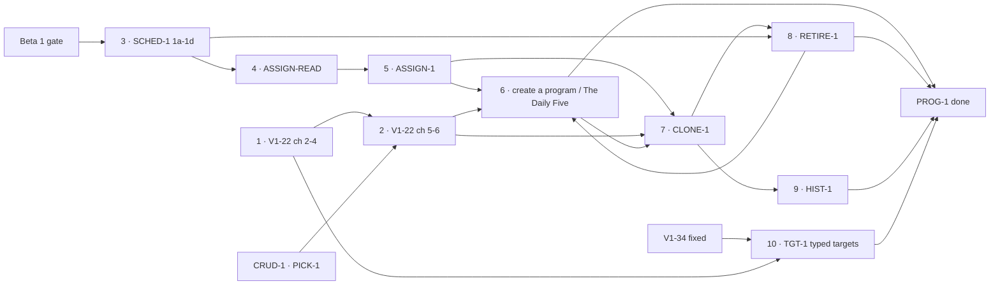

# PROG-1 — programs and scheduling

> **Status: proposed 2026-10-23, awaiting the maintainer's approval of the plans.** A cross-PR milestone,
> not an implementation plan. **What** each step must make true lives in the
> [spec](../specs/crud-1-fix-it-yourself.md), cited by criterion number; this file orders the steps and
> defines "done". The screens were approved as a prototype (v8 by the maintainer, 2026-10-23; v9 adds
> the target fields decided in M34): [docs/prototypes/crud-1/](../prototypes/crud-1/index.html). Its
> sibling is [CRUD-1 — fix it yourself](./crud-1-fix-it-yourself.md).

## The goal

A parent runs the household's programs without a deploy. They can:

1. edit a program's movements, sets, reps and per-athlete targets — typed, with a note (V1-22, TGT-1);
2. put an athlete on a program **on chosen weekdays**, move them, change their days, or take them
   off, with Undo (ASSIGN-1);
3. create a program with up to three labelled workouts, or start from The Daily Five (V1-22 A4);
4. save a program as a copy and choose who moves; archive one; see what an athlete ran on any past
   date (CLONE-1, RETIRE-1, HIST-1).

Today a program changes only by editing TypeScript and deploying (`docs/plan.md` → V1-22), and every
athlete gets the household's newest block every day. It closes Beta 1's _"A household can edit its
program and choose its days"_ (`beta-1.md:438`); the streaks half of that box is MOT-1's.

## Decisions

**Made** (quoted in the spec's review-response log):

| Decision                                                                                   | Where             |
| ------------------------------------------------------------------------------------------ | ----------------- |
| The default program is **The Daily Five** via ONB-2's writer, never `PROGRAM_SEED`         | M22, criterion 33 |
| Programs have labelled **workouts** (at most three); a "day" is a weekday and nothing else | M24, Q16, 42      |
| A skipped day never shifts the program; the rotation counts **scheduled** days             | Q13, Q13b, 40     |
| Archiving a program someone is on resolves each of them in place first                     | Q3                |
| HIST-1 is timeline first                                                                   | Q4                |
| Per-athlete targets are typed: the movement's own quantity, **one** weight, and a note     | M31 → M34, 50–51  |
| Labelled workouts pinned to recurring weekdays come later, and nothing here may block them | M24, Recurrence   |

**To decide — before the step that depends on it:**

| Question                                                            | Decide by         | Recommendation                                               |
| ------------------------------------------------------------------- | ----------------- | ------------------------------------------------------------ |
| Widen to Beta 1 (family #1, two weeks, the maintainer's call)       | before step 3     | Beta 1's own gate; nothing here changes it                   |
| ADR 0007 decision 2's amendment (scheduled-day count)               | step 3's sign-off | Rides SCHED-1 1c, as the spec records                        |
| How a workout label is stored                                       | step 6's plan     | Per the [V1-22 A4 plan](../plans/v1-22-a4-create-program.md) |
| ADR 0007's amendment for program creation (A4-0, its own signed PR) | before step 6     | Per the [V1-22 A4 plan](../plans/v1-22-a4-create-program.md) |
| What CSV columns say which program version an athlete ran           | step 7's plan     | Per the [CLONE-1 plan](../plans/clone-1-save-as-copy.md)     |

## The steps

**This is the canonical chart**, embedded by every PR in this milestone with its own step marked.

| Step | What                                                                                                                                      | Plan                                                                                                          | Gate                                                                                                                                       | Spec criteria                                                       |
| ---- | ----------------------------------------------------------------------------------------------------------------------------------------- | ------------------------------------------------------------------------------------------------------------- | ------------------------------------------------------------------------------------------------------------------------------------------ | ------------------------------------------------------------------- |
| 1    | **V1-22 chunks 2 → 3 → 4** — the snapshot writer, the backfill, edit values                                                               | [V1-22 spec](../specs/v1-22-authoring-program-editing.md), [chunk 2](../plans/v1-22-2-renderer-and-writer.md) | already unblocked (roadmap)                                                                                                                | V1-22's own                                                         |
| 2    | **V1-22 chunks 5 → 6** — the seed guard; add, remove, reorder                                                                             | [V1-22 spec](../specs/v1-22-authoring-program-editing.md)                                                     | step 1 + CRUD-1's PICK-1 (the same picker)                                                                                                 | 34                                                                  |
| 3    | **SCHED-1 1a → 1d** — assignments and weekday rows                                                                                        | [sched-1-scheduling-model](../plans/sched-1-scheduling-model.md)                                              | **Beta 1's gate** + ADR 0007 signed                                                                                                        | SCHED-1's own                                                       |
| 4    | **ASSIGN-READ** — Today and the export read the athlete's assignments                                                                     | [assign-1-assignments](../plans/assign-1-assignments.md)                                                      | step 3 + V1-22 chunk 3's recorded `--apply` + the never-assigned correction applied (READ-2a); Insight's sign-off + the census (READ-2b)   | 30, 43                                                              |
| 5    | **ASSIGN-1** — put on, move, change days, take off, with Undo                                                                             | [assign-1-assignments](../plans/assign-1-assignments.md)                                                      | step 4 + U0 + ADR 0007's amendments (1a-db, 1a, 1b-a) + AUTH-1 1c and WP-1 (1b-a) + step 1's chunk 4 (1c) + CRUD-1's PROF-1 a-1 and b (1d) | 21, 29, 31, 32, 36–38, 40, 44–46 (36's create link lands in step 6) |
| 6    | **V1-22 A4** — create a program; start from The Daily Five (its last PR, A4-4, waits for step 8, which makes "no live program" reachable) | [v1-22-a4-create-program](../plans/v1-22-a4-create-program.md)                                                | steps 2, 4, 5                                                                                                                              | 33, 35, 36 (the link), 42, 45, 49                                   |
| 7    | **CLONE-1** — save as a copy, choose who moves                                                                                            | [clone-1-save-as-copy](../plans/clone-1-save-as-copy.md)                                                      | steps 1, 2, 5                                                                                                                              | 22–25                                                               |
| 8    | **RETIRE-1** — archive a program                                                                                                          | [retire-1-archive-program](../plans/retire-1-archive-program.md)                                              | steps 3, 7                                                                                                                                 | 26–27                                                               |
| 9    | **HIST-1** — what an athlete ran on a past date                                                                                           | [hist-1-program-history](../plans/hist-1-program-history.md)                                                  | step 7                                                                                                                                     | 28                                                                  |
| 10   | **TGT-1** — typed per-athlete targets, one weight, a note                                                                                 | [tgt-1-typed-targets](../plans/tgt-1-typed-targets.md)                                                        | 1a–1c: V1-34 fixed, before step 1's chunk 4; 1d: chunk 4 + 1c; 1e–1f: 1d                                                                   | 50–51                                                               |

**Before Beta 1's gate, only steps 1, 2 and 10 can run** (TGT-1 1a–1c before chunk 4), and step 2 waits on CRUD-1's picker. Step 3
is the gate for everything about days.

## Parallel lanes

Settled by [parallel-work.md](../parallel-work.md)'s six gates, run 2026-10-23 — see
[the gate run](#gate-run). _(Corrected by it: the lanes below interleave, and every step, not only
2, 6, 7 and 10, edits `programming.md`.)_

- **Lane A — Authoring:** V1-22 chunk 2 → 3 → TGT-1 1a–1c → chunk 4 → TGT-1 1d–1f → chunks 5 → 6
  (6 after CRUD-1's PICK-1). Then, after scheduling: A4-0 → A4-3c → CLONE-1, and A4-4 only after
  lane B's RETIRE-1.
- **Lane B — Scheduling:** 3 → 4 → 5, then 8 (after lane A's CLONE-1 and A4-3a) and 9 (after CLONE-1).
- **Both lanes take turns on `programming.md`**: every step edits it, so at most one PROG-1 PR is in
  review at a time. Before Beta 1's gate only lane A has work, so this costs nothing until the gate.

### Gate run

_Run 2026-10-23._ The repo was read at `origin/main@27847ca`, along with what is in flight
(`git worktree list`, `gh pr list --state open`). The plans were read as they stand on `docs/crud-spec`
(`637bce1` plus its uncommitted edits). The cite convention and the expanded `owns:` are
[CRUD-1's gate run](./crud-1-fix-it-yourself.md#gate-run)'s. `<id>:<n>` means
`docs/plans/<id>-….md`, line `n`.

**Gate 1 fails for every pair, on the guides alone.** Every PROG-1 step edits
`docs/features/programming.md`: `v1-22-2:465`; `tgt-1:332,383,420,431`; `a4:282,295,313,339`;
`clone-1:439`; `sched-1:216,275,422`; `assign-1:1198,1216,1226,1265,1276,1288`; `retire-1:487,541`;
`hist-1:298,321`. Each lane's mutating PRs also edit `write-path.md` (`v1-22-2:463`, `tgt-1:420`,
`a4:314`, `clone-1:440`, `assign-1:1199,1288,1298`, `retire-1:486,523`, `hist-1:322`).

**Gates that fail for whole lanes:**

- **Gate 2** fails for V1-22 chunks 3–6, which have a spec but no plan
  (`docs/specs/v1-22-authoring-program-editing.md:146-149`).
- **Gate 3:** scheduling waits on SCHED-1 1c observed applied. READ-2a waits on chunk 3's recorded
  `--apply` (`:82`). ASSIGN-1 1b-a waits on AUTH-1 1c, which has not started (`:83`;
  `docs/roadmap.md:54` at `origin/main`).
- **Gate 5:** the plans await approval (`:3`). Beta 1's gate and ADR 0007's signature hold step 3
  (`:81`). Label storage, A4-0 and the CSV columns are still open (`:45-47`).
- **Gate 4** passes: `docs/specs/crud-1-fix-it-yourself.md:40` and
  `docs/specs/v1-22-authoring-program-editing.md:18`.
- **Gate 6** fails as recorded in CRUD-1's run: the migration journal and number, the
  mutation-patch prefixes, `verify.ts`, `constants.ts`, `a11y.spec.ts` and
  `[profileId]/page.tsx`.

| Lane pair                                                      | Shared files / guides                                                                                                                                                                                                                                                                                                                                                                                                                                                                                                                                                                                                                                                                                                        | Gates failing | Verdict                                                                                                                                                                                                                                   |
| -------------------------------------------------------------- | ---------------------------------------------------------------------------------------------------------------------------------------------------------------------------------------------------------------------------------------------------------------------------------------------------------------------------------------------------------------------------------------------------------------------------------------------------------------------------------------------------------------------------------------------------------------------------------------------------------------------------------------------------------------------------------------------------------------------------- | ------------- | ----------------------------------------------------------------------------------------------------------------------------------------------------------------------------------------------------------------------------------------- |
| V1-22 chunk 2 (lane A's next) × AUTH-1 1b, 1c (in flight next) | `write-path.md` (`v1-22-2:463`; `auth-1:1668,1717`). `verify.ts`. `actions.test.ts` (`v1-22-2:455`; `auth-1:1712`)                                                                                                                                                                                                                                                                                                                                                                                                                                                                                                                                                                                                           | 1             | **Serialize: one in review at a time.** AUTH-1 goes first whenever it is ready, because it is the critical path. Chunk 2 takes any free slot.                                                                                             |
| AUTH-1 1b × A, B                                               | `packages/db/src/seed.ts` (`auth-1:1660`; `sched-1:419`; `a4:309`; `retire-1:477`; `tgt-1:378`). `corrections/registry.ts` (`auth-1:1661`; `assign-1:1196,1308`; `tgt-1:444`). The migration journal                                                                                                                                                                                                                                                                                                                                                                                                                                                                                                                         | 1, 6          | **Serialize: 1b first.**                                                                                                                                                                                                                  |
| AUTH-1 1c × A                                                  | `app/p/[profileId]/routine/page.tsx` (`auth-1:1708`). It is owned by `programming.md:10`, but 1c's table lists only `write-path.md` (`auth-1:1717`)                                                                                                                                                                                                                                                                                                                                                                                                                                                                                                                                                                          | 1             | **Serialize: 1c first.** 1c also owes a `programming.md` edit.                                                                                                                                                                            |
| A (Authoring) × B (Scheduling)                                 | `packages/shared/src/programming.ts` (`sched-1:213,418`; `assign-1:1212,1275`; `a4:275,306,391`; `clone-1:428`; `retire-1:480`; `tgt-1:377,407,428`). `seed.ts`. `lib/dal/programming.ts`, `lib/programming/program-day.ts`, `program-reference.tsx` and `lib/dal/export.ts` (`tgt-1:410-414`; `assign-1:1205-1206,1210,1222`). `docs/csv-export-contract.md` (`tgt-1:417`; `assign-1:1224`). `writers/` and `queries/program-assignments.ts` (`assign-1:1283,1285`; `a4:291-292`; `retire-1:476`). `lib/dal/programs.ts` and `app/p/program-actions.ts`, NEW at `a4:310-311` and edited at `clone-1:431` and `retire-1:479,518`. The prescribed-snapshot files, NEW at `v1-22-2:441,446` and edited at `assign-1:1211,1223` | 1, 3, 5, 6    | **Serialize.** TGT-1d goes before READ-2a and READ-2b: it can run before Beta 1's gate and they cannot. Then ASSIGN-1 1b-w → A4-2 → A4-3a → CLONE-1 PR 3 → RETIRE-1 b, c → A4-4. Each edits a file the one before it creates or reshapes. |
| CRUD-1 A (PROF-1) × A                                          | `programming.md`. `shared/src/programming.ts` (`prof-1:423`). `queries/program-day.ts` (`prof-1:424`; `v1-22-2:440`; `tgt-1:409`). `lib/dal/programming.ts` (`prof-1:428`; `tgt-1:412`). `text.ts` (`prof-1:441`; `tgt-1:328`)                                                                                                                                                                                                                                                                                                                                                                                                                                                                                               | 1, 6          | **Serialize: V1-22 chunk 2 → PROF-1 a-g → TGT-1d.**                                                                                                                                                                                       |
| CRUD-1 A × B                                                   | `writers/profile.ts`, `shared/src/profiles.ts` and `app/p/profile-actions.ts` (`prof-1:444,447,464,486,527`; `assign-1:1304-1306`). `writers/ownership.ts` (`prof-1:425,487`; `assign-1:1284`). `settings/page.tsx` (`prof-1:470`; `retire-1:537`). `undo-line.tsx` (`prof-1:472`; `retire-1:536`)                                                                                                                                                                                                                                                                                                                                                                                                                           | 1, 3, 5, 6    | **Serialize: all of PROF-1, a-1d included, before ASSIGN-1 1b-h.** Step 5's gate names only a-1 and b (`:83`).                                                                                                                            |
| CRUD-1 B (V1-9b) × A                                           | `writers/strength-session.ts` (`v1-9b:285`; `v1-22-2:443`). `lib/dal/entries.ts` (`v1-9b:391`; `v1-22-2:450`). `strength-logging.md`                                                                                                                                                                                                                                                                                                                                                                                                                                                                                                                                                                                         | 1, 6          | **Serialize: V1-22 chunk 2 → V1-9b B0 → B1-2.**                                                                                                                                                                                           |
| CRUD-1 B × B                                                   | `page.tsx`. ADR 0008 (`retire-1:489`; proposed, `docs/roadmap.md:55`). The migration journal                                                                                                                                                                                                                                                                                                                                                                                                                                                                                                                                                                                                                                 | 1, 5, 6       | **Serialize, at no cost.** V1-9b is Beta 0, and lane B waits on Beta 1's gate (`:81`).                                                                                                                                                    |
| CRUD-1 C (V1-24, U0, PICK-1, MOV-1) × A                        | The strength-form files (`pick-1:556-558`; `v1-22-2:451-454`; `tgt-1:331`). `strength-session.ts`, shared and writer (`pick-1:508,510`; `v1-22-2:439,443`). `entries.ts`. Both `program-day.ts` (`pick-1:552-553`; `v1-22-2:440,445`). `e2e/steps.ts` and `export-full-day.spec.ts` (`pick-1:559,561`; `v1-22-2:461-462`)                                                                                                                                                                                                                                                                                                                                                                                                    | 1, 3, 6       | **Serialize: chunk 2 → PICK-1 PR 2 → PR 4 → chunks 5–6** (`:80`). TGT-1b and PICK-1 PR 4 share `strength-form-scaffold.ts`, so one at a time.                                                                                             |
| CRUD-1 C × B                                                   | `page.tsx`. `strength-section.tsx` (`pick-1:555`; `assign-1:1209`). `program-day.ts` (`assign-1:1192,1206`). `steps.ts` (`sched-1:176`). `csv-export-contract.md` (`mov-1:506`; `assign-1:1224`). `settings/page.tsx` (`mov-1:497`; `retire-1:537`)                                                                                                                                                                                                                                                                                                                                                                                                                                                                          | 1, 5, 6       | **Serialize at no cost.** PICK-1 PR 4 goes before READ-2a, and MOV-1b before RETIRE-1 d. Beta 1's gate already orders them.                                                                                                               |

**Serial chains:**

1. **`programming.md`, one PR in review at a time.** Before the gate: V1-22 chunk 2 → (CRUD-1's
   PROF-1 a-g) → chunk 3 → TGT-1a → 1b → 1c → chunk 4 → TGT-1d → 1e → chunk 5 → chunk 6 (after
   PICK-1). After the gate: SCHED-1 1a–1d → READ-1 → READ-2a → READ-2b → ASSIGN-1 1a-db … 1d → A4-0
   … A4-3c → CLONE-1 → RETIRE-1 → {A4-4, HIST-1}. SCHED-1's cuttable 1e and READ-1 both create
   `queries/program-assignments.ts` (`sched-1:448`; `assign-1:1190`), so only one of them ships
   (`assign-1:124`).
2. **`seed.ts`, under `write-path.md`:** AUTH-1 1b → V1-22 chunk 5 → TGT-1c → SCHED-1 1d → A4-3a →
   RETIRE-1 b.
3. **Migrations, gate 6:** TGT-1a, TGT-1c, chunk 6, SCHED-1 1c, ASSIGN-1 1a-db, A4-1 and RETIRE-1 a,
   in CRUD-1's single queue. Each takes the next number at merge. `sched-1:272`'s `0017` is stale,
   because main is at `0018`.
4. **The export bytes:** V1-22 chunk 2 → TGT-1d → READ-2b. Each edits `lib/dal/export.ts`
   (`v1-22-2:449`; `tgt-1:414`; `assign-1:1222`).

## PROG-1 exit criteria — done when

- [ ] A parent changes a program's movements, sets, reps and per-athlete targets in the app, and a
      day already logged keeps what was prescribed then (steps 1–2).
- [ ] An athlete runs a program on chosen weekdays; a skipped day never shifts it; Mon/Wed/Fri
      alternates (steps 3–5; criterion 40).
- [ ] A household with no live program can start from The Daily Five, and a parent can create a
      program with up to three labelled workouts (step 6).
- [ ] A copy can be saved and the right athletes moved, a program archived, and any past date answered
      (steps 7–9).
- [ ] A box jump's height and weight are typed per athlete; no target is _written_ as free text, and any legacy text is counted and read-only (step 10).
- [ ] Every spec criterion tagged PROG-1 has a test in the step that owns it: 21–38, 40, 42–46, 49–51.
- [ ] The four "calendar-indexed" records in disagreement 8 say "scheduled days".

## Risks

- **Beta 1's human gate holds most of this milestone.** That is by design; it is the reason for the
  beta. Steps 1, 2 and 10 are the useful work before it.
- **ASSIGN-READ changes CSV bytes** (spec D4). The export is consumed by an existing workflow, so its
  plan pins the bytes that may change with a test, and the Insight pillar signs off.
- **The editor is one surface for four steps.** They serialize; the plans say in which order.
- **Model-drafted doses.** The Daily Five's doses need the maintainer's sign-off before seeding
  (`docs/programs/daily-five-default.md`); step 6 inherits that gate.

## Review log

Each plan below went through the engineering panel (plus db-safety and privacy where it migrates or
stores personal data) and the three UX lenses, a reconcile, and a light round-2 re-review where a
blocker reshaped it. ASSIGN-1 and RETIRE-1 were reconciled against one shared contract (change kinds,
replay-first, the archived-block conjunct at every writer, the lock timeout and order, one Undo line), so
their Undo and replay rules cannot drift. Each plan's `## Review-response log` is the record.

| Plan                                             | Round 2 | Outcome that moved this milestone                                                                 |
| ------------------------------------------------ | ------- | ------------------------------------------------------------------------------------------------- |
| [ASSIGN-1](../plans/assign-1-assignments.md)     | yes     | Ten PRs; one 1a-db migration owns the change, item and weekday tables; the gates in steps 4–5     |
| [V1-22 A4](../plans/v1-22-a4-create-program.md)  | —       | A4-0 (ADR amendment) first; A4-4 stays here, gated on RETIRE-1 PR d                               |
| [CLONE-1](../plans/clone-1-save-as-copy.md)      | yes     | Five PRs; replay after Undo needs ASSIGN-1's item rebuild                                         |
| [RETIRE-1](../plans/retire-1-archive-program.md) | yes     | Four PRs; Take off is staged, one Archive, one Undo; PR a holds the deploy until migrate is green |
| [HIST-1](../plans/hist-1-program-history.md)     | yes     | Waits on ASSIGN-READ                                                                              |
| [TGT-1](../plans/tgt-1-typed-targets.md)         | —       | 1a–1c before V1-22 chunk 4; census before any backfill                                            |
