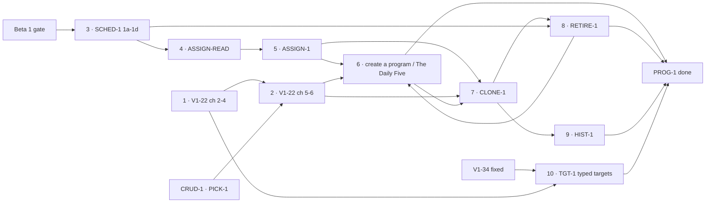

# PROG-1 — programs and scheduling

> **Status: proposed 2026-10-23, awaiting the maintainer's approval of the plans.** A cross-PR milestone,
> not an implementation plan. **What** each step must make true lives in the
> [spec](../specs/crud-1-fix-it-yourself.md), cited by criterion number; this file orders the steps and
> defines "done". The screens were approved as a prototype (v8 by the maintainer, 2026-10-23; v9 adds
> the target fields decided in M34): [docs/prototypes/crud-1/](../prototypes/crud-1/index.html). Its
> sibling is [CRUD-1 — fix it yourself](./crud-1-fix-it-yourself.md).

## The goal

A parent runs the household's programs without a deploy. They can:

1. edit a program's movements, sets, reps and per-athlete targets — typed, with a note (V1-22, TGT-1);
2. put an athlete on a program **on chosen weekdays**, move them, change their days, or take them
   off, with Undo (ASSIGN-1);
3. create a program with up to three labelled workouts, or start from The Daily Five (V1-22 A4);
4. save a program as a copy and choose who moves; archive one; see what an athlete ran on any past
   date (CLONE-1, RETIRE-1, HIST-1).

Today a program changes only by editing TypeScript and deploying (`docs/plan.md` → V1-22), and every
athlete gets the household's newest block every day. It closes Beta 1's _"A household can edit its
program and choose its days"_ (`beta-1.md:438`); the streaks half of that box is MOT-1's.

## Decisions

**Made** (quoted in the spec's review-response log):

| Decision                                                                                   | Where             |
| ------------------------------------------------------------------------------------------ | ----------------- |
| The default program is **The Daily Five** via ONB-2's writer, never `PROGRAM_SEED`         | M22, criterion 33 |
| Programs have labelled **workouts** (at most three); a "day" is a weekday and nothing else | M24, Q16, 42      |
| A skipped day never shifts the program; the rotation counts **scheduled** days             | Q13, Q13b, 40     |
| Archiving a program someone is on resolves each of them in place first                     | Q3                |
| HIST-1 is timeline first                                                                   | Q4                |
| Per-athlete targets are typed: the movement's own quantity, **one** weight, and a note     | M31 → M34, 50–51  |
| Labelled workouts pinned to recurring weekdays come later, and nothing here may block them | M24, Recurrence   |

**To decide — before the step that depends on it:**

| Question                                                            | Decide by         | Recommendation                                               |
| ------------------------------------------------------------------- | ----------------- | ------------------------------------------------------------ |
| Widen to Beta 1 (family #1, two weeks, the maintainer's call)       | before step 3     | Beta 1's own gate; nothing here changes it                   |
| ADR 0007 decision 2's amendment (scheduled-day count)               | step 3's sign-off | Rides SCHED-1 1c, as the spec records                        |
| How a workout label is stored                                       | step 6's plan     | Per the [V1-22 A4 plan](../plans/v1-22-a4-create-program.md) |
| ADR 0007's amendment for program creation (A4-0, its own signed PR) | before step 6     | Per the [V1-22 A4 plan](../plans/v1-22-a4-create-program.md) |
| What CSV columns say which program version an athlete ran           | step 7's plan     | Per the [CLONE-1 plan](../plans/clone-1-save-as-copy.md)     |

## The steps

**This is the canonical chart**, embedded by every PR in this milestone with its own step marked.

| Step | What                                                                                                                                      | Plan                                                                                                          | Gate                                                                     | Spec criteria                |
| ---- | ----------------------------------------------------------------------------------------------------------------------------------------- | ------------------------------------------------------------------------------------------------------------- | ------------------------------------------------------------------------ | ---------------------------- |
| 1    | **V1-22 chunks 2 → 3 → 4** — the snapshot writer, the backfill, edit values                                                               | [V1-22 spec](../specs/v1-22-authoring-program-editing.md), [chunk 2](../plans/v1-22-2-renderer-and-writer.md) | already unblocked (roadmap)                                              | V1-22's own                  |
| 2    | **V1-22 chunks 5 → 6** — the seed guard; add, remove, reorder                                                                             | [V1-22 spec](../specs/v1-22-authoring-program-editing.md)                                                     | step 1 + CRUD-1's PICK-1 (the same picker)                               | 34                           |
| 3    | **SCHED-1 1a → 1d** — assignments and weekday rows                                                                                        | [sched-1-scheduling-model](../plans/sched-1-scheduling-model.md)                                              | **Beta 1's gate** + ADR 0007 signed                                      | SCHED-1's own                |
| 4    | **ASSIGN-READ** — Today and the export read the athlete's assignments                                                                     | [assign-1-assignments](../plans/assign-1-assignments.md)                                                      | step 3                                                                   | 30, 43                       |
| 5    | **ASSIGN-1** — put on, move, change days, take off, with Undo                                                                             | [assign-1-assignments](../plans/assign-1-assignments.md)                                                      | step 4 + CRUD-1's U0 sheet                                               | 21, 29, 31, 36–38, 40, 44–46 |
| 6    | **V1-22 A4** — create a program; start from The Daily Five (its last PR, A4-4, waits for step 8, which makes "no live program" reachable) | [v1-22-a4-create-program](../plans/v1-22-a4-create-program.md)                                                | steps 2, 4, 5                                                            | 32–33, 35, 42, 45, 49        |
| 7    | **CLONE-1** — save as a copy, choose who moves                                                                                            | [clone-1-save-as-copy](../plans/clone-1-save-as-copy.md)                                                      | steps 1, 2, 5                                                            | 22–25                        |
| 8    | **RETIRE-1** — archive a program                                                                                                          | [retire-1-archive-program](../plans/retire-1-archive-program.md)                                              | steps 3, 7                                                               | 26–27                        |
| 9    | **HIST-1** — what an athlete ran on a past date                                                                                           | [hist-1-program-history](../plans/hist-1-program-history.md)                                                  | step 7                                                                   | 28                           |
| 10   | **TGT-1** — typed per-athlete targets, one weight, a note                                                                                 | [tgt-1-typed-targets](../plans/tgt-1-typed-targets.md)                                                        | 1a–1c: V1-34 fixed, before step 1's chunk 4; 1d: chunk 4 + 1c; 1e–1f: 1d | 50–51                        |

**Before Beta 1's gate, only steps 1, 2 and 10 can run** (TGT-1 1a–1c before chunk 4), and step 2 waits on CRUD-1's picker. Step 3
is the gate for everything about days.

## Parallel lanes

- **Lane A — Authoring:** 1 → 2 → 10, then 6 and 7 once scheduling has caught up.
- **Lane B — Scheduling:** 3 → 4 → 5, then 8 and 9.
- Steps 2, 6, 7 and 10 all edit the program editor under `programming.md`, so they serialize under
  gate 1 whatever the screens look like.

### Gate run

_Pending — run once the plans' panels have reconciled. Recorded here with the glob intersection for
each pair of lanes, feature guides' `owns:` included, and against CRUD-1's lanes._

## PROG-1 exit criteria — done when

- [ ] A parent changes a program's movements, sets, reps and per-athlete targets in the app, and a
      day already logged keeps what was prescribed then (steps 1–2).
- [ ] An athlete runs a program on chosen weekdays; a skipped day never shifts it; Mon/Wed/Fri
      alternates (steps 3–5; criterion 40).
- [ ] A household with no live program can start from The Daily Five, and a parent can create a
      program with up to three labelled workouts (step 6).
- [ ] A copy can be saved and the right athletes moved, a program archived, and any past date answered
      (steps 7–9).
- [ ] A box jump's height and weight are typed per athlete; no target is _written_ as free text, and any legacy text is counted and read-only (step 10).
- [ ] Every spec criterion tagged PROG-1 has a test in the step that owns it: 21–38, 40, 42–46, 49–51.
- [ ] The four "calendar-indexed" records in disagreement 8 say "scheduled days".

## Risks

- **Beta 1's human gate holds most of this milestone.** That is by design; it is the reason for the
  beta. Steps 1, 2 and 10 are the useful work before it.
- **ASSIGN-READ changes CSV bytes** (spec D4). The export is consumed by an existing workflow, so its
  plan pins the bytes that may change with a test, and the Insight pillar signs off.
- **The editor is one surface for four steps.** They serialize; the plans say in which order.
- **Model-drafted doses.** The Daily Five's doses need the maintainer's sign-off before seeding
  (`docs/programs/daily-five-default.md`); step 6 inherits that gate.

## Review log

_Pending: written when the plans' panels have reconciled._
