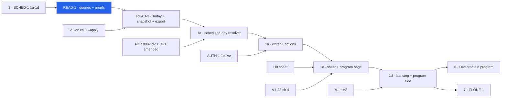

# ASSIGN-READ and ASSIGN-1: Today reads the athlete's assignments, and a parent can change them

> Backlog: **ASSIGN-READ** and **ASSIGN-1**, both _unfiled_ (spec → "Unowned work" 1 and 5; `docs/plan.md`
> gains the rows in the PR that files them) · Spec: [crud-1-fix-it-yourself.md](../specs/crud-1-fix-it-yourself.md)
> chunks **D4** and **D4b** · Milestone: [PROG-1](../milestones/prog-1-programs-and-scheduling.md) steps 4 and 5 ·
> Branch: one per PR, listed under [Staging](#staging). The first is `feat/assign-read-1-assigned-blocks`.
>
> **Plan only.** No implementation code, no migration and no app file is in the PR that carries this plan.
> Builds on [SCHED-1](./sched-1-scheduling-model.md) (D3), which creates `program_assignments` and its weekday
> rows and explicitly leaves this read out (`sched-1-scheduling-model.md:141-143`), and on
> [ADR 0007](../decisions/0007-scheduling-model.md). Measured against this worktree at `8769c1b`.

## Goal

Two things are true today. Every athlete in a household gets that household's newest block on every day: `programDayRows`
picks one block by `orderBy(desc(programBlocks.id)).limit(1)` (`packages/db/src/queries/program-day.ts:71-85`),
and Today asks it for the global calendar letter `resolveDayRole(day)` (`apps/web/app/p/[profileId]/page.tsx:81,88`).
And nothing a parent can do changes which program an athlete runs or on which days. After SCHED-1 the rows that
could say so exist, but nothing reads them except the seed, and nothing writes them (SCHED-1 1c ships them dark,
1d seeds seven weekdays).

This plan covers two backlog rows in six PRs (seven if one migration is still owed):

- **ASSIGN-READ (D4).** Today, the log-time prescription snapshot and the CSV export's live fallback stop
  reading "the newest block" and read **the athlete's assignments**. That replaces the kid-only guard A1 adds
  (Q15, FE-5). For the CSV this is a byte-affecting change on a contract the **Insight** pillar owns
  (`docs/roadmap.md:34`, `:111`), so the cells that can move are listed and pinned under
  [The export: exactly which bytes can change](#the-export-exactly-which-bytes-can-change).
- **ASSIGN-1 (D4b).** A parent can put an athlete on a program on chosen weekdays, move them, change their
  days or take them off, with Undo. Each change closes a period and opens a new one; nothing is edited in
  place, except a period opened today, which is replaced. The rotation starts counting **scheduled** days (Q13b)
  through a stored phase offset, and this is the recurrence editor that ADR 0007 decision 1 calls "the honest
  bill" (`0007:129-133`). It also adds A1's last step and the "No program yet" state.

Now, because CLONE-1's gate 2 is exactly this read (`docs/plan.md` → CLONE-1, "Gated on, in order", item 2),
because RETIRE-1's "move them first" and every Undo in the D-track need a plain assignment write, and because
D4c (create a program) is safe only once Today renders the **set** of active assignments (ADR 0007 decision 4,
`0007:284-286`).

## Acceptance

### Spec criteria owned here, quoted by number (the spec is the source; not restated)

| Criterion                                                                                                                | PR                                   |
| ------------------------------------------------------------------------------------------------------------------------ | ------------------------------------ |
| **43**: two programs due on one day are both shown, in the order the assignments were opened, each named                 | READ-2                               |
| **30**: a rest day says so and names each program's days; a due day names the program and workout                        | 1c (the read is READ-2's)            |
| **40**: the due workout is a pure function of date, rotation and weekday set; scheduled-day count; closed form; carry-on | 1a (resolver), 1b (offset written)   |
| **21**: close and open, never edit in place; a period opened today is replaced; Undo reverses exactly what changed       | 1b                                   |
| **29**: weekdays stored as rows from `WEEKDAYS`, at least one, no repeats; Monday-first in the UI via `WEEKDAYS`         | 1b (server), 1c (UI)                 |
| **44**: "change days" offers only that program; a move is its own explicit action naming both programs                   | 1b (server), 1c (UI)                 |
| **31**: the sheet previews the next six sessions with the same resolver Today uses                                       | 1c                                   |
| **37**: the sheet's layout below and above 600px; the toggles size to their container; ≥44 × 44; foreground on muted     | 1c                                   |
| **46**: changing text inside the sheet is announced by a `role="status"` region inside it                                | 1c                                   |
| **38**: put back on from both sides; re-adding offers the athlete's last days for that program                           | 1c (athlete side), 1d (program side) |
| **32**: A1's last step, with nothing preselected and every day chosen; "Not now" lands on "No program yet"               | 1d (see disagreement D-3)            |
| **36**: "Create a program" one tap away wherever a program is chosen                                                     | **D4c** completes it (D-4)           |
| **47** (post-D3 half): archiving an athlete closes their open assignments, and Undo reopens them                         | 1b (see D-5)                         |

### Done when (observable)

- **READ-1.** `packages/db/src/queries/program-assignments.ts` exports `assignmentPeriodRows` and
  `prescriptionRowsForBlocks`. `db:verify` proves that a block from another household passed in the candidate set
  returns **zero** rows, and a `db:mutations` patch that drops the block-household conjunct turns `db:verify` red.
  `programDayRows` keeps its behaviour; every existing V1-10 proof at `verify.ts:3934-4286` stays green unedited.
- **READ-2.** Nothing in `apps/web` calls `programDayRows` except the transitional rule (never-assigned kid). Today
  renders one program card per **due** assignment, in `(active_from, id)` order. The log-time snapshot matches
  `prescriptionId` only inside the blocks of the periods covering the session's date. The export's live
  fallback is date-aware. For the seeded household **every export byte is unchanged**, proved by the pin
  tests below. A1's guard survives only inside the transitional rule (never-assigned athletes), with its removal trigger (1d) in its docblock.
- **1a.** `packages/shared/src/schedule.ts` exports `scheduledDaysBetween` (closed form), `workoutDue` and
  `carryOnOffset`. With all seven weekdays and offset 0, `workoutDue` equals the calendar resolver on **60,001**
  dates (±30,000 around the anchor, so the pre-anchor half is included). On Mon/Wed/Fri the six workouts after the
  anchor alternate B, A, B, A, B, A. All four "calendar-indexed" records in spec disagreement 8 now carry the
  2026-10-22 amendment next to the 2026-09-24 quote (see [The four records](#the-four-records-disagreement-8)).
- **1b.** `setAssignmentAction` and `undoAssignmentChangeAction` exist and are listed in `MUTATING_ACTIONS`
  (`apps/web/app/p/[profileId]/mutating-actions.ts:24-32`). They carry the mandatory boundary tests: unauth →
  reject, wrong household → `notFound`, bad body → zod field errors, replay → one effect and the same
  response. `db:verify` proves the writer never writes `active_to < active_from` and that a same-day change
  replaces the period. It also proves the stored `phase_offset` makes the next workout the one that would have come next.
- **1c, 1d.** Every screen is reachable at 360 / 820 / 1280 px with no horizontal overflow and no control under
  44 × 44. Screenshots are published to the PR, and both the UX panel and the engineering panel have run.

## Where this plan disagrees with the spec, the milestone or an ADR

Each item is stated rather than silently resolved. The maintainer decides; the recommendation is marked.

- **D-1 · ADR 0007 forbids this editor before MOT-1's verdict table.** Its backlog table tells SCHED-1 it must
  not _"ship a weekday-row **editor** before the verdict table (see MOT-1)"_ (`0007:491`). ASSIGN-1 is that editor.
  The spec gates D4b only on D4 (spec chunk table, D4b row) and the milestone only on step 4 and U0
  (`prog-1-programs-and-scheduling.md:80`), so neither mentions it. The ADR's reason is real: a schedule edit
  between a day closing and its verdict being settled re-judges history (`0007:312-318`). Without MOT-1,
  though, there is no verdict to re-judge, and decision 5 already makes MOT-1 add **settle-before-edit** to the
  authoring mutations (`0007:396-399`), which will include `setAssignmentAction`. **Recommendation:** the
  maintainer amends `0007:491` alongside the decision-2 amendment, to read "an editor may ship before MOT-1;
  MOT-1 adds settle-before-edit to it". **ASSIGN-1b does not merge until that amendment is signed.**
- **D-2 · SCHED-1's chunk 1e and ASSIGN-READ overlap.** The SCHED-1 plan has a fifth chunk, "dueness reaches
  Today" (`sched-1-scheduling-model.md:153`, `:444-468`). The spec's D3 is **1a → 1d** only. This plan treats
  **READ-2 as 1e's replacement**: it reads dueness and the block set together, which is the correlation the
  SCHED-1 panel asked 1e for anyway (finding C3, `:717`). If D3 ships 1e after all, READ-2 shrinks to the
  block-set half. One more point: SCHED-1's panel cut the N-slot generalization of `resolveRotationSlot` (P2,
  `:751`), yet spec criterion 31 names `resolveRotationSlot` as "SCHED-1 1b". If 1b ships the narrowed form,
  **1a here introduces the general resolver** (`workoutDue`) and criterion 31 cites that instead.
- **D-3 · Criterion 32's owner.** The spec tags it _(ASSIGN-1, extending A1's flow)_. The milestone lists 32
  under step 6, D4c (`prog-1-programs-and-scheduling.md:81`). This plan follows the spec and ships it in 1d.
  The branch that criterion 33 adds when there is no live program stays D4c's.
- **D-4 · Criterion 36 cannot be met by ASSIGN-1 alone.** "Create a program" is D4c, which lands **after** D4b
  (spec chunk table; milestone step 6). ASSIGN-1 does not render a control that leads nowhere. D4c's PR adds the
  link to the four surfaces 36 names, and 36's test runs there. ASSIGN-1 leaves one named seam: the
  sheet's footer slot and the "No program yet" card each take an optional `createProgram` render prop.
- **D-5 · Criterion 47's half after D3 is handed to SCHED-1 1c, whose plan does not list it.** The
  [PROF-1 plan](./prof-1-athletes.md) (drafted alongside this one) ships a **tripwire**:
  `packages/db/src/writers/profile.test.ts` fails once `schema.programAssignments` exists and
  `writers/profile.ts`'s archive does not reference it (`prof-1-athletes.md:419-420`). That forces **SCHED-1
  1c** to close assignments on archive. The SCHED-1 file table (`sched-1-scheduling-model.md:269-277`) has no
  such row, and 1c's close would precede this plan's same-day rule. **Recommendation:** the close-on-archive
  helper is **one** function, `applyAssignmentChange` with take-off items, including the same-day soft delete (§3 of the
  writer, below). If SCHED-1 1c writes it, 1b reuses and extends it; if 1c writes the bare `active_to =
yesterday` form, 1b's PR fixes its same-day case, with a `db:verify` case (archive on the day a period
  opened).
- **D-6 · The spec's `assignmentSetSchema` cannot express "take off", and has no version guard.** It requires
  `weekdays` (min 1) even when `to` is null (`crud-1-fix-it-yourself.md:473-478`). It is kept **field for
  field**, with three additive changes: `expectedAssignmentPublicId`, a `weekdays` field that is conditional on
  `to`, and a wrapping `assignmentChangeSchema` that carries the change id. See
  [The writer interface other plans call](#the-writer-interface-other-plans-call) §1. The first draft's
  discriminated union is withdrawn. The spec's contract block is updated to match when the D4b row is filed.
- **D-7 · The four records in disagreement 8.** One of them is "the SCHED-1 plan's `YDP_ROTATION` docblock".
  Plans are **kept as-merged and not retro-edited** (`docs/plans/README.md:12-13`). Once SCHED-1 1b ships, the live
  copy of that docblock is in `packages/shared/src/programming.ts`, so **1a edits the code docblock**, and the
  SCHED-1 plan file is left alone. The other three are edited as the spec says.
- **D-8 · Prototype behaviour that the implementation must not copy.** The prototype is approved for its
  screens; three of its mechanics are wrong and are recorded here so they are not ported:
  1. Take-off writes `to = TODAY - 1` even on a period opened today (`docs/prototypes/crud-1/index.html:4783-4787`),
     the very `active_to < active_from` that criterion 21 forbids. Only `applyAssign` handles the same-day case
     (`:3958-3983`). The writer here soft-deletes a period opened today.
  2. It has no phase offset. `slotFor` counts from the anchor with the athlete's **current** days
     (`:1705-1714`), so a change of days can jump the rotation. That jump is the reason for the stored offset (FE-2).
  3. Its "won't alternate" warning (`:3925-3929`) fires only in the calendar mode. Under Q13b's scheduled
     count, consecutive scheduled days always advance by one slot, so that state cannot happen. Criterion 31's
     "say so in words" clause is therefore **proved unreachable by a test** rather than built as copy (1a).
- **D-9 · The milestone's gate for step 5 is incomplete.** `/p/[profileId]/program` does not exist yet
  (`find apps/web/app` lists no `program/` route). V1-22 chunk 4 creates it. The household settings page
  that the program-side "+ Put someone on it" lives on belongs to A2 (spec Q5). So 1c is gated on **V1-22 chunk
  4**, and 1d is gated on **A1 and A2**, in addition to the milestone's "step 4 + U0".

## Staging

One concern per PR; no PR adds both a migration and UI. The spec expected 3–4 PRs. Six are listed because the read alone touches the Today
read, the snapshot writer and the export, the write is a new subsystem with its own boundary suite, and
AGENTS.md forbids a DB proof PR sharing review with a UI PR.

| PR         | Branch                                   | What                                                                                                                                                             | ~lines | Gate                                                                                                                                                   |
| ---------- | ---------------------------------------- | ---------------------------------------------------------------------------------------------------------------------------------------------------------------- | ------ | ------------------------------------------------------------------------------------------------------------------------------------------------------ |
| **READ-1** | `feat/assign-read-1-assigned-blocks`     | Two queries in `packages/db`, the block-household conjunct, the `db:verify` proofs and one mutation patch. No consumer changes.                                  | ~300   | D3 (SCHED-1 1a–1d) merged and observed applied                                                                                                         |
| **READ-2** | `feat/assign-read-2-today-and-export`    | Today, the snapshot writer and the export fallback switch to assignments. N cards. The guard becomes the transitional rule                                       | ~400   | READ-1 · **V1-22 chunk 3 `--apply` recorded** · Insight sign-off on the byte list · the read-only census below shows zero rows in the "changes" bucket |
| _(1a-db)_  | `db/assign-1a0-phase-offset`             | `program_assignments.phase_offset`, `program_assignment_changes`, `opened_by_change_id` / `closed_by_change_id` · **only if SCHED-1 1c merged without them**     | ~120   | READ-2. One migration per PR. Owes the DB-safety lens                                                                                                  |
| **1a**     | `refactor/assign-1a-scheduled-day-count` | The pure resolver: scheduled-day count, `workoutDue`, `carryOnOffset`; Today switches to it; the four records                                                    | ~300   | READ-2 · the `phase_offset` column exists · **ADR 0007 decision 2 amended and signed**                                                                 |
| **1b**     | `feat/assign-1b-assignment-writer`       | The schema, `applyAssignmentChange` + `undoAssignmentChange`, the DAL, the two actions, `openAssignmentsForBlock`, the archive hook, boundary tests, `db:verify` | ~400   | 1a · **D-1 signed** · AUTH-1 1c observed live                                                                                                          |
| **1c**     | `feat/assign-1c-assignment-sheet`        | The sheet (U0), the program page's cards, Change days / Move / Take off, Undo; the day page's rest-day and no-program states                                     | ~400   | 1b · **U0 merged** · **V1-22 chunk 4 merged** · UX panel (full)                                                                                        |
| **1d**     | `feat/assign-1d-first-program-step`      | A1's last step; the program side of "+ Put someone on it"; the transitional rule's removal and its correction                                                    | ~350   | 1c · A1 + A2 merged · UX panel (full) · the correction's `--apply` recorded                                                                            |

**Why this order cannot move.** READ before ASSIGN, because a writer that can store fewer than seven weekdays,
or a second program, before Today reads them would leave written state that nothing shows. 1a before 1b,
because the writer computes `phase_offset` with `carryOnOffset`, and a writer whose offsets came from a
resolver that has not landed would write values nothing can check. The UI goes last, and the removal of the
transitional rule goes in the PR that ships the last step, because until a parent can put a new child on a
program, removing it would blank that child's Today (see [Risks](#risks--rollback)).



## Design

### The read model (READ-1, READ-2)

**One read of the periods, and dueness applied only where it belongs.** Three consumers ask different
questions of the same rows, so the rows are read once and each consumer filters in pure code:

| Consumer                            | Question                                       | Filter                                                                                                                  |
| ----------------------------------- | ---------------------------------------------- | ----------------------------------------------------------------------------------------------------------------------- |
| Today (`getDuePrograms`)            | which programs are **due** on the viewed day   | covering the date **and** the weekday is in the set (`isDueOnWeekday`)                                                  |
| The snapshot writer (V1-22 chunk 2) | which prescription did the athlete log against | covering the session's date. **No dueness**: logging on a rest day against an asserted role is legal                    |
| The export's live fallback          | what was prescribed for this past row          | covering the row's date. **No dueness, ever**. This is SCHED-1's export finding (`sched-1-scheduling-model.md:119-139`) |

"Covering" means `active_from ≤ date ≤ coalesce(active_to, date)` with `active_to` **inclusive**, which is the
boundary the SCHED-1 panel pinned (B7, `:726`). Both the assignment and its weekday rows must be live
(`deleted_at IS NULL`); the SCHED-1 panel found that the weekday rows' own conjunct is easy to forget
(`:740`).

```ts
// packages/db/src/queries/program-assignments.ts (READ-1) — single-sourced so db:verify runs the SQL the app runs
export function assignmentPeriodRows(
  db: NodePgDatabase<typeof schema>,
  args: { profilePublicId: string; scope: HouseholdScope },
): Promise<
  Array<{
    assignmentPublicId: string;
    blockPublicId: string;
    blockName: string;
    activeFrom: string; // YYYY-MM-DD
    activeTo: string | null; // inclusive
    weekdays: Weekday[]; // array_agg over LIVE weekday rows, sorted; never empty for a live period (writer-enforced, db:verify-proved)
    phaseOffset: number; // 0 until 1a-db/1c adds the column; READ-1 selects a literal 0 if absent
    openedSeq: number; // program_assignments.id — ORDER ONLY, never leaves packages/db as an identifier (see below)
  }>
>;
// WHERE isLiveProfile(profilePublicId, scope)                       — writers/ownership.ts:118
//   AND blockInProfileHousehold()                                    — NEW in writers/ownership.ts (below)
//   AND program_assignments.deleted_at IS NULL AND program_blocks.deleted_at IS NULL
// ORDER BY active_from, id

export function prescriptionRowsForBlocks(
  db: NodePgDatabase<typeof schema>,
  args: {
    profilePublicId: string;
    scope: HouseholdScope;
    dayRole: DayRole;
    blockPublicIds: readonly string[];
  },
); // the SAME select list as programDayRows + blockPublicId; [] without a query when blockPublicIds is empty
```

- **`openedSeq` is not an id for the DTO.** It is an internal bigint used only to break ties in ordering; the
  DAL maps it to a position. AGENTS.md's "never a raw row, never an internal id" holds: no DTO carries it.
- **`blockInProfileHousehold()`** is the hop `programDayRows` writes by hand at
  `program-day.ts:74` (`eq(profiles.householdId, programBlocks.householdId)`). The SCHED-1 panel decided it is
  named **once**, in `packages/db/src/writers/ownership.ts`, and converted at `:74` (C2, `:716`). That was planned
  for 1e; with 1e not in D3 (D-2), READ-1 lands it. Without it the new read would be **weaker than the query
  beside it**: `program_assignments` carries no `household_id`, and the SCHED-1 plan says plainly that
  nothing in the schema stops a profile of household H being assigned a block of another household
  (`:297-299`).
- **The candidate set is server-derived, and the query re-checks it anyway.** `blockPublicIds` always comes
  from `assignmentPeriodRows`, never from a request. `prescriptionRowsForBlocks` still requires
  `isLiveProfile` and `blockInProfileHousehold`, so a foreign id in the set returns nothing. That is depth
  behind the gate, which `docs/features/write-path.md` asks for (quoted at `apps/web/lib/dal/export.ts:37-38`).
- **The select list is shared, not copied.** READ-1 extracts `programDayRows`' column object
  (`program-day.ts:96-117`) into a module-private `programRowColumns`, which both functions use. The two then
  differ only in their `WHERE`, so a column added for V1-26 or TGT-1 reaches both.

**`programDayRows` keeps exactly one caller after READ-2**: the transitional rule. It is deleted in 1d along
with the V1-10 newest-block proofs it alone needs (`verify.ts:4127`, `:4158`). Those proofs are **migrated,
not dropped**: the property they defend ("a second block never hijacks a card") is re-proved against
`prescriptionRowsForBlocks` as "a block outside the candidate set never contributes".

### The transitional rule: never-assigned kids, and why A1's guard is not simply deleted

The spec says D4 "removes the kid-only guard A1 added". Deleting it with nothing in its place would blank
Today for a real population, because the [ONB-2](../milestones/beta-1.md) household-creation writer ships
in **Beta 0**, before `program_assignments` exists. So family #1's children have **no assignment rows** when
READ-2 lands. The SCHED-1 plan assumed ONB-2's writer would write them "in the same transaction"
(`sched-1-scheduling-model.md:491`), which cannot happen in that order. Children A1 creates in the window
before 1d's last step ships have none either.

So READ-2 **replaces** the guard with one rule in one helper (`packages/db/src/queries/program-assignments.ts`
→ `candidateBlocks(periods, date, profileKind)`), used by all three consumers:

- The profile has **≥1 live period, open or closed** → the blocks of the periods covering `date`. An athlete
  who was taken off a program gets nothing, and that is correct.
- The profile has **no period at all** and `kind = 'kid'` → today's behaviour, exactly: the newest block that
  programs the role (`programDayRows`). This keeps A1's guard semantics for never-assigned children.
- The profile has **no period at all** and `kind = 'adult'` → nothing. This is A1's guard for adults, unchanged.

It has a docblock naming its **removal trigger**: 1d ships the last step, and a registered correction
assigns every remaining never-assigned live child in a household with exactly one live block. It also gets a
`db:verify` proof of every branch. This is the per-**profile** grain the SCHED-1 panel required of 1e's fallback
(C3, `:717`); a per-household fallback would silently blank one sibling in a half-migrated household.

**Where A1's guard is, per the [PROF-1 plan](./prof-1-athletes.md)** (drafted alongside this one, so this
is **unverified against merged code**). It has two parts:

1. `PROGRAM_READ_KIND = PROFILE_KIND.kid` inside `programDayRows`' block subquery. Its docblock already says
   _"ASSIGN-READ (D4) deletes this"_ (`prof-1-athletes.md:178-196`).
2. `roleForPage = profile.kind === kid ? dayRole : null` in `page.tsx`, which drives both the date-line badge
   and the form's day-role default (`:199-215`).

The fit with the rule above is exact. The never-assigned branch **is** `programDayRows` with part 1 in
place: a child gets the newest block, and an adult gets `[]`. So READ-2 does **not** delete part 1; it
narrows its callers to the never-assigned branch only, and **1d deletes it** with `programDayRows`. That
departs from its docblock's "D4 deletes this", for the reason given above. Part 2 is replaced in READ-2 by the
due-programs rule (below).

### Today (READ-2)

```ts
// apps/web/lib/dal/programming.ts — beside getProgramDay, which READ-2 deletes
export type DueProgramDTO = {
  assignmentPublicId: string;
  blockPublicId: string;
  blockName: string;
  dayRole: DayRole; // READ-2: resolveDayRole(day) (global, unchanged); 1a: workoutDue(rotationFor(block), period, day)
  workoutLabel: string; // see "Labels" below
  rows: ProgramDayDTO[]; // toProgramDay(), unchanged (apps/web/lib/programming/program-day.ts)
};
export async function getDuePrograms(
  profilePublicId: string,
  day: string,
): Promise<DueProgramDTO[]>;
// getHouseholdScope() → uuid guard → assignmentPeriodRows → candidateBlocks + isDueOnWeekday → one
// prescriptionRowsForBlocks per due block (usually one) → DTOs in (activeFrom, openedSeq) order (criterion 43)
```

- **The page.** `page.tsx:81-89` swaps `resolveDayRole(day)` + `getProgramDay` for `getDuePrograms(profile.id, day)`
  inside the same `Promise.all`. `StrengthSection` (`strength-section.tsx:46-50`) renders one `ProgramReference`
  per due program, each headed with the program name (criterion 43).
- **The scaffold with two programs.** The form is scaffolded from the **first** due program. Its `defaultDayRole`
  is that program's role, and the other cards stay reference-only. Two due programs cannot happen until D4c or
  CLONE-1 creates a second block; the UX question of which program a "Log" scaffolds is carried to 1c's panel
  as an open question rather than designed here.
- **The date-line badge and the form's day-role default.** Today both come from the global `dayRole`
  (`page.tsx:157`; `strength-section.tsx:79`), narrowed by PROF-1's `roleForPage` for adults. READ-2 takes
  both from the due programs: a label and a default only when exactly one program is due, and none otherwise.
  A `null` default already means "Not a programmed day" (`strength-section.tsx:40`), so no unasserted
  role is ever pre-selected into `sessions.day_role`'s provenance. ⚠️ **This is a visible change** for any
  athlete with no due program. A single UX reviewer is owed (AGENTS.md: scale the depth, never the existence).
- **Invariant 3e changes.** `resolveDayRole` is total, but "due" is not, so the strength section gains a
  "not due" branch. In READ-2 the branch is unreachable, because every period has seven weekdays (only 1b can
  write fewer), but it is **typed** (`DueProgramDTO[]` may be empty), so 1c only adds copy.

### The snapshot writer (READ-2)

V1-22 chunk 2's `prescribedSnapshotsFor` calls `programDayRows(db, { profilePublicId, dayRole })` and
matches the submitted `prescriptionId` against those rows (`v1-22-2-renderer-and-writer.md:240-265`).
⚠️ **This is the coupling the spec's D4 row does not mention.** If Today shows block B (assigned) while the writer still reads
block C (the newest), the form submits B's prescription id, the writer finds no match, and the snapshot stays
**NULL**. The entry then falls to the live fallback for ever. READ-2 therefore changes the writer's candidate
set to `candidateBlocks(periods, sessionDate, kind)`, the same set Today reads, so "both paths consume the same
rows" (that plan's by-construction argument, `:250-253`) still holds. File: `packages/db/src/writers/strength-session.ts`
(owned by `strength-logging.md`).

### The export: exactly which bytes can change

**Which files and columns.** Only **column 7, `prescribed`**, of `data/strength-log/<athlete>/<YYYY-MM>.csv`
(`docs/csv-export-contract.md:16`). Every other byte is unchanged by construction:

- `bodyweight` and `checkins` files: the inputs to `buildBodyweight` / `buildCheckins` (`export.ts:163-181`) are untouched.
- The other seven strength columns come from `strengthMonthRows` and `foldStrengthRows` (`export.ts:44-94`), which
  are untouched. **`session_type` is stored `sessions.day_role`**, not a resolve, so the rotation change in 1a
  can never reach a past row (ADR 0007 context fact 4, `0007:65-70`).
- The file set comes from `loggedMonths` (`export.ts:146`), which is untouched.

**Which rows.** Only rows where **both** hold: `entries.prescribed_snapshot IS NULL` (after V1-22 chunk 2 the
snapshot wins, `snapshot ?? live`, `v1-22-2-renderer-and-writer.md:356-361`), **and** `sessions.day_role` is
non-null and in `DAY_ROLES` (`export.ts:120`). After V1-22 chunk 3's backfill, which is READ-2's gate,
every row logged before chunk 2 has a non-null snapshot. The NULL rows are then only post-chunk-2 rows whose
writer found no match: the role was switched after scaffolding, the movement was renamed, or the movement was
added by hand (chunk 2's divergence table, `:410-418`).

**What changes for those rows.** Before: the match against the newest live block that programs the role
(`program-day.ts:71-85`), or `''` under A1's guard. After: the match against the blocks of the periods
**covering the row's date**, with the existing ambiguity rule (`export.ts:131`, two matches → `''`) applied across
blocks. A cell changes in exactly three cases:

| #   | Case                                                              | Old            | New                  | Reachable when                                                                                                                                         |
| --- | ----------------------------------------------------------------- | -------------- | -------------------- | ------------------------------------------------------------------------------------------------------------------------------------------------------ |
| a   | the covering period's block is not the newest block for that role | newest block's | the assigned block's | a household holds two live blocks. **Not before D4c or CLONE-1**                                                                                       |
| b   | two covering blocks both prescribe `(role, slug)`                 | one block's    | `''` (ambiguous)     | as (a)                                                                                                                                                 |
| c   | the profile has periods, but none covers the row's date           | newest block's | `''`                 | after 1b (taken off, then logs against an asserted role). Or a NULL-snapshot row dated before the first `active_from`, which the census proves is zero |

A never-assigned child's cell is identical (the transitional rule), and a never-assigned adult's is `''`
as it already is under A1's guard. **So at READ-2's merge the expected number of changed cells in production is
zero**. That is a claim, and a test and a census back it:

- **Unit pin** (`apps/web/lib/programming/prescribed-snapshot.test.ts`, the chunk-2 module). A property test:
  for any set of rows, and periods whose covering blocks all equal the newest block, the new resolution
  is **byte-identical** to the old. Cases (a), (b) and (c) each have one fixture with the before and after
  strings spelled on the assertion side. Each fixture uses a **non-empty** prescribed string, because 11
  of 13 live prescriptions render `''` and an equality test over `''` passes vacuously (V1-22 spec acceptance 8,
  `v1-22-authoring-program-editing.md:61-64`).
- **`db:verify`.** `prescriptionRowsForBlocks` over two blocks in one household with the same `(role, slug)`
  returns both rows, so case (b)'s ambiguity is computed from real SQL rather than a fixture. A foreign
  block returns zero rows.
- **The existing e2e** `apps/web/e2e/export-full-day.spec.ts` keeps its two pins: the probe's `prescribed` is
  `''` (`:226`), and a re-export is byte-identical (`:246`). It runs under `pnpm e2e:local`.
- **A read-only census, run by the operator before merge and pasted into the PR.** It counts NULL-snapshot
  strength entries per profile, bucketed by "has a covering period, block = newest" / "has a covering period,
  block ≠ newest" / "has periods, none covering" / "never assigned". The merge gate is **zero rows outside
  the first and last buckets**. It is SELECT-only; the PR adds it to `docs/runbooks.md`.

**What the export does not do.** It never applies dueness to history. A session logged on Saturday against
an asserted Strength B, while the athlete's days are Mon/Wed/Fri, still exports its prescription. Applying the
weekday set to the past is the retroactive re-judging that `docs/plan.md:1906-1910` forbids (the SCHED-1 plan cites `:1682-1688`, which has since drifted), one column over.

**Insight's sign-off** is on this table. ADR 0007 open question 2 asks whether the export reads "one designated
assignment" or uses "a discriminated match key" (`0007:579-581`). This plan's answer is **neither, for now**:
the export reads the **set** of covering assignments and keeps today's ambiguity rule. A discriminated key
needs `entries.prescription_id` (GAP-1 P1-2, unbuilt; `export.ts:101`), which V1-22 chunk 6 owes. Until then a
duplicate across blocks exports `''`, which the contract already prefers to a wrong plan
(`export.ts:104-107`). The cost is case (b), and it is reachable only after CLONE-1.

### Labels (READ-2, used by 1c)

`workoutLabel(block, dayRole)`: the program name alone when the block has **one distinct workout**,
otherwise `DAY_ROLE_LABELS[dayRole]` (`packages/shared/src/programming.ts:82-87`) (criteria 30 and 42).
"Distinct" means two strength roles whose live `(idx, movement slug, sets, target_reps)` lists are identical
count once. That is how The Daily Five's A/B stopgap, the same rows under `strength_a` and `strength_b`
(`beta-1.md:346-354`), reads as one workout without hardcoding its slug. It is computed by one grouped query
over the assigned blocks' strength roles, added to READ-1. D4c replaces the fallback with stored labels (Q16).
_Alternatives:_ a slug list (`['daily_five']`), rejected because it hardcodes a product name in a query; a
one-slot rotation for The Daily Five, rejected because it would change the `session_type` bytes of every future
row from alternating `strength-a`/`strength-b` to constant, which `beta-1.md:349-350` accepted as is.

### The resolver (1a)

```ts
// packages/shared/src/schedule.ts — pure, no IO, no Intl; extends SCHED-1 1b's module
/** Scheduled days in [from, to): whole weeks × |set| + the set's weekdays in the remainder. Signed (to < from → negative).
 *  CLOSED FORM, FE-4: never a day-by-day walk over the span, so the 60,001-date proof stays 60,001 evaluations. */
export function scheduledDaysBetween(
  from: string,
  to: string,
  weekdays: readonly Weekday[],
): number;

export type Rotation = { anchorDay: string; slots: readonly DayRole[] };
/** A period's inputs. Additive later: `pins?` (labelled workouts on weekdays, M24) is a new branch, not a rewrite. */
export type SchedulePeriod = { weekdays: readonly Weekday[]; phaseOffset: number };

/** The workout DUE on `day`, or null on a rest day. Never "the next slot". */
export function workoutDue(
  rotation: Rotation,
  period: SchedulePeriod,
  day: string,
): DayRole | null {
  if (!isDueOnWeekday(period.weekdays, day)) return null;
  const n = scheduledDaysBetween(rotation.anchorDay, day, period.weekdays) + period.phaseOffset;
  return rotation.slots[floorMod(n, rotation.slots.length)]!;
}

/** The offset that makes `next`'s first scheduled day ≥ `from` run the workout `prev` would have run on ITS
 *  first scheduled day ≥ `from`. Pure in (rotation, prev, next.weekdays, from). Both "first scheduled day ≥ from"
 *  searches are ≤ 7 steps, a constant bound and not a walk over the span. */
export function carryOnOffset(
  rotation: Rotation,
  prev: SchedulePeriod,
  next: { weekdays: readonly Weekday[] },
  from: string,
): number;
```

- **Equivalence (criterion 40).** With `weekdays = WEEKDAYS` and `phaseOffset = 0`,
  `scheduledDaysBetween(anchor, day, WEEKDAYS) === isoDayDiff(day, anchor)`. So
  `workoutDue(YDP_ROTATION, EVERY_DAY, d) === resolveDayRole(d)` for every `d`. The proof iterates ±30,000 days
  (60,001 evaluations), with the oracle being the pre-move parity formula written once on the assertion side,
  which is the form SCHED-1 1b uses (`sched-1-scheduling-model.md:253-260`).
- **The closed form against a brute-force oracle.** All 127 non-empty weekday sets × a ±60-day span around three
  anchors (a Sunday, a Wednesday, a Saturday), against a walk written in the test. That is about 46,000
  comparisons, each walking at most 60 days.
- **Mon/Wed/Fri alternates.** From the YDP anchor, the next six scheduled workouts are B, A, B, A, B, A. Under the
  calendar count they were A, B, B, B, A, A (the spec's M16 resolution records both).
- **"Never stops alternating" (D-8.3).** For every non-empty set and every one of the next 28 days,
  consecutive scheduled days differ in slot when `slots.length ≥ 2`. This test replaces criterion 31's warning copy.
- **Which day "next" starts from.** `carryOnOffset` measures from `from` = the change day **inclusive**.
  Consequence, chosen on purpose: if today stays scheduled, today's workout does not change when the days are
  saved. If today is dropped, the next scheduled day gets the workout today would have had, which may repeat a
  workout already done today. That matches the maintainer's 2026-09-24 tolerance for a repeat
  (`apps/web/lib/programming/day-role-schedule.ts:14-16`). The alternative, measuring from tomorrow when today
  was due, skips a workout that was not done, and both choices are pure. Open question 3.
- **Offsets for non-changes.** Put on, move, and re-adding after a take-off all get **offset 0**. Two athletes
  on one program with the same days are then on the same workout, which keeps ADR 0007 decision 2's concern
  that co-training siblings stay in step (`0007:150-158`). Only a **change of days** carries on.
- **`rotationFor(block)`** returns `YDP_ROTATION` for **every** block, which is exactly today's behaviour
  (`resolveDayRole` is global). No rotation storage is authorized (`0007:435`). D4c adds a stored anchor for
  created programs (criterion 35) and extends this one function.
- **Today switches** from `resolveDayRole(day)` to `workoutDue(rotationFor(block), period, day)` per due
  period, inside `getDuePrograms`. `resolveDayRole` stays as the every-day wrapper the transitional rule and
  `apps/web/e2e/a11y.spec.ts:661` use, and its four pinning assertions (`day-role-schedule.test.ts:15,32,47,52-53`)
  stay green unedited.

### The four records (disagreement 8)

1a edits, in its own diff, keeping the 2026-09-24 quote verbatim and adding the 2026-10-22 amendment
(Q13b: count scheduled days; identical when every day runs) beside it:

1. `apps/web/lib/programming/day-role-schedule.ts:3-24`, the docblock.
2. `docs/plan.md` → YDP-1.
3. `docs/features/programming.md` invariant 3b.
4. The `YDP_ROTATION` docblock in `packages/shared/src/programming.ts` as SCHED-1 1b ships it, **not** the SCHED-1
   plan file (D-7).

**ADR 0007 decision 2** is amended by the maintainer's signature, which the milestone says rides SCHED-1 1c
(`prog-1-programs-and-scheduling.md:39`). 1a **verifies** the amendment is in the ADR. If it is not, 1a
does not merge (Gate). The amendment has two parts: the phase now depends on the assignment's weekday set,
and a stored per-assignment `phase_offset` exists. Both contradict the text of `0007:150-158` ("the anchor
belongs on `program_blocks`, not on the assignment"), so the amendment must say that the **anchor** stays on
the block and only an **offset** rides the period.

### The writer interface other plans call

**This section is the one definition** of the assignment write. CLONE-1 (its "The interface this plan needs
from ASSIGN-1", `clone-1-save-as-copy.md:117-153`) and RETIRE-1 ("What this plan depends on",
`retire-1-archive-program.md:117-133`; Decisions 2–4, `:174-303`) each assumed a different unbuilt interface,
and neither matched the spec's `assignmentSetSchema` (`crud-1-fix-it-yourself.md:473-478`). Both plans point
here. Where this differs from what they assumed, the difference is named below, and their PRs follow this one.

#### 1. The shape: the spec's schema plus three fields, with no parallel union

```ts
// packages/shared/src/assignment.ts (NEW, 1b)
/** ≥1, no repeats, each a WEEKDAYS member. REUSES weekdaySchema (SCHED-1 1a, day.ts); never re-declared (criterion 29). */
export const weekdaySetSchema = z
  .array(weekdaySchema)
  .min(1)
  .refine((a) => new Set(a).size === a.length);

/** The spec's assignmentSetSchema (crud-1-fix-it-yourself.md:473-478), field for field, plus:
 *  - `expectedAssignmentPublicId`: the open period the parent was looking at (FE-7's version guard). Required when
 *    `fromBlockPublicId` is set; a dialog without one (CLONE-1's "who moves") reads it from
 *    `openAssignmentsForBlock` (§6) when the dialog opens.
 *  - `weekdays` is required when `toBlockPublicId` is set and FORBIDDEN when it is null (take off): the spec's
 *    unconditional `min(1)` would force a take-off to send dummy days.
 *  `from = null` → put on · `to = null` → take off · `to = from` → change days · both set and different → move.
 *  That reading is the SPEC's, and it is only the CLIENT's claim: the writer re-derives the kind (§3). */
export const assignmentSetSchema = z
  .object({
    profilePublicId: uuidSchema,
    fromBlockPublicId: uuidSchema.nullable(),
    toBlockPublicId: uuidSchema.nullable(),
    expectedAssignmentPublicId: uuidSchema.nullable(),
    weekdays: weekdaySetSchema.optional(),
  })
  .strict()
  .superRefine(/* to set ⇔ weekdays present; from set ⇔ expected set; not both null */);
export type AssignmentSet = z.infer<typeof assignmentSetSchema>;

/** One CHANGE = one event = one Undo. `clientId` is the change id (§2). CLONE-1 sends many items (its movers). */
export const assignmentChangeSchema = z
  .object({
    clientId: uuidSchema,
    items: z.array(assignmentSetSchema).min(1).max(ASSIGNMENT_CHANGE_MAX_ITEMS),
  })
  .strict();
export const undoAssignmentChangeSchema = z.object({ changePublicId: uuidSchema }).strict();
```

`ASSIGNMENT_CHANGE_MAX_ITEMS` lives beside the schema, so a crafted body cannot make the writer loop (RETIRE-1's
`PROGRAM_ARCHIVE_TAKE_OFF_MAX` reasoning, `retire-1-archive-program.md:404-406`). **This replaces D-6's
discriminated union**, which is withdrawn.

#### 2. The writer: takes the caller's transaction and throws a typed sentinel

```ts
// packages/db/src/writers/program-assignments.ts (NEW, 1b)
export async function applyAssignmentChange(
  tx: Executor, // packages/db/src/writers/executor.ts:14 — ALWAYS the caller's open transaction
  scope: HouseholdScope,
  args: {
    clientId: string; // the change id
    today: string; // §5 — passed in, never computed here
    items: readonly AssignmentSet[];
    phase?: 'reset' | 'carry'; // §3; default 'reset'. CLONE-1 passes 'carry' for its movers
    kind?: 'assign' | 'archive'; // recorded on the change row; RETIRE-1 passes 'archive'
  },
): Promise<AssignmentChangeResult>; // returns ONLY on success

export type AssignmentChangeResult = {
  changePublicId: string; // the Undo key (§4)
  effectiveFrom: string; // = today
  replayed: boolean;
  items: Array<{
    profilePublicId: string;
    kind: 'put' | 'change' | 'move' | 'takeOff'; // DERIVED (§3), never echoed from the request
    fromBlockPublicId: string | null;
    toBlockPublicId: string | null;
  }>;
};

/** THE sentinel. Thrown, never returned: a typed non-ok RETURN inside drizzle's `transaction()` COMMITS
 *  whatever the callback already wrote (the callback resolved), and every writer in this repo signals failure
 *  by throwing (strength-session.ts:54, :309; movement-catalog.ts:102). */
export class AssignmentRefusal extends Error {
  constructor(
    readonly reason: 'not_found' | 'stale' | 'already_on' | 'archived' | 'busy' | 'expired',
    readonly detail?: { onIt?: Array<{ profilePublicId: string; name: string }> },
  ) {
    super(`assignment refused: ${reason}`);
  }
}

/** Outside the transaction, the ONE mapper back to a typed result. Postgres `55P03` (lock_timeout) → 'busy';
 *  `23505` on either program_assignments index → 'stale' (a backstop only; §3 makes it unreachable through the
 *  writer); anything else rethrows to error.tsx. */
export function toAssignmentOutcome(e: unknown): { ok: false; reason: AssignmentRefusal['reason']; detail?: … };
```

A caller's shape is therefore always the same, whether it is ASSIGN-1's action, CLONE-1's `saveProgramCopy`
(step 8, `clone-1-save-as-copy.md:216`) or RETIRE-1's `archiveProgram`:

```ts
try {
  return {
    ok: true,
    ...(await db.transaction((tx) =>
      /* own writes, then */ applyAssignmentChange(tx, scope, args),
    )),
  };
} catch (e) {
  return toAssignmentOutcome(e); // rethrows what it does not recognise
}
```

**What differs from the siblings' assumptions.** CLONE-1 assumed internal `profileId`/`blockId` numbers, a
`todayFor(profileId)` callback and a returned token (`clone-1-save-as-copy.md:122-137`). The items here are
public ids, because one schema serves both the action and the sibling writers. `today` is one string, because
every athlete in one request shares the request's active day (§5). The Undo key is a change id, not a token (§4).
RETIRE-1 assumed separate close, reopen and open writers (`retire-1-archive-program.md:125`). Here there is one
writer for all of them, and RETIRE-1 calls it with `kind: 'archive'` and take-off items (`to = null`).

#### 3. Inside the transaction: lock, then derive the kind, then write

**The global lock order: `program_blocks` → `program_assignment_changes` → `profiles` → `program_assignments`**,
each set ordered by `id` ascending. Every writer that touches assignments follows it, which is what keeps
CLONE-1, RETIRE-1 and this one from deadlocking against each other.

1. `SET LOCAL lock_timeout = '3s'`.
2. **`program_blocks`.** Every block named by any item, `blockInHousehold(scope)` (§6) + `deleted_at IS NULL`,
   `ORDER BY id FOR SHARE`. A missing block → `AssignmentRefusal('not_found')`. A **target** block with
   `archived_at IS NOT NULL` → `'archived'` (RETIRE-1 Decision 2: `FOR SHARE` here conflicts with
   `archiveProgram`'s `FOR UPDATE`, `retire-1-archive-program.md:178-183`; the conjunct lands with RETIRE-1's
   column). A caller that already holds `FOR UPDATE` on a block (CLONE-1's source, `clone-1-save-as-copy.md:198-200`;
   RETIRE-1's archived block) re-acquires a weaker lock it already holds, which is a no-op in Postgres.
3. **`program_assignment_changes`.** `INSERT … (client_id, household_id, kind, effective_day) ON CONFLICT
(client_id) WHERE deleted_at IS NULL DO NOTHING RETURNING id` (the predicate is repeated, `docs/lessons.md:21-27`).
   No row → **replay**: re-select the change by `client_id` **and** `household_id = scope` (a key belonging to
   another household → `'not_found'`, the PROF-1 lesson that a replay lookup is scoped,
   `prof-1-athletes.md:376`), then rebuild the result (below) and return with `replayed: true`, **writing nothing
   else**.
4. **`profiles`.** Every item's profile, `isLiveProfile(publicId, scope)` and not archived, `ORDER BY id FOR UPDATE`.
   A missing one → `'not_found'`. **This lock is the phantom guard**: locking the existing open rows (step 5)
   cannot stop a concurrent transaction from _inserting_ a second open row, but two writers for one athlete
   serialize here.
5. **`program_assignments`.** Each athlete's live open rows (`active_to IS NULL AND deleted_at IS NULL`),
   `ORDER BY id FOR UPDATE`.
6. **Derive the kind from the locked rows, never from the dialog:**
   | Locked state for this athlete                | Kind      | Guard                                                                  |
   | -------------------------------------------- | --------- | ---------------------------------------------------------------------- |
   | an open row on `to`, and `from = to`         | `change`  | that row is `expectedAssignmentPublicId`, else `'stale'`               |
   | an open row on `to`, and `from ≠ to`         | refused   | `'already_on'` (criterion 44: never overwrite another assignment)      |
   | an open row on `from` (≠ `to`), none on `to` | `move`    | the `from` row is `expected…`, else `'stale'`                          |
   | an open row on `from`, and `to = null`       | `takeOff` | as above                                                               |
   | no open row on `to`, and `from = null`       | `put`     | —                                                                      |
   | `from` set but no open row on it             | refused   | `'stale'`: someone else moved or took them off since the dialog opened |
7. **Close** (`move`, `takeOff`, `change`): a row opened **before** today → `active_to = today − 1`; a row opened
   **today** → `deleted_at = now()` (FE-1; `program_assignments_active_range_check`,
   `sched-1-scheduling-model.md:334-337`). Either way `closed_by_change_id = <change>`, `updated_at = now()`.
8. **Open** (`put`, `move`, `change`): insert the period (`active_from = today`, `opened_by_change_id = <change>`),
   then its weekday rows. `phase_offset` = `carryOnOffset(rotation, closedPeriod, next, today)` for `change`, and
   for `move` when `phase: 'carry'` (CLONE-1's copy keeps the athlete's next workout; it requires
   `rotationFor(to)` to equal `rotationFor(from)`, which holds for every block until D4c, §1a). `put` and a
   `'reset'` move get 0.

**"Replace a period opened today" is close + open, not an in-place update.** Criterion 21 says _"update its weekdays
and offset in place"_. The observable result is identical: one live period from today with the new days. Doing
it as a soft delete plus an insert keeps one invariant that the Undo below relies on: **a period's weekday rows
are never edited after insert, by any writer**. `db:verify` proves the invariant with a mutation patch that edits
one. The first draft's in-place update is withdrawn.

**Replay rebuilds the original result with one indexed query** (AGENTS.md backend rule 6, "persist first result →
replay"): `SELECT … FROM program_assignments WHERE opened_by_change_id = $c OR closed_by_change_id = $c`
(each column has its own partial index), joined to profiles and blocks for the public ids. `kind` is
re-derived per athlete from that pair: opened and closed on different blocks is a move, and so on. Nothing
the client sent is needed to answer a replay.

#### The columns and the table: who owns them

```ts
// program_assignment_changes — one row per CHANGE (an assignment event). Config-event data.
//   id bigint identity · public_id uuid (the Undo key; UUIDv7) · client_id uuid NOT NULL
//   household_id → households.id (the scope; covering index) · kind text CHECK in ASSIGNMENT_CHANGE_KINDS
//     ('assign','archive'; a packages/shared const, pinned by assertCheckCoversConst)
//   effective_day date NOT NULL (the `today` it ran on — Undo's expiry) · undone_at timestamptz NULL · …timestamps
//   uq_program_assignment_changes_client_id (client_id) WHERE deleted_at IS NULL
// program_assignments gains:
//   opened_by_change_id bigint NULL → program_assignment_changes.id   (FK named explicitly: 39 bytes)
//   closed_by_change_id bigint NULL → program_assignment_changes.id   (39 bytes)
//   + one partial covering index each (WHERE … IS NOT NULL). NULL = written by the seed or before ASSIGN-1.
```

**Why a table and not just the two columns.** A take-off opens nothing, so after its Undo no assignment row
names the change. A replayed Undo then could not tell "already undone" from "never happened". `undone_at`
on the event row answers that, and `effective_day` is the expiry. **Owner: SCHED-1 1c, if it has not migrated
when this lands** (spec → Recurrence: 1c "is not yet migrated"; `phase_offset` rides the same way). Otherwise
**ASSIGN-1's 1a-db** carries all of it (the table, the two columns and `phase_offset`) as one migration. ⚠️
This withdraws the first draft's "idempotency without a `client_id`" argument: the change row is the persisted first
result, and `program_assignments` itself still has no `client_id` (ADR 0007 `:438-443` stands).

#### 4. Undo: one writer, one action, keyed by a server-side change id

```ts
export async function undoAssignmentChange(
  tx: Executor,
  scope: HouseholdScope,
  args: { changePublicId: string; today: string },
): Promise<{ replayed: boolean; items: AssignmentChangeResult['items'] }>; // throws AssignmentRefusal
```

The input is a **public id used as a lookup key**. No value to restore travels from the client, which retires the
pre-image token this plan first proposed and the token CLONE-1 assumed (`clone-1-save-as-copy.md:146-150`).

1. Read the change by `public_id` **and** `household_id = scope` (unlocked); a miss → `'not_found'`. Read the blocks
   its rows name.
2. Lock in the global order: those `program_blocks` (`FOR SHARE`), the change row (`FOR UPDATE`), the athletes'
   `profiles` (`FOR UPDATE`), then the change's rows **plus every open row those athletes hold on those blocks**
   (`FOR UPDATE`).
3. `undone_at IS NOT NULL` → return `replayed: true` with the same items (the rebuild query). `effective_day ≠ today`
   → `'expired'`. Undoing yesterday's change would erase a day that was in effect, which HIST-1 must keep.
4. **Compare full state, before any write:**
   - every row the change **opened**: `deleted_at IS NULL`, `active_to IS NULL`, `closed_by_change_id IS NULL`, and
     its weekday rows all live (they are never edited, §3);
   - every row it **closed**: `closed_by_change_id = <change>`, and either `active_to = effective_day − 1` with
     `deleted_at IS NULL`, or `deleted_at IS NOT NULL` (a same-day close);
   - **on each (athlete, block) pair it would reopen, no open live row exists that the change did not open.**
     Any mismatch → `'stale'`, computed from the locked SELECT. **The unique index is never the detector**, so no
     raw `23505` can surface.
5. Invert: soft-delete the opened rows; reopen the closed ones (`active_to = NULL`, or `deleted_at = NULL`) and
   set their `closed_by_change_id = NULL`; set `undone_at = now()`.

**One action:** `undoAssignmentChangeAction({ changePublicId })` in `assignment-actions.ts`. ASSIGN-1's Undo and
**CLONE-1's** "Undo after a copy" (criterion 45; the copy is kept, `clone-1-save-as-copy.md:254-262`) both call
it; CLONE-1 adds no undo writer.

**RETIRE-1's Undo, reconciled: the change id wins.** RETIRE-1 derives the closed set from
`updated_at = archived_at` (`retire-1-archive-program.md:223-262`) and itself names the limit: it breaks the
moment a closed row's `updated_at` moves. This writer **does** move it, because Undo clears
`closed_by_change_id` on reopen and a later change closes rows. So **`archiveProgram` passes a change id** (its
own `clientId`) with `kind: 'archive'` and take-off items. RETIRE-1's `restoreProgram` takes
`undoOf: changePublicId` instead of `archivedAt`, and calls **`undoAssignmentChange` inside its own
transaction**. The only thing it adds is clearing `archived_at`, guarded by `archived_at = change.created_at`,
which still holds because both are the same transaction's `now()`. That keeps RETIRE-1's one-row equality
check and drops its N-row derivation. RETIRE-1's restore stays its own action, because only it can unarchive,
but it is **not** a second Undo mechanism: it reverses assignments only through this writer.

#### 5. The athlete's today: one resolver

**`getActiveLocalDay()`** (`apps/web/lib/active-timezone.ts:23-25`), called **once per request in the DAL**, and
passed to every writer as `today`. There is **no per-profile or per-household timezone today**: household
timezone is deferred (`active-timezone.ts:10-12`), so "the athlete's day" is **the request's active day**, from
the requesting device's validated `tz` cookie. That is the same value Today renders (`page.tsx:64-65`). A
parent's phone and the athlete's tablet can therefore disagree by a day across a zone boundary (ADR 0007
`:351-360`), and all three plans inherit that, unchanged. No writer in `packages/db` computes "today"; it cannot
read the cookie, and the parameter is what keeps the writers testable. CLONE-1's `todayFor(profileId)` collapses
to this one value.

#### 6. One read of "who is on this program", and the block-scope predicate

```ts
// packages/db/src/queries/program-assignments.ts (READ-1 creates the module; this query lands in 1b)
export function openAssignmentsForBlock(
  db: Executor,
  args: { scope: HouseholdScope; blockPublicId: string; on: string },
): Promise<
  Array<{
    assignmentPublicId: string; // what a dialog sends back as expectedAssignmentPublicId
    profilePublicId: string;
    profileName: string;
    weekdays: Weekday[];
    activeFrom: string;
    phaseOffset: number;
  }>
>; // live, non-archived athletes; isOpenOn(period, on) (§7); ORDER BY profiles.name, id
```

CLONE-1's "who moves" dialog and RETIRE-1's resolve-in-place panel (`retire-1-archive-program.md:185-198`)
both read this one query, and so do 1c's program list chips. RETIRE-1's `in_use` comparison re-runs it under
its lock.

**`blockInHousehold(scope)`** in `packages/db/src/writers/ownership.ts`, beside `inHousehold`/`isLiveProfile`
(`:113-118`). It is `program_blocks.household_id = <scope>`, the name and shape RETIRE-1 Decision 4 proposes
(`retire-1-archive-program.md:283-291`). **ASSIGN-1 lands first, so READ-1 owns it.** `blockInProfileHousehold()`
(the profile-correlated hop for reads that start from a profile, `program-day.ts:74`) is written as
`and(isLiveProfile(…), blockInHousehold(scope))` rather than as a second predicate. RETIRE-1 then reuses
`blockInHousehold` and adds only `programIsListed()`.

#### 7. The pure predicates HIST-1, ASSIGN-READ and the resolver share

```ts
// packages/shared/src/schedule.ts
/** Is the period in effect on `day`? `activeTo` is INCLUSIVE; NULL = still open. Pure; the ONE definition —
 *  ASSIGN-READ's covering filter, the export's date-aware fallback, HIST-1's "what was open on this date",
 *  openAssignmentsForBlock's SQL (whose db:verify case asserts the same four boundary days). */
export function isOpenOn(
  period: { activeFrom: string; activeTo: string | null },
  day: string,
): boolean {
  return period.activeFrom <= day && (period.activeTo === null || day <= period.activeTo);
}

// packages/shared/src/day.ts — beside WEEKDAYS (SCHED-1 1a)
export const WEEKDAYS_MONDAY_FIRST = [...WEEKDAYS.slice(1), WEEKDAYS[0]] as const; // derived, never re-typed
export const WEEKDAY_LABELS = {
  0: { short: 'Sun', long: 'Sunday' } /* … */,
} as const satisfies Record<Weekday, { short: string; long: string }>;
/** "every day" · "weekdays" · "weekends" · "Mon, Wed, Fri" — the prototype's daysLabel (index.html:1662-1673),
 *  Monday-first. HIST-1 and 1c import it; nothing else formats a weekday set. */
export function formatWeekdaySet(days: readonly Weekday[]): string;
```

`isOpenOn` compares ISO `YYYY-MM-DD` strings, which order lexically. The SQL twin is `active_from <= $d AND
(active_to IS NULL OR $d <= active_to)`, and `db:verify` proves both agree on the boundary days (the day
before `active_from`, `active_from` itself, `active_to` itself, and the day after).

### The write (1b)

The writer, the schema, Undo, the lock order and the resolver are all defined in
[The writer interface other plans call](#the-writer-interface-other-plans-call). The rest of this section adds
only ASSIGN-1's own use of them.

**The archive hook (D-5).** PROF-1b's `setProfileArchived` (`writers/profile.ts`, `prof-1-athletes.md:419`)
calls `applyAssignmentChange(tx, scope, { clientId, today, items: <one take-off per open row> })` in its own
transaction, and the archive's Undo calls `undoAssignmentChange` with that change id (criterion 47). There is no
separate closer. If SCHED-1 1c already wired one to satisfy PROF-1's tripwire, 1b replaces it with this call.

**The actions** live in a new sharded module, `apps/web/app/p/[profileId]/assignment-actions.ts` (`'use server'`).
The spec recommends sharding `actions.ts` rather than queueing four tracks on it (spec → "The critical path").
`apps/web/test/source-scan.ts:68` finds any `'use server'` module, so `pages-are-gated.test.ts` covers it
with no new wiring, provided WP-1a has landed ([wp-1-shard-actions.md](./wp-1-shard-actions.md): new actions
go in new per-feature modules, and the boundary matrix covers every module). This module is the same pattern
as PROF-1's `apps/web/app/p/athlete-actions.ts` (`prof-1-athletes.md:221-241`). Each action follows the existing shape: `Sentry.withServerActionInstrumentation` inside the
body (`actions.ts:56-64`), zod first, then the DAL, `revalidatePath(`/p/${id}`)` + `/p/${id}/program`, and the
`ActionState` envelope. The two actions are `setAssignmentAction` (`assignmentChangeSchema` with one item) and `undoAssignmentChangeAction` (§4). Both are added to `MUTATING_ACTIONS` with `NO_PROFILE_SAVE`.

### The screens (1c, 1d), from the approved prototype

| Prototype (v9)                                                                                                             | Implementation                                                                                                                        | PR  |
| -------------------------------------------------------------------------------------------------------------------------- | ------------------------------------------------------------------------------------------------------------------------------------- | --- |
| `assign` screen → `openAssign` (`index.html:3985-4068`), `assignFields` (`:3798-3870`), `drawAssignPreview` (`:3881-3946`) | `apps/web/app/p/[profileId]/program/assignment-sheet.tsx` (client island on U0's `components/ui/sheet.tsx`); `weekdays-field.tsx`     | 1c  |
| `program` screen with two or more programs → `vProgramCards` (`:3436-3480`), `progFooter` (`:3481-3502`)                   | one `<li>` card per program on `/p/[profileId]/program`: "Edit program" + "Change days"; footer "+ Put {name} on another program"     | 1c  |
| `program` screen, no program → `vProgram`'s empty branch (`:3511-3535`)                                                    | "No program yet" + "Choose a program" (the sheet in `put` mode). "Create a program" arrives with D4c (D-4)                            | 1c  |
| Day page Strength section: "Today: {program} · {workout}" / no program today                                               | `strength-section.tsx` copy; constants in `STRENGTH_COPY` (`apps/web/lib/constants.ts:458`)                                           | 1c  |
| `add` screen, last step → `vFirst` (`:4124-4150`)                                                                          | `apps/web/app/p/[profileId]/program/first/page.tsx`: the same `AssignmentFields` in `put` mode, every day ticked, nothing preselected | 1d  |
| `programs` screen → `openAssignTo` (`:4070-4122`)                                                                          | "+ Put someone on it" on each program in A2's household settings list                                                                 | 1d  |

- **One days field (Recurrence).** `WeekdaysField` is a single `<fieldset>` with seven checkbox labels, so a
  "Custom…" can sit beside it later without a redesign. The display order is
  `WEEKDAYS_MONDAY_FIRST = [...WEEKDAYS.slice(1), WEEKDAYS[0]]`, **derived**, and the labels come from one
  `WEEKDAY_LABELS satisfies Record<Weekday, { short; long }>`, both in `packages/shared/src/day.ts` beside
  `WEEKDAYS`. If SCHED-1 ships the `WEEKDAY` named-member map its panel accepted (`sched-1-scheduling-model.md:732`),
  these build on it. Either way there is no second weekday list (criterion 29). RRULE is never stored and never shown.
- **The preview (criterion 31)** imports `workoutDue` and `carryOnOffset` from `@mat-plan/shared`, the functions
  the server uses, so Today and the preview cannot disagree. It needs the block's rotation and the current
  period (`AssignmentDTO`, below), and no load. **No authored load crosses into the sheet.**
- **The status region (criterion 46)** sits inside the sheet's `<form>`, mounted with the sheet and empty, then
  filled on change (prototype `:3866-3868`). The live region outside the modal is inert while it is open
  (A11Y-1).
- **Undo** is untimed, in place beside the change, and receives focus (PUX-7; prototype `rerender('#undo-btn')`
  at `:4801`). It is announced through the page's live region once the sheet has closed.

**360px width math (criterion 37; AGENTS.md UI rules).** The sheet fills the screen below 600px. Taking U0's
body padding as 16px each side (**unverified**: U0's plan sets it), the content width is
`360 − 2·16 = 328px`. The toggles use `grid-template-columns: repeat(auto-fill, minmax(64px, 1fr))` with an
8px gap (prototype `:466-468`):

- columns = ⌊(W + 8) / (64 + 8)⌋ = ⌊336 / 72⌋ = **4**, each (328 − 3·8) / 4 = **76px** wide by 44px tall,
  laid out as 4 + 3. That agrees with the prototype's measured 76 × 44 (spec M2).
- At the spec's measured **294px** (the prototype frame): ⌊302 / 72⌋ = 4 columns at (294 − 24) / 4 = **67.5px**.
- Seven across needs 7·64 + 6·8 = **496px**, the spec's number. A test at 360px asserts every toggle's
  `getBoundingClientRect()` is ≥ 44 × 44, **height and width**; the a11y gate checks height only (spec unowned 8).
- A program card on the program page, at 360px with `px-4` on `main`, is 328px. Its border and `px-4` padding
  leave 294px. "Edit program" (12 characters at about 7.5px each, plus 32px padding, ≈ 122px) + 8px gap + "Change days"
  (11 characters ≈ 115px) ≈ **245px**, which fits on one row. Those character widths are approximations, so the
  screenshot at 360px is the check. "+ Put {name} on another program" with a long name **wraps**
  (`whitespace-normal h-auto min-h-11`), and is never truncated (U27).
- The sheet footer holds "Cancel" (≈ 77px) and "Put on program" (≈ 137px), ≈ 222px ≤ 328px.
- Text on the days chips uses `foreground` on `muted`, never `muted-foreground` (4.34:1, `docs/design.md:97`; CD-1).

**DTO for the program page and the sheet:**

```ts
// apps/web/lib/programming/assignment.ts — the spec's AssignmentDTO, plus what the sheet needs
export type AssignmentDTO = {
  assignmentPublicId: string; // the version guard 1b's ops send back
  blockPublicId: string;
  blockName: string;
  activeFrom: string;
  activeTo: string | null;
  weekdays: Weekday[];
  phaseOffset: number;
};
export type AthleteProgramsDTO = {
  open: AssignmentDTO[]; // ordered as Today orders them
  lastWeekdaysByBlock: Record<string, Weekday[]>; // criterion 38: re-adding offers the LAST days
  livePrograms: Array<{ blockPublicId: string; blockName: string; rotation: Rotation }>;
};
```

## File-by-file changes

### READ-1

| Path                                                                             | Change | What & why                                                                                                                                                                                         |
| -------------------------------------------------------------------------------- | ------ | -------------------------------------------------------------------------------------------------------------------------------------------------------------------------------------------------- |
| `packages/db/src/queries/program-assignments.ts`                                 | NEW    | `assignmentPeriodRows`, `prescriptionRowsForBlocks`, `blockWorkoutSignatures` (Labels), `candidateBlocks` (the transitional rule, as a pure function over the period rows plus the profile's kind) |
| `packages/db/src/queries/program-day.ts`                                         | EDIT   | Extract `programRowColumns`; replace `:74`'s hand-written hop with `blockInProfileHousehold()`. Behaviour identical                                                                                |
| `packages/db/src/writers/ownership.ts`                                           | EDIT   | `blockInProfileHousehold()`, the prefixed form of the file's other predicates (`:113-118`)                                                                                                         |
| `packages/db/src/index.ts`                                                       | EDIT   | Export the new queries                                                                                                                                                                             |
| `packages/db/scripts/verify.ts`                                                  | EDIT   | New section (below)                                                                                                                                                                                |
| `packages/db/scripts/mutations/07-assigned-block-skips-household.{patch,expect}` | NEW    | Drops the conjunct from `prescriptionRowsForBlocks`; `db:verify` must go RED (the `01-drop-household-conjunct` shape)                                                                              |
| `docs/features/programming.md`                                                   | EDIT   | `owns:` gains `packages/db/src/queries/program-assignments.ts`, which nothing owns otherwise (SCHED-1 panel, `:739`). Invariant 3 gets "until READ-2"                                              |
| `docs/features/write-path.md`                                                    | EDIT   | It owns `packages/db/src/writers/` (`ownership.ts`)                                                                                                                                                |
| `docs/changelog/<date>-feat-assign-read-1.md`                                    | NEW    | `status:check`                                                                                                                                                                                     |

### READ-2

| Path                                                             | Change | What & why                                                                                                                |
| ---------------------------------------------------------------- | ------ | ------------------------------------------------------------------------------------------------------------------------- |
| `apps/web/lib/dal/programming.ts`                                | EDIT   | `getDuePrograms` replaces `getProgramDay` (`:29-41`)                                                                      |
| `apps/web/lib/programming/program-day.ts`                        | EDIT   | `DueProgramDTO`; `workoutLabel`                                                                                           |
| `apps/web/app/p/[profileId]/page.tsx`                            | EDIT   | `:81-89`, `:157`: due programs, and the badge rule                                                                        |
| `apps/web/app/p/[profileId]/strength-section.tsx`                | EDIT   | N `ProgramReference` cards, named; the scaffold from the first                                                            |
| `apps/web/app/p/[profileId]/program-reference.tsx`               | EDIT   | A program-name heading. ⚠️ The heading stays inside `<summary>` (programming invariant 1b)                                |
| `packages/db/src/writers/strength-session.ts`                    | EDIT   | `prescribedSnapshotsFor` reads `candidateBlocks` for the session date                                                     |
| `apps/web/lib/dal/export.ts`                                     | EDIT   | `prescribedFor` becomes date-aware over covering blocks, with the ambiguity rule across blocks                            |
| `apps/web/lib/programming/prescribed-snapshot.ts` (+ `.test.ts`) | EDIT   | The chunk-2 module: `liveMatchKey(blockSet, role, slug)`, beside `prescribedKey`; the byte pins                           |
| `packages/db/scripts/verify.ts`                                  | EDIT   | `candidateBlocks`' three branches on real rows; the writer snapshots across an assigned, non-newest block                 |
| `packages/db/src/queries/program-day.ts`                         | EDIT   | `PROGRAM_READ_KIND`'s docblock: "READ-2 narrows, 1d deletes" (PROF-1 a-g put it there)                                    |
| `docs/csv-export-contract.md`                                    | EDIT   | `prescribed`'s fallback is "the blocks assigned on that date"; the ambiguity rule now spans blocks                        |
| `docs/architecture.md`                                           | EDIT   | §2d, the program read path (`:210`); ADR 0007 `:502` makes §2d the view each PR under it keeps current                    |
| `docs/runbooks.md`                                               | EDIT   | The read-only census                                                                                                      |
| `docs/features/{programming,write-path,strength-logging}.md`     | EDIT   | `guides:check`. Programming: invariants 3, 3d, 3e. Strength-logging owns `strength-section.tsx` and `strength-session.ts` |

### 1a-db (only if SCHED-1 1c merged without these columns)

`packages/db/src/schema.ts` + `migrations/00NN_assign1_phase_offset.sql`, generated and then hand-hardened:
`SET lock_timeout` / `statement_timeout`, `ADD COLUMN IF NOT EXISTS phase_offset integer NOT NULL DEFAULT 0`. That is
a constant default, so it is metadata-only on PG ≥ 11 and needs no rewrite or backfill. The `int` is an
ordinal, the class `.squawk.toml` excludes from `prefer-bigint-over-int` (`sched-1-scheduling-model.md:348-349`).
No CHECK: any integer is valid, because the resolver applies `floorMod`. `db:verify`: the column's shape, and a
pre-existing row reads `0`. **The spec says "nullable, additive"**; this plan picks NOT NULL DEFAULT 0 so the
resolver never needs a `?? 0` that could drift. The same migration creates `program_assignment_changes` (empty, so
its FK to `households` and its indexes are created validated and inline, the `0011` precedent
`sched-1-scheduling-model.md:381-392` argues) and adds `opened_by_change_id` / `closed_by_change_id` to
`program_assignments`. That table **has rows** by then (1d's seed), so per AGENTS.md the two FKs are added
`NOT VALID` here and `VALIDATE`d in a **follow-up PR**, and the two partial indexes are `CREATE INDEX
CONCURRENTLY` in their own transaction-stripped file (the AGENTS.md gotcha). Riding SCHED-1 1c avoids all
three steps, because the table is empty there. **Recommended instead:** ride SCHED-1 1c, which has not
migrated (spec → Recurrence, FE-2 bullet), and this PR disappears.

### 1a

| Path                                                     | Change | What & why                                                                        |
| -------------------------------------------------------- | ------ | --------------------------------------------------------------------------------- |
| `packages/shared/src/schedule.ts` (+ `.test.ts`)         | EDIT   | `scheduledDaysBetween`, `workoutDue`, `carryOnOffset`, `rotationFor`; the proofs  |
| `apps/web/lib/dal/programming.ts`                        | EDIT   | `getDuePrograms` resolves per period                                              |
| `apps/web/lib/programming/day-role-schedule.ts` (+ test) | EDIT   | The wrapper over `workoutDue(YDP_ROTATION, EVERY_DAY, d)`; the docblock amendment |
| `packages/shared/src/programming.ts`                     | EDIT   | `YDP_ROTATION`'s docblock amendment (D-7)                                         |
| `docs/plan.md`, `docs/features/programming.md`           | EDIT   | YDP-1; invariant 3b                                                               |

### 1b

| Path                                                                | Change   | What & why                                                                                                                 |
| ------------------------------------------------------------------- | -------- | -------------------------------------------------------------------------------------------------------------------------- |
| `packages/shared/src/assignment.ts` (+ test)                        | NEW      | `assignmentSetSchema`, `weekdaySetSchema`, `undoAssignmentSchema`                                                          |
| `packages/db/src/writers/program-assignments.ts`                    | NEW      | `applyAssignmentChange`, `undoAssignmentChange`, `AssignmentRefusal`, `toAssignmentOutcome`                                |
| `apps/web/lib/dal/assignments.ts`                                   | NEW      | `getHouseholdScope()` → writer → DTO; `getAthletePrograms` (the read the sheet uses)                                       |
| `apps/web/app/p/[profileId]/assignment-actions.ts` (+ test)         | NEW      | The two actions                                                                                                            |
| `apps/web/app/p/[profileId]/mutating-actions.ts`                    | EDIT     | Two keys                                                                                                                   |
| `packages/db/src/writers/profile.ts`                                | EDIT     | PROF-1b's `setProfileArchived` calls `applyAssignmentChange` (take-off items); its Undo calls `undoAssignmentChange` (D-5) |
| `apps/web/lib/constants.ts`                                         | EDIT     | `ASSIGNMENT_ERROR_COPY` (`busy`, `alreadyOn`, `undoExpired`); the stale message reuses `AMEND_ERROR_COPY.staleWrite`       |
| `packages/db/scripts/verify.ts`, a mutation patch                   | EDIT/NEW | Below                                                                                                                      |
| `docs/privacy/data-inventory.md`, possibly `docs/privacy/notice.md` | EDIT     | Below                                                                                                                      |
| `docs/features/write-path.md`, `docs/features/programming.md`       | EDIT     | `guides:check`; programming's `owns:` gains `packages/shared/src/assignment.ts`                                            |

### 1c and 1d

Listed in [The screens](#the-screens-1c-1d-from-the-approved-prototype). Also: `apps/web/e2e/a11y.spec.ts`
gains `/p/[id]/program` and the open-sheet state (spec unowned 8, "each UI chunk adds its route and its
open-sheet state in its own PR"), and an e2e spec covers change days → Undo. 1d adds the transitional rule's
removal, the `programDayRows` deletion with its proofs migrated, and the correction
`packages/db/scripts/corrections/` → `assign-never-assigned-kids` (dry-run by default, idempotent, one
household at a time, refusing any household with more than one live block).

## Test plan

**Unit (`pnpm test`).**

- 1a: the 60,001-date equivalence; closed form against the brute-force oracle; Mon/Wed/Fri; "never stops
  alternating"; `carryOnOffset` (today kept → today unchanged; today dropped → the next day gets today's workout;
  the pre-anchor half; a one-slot rotation).
- 1b: `assignmentSetSchema`: empty days, a repeat, `7`, `-1`, `'1'`, move with `from === to`, take off carrying
  `weekdays` (rejected: every union arm is `.strict()`, so an unknown key fails).
- READ-2: the byte pins; `workoutLabel`'s identical-roles case; `StrengthSection` with 0, 1 and 2 due programs
  (criterion 43's order and names).

**Boundary (`assignment-actions.test.ts`, the `actions.test.ts` idiom).** The tuples are built from
`MUTATING_ACTIONS`, so unauth → reject comes free. Explicitly: wrong-household profile → `NO_PROFILE_SAVE` and no
write; a **foreign block** with an owned profile → `notFound` and no write; bad body → `fieldErrors`; **replay**
of each op → one effect and an identical `ActionState`; a stale `expectedAssignmentPublicId` → `staleWrite`;
Undo replayed → `ok` and one inversion; Undo after the day rolls over → `undoExpired`.

**`db:verify` (PGlite, rolled-back fixtures, the TEN-2a idiom).** READ-1: the candidate-set BOLA probe from
**both** households' scopes; two blocks with the same `(role, slug)` → two rows. READ-2: the transitional
rule's three branches. 1b: no row ever has `active_to < active_from` after put → change the same day →
change the next day → take off the same day; a same-day change leaves exactly one live period; the stored
`phase_offset` makes `workoutDue` on the new period's first day equal the old period's next workout; a
cross-household block is refused by the **writer** (the schema cannot refuse it, `sched-1-scheduling-model.md:297-299`).
A mutation patch removes the same-day branch, so the CHECK fires, and `db:verify` must go RED.

**E2E (`pnpm e2e:local`).** READ-2: `export-full-day.spec.ts` and `a11y.spec.ts` unchanged and green. 1c:
change days → the preview updates → Save → Today's card matches the preview's first row → Undo.

**Screens.** `ui-screenshot` at 390 / 820 / 1280 for every screen in the table, published with
`screenshots:publish`. **Real-phone checks** (spec → "For the implementation plans", owned by this plan
together with B1's): VoiceOver and TalkBack on the sheet's status region while it is modal, swipe-back on the
full-screen sheet, landscape height, and the largest system text size.

## Risks / rollback

| Risk                                                                                                                | Mitigation                                                                                                                                                                                         |
| ------------------------------------------------------------------------------------------------------------------- | -------------------------------------------------------------------------------------------------------------------------------------------------------------------------------------------------- |
| **READ-2 blanks Today for family #1's children**, who have no assignment rows (ONB-2 ships before the table exists) | The transitional rule; its removal waits for 1d's last step **and** the correction's recorded `--apply`                                                                                            |
| **The snapshot writer and Today read different blocks**, so new entries snapshot NULL forever                       | One `candidateBlocks` for both, and a `db:verify` case that logs against an assigned **non-newest** block                                                                                          |
| **A CSV cell changes that the byte table did not predict**                                                          | The table, the property pin, and a census whose merge gate is zero rows in the "changes" buckets. Insight signs off on the table                                                                   |
| **Applying dueness to history**, so a rest-day session loses its `prescribed` cell                                  | Only Today applies `isDueOnWeekday`, and that is stated in the export's docblock. A unit case covers a Saturday session on a Mon/Wed/Fri athlete                                                   |
| **A cross-household block reaches a period** (writer-enforced, not schema-enforced)                                 | `blockInProfileHousehold` in both the writer and the read; `db:verify` from both scopes; a mutation patch                                                                                          |
| **The silent weekday shift.** The UI is Monday-first and the storage is `0 = Sunday`                                | No literal weekday in the UI; the order is derived from `WEEKDAYS`; an e2e taps "Mon" and asserts the stored row is `localWeekday` of a known Monday (the SCHED-1 panel's corrected proof, `:715`) |
| **Two parents edit one athlete at once**                                                                            | Profile row `FOR UPDATE` + `lock_timeout` → `busy`; the open-period index as backstop → `staleWrite`                                                                                               |
| **Midnight passes between opening the sheet and saving**                                                            | The effective date is the server's, and the success message names it. A replay after midnight is detected as already applied (same block and weekdays)                                             |
| **ADR 0007 `:491` merged unamended** (D-1)                                                                          | 1b's gate                                                                                                                                                                                          |
| **The LLM authoring a load**                                                                                        | Nothing here writes or displays a load. `AssignmentDTO`, the preview and the sheet carry workout labels only; `ScaffoldRow` is unchanged                                                           |

**Rollback.** READ-1 and 1a revert cleanly; READ-1 has no data and 1a's computation is pure. READ-2 reverts to
the newest-block read; any NULL-snapshot rows logged in between export as before. 1b–1d write config rows:
reverting the code leaves periods that Today (READ-2) still reads correctly, and a wrong period is repaired by
the app itself (that is the feature) or by a guarded correction. 1a-db is additive and fixed forward.

## Privacy

- **What this starts holding.** `program_assignments` and its weekday rows say **when a minor trains**, now
  entered by a parent rather than seeded. SCHED-1 1c owes the inventory row. **Verified today: no
  `program_assignments` row exists** in `docs/privacy/data-inventory.md` (the tables at `:102-130`), and the
  household-deletion census in `docs/runbooks.md:831-845` does not count it. **1b does not merge until both
  include `program_assignments` and `program_assignment_weekdays`**, ordered before `profiles` and
  `program_blocks` for the FKs. If D3 has already added them, 1b updates the row to say "written by the app
  since ASSIGN-1".
- **Export.** Assignments are not in the CSV export. `notice.md:163-165` lists what the export leaves out,
  and the list is explicit. 1b's privacy lens decides whether "which programs and days" joins it; the
  recommendation is yes, in the same PR.
- **Soft-deleted same-day periods** carry `deleted_at` and nothing personal beyond the profile link. Whether
  PRIV-3's purge sweeps them is PRIV-3's call; it is noted for that plan.
- No new processor, no logging of weekdays, and Sentry context is unchanged (`userId`, `householdId`).

## AUTH-1 1c: what to re-verify

D3 sits behind Beta 1's gate, which requires invited families, so AUTH-1 1c is expected to be live before 1b.
If it is not, or once it lands, re-verify against the AUTH-1 plan's 1c row (`auth-1-clerk-google.md:549`):

1. Both new actions call the session check 1c installs in place of `hasGateAccess`, and appear in
   `MUTATING_ACTIONS`, so `actions.test.ts`' unauth and wrong-household suites cover them.
2. 1c's **mutation rate limiter** wraps both actions (AGENTS.md: rate-limit mutations).
3. `getHouseholdScope()`'s membership-based body is the only household source (ADR 0006: household in the
   session, not the URL); a wrong-household profile is a 404.
4. The new pages (`/p/[id]/program/first`, and the program page's changes) call the page guard 1c converts, and
   `pages-are-gated.test.ts` finds them.
5. **Who may change assignments** after AUTH-1 (any member, or the owner only). ADR 0008 decision 4 has deletion
   authority revisited at AUTH-1; assignment authority deserves the same question. Open question 5.

## Out of scope / deferred

- **Creating a program and The Daily Five path** (D4c), including criterion 33 and "Create a program" (D-4).
- **Which program a "Log" scaffolds when two are due.** Unreachable until D4c or CLONE-1; carried to 1c's UX panel.
- **Per-block rotation storage**, a created program's anchor (criterion 35 → D4c), and the ONB-2 collapse to
  one slot (SCHED-1's named row).
- **Labelled workouts pinned to weekdays** (M24). `SchedulePeriod` takes an optional field later; the pins are
  their own rows, never a column on the weekday rows.
- **RRULE, "Custom…", `.ics`** (spec → Recurrence).
- **A discriminated export match key** (`entries.prescription_id`, V1-22 chunk 6).
- **MOT-1's verdicts and settle-before-edit**: MOT-1 adds them to `setAssignmentAction` (D-1).
- **Offline replay of assignment writes** (FE-15 is B1's and sync's). Assignments are online-only.
- **HIST-1's timeline.** The periods this writes are its input; FE-9 (a session keeps the snapshot it was
  logged against) holds by construction, because nothing here touches `entries`.

## Open questions

1. **D-1:** amend ADR 0007 `:491` to allow the editor before MOT-1, with MOT-1 adding settle-before-edit?
   _Recommended: yes._
2. **Ordering two due programs.** `(active_from, id)` puts a program whose days were just changed **below** one
   opened earlier, so the cards reorder on a change of days. The alternative is the earliest `active_from` in
   the athlete's unbroken run on that program. _Recommended: the run's start; decided by 1c's UX panel._
3. **Carry-on from today, inclusive** (today's workout is kept if today stays scheduled; a dropped today may
   repeat), or from tomorrow when today was due (never repeats, may skip)? _Recommended: inclusive._
4. **Put on, move and re-add start at offset 0** (in step with siblings on the same days), not "Workout A
   first"? _Recommended: offset 0._
5. **Who may change an athlete's program and days** after AUTH-1?
6. **D-6:** the spec's contract block is updated to the union shape when the row is filed?

## Review-response log

_Pending: engineering panel + UX panel (round 1)._
