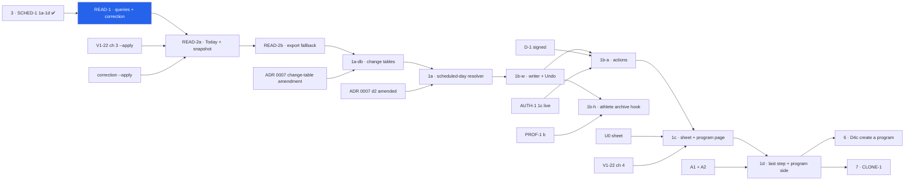
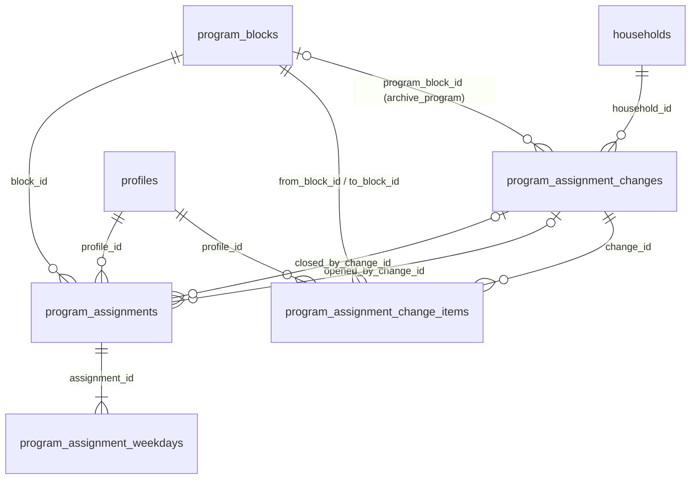
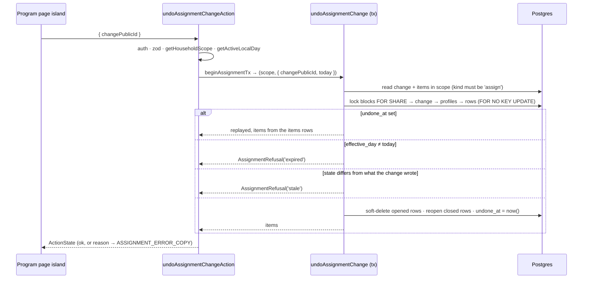

# ASSIGN-READ and ASSIGN-1: Today reads the athlete's assignments, and a parent can change them

> Backlog: **ASSIGN-READ** and **ASSIGN-1**, both _unfiled_ (spec → "Unowned work" 1 and 5). `docs/plan.md`
> is frozen on this branch, so **each row is added in the PR that opens it** (READ-1 files ASSIGN-READ, 1a-db
> files ASSIGN-1) · Spec: [crud-1-fix-it-yourself.md](../specs/crud-1-fix-it-yourself.md) chunks **D4** and
> **D4b** · Milestone: [PROG-1](../milestones/prog-1-programs-and-scheduling.md) steps **4** and **5** ·
> Branch: one per PR, listed under [Staging](#staging). The first is `feat/assign-read-1-assigned-blocks`.
>
> **Plan only.** No implementation code, no migration and no app file is in the PR that carries this plan.
> Builds on [SCHED-1](./sched-1-scheduling-model.md) (D3), which creates `program_assignments` and its weekday
> rows and explicitly leaves this read out (`sched-1-scheduling-model.md:141-143`), and on
> [ADR 0007](../decisions/0007-scheduling-model.md). First measured against this worktree at `8769c1b`;
> round-1 claims re-measured at `5d99dd0`. The ASSIGN-1 ↔ RETIRE-1 cross-plan contract (orchestrator,
> 2026-10-23) is applied verbatim; its thirteen points (plus item 14 and the 4/5 clarification, settled later) are cited below as **contract N**.

## Goal

Two things are true today. Every athlete in a household gets that household's newest block on every day: `programDayRows`
picks one block by `orderBy(desc(programBlocks.id)).limit(1)` (`packages/db/src/queries/program-day.ts:71-85`),
and Today asks it for the global calendar letter `resolveDayRole(day)` (`apps/web/app/p/[profileId]/page.tsx:81,88`).
And nothing a parent can do changes which program an athlete runs or on which days. After SCHED-1 the rows that
could say so exist, but nothing reads them except the seed, and nothing writes them (SCHED-1 1c ships them dark,
1d seeds seven weekdays).

This plan covers two backlog rows in **ten** PRs. The panel split two of the first draft's PRs (1b into three,
READ-2 into two), and the migration is now unconditional and ASSIGN-1's:

- **ASSIGN-READ (D4, milestone step 4).** Today and the log-time prescription snapshot stop reading "the
  newest block" and read **the athlete's assignments** (READ-2a). The CSV export's live fallback becomes
  date-aware (READ-2b). That replaces the kid-only guard A1 adds (Q15, FE-5) everywhere except the
  export's history before an athlete's first assignment, where it stays so that no past cell changes
  (D-12). For the CSV this is a byte-affecting change on a contract the **Insight** pillar owns
  (`docs/roadmap.md:34`, `:111`), so the cells that can move are listed and pinned under
  [The export: exactly which bytes can change](#the-export-exactly-which-bytes-can-change).
- **ASSIGN-1 (D4b, milestone step 5).** A parent can put an athlete on a program on chosen weekdays, move
  them, change their days or take them off, with Undo. Each change closes a period and opens a new one;
  nothing is edited in place, and a period opened today is replaced. The rotation counts **scheduled** days
  (Q13b) through a stored phase offset; this is the recurrence editor that ADR 0007 decision 1 calls "the
  honest bill" (`0007:129-133`). It also adds A1's last step and the "No program yet" state.

Now, because CLONE-1's gate 2 is exactly this read (`docs/plan.md` → CLONE-1, "Gated on, in order", item 2),
because RETIRE-1's "move them first" and every Undo in the D-track need a plain assignment write, and because
D4c (create a program) is safe only once Today renders the **set** of active assignments (ADR 0007 decision 4,
`0007:284-286`).

## Acceptance

### Spec criteria owned here, quoted by number (the spec is the source; not restated)

Grouped by the milestone's steps (`prog-1-programs-and-scheduling.md`, steps table): step 4 owns **30, 43**;
step 5 owns **21, 29, 31, 36–38, 40, 44–46**. 32 and 47 are attributed differently by the spec and the
milestone; both are recorded (D-3, D-5).

| Criterion                                                                                                                | Step | PR                                   |
| ------------------------------------------------------------------------------------------------------------------------ | ---- | ------------------------------------ |
| **43**: two programs due on one day are both shown, in the order the assignments were opened, each named                 | 4    | READ-2a                              |
| **30**: a rest day says so and names each program's days; a due day names the program and workout                        | 4    | READ-2a (copy and test, on fixtures) |
| **40**: the due workout is a pure function of date, rotation and weekday set; scheduled-day count; closed form; carry-on | 5    | 1a (resolver), 1b-w (offset written) |
| **21**: close and open, never edit in place; a period opened today is replaced; Undo reverses exactly what changed       | 5    | 1b-w                                 |
| **29**: weekdays stored as rows from `WEEKDAYS`, at least one, no repeats; Monday-first in the UI via `WEEKDAYS`         | 5    | 1b-w (server), 1c (UI)               |
| **44**: "change days" offers only that program; a move is its own explicit action naming both programs                   | 5    | 1b-w (server), 1c (UI)               |
| **31**: the sheet previews the next six sessions with the same resolver Today uses                                       | 5    | 1c                                   |
| **37**: the sheet's layout below and above 600px; toggles size to their container; seven across from 468px; ≥44 × 44     | 5    | 1c                                   |
| **46**: changing text inside the sheet is announced by a `role="status"` region inside it                                | 5    | 1c                                   |
| **38**: put back on from both sides; re-adding offers the athlete's last days for that program                           | 5    | 1c (athlete side), 1d (program side) |
| **36**: "Create a program" one tap away wherever a program is chosen                                                     | 5, 6 | **D4c** completes it (D-4)           |
| **32**: A1's last step, with nothing preselected and every day chosen; "Not now" lands on "No program yet"               | 6    | 1d (D-3)                             |
| **47** (post-D3 half): archiving an athlete closes their open assignments, and Undo reopens them                         | (A2) | 1b-h (D-5)                           |

### Done when (observable)

- **READ-1.** `packages/db/src/queries/program-assignments.ts` exports `assignmentPeriodRows`,
  `prescriptionRowsForBlocks`, `blockWorkoutSignatures` and the pure `candidateBlocks`. `db:verify` proves a
  block from another household passed in the candidate set returns **zero** rows, and a `db:mutations` patch
  that drops the block-household conjunct turns `db:verify` red. A profile whose only row is soft-deleted reads
  as **ever assigned**. `programDayRows` keeps its behaviour, and every existing V1-10 proof at
  `verify.ts:3934-4286` stays green unedited. The correction `assign-never-assigned-kids` exists, is dry-run by
  default, and prints aggregate counts only.
- **READ-2a.** Today and the snapshot writer call `programDayRows` nowhere. Today renders one program card per
  **due** assignment, in `(active_from, id)` order, each named, and a rest day names each program's days
  (criteria 30, 43, proved on fixtures with fewer than seven weekdays). The snapshot writer matches
  `prescriptionId` only inside the blocks of the periods covering the session's date.
- **READ-2b.** The export's live fallback is date-aware: a date before the athlete's first period resolves
  exactly as today's export does. For the seeded household **every export byte is unchanged**, proved by the
  pin tests below, and the census shows zero rows in the "changes" buckets.
- **1a-db.** One migration creates `program_assignment_changes` and `program_assignment_change_items` and adds
  `phase_offset`, `opened_by_change_id`, `closed_by_change_id` to `program_assignments`. `db:verify` proves
  every new constraint rejects a bad row. The runbook's household deletion counts and deletes the two new
  tables; the inventory classifies them.
- **1a.** `packages/shared/src/schedule.ts` exports `scheduledDaysBetween` (closed form), `workoutDue`,
  `carryOnOffset`, `rotationFor` and `EVERY_DAY`. With all seven weekdays and offset 0, `workoutDue` equals
  SCHED-1's `resolveRotationDayRole` on **60,001** dates (±30,000 around the anchor). On Mon/Wed/Fri the six
  workouts after the anchor alternate B, A, B, A, B, A. All four "calendar-indexed" records in spec
  disagreement 8 carry the 2026-10-22 amendment next to the 2026-09-24 quote.
- **1b-w.** `applyAssignmentChange`, `undoAssignmentChange`, `assignmentChangeResultByClientId` and
  `beginAssignmentTx` exist. `db:verify` proves the writer never writes `active_to < active_from`, that a
  same-day change replaces the period, that the stored `phase_offset` makes the next workout the one that
  would have come next, and that a replay **after** Undo returns the first result.
- **1b-a.** `setAssignmentAction` and `undoAssignmentChangeAction` exist in `apps/web/app/p/assignment-actions.ts`
  and are listed in `MUTATING_ACTIONS` with `scope: 'household'`. They carry the mandatory boundary tests:
  unauth → reject, wrong household → refused, bad body → zod field errors, replay → one effect and the same
  response. The generic Undo refuses an archive change.
- **1b-h.** Archiving an athlete writes an `archive_athlete` change before the `profiles` UPDATE, and restoring
  reverses exactly that change.
- **1c, 1d.** Every screen is reachable at 360 / 820 / 1280 px and 844 × 390 with no horizontal overflow (the
  document **and** the sheet body) and no control under 44 × 44. After Save, Take off and Undo the e2e asserts
  where focus is. Screenshots are published to the PR, and both the UX panel and the engineering panel have run.

## Where this plan disagrees with the spec, the milestone or an ADR

Each item is stated rather than silently resolved. The maintainer decides; the recommendation is marked.
The ones that need the orchestrator to edit a spec, milestone or seams row are collected again under
[Contradictions for the orchestrator](#contradictions-for-the-orchestrator).

- **D-1 · ADR 0007 forbids this editor before MOT-1's verdict table.** Its backlog table tells SCHED-1 it must
  not _"ship a weekday-row **editor** before the verdict table (see MOT-1)"_ (`0007:491`). ASSIGN-1 is that editor.
  The spec gates D4b only on D4, and the milestone only on step 4 and U0, so neither mentions it. The ADR's
  reason is real: a schedule edit between a day closing and its verdict being settled re-judges history
  (`0007:312-318`). Without MOT-1, though, there is no verdict to re-judge, and decision 5 already makes MOT-1
  add **settle-before-edit** to the authoring mutations (`0007:396-399`), which will include
  `setAssignmentAction`. **Recommendation:** the maintainer amends `0007:491` alongside the decision-2
  amendment, to read "an editor may ship before MOT-1; MOT-1 adds settle-before-edit to it". **1b-a does not
  merge until that amendment is signed.**
- **D-2 · SCHED-1's chunk 1e and ASSIGN-READ overlap.** The SCHED-1 plan has a fifth chunk, "dueness reaches
  Today" (`sched-1-scheduling-model.md:153`, `:444-468`). The spec's D3 is **1a → 1d** only. This plan treats
  **READ-2a as 1e's replacement**. If D3 ships 1e after all, READ-2a shrinks to the block-set half. Criterion 31
  names `resolveRotationSlot` ("SCHED-1 1b"), which counts calendar days (`sched-1-scheduling-model.md:239-244`);
  under Q13b the preview must use **`workoutDue`** (1a), so criterion 31 should cite that.
- **D-3 · Criterion 32's owner.** The spec tags it _(ASSIGN-1, extending A1's flow)_; the milestone lists 32
  under step 6. This plan ships it in 1d. The branch that criterion 33 adds when there is no live program
  stays D4c's.
- **D-4 · Criterion 36 cannot be met by ASSIGN-1 alone.** "Create a program" is D4c, which lands **after** D4b.
  ASSIGN-1 does not render a control that leads nowhere. D4c's PR adds the link to the four surfaces 36 names,
  and 36's test runs there. ASSIGN-1 leaves one named seam: the sheet's footer slot and the "No program yet"
  card each take an optional `createProgram` render prop.
- **D-5 · Criterion 47's post-D3 half is ASSIGN-1's, in 1b-h.** The PROF-1 plan **dropped** its tripwire
  (`prof-1-athletes.md:655`, scope S2) and left a seam docblock on `setProfileArchived` pointing here
  (`prof-1-athletes.md:465`). So the hook is not SCHED-1's job and is not forced early. **1b-h** makes PROF-1's
  archive call `applyAssignmentChange` with `kind: 'archive_athlete'` **before** its `profiles` UPDATE
  (contract 8), and PROF-1's restore call `undoAssignmentChange` with `allowArchived: true` (contract 4).
  The milestone lists 47 under A2; this is its post-D3 half.
- **D-6 · The spec's `assignmentSetSchema` cannot express "take off", and has no version guard.** It requires
  `weekdays` (min 1) even when `to` is null. It is kept **field for field**, with the additive changes the
  seams paragraph already records (`crud-1-fix-it-yourself.md:557-561`): `expectedAssignmentPublicId`,
  `weekdays` only when `to` is set, and the `{ clientId, items[] }` wrapper. See
  [The writer interface other plans call](#the-writer-interface-other-plans-call) §1.
- **D-7 · The four records in disagreement 8.** One of them is "the SCHED-1 plan's `YDP_ROTATION` docblock".
  Plans are **kept as-merged and not retro-edited** (`docs/plans/README.md:12-13`). Once SCHED-1 1b ships, the live
  copy of that docblock is in `packages/shared/src/programming.ts`, so **1a edits the code docblock**, and the
  SCHED-1 plan file is left alone.
- **D-8 · Prototype behaviour that the implementation must not copy.**
  1. Take-off writes `to = TODAY - 1` even on a period opened today (`docs/prototypes/crud-1/index.html:4783-4787`),
     the `active_to < active_from` that criterion 21 forbids. The writer here soft-deletes a period opened on or
     after today.
  2. It has no phase offset. `slotFor` counts from the anchor with the athlete's **current** days
     (`:1705-1714`), so a change of days can jump the rotation. That jump is the reason for the stored offset.
  3. Its "won't alternate" warning (`:3925-3929`) fires only in the calendar mode. Under Q13b consecutive
     scheduled days always advance by one slot, so criterion 31's "say so in words" clause is **proved
     unreachable by a test** (1a) rather than built as copy.
- **D-9 · The milestone's gates for steps 4 and 5 are incomplete.** Step 4's gate is "step 3"; step 5's is
  "step 4 + U0" (`prog-1-programs-and-scheduling.md`, steps table). The real gates also include V1-22 chunk 3's
  recorded `--apply` and the correction's (READ-2a), Insight's sign-off and the census (READ-2b), ADR 0007's
  amendments (1a-db, 1a, 1b-a), AUTH-1 1c and WP-1 (1b-a), V1-22 chunk 4 (1c: `/p/[profileId]/program` does not
  exist yet) and A1 + A2 (1d). Asked of the orchestrator.
- **D-10 · "Today, athlete-local" (criterion 21) is the request's active day.** There is no per-athlete or
  per-household timezone: household timezone is deferred (`apps/web/lib/active-timezone.ts:8-12`). Every writer
  takes `today` from **`getActiveLocalDay()`** (`active-timezone.ts:23-25`), called once per request in the DAL,
  and the sheet's preview receives the **same** value as a server prop rather than computing a client
  `Date`, so the preview, the write and Today agree. A parent's phone and an athlete's tablet in different
  zones can disagree by a day (ADR 0007 `:351-360`); that is inherited, not introduced.
- **D-11 · The change tables are ASSIGN-1's, in 1a-db.** The seams row says "ASSIGN-1 (or SCHED-1 1c if it has
  not migrated yet)" (`crud-1-fix-it-yourself.md:548`). Deciding it now: **ASSIGN-1 owns 1a-db**, unconditionally.
  SCHED-1's plan has no such table, and keeping the "or" leaves two plans each assuming the other.
- **D-12 · A1's kid-only read survives in one place: the export's history before an athlete's first
  assignment.** The spec says D4 "removes the kid-only guard". Removing it from the export's fallback would
  blank, or change, past `prescribed` cells the moment an athlete is first put on a program (correctness S1).
  So READ-2b keeps today's resolution (`programDayRows`, with PROF-1's `readsHouseholdProgram`) **for dates
  before the athlete's first period**, and only there. Today and the snapshot writer drop it in READ-2a.
- **D-13 · A third table needs ADR 0007's authorization.** ADR 0007 authorizes `program_assignments` and its
  weekday rows; it does not authorize `program_assignment_changes` or `program_assignment_change_items`.
  **An amendment is a maintainer item** (open question 7); 1a-db does not merge without it. This plan does not
  draft it.

## Staging

One concern per PR; no PR adds both a migration and UI. Ten are listed because the read touches Today, the
snapshot writer and the export (two concerns: the log path, and an Insight-owned byte contract), the write is
a new subsystem whose writer, action boundary and archive hook each deserve their own review, and AGENTS.md
forbids a DB proof PR sharing review with a UI PR.

| PR          | Branch                                   | What                                                                                                                                                                  | ~lines | Gate                                                                                                                |
| ----------- | ---------------------------------------- | --------------------------------------------------------------------------------------------------------------------------------------------------------------------- | ------ | ------------------------------------------------------------------------------------------------------------------- |
| **READ-1**  | `feat/assign-read-1-assigned-blocks`     | The queries, `isOpenOn`, `candidateBlocks`, the `db:verify` proofs, one mutation patch; the correction `assign-never-assigned-kids`; inventory + runbook rows if owed | ~380   | Step 3 (SCHED-1 1a–1d) merged and observed applied                                                                  |
| **READ-2a** | `feat/assign-read-2a-today-and-snapshot` | Today and the snapshot writer read the athlete's periods. N cards, "Which workout?", the rest-day and no-program text                                                 | ~400   | READ-1 · V1-22 chunk 3 `--apply` recorded · **the correction's `--apply` recorded** · one UX reviewer               |
| **READ-2b** | `feat/assign-read-2b-export-fallback`    | The export's live fallback becomes date-aware, with the before-first-period rule; the byte pins; the census; the contract doc                                         | ~250   | READ-2a · Insight sign-off on the byte table · the census shows zero rows in the "changes" buckets                  |
| **1a-db**   | `db/assign-1a-db-assignment-changes`     | One migration: two tables, three columns. Constraint proofs; the ERD; inventory, notice and runbook for the new tables                                                | ~300   | READ-2b · **ADR 0007 amendment for the change tables signed (D-13)** · DB-safety lens                               |
| **1a**      | `refactor/assign-1a-scheduled-day-count` | The pure resolver; Today switches to it; the four records                                                                                                             | ~300   | 1a-db · **ADR 0007 decision 2 amended and signed**                                                                  |
| **1b-w**    | `feat/assign-1b-w-assignment-writer`     | The schemas, `applyAssignmentChange`, `undoAssignmentChange`, the rebuild, `beginAssignmentTx`, the ownership helpers, `openAssignmentsForBlock`, `db:verify`         | ~400   | 1a                                                                                                                  |
| **1b-a**    | `feat/assign-1b-a-assignment-actions`    | The DAL, the two actions in `app/p/assignment-actions.ts`, the error copy, the boundary tests                                                                         | ~300   | 1b-w · **D-1 signed** · AUTH-1 1c observed live · WP-1 merged                                                       |
| **1b-h**    | `feat/assign-1b-h-athlete-archive-hook`  | PROF-1's archive and restore call the writer (`archive_athlete`)                                                                                                      | ~200   | 1b-w · PROF-1 b merged                                                                                              |
| **1c**      | `feat/assign-1c-assignment-sheet`        | The sheet (U0), the program page's cards, Change days / Move / Take off, Undo; "Change days" on the single-program editor; the no-program actions                     | ~400   | 1b-a · **U0 merged** · **V1-22 chunk 4 merged** · UX panel (full) · **the correction re-run and recorded at merge** |
| **1d**      | `feat/assign-1d-first-program-step`      | A1's last step; the program side of "+ Put someone on it"                                                                                                             | ~300   | 1c · A1 + A2 merged · UX panel (full)                                                                               |

**Why this order cannot move.** READ before ASSIGN, because a writer that can store fewer than seven weekdays,
or a second program, before Today reads them would leave written state that nothing shows. The correction
runs before READ-2a, because READ-2a stops giving never-assigned children the newest block. 1a-db before 1a,
because Today's per-period resolve reads `phase_offset`. 1a before 1b-w, because the writer computes
`phase_offset` with `carryOnOffset`. 1b-a and 1b-h are independent of each other (disjoint files) and both
follow 1b-w. The UI goes last. 1a-db could move earlier (it needs only D3); it is placed after READ-2b so
that one lane holds `packages/db` at a time.



Each PR also embeds the milestone's canonical chart (`prog-1-programs-and-scheduling.md`, "The steps") with
step 4 (READ-1, READ-2a, READ-2b) or step 5 (every other PR) marked.

## Design

### The read model (READ-1, READ-2a, READ-2b)

**One read of the periods, and dueness applied only where it belongs.** Three consumers ask different
questions of the same rows, so the rows are read once and each consumer filters in pure code:

| Consumer                            | Question                                       | Filter                                                                                                                  |
| ----------------------------------- | ---------------------------------------------- | ----------------------------------------------------------------------------------------------------------------------- |
| Today (`getDuePrograms`)            | which programs are **due** on the viewed day   | covering the date **and** the weekday is in the set (`isDueOnWeekday`)                                                  |
| The snapshot writer (V1-22 chunk 2) | which prescription did the athlete log against | covering the session's date. **No dueness**: logging on a rest day against an asserted role is legal                    |
| The export's live fallback          | what was prescribed for this past row          | covering the row's date. **No dueness, ever**. This is SCHED-1's export finding (`sched-1-scheduling-model.md:119-139`) |

"Covering" is `isOpenOn(period, date)`: `active_from ≤ date ≤ coalesce(active_to, date)`, `active_to`
**inclusive** (the SCHED-1 panel's B7, `:726`). Both the assignment and its weekday rows must be live
(`deleted_at IS NULL`); the SCHED-1 panel found the weekday rows' own conjunct is easy to forget (`:740`).

```ts
// packages/db/src/queries/program-assignments.ts (READ-1) — single-sourced so db:verify runs the SQL the app runs
export function assignmentPeriodRows(
  db: Executor,
  args: { profilePublicId: string; scope: HouseholdScope },
): Promise<{
  periods: Array<{
    assignmentPublicId: string;
    blockPublicId: string;
    blockName: string;
    activeFrom: string; // YYYY-MM-DD
    activeTo: string | null; // inclusive
    weekdays: Weekday[]; // array_agg over LIVE weekday rows, sorted; never empty for a live period (writer-enforced, db:verify-proved)
    phaseOffset: number; // READ-1: a literal 0 (no column yet); 1a-db changes THIS query to select the column
    openedSeq: number; // program_assignments.id — ORDER ONLY, never leaves packages/db as an identifier
  }>; // live rows only: program_assignments.deleted_at IS NULL AND program_blocks.deleted_at IS NULL
  firstActiveFrom: string | null; // min(active_from) over EVERY row of the profile, soft-deleted included; null = never assigned
}>;
// WHERE isLiveProfile(profilePublicId, scope) AND programBlockInHousehold(scope)   — writers/ownership.ts
// ORDER BY active_from, id

export function prescriptionRowsForBlocks(
  db: Executor,
  args: {
    profilePublicId: string;
    scope: HouseholdScope;
    dayRole: DayRole;
    blockPublicIds: readonly string[];
  },
); // the SAME select list as programDayRows + blockPublicId; [] without a query when blockPublicIds is empty
```

- **"Never assigned" counts soft-deleted rows** (correctness B3). A period opened and taken off on the same
  day is soft-deleted (§3), so the athlete has **no live row** but **was** assigned. Reading "no live row" as
  "never assigned" would hand that athlete the newest block again. `firstActiveFrom` is computed over every
  row, `deleted_at` ignored, and `db:verify` proves a profile whose only row is soft-deleted is ever-assigned.
- **`openedSeq` is not an id for the DTO.** It breaks ties in ordering; the DAL maps it to a position. No DTO
  carries it.
- **The block-household conjunct is PROF-1's `programBlockInHousehold(scope)`** (seams table,
  `crud-1-fix-it-yourself.md:546`; PROF-1 a-g lands it, `prof-1-athletes.md:238`, `:425`). READ-1 imports it and,
  if a-g has not already, converts `program-day.ts:74`'s hand-written hop to it. There is no second
  `blockInProfileHousehold` helper: a read that starts from a profile writes
  `and(isLiveProfile(…), programBlockInHousehold(scope))`. Without the conjunct the new read would be **weaker
  than the query beside it**: `program_assignments` carries no `household_id`, and nothing in the schema stops a
  profile of household H being assigned a block of another household (`sched-1-scheduling-model.md:297-299`).
- **The candidate set is server-derived, and the query re-checks it anyway.** `blockPublicIds` always comes
  from `assignmentPeriodRows`, never from a request; `prescriptionRowsForBlocks` still requires both conjuncts,
  so a foreign id returns nothing (depth behind the gate, `apps/web/lib/dal/export.ts:37-38`).
- **The select list is shared, not copied.** READ-1 extracts `programDayRows`' column object
  (`program-day.ts:96-117`) into a module-private `programRowColumns` used by both functions.

### `candidateBlocks`: one typed answer, three consumers

The first draft returned a bare list and hid a never-assigned branch inside it. The panel asked for a typed
result (architecture S3) and a per-date rule (correctness S1), and a correction that runs **before** READ-2a
replaces the old transitional rule (scope S1). One pure function, in the READ-1 module:

```ts
export type Candidates =
  | { kind: 'never_assigned' } // firstActiveFrom === null
  | { kind: 'before_first' } //   date < firstActiveFrom
  | { kind: 'none_open' } //      assigned before, nothing covers this date (taken off)
  | { kind: 'covered'; periods: readonly PeriodRow[] }; // ≥1 live period covers the date, in (activeFrom, openedSeq) order
export function candidateBlocks(
  rows: Awaited<ReturnType<typeof assignmentPeriodRows>>,
  date: string,
): Candidates;
```

| `kind`           | Today (READ-2a)                                                | Snapshot writer (READ-2a) | Export fallback (READ-2b)                                                     |
| ---------------- | -------------------------------------------------------------- | ------------------------- | ----------------------------------------------------------------------------- |
| `never_assigned` | "No program yet" (state 1 below)                               | no match → NULL snapshot  | **today's resolution**: `programDayRows` under `readsHouseholdProgram` (D-12) |
| `before_first`   | "Not on a program on this day" (state 2)                       | no match → NULL snapshot  | **today's resolution** (D-12)                                                 |
| `none_open`      | "Not on a program" (state 2)                                   | no match → NULL snapshot  | `''`                                                                          |
| `covered`        | due periods → cards; covered but none due → rest day (state 3) | the covering blocks       | the covering blocks, the ambiguity rule across them                           |

Each consumer `switch`es on `kind` with an exhaustive `never` check, so a fifth state is a compile error
everywhere rather than a silent fall-through.

**The correction replaces the transitional rule.** `assign-never-assigned-kids`
(`packages/db/scripts/corrections/`, READ-1; [the rules](../../packages/db/scripts/corrections/README.md)):
dry-run by default, idempotent, one household per run. For a household with **exactly one** live block it
gives every live child with **no `program_assignments` row at all, soft-deleted included** one period on that
block, all seven weekdays, `active_from` = the run day, written as SCHED-1 1d's seed writes them
(`opened_by_change_id` NULL). It refuses a household with more than one live block and leaves adults alone
(A1's guard semantics: an adult reads no household program). **It prints aggregate counts only** (households
seen, children assigned, households refused), never a name or a public id (privacy B3). It runs `--apply`
**before READ-2a merges**, and again **at 1c's merge** (UX lens 3 B2) for children A1 adds in between; both
runs are recorded in the PR. Because `active_from` is the run day, the per-date rule leaves every earlier
export cell as it was.

**What the window costs.** A child added between READ-2a and 1c's merge sees "No program yet" with no way to
choose one until 1c ships, unless the operator re-runs the correction (idempotent, safe any day). Stated under
Risks; the alternative, keeping a never-assigned Today fallback, is what the panel withdrew.

**Where A1's guard is, per the [PROF-1 plan](./prof-1-athletes.md)** (unverified against merged code). It is
`readsHouseholdProgram(kind)` in `packages/shared/src/programming.ts` (`prof-1-athletes.md:211-221`), used by
`programDayRows` and by `page.tsx`. READ-2a removes the page's use (the due-programs rule replaces it) and the
snapshot writer's (it no longer calls `programDayRows`). READ-2b leaves the export's use in place for the two
history kinds above. Its docblock ("D4 deletes this") becomes "D4 narrows this to the export's history before
an athlete's first assignment" (D-12). `programDayRows` and its V1-10 proofs (`verify.ts:4127`, `:4158`) stay.

### Today (READ-2a)

```ts
// apps/web/lib/dal/programming.ts — beside getProgramDay, which READ-2a deletes
export type DueProgramDTO = {
  blockPublicId: string;
  blockName: string;
  dayRole: DayRole; // READ-2a: resolveDayRole(day) (global, unchanged); 1a: workoutDue(rotationFor(block), period, day)
  workoutLabel: string; // workoutLabel(block, dayRole) — the one label function (Labels, below)
  rows: ProgramDayDTO[]; // toProgramDay(), unchanged (apps/web/lib/programming/program-day.ts)
};
export type TodayProgramsDTO =
  | { state: 'due'; programs: DueProgramDTO[] } // ≥1, criterion 43's order
  | { state: 'rest'; schedule: Array<{ blockName: string; weekdays: Weekday[] }> } // criterion 30
  | { state: 'not_on_program' } //   before_first / none_open
  | { state: 'no_program_yet' }; //  never_assigned
export async function getTodayPrograms(
  profilePublicId: string,
  day: string,
): Promise<TodayProgramsDTO>;
// getHouseholdScope() → uuid guard → assignmentPeriodRows → candidateBlocks → isDueOnWeekday per covering
// period → one prescriptionRowsForBlocks per due block (usually one)
```

- **The page.** `page.tsx:81-89` swaps `resolveDayRole(day)` + `getProgramDay` for `getTodayPrograms(profile.id, day)`
  in the same `Promise.all`. `StrengthSection` (`strength-section.tsx:40-50`) renders one `ProgramReference`
  per due program, each headed with "{program} · {workout}" (criterion 43); the heading stays inside
  `<summary>` (programming invariant 1b).
- **"Which workout?" when two are due** (UX lens 1 B1). A `<select>` above the form, labelled "Which
  workout?", one option per due program reading "{program} · {workout}", **defaulting to the first due
  program**. Each option's value carries the `blockPublicId` and the role, so two programs with the same role
  are distinct options. The choice drives which program scaffolds the form and the form's role default. It
  is not sent to the server as a new field: a submitted `prescriptionId` already names its block, and the
  snapshot writer matches inside the candidate set. Rendered only with two or more due, which is unreachable
  until D4c or CLONE-1; it is typed and unit-tested now so the scaffold question is not left to whoever ships
  the second block.
- **One day-role rule** (UX lens 3 S5). `dayRoleForPage(today)`: the selected (default: first) due program's
  role when `state = 'due'`, otherwise `null`. The date-line badge and the form's default both read it, so they
  cannot disagree. A `null` default already means "Not a programmed day" (`strength-section.tsx:40`), so no
  unasserted role is pre-selected into `sessions.day_role`'s provenance.
- **The four states each have their own copy** (UX lens 1 S6), all in `STRENGTH_COPY`
  (`apps/web/lib/constants.ts:458`): **1** "No program yet." (never assigned); **2** "Not on a program." (taken
  off, or before the first); **3** "No program today. {Program} runs {Mon, Wed, Fri}." per program
  (criterion 30, `formatWeekdaySet`); **due** "Today: {program} · {workout}". Logging works in all four. READ-2a
  renders the text; 1c adds the actions (state 1 "Choose a program", state 2 "Put {name} back on…").
- **Reachability.** In READ-2a every period has seven weekdays, so state 3 and two due programs are reached
  only by `db:verify` and unit fixtures; 1b-a makes state 3 reachable. ⚠️ **Visible change**: a never-assigned
  athlete, which after the correction means an adult or a child added since, sees state 1 rather than the
  newest block. A single UX reviewer is owed (AGENTS.md: scale the depth, never the existence).
- **Insight note for rest days** (UX lens 3 S5). Once 1b-a makes rest days reachable, a session logged on one
  defaults to a `null` role, so its `prescribed` is `''` and its `session_type` is whatever the writer stores for
  an unasserted role (`strength-form.tsx:589-612`). That changes **future** rows only (nothing past is
  re-resolved), and READ-2a's PR tells Insight so in the description.

### The snapshot writer (READ-2a)

V1-22 chunk 2's `prescribedSnapshotsFor`, in **`packages/db/src/writers/prescribed-snapshot.ts`**
(`v1-22-2-renderer-and-writer.md:441`), calls `programDayRows(exec, { profilePublicId, dayRole })` and matches the
submitted `prescriptionId` against those rows. ⚠️ **This is the coupling the spec's D4 row does not mention.** If
Today shows block B (assigned) while the writer reads block C (the newest), the form submits B's prescription
id, the writer finds no match, and the snapshot stays **NULL** for ever. READ-2a therefore changes the writer's
candidate set to `candidateBlocks(rows, sessionDate)`'s `covered` periods, the set Today reads, so "both paths
consume the same rows" (that plan's by-construction argument) still holds. That is why Today and the writer
ship in **one** PR (2a), and the export, which can lag safely, in another (2b).

### The export: exactly which bytes can change (READ-2b)

**Which files and columns.** Only **column 7, `prescribed`**, of `data/strength-log/<athlete>/<YYYY-MM>.csv`
(`docs/csv-export-contract.md:16`). Every other byte is unchanged by construction:

- `bodyweight` and `checkins` files: the inputs to `buildBodyweight` / `buildCheckins` (`export.ts:163-181`) are untouched.
- The other strength columns come from `strengthMonthRows` and `foldStrengthRows` (`export.ts:44-94`), which are
  untouched. **`session_type` is stored** (`export.ts:55`), not a resolve, so the rotation change in 1a can never
  reach a past row (ADR 0007 context fact 4, `0007:65-70`).
- The file set comes from `loggedMonths` (`export.ts:146`), which is untouched.

**Which rows.** Only rows where **both** hold: `entries.prescribed_snapshot IS NULL` (after V1-22 chunk 2 the
snapshot wins, `snapshot ?? live`), **and** `sessions.day_role` is non-null and in `DAY_ROLES` (`export.ts:120`).
After V1-22 chunk 3's backfill every row logged before chunk 2 has a non-null snapshot, so the NULL rows are
post-chunk-2 rows whose writer found no match.

**What changes for those rows.** Before: the match against the newest live block that programs the role
(`program-day.ts:71-85`), or `''` under A1's guard. After: by `candidateBlocks(rows, rowDate)`, with the existing
ambiguity rule (`export.ts:131`, two matches → `''`) applied across blocks. A cell changes in exactly four cases:

| #   | Case                                                                         | Old            | New                  | Reachable when                                                        |
| --- | ---------------------------------------------------------------------------- | -------------- | -------------------- | --------------------------------------------------------------------- |
| a   | a covering period's block is not the newest block for that role              | newest block's | the assigned block's | a household holds two live blocks. **Not before D4c or CLONE-1**      |
| b   | two covering blocks both prescribe `(role, slug)`                            | one block's    | `''` (ambiguous)     | as (a)                                                                |
| c   | the athlete was assigned before, nothing covers the row's date (`none_open`) | newest block's | `''`                 | after 1b-a (taken off, then logs against an asserted role)            |
| d   | an **adult** (A1's guard) with a covering period                             | `''`           | the assigned block's | after 1b-a (a parent puts an adult on a program); the intended change |

A date **before** the athlete's first period (`never_assigned`, `before_first`) is **unchanged by construction**:
it runs today's resolution, guard included (D-12). That is what keeps a parent's first put-on, or the
correction, from rewriting history (correctness S1). **So at READ-2b's merge the expected number of changed cells
in production is zero**, and a test and a census back it:

- **Unit pin** (`apps/web/lib/programming/prescribed-snapshot.test.ts`, the chunk-2 module). A property test: for
  any rows, and periods whose covering blocks all equal the newest block, the new resolution is
  **byte-identical** to the old; and for any date before `firstActiveFrom` it is byte-identical whatever the
  periods say. Cases (a)–(d) each have one fixture with the before and after strings on the assertion side,
  each **non-empty**, because 11 of 13 live prescriptions render `''` and an equality over `''` passes vacuously
  (`v1-22-authoring-program-editing.md:61-64`).
- **`db:verify`.** `prescriptionRowsForBlocks` over two blocks with the same `(role, slug)` returns both rows,
  so case (b) is computed from real SQL. A foreign block returns zero rows.
- **The existing e2e** `apps/web/e2e/export-full-day.spec.ts` keeps its two pins (`:226`, `:246`) under `pnpm e2e:local`.
- **A read-only census, run by the operator before merge and pasted into the PR.** It reports, as **aggregate
  counts only** (no profile, household, name or id in the output; privacy B3), NULL-snapshot strength entries
  bucketed by: "before first / never assigned" · "covered, block = newest" · "covered, block ≠ newest" ·
  "none open" · "adult, covered". The merge gate is **zero in the last three**. It is SELECT-only; the PR adds
  it to `docs/runbooks.md`.

**What the export does not do.** It never applies dueness to history. A session logged on Saturday against
an asserted Strength B, while the athlete's days are Mon/Wed/Fri, still exports its prescription. Applying the
weekday set to the past is the retroactive re-judging that `docs/plan.md:1906-1910` forbids.

**Insight's sign-off** is on this table. ADR 0007 open question 2 asks whether the export reads "one designated
assignment" or uses "a discriminated match key" (`0007:579-581`). This plan's answer is **neither, for now**:
the set of covering assignments with today's ambiguity rule. A discriminated key needs
`entries.prescription_id` (GAP-1 P1-2, unbuilt; `export.ts:101`), which V1-22 chunk 6 owes.

### Labels (READ-1 query, READ-2a function)

**One rotation/label pair** (architecture S2): `rotationFor(block)` in `packages/shared/src/schedule.ts` (1a) and
`workoutLabel(block, dayRole)` in `apps/web/lib/programming/program-day.ts` (READ-2a). V1-22 A4-2 **extends** both
rather than adding a second source (`v1-22-a4-create-program.md:248-249`, `:289-290`). Every surface (Today's
card heading, the "Which workout?" option, the sheet's preview, the program page's cards, the success line)
calls `workoutLabel`; none formats a label itself (UX lens 1 S5).

`workoutLabel` returns the program name alone when the block has **one distinct workout**, otherwise
`DAY_ROLE_LABELS[dayRole]` (`packages/shared/src/programming.ts:82-87`). "Distinct" means two strength roles
whose live `(idx, movement slug, sets, target_reps)` lists are identical count once, computed by one grouped
query (`blockWorkoutSignatures`, READ-1) over the assigned blocks. That is how The Daily Five's A/B stopgap
reads as one workout without hardcoding its slug. A4-2 puts a stored workout name in front of it. The
heuristic **stays** (scope S7 pushed back below): criterion 30 requires it, and A4's D-4 depends on it.

### The resolver (1a)

```ts
// packages/shared/src/schedule.ts — pure, no IO, no Intl; extends SCHED-1 1b's module
/** Scheduled days in [from, to): whole weeks × |set| + the set's weekdays in the remainder. Signed (to < from → negative).
 *  CLOSED FORM, FE-4: never a day-by-day walk over the span, so the 60,001-date proof stays 60,001 evaluations. */
export function scheduledDaysBetween(
  from: string,
  to: string,
  weekdays: readonly Weekday[],
): number;

export type Rotation = { anchorDay: string; slots: readonly DayRole[] };
/** A period's inputs. Additive later: `pins?` (labelled workouts on weekdays, M24) is a new branch, not a rewrite. */
export type SchedulePeriod = { weekdays: readonly Weekday[]; phaseOffset: number };
/** Every day, no offset: the period whose resolution equals SCHED-1's calendar resolver. Defined HERE once;
 *  SCHED-1 has no such constant (its plan's 1b table, `sched-1-scheduling-model.md:211`). */
export const EVERY_DAY = { weekdays: WEEKDAYS, phaseOffset: 0 } as const satisfies SchedulePeriod;

/** The workout DUE on `day`, or null on a rest day. Never "the next slot". */
export function workoutDue(
  rotation: Rotation,
  period: SchedulePeriod,
  day: string,
): DayRole | null {
  if (!isDueOnWeekday(period.weekdays, day)) return null;
  return rotation.slots[
    slotIndex(
      rotation,
      scheduledDaysBetween(rotation.anchorDay, day, period.weekdays) + period.phaseOffset,
    )
  ]!;
}

/** The offset that makes `next`'s first scheduled day ≥ `from` run the workout `prev` would have run on ITS
 *  first scheduled day ≥ `from`. Both searches are ≤ 7 steps, a constant bound, not a walk over the span. */
export function carryOnOffset(
  rotation: Rotation,
  prev: SchedulePeriod,
  next: { weekdays: readonly Weekday[] },
  from: string,
): number;

/** The rotation a block runs. Every block → YDP_ROTATION today (resolveDayRole is global); A4-2 extends it. */
export function rotationFor(block: {
  anchorDay: string | null;
  workoutSlugs?: readonly DayRole[];
}): Rotation;
```

- **One slot indexer.** SCHED-1 1b's `resolveRotationSlot` computes `floorMod(isoDayDiff(day, anchor), n)`
  (`sched-1-scheduling-model.md:239-244`). 1a splits out `slotIndex(rotation, count) = floorMod(count, slots.length)`
  and makes **both** `resolveRotationSlot` and `workoutDue` call it, so there is one modulo, not two.
- **Equivalence (criterion 40).** `scheduledDaysBetween(anchor, day, WEEKDAYS) === isoDayDiff(day, anchor)`, so
  `workoutDue(YDP_ROTATION, EVERY_DAY, d)` equals **SCHED-1's `resolveRotationDayRole(YDP_ROTATION, d)`** for every
  `d`. The proof iterates ±30,000 days (60,001 evaluations) against that function **and** the parity oracle
  SCHED-1 writes once on the assertion side (`sched-1-scheduling-model.md:247-256`).
- **The closed form against a brute-force oracle.** All 127 non-empty weekday sets × a ±60-day span around three
  anchors (a Sunday, a Wednesday, a Saturday), against a walk written in the test.
- **Mon/Wed/Fri alternates.** From the YDP anchor the next six scheduled workouts are B, A, B, A, B, A (under the
  calendar count they were A, B, B, B, A, A; the spec's M16 resolution records both).
- **"Never stops alternating" (D-8.3).** For every non-empty set and each of the next 28 days, consecutive
  scheduled days differ in slot when `slots.length ≥ 2`. This test replaces criterion 31's warning copy.
- **Which day "next" starts from.** `carryOnOffset` measures from `from` = the change day **inclusive**. If today
  stays scheduled, today's workout does not change when the days are saved. If today is dropped, the next
  scheduled day gets the workout today would have had, which may **repeat** one already done today. The panel
  asked whether, when today was already due, carry-on should count from tomorrow instead; that is open
  question 3, with a changed recommendation.
- **When the offset carries, and when it resets** (contract 1 drops the `phase` knob, so this is **derived** in
  the writer, never sent):
  | Item kind                                                                                           | Offset                                                                                           |
  | --------------------------------------------------------------------------------------------------- | ------------------------------------------------------------------------------------------------ |
  | `change` (same block, new days)                                                                     | carry from the closed period                                                                     |
  | `move`, when `rotationFor(from)` equals `rotationFor(to)` (all blocks until A4-2)                   | carry from the closed period. This is what CLONE-1's movers need (`clone-1-save-as-copy.md:224`) |
  | `move` between different rotations                                                                  | 0                                                                                                |
  | `put` onto a block the athlete was on before ("put back", UX lens 3 S4)                             | carry from their latest closed period on that block, measured to today                           |
  | `put` onto a block for the first time                                                               | 0: two athletes on one program with the same days are on the same workout (`0007:150-158`)       |
  | That replaces the first draft's "put, move and re-add all start at 0" (open question 4 is updated). |
- **Today switches** from `resolveDayRole(day)` to `workoutDue(rotationFor(block), period, day)` per due period,
  inside `getTodayPrograms`. `resolveDayRole` stays as the every-day wrapper the export's history rule and
  `apps/web/e2e/a11y.spec.ts:661` use; its pinning assertions (`day-role-schedule.test.ts:15,32,47,52-53`) stay
  green unedited.

### The four records (disagreement 8)

1a edits, in its own diff, keeping the 2026-09-24 quote verbatim and adding the 2026-10-22 amendment (Q13b:
count scheduled days; identical when every day runs) beside it:

1. `apps/web/lib/programming/day-role-schedule.ts:3-24`, the docblock.
2. `docs/plan.md` → YDP-1.
3. `docs/features/programming.md` invariant 3b.
4. The `YDP_ROTATION` docblock in `packages/shared/src/programming.ts` as SCHED-1 1b ships it, **not** the SCHED-1
   plan file (D-7).

**ADR 0007 decision 2** is amended by the maintainer's signature (`prog-1-programs-and-scheduling.md`, "To
decide"). 1a **verifies** it is in the ADR, or does not merge. The amendment must say that the **anchor** stays on
the block and only an **offset** rides the period (`0007:150-158` says "the anchor belongs on `program_blocks`").

### The writer interface other plans call

**This section is the one definition** of the assignment write (seams table, `crud-1-fix-it-yourself.md:547-549`).
CLONE-1 (its "What CLONE-1 reuses" section) and RETIRE-1 (its "What this plan uses from the sibling plans"
section, and Decisions 2–4) call it inside their own transactions. Where the cross-plan contract settles a shape,
it is applied here verbatim.

#### 1. The shapes (`packages/shared/src/assignment.ts`, 1b-w)

```ts
/** contract 1. Backs the DB CHECK; pinned by assertCheckCoversConst. Never a literal outside this file's contract test. */
export const ASSIGNMENT_CHANGE_KINDS = ['assign', 'archive_program', 'archive_athlete'] as const;
export type AssignmentChangeKind = (typeof ASSIGNMENT_CHANGE_KINDS)[number];
/** Per-athlete item kinds, DERIVED by the writer (§3); backs the items table's CHECK. */
export const ASSIGNMENT_ITEM_KINDS = ['put', 'change', 'move', 'take_off'] as const;
/** Refusal reasons. The ONE list: the writer throws them, toAssignmentOutcome returns them, and
 *  ASSIGNMENT_ERROR_COPY is `satisfies Record<AssignmentRefusalReason, string>` so a new reason without copy fails to compile. */
export const ASSIGNMENT_REFUSAL_REASONS = [
  'not_found',
  'stale',
  'already_on',
  'archived',
  'busy',
  'expired',
] as const;
export const ASSIGNMENT_CHANGE_MAX_ITEMS = 50; // a crafted body cannot make the writer loop; ≥ any household's athletes

/** ≥1, no repeats, each a WEEKDAYS member. REUSES weekdaySchema (SCHED-1 1a, day.ts); never re-declared (criterion 29). */
export const weekdaySetSchema = z
  .array(weekdaySchema)
  .min(1, { error: ASSIGNMENT_COPY.pickADay })
  .refine((a) => new Set(a).size === a.length);

/** contract 9: UNREFINED, so `.pick` works for RETIRE-1. */
export const assignmentItemBase = z
  .object({
    profilePublicId: uuidSchema,
    fromBlockPublicId: uuidSchema.nullable(),
    toBlockPublicId: uuidSchema.nullable(),
    expectedAssignmentPublicId: uuidSchema.nullable(), // the open period the parent was looking at (version guard)
    weekdays: weekdaySetSchema.optional(),
  })
  .strict();
/** The spec's assignmentSetSchema field for field (D-6), refined:
 *  to set ⇔ weekdays present · from set ⇔ expected set · not both null.
 *  from = null → put · to = null → take off · to = from → change days · both set and different → move.
 *  That reading is only the CLIENT's claim: the writer re-derives the kind (§3). */
export const assignmentSetSchema = assignmentItemBase.superRefine(/* … */);
export type AssignmentSet = z.infer<typeof assignmentSetSchema>;

/** One CHANGE = one event = one Undo. `clientId` is the change's idempotency key. */
export const assignmentChangeSchema = z
  .object({
    clientId: uuidSchema,
    items: z.array(assignmentSetSchema).min(1).max(ASSIGNMENT_CHANGE_MAX_ITEMS),
  })
  .strict()
  .refine((c) => new Set(c.items.map((i) => i.profilePublicId)).size === c.items.length, {
    path: ['items'], // correctness S6: one item per athlete per change; a second would close the row the first opened
  });
export const undoAssignmentChangeSchema = z.object({ changePublicId: uuidSchema }).strict(); // contract 9: the wire key
export type AthleteOnProgram = { profilePublicId: string; name: string }; // contract 9
```

`min(1)` on `items` is the request schema; an `archive_program` with no athletes on the block reaches the writer
with `items: []` directly from RETIRE-1, and the writer allows zero items for that kind only (contract 2).

#### 2. The writer: takes the caller's transaction and throws a typed sentinel

```ts
// packages/db/src/writers/program-assignments.ts (NEW, 1b-w)
export const ASSIGNMENT_LOCK_TIMEOUT = '3s'; // contract 7

/** contract 7: the ONE way to open a transaction that touches assignments. Statement one is
 *  `SELECT set_config('lock_timeout', ${ASSIGNMENT_LOCK_TIMEOUT}, true)` — transaction-local and parameterized,
 *  because `SET LOCAL` cannot take a bind parameter and sql.raw is banned (AGENTS.md). */
export function beginAssignmentTx<T>(db: Db, fn: (tx: Executor) => Promise<T>): Promise<T>;

export async function applyAssignmentChange(
  tx: Executor, // ALWAYS a transaction opened by beginAssignmentTx
  scope: HouseholdScope,
  args: {
    clientId: string; // the change's idempotency key
    today: string; // §5 — passed in, never computed here
    kind: AssignmentChangeKind; // recorded on the change row (contract 1); items.length === 0 only for 'archive_program'
    athletePublicId?: string; // REQUIRED when kind = 'archive_athlete' (then items must be []: §3 step 7 derives them)
    programBlockId?: number; // contract 14: REQUIRED when kind = 'archive_program' (a zero-item change cannot
    //                          otherwise name its block); forbidden otherwise. Internal id: only RETIRE-1's writer,
    //                          which already holds the block under FOR UPDATE, passes it; never from a request.
    items: readonly AssignmentSet[];
  },
): Promise<AssignmentChangeResult>; // returns ONLY on success

export type AssignmentChangeResult = {
  changePublicId: string; // the Undo key (§4)
  effectiveFrom: string; // = today
  replayed: boolean;
  items: Array<{
    profilePublicId: string;
    kind: (typeof ASSIGNMENT_ITEM_KINDS)[number]; // DERIVED (§3), never echoed from the request
    fromBlockPublicId: string | null;
    toBlockPublicId: string | null;
  }>;
};

/** THE sentinel. Thrown, never returned: a typed non-ok RETURN inside drizzle's `transaction()` COMMITS
 *  whatever the callback already wrote, and every writer here signals failure by throwing (strength-session.ts:54, :309). */
export class AssignmentRefusal extends Error {
  constructor(
    readonly reason: (typeof ASSIGNMENT_REFUSAL_REASONS)[number],
    readonly detail?: { onIt?: AthleteOnProgram[] }, // ONLY what the UI names (privacy S3); the message never carries it
  ) {
    super(`assignment refused: ${reason}`); // reason only: no name or id reaches a log or Sentry
  }
}

/** Outside the transaction, the ONE mapper back to a typed result. Postgres 55P03 (lock_timeout) and 40P01
 *  (deadlock) → 'busy' (contract 7); 23505 on either program_assignments index → 'stale' (a backstop; §3 makes it
 *  unreachable through the writer); anything else rethrows to error.tsx. */
export function toAssignmentOutcome(e: unknown): { ok: false; reason: AssignmentRefusalReason; detail?: … };

/** The persisted first result, rebuilt (correctness B2). Exported for CLONE-1 and RETIRE-1's replay (contract 3).
 *  Reads the change and its ITEMS rows; filters NOTHING on deleted_at or undone_at — not the change's, not the
 *  blocks', not the profiles' — so a replay after an Undo, an archive or a rename returns what the first call
 *  returned. null when no change with that client_id exists in scope. */
export function assignmentChangeResultByClientId(
  exec: Executor,
  scope: HouseholdScope,
  clientId: string,
): Promise<(AssignmentChangeResult & { kind: AssignmentChangeKind }) | null>;
```

A caller's shape is always the same, whether it is ASSIGN-1's action, CLONE-1's `saveProgramCopy` or RETIRE-1's
`archiveProgram`:

```ts
try {
  return {
    ok: true,
    ...(await beginAssignmentTx(db, (tx) =>
      /* own writes, then */ applyAssignmentChange(tx, scope, args),
    )),
  };
} catch (e) {
  return toAssignmentOutcome(e); // rethrows what it does not recognise
}
```

#### 3. Inside the transaction: lock, replay, refuse, derive, write

**The global lock order: `program_blocks` → `program_assignment_changes` → `profiles` → `program_assignments`**
(contract 8), each set ordered by `id` ascending. Every writer that touches assignments follows it; PROF-1's
archive hook calls this writer **before** its own `profiles` UPDATE, so its lock on `profiles` is taken here first.
**The SCHED-1 1d seed's assignment pass** joins the order too: once RETIRE-1 PR b adds its archived conjunct, the seed
takes `FOR SHARE` on the block before it writes assignment rows. That edit is RETIRE-1's; it is noted here because this
section is the order's one statement. Row locks are **`FOR NO KEY UPDATE`** wherever the row's key does not change (DB S3): nothing here updates a
primary key or a referenced column, so a concurrent `INSERT` that references the profile (logging a set) is not
blocked, while two writers for one athlete still serialize.

1. (Caller) `beginAssignmentTx`: `lock_timeout` is statement one.
2. **`program_blocks`.** Every block named by any item that exists in scope (`programBlockInHousehold(scope)`),
   `ORDER BY id FOR SHARE`. **Nothing is refused yet** (DB S1): a missing or archived block is noted, because a
   replay must return the first result even after the block was archived. A caller that already holds
   `FOR UPDATE` on a block (CLONE-1's source; RETIRE-1's archived block) re-acquires a weaker lock it holds,
   a no-op.
3. **`program_assignment_changes`.** `insertAssignmentChangeOwnedBy(tx, scope, { clientId, kind, effectiveDay: today })`
   (`writers/ownership.ts`, below): `INSERT … ON CONFLICT (client_id) WHERE deleted_at IS NULL DO NOTHING RETURNING id`
   (the predicate is repeated, `docs/lessons.md:21-27`). No row → **replay**:
   `assignmentChangeResultByClientId(tx, scope, clientId)`. Not found in scope → `'not_found'` (a key belonging to
   another household; the PROF-1 lesson that a replay lookup is scoped, `prof-1-athletes.md:376`). Found with a
   different `kind` → `'stale'`; for `archive_program`, a stored `program_block_id` other than `args.programBlockId` →
   `'stale'` (contract 3's "names this block", answerable with zero items because of contract 14). Otherwise return
   it with `replayed: true`, **writing nothing else**. A first insert with `kind = 'archive_program'` and no
   `programBlockId` throws (a programming error), as the CHECK would.
4. **Refusals deferred from step 2.** A missing block → `'not_found'`. A **target** block with
   `archived_at IS NOT NULL` → `'archived'` (RETIRE-1 PR b adds this conjunct with its column, as it adds §4's).
   `items.length === 0` with `kind ≠ 'archive_program'` → throws (a programming error, not a refusal).
5. **`profiles`.** Every item's profile, `isLiveProfile(publicId, scope)` and `archived_at IS NULL`,
   `ORDER BY id FOR NO KEY UPDATE`. Missing → `'not_found'`; archived → `'archived'`. **This lock is the phantom
   guard**: locking existing open rows cannot stop a concurrent insert of a second open row, but two writers for
   one athlete serialize here.
6. **`program_assignments`.** Each athlete's live open rows (`active_to IS NULL AND deleted_at IS NULL`), and their
   latest closed row on each `to` block (for put-back's carry), `ORDER BY id FOR NO KEY UPDATE`. **Only live rows
   (`deleted_at IS NULL`) count** for the carry, as for everything else: a soft-deleted same-day period never ran, so
   it is not "the latest period" a put-back carries from (round 2 S4).
7. **Derive the item kind from the locked rows, never from the dialog.** For `archive_athlete` the items are not sent
   at all: one `take_off` per open row locked in step 6 for `athletePublicId` (round 2 B2). Otherwise:
   | Locked state for this athlete                | Kind       | Guard                                                                  |
   | -------------------------------------------- | ---------- | ---------------------------------------------------------------------- |
   | an open row on `to`, and `from = to`         | `change`   | that row is `expectedAssignmentPublicId`, else `'stale'`               |
   | an open row on `to`, and `from ≠ to`         | refused    | `'already_on'`, `detail.onIt` names the athlete (criterion 44)         |
   | an open row on `from` (≠ `to`), none on `to` | `move`     | the `from` row is `expected…`, else `'stale'`                          |
   | an open row on `from`, and `to = null`       | `take_off` | as above                                                               |
   | no open row on `to`, and `from = null`       | `put`      | —                                                                      |
   | `from` set but no open row on it             | refused    | `'stale'`: someone else moved or took them off since the dialog opened |
8. **Close** (`move`, `take_off`, `change`): a row with **`active_from >= today`** → `deleted_at = now()` (DB S2:
   `>=`, not `=`, because a period opened by another device whose active day is ahead of this request's would
   otherwise get `active_to < active_from`, `program_assignments_active_range_check`,
   `sched-1-scheduling-model.md:334-337`); otherwise `active_to = today − 1`. Either way
   `closed_by_change_id = <change>`, `updated_at = now()`.
9. **Open** (`put`, `move`, `change`): insert the period (`active_from = today`, `opened_by_change_id = <change>`,
   `phase_offset` per [the carry table](#the-resolver-1a)), then its weekday rows.
10. **Persist the first result**: one `program_assignment_change_items` row per item, in request order
    (`position`), with the derived kind and the two blocks. The returned result is built from the same values
    the rows hold, and `db:verify` proves a replay rebuilds it byte-for-byte.

**"Replace a period opened today" is close + open, not an in-place update.** Criterion 21 says _"update its weekdays
and offset in place"_. The observable result is identical: one live period from today with the new days. A soft
delete plus an insert keeps one invariant the Undo relies on: **a period's weekday rows are never edited after
insert, by any writer**. `db:verify` proves it with a mutation patch that edits one. Asked of the orchestrator as
a wording amendment.

**Why the items table, and not the rebuild from `opened_by`/`closed_by`** (correctness B2). The first draft rebuilt a
replay from the assignment rows a change opened or closed. Undo soft-deletes the rows it opened and clears
`closed_by_change_id` on the rows it reopens, so after an Undo that rebuild returns **nothing**, and a retried
"Save" whose first response was lost would answer differently from the first call. AGENTS.md backend rule 6 is
"persist first result → replay". The items rows **are** the persisted first result: append-only, never
updated, never filtered. The two columns on `program_assignments` stay, because Undo needs them to find the
rows to invert (§4).

#### The tables and columns (1a-db): who owns them

```ts
// program_assignment_changes — one row per CHANGE (an assignment event). Config-event data.
//   id bigint identity · public_id uuid NOT NULL UNIQUE (UUIDv7; the Undo key) · client_id uuid NOT NULL
//   household_id bigint NOT NULL → households.id (the scope; covering index)
//   kind text NOT NULL CHECK (kind IN ('assign','archive_program','archive_athlete'))   — ASSIGNMENT_CHANGE_KINDS
//   effective_day date NOT NULL (the `today` it ran on — Undo's expiry) · undone_at timestamptz NULL
//   program_block_id bigint NULL → program_blocks.id (covering index) — contract 14: the block an archive_program
//     change archived, so contract 3's replay check can match it with zero items;
//     CHECK (kind <> 'archive_program' OR program_block_id IS NOT NULL)
//   created_at / updated_at timestamptz NOT NULL DEFAULT now() · deleted_at timestamptz NULL
//   uq_program_assignment_changes_client_id (client_id) WHERE deleted_at IS NULL
// program_assignment_change_items — one row per ITEM of a change: the persisted first result.
//   id bigint identity · change_id bigint NOT NULL → program_assignment_changes.id
//   position integer NOT NULL (request order) · profile_id bigint NOT NULL → profiles.id
//   item_kind text NOT NULL CHECK (item_kind IN ('put','change','move','take_off'))     — ASSIGNMENT_ITEM_KINDS
//   from_block_id / to_block_id bigint NULL → program_blocks.id
//   CHECK shape: put ⇒ from NULL ∧ to NOT NULL · take_off ⇒ from NOT NULL ∧ to NULL ·
//                change ⇒ from = to · move ⇒ both NOT NULL ∧ from <> to
//   uq (change_id, position) — covers the change_id FK · uq (change_id, profile_id) — S6 at the DB too
//   idx profile_id · partial idx from_block_id / to_block_id WHERE … IS NOT NULL · created_at
//   No public_id (never addressed on its own), no client_id (the change's is the key), no deleted_at (append-only;
//   it leaves only with its household).
// program_assignments gains:
//   phase_offset integer NOT NULL DEFAULT 0 (ordinal; any integer is valid, the resolver applies floorMod)
//   opened_by_change_id / closed_by_change_id bigint NULL → program_assignment_changes.id (FKs named explicitly,
//     under 63 bytes) + one partial covering index each. NULL = written by the seed, the correction, or before ASSIGN-1.
```

**Why a change table at all.** A take-off opens nothing, so after its Undo no assignment row names the change, and
a replayed Undo could not tell "already undone" from "never happened". `undone_at` answers that, and
`effective_day` is the expiry. `program_assignments` itself still has no `client_id` (ADR 0007 `:438-443` stands).
**Owner: ASSIGN-1's 1a-db** (D-11), one migration, below.



1a-db embeds this ERD in its PR description and in `docs/architecture.md` §2d (architecture S5).

#### 4. Undo: one writer, keyed by a server-side change id

```ts
export async function undoAssignmentChange(
  tx: Executor, // opened by beginAssignmentTx
  scope: HouseholdScope,
  args: { changePublicId: string; today: string; allowArchived?: true },
  // allowArchived: restore callers only (contract 4). It skips ONLY the archived-ATHLETE check (step 4). The
  // archived-BLOCK conjunct (contract 5) is NEVER bypassed: restoreProgram clears archived_at before it reopens anything.
): Promise<{ replayed: boolean; items: AssignmentChangeResult['items'] }>; // throws AssignmentRefusal
```

The input is a **public id used as a lookup key**. No value to restore travels from the client.

1. Read the change by `public_id` in scope (`assignmentChangeInHousehold(scope)`, unlocked) and its items; a miss →
   `'not_found'`. **Without `allowArchived`, a change whose `kind ≠ 'assign'` → `'not_found'`** (contract 4): an
   archive is undone only through `restoreProgram` or PROF-1's restore.
2. Lock in the global order: the blocks its items name (`FOR SHARE`), the change row (`FOR NO KEY UPDATE`), the
   athletes' `profiles` (`FOR NO KEY UPDATE`), then the rows it opened or closed **plus every open row those
   athletes hold on those blocks** (`FOR NO KEY UPDATE`).
3. **Replay first.** `undone_at IS NOT NULL` → `replayed: true` with the items rebuilt from the items rows. Then
   `effective_day ≠ today` → `'expired'`: undoing yesterday's change would erase a day that was in effect, which
   HIST-1 must keep.
4. **Refusals.** Without `allowArchived`: an athlete it would reopen rows for is archived → `'archived'`. That is the
   **only** check `allowArchived` skips.
   ⚠️ **Forward note (contract 5):** RETIRE-1 PR b adds the third enforcement site here, `'archived'` when any row
   it would reopen sits on a block with `archived_at IS NOT NULL` (read under the `FOR SHARE` above). It is **never
   bypassed**, `allowArchived` or not: `restoreProgram` clears `archived_at` before calling this, in one transaction,
   so it never needs to. It is the refusal a Move's Undo meets when the program it would reopen onto was archived
   since; its copy is `ASSIGNMENT_ERROR_COPY.archived` (1b-a).
5. **Compare full state, before any write:**
   - every row the change **opened**: `deleted_at IS NULL`, `active_to IS NULL`, `closed_by_change_id IS NULL`, and
     its weekday rows all live (never edited, §3);
   - every row it **closed**: `closed_by_change_id = <change>`, and either `active_to = effective_day − 1` with
     `deleted_at IS NULL`, or `deleted_at IS NOT NULL` (a close of a row opened on or after that day);
   - **on each (athlete, block) pair it would reopen, no open live row exists that the change did not open.**
     Any mismatch → `'stale'`, computed from the locked SELECT. The unique index is never the detector, so no raw
     `23505` surfaces.
6. Invert: soft-delete the opened rows; reopen the closed ones (`active_to = NULL`, or `deleted_at = NULL`) and
   clear their `closed_by_change_id`; set `undone_at = now()`.

**One generic action:** `undoAssignmentChangeAction({ changePublicId })` in `app/p/assignment-actions.ts`.
ASSIGN-1's Undo and CLONE-1's "Undo after a copy" (criterion 45) call it; CLONE-1 adds no undo writer.

**RETIRE-1's and PROF-1's Undo: the change id wins.** `archiveProgram` always writes its change row with
`kind: 'archive_program'`, even with zero items (contract 2), so every archive has a persisted first result and
an Undo keyed by `changePublicId`. `restoreProgram` takes `changePublicId` (contract 9's wire key, never
`undoOf`), and, per contract 6, returns `replayed: true` when the change's `undone_at IS NOT NULL` and
`archived_at IS NULL`; only then does it compare `archived_at ≠ change.created_at` → `'stale'`, in SQL. PROF-1's
restore (1b-h) calls `undoAssignmentChange(tx, scope, { changePublicId, today, allowArchived: true })` **before**
its `profiles` UPDATE that clears `archived_at`, the mirror of the archive's order.



1b-w embeds this sequence in its PR description and in `docs/architecture.md` §2d (architecture S5).

#### 5. The athlete's today: one resolver

**`getActiveLocalDay()`** (`apps/web/lib/active-timezone.ts:23-25`), called **once per request in the DAL**, passed to
every writer as `today` and to the sheet as a server prop (D-10). No writer in `packages/db` computes "today". CLONE-1's
`todayFor(profileId)` collapses to this one value.

#### 6. One read of "who is on this program", the list of programs, and the scope helpers

```ts
// packages/db/src/queries/program-assignments.ts (1b-w)
export function openAssignmentsForBlock(
  db: Executor,
  args: { scope: HouseholdScope; blockPublicId: string; on: string },
): Promise<
  Array<{
    assignmentPublicId: string;
    profilePublicId: string;
    profileName: string;
    weekdays: Weekday[];
    activeFrom: string;
    phaseOffset: number;
  }>
>;
// live, non-archived athletes; isOpenOn(period, on) (§7); ORDER BY profiles.name, id
```

CLONE-1's "who moves" dialog, RETIRE-1's resolve-in-place panel and 1c's program chips read this one query.
**RETIRE-1's invariant count is unfiltered** (contract 10): under the block lock it counts every live open row on
the block, any profile and any `active_from`, and a mismatch with this query → `'stale'`.

**The household's program list** is **`listHouseholdPrograms(db, { scope, mode: 'listed' })`** in
`packages/db/src/queries/program-blocks.ts`, owned by V1-22 chunk 4 (contract 11). The "which program?" sheet
imports it; ASSIGN-1 writes no list query of its own.

**Scope helpers** (`packages/db/src/writers/ownership.ts`, 1b-w; architecture S1). `program_assignment_changes`
carries its own `household_id`, so by the file's convention (`ownership.ts:150-160`: a table with its own
`household_id` gets **prefixed** helpers, like `movementInHousehold`) it gets two:
`assignmentChangeInHousehold(scope)` and `insertAssignmentChangeOwnedBy(exec, scope, values)`. They must live
there: `packages/db/src/scope.test.ts:128-138` asserts that exactly one **module** reads `scope.householdId`, and
the insert has to. That test asserts the module, not a list of names, so **it needs no edit** for these two; if
1b-w adds a named case it edits the file then (it is not edited on this branch). `programBlockInHousehold` is
PROF-1's (above).

#### 7. The pure predicates HIST-1, ASSIGN-READ and the resolver share

```ts
// packages/shared/src/schedule.ts (READ-1)
/** Is the period in effect on `day`? `activeTo` is INCLUSIVE; NULL = still open. The ONE definition. */
export function isOpenOn(
  period: { activeFrom: string; activeTo: string | null },
  day: string,
): boolean {
  return period.activeFrom <= day && (period.activeTo === null || day <= period.activeTo);
}

// packages/shared/src/day.ts — beside WEEKDAYS (SCHED-1 1a); READ-2a
export const WEEKDAYS_MONDAY_FIRST = [...WEEKDAYS.slice(1), WEEKDAYS[0]] as const; // derived, never re-typed
export const WEEKDAY_LABELS = {
  0: { short: 'Sun', long: 'Sunday' } /* … */,
} as const satisfies Record<Weekday, { short: string; long: string }>;
/** "every day" · "weekdays" · "weekends" · "Mon, Wed, Fri" — the prototype's daysLabel (index.html:1662-1673). */
export function formatWeekdaySet(days: readonly Weekday[]): string;
```

`db:verify` proves `isOpenOn` and its SQL twin agree on the four boundary days.

### The write (1b-w, 1b-a, 1b-h)

**1b-w** ships everything in [The writer interface](#the-writer-interface-other-plans-call) with its `db:verify`
cases and mutation patches, and nothing in `apps/web`.

**1b-a: the actions** live in **`apps/web/app/p/assignment-actions.ts`** (`'use server'`), the module the seams
table names (`crud-1-fix-it-yourself.md:538`; architecture B1), **household-scoped**: an assignment change names
athletes and blocks by public id inside the household, not one profile from the URL, so both actions are
`scope: 'household'` entries in `MUTATING_ACTIONS` with PROF-1's `NO_ATHLETE_SAVE` refusal, and WP-1's household
suite covers them (`wp-1-shard-actions.md:199-222`). Each follows the existing shape:
`Sentry.withServerActionInstrumentation` inside the body (`actions.ts:56-64`), zod first, then the DAL
(`apps/web/lib/dal/assignments.ts`: `getHouseholdScope()` → `getActiveLocalDay()` → `beginAssignmentTx` → writer →
DTO), `revalidatePath` for `/p/{id}` and `/p/{id}/program` of every athlete in the result, and the `ActionState`
envelope with `reason` mapped through `ASSIGNMENT_ERROR_COPY` (`apps/web/lib/constants.ts`). The two are
`setAssignmentAction` (`assignmentChangeSchema`, `kind: 'assign'` set by the server) and
`undoAssignmentChangeAction` (§4).

**The `'archived'` copy** (from RETIRE-1 UX3 round 2). `ASSIGNMENT_ERROR_COPY.archived` is "{program} is archived.
Restore it from Archived programs first, then undo.", with "Restore it from Archived programs" rendered as a link to
the Programs list. It is what an Undo (a Move's, say) shows when the program it would reopen onto has been archived
since (§4 step 4). A Vitest row in `apps/web/lib/constants.test.ts` asserts every `ASSIGNMENT_REFUSAL_REASONS` member
has copy and pins this one's text and link target; the boundary suite has one case that returns it.

**1b-h: the athlete-archive hook** (D-5). It edits PROF-1's `setProfileArchived` path
(`packages/db/src/writers/profile.ts`, the seam docblock at `prof-1-athletes.md:465`) and its actions in
`apps/web/app/p/profile-actions.ts`:

- **Archive.** `archiveAthleteSchema` gains an additive `clientId`. Inside one `beginAssignmentTx`, the hook calls
  `applyAssignmentChange` with `kind: 'archive_athlete'`, `athletePublicId` and **`items: []`**, **then** runs
  PROF-1's `profiles` UPDATE (contract 8). **The writer derives the take-off items itself** from the open rows it
  locked in §3 step 6 (round 2 B2): a pre-lock read in the hook could miss a period opened between the read and the
  lock, leaving an archived athlete holding an open period. The change row is always written, so every athlete
  archive has a persisted result and its restore always has a `changePublicId`; with no open rows its persisted
  items are `[]`. ⚠️ Contract 2's parenthetical allows zero items only for `archive_program`; zero **request**
  items for `archive_athlete` (derived, possibly zero persisted) is an extension asked of the orchestrator.
- **The correction for the gap** (round 2 B2). Athletes archived between PROF-1 b and 1b-h kept their open periods.
  1b-h ships `assign-close-archived-athletes-open-periods` (`packages/db/scripts/corrections/`): dry-run by default,
  idempotent (a second run finds nothing), one household per run. For every profile with `archived_at IS NOT NULL`
  holding a live open row it applies the writer's close rule (`active_to = run day − 1`, or a soft delete when
  `active_from >= run day`), `closed_by_change_id` NULL, and prints aggregate counts only. A later restore does not
  reopen them; the put-back path offers their last days. Its `--apply` is recorded in 1b-h's PR.
- **Restore.** `restoreAthleteSchema` gains an optional `changePublicId`. With one, it calls
  `undoAssignmentChange(..., { allowArchived: true })` first, then clears `archived_at`. `'expired'` (restored on a
  later day) still restores the athlete and says their programs were not put back (copy in
  `ASSIGNMENT_ERROR_COPY.undoExpired`'s family); their last days are offered by the put-back path.
- **`40P01`** between an archive and a concurrent assignment change cannot happen if both follow the order;
  if a future writer breaks it, `toAssignmentOutcome` maps it to `'busy'` rather than an error page (correctness S2).

### The screens (1c, 1d), from the approved prototype

| Prototype (v9)                                                                                                             | Implementation                                                                                                                                                                              | PR  |
| -------------------------------------------------------------------------------------------------------------------------- | ------------------------------------------------------------------------------------------------------------------------------------------------------------------------------------------- | --- |
| `assign` screen → `openAssign` (`index.html:3985-4068`), `assignFields` (`:3798-3870`), `drawAssignPreview` (`:3881-3946`) | `apps/web/app/p/[profileId]/program/assignment-sheet.tsx` (client island on U0's `components/ui/sheet.tsx`); `weekdays-field.tsx`                                                           | 1c  |
| `program` screen with two or more programs → `vProgramCards` (`:3436-3480`), `progFooter` (`:3481-3502`)                   | one `<li>` card per program on `/p/[profileId]/program` (`id="pc-<blockPublicId>"`, `tabIndex={-1}`): "Edit program" (a `<Link>`) + "Change days"; footer "+ Put {name} on another program" | 1c  |
| `program` screen with **one** program: V1-22 chunk 4's editor                                                              | a "Change days" row on that editor, opening the same sheet (UX lens 1 B2)                                                                                                                   | 1c  |
| `program` screen, no program → `vProgram`'s empty branch (`:3511-3535`)                                                    | state 1 "No program yet" + "Choose a program"; state 2 "Not on a program" + "Put {name} back on {program}". "Create a program" arrives with D4c (D-4)                                       | 1c  |
| `add` screen, last step → `vFirst` (`:4124-4150`)                                                                          | `apps/web/app/p/[profileId]/program/first/page.tsx`: the same `AssignmentFields` in `put` mode, every day ticked, nothing preselected                                                       | 1d  |
| `programs` screen → `openAssignTo` (`:4070-4122`)                                                                          | "+ Put someone on it" on each program in A2's household settings list                                                                                                                       | 1d  |

- **One label for one action** (UX lens 1 S4). "Change days" everywhere: the card button, the editor row, the
  sheet title ("Change {name}'s days on {program}"), the Save button ("Save days") and the success line
  ("{name}'s days changed. Undo"). One `ASSIGNMENT_COPY` object in `apps/web/lib/constants.ts` holds them, beside
  `ASSIGNMENT_ERROR_COPY`.
- **"+ Put {name} on another program" is hidden when it leads nowhere** (UX lens 1 S2): when every listed
  program is one the athlete is already on. It returns once D4c can offer "Create a program".
- **"Which program?"** in `put`/`move` mode is a radio list from `listHouseholdPrograms(…, 'listed')`, each card
  naming the program and its workouts via `workoutLabel`.
- **One days field.** `WeekdaysField` is one `<fieldset>` with seven checkbox labels in `WEEKDAYS_MONDAY_FIRST`
  order with `WEEKDAY_LABELS`. No second weekday list (criterion 29). RRULE is never stored and never shown.
- **The preview (criterion 31)** is an `<ol>` of the next six sessions, computed with `workoutDue` and
  `carryOnOffset` from `@mat-plan/shared`, the functions the server uses, from `today` passed as a server prop
  (D-10). No authored load crosses into the sheet.
- **The in-sheet status region (criterion 46)** is U0's `status` prop (`pick-1-movement-picker.md:344`: a
  `role="status"` `<p>` mounted with the sheet, sr-only), not a second region. The preview's change is pushed to it
  **debounced ~400ms**, so ticking three days announces once.
- **Undo** is untimed and sits beside the change (PUX-7). Its focus and announcement contract is below.

**The Undo line: focus and announcement** (contract 12; UX lens 2 B1). One page-level client island on the
program page (`program-changes.tsx`) owns the action result, PROF-1's **`UndoLine`**
(`apps/web/components/undo-line.tsx`, `prof-1-athletes.md:472`) and its always-mounted `role="status"` region (the
`saved-announcer.tsx:8-11` idiom: a region mounted with the result is not announced). The line renders **outside**
the sheet, so it survives the sheet closing.

- **After Save or Take off:** the sheet closes; U0's `onCloseAutoFocus` is `preventDefault`ed and focus goes to
  **Undo**. The result text is announced through the island's status region. Undo carries **no**
  `aria-describedby` (never both, contract 12).
- **After Undo:** focus goes to the restored card, `#pc-<blockPublicId>` (`tabIndex={-1}`). Undoing a put while other
  programs remain → the **first remaining** card. Left on no program → the state 1 or 2 card. **No card on the page**
  (one program: the page is V1-22's editor, which renders none) → the page's `<h1>` (`tabIndex={-1}`). In every case
  the status region announces "Undone." (round 2 S6)
- **Undo state is the server's** (UX lens 3 S3). The island shows Undo only for a result the action just returned;
  a reload shows no stale Undo. If Undo returns `'expired'` or `'stale'`, the line says so and offers the way back
  (correctness S3; UX lens 3 S4):
  | The change was                                                         | Undo refused because | The line offers                                                                                           |
  | ---------------------------------------------------------------------- | -------------------- | --------------------------------------------------------------------------------------------------------- |
  | change days                                                            | expired (a new day)  | "Change days" with the previous days prefilled (`lastPeriodByBlock`); a `change`, so the rotation carries |
  | move                                                                   | expired              | "Move back to {from}", the previous days prefilled; a same-rotation move carries                          |
  | take off                                                               | expired              | "Put {name} back on {program}", last days prefilled; a put-back carries                                   |
  | put on                                                                 | expired              | "Take {name} off {program}"                                                                               |
  | any                                                                    | stale                | "Someone changed this since. Here is what's on now." and the page re-renders                              |
  | The copy is `ASSIGNMENT_ERROR_COPY.undoExpired` / `.stale`, one place. |
- **e2e:** `toBeFocused()` on Undo after Save and after Take off, and on `#pc-…` after Undo.

**Errors inside the sheet** (UX lens 2 S5). The days `<fieldset>` gets `aria-invalid` and `aria-describedby` its
error ("Pick at least one day.", the one message, from `ASSIGNMENT_COPY.pickADay`, which the zod schema also
uses). A server refusal renders **inside the sheet, above the actions**, as visible text pushed to the in-sheet
status; the sheet stays open. While pending, Save is `aria-disabled` with the label "Saving…".

**Focus inside the sheet** (UX lens 2 NITs). The title receives focus on open (U0's `initialFocus: 'title'`) and
again when the sheet switches mode (put → move). The weekday labels show the A11Y-10 focus ring on
`:focus-visible` of their input.

**360px width math (criterion 37).** The sheet fills the screen below 600px; with U0's 16px body padding
(**unverified**: U0's plan sets it) the content is `W = viewport − 32`. The toggles use
`grid-template-columns: repeat(auto-fill, minmax(60px, 1fr))` with an 8px gap (UX lens 2 S2; was 64px), so
columns = ⌊(W + 8) / 68⌋:

| Viewport / container              | W   | Columns | Toggle width          | Rows  |
| --------------------------------- | --- | ------- | --------------------- | ----- |
| prototype frame                   | 294 | 4       | (294 − 24) / 4 = 67.5 | 4 + 3 |
| 360 phone                         | 328 | 4       | (328 − 24) / 4 = 76   | 4 + 3 |
| 390 phone (screenshot width)      | 358 | 5       | (358 − 32) / 5 = 65.2 | 5 + 2 |
| ≥600 dialog, `min(520px, …)` − 32 | 488 | 7       | (488 − 48) / 7 ≈ 62.9 | 1     |

Seven across needs 7·60 + 6·8 = **468px**, which the ≥600 dialog's 488px clears. The spec already carries 468
(`crud-1-fix-it-yourself.md:385`). A test at 360px asserts every toggle's `getBoundingClientRect()` is ≥ 44 × 44,
**height and width**; the a11y gate checks height only (spec unowned 8).

- **Long names** (UX lens 2 S3). Every button that carries a name ("+ Put {name} on another program", "Put {name}
  back on…") is `whitespace-normal h-auto min-h-11 text-left`. The sheet title, the radio cards, each card's `<h2>`
  and the result line's text are `min-w-0 [overflow-wrap:anywhere]`. A 360px e2e with a 40-character athlete name
  and a 60-character program name asserts **no horizontal overflow on the sheet body** (`scrollWidth ≤ clientWidth`)
  as well as on the document.
- **Label in name** (UX lens 2 S4). A button whose accessible name adds context keeps its visible text **first**,
  then an sr-only suffix ("Change days<span class="sr-only"> for {program}</span>"). "Edit program" is a
  `<Link>` (it navigates), not a button.
- **Program card buttons at 360px.** The card is 328px; border and `px-4` leave 294px. "Edit program" (≈ 122px) +
  8px + "Change days" (≈ 115px) ≈ 245px fits one row; the 360px screenshot is the check.
- **The sheet footer** holds "Cancel" (≈ 77px) and "Save days" / "Put on program" (≤ 137px) ≈ 222px ≤ 328px; U0
  pads it with `env(safe-area-inset-bottom)` (`pick-1-movement-picker.md:345`).
- **Short viewports** (UX lens 2 S6). In landscape (844 × 390) the header and footer would leave the body ~200px.
  The sheet uses U0's **compact mode** (`data-compact` when `visualViewport.height < 480`,
  `pick-1-movement-picker.md:373-376`), not a `max-height` media query, for the reason U0 gives (the iOS keyboard
  does not fire one). Under compact the header scrolls with the body instead of pinning; if U0 has merged without
  that, 1c adds it to `sheet.tsx` under `data-compact` with a U0 test. An 844 × 390 capture is in the PR.
- **200% text.** One screenshot at 200% font size (the browser's minimum-font setting via Playwright), checking
  the toggles stay ≥ 44 × 44 and nothing clips.
- Text on the days chips uses `foreground` on `muted`, never `muted-foreground` (4.34:1, `docs/design.md:97`; CD-1).

**DTO for the program page and the sheet:**

```ts
// apps/web/lib/programming/assignment.ts — the spec's AssignmentDTO, plus what the sheet needs
export type AssignmentDTO = {
  assignmentPublicId: string; // the version guard the actions send back
  blockPublicId: string;
  blockName: string;
  activeFrom: string;
  activeTo: string | null;
  weekdays: Weekday[];
  phaseOffset: number;
};
export type AthleteProgramsDTO = {
  today: string; // getActiveLocalDay(), D-10
  open: AssignmentDTO[]; // ordered as Today orders them
  lastPeriodByBlock: Record<string, { weekdays: Weekday[]; phaseOffset: number; activeTo: string }>;
  // criterion 38: re-adding offers the LAST days; phaseOffset lets the put-back preview carry with the server's resolver (31). Live rows only
  livePrograms: Array<{ blockPublicId: string; blockName: string; rotation: Rotation }>; // listHouseholdPrograms('listed')
};
```

## File-by-file changes

Every PR also edits `docs/roadmap.md`, `docs/status.md` and adds a changelog fragment (`status:check`), and adds
or updates its backlog row in `docs/plan.md` (scope S6). Listed once here.

### READ-1

| Path                                                                             | Change | What & why                                                                                                                                                |
| -------------------------------------------------------------------------------- | ------ | --------------------------------------------------------------------------------------------------------------------------------------------------------- |
| `packages/db/src/queries/program-assignments.ts`                                 | NEW    | `assignmentPeriodRows`, `prescriptionRowsForBlocks`, `blockWorkoutSignatures`, `candidateBlocks` (pure, typed)                                            |
| `packages/shared/src/schedule.ts` (+ test)                                       | EDIT   | `isOpenOn`                                                                                                                                                |
| `packages/db/src/queries/program-day.ts`                                         | EDIT   | Extract `programRowColumns`; `:74`'s hop → `programBlockInHousehold(scope)` if PROF-1 a-g has not. Behaviour identical                                    |
| `packages/db/src/index.ts`                                                       | EDIT   | Export the new queries                                                                                                                                    |
| `packages/db/scripts/verify.ts`                                                  | EDIT   | The BOLA probe from both scopes; two blocks, one `(role, slug)` → two rows; `candidateBlocks`' four kinds on real rows, soft-deleted-only → ever-assigned |
| `packages/db/scripts/mutations/NN-assigned-block-skips-household.{patch,expect}` | NEW    | Drops the conjunct from `prescriptionRowsForBlocks`; `db:verify` must go RED                                                                              |
| `packages/db/scripts/corrections/registry.ts` (+ its test)                       | EDIT   | `assign-never-assigned-kids` (above). Aggregate output only                                                                                               |
| `docs/privacy/data-inventory.md`, `docs/runbooks.md`                             | EDIT   | **Only if SCHED-1 has not:** `program_assignments` and `program_assignment_weekdays` rows, counts, DELETEs and pre-flight (e) (privacy B2)                |
| `docs/features/programming.md`                                                   | EDIT   | `owns:` gains `packages/db/src/queries/program-assignments.ts` (SCHED-1 panel, `:739`)                                                                    |
| `docs/features/write-path.md`                                                    | EDIT   | It owns `packages/db/src/writers/` only if `ownership.ts` is touched                                                                                      |

### READ-2a

| Path                                                         | Change | What & why                                                                                               |
| ------------------------------------------------------------ | ------ | -------------------------------------------------------------------------------------------------------- |
| `apps/web/lib/dal/programming.ts`                            | EDIT   | `getTodayPrograms` replaces `getProgramDay` (`:29-41`)                                                   |
| `apps/web/lib/programming/program-day.ts` (+ test)           | EDIT   | `DueProgramDTO`, `TodayProgramsDTO`, `workoutLabel`, `dayRoleForPage`                                    |
| `packages/shared/src/day.ts` (+ test)                        | EDIT   | `WEEKDAYS_MONDAY_FIRST`, `WEEKDAY_LABELS`, `formatWeekdaySet`                                            |
| `apps/web/app/p/[profileId]/page.tsx`                        | EDIT   | `:81-89`, `:157`: the four states; the badge from `dayRoleForPage`                                       |
| `apps/web/app/p/[profileId]/strength-section.tsx` (+ test)   | EDIT   | N named cards; "Which workout?"; the four states' text                                                   |
| `apps/web/app/p/[profileId]/program-reference.tsx`           | EDIT   | "{program} · {workout}" heading, inside `<summary>` (programming invariant 1b)                           |
| `packages/db/src/writers/prescribed-snapshot.ts` (+ test)    | EDIT   | `prescribedSnapshotsFor` reads the `covered` blocks for the session date (reuse finding: the right file) |
| `packages/shared/src/programming.ts`                         | EDIT   | `readsHouseholdProgram`'s docblock: "D4 narrows this to the export's history" (D-12)                     |
| `apps/web/lib/constants.ts`                                  | EDIT   | `STRENGTH_COPY` gains the four states                                                                    |
| `packages/db/scripts/verify.ts`                              | EDIT   | The writer snapshots against an assigned, **non-newest** block                                           |
| `docs/architecture.md`                                       | EDIT   | §2d, the program read path (`:210`)                                                                      |
| `docs/features/{programming,write-path,strength-logging}.md` | EDIT   | `guides:check`. Programming: invariants 3, 3d, 3e                                                        |

### READ-2b

| Path                                                             | Change | What & why                                                                                               |
| ---------------------------------------------------------------- | ------ | -------------------------------------------------------------------------------------------------------- |
| `apps/web/lib/dal/export.ts`                                     | EDIT   | `prescribedFor` (`:113-135`) per row date through `candidateBlocks`; history kinds keep `programDayRows` |
| `apps/web/lib/programming/prescribed-snapshot.ts` (+ `.test.ts`) | EDIT   | `liveMatchKey(blockSet, role, slug)`; the byte pins, cases (a)–(d) and the before-first property         |
| `docs/csv-export-contract.md`                                    | EDIT   | `prescribed`'s fallback: "the blocks assigned on that date; before the first assignment, as before"      |
| `docs/runbooks.md`                                               | EDIT   | The read-only census (aggregates only)                                                                   |
| `docs/features/programming.md`                                   | EDIT   | `guides:check`                                                                                           |

### 1a-db (ASSIGN-1's, unconditional; D-11)

`packages/db/src/schema.ts` + `migrations/00NN_assign1_assignment_changes.sql`, generated, then hand-hardened.
**One file** (DB B1; the first draft's `NOT VALID` + follow-up `VALIDATE` PR and separate index file are withdrawn):

- `SET lock_timeout` / `statement_timeout` first, as every migration does (`0013_prescribed_snapshot.sql:30-31`).
- `CREATE TABLE program_assignment_changes`, `CREATE TABLE program_assignment_change_items`: new, so **empty**.
- `ALTER TABLE program_assignments ADD COLUMN IF NOT EXISTS phase_offset integer NOT NULL DEFAULT 0` (a constant
  default: metadata-only on PG ≥ 11; `prefer-bigint-over-int` is excluded for ordinals, `.squawk.toml`), and the
  two nullable change-id columns.
- **Every FK is added validated, inline in this file.** drizzle-kit emits FKs as `ALTER TABLE … ADD CONSTRAINT`,
  which Squawk flags. Each gets a `-- squawk-ignore <rule>` on the line **directly above** the statement, with the
  justification above that (the `0013:46-47` and `0010:58-62` precedent): for the new tables, the validating scan
  reads zero rows; for `program_assignments`' two new FKs, every row's column is NULL (just added), the table holds
  the seed's and the correction's rows only (the PR records the production count, as 0013 recorded 51), and the
  `SHARE ROW EXCLUSIVE` lock is bounded by `lock_timeout`. The implementer records the rule names Squawk actually
  reports on the generated file.
- **Plain `CREATE INDEX`** for every index: the new tables are empty and `program_assignments` is tiny.
  ⚠️ **No `squawk-ignore` is written for them**, because `require-concurrent-index-creation` is already in
  `.squawk.toml`'s `excluded_rules` (the CONCURRENTLY runner does not exist); an ignore line there would be dead
  text. The justification is an SQL comment instead (DB B1, partly pushed back).
- `db:verify` (DB B3): the shapes; a pre-existing row reads `phase_offset = 0`; and **one rejected insert per
  constraint**: each CHECK (`kind` and `item_kind` via `assertCheckCoversConst` against `ASSIGNMENT_CHANGE_KINDS` /
  `ASSIGNMENT_ITEM_KINDS`; each arm of the shape CHECK; contract 14's CHECK: an `archive_program` change with a NULL
  `program_block_id` refused), each FK (a dangling id), both uniques on items, and the
  partial unique on `client_id` (a second live row refused, a row beside a soft-deleted one accepted).

| Path                                             | Change | What & why                                                                                                                                           |
| ------------------------------------------------ | ------ | ---------------------------------------------------------------------------------------------------------------------------------------------------- |
| `packages/db/src/schema.ts`                      | EDIT   | The two tables (the changes table with `program_block_id`, contract 14), three columns, named FKs                                                    |
| `packages/db/migrations/00NN_….sql`, `meta`      | NEW    | As above                                                                                                                                             |
| `packages/db/src/queries/program-assignments.ts` | EDIT   | `assignmentPeriodRows` selects `program_assignments.phase_offset` in place of READ-1's literal 0 (round 2 B1: otherwise no PR ever reads the column) |
| `packages/shared/src/assignment.ts`              | NEW    | `ASSIGNMENT_CHANGE_KINDS`, `ASSIGNMENT_ITEM_KINDS` only (the CHECKs' source); 1b-w adds the rest                                                     |
| `packages/db/scripts/verify.ts`                  | EDIT   | The constraint proofs; a period with `phase_offset = 3` reads back `3` through `assignmentPeriodRows`, Today's query                                 |
| `docs/runbooks.md`                               | EDIT   | Household deletion: counts, DELETEs and pre-flight (e) for the two tables (Privacy)                                                                  |
| `docs/privacy/data-inventory.md`, `notice.md`    | EDIT   | The two tables classified; the notice's held-data and export-omits lists (Privacy)                                                                   |
| `docs/architecture.md`                           | EDIT   | §2d gains the ERD                                                                                                                                    |
| `docs/features/programming.md`                   | EDIT   | `owns:` gains `packages/shared/src/assignment.ts`                                                                                                    |

### 1a

| Path                                                     | Change | What & why                                                                                                                                                         |
| -------------------------------------------------------- | ------ | ------------------------------------------------------------------------------------------------------------------------------------------------------------------ |
| `packages/shared/src/schedule.ts` (+ `.test.ts`)         | EDIT   | `slotIndex`, `scheduledDaysBetween`, `workoutDue`, `carryOnOffset`, `rotationFor`, `EVERY_DAY`; the proofs                                                         |
| `apps/web/lib/dal/programming.ts`                        | EDIT   | `getTodayPrograms` resolves per period                                                                                                                             |
| `packages/db/scripts/verify.ts` (+ the DAL test)         | EDIT   | A seeded period with a non-zero `phase_offset` makes `getTodayPrograms` return the shifted workout, so the offset is proved on Today's whole path, not just stored |
| `apps/web/lib/programming/day-role-schedule.ts` (+ test) | EDIT   | The docblock amendment; the equivalence against `resolveRotationDayRole`                                                                                           |
| `packages/shared/src/programming.ts`                     | EDIT   | `YDP_ROTATION`'s docblock amendment (D-7)                                                                                                                          |
| `docs/plan.md`, `docs/features/programming.md`           | EDIT   | YDP-1; invariant 3b                                                                                                                                                |

### 1b-w

| Path                                                      | Change   | What & why                                                                                                                                                                      |
| --------------------------------------------------------- | -------- | ------------------------------------------------------------------------------------------------------------------------------------------------------------------------------- |
| `packages/shared/src/assignment.ts` (+ test)              | EDIT     | The schemas, `ASSIGNMENT_REFUSAL_REASONS`, `ASSIGNMENT_CHANGE_MAX_ITEMS`, `AthleteOnProgram`                                                                                    |
| `packages/db/src/writers/program-assignments.ts` (+ test) | NEW      | `ASSIGNMENT_LOCK_TIMEOUT`, `beginAssignmentTx`, `applyAssignmentChange`, `undoAssignmentChange`, `assignmentChangeResultByClientId`, `AssignmentRefusal`, `toAssignmentOutcome` |
| `packages/db/src/writers/ownership.ts`                    | EDIT     | `assignmentChangeInHousehold`, `insertAssignmentChangeOwnedBy`                                                                                                                  |
| `packages/db/src/queries/program-assignments.ts`          | EDIT     | `openAssignmentsForBlock`                                                                                                                                                       |
| `packages/db/scripts/verify.ts`, mutation patches         | EDIT/NEW | Below                                                                                                                                                                           |
| `docs/architecture.md`                                    | EDIT     | §2d gains the Undo sequence                                                                                                                                                     |
| `docs/features/write-path.md`, `programming.md`           | EDIT     | `guides:check`                                                                                                                                                                  |

### 1b-a

| Path                                             | Change | What & why                                                                                                                 |
| ------------------------------------------------ | ------ | -------------------------------------------------------------------------------------------------------------------------- |
| `apps/web/lib/dal/assignments.ts`                | NEW    | Scope → today → `beginAssignmentTx` → writer → DTO; `getAthletePrograms` (the sheet's read)                                |
| `apps/web/app/p/assignment-actions.ts` (+ test)  | NEW    | The two actions, household-scoped                                                                                          |
| `apps/web/app/p/[profileId]/mutating-actions.ts` | EDIT   | Two `scope: 'household'` entries; `ACTION_BINDINGS`, `VALID_BODY` (WP-1's append points)                                   |
| `apps/web/lib/constants.ts` (+ test)             | EDIT   | `ASSIGNMENT_ERROR_COPY satisfies Record<AssignmentRefusalReason, string>`, including `archived` (below); `ASSIGNMENT_COPY` |
| `docs/features/write-path.md`                    | EDIT   | `guides:check`                                                                                                             |

### 1b-h

| Path                                                       | Change | What & why                                                                                                                                                                |
| ---------------------------------------------------------- | ------ | ------------------------------------------------------------------------------------------------------------------------------------------------------------------------- |
| `packages/db/src/writers/profile.ts` (+ test)              | EDIT   | Archive: hook before the UPDATE; restore: undo before the UPDATE                                                                                                          |
| `packages/shared/src/profiles.ts`                          | EDIT   | `clientId` on archive, `changePublicId` on restore (additive)                                                                                                             |
| `apps/web/app/p/profile-actions.ts`, the settings island   | EDIT   | Pass the key through; the restore's "programs not put back" line                                                                                                          |
| `packages/db/scripts/verify.ts`                            | EDIT   | Archive the day a period opened (soft delete); restore reopens exactly those; a period opened concurrently before the lock is still closed (items derived under the lock) |
| `packages/db/scripts/corrections/registry.ts` (+ its test) | EDIT   | `assign-close-archived-athletes-open-periods` (round 2 B2); aggregate output only                                                                                         |
| `docs/features/write-path.md`                              | EDIT   | `guides:check`                                                                                                                                                            |

### 1c and 1d

Listed in [The screens](#the-screens-1c-1d-from-the-approved-prototype). Also: `apps/web/e2e/a11y.spec.ts` gains
`/p/[id]/program` and the open-sheet state (spec unowned 8); an e2e covers change days → preview → Save → Today
matches the preview's first row → Undo, with the focus assertions; the long-name 360px overflow e2e. 1c's PR
records the correction's second `--apply`.

## Test plan

**Unit (`pnpm test`).**

- READ-1/2a: `candidateBlocks`' four kinds, including a soft-deleted-only profile and a date on `firstActiveFrom`;
  `workoutLabel`'s identical-roles case; `StrengthSection` with each state and with 1 and 2 due programs
  (criterion 43's order and names, "Which workout?" defaulting to the first); `dayRoleForPage`.
- READ-2b: the byte pins and the before-first property.
- 1a: the 60,001-date equivalence against `resolveRotationDayRole` and the oracle; closed form against brute
  force; Mon/Wed/Fri; "never stops alternating"; `carryOnOffset` (today kept → unchanged; today dropped → the next
  day gets today's workout; pre-anchor; a one-slot rotation); the carry table's five rows.
- 1b-w: `assignmentSetSchema`: empty days (the one message), a repeat, `7`, `-1`, `'1'`, take off carrying
  `weekdays`, an unknown key; `assignmentChangeSchema`: two items for one athlete (S6), 51 items.

**Boundary (`assignment-actions.test.ts`, WP-1's household suite).** Unauth → reject; wrong-household profile →
`NO_ATHLETE_SAVE` and no write; a **foreign block** with an owned profile → refused and no write; bad body →
`fieldErrors`; **replay** of each op → one effect and an identical `ActionState`; a stale
`expectedAssignmentPublicId` → `stale`; Undo replayed → `ok` and one inversion; Undo after the day rolls over →
`undoExpired`; Undo onto a program archived since → `archived` with its copy; **an `archive_program` or `archive_athlete` change id sent to the generic Undo → refused, nothing
written** (contract 4).

**`db:verify` (PGlite, rolled-back fixtures, the TEN-2a idiom).** READ-1: the candidate-set BOLA probe from
**both** households' scopes; two blocks with the same `(role, slug)` → two rows; the four candidate kinds. 1a-db:
one rejected insert per constraint. 1b-w: no row ever has `active_to < active_from` after put → change the same
day → change the next day → take off the same day, **and** for a row whose `active_from` is tomorrow; a same-day
change leaves exactly one live period; the stored `phase_offset` makes `workoutDue` on the new period's first day
equal the old period's next workout; put-back carries; **replay after Undo returns the first result**
(correctness B2), and replay after the target block is archived does too (DB S1); a client id from another
household → `not_found`; a cross-household block is refused by the **writer** (the schema cannot refuse it).
**Archive-shape cases** (round 2 S3): a zero-item `archive_program` writes its change row and a replay returns
`items: []`; a replay whose stored `program_block_id` differs from `args.programBlockId` → `'stale'`; `archive_program`
without `programBlockId` throws; zero items with `kind = 'assign'` throws; `archive_athlete` with non-empty items
throws. Mutation patches: remove the same-day branch (the CHECK fires, `db:verify` RED); filter the rebuild on
`deleted_at` (the replay-after-Undo case goes RED).

**E2E (`pnpm e2e:local`).** READ-2a/2b: `export-full-day.spec.ts` and `a11y.spec.ts` unchanged and green. 1c:
change days → the preview updates → Save → focus on Undo → Today's card matches the preview's first row → Undo →
focus on `#pc-…`; take off → focus on Undo; the 360px long-name case.

**Screens.** `ui-screenshot` at 390 / 820 / 1280, plus 844 × 390 and one at 200% text, for every screen in the
table. **Real-phone checks** (spec → "For the implementation plans"): VoiceOver and TalkBack on the in-sheet
status while modal and on the Undo announcement after close, swipe-back on the full-screen sheet, landscape, and
the largest system text size.

## Risks / rollback

| Risk                                                                                     | Mitigation                                                                                                                                                          |
| ---------------------------------------------------------------------------------------- | ------------------------------------------------------------------------------------------------------------------------------------------------------------------- |
| **READ-2a blanks Today for children with no assignment rows**                            | The correction runs `--apply` before READ-2a merges (its gate) and again at 1c's merge; it is idempotent and can be re-run any day for a child added in between     |
| **A child added between READ-2a and 1c sees "No program yet" with no way to choose one** | Accepted for that window, stated in READ-2a's PR; the operator re-runs the correction. The alternative (a never-assigned Today fallback) is what the panel withdrew |
| **A first put-on rewrites past CSV cells**                                               | The before-first rule (D-12) and its property pin                                                                                                                   |
| **The snapshot writer and Today read different blocks**                                  | One `candidateBlocks`, shipped in one PR (2a), and a `db:verify` case against an assigned **non-newest** block                                                      |
| **A CSV cell changes that the byte table did not predict**                               | The table, the property pins, and a census whose merge gate is zero in the "changes" buckets. Insight signs off                                                     |
| **Applying dueness to history**                                                          | Only Today applies `isDueOnWeekday`; a unit case covers a Saturday session on a Mon/Wed/Fri athlete                                                                 |
| **A cross-household block reaches a period** (writer-enforced, not schema-enforced)      | `programBlockInHousehold` in the writer and the read; `db:verify` from both scopes; a mutation patch; runbook pre-flight (e)                                        |
| **A retried Save after an Undo answers differently**                                     | The items table is the persisted first result; the rebuild filters nothing; a mutation patch proves it                                                              |
| **The silent weekday shift.** Monday-first UI, `0 = Sunday` storage                      | No literal weekday in the UI; an e2e taps "Mon" and asserts the stored row is `localWeekday` of a known Monday (`sched-1-scheduling-model.md:715`)                  |
| **Two parents edit one athlete at once**                                                 | `profiles FOR NO KEY UPDATE` + `lock_timeout` → `busy`; the open-period index as backstop → `stale`                                                                 |
| **A deadlock against RETIRE-1, CLONE-1 or the athlete archive**                          | One lock order (contract 8), every writer through `beginAssignmentTx`; `40P01` → `busy` if it ever happens                                                          |
| **Midnight passes between opening the sheet and saving**                                 | The effective date is the server's and the success line names it; a replay is answered from the items rows                                                          |
| **ADR 0007 `:491` or the change-table amendment merged unamended** (D-1, D-13)           | 1b-a's and 1a-db's gates                                                                                                                                            |
| **The LLM authoring a load**                                                             | Nothing here writes or displays a load. `AssignmentDTO`, the preview and the sheet carry workout labels only                                                        |

**Rollback.** READ-1 and 1a revert cleanly (no data; 1a is pure). READ-2a reverts to the newest-block read; the
correction's rows stay and are read correctly once it re-lands. READ-2b reverts to the newest-block fallback. 1a-db
is additive and fixed forward. 1b–1d write config rows: reverting the code leaves periods Today still reads
correctly, and a wrong period is repaired by the app itself or by a guarded correction.

## Privacy

Each table PR re-reads `docs/privacy/data-inventory.md` against its diff and updates it **in the same PR**
(privacy S4; AGENTS.md: a change to what is stored without touching that file makes the notice false).

- **What this starts holding.** `program_assignments` and its weekday rows say **when a minor trains**, now entered
  by a parent rather than seeded. `program_assignment_changes` and `_items` record **who changed which athlete's
  program, when, and how** (put on, moved, days changed, taken off, archived), and for a program archive **which
  program** was archived (`program_block_id`, contract 14: a reference to the household's own block, no new personal
  content). Classified in the inventory as
  household-reachable **configuration-event data** about a minor: not health measurements, but a schedule
  history; no free text; scoped by `household_id` (changes) or through it (items); retained for the household's
  life; not purged by soft delete (append-only); leaves only with the household (privacy S1).
- **The deletion gate rides the PR that creates each table** (privacy B2). READ-1 checks that the inventory and
  the runbook already list `program_assignments` and `program_assignment_weekdays` (verified absent today: the
  inventory's tables are at `data-inventory.md:115-135`, and the deletion counts at `runbooks.md:824-853` do not
  include them); if SCHED-1 did not add them, READ-1 does. 1a-db does the same for its two tables. **Neither merges
  without it.**
- **The household-deletion order** (privacy B1; correctness S5). The runbook's table (`runbooks.md`, "Delete a
  household", step 4) has **13** DELETEs today. The four tables go **after `prescriptions` (#9) and before
  `program_blocks`**, child before parent: **`program_assignment_weekdays` → `program_assignments` →
  `program_assignment_change_items` → `program_assignment_changes`**. `program_assignments` must precede the changes
  (its two FKs), the items must precede the changes, and all four precede `program_blocks`, `profiles` and
  `households`. Scope: assignments by `profile_id ∈ H`; weekdays by **`assignment_id ∈ H's assignments`** (the weekday table has no
  `profile_id`; round 2 S5); items by `change_id ∈ changes of H`; changes
  by `household_id = H`. **New total: 17** (15 after READ-1 or SCHED-1, 17 after 1a-db; if another plan adds a
  table first, each PR states the count it leaves). "4c. The 13 DELETEs" and the step-3 count block change with
  them.
- **Pre-flight (e)** (privacy B1), both directions, must be 0 or STOP: a `program_assignments` row whose profile is
  in H and whose block is not, or the reverse (`block_id` is an unscoped FK, enforced by the writer only, the same
  class as (a)–(d)); and a `program_assignment_change_items` row whose change is in H and whose profile or either
  block is not, or the reverse; and a `program_assignment_changes` row of H whose `program_block_id` is not H's block,
  or a ¬H change naming H's block; and a ¬H `program_assignments` row whose `opened_by_change_id` or
  `closed_by_change_id` points at one of H's changes (round 2 S5). The reverse direction is the one that aborts: deleting H's block or profile with a
  ¬H row pointing at it raises `23503` mid-transaction.
- **Export.** Assignments and their history are not in the CSV export. `notice.md:163-165` lists what the export
  leaves out; 1a-db adds "which programs each athlete is on, on which days, and the history of changes to that"
  to it, and to the notice's description of what is held (privacy S2).
- **Names in refusals** (privacy S3). `AssignmentRefusal.detail.onIt` carries `{ profilePublicId, name }` because
  the "already on" message names the athlete (contract 9); nothing else does. The error's `message` is the reason
  only, `toAssignmentOutcome` never forwards `detail` to Sentry or a log, and Sentry context stays `userId`,
  `householdId`.
- **The census and the correction output aggregates only** (privacy B3): counts per bucket, never a name, public id
  or household.
- **Soft-deleted same-day periods** carry `deleted_at` and nothing personal beyond the profile link. Whether PRIV-3's
  purge sweeps them is PRIV-3's call.
- No new processor, no logging of weekdays.

## AUTH-1 1c: what to re-verify

D3 sits behind Beta 1's gate, which requires invited families, so AUTH-1 1c is expected to be live before 1b-a.
Re-verify against the AUTH-1 plan's 1c row (`auth-1-clerk-google.md:549`):

1. Both actions call the session check 1c installs in place of `hasGateAccess` and appear in `MUTATING_ACTIONS`, so
   WP-1's unauth and household suites cover them.
2. 1c's **mutation rate limiter** wraps both actions.
3. `getHouseholdScope()`'s membership-based body is the only household source (ADR 0006).
4. The new pages (`/p/[id]/program/first`, and the program page's changes) call the page guard and
   `pages-are-gated.test.ts` finds them.
5. **Who may change assignments** after AUTH-1. Open question 5.

## Out of scope / deferred

- **Creating a program and The Daily Five path** (D4c), including criterion 33 and "Create a program" (D-4).
- **Per-block rotation storage**, a created program's anchor (criterion 35 → A4-2), and the ONB-2 collapse to one slot.
- **Labelled workouts pinned to weekdays** (M24). `SchedulePeriod` takes an optional field later.
- **RRULE, "Custom…", `.ics`** (spec → Recurrence).
- **A discriminated export match key** (`entries.prescription_id`, V1-22 chunk 6).
- **MOT-1's verdicts and settle-before-edit** (D-1).
- **Offline replay of assignment writes.** Assignments are online-only.
- **HIST-1's timeline.** The periods this writes are its input; nothing here touches `entries`.

## Open questions

> **Maintainer answers, 2026-10-23** (spec → review-response log, round 8): Carry on from tomorrow when today was due: **yes**; a one-program household's last step asks by name: **yes** (M38). Still open: the ADR 0007 amendments (asked again).

1. **D-1:** amend ADR 0007 `:491` to allow the editor before MOT-1, with MOT-1 adding settle-before-edit?
   _Recommended: yes._
2. **Ordering two due programs.** `(active_from, id)` puts a program whose days were just changed **below** one
   opened earlier, so cards reorder on a change of days. The alternative is the start of the athlete's unbroken
   run on that program. _Recommended: the run's start; decided by 1c's UX panel._
3. **When today was already due, does the rotation carry on counting from tomorrow?** (UX lens 1 S1, UX lens 3
   S1.) Today the plan carries from today inclusive: if today is dropped, the next scheduled day gets **today's**
   workout, which the athlete has usually already done, since logging happens after practice. Counting from
   tomorrow whenever today was due under the old days gives the next day the workout that **follows** today's,
   and never repeats; it can skip one only if today's was not done. It reads criterion 40's "carry on from the
   workout that would have come next" more literally, so it is a change against the plan's current reading, not
   against the criterion. _Recommended: from tomorrow when today was due under the old days; inclusive
   otherwise._ For the maintainer.
4. **Offsets.** First put-on → 0 (in step with siblings on the same days); change days, a move between programs
   with the same rotation, and putting someone back → carry. _Recommended: as stated (it is what contract 1's
   "no phase knob" leaves derivable, and what CLONE-1 needs)._
5. **Who may change an athlete's program and days** after AUTH-1?
6. **A one-program household's last step (1d): does it ask by name?** (UX lens 1 S3.) Criterion 32 says "no
   program preselected". With exactly one live program, a radio list of one is a preselection in all but name.
   The alternative is a question that names it, "Put {name} on {program}?", with the days below and "Not now".
   _Recommended: ask by name; nothing is preselected because the parent answers a question rather than accepting
   a selected radio._ For the maintainer.
7. **D-13:** amend ADR 0007 to authorize `program_assignment_changes` and `program_assignment_change_items`
   (config-event tables, append-only items, household-scoped)? _Recommended: yes, signed before 1a-db merges._

## Contradictions for the orchestrator

Spec, milestone or seams text this plan cannot edit, each with the wording it needs:

1. **Seams row "Replaying or undoing an assignment change"** (`crud-1-fix-it-yourself.md:548`): owner "ASSIGN-1 (or
   SCHED-1 1c …)" → "ASSIGN-1 (1a-db)", and the home gains `program_assignment_change_items` (D-11, correctness B2).
2. **Seams row "The kid-only program read until ASSIGN-READ"** (`:540`): it survives as the export's history rule
   before an athlete's first assignment (D-12).
3. **Criterion 21**: "athlete-local" → "the request's active day (`getActiveLocalDay`)" (D-10); "update its
   weekdays and offset in place" → "replace it (the old period soft-deleted, a new one opened)" (§3).
4. **Criterion 31**: cite `workoutDue` (ASSIGN-1 1a), not `resolveRotationSlot`; the "say so in words" clause is
   proved unreachable (D-2, D-8.3).
5. **Milestone, steps table**: step 4's gate adds "V1-22 chunk 3 `--apply`; the never-assigned correction's
   `--apply`; Insight sign-off"; step 5's adds "ADR 0007 amendments (d2, `:491`, the change tables); AUTH-1 1c;
   V1-22 chunk 4 (1c); A1 + A2 (1d)" (D-9). Step 5's criteria could note 47's post-D3 half (D-5).
6. **Criterion 37's 468px** is **already** in the spec (`:385`); nothing to do.

## Review-response log

Round 1: engineering panel (correctness, DB safety, privacy, scope, architecture, reuse) and UX panel (lens 1
interaction and first-run, lens 2 a11y and 360px, lens 3 trust and data-entry burden), plus the orchestrator's
cross-plan contract. Each finding was checked against the code or the sibling plan before it was written in.

### Cross-plan contract (ASSIGN-1 ↔ RETIRE-1), applied verbatim

| #   | Point                                                                                                               | Verdict | Where                                                                                                                                                   |
| --- | ------------------------------------------------------------------------------------------------------------------- | ------- | ------------------------------------------------------------------------------------------------------------------------------------------------------- |
| 1   | Three change kinds; no `phase` knob                                                                                 | applied | §1 `ASSIGNMENT_CHANGE_KINDS`; §2 `kind` arg; the carry table derives what `phase` chose                                                                 |
| 2   | An archive always writes its change row; 0 items only for `archive_program`                                         | applied | §1 note; §3 step 4; §4 RETIRE-1 paragraph; 1b-h writes none with 0 rows                                                                                 |
| 3   | Replay first for `archiveProgram`; `replayed` on a live block → stale                                               | applied | §3 step 3 (kind mismatch → stale); RETIRE-1 owns its side                                                                                               |
| 4   | Generic Undo refuses `kind <> 'assign'`; `allowArchived` for restores                                               | applied | §4 step 1, signature; boundary test                                                                                                                     |
| 5   | Third enforcement site, added by RETIRE-1 PR b                                                                      | applied | §4 step 4 forward note                                                                                                                                  |
| 6   | `restoreProgram` replay before the stale guard, in SQL                                                              | applied | §4 RETIRE-1 paragraph                                                                                                                                   |
| 7   | `ASSIGNMENT_LOCK_TIMEOUT`, `beginAssignmentTx`, 40P01/55P03 → busy                                                  | applied | §2                                                                                                                                                      |
| 8   | Lock order; PROF-1's hook before its `profiles` UPDATE                                                              | applied | §3 heading; 1b-h                                                                                                                                        |
| 9   | Exported shapes, wire key `changePublicId`                                                                          | applied | §1, §2, `ASSIGNMENT_ERROR_COPY.{busy, undoExpired, alreadyOn}` in 1b-a                                                                                  |
| 10  | Invariant count unfiltered                                                                                          | applied | §6                                                                                                                                                      |
| 11  | `listHouseholdPrograms` is the one list                                                                             | applied | §6; the sheet; `AthleteProgramsDTO`                                                                                                                     |
| 12  | One page-level Undo island; focus via `onCloseAutoFocus`                                                            | applied | "The Undo line: focus and announcement"                                                                                                                 |
| 13  | Drop `PROGRAM_ARCHIVE_TAKE_OFF_MAX` and `retire-1:NNN` cites                                                        | applied | `ASSIGNMENT_CHANGE_MAX_ITEMS` stands alone; RETIRE-1 cited by section name throughout                                                                   |
| 14  | `program_assignment_changes.program_block_id` + CHECK (from RETIRE-1's reconcile)                                   | applied | 1a-db's one migration; `programBlockId` required for `archive_program`; §3 step 3 replay match; ERD; `db:verify` CHECK proof; inventory; pre-flight (e) |
| 4/5 | Clarification: `allowArchived` skips only the archived-athlete check; the archived-block conjunct is never bypassed | applied | §4 signature comment and step 4                                                                                                                         |
| 8   | Note: the SCHED-1 1d seed takes `FOR SHARE` on the block once RETIRE-1 PR b lands (RETIRE-1's edit)                 | noted   | §3 lock-order paragraph                                                                                                                                 |
| —   | `ASSIGNMENT_ERROR_COPY` had no `archived` string (from RETIRE-1 UX3 round 2)                                        | applied | Copy with the Restore link; Vitest row; a boundary case (1b-a)                                                                                          |

### Correctness

| ID  | Finding                                            | Verdict  | Resolution                                                                                                                                                             |
| --- | -------------------------------------------------- | -------- | ---------------------------------------------------------------------------------------------------------------------------------------------------------------------- |
| B1  | Undo skips the archived guards                     | accepted | Generic Undo refuses `kind <> 'assign'`; `allowArchived` only for restore callers; athlete-archived check in §4 step 4 (contract 4)                                    |
| B2  | A replay after Undo must return the first result   | accepted | `program_assignment_change_items` is the persisted first result; `assignmentChangeResultByClientId` exported, filters nothing; a `db:verify` case and a mutation patch |
| B3  | "Never assigned" must include soft-deleted rows    | accepted | `firstActiveFrom` over every row; `db:verify` soft-deleted-only case; the correction uses the same definition                                                          |
| S1  | The first assignment must not blank past CSV cells | accepted | Before-first rule (D-12): a date before the first period resolves as today's export does; a property pin                                                               |
| S2  | Archive-hook lock order                            | accepted | 1b-h: writer before the `profiles` UPDATE; kind `archive_athlete`; `40P01` → busy                                                                                      |
| S3  | Expired-Undo fallbacks                             | accepted | Per-kind table under "The Undo line"                                                                                                                                   |
| S4  | The byte table's case (d)                          | accepted | Case (d): an adult with a covering period (`''` → the assigned block's), reachable after 1b-a; census bucket "adult, covered"                                          |
| S5  | Deletion order                                     | accepted | Privacy: weekdays → assignments → change items → changes, before `program_blocks`                                                                                      |
| S6  | One item per athlete per change                    | accepted | `assignmentChangeSchema` refine and `uq (change_id, profile_id)`                                                                                                       |

### DB safety

| ID  | Finding                                                                                                        | Verdict           | Resolution                                                                                                                                                                                                                                                                                                                                                                                                                        |
| --- | -------------------------------------------------------------------------------------------------------------- | ----------------- | --------------------------------------------------------------------------------------------------------------------------------------------------------------------------------------------------------------------------------------------------------------------------------------------------------------------------------------------------------------------------------------------------------------------------------- |
| B1  | 1a-db is one file; validated FKs inline; plain `CREATE INDEX` with justified ignores; no follow-up VALIDATE PR | accepted, in part | One file, FKs validated inline with `squawk-ignore` directly above each, the follow-up PR dropped. **Pushback on the index ignores**: `require-concurrent-index-creation` is in `.squawk.toml`'s `excluded_rules`, so an ignore line would be dead; the justification is a plain SQL comment. Also stated honestly: `program_assignments` is not empty (seed and correction rows), only tiny, and its new FK columns are all NULL |
| B3  | Constraint proofs in `db:verify`                                                                               | accepted          | One rejected insert per CHECK arm, FK, unique and the partial unique                                                                                                                                                                                                                                                                                                                                                              |
| S1  | Defer refusals until after the replay check                                                                    | accepted          | §3 steps 2–4: lock without refusing, replay, then refuse                                                                                                                                                                                                                                                                                                                                                                          |
| S2  | `active_from >= today` closes by soft delete                                                                   | accepted          | §3 step 8; a `db:verify` case with `active_from` = tomorrow                                                                                                                                                                                                                                                                                                                                                                       |
| S3  | `FOR NO KEY UPDATE` where the key is not changing                                                              | accepted          | `profiles`, the change row and `program_assignments` all `FOR NO KEY UPDATE`; still serializes two writers for one athlete                                                                                                                                                                                                                                                                                                        |
| S4  | ADR 0007 amendment for the third table                                                                         | accepted          | D-13, open question 7, 1a-db's gate. A maintainer item; not drafted here                                                                                                                                                                                                                                                                                                                                                          |
| S5  | `beginAssignmentTx`                                                                                            | accepted          | §2, with `set_config(…, true)` because `SET LOCAL` cannot take a parameter and `sql.raw` is banned                                                                                                                                                                                                                                                                                                                                |

### Privacy

| ID  | Finding                                                                           | Verdict  | Resolution                                                                                                  |
| --- | --------------------------------------------------------------------------------- | -------- | ----------------------------------------------------------------------------------------------------------- |
| B1  | The household-deletion order; count the DELETEs; pre-flight (e)                   | accepted | Order stated; 13 → 15 → **17**; pre-flight (e) both directions for assignments and change items             |
| B2  | The deletion/inventory gate belongs to the PR that creates each table; READ-1 too | accepted | READ-1 (assignments, weekdays, if SCHED-1 has not) and 1a-db (the change tables); neither merges without it |
| B3  | The census outputs aggregates only                                                | accepted | Census and correction both print bucket counts only                                                         |
| S1  | Classify the change tables                                                        | accepted | Configuration-event data about a minor; retention; scope; no free text                                      |
| S2  | The notice edits                                                                  | accepted | Held-data description and export-omits list, in 1a-db                                                       |
| S3  | No names inside `AssignmentRefusal` beyond what the UI needs                      | accepted | Only `detail.onIt` (contract 9); the message is the reason; never forwarded to Sentry                       |
| S4  | An inventory re-read at each table PR                                             | accepted | Privacy section, first paragraph                                                                            |

### Scope

| ID  | Finding                                                                             | Verdict           | Resolution                                                                                                                                                                                                                                                                                                          |
| --- | ----------------------------------------------------------------------------------- | ----------------- | ------------------------------------------------------------------------------------------------------------------------------------------------------------------------------------------------------------------------------------------------------------------------------------------------------------------- |
| B1  | Split 1b into writer / actions / archive hook                                       | accepted          | 1b-w, 1b-a, 1b-h                                                                                                                                                                                                                                                                                                    |
| S1  | The never-assigned correction runs before READ-2 and replaces the transitional rule | accepted          | The correction moves to READ-1 and gates READ-2a; the transitional rule is gone from Today and the writer. The export keeps its history rule for a different reason (correctness S1, D-12)                                                                                                                          |
| S2  | Split READ-2 into a and b                                                           | accepted          | 2a: Today + snapshot writer (they must agree, so they ship together); 2b: the export fallback                                                                                                                                                                                                                       |
| S3  | Decide 1a-db's ownership now                                                        | accepted          | ASSIGN-1 owns it (D-11); seams row asked of the orchestrator                                                                                                                                                                                                                                                        |
| S4  | Drop `phase`/`kind` knobs until callers exist                                       | accepted, in part | `phase` dropped (contract 1); the carry is derived (the carry table). `kind` stays: RETIRE-1 and PROF-1 pass it                                                                                                                                                                                                     |
| S5  | Stale text                                                                          | accepted          | D-5 (PROF-1 dropped its tripwire), the snapshot writer's file, the "only if SCHED-1 1c" 1a-db branch, the RETIRE-1 line cites, "1d deletes `programDayRows`" all corrected                                                                                                                                          |
| S6  | Backlog rows are added at PR open                                                   | accepted          | Header and "File-by-file changes" preamble                                                                                                                                                                                                                                                                          |
| S7  | Drop the label heuristic                                                            | **rejected**      | Criterion 30 requires it: "the program alone when it has one workout, so The Daily Five's A/B stopgap never shows as 'Strength A/B'" (`crud-1-fix-it-yourself.md:353-357`), and V1-22 A4's D-4 depends on it (`v1-22-a4-create-program.md:510-511`). It is one grouped query; A4-2 puts stored names in front of it |

### Architecture

| ID  | Finding                                                                                                                           | Verdict           | Resolution                                                                                                                                                                                     |
| --- | --------------------------------------------------------------------------------------------------------------------------------- | ----------------- | ---------------------------------------------------------------------------------------------------------------------------------------------------------------------------------------------- |
| B1  | Module `app/p/assignment-actions.ts`, household-scoped                                                                            | accepted          | 1b-a; `scope: 'household'`; seams `:538`                                                                                                                                                       |
| S1  | Use PROF-1's `programBlockInHousehold`; add `assignmentChangeInHousehold` / `insertAssignmentChangeOwnedBy`; note `scope.test.ts` | accepted, in part | Imported, not owned; the two helpers in `ownership.ts`. **On `scope.test.ts`**: it asserts the module (`:128-138`), not names, so it needs no edit; 1b-w edits it only if it adds a named case |
| S2  | One rotation/label pair                                                                                                           | accepted          | `rotationFor` (schedule.ts) and `workoutLabel` (program-day.ts), every surface calls them; A4-2 extends both                                                                                   |
| S3  | `candidateBlocks` returns a typed result                                                                                          | accepted          | `Candidates`, four kinds, exhaustive switches                                                                                                                                                  |
| S5  | Diagrams                                                                                                                          | accepted          | ERD (1a-db) and Undo sequence (1b-w) in the plan, the PR descriptions and `docs/architecture.md` §2d                                                                                           |
| S6  | Milestone gates and criteria match steps 4–5                                                                                      | accepted          | Criteria table grouped by step (30, 43 in step 4 → READ-2a); the extra gates listed as D-9 and asked of the orchestrator                                                                       |

### Reuse

| ID  | Finding                                                                 | Verdict           | Resolution                                                                                                                                                                                                                                                                  |
| --- | ----------------------------------------------------------------------- | ----------------- | --------------------------------------------------------------------------------------------------------------------------------------------------------------------------------------------------------------------------------------------------------------------------- |
| R1  | SCHED-1's `resolveRotationDayRole` and `EVERY_DAY`                      | accepted, in part | The equivalence proof runs against `resolveRotationDayRole`, and one `slotIndex` serves both resolvers. **`EVERY_DAY` is not SCHED-1's**: its plan defines no such constant (grep; its 1b table, `sched-1-scheduling-model.md:211`), so 1a defines it once in `schedule.ts` |
| R2  | U0's `status` prop                                                      | accepted          | The in-sheet region is U0's `status` (`pick-1-movement-picker.md:344`), debounced                                                                                                                                                                                           |
| R3  | `UndoLine`                                                              | accepted          | PROF-1's `apps/web/components/undo-line.tsx`, imported                                                                                                                                                                                                                      |
| R4  | `readsHouseholdProgram`                                                 | accepted          | The export's history rule uses it; no `profileKind` parameter or second kind check                                                                                                                                                                                          |
| R5  | Refusal-reason consts and their copy in one place                       | accepted          | `ASSIGNMENT_REFUSAL_REASONS` (shared); `ASSIGNMENT_ERROR_COPY satisfies Record<…>`; "Pick at least one day." once                                                                                                                                                           |
| R6  | The snapshot writer is `packages/db/src/writers/prescribed-snapshot.ts` | accepted          | Corrected (`v1-22-2-renderer-and-writer.md:441`); the first draft named `strength-session.ts`                                                                                                                                                                               |

### UX lens 1 — interaction and first-run

| ID  | Finding                                               | Verdict        | Resolution                                                                                         |
| --- | ----------------------------------------------------- | -------------- | -------------------------------------------------------------------------------------------------- |
| B1  | A "Which workout?" select when two are due            | accepted       | READ-2a: program · workout, defaulting to the first due, block id in the value                     |
| B2  | "Change days" on the single-program editor            | accepted       | 1c, screens table                                                                                  |
| S1  | Carry-on from tomorrow when today was due             | **maintainer** | Open question 3, recommended                                                                       |
| S2  | Hide the dead "+ Put on another program"              | accepted       | Hidden when every listed program is one they are on                                                |
| S3  | Does a one-program household's last step ask by name? | **maintainer** | Open question 6, recommended                                                                       |
| S4  | Relabel "Change days" consistently                    | accepted       | One `ASSIGNMENT_COPY`; card, row, title, button and success line                                   |
| S5  | Label pass-through                                    | accepted       | Every surface calls `workoutLabel`                                                                 |
| S6  | Three "no program" states, each with its own copy     | accepted       | Four `TodayProgramsDTO` states (three without a program, plus due), text in READ-2a, actions in 1c |

### UX lens 2 — a11y and 360px

| ID   | Finding                                                                                                                          | Verdict           | Resolution                                                                                                                                                                                                                                                                  |
| ---- | -------------------------------------------------------------------------------------------------------------------------------- | ----------------- | --------------------------------------------------------------------------------------------------------------------------------------------------------------------------------------------------------------------------------------------------------------------------- |
| B1   | The Undo focus and announcement contract                                                                                         | accepted          | Contract 12 as written; e2e `toBeFocused()` after Save, Take off and Undo                                                                                                                                                                                                   |
| S2   | Weekday grid `minmax(60px, 1fr)`; per-viewport table; 496 → 468                                                                  | accepted          | Table under "360px width math". The spec **already** says 468 (`:385`), so no amendment is owed                                                                                                                                                                             |
| S3   | Long names                                                                                                                       | accepted          | Classes stated; a 360px e2e asserting the sheet body and the document                                                                                                                                                                                                       |
| S4   | Label in name; "Edit program" is a `<Link>`                                                                                      | accepted          | Visible text first, sr-only suffix                                                                                                                                                                                                                                          |
| S5   | Errors inside the sheet                                                                                                          | accepted          | `aria-invalid` + `aria-describedby`; refusals above the actions through the in-sheet status; `aria-disabled` + "Saving…"                                                                                                                                                    |
| S6   | Height budget: unpin the header under `max-height: 480px`; safe-area footer; 844 × 390                                           | accepted, in part | The header unpins in U0's **compact mode** (`data-compact`, visual viewport < 480), not a media query: U0 rejected the media query because the iOS keyboard never fires it (`pick-1-movement-picker.md:373-376`). Safe-area footer is already U0's. 844 × 390 capture added |
| NITs | Focus title on open and mode switch; `<ol>` preview with debounced status; A11Y-10 ring; 200% text; one "Pick at least one day." | accepted          | All in "The screens"                                                                                                                                                                                                                                                        |

### UX lens 3 — trust and data-entry burden

| ID  | Finding                                          | Verdict        | Resolution                                                                       |
| --- | ------------------------------------------------ | -------------- | -------------------------------------------------------------------------------- |
| S1  | Carry-on when today was already due              | **maintainer** | Open question 3 (same as lens 1 S1)                                              |
| B2  | Run the never-assigned correction at 1c's merge  | accepted       | A second recorded `--apply` at 1c's merge, in addition to the one before READ-2a |
| S3  | Undo state derived from the server               | accepted       | Shown only for a result the action just returned; no Undo after reload           |
| S4  | Expired-Undo copy; put-back defaults to carry    | accepted       | The per-kind table; put-back carries (the carry table)                           |
| S5  | One day-role rule; an Insight note for rest days | accepted       | `dayRoleForPage`; the note in READ-2a's PR                                       |
| S6  | D-10: "today" vs criterion 21                    | accepted       | D-10; `today` is a server prop from `getActiveLocalDay()`                        |

### Round 2 — correctness and DB-safety re-review

All seven round-1 blockers confirmed closed; the Squawk index pushback (DB B1) confirmed.

| ID  | Finding                                                                      | Verdict  | Resolution                                                                                                                                                    |
| --- | ---------------------------------------------------------------------------- | -------- | ------------------------------------------------------------------------------------------------------------------------------------------------------------- |
| B1  | No PR ever reads `phase_offset`                                              | accepted | 1a-db changes `assignmentPeriodRows` to select it, with a `db:verify` read-back; 1a proves a non-zero offset shifts `getTodayPrograms`                        |
| B2  | An archived athlete can be left holding an open period                       | accepted | `archive_athlete` items derived by the writer under its step-6 lock; the change row always written (contract-2 extension asked); a correction ships with 1b-h |
| S3  | Missing archive-shape tests                                                  | accepted | Five `db:verify` cases (zero-item replay, block mismatch → stale, missing `programBlockId`, zero `assign` items, `archive_athlete` with items)                |
| S4  | The carry's period set unstated; the put-back preview lacks the offset       | accepted | Live rows only, said in §3 step 6; `lastPeriodByBlock` carries `phaseOffset`                                                                                  |
| S5  | Runbook: weekdays have no `profile_id`; cross-household change-id references | accepted | Weekdays scoped by `assignment_id`; pre-flight (e) gains the `opened_by`/`closed_by` direction                                                                |
| S6  | Focus fallback after Undo                                                    | accepted | First remaining card; the page `<h1>` when no card exists; always announced                                                                                   |

_Re-review: pending a light second pass on the blocking items (correctness B1–B3, DB B1, privacy B1–B3, scope B1,
architecture B1, UX lens 1 B1–B2, UX lens 2 B1, UX lens 3 B2), and the maintainer's answers to open questions 1,
3, 6 and 7._
