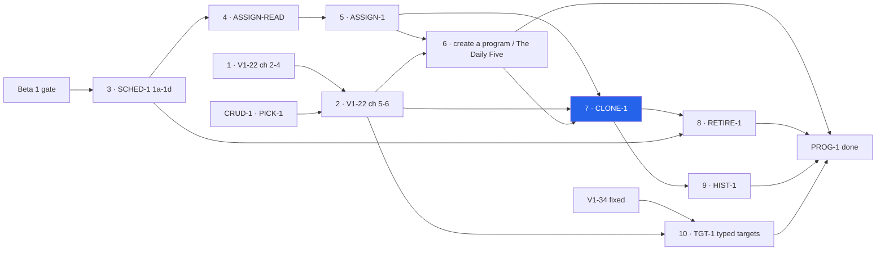
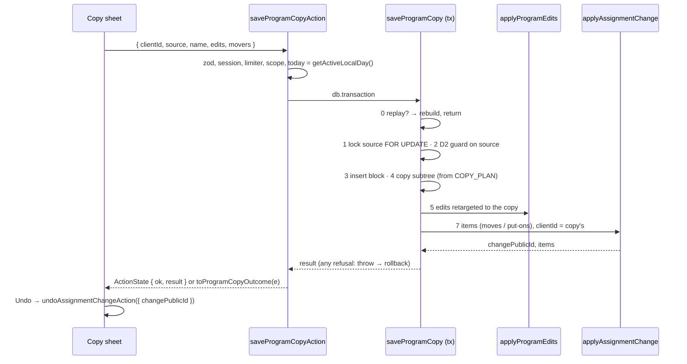

# CLONE-1 — save a program as a copy, and choose who moves to it

> Backlog: [plan.md](../plan.md#clone-1) row CLONE-1 · Spec:
> [crud-1-fix-it-yourself.md](../specs/crud-1-fix-it-yourself.md) chunk D5 · Milestone:
> [PROG-1](../milestones/prog-1-programs-and-scheduling.md) step 7 · Branch:
> `feat/clone-1-save-as-copy` (staged as four PRs, below).

## Goal

A parent who wants to **replace** a program for some athletes, rather than change it for everyone,
can save the editor's changes as a **copy** and tick who moves to it. The source stays exactly as it
was. ASSIGN-1's assignment write gives each athlete who moves a closed assignment on the source and an
open one on the copy. Nothing is deleted. The old program, each entry's snapshotted prescription and
the assignment dates then say together who ran which version, and when
([plan.md:1929-1941](../plan.md#clone-1)).

It comes now because RETIRE-1 and HIST-1 both wait on it (spec `crud-1-fix-it-yourself.md:163-164`).
It is also the only PROG-1 step that writes **new copies of per-athlete targets**, which brings the
"LLM never authors loads" rule onto a request-driven write path for the first time.

## Acceptance

**Verbatim from the backlog row** (`docs/plan.md:1929-1963`). The row has no single acceptance line, so
these are the decisions it states:

> Saving the copy asks which athletes move to it; the default is none. Moving one closes their current
> `program_assignments` row (`active_to`) and opens one on the copy (`active_from` = today). Nothing is
> deleted, so the old program, each entry's snapshotted prescription (ADR 0005 decision 5), and the
> assignment dates together say who ran which version, when.
>
> **Grain:** the clone is a **block** (`program_blocks` + its `prescriptions` + `prescription_targets`),
> because an assignment points at a block.
>
> **Gated on, in order:** 1. V1-22 chunks 2 and 3 … 2. SCHED-1's `program_assignments`, plus Today
> reading the athlete's **assignment** instead of `programDayRows`' newest block … 3. The V1-22 editor
> (chunks 4 and 6), which edits the copy rather than the original.

⚠️ **"The default is none" may be amended.** See open question 2: the UX panel asks that the athlete
whose page the editor was opened from be pre-ticked, visibly. That needs the maintainer's yes.

**Spec criteria this plan carries** (`crud-1-fix-it-yourself.md:321-329`, `:425-426`):

- **22.** When a parent saves program edits and anyone else is on the program, the system shall ask
  whether to change it for everyone on it or save it as a copy, naming who is on it.
- **23.** When a copy is saved, it shall carry every live prescription and per-athlete target of the
  source with identical values, and the source shall be unchanged.
- **24.** When a parent moves an athlete to the copy, the system shall behave as criterion 21 and shall
  not change any already-exported byte for that athlete. An athlete who was not on the source shall be
  told which program(s) they stay on, and that they have no loads on the copy yet.
- **25.** When a copy is saved with no athletes ticked, no assignment shall change.
- **45 (D5 half).** Undo after a copy shall reverse every assignment the copy wrote, including an
  athlete who was not on the source. Undo after "save for everyone" shall exist.

**Done when (observable):**

- **One transaction writes the copy.** It writes one `program_blocks` row, carrying the source's
  `rotation_anchor_date` (V1-22 A4-1), plus a copy of each of these:
  - every live `workouts` row (A4-1);
  - every live `prescriptions` row;
  - every live `prescription_targets` row;
  - every row of any child table that exists by then (TGT-1's).

  Each copied value matches the source byte for byte. The only differences are identity and timestamp
  columns, the copy's name, slug and `client_id`, and the parent's staged edits. A `db:verify` dump of
  the source subtree, `updated_at` included, is identical before and after.

- **A coverage guard catches anything the copy would miss.** It is a `db:verify` check that fails when
  a column or a referencing table of the copied subtree is neither copied by the writer nor on an
  exclusion list that gives a reason for each entry.
- **Nobody ticked writes no assignment.** `program_assignments`, `program_assignment_weekdays` and
  `program_assignment_changes` are byte-identical before and after (criterion 25).
- **A replay changes nothing.** A replay of the same `clientId` returns the original result
  (`toEqual`), even after the source was edited or archived in between, and writes nothing. A
  `clientId` that belongs to another household returns `not_found`.
- **A failure anywhere after the first insert rolls the whole copy back.** Examples are D2's `stale`,
  an `AssignmentRefusal` or an injected fault. No new block or child row remains, and a later submit
  with the same `clientId` performs the copy.
- **A mover's next workout does not jump.** For a mover whose workouts were not added or removed by the
  edits, the workout due on each of the next 14 dates is the same before and after the move.
- **The export does not move.** For a moved athlete, every past `prescribed` cell is identical before
  and after the move (criterion 24). The one case where a cell can change is named under
  "Contradictions", item 4.
- **Undo goes through ASSIGN-1, not this plan.** Undo after a copy calls ASSIGN-1's
  `undoAssignmentChangeAction` with the change id the copy returned. It reverses every mover,
  newcomers included, and keeps the copy. A second Undo is a replay. Undo after the day has changed
  returns `expired`. CLONE-1 adds **no** undo writer, no undo action and no client-held token.

## Where this sits, and what it depends on



The chart comes from the milestone (`docs/milestones/prog-1-programs-and-scheduling.md:50-71`), with
this step marked. **Step 6 → step 7 is now a gate.** The milestone has been updated to say so (scope
B1). V1-22 A4 owns `program_blocks.client_id`, `rotation_anchor_date` and `workouts`
(`v1-22-a4-create-program.md:111`, `:132-141`). A copy made before those exist would have no rotation
of its own and no labels (`v1-22-a4-create-program.md:38-40`).

### What CLONE-1 reuses (the seams settled 2026-10-23)

The spec's seams table (`crud-1-fix-it-yourself.md:525-547`) names one home for each of these.
CLONE-1 imports them and re-derives none.

| Thing                                                                                                             | Home                                                                                 | Used for                                                                                                                                                                                          |
| ----------------------------------------------------------------------------------------------------------------- | ------------------------------------------------------------------------------------ | ------------------------------------------------------------------------------------------------------------------------------------------------------------------------------------------------- |
| `applyAssignmentChange(tx, scope, { clientId, today, items, phase })`, `AssignmentRefusal`, `toAssignmentOutcome` | `packages/db/src/writers/program-assignments.ts` (`assign-1-assignments.md:555-622`) | The moves, called **inside** CLONE-1's transaction. The change's `clientId` **is the copy's `clientId`**, so one key covers both the copy and its moves.                                          |
| `program_assignment_changes`, `opened_by_change_id` / `closed_by_change_id`                                       | ASSIGN-1 1a-db (`assign-1-assignments.md:679-700`)                                   | Replay rebuilds the movers from these. Undo is keyed by the change.                                                                                                                               |
| `undoAssignmentChange` / `undoAssignmentChangeAction({ changePublicId })`                                         | `assign-1-assignments.md:702-746`, in `assignment-actions.ts`                        | Undo after a copy (criterion 45). Its lifetime is the day: `effective_day ≠ today` → `expired` (`:722-723`).                                                                                      |
| The lock order: `program_blocks` → `program_assignment_changes` → `profiles` → `program_assignments`              | `assign-1-assignments.md:624-628`                                                    | CLONE-1 takes `program_blocks` first, then calls the writer, which takes the rest.                                                                                                                |
| `openAssignmentsForBlock(db, { scope, blockPublicId, on })`                                                       | `packages/db/src/queries/program-assignments.ts` (`assign-1-assignments.md:759-779`) | Who is on the source, read in the editor's RSC and again under the lock.                                                                                                                          |
| `programBlockInHousehold(scope)`                                                                                  | `packages/db/src/writers/ownership.ts` (`assign-1-assignments.md:781-787`)           | The source read.                                                                                                                                                                                  |
| `getActiveLocalDay()`                                                                                             | `apps/web/lib/active-timezone.ts:23`                                                 | The single `today`. There is no per-profile timezone (`assign-1-assignments.md:748-757`).                                                                                                         |
| `PROGRAM_NAME_MAX`, `programNameSchema`, the reserved-slug check (incl. `daily_five`)                             | `packages/shared/src/programming.ts` (V1-22 A4)                                      | The copy's name. ⚠️ A4's contract text lists only `PROGRAM_NAME_MAX` (`v1-22-a4-create-program.md:197`). The other two are assigned to A4 by the seams table only, so A4's plan should name them. |
| `program_blocks.client_id` (`UNIQUE (client_id)`, **not** partial) and `rotation_anchor_date`                     | A4-1's migration (`v1-22-a4-create-program.md:139-141`)                              | Idempotency and the copy's rotation. **CLONE-1 has no migration.**                                                                                                                                |
| `rotationFor(block, workouts)`                                                                                    | `packages/shared/src/programming.ts` (A4, `:202-203`)                                | The test that decides whether a move may use `phase: 'carry'`.                                                                                                                                    |
| `MUTATING_ACTIONS` + `ACTION_BINDINGS`, `scope: 'household'`                                                      | [WP-1](./wp-1-shard-actions.md) (`:76`, `:171`)                                      | The registration of `saveProgramCopyAction`.                                                                                                                                                      |
| The sheet, including the phone back gesture                                                                       | U0, `components/ui/sheet.tsx`                                                        | The copy sheet.                                                                                                                                                                                   |
| `columnsOf()`                                                                                                     | `packages/db/scripts/verify.ts:178`                                                  | The coverage guard's live-schema side.                                                                                                                                                            |

### The interface needed from D2 (V1-22 chunks 4–6)

D2 has no plan yet. CLONE-1 needs the following from it. **D2's plan provides it, or says how it
differs.**

1. **The edit writer takes the caller's `Executor`.** Example shape:
   `applyProgramEdits(tx, scope, { blockId, edits })`. It must **throw** on a refusal, or CLONE-1
   converts a returned non-ok into a throw before doing anything else. The reason is that drizzle
   commits on a normal return (below).
2. **The version guard is V1-22's own**, not a token. Acceptance 14 compares the submitted set of live
   prescription public ids per `(block_id, day_role)` with the live set
   (`v1-22-authoring-program-editing.md:85-87`). The first draft of this plan wrote an `expectedVersion`
   as if a token existed, and that is withdrawn (reuse, "also found"). CLONE-1 runs D2's guard against
   the **source** under the source's lock. That proves the parent saw what is being copied.
3. **The edit shape tells an existing item from a new one.** The minimum is `{ prescriptionPublicId,
… }` for an existing item and `{ new: … }` for one added in the draft. That way `retargetEdits`
   remaps the existing ids to the copy's ids and passes new rows through unchanged.
4. **Undo after "save for everyone"** (FE-7, spec `:919`; criterion 45). CLONE-1 does not build it. It
   is a **hard gate for PR 4**: the footer's direct save is the "for everyone" path.

### Contradictions and gaps (said, not silently resolved)

1. **Resolved: the rotation.** The first draft found that a copy had no per-block rotation to carry.
   Gating on step 6 resolves it (A4-1 adds `rotation_anchor_date` and `workouts`). A copy of a legacy
   block (anchor NULL) stays legacy: `rotationFor` returns the shipped const for both, so the two
   are equal (`v1-22-a4-create-program.md:202`).
2. **Criterion 23 vs the approved prototype.** The prototype saves the **staged edits** into the copy:
   `copy.days = staged` (`docs/prototypes/crud-1/index.html:5161-5167`). The plan reads both as: the
   **source cloned verbatim, with the staged edits applied to the copy**, in one transaction.
   Criterion 23's test is the empty-edit case. A second test checks that only the edited fields differ.
   Spec text change requested (below).
3. **Criterion 24's "no loads on the copy yet" is not always true.** A copy carries **every** live
   target of the source. That includes targets for athletes not assigned to the source, because
   targets are keyed by profile (`packages/db/src/schema.ts:879-881`), not by assignment. So the
   newcomer line has three cases (UX3 S2): on the source; not on it with no target on the copy; not on
   it but carrying earlier loads from the source. The prototype's own condition is wrong the same way
   (`index.html:3600-3606`).
4. **One residual export case: rows logged earlier on the day of the move.** ASSIGN-READ makes the
   export's NULL-snapshot fallback read the blocks of the periods **covering the row's date**
   (`assign-1-assignments.md:362-371`). A move closes the source at `today − 1` and opens the copy at
   `today`. So a NULL-snapshot strength row logged **earlier today** against the source now resolves
   through the copy:
   - if the edits changed that prescription, its `prescribed` cell changes;
   - if the copy is unedited, the cell is byte-identical.

   NULL rows after chunk 3 are only the writer's no-match cases (`assign-1-assignments.md:361-364`), so
   the exposure is small, but it is not zero. **Open question 4.**

5. **The prototype opens the save dialog on every save** (`index.html:4675-4677`). This plan now
   follows **criterion 22** instead. The direct save needs no dialog when nobody besides the route
   athlete is on the program. "Save as a copy…" is always a second footer action, so it is always
   reachable (UX1 S1).

## The design

### `saveProgramCopy(tx, scope, args)` — one transaction

`args` are `{ clientId, sourceBlockPublicId, name, edits, moveProfilePublicIds, today }`.

```
0. REPLAY CHECK — before any lock or guard.
   SELECT the block WHERE client_id = $clientId          (NO deleted_at / archived filter: the index is
                                                          not partial, v1-22-a4-create-program.md:141)
     in scope         → return rebuildCopyResult(tx, scope, block)   (writes nothing)
     other household  → throw ProgramCopyRefusal('not_found')        (no oracle; A4's rule, :283)
1. SET LOCAL lock_timeout; SELECT source FROM program_blocks
     WHERE public_id = $source AND programBlockInHousehold(scope) AND deleted_at IS NULL
     FOR UPDATE                                           (V1-22 acceptance 15's lock; first in the order)
   miss → throw ProgramCopyRefusal('not_found')
2. D2's guard against the SOURCE (the submitted live public-id sets per day role) → mismatch: 'stale'
3. INSERT program_blocks (public_id = newId(), household_id, client_id, slug = movementSlug(name),
     name, notes, rotation_anchor_date = source's) ON CONFLICT (client_id) DO NOTHING RETURNING id
   no row → a concurrent twin won the race: re-run step 0 (it now hits) and return its result
   23505 on uq_program_blocks_household_slug → throw ProgramCopyRefusal('name_taken')
4. copy workouts, prescriptions (RETURNING id, day_role, idx → oldId→newId), prescription_targets
   (live target, live profile, profile in scope — the writer-enforced invariant, schema.ts:851-858),
   and every child table in the exported COPY_PLAN, each insert BUILT FROM the plan's column list
5. applyProgramEdits(tx, scope, { blockId: copy, edits: retargetEdits(edits, idMap) })   (D2)
6. derive, AFTER the edits: for each ticked athlete, an open period on the source (openAssignmentsForBlock
   under the lock) → item { from: source, to: copy, expected: that period, weekdays: its weekdays };
   none → { from: null, to: copy, weekdays: [...WEEKDAYS] }. Then each newcomer's target status
   (copyTargetStatus, below) from the copy's targets as now written.
7. if any item: applyAssignmentChange(tx, scope, { clientId, today, items,
     phase: rotationFor(copy) equals rotationFor(source) ? 'carry' : 'reset' })
8. return ProgramCopyResult
```

**Failure is a throw, never a returned non-ok (corr B2).** Inside drizzle's `transaction()`, a callback
that returns normally **commits** whatever it already wrote. ASSIGN-1 records the same fact and the
repo idiom (`assign-1-assignments.md:584-587`; `strength-session.ts:54`). So every refusal after step 0
throws `ProgramCopyRefusal`. ASSIGN-1's `AssignmentRefusal` and D2's refusal propagate as thrown.
Outside the transaction, `toProgramCopyOutcome(e)` maps:

- its own reasons;
- everything `toAssignmentOutcome` recognises;
- `55P03` → `busy`.

Anything else rethrows to `error.tsx`.

**A commit-on-return probe pins the fact.** A `db:verify` case opens a transaction, inserts a fixture
row, **returns** `{ ok: false }`, and asserts the row persisted. If a drizzle upgrade ever changes this,
the probe goes red and the sentinel rule is re-examined, not silently relied on.

**Values are copied column to column, with no expression.** The writer never applies a `coalesce`, a
trim, rounding or a default fill. Each source column is selected and inserted unchanged, from the same
exported list the coverage guard reads. That is how "a human-authored target, copied verbatim" (spec
`:905`; `schema.ts:852`, "HUMAN-AUTHORED — the LLM never authors loads") holds by construction. A
newcomer gets **no** invented target (U17, spec `:993`). The UI tells them so instead.

**Why read-then-insert, not `INSERT … SELECT`.** Public ids are UUIDv7 from `newId()`
(`packages/shared/src/id.ts:9`), and SQL has no v7 generator here. The volume is at most 3 workouts ×
`MAX_SESSION_MOVEMENTS` (12, `packages/shared/src/strength-session.ts:30`) × the athletes with targets.

**The name.** The rules are A4's `programNameSchema`, plus the reserved-slug check, which includes
`daily_five`. The slug is `movementSlug(name)` (`packages/shared/src/movements.ts:34`; the block
docblock, `schema.ts:783`). The default is `"{source} (copy)"` (arch S5). From an athlete's page it is
`"{source} for {athlete}"` (UX1 N1). "Free" means no row with `deleted_at IS NULL` holds the slug,
because that is the unique index's predicate (`schema.ts:800-802`). An **archived** program still
holds its slug, so the field error covers archived names: "A program with this name already exists,
possibly archived." The error is computed by the index (step 3), never by a pre-check alone.

### `rebuildCopyResult` — replay returns the original result

The rebuild reads the following:

- the copy block (public id, name);
- `program_assignment_changes` by `client_id = the copy's clientId` (absent when nobody moved);
- the movers, through ASSIGN-1's rebuild query over `opened_by_change_id` / `closed_by_change_id`
  (`assign-1-assignments.md:672-677`).

**Interface requirement on ASSIGN-1:** export that rebuild as
`assignmentChangeResultByClientId(exec, scope, clientId)`. Calling `applyAssignmentChange` again for a
replay would run its step 2 first, and an archived copy would then refuse as `'archived'` before the
replay is detected (`:631-637` vs `:638-643`).

The source is **not** read, so a replay after the source is edited, renamed or archived returns the
same DTO. Newcomer target status is recomputed from the copy's targets. That is identical unless the
copy itself was edited in between, which is a stated limit.

### The result and the dialog data

```
packages/shared/src/programming.ts
  programCloneSchema { clientId: uuidSchema, sourceBlockPublicId: uuidSchema,
                       name: programNameSchema (A4), edits: D2's programEditSchema,
                       moveProfilePublicIds: uuidSchema[] (unique, max ASSIGNMENT_CHANGE_MAX_ITEMS) }
                     — NO profilePublicId: the action is household-scoped (arch S3)
  copyTargetStatus(savedTargets, stagedEdits, profileId) → 'none' | 'carried'
                     — PURE; the dialog (before save) and the writer's result (after) both call it (arch S4)

apps/web/lib/programming
  ProgramCopyResult { copy: { publicId, name }, changePublicId: string | null,
                      movers: Array<{ profilePublicId, kind: AssignmentChangeResult['items'][n]['kind'],
                                      targets: 'none' | 'carried' | null }> }
                      — `kind` IS ASSIGN-1's vocabulary ('move' | 'put'), one set of words (reuse N2)
  CopyCandidate     { profilePublicId, name, onSource: boolean, staysOn: string[] }
                      — built by the editor page's RSC and passed as props (arch S4); the DTO keeps only
                        candidates (reuse N1)
```

No load, target value or rendered prescription is in any DTO.

### Sequence (PR 2b embeds it in `docs/architecture.md`, arch S6)



## The UI (PR 4)

It implements the prototype's save flow (`docs/prototypes/crud-1/index.html:3565-3627`, `:5154-5211`),
**with declared departures** that the UX panel's two blocking findings required (UX1 B1, UX3 B1). In
the prototype, a copy saved with nobody moved quietly took the edits with it.

**The editor's footer has two actions** (UX1 S1, UX3 S5, scope S4):

- **Primary: "Save for {names}"**, or just "Save" when nobody besides the route athlete is on the
  program. It is the direct save through D2, with D2's Undo, and no dialog. That is criterion 22: the
  question is asked only when someone else is on it.
- **The choice is explicit when others are on the program (UX3 S1).** The button's label names them,
  and **neither button is the form's default**. Enter in an editor field never saves, so saving for
  other people always takes a tap on the button that names them. This branch sends no movers by
  construction.
- **Secondary: "Save as a copy…".** It opens the copy sheet.

**The copy sheet** sits on U0's sheet, and is a departure from the prototype's plain dialog. It has:

- An `<h2>` "Save as a copy of {source}", focused on open.
- The **name** `<input>`, `maxLength` = `PROGRAM_NAME_MAX`, with `enterKeyHint="next"`. Enter moves
  focus to the first mover and never submits.
- **Two fieldsets** (UX1 S2), with the route athlete first in whichever one holds them:
  - "On {source} — they switch to the copy";
  - "Not on it — they add the copy".
- Each **checkbox row** is one `<label>` wrapping the box. The name is wired with `aria-labelledby`
  and the status line with `aria-describedby`. The status lines are:
  - "Stops {source} today, starts the copy.";
  - "Starts the copy today[ and stays on {programs}]." followed by either "No loads for {name} on
    the copy yet — add them after saving." or "Carries {name}'s earlier loads from {source} — check
    them." (UX3 S2).
  - Any ⚠ glyph is `aria-hidden`. The focus ring is drawn on the row card (`:has(:focus-visible)`).
- **The submit label follows the state (UX3 B1):** "Save copy and move {names}", or "Save copy, move
  nobody". When nobody is ticked, a static line above the footer reads: "Your changes go only to the
  copy. Nobody will be on it until you move someone."
- **Errors.** A field error sits beside its field (`aria-describedby`), and focus moves to the first
  invalid field (A11Y-2, spec `:925`). A form-level error (`stale`, `busy`, `not_found`) **keeps the
  sheet open**, with a focused message at the top of the body. `stale` revalidates first (V1-22
  acceptance 14).

**After a copy** (UX1 B1 (d)):

- The page's success line reads "{copy}, a copy of {source}, saved. {names} moved to it from today."
  or "… Nobody moved."
- It links "Move someone to {copy}" (ASSIGN-1's "+ Put someone on it", criterion 38) and, when any
  newcomer is `none` or `carried`, "Set loads for {names} on {copy}".
- The editor, still on the source, says "Your changes were saved to {copy}. {source} is unchanged."
- There is **Undo** when anyone moved.
- **Undo lives until the page is left or the day ends** (`expired`). This is said in no copy text,
  because the line disappears with the page.
- Focus on close: the sheet's `onCloseAutoFocus` sends focus to Undo, or to the `<h1>` when there is
  no Undo. Undo carries `aria-describedby` → the success text, so the move announces it **once**, and
  no live region repeats it (UX2).

**All copy strings live in one const module**, `apps/web/components/programs/program-copy-text.ts`. The
component and its tests import it (reuse S5).

**Pre-tick (UX3, open question 2).** If the maintainer agrees, the route athlete's box is ticked when
the sheet opens, and visibly so. This amends the row's "default none".

**Width at 360px.** The sheet is full-screen below 600px (criterion 37). Content is 360 − 2 × 16 =
**328px**.

- **A mover row:** 12px padding + 20px box + 12px gap + text + 12px padding leaves **272px**.
  "Starts the copy today and stays on Youth Daily Program." is about 56 × 7px ≈ 392px, so it wraps to
  two lines. With a warning line the row is about 4 × 20 + 24 = 104px, which is ≥ 44.
- **Text in rows:** every row's text has `min-w-0` and `overflow-wrap: anywhere`, so a long athlete or
  program name wraps instead of widening the row (UX2).
- **The editor footer:** "Save for Ana, Ben and Cal" is about 245px with padding, and "Save as a
  copy…" about 160px. 245 + 8 + 160 = 413 > 328, so the two **stack**, full-width and 44px each,
  below a 480px container.
- **The sheet footer:** Cancel (88px) plus "Save copy and move Ana and Ben" (about 287px) is more than
  328px, so it wraps to full-width rows, submit first.
- **Zoom and landscape:** these are U0's pinned header and footer rule (A11Y-8, spec `:926`), cited
  rather than restated.

**The a11y scan.** The open copy sheet at 360px joins `apps/web/e2e/a11y.spec.ts`, with a 40-character
athlete name and a 60-character program name (unowned 8, spec `:690-694`). It does so in PR 4, which
may edit that file.

## Staging

| PR     | Branch                        | What                                                                                                                                                              | ~Lines | Gate                                                                                                                                                                      |
| ------ | ----------------------------- | ----------------------------------------------------------------------------------------------------------------------------------------------------------------- | ------ | ------------------------------------------------------------------------------------------------------------------------------------------------------------------------- |
| ~~1~~  | —                             | **Cut.** The `client_id` migration is V1-22 A4-1's. Its db-safety findings are handed to A4 (log).                                                                | —      | —                                                                                                                                                                         |
| **2a** | `feat/clone-1-2a-copy-writer` | `program-clone.ts` steps 0–5 and 8 (the copy only, no moves), `COPY_PLAN`, `retargetEdits`, the sentinel and its mapper, and the `db:verify` cases 1–7 and 10–11. | ~320   | **Step 6 merged and A4-1 observed applied** · V1-22 chunk 3's `--apply` recorded in the corrections **Applied** table · D2 merged (its edit writer, its guard, its Undo). |
| **2b** | `feat/clone-1-2b-moves`       | Steps 6–7, `rebuildCopyResult` with ASSIGN-1's exported rebuild, `copyTargetStatus`, cases 8–9 and 12–13, and the sequence diagram in `architecture.md`.          | ~250   | 2a · ASSIGN-1 merged with the rebuild export.                                                                                                                             |
| **3**  | `feat/clone-1-3-action`       | `programCloneSchema`, the DAL, `saveProgramCopyAction` in `app/p/program-actions.ts`, the registry entries, and the boundary tests.                               | ~300   | 2b · WP-1 merged.                                                                                                                                                         |
| **4**  | `feat/clone-1-4-copy-sheet`   | The footer's two actions, the copy sheet, the success line, the copy-text module, and the a11y scan state.                                                        | ~380   | 3 · **UX panel re-review** · U0 merged · **D2's "for everyone" Undo merged (criterion 45)**.                                                                              |

There is no migration in any PR. 2a is exercised only by `db:verify` for one PR. That is accepted: the
alternative (copy + moves in one PR, ~570 lines) breaks the 400-line target (scope S2).

## File-by-file changes

| Path                                                                      | PR       | Change | What & why                                                                                                                                                                                                                                                                                                                                                                                                                                                                                                                                                    |
| ------------------------------------------------------------------------- | -------- | ------ | ------------------------------------------------------------------------------------------------------------------------------------------------------------------------------------------------------------------------------------------------------------------------------------------------------------------------------------------------------------------------------------------------------------------------------------------------------------------------------------------------------------------------------------------------------------- |
| `packages/db/src/writers/program-clone.ts`                                | 2a, 2b   | NEW    | `saveProgramCopy`, `ProgramCopyRefusal`, `toProgramCopyOutcome`, `rebuildCopyResult`. It also exports **`COPY_PLAN`**: for each copied table, its copied columns, its remapped FK and its excluded columns with a reason. Each insert is built from that list, so the list cannot drift from the writer. `HouseholdScope` is a required parameter (write-path: the scope is explicit below `lib/dal`).                                                                                                                                                        |
| `packages/db/src/writers/program-clone.test.ts`                           | 2a       | NEW    | Pure: `retargetEdits` remaps every existing id, passes new rows through, and refuses an unknown id. Default names.                                                                                                                                                                                                                                                                                                                                                                                                                                            |
| `packages/db/src/index.ts`                                                | 2a       | EDIT   | Export the writer, beside `writers/strength-session.ts`'s export (exact barrel path unverified).                                                                                                                                                                                                                                                                                                                                                                                                                                                              |
| `packages/db/scripts/verify.ts`                                           | 2a, 2b   | EDIT   | The `db:verify` cases (Test plan).                                                                                                                                                                                                                                                                                                                                                                                                                                                                                                                            |
| `packages/db/scripts/mutations/NN-clone-drops-a-column.patch` + `.expect` | 2a       | NEW    | Drops `load` from `COPY_PLAN.prescription_targets`. The `.expect` names the coverage guard's assertion **and** the verbatim case's (the README's format, `packages/db/scripts/mutations/README.md:39`). The first draft's "add a schema column" patch is dropped (scope S5).                                                                                                                                                                                                                                                                                  |
| `packages/shared/src/programming.ts`                                      | 2b, 3    | EDIT   | `copyTargetStatus` (2b) and `programCloneSchema` (3). Owned by `programming.md`.                                                                                                                                                                                                                                                                                                                                                                                                                                                                              |
| `apps/web/lib/dal/program-clone.ts`                                       | 3        | NEW    | `server-only`. `getHouseholdScope()` (`apps/web/lib/dal/household.ts:68`), where null means `not_found`. `today = getActiveLocalDay()` is called once. Then the transaction, then `toProgramCopyOutcome` outside it. Also `copyCandidates(blockPublicId)` for the editor RSC, built on `openAssignmentsForBlock`.                                                                                                                                                                                                                                             |
| `apps/web/lib/dal/program-clone.test.ts`                                  | 3        | NEW    | Emitted-SQL proofs on `apps/web/lib/dal/recording-db.ts`: the household conjunct on the replay lookup, on the source and on the candidates.                                                                                                                                                                                                                                                                                                                                                                                                                   |
| `apps/web/app/p/program-actions.ts`                                       | 3        | NEW    | `'use server'`, **scope `'household'`**: the action takes **no** `profileId`, because the copy and its movers are household-level. `saveProgramCopyAction` follows the seven points: `Sentry.withServerActionInstrumentation`, zod first, session, limiter, DAL, `revalidatePath` (editor, program list, each mover's day page) and the `ActionState` envelope. **No undo action** (ASSIGN-1's is reused). ⚠️ V1-22 A4 drafted `programs-actions.ts` (`v1-22-a4-create-program.md:286`). This plan uses `program-actions.ts` as directed, so A4 should match. |
| `apps/web/app/p/[profileId]/mutating-actions.ts` (app-wide after WP-1)    | 3        | EDIT   | `saveProgramCopyAction` with `scope: 'household'`, its `ACTION_BINDINGS` entry with `writers: [saveProgramCopy]`, `VALID_BODY`, and the pinned module list (WP-1's steps, `wp-1-shard-actions.md:171`).                                                                                                                                                                                                                                                                                                                                                       |
| `apps/web/app/p/[profileId]/actions.test.ts`                              | 3        | EDIT   | Covered by WP-1's household suite by construction. Plus the plan-specific boundary cases.                                                                                                                                                                                                                                                                                                                                                                                                                                                                     |
| `<D2's editor component>`                                                 | 4        | EDIT   | The two footer actions and the "changes were saved to {copy}" line.                                                                                                                                                                                                                                                                                                                                                                                                                                                                                           |
| `apps/web/components/programs/save-copy-sheet.tsx` (+ `.test.tsx`)        | 4        | NEW    | The copy sheet, a client island.                                                                                                                                                                                                                                                                                                                                                                                                                                                                                                                              |
| `apps/web/components/programs/program-copy-text.ts`                       | 4        | NEW    | Every string (reuse S5).                                                                                                                                                                                                                                                                                                                                                                                                                                                                                                                                      |
| `apps/web/e2e/a11y.spec.ts`                                               | 4        | EDIT   | The open-sheet state at 360px with long names.                                                                                                                                                                                                                                                                                                                                                                                                                                                                                                                |
| `docs/architecture.md`                                                    | 2b       | EDIT   | The sequence diagram above (arch S6).                                                                                                                                                                                                                                                                                                                                                                                                                                                                                                                         |
| `docs/features/programming.md`                                            | 2b, 3, 4 | EDIT   | **guides:check.** The copy's verbatim rule. `COPY_PLAN` is the one list of what a program is. `owns:` gains `apps/web/components/programs/` if A4 has not already claimed it.                                                                                                                                                                                                                                                                                                                                                                                 |
| `docs/features/write-path.md`                                             | 2a, 3    | EDIT   | **guides:check** (owns `writers/`, `lib/dal/`). The refusal-throws rule with its probe. The replay-first ordering. `program-actions.ts` added to `owns:` (WP-1 asserts it).                                                                                                                                                                                                                                                                                                                                                                                   |
| `docs/privacy/data-inventory.md`                                          | 2a       | EDIT   | The `prescription_targets` row (`:130`, "a per-minor prescribed load"): a copy **duplicates** these rows within the same household. They are deleted by the same procedure (`docs/runbooks.md:845-847` deletes targets by profile **or** by prescription in the household's blocks). No new category, processor or retention. The `workouts` names it also copies are A4's row.                                                                                                                                                                               |

## Test plan

**`db:verify` (PGlite, `pnpm --filter @mat-plan/db db:verify`; in `pnpm verify` and CI `quality`):**

1. **Verbatim (criterion 23).** The fixture has:
   - two workouts (A4 rows) and a legacy block;
   - a duplicated `(day_role, movement)`;
   - an open prescription (`sets` NULL) and verbatim `AMRAP` / `~145-150` values;
   - targets for three athletes, one with `load` NULL and `reps` set.

   The test first **asserts a non-empty `load` and `target_reps` exist** (V1-22 acceptance 8's
   lesson). It then clones with empty edits and nobody ticked, and asserts every `COPY_PLAN` column is
   equal and every identity column differs.

2. **The source is unchanged.** A full dump of the subtree, `updated_at` included, is identical
   before and after, with and without edits.
3. **Edits land on the copy only.** One `sets` change, one target change and one added item: the copy
   differs in exactly those, and the source in none.
4. **Only live rows are copied.** Soft-deleted prescriptions, targets and workouts are not copied. A
   target straddling households (`docs/runbooks.md:862-863`) is not copied.
5. **The coverage guard.** For every table in `COPY_PLAN`, the copied plus excluded columns must equal
   `columnsOf(table)` **and** drizzle's `getTableColumns()`. A `pg_constraint` scan must find every FK
   referencing a copied table either in `COPY_PLAN` or in the reasoned exclusions
   (`program_assignments`, `program_assignment_weekdays` through it). An **in-file negative case**
   feeds the guard a plan missing one column and asserts it reports that column. The mutation patch
   above must turn both the guard and case 1 red.
6. **The commit-on-return probe** (above).
7. **Rollback on a refusal.** A D2 `stale` raised mid-copy leaves **zero** new blocks or child rows,
   and a later same-`clientId` submit performs the copy. A fault is also **injected** after step 4
   through a test-only `Executor` wrapper (`packages/db/src/writers/executor.ts:14`) that throws on the
   first `program_assignments` insert (corr S5). Nothing remains after it.
8. **Nobody ticked (criterion 25).** The three assignment tables are byte-identical, and D4's Today
   read still resolves every athlete to the source (the newest-block trap,
   `packages/db/src/queries/program-day.ts:84-85`).
9. **Moves (criterion 24 → 21).** A mover's source period is closed and their copy period carries the
   mover's own weekdays. A newcomer gets seven weekday rows. The mover's next 14 workouts are unchanged
   (`phase: 'carry'`). When the edits add a workout, `'reset'` is passed and the test asserts it.
10. **Replay.** The same `clientId` twice gives one block and returns `toEqual` results. A replay
    **after the source was edited**, and another **after it was archived**, returns the same full
    result. Another household's `clientId` → `not_found`.
11. **The name.** A live or archived holder of the slug gives `name_taken` and nothing written. A
    reserved slug (`daily_five`) is refused.
12. **Export bytes (criterion 24).** For a moved athlete with snapshot `'3x5 @ 65'`, snapshot `''`
    and snapshot NULL rows dated **before** today, the rendered `prescribed` value from D4's fallback
    is identical before and after the move. A fifth row, NULL-snapshot and dated **today**, is
    asserted to change only when the copy was edited (contradiction 4, pinned rather than hidden).
13. **Undo through ASSIGN-1.** `undoAssignmentChange` with the returned id restores every mover,
    newcomers included, and keeps the copy.

**Unit (Vitest):** `copyTargetStatus` for none, carried and on-source; the default names; and the copy
module's strings used by the component tests.

**Boundary tests (PR 3; WP-1's household suite plus):**

- **Unauthenticated:** rejected.
- **Wrong-household source:** 404 semantics, and the writer is not called.
- **A wrong-household mover in an otherwise valid body:** the same, with nothing written, the block
  included.
- **Bad bodies are zod-rejected:** a non-uuid, a blank name, an over-long name, duplicate movers, more
  than the item cap, and a `profileId` field (`.strict()`).
- **A replay:** one effect and an identical response.

**e2e:** `pnpm e2e:local` before PR 4. **Screenshots** at three widths:

- the footer with others on the program;
- the copy sheet with a carried-loads newcomer;
- the copy sheet with nobody ticked;
- the success line with Undo.

## Risks / rollback

| Risk                                                                                                                 | Mitigation                                                                                                                                                                                                                     |
| -------------------------------------------------------------------------------------------------------------------- | ------------------------------------------------------------------------------------------------------------------------------------------------------------------------------------------------------------------------------ |
| **A copy hijacks Today for everyone** (newest block per day role, `docs/features/programming.md:99-105`, `:235-237`) | Gated on D4. Case 8.                                                                                                                                                                                                           |
| **A move rewrites a past `prescribed` cell**                                                                         | ASSIGN-1's date-covering export (`assign-1-assignments.md:362-371`) and gate 1 (chunk 3's backfill) leave one case: a NULL-snapshot row logged earlier on the move day, with an edited copy. Case 12 pins it; open question 4. |
| **"LLM never authors loads"** — a new path that writes targets                                                       | Column-to-column copy from `COPY_PLAN`, the verbatim case, and the mutation patch. No model is anywhere in the path. A newcomer gets a warning, not a target. The success line says "a copy of {source}".                      |
| A copy misses a later child table (TGT-1 can land first, milestone `:87`)                                            | The coverage guard and its negative case.                                                                                                                                                                                      |
| A silent partial commit on a returned refusal                                                                        | The sentinel rule, the probe (case 6) and the rollback cases (case 7).                                                                                                                                                         |
| Deadlock with RETIRE-1 or ASSIGN-1                                                                                   | ASSIGN-1's global lock order. CLONE-1 holds only `program_blocks` before calling the writer.                                                                                                                                   |
| A copy with nobody moved carries edits nobody will run                                                               | The explicit submit label and nobody-ticked line (UX3 B1), and the success line's "Move someone to {copy}" link. Removing a stray copy is RETIRE-1, the next step.                                                             |
| AUTH-1 1c changes the principal                                                                                      | Re-verify list below.                                                                                                                                                                                                          |

**AUTH-1.** Chunks 1a, 1b-bis and 1c-pre have shipped; 1b, 1c and 1d have not. D5 sits behind Beta 1's
gate, so 1c, the one-way door, lands first. **When PR 3 is written, re-verify each of these against
1c's row (`docs/plans/auth-1-clerk-google.md:549`):**

- `requireSession()` is called inside the action;
- `getHouseholdScope()`'s new body is what it resolves through (`household.ts:62-66`);
- the mutation limiter wraps it;
- WP-1's registry and `pages-are-gated.test.ts` include it;
- **whatever role check AUTH-1 added to the editor** (V1-22: "adds a role check rather than moving the
  route") also guards moving another athlete.

**Rollback.** There is no migration. 2a and 2b add a writer with no app caller, so a revert is clean.
Copies already written are ordinary blocks, and their assignments are ordinary ASSIGN-1 changes
(Undo-able the same day). PR 4 is a UI revert. Fix-forward is the default.

## Out of scope / deferred

- **A version-compare or history screen** (`plan.md:1959-1960`). HIST-1 covers it.
- **A `cloned_from` column.** No PROG-1 screen reads one. The success line states the relation when
  it matters, HIST-1 attributes by snapshot and period (FE-9, spec `:921`), and adding it later is one
  nullable FK in A4's table family.
- **Cloning a single workout** (the `workouts` arc, ADR 0007, `plan.md:1950-1952`).
- **A CSV column naming the program** (open question 3).
- **Choosing a newcomer's days in the sheet.** They start on every day, and "Change days" is ASSIGN-1.
- **Archiving the source after a full move.** That is RETIRE-1.
- **Household-wide replacement** (`plan.md:1943-1947`).

## Alternatives considered and rejected

| Alternative                                                                   | Why rejected                                                                                                                       |
| ----------------------------------------------------------------------------- | ---------------------------------------------------------------------------------------------------------------------------------- |
| Idempotency by `(household_id, slug)`                                         | It cannot tell a replay from a deliberate second copy, and a renamed replay makes two copies.                                      |
| Clone verbatim, then have the parent edit the copy                            | The approved prototype stages edits first, and U15 removed this two-step flow (spec `:991`).                                       |
| The copy's anchor is the save day (criterion 35's rule for a created program) | A mover would restart at the first workout. A copy continues its source.                                                           |
| CLONE-1's own undo writer, or a client-held pre-image token (first draft)     | It would be a second Undo mechanism. ASSIGN-1's change id covers it with no client-held value (`assign-1-assignments.md:713-716`). |
| One dialog with a "for everyone / as a copy" radio (prototype)                | A copy with nobody moved lost the edits in practice (UX1 B1, UX3 B1). Two footer actions make the outcome visible before the tap.  |
| Undo also hides the copy                                                      | It would lose the staged edits, and the prototype keeps the copy (`index.html:4975-4977`).                                         |

## Open questions

> **Maintainer answers, 2026-10-23** (spec → review-response log, round 8): Still open: the pre-tick question (asked again with detail).

1. ~~Where a block's rotation lives~~ **Resolved:** step 6 gates step 7 (scope B1; the milestone was
   updated).
2. **Pre-tick the route athlete (UX3).** **For the maintainer.** It amends the backlog's "default none"
   (`plan.md:1935`). Recommendation: yes, visibly ticked, because a parent editing an athlete's program
   and saving a copy almost always means that athlete.
3. **The CSV "who ran which version"** (`plan.md:1953-1955`, milestone `:46`). **Recommendation: no CSV
   change.** The export is byte-faithful to an existing workflow, `prescribed` already records what was
   asked, and "which version" is answered by the periods and blocks and shown by HIST-1. A program
   column is an Insight contract change with its own row. **For the maintainer, as Insight's owner.**
4. **A NULL-snapshot row logged earlier on the move day** (contradiction 4). It can change its
   `prescribed` cell if the copy was edited. Options:
   - **(a)** accept and document it;
   - **(b)** open the copy period from tomorrow when the athlete has logged today. That needs
     ASSIGN-1's writer to take a per-item `from`.

   Recommendation (a): the exposure needs a NULL snapshot, which after chunk 3 is only the writer's
   no-match cases. **For the maintainer and Insight.**

5. **D2's interface** (above). If D2 lands without it, escalate rather than build a second editor
   writer or Undo.

## Review-response log

**Round 1.** Five engineering lenses (correctness, scope, architecture, reuse, db-safety) and three UX
lenses reviewed the first draft. ASSIGN-1's plan then defined the shared writer, and the reconcile
follows it. Findings were relayed in summary. Where a finding's full text was not relayed, the
response says so rather than guessing at it.

### Engineering panel

| Finding                                                                                                                   | Lens         | Response                                                                                                                                                                      |
| ------------------------------------------------------------------------------------------------------------------------- | ------------ | ----------------------------------------------------------------------------------------------------------------------------------------------------------------------------- |
| **B1** — gate on step 6; cut PR 1                                                                                         | scope        | **Accepted.** The step 6 gate and the cut PR 1 are in Staging. A4 owns `client_id` and the anchor.                                                                            |
| **S2** — split the writer PR                                                                                              | scope        | **Accepted.** 2a (copy) and 2b (moves and replay), re-estimated at ~320 and ~250 lines.                                                                                       |
| **S4** — "for everyone" is a direct save, not a radio                                                                     | scope        | **Accepted.** The two footer actions.                                                                                                                                         |
| **S5** — coverage guard against live columns; drop the schema-add mutation                                                | scope        | **Accepted.** `COPY_PLAN` vs `columnsOf` + `getTableColumns` + an FK scan, an in-file negative case, and a drop-a-column patch with a named `.expect`.                        |
| **B1** — replay must precede locks and guards and return the original result                                              | correctness  | **Accepted.** Step 0 has no `deleted_at` filter. `rebuildCopyResult` reads from `program_assignment_changes`. Case 10 checks replay after an edit and after an archive.       |
| **B2** — a returned non-ok commits                                                                                        | correctness  | **Accepted.** The `ProgramCopyRefusal` sentinel, the mapper outside the transaction, the probe (case 6) and the D2 `stale` rollback (case 7).                                 |
| **S2** — no client-held Undo token                                                                                        | correctness  | **Accepted.** ASSIGN-1's change id is used, and CLONE-1 has no undo of its own.                                                                                               |
| **S4** — the guard must catch a dropped column                                                                            | correctness  | **Accepted** (see scope S5).                                                                                                                                                  |
| **S5** — inject the failure, do not wait for one                                                                          | correctness  | **Accepted.** A test-only `Executor` wrapper.                                                                                                                                 |
| **S6** — derive move vs put-on after the edits, in the transaction                                                        | correctness  | **Accepted.** Step 6. The result returns the kinds.                                                                                                                           |
| N1–N3                                                                                                                     | correctness  | **Partly addressed** — N1 is folded into the guard design (arch N1). The text of N2 and N3 was not relayed; they are to be checked at re-review.                              |
| **B1** — replay ordering                                                                                                  | architecture | **Accepted** (see correctness B1).                                                                                                                                            |
| **S1** — name D2's interface                                                                                              | architecture | **Accepted.** "The interface needed from D2": the caller's Executor, V1-22's live-id guard (not a token), existing vs new items, and `retargetEdits` passes new rows through. |
| **S2** — reuse ASSIGN-1's writer and Undo                                                                                 | architecture | **Accepted.** The seams table. The first draft's interface section is deleted.                                                                                                |
| **S3** — register by WP-1 with scope                                                                                      | architecture | **Accepted.** `app/p/program-actions.ts`, `scope: 'household'`, no `profileId`. A4's draft name `programs-actions.ts` is flagged for alignment.                               |
| **S4** — dialog data from the RSC; one pure helper                                                                        | architecture | **Accepted.** `CopyCandidate` props and `copyTargetStatus` in shared.                                                                                                         |
| **S5** — "free" means `deleted_at IS NULL`; archived names collide                                                        | architecture | **Accepted.** That is the index's own predicate (`schema.ts:800-802`). The error copy names archived programs.                                                                |
| **S6** — a sequence diagram                                                                                               | architecture | **Accepted.** In the plan, and in `architecture.md` in 2b.                                                                                                                    |
| N1, other NITs                                                                                                            | architecture | **Accepted** where relayed (the guard builds inserts from the list). The rest of the text was not relayed.                                                                    |
| **B1** — reuse ASSIGN-1's interface                                                                                       | reuse        | **Accepted.**                                                                                                                                                                 |
| **S1** — `openAssignmentsForBlock`, `programBlockInHousehold`, `getActiveLocalDay`                                        | reuse        | **Accepted.**                                                                                                                                                                 |
| **S3** — import the name rules from A4                                                                                    | reuse        | **Accepted.** One mismatch is flagged: A4's contract text lists only `PROGRAM_NAME_MAX`.                                                                                      |
| **S5** — one copy-text module                                                                                             | reuse        | **Accepted.**                                                                                                                                                                 |
| **N1** — DTO keeps only candidates                                                                                        | reuse        | **Accepted.**                                                                                                                                                                 |
| **N2** — `columnsOf()`; drop own `phase`; one kind vocabulary                                                             | reuse        | **Accepted.** ASSIGN-1's `phase` argument and kinds are used.                                                                                                                 |
| **"Also found"** — no version token exists                                                                                | reuse        | **Accepted.** `expectedVersion` is removed, and D2's live-id guard is used instead.                                                                                           |
| **B1, S1** — replay and idempotency                                                                                       | db-safety    | **Accepted** (see correctness B1).                                                                                                                                            |
| **S6** — derived kinds in the transaction                                                                                 | db-safety    | **Accepted.**                                                                                                                                                                 |
| **S3, S4, N1–N3** — the migration's index predicate proof, no `IF NOT EXISTS` on the index, a plain `CREATE UNIQUE INDEX` | db-safety    | **Handed to V1-22 A4**, which now owns the migration (A4-1). Not applicable here.                                                                                             |

### UX panel

| Finding                                                                                               | Lens            | Response                                                                                                                                                                                                                                                                                                                                                                                                                                                                                                         |
| ----------------------------------------------------------------------------------------------------- | --------------- | ---------------------------------------------------------------------------------------------------------------------------------------------------------------------------------------------------------------------------------------------------------------------------------------------------------------------------------------------------------------------------------------------------------------------------------------------------------------------------------------------------------------- |
| **B1** — a copy with nobody moved loses the edits                                                     | 1 · interaction | **Accepted.** Two footer actions, a stateful submit label, a nobody-ticked line, and the success line with "Move someone to {copy}".                                                                                                                                                                                                                                                                                                                                                                             |
| **S1** — direct save; copy as a secondary action                                                      | 1               | **Accepted.** No dialog unless someone else is on the program (criterion 22).                                                                                                                                                                                                                                                                                                                                                                                                                                    |
| **S2** — two fieldsets, route athlete first                                                           | 1               | **Accepted.**                                                                                                                                                                                                                                                                                                                                                                                                                                                                                                    |
| **N1** — "{source} for {athlete}" from an athlete page                                                | 1               | **Accepted.**                                                                                                                                                                                                                                                                                                                                                                                                                                                                                                    |
| Focus, announcements, Enter, wrapping, scan state, zoom, per-control names, focus ring, branch inputs | 2 · a11y        | **Accepted, all.** `onCloseAutoFocus` → Undo or `<h1>` with `aria-describedby` and no double announcement. Form-level errors keep the sheet open with a focused message. `enterKeyHint="next"`, and Enter never submits. `min-w-0` + `overflow-wrap`. A 360px scan with long names. Zoom and landscape cite U0. The departure from the prototype is declared. `aria-labelledby` / `describedby` per row, the glyph `aria-hidden`, a card focus ring. The direct save sends no movers. `<h2>` is focused on open. |
| **B1** — nobody-moved copy, and an explicit submit label                                              | 3 · trust       | **Accepted** (see 1 · B1).                                                                                                                                                                                                                                                                                                                                                                                                                                                                                       |
| **S1** — "for everyone" needs an explicit choice; its Undo is a gate                                  | 3               | **Accepted.** No default button when others are on the program. D2's Undo gates PR 4.                                                                                                                                                                                                                                                                                                                                                                                                                            |
| **S2** — three-way newcomer line                                                                      | 3               | **Accepted.** `copyTargetStatus`.                                                                                                                                                                                                                                                                                                                                                                                                                                                                                |
| **S4** — derive warnings after the edits                                                              | 3               | **Accepted** (step 6).                                                                                                                                                                                                                                                                                                                                                                                                                                                                                           |
| **S5** — split the actions                                                                            | 3               | **Accepted** (see 1 · S1).                                                                                                                                                                                                                                                                                                                                                                                                                                                                                       |
| Pre-tick the route athlete                                                                            | 3               | **Open for the maintainer** (open question 2). It amends the backlog's "default none".                                                                                                                                                                                                                                                                                                                                                                                                                           |

_Round 2 (re-review): pending._
