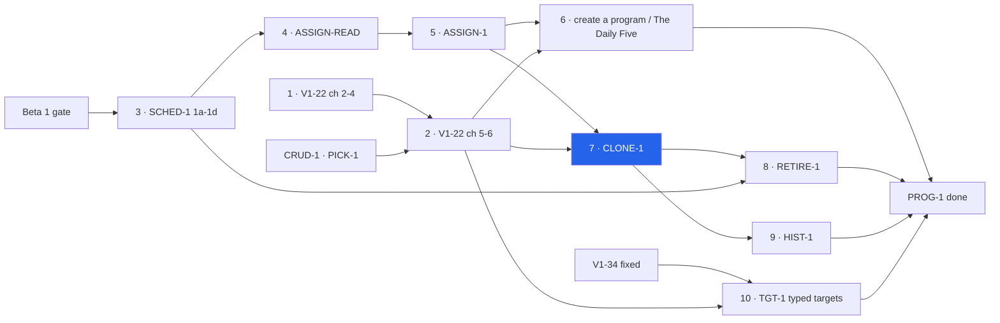

# CLONE-1 — save a program as a copy, and choose who moves to it

> Backlog: [plan.md](../plan.md#clone-1) row CLONE-1 · Spec:
> [crud-1-fix-it-yourself.md](../specs/crud-1-fix-it-yourself.md) chunk D5 · Milestone:
> [PROG-1](../milestones/prog-1-programs-and-scheduling.md) step 7 · Branch:
> `feat/clone-1-save-as-copy` (staged as four PRs, below).

## Goal

A parent who wants to **replace** a program for some athletes, not change it for everyone, can save the
editor's changes as a **copy** and tick who moves to it. The source stays exactly as it was. Every
athlete who moves gets a closed assignment on the source and an open one on the copy, written by
ASSIGN-1's assignment write. Nothing is deleted. So the old program, each entry's snapshotted
prescription and the assignment dates together say who ran which version, and when
([plan.md:1929-1941](../plan.md#clone-1)). The work comes now because RETIRE-1 and HIST-1 both wait on
it (spec `crud-1-fix-it-yourself.md:163-164`). It is also the only PROG-1 step that writes **new
copies of per-athlete targets**. That puts the "LLM never authors loads" rule in play on a write path
for the first time since the seed.

## Acceptance

**Verbatim from the backlog row** (`docs/plan.md:1929-1963`). The row has no single acceptance line, so
these are the decisions it states:

> Saving the copy asks which athletes move to it; the default is none. Moving one closes their current
> `program_assignments` row (`active_to`) and opens one on the copy (`active_from` = today). Nothing is
> deleted, so the old program, each entry's snapshotted prescription (ADR 0005 decision 5), and the
> assignment dates together say who ran which version, when.
>
> **Grain:** the clone is a **block** (`program_blocks` + its `prescriptions` + `prescription_targets`),
> because an assignment points at a block.
>
> **Gated on, in order:** 1. V1-22 chunks 2 and 3 … 2. SCHED-1's `program_assignments`, plus Today
> reading the athlete's **assignment** instead of `programDayRows`' newest block … 3. The V1-22 editor
> (chunks 4 and 6), which edits the copy rather than the original.

**Spec criteria this plan carries** (`crud-1-fix-it-yourself.md:321-329`, `:425-426`):

- **22.** When a parent saves program edits and anyone else is on the program, the system shall ask
  whether to change it for everyone on it or save it as a copy, naming who is on it.
- **23.** When a copy is saved, it shall carry every live prescription and per-athlete target of the
  source with identical values, and the source shall be unchanged.
- **24.** When a parent moves an athlete to the copy, the system shall behave as criterion 21 and shall
  not change any already-exported byte for that athlete. An athlete who was not on the source shall be
  told which program(s) they stay on, and that they have no loads on the copy yet.
- **25.** When a copy is saved with no athletes ticked, no assignment shall change.
- **45 (D5 half).** Undo after a copy shall reverse every assignment the copy wrote, including an
  athlete who was not on the source. Undo after "save for everyone" shall exist.

**Done when (observable):**

- One `program_blocks` row, plus one copy of each live `prescriptions` row and each live
  `prescription_targets` row (and of every child table that exists by then, such as TGT-1's), are
  written in **one transaction**. Each copy has the source's values byte-for-byte, except identity
  and timestamp columns and the parent's staged edits. A `db:verify` dump of the source subtree,
  `updated_at` included, is identical before and after.
- A `db:verify` **coverage guard** fails if any table or column referencing the cloned subtree is
  neither copied by the writer nor on an explicit, reasoned exclusion list. This guard is what catches
  TGT-1's typed-target table or `note` column if it lands after this.
- With **nobody ticked**, `program_assignments` and `program_assignment_weekdays` are byte-identical
  before and after (criterion 25). Every athlete's Today still resolves to the **source**, not to the
  copy, even though the copy is the newest block (the `id DESC LIMIT 1` hazard,
  `packages/db/src/queries/program-day.ts:84-85`).
- A replay of the same submit (same `clientId`) writes nothing new and returns the same result.
- For a mover whose workouts the parent did not edit, the workout due on each of the next 14 dates
  is the same before and after the move. The copy carries the source's rotation, and the move carries
  the athlete's phase.
- For each moved athlete, the export's `prescribed` column is the same before and after the move. The
  fixture covers a non-empty snapshot, a `''` snapshot and a NULL snapshot (criterion 24; the last is
  the case that can move, below).
- Undo restores every assignment the copy changed, as one event. It soft-deletes the copy's new
  assignments and reopens the closed ones. The copy itself is kept. A second Undo, or one made after
  any of those rows changed elsewhere, returns `AMEND_ERROR_COPY.staleWrite`
  (`apps/web/lib/constants.ts:540`) and writes nothing.

## Where this sits, and what it depends on



The chart is the milestone's (`docs/milestones/prog-1-programs-and-scheduling.md:50-71`), with this
step marked.

### What exists today, and what does not (measured on this branch)

| Thing CLONE-1 needs                                          | State                                                                                                                                                                                                                                                                                                                       |
| ------------------------------------------------------------ | --------------------------------------------------------------------------------------------------------------------------------------------------------------------------------------------------------------------------------------------------------------------------------------------------------------------------- |
| The three tables it copies                                   | ✅ `program_blocks` (`packages/db/src/schema.ts:785-806`), `prescriptions` (`:816-847`), `prescription_targets` (`:859-883`).                                                                                                                                                                                               |
| `entries.prescribed_snapshot`                                | ✅ the column (`schema.ts:218`, migration `0013`). ❌ **no writer**: `git grep prescribedSnapshot -- apps packages` finds only the schema and `db:verify`. V1-22 chunk 2 ([plan](./v1-22-2-renderer-and-writer.md)) is unmerged, so the export still reconstructs `prescribed` live (`apps/web/lib/dal/export.ts:113-132`). |
| `program_assignments` + weekday rows                         | ❌ not migrated (last migration `0018`). Shape is SCHED-1 1c's ([plan](./sched-1-scheduling-model.md) `:305-377`).                                                                                                                                                                                                          |
| ASSIGN-READ / ASSIGN-1 plan                                  | ❌ **`docs/plans/assign-1-assignments.md` does not exist** at the time of writing (`ls docs/plans`). The interface below is taken from the spec's D4b row (`:160`), criteria 21/29/44/45 and `assignmentSetSchema`/`AssignmentDTO` (`:473-505`).                                                                            |
| The program editor and its save                              | ❌ V1-22 chunks 4–6 are unbuilt (there is no `app/p/[profileId]/program/` route, `ls apps/web/app/p/[profileId]`).                                                                                                                                                                                                          |
| Block-creation idempotency (`client_id` on `program_blocks`) | ❌ `program_blocks` is "config data → NO client_id; idempotency = the partial-unique natural key `(household_id, slug)`" (`schema.ts:779-783`). Nothing creates a block from a request yet.                                                                                                                                 |
| A **per-block** rotation (anchor + ordered workouts)         | ❌ **Not data.** SCHED-1 1b makes the rotation `YDP_ROTATION`, a **const** in `packages/shared` (`sched-1-scheduling-model.md:219-234`), and 1c deliberately adds **no** rotation column (`:301-303`). See "Contradiction 1" below.                                                                                         |
| Workout labels                                               | ❌ `DAY_ROLES` is a closed list (`packages/shared/src/programming.ts:28`); D4c picks a label store (spec `:161`, FE-3).                                                                                                                                                                                                     |

### The interface this plan needs from ASSIGN-1 (D4b)

ASSIGN-1 has no plan yet, so this is what CLONE-1 assumes. **ASSIGN-1's plan must either provide it or
say how it differs.** If it differs, this section is the thing to reconcile.

```ts
// packages/db/src/writers/program-assignments.ts   (ASSIGN-1's; the name is an assumption)
type AssignmentChange =
  | { kind: 'move'; profileId: number; fromBlockId: number; toBlockId: number; weekdays: Weekday[]; phase: 'carry' }
  | { kind: 'put_on'; profileId: number; toBlockId: number; weekdays: Weekday[] };

applyAssignmentChanges(
  tx: Executor,              // CLONE-1 calls it INSIDE its own transaction, so the block and the moves are atomic
  scope: HouseholdScope,
  changes: AssignmentChange[],
  todayFor: (profileId: number) => string,   // the ATHLETE's declared day (criterion 21), never the device clock
): Promise<{ undo: AssignmentUndoToken }>;

undoAssignmentChanges(tx, scope, token): Promise<{ ok: true } | { ok: false; reason: 'stale' }>;
```

The requirements, each traced to a criterion:

1. **It takes a caller's transaction.** If it opens its own, a copy could commit with the moves
   failing, or the other way round. The copy and its moves are then two events, and criterion 45's
   "Undo reverses every assignment the copy wrote" has nothing whole to reverse.
2. **It handles a move on the day the source period opened.** Closing that period would write
   `active_to < active_from` and violate `program_assignments_active_range_check`
   (`sched-1-scheduling-model.md:335-338`). Criterion 21 covers this for a **change of days** only, so
   ASSIGN-1 must say what a **move** does in that case. It must not throw `23514`, and the Undo token
   must restore whatever it did.
3. **`phase: 'carry'`.** A move to a block whose rotation equals the source's keeps the athlete's next
   workout. This needs the period's stored `phase_offset` (spec `:502-505`, FE-2) and the copy's
   rotation (contradiction 1).
4. **The Undo token is a pre-image (FE-7, spec `:919`).** It lists the rows opened (to soft-delete) and
   the rows closed, each with the `active_to` it wrote. It is checked before any write, and a
   mismatch returns `stale`. Nothing in it hard-deletes (FE-8, `:920`).

### Contradictions and gaps found while planning (said, not silently resolved)

1. **The spec gates D5 on D1 + D4b + D2, but a copy has no rotation to carry until something makes
   the rotation per-block data.** Today the YDP's anchor and slot order are a const keyed to nothing
   in the database (`sched-1-scheduling-model.md:219-234`). A copy with a new slug would have **no
   rotation**, or would silently borrow the YDP's through whatever lookup ASSIGN-READ invents.
   Criterion 35 makes D4c (step 6) store an anchor for a **created** program, so D4c is the natural
   owner. **Recommendation: add step 6 (D4c) as a gate of step 7, or have ASSIGN-READ (step 4) move the
   rotation onto `program_blocks`.** Until one of those is decided, PR 2 below cannot be written. This
   is the plan's first open question.
2. **Criterion 23 against the approved prototype.** Criterion 23 says the copy carries the source's
   values "identical". The prototype saves the **staged edits** into the copy:
   `copy.days = staged` (`docs/prototypes/crud-1/index.html:5161-5167`), and the source keeps its old
   values. Both readings hold if the copy is written as **(source cloned verbatim) + (the parent's
   staged edits applied to the copy)**, in one transaction. That is this plan's design. Criterion 23's
   test is the empty-edit case, and a second test asserts that only the edited fields differ.
3. **Criterion 24's "no loads on the copy yet" is not always true.** A copy carries **every** live
   target of the source (criterion 23), including targets for athletes who are not assigned to it. An
   athlete can hold targets on a block they are not on: targets are keyed by profile
   (`schema.ts:879-881`), not by assignment. So the warning must be **computed** ("this athlete has
   no target on the copy, and the copy has targets for someone"), never asserted for every newcomer.
   The prototype's own condition is wrong the same way. It warns if any prescription has any load for
   anyone (`index.html:3600-3606`).
4. **The prototype opens the save dialog on every save of an existing program** (`index.html:4675-4677`),
   not only "when anyone else is on the program" (criterion 22). The dialog is the **only** way into
   "save as a copy", so this plan follows the prototype. Criterion 22 is a "shall ask when". It does not
   say "shall not ask otherwise".
5. **`programCloneSchema` has no idempotency key and no edits** (`crud-1-fix-it-yourself.md:491`).
   AGENTS.md backend rule 6 requires the first, and contradiction 2 requires the second. This plan
   amends the contract (below). The spec's line should follow when this plan is accepted.
6. **SCHED-1 1e leaves `programDayRows` and the export on "newest block wins", on purpose**
   (`sched-1-scheduling-model.md:119-143`, `:450-451`). If ASSIGN-READ (step 4) also leaves the
   export's **fallback** there, then any entry still holding a NULL snapshot changes its exported
   `prescribed` column the moment a copy is **created**, even with nobody moved. The copy is the newest
   block for every day role it holds (`program-day.ts:84-85`). Criterion 24 then fails for **every**
   athlete, not only movers. This plan cannot fix that (the export is D4's and Insight's). It adds the
   test that fails if it is still true, and the risk row says what to do.

## The design

### What "save as a copy" writes, in one transaction

```
saveProgramCopy(tx, scope, { clientId, sourceBlockPublicId, expectedVersion, name, edits, movers })
  1. SELECT … FROM program_blocks WHERE public_id = $source AND household_id = scope AND deleted_at IS NULL
       FOR UPDATE                                  ← V1-22 acceptance 15's lock, reused (not a new one)
     miss → { ok:false, reason:'not_found' }       ← 404 semantics: foreign and unknown look the same
  2. version guard: expectedVersion ≠ D2's version token for the block → { ok:false, reason:'stale' }
  3. INSERT program_blocks (public_id, household_id, client_id, slug, name, notes, <rotation cols>)
       ON CONFLICT (household_id, client_id) WHERE client_id IS NOT NULL DO NOTHING RETURNING id
     no row → replay: SELECT the existing copy by (household_id, client_id); return its stored result,
              and write nothing else  (step 3 is the first write, so a replay stops before any other)
     23505 on uq_program_blocks_household_slug → { ok:false, fieldErrors:{ name } }
  4. read live prescriptions of the source (deleted_at IS NULL), ordered (day_role, idx)
     INSERT copies with new public_ids; RETURNING (id, day_role, idx) → map oldId → newId
  5. read live prescription_targets of those prescriptions whose PROFILE is live and in scope
     (the writer-enforced invariant, schema.ts:851-858) → INSERT copies remapped through the map
  6. every further child table that exists by then (TGT-1's typed targets) — same remap
  7. apply `edits` to the COPY through D2's edit writer, with source public ids retargeted by
     the pure `retargetEdits(edits, idMap)` (unit-tested), under the same lock
  8. movers → applyAssignmentChanges(tx, scope, changes, todayFor)   (ASSIGN-1; may be empty)
  9. return { ok:true, copy:{ publicId, name }, moved:[…], undo }
```

**Values are copied column-to-column with no expression.** There is no `coalesce`, no trim, no
rounding and no default fill. The writer selects each source column and inserts it unchanged. That is
how "a human-authored target, copied verbatim" (spec `:905`;
`schema.ts:852`, "HUMAN-AUTHORED — the LLM never authors loads") holds by construction. A newcomer gets
**no** invented target (U17, spec `:993`). The UI warns instead.

**Why read-then-insert rather than `INSERT … SELECT`.** Public ids are UUIDv7 generated in TypeScript
(`newId()`, `packages/shared/src/id.ts:9`). Postgres has no v7 generator in the versions this repo
runs (unverified for Neon's exact version; PGlite certainly has none). The volume is small: at most
3 workouts × `MAX_SESSION_MOVEMENTS` (12, `packages/shared/src/strength-session.ts:30`) × the athletes
with targets.

**The copy's slug** is `movementSlug(name)` (`packages/shared/src/movements.ts:34`), which the
block docblock names as the block-slug rule (`schema.ts:783`). So "Program (Copy)" and "program (copy)"
collide, which is intended. The **default name** is computed server-side when the dialog opens:
`"{source} (copy)"`, then `"(copy 2)"`, `"(copy 3)"` and so on until a live slug is free. The submit
still treats a collision as a field error, because two parents can race. A name whose slug is any
`PROGRAM_SEED` block's slug is also refused. Otherwise a later re-seed (`seed.ts:418-440` re-resolves
the block **by slug**) could attach seeded prescriptions to a parent's copy after the seeded block
was ever hidden.

### Movers

Only **live, non-archived athletes in the session's household** are offered and accepted (A2's
marker. If A2 has not landed, "live" means `deleted_at IS NULL`).

| Ticked athlete is…                           | Change sent to ASSIGN-1                                         | Copy shown in the row (prototype `index.html:3615-3620`) |
| -------------------------------------------- | --------------------------------------------------------------- | -------------------------------------------------------- |
| on the source (an open assignment)           | `move`, **their own weekdays**, `phase: 'carry'`                | "Stops {source} today, starts the copy."                 |
| not on the source                            | `put_on`, **every weekday** (`WEEKDAYS`, never a re-typed list) | "Starts the copy today[ and stays on {programs}]."       |
| not on the source, and no target on the copy | as above, plus the computed warning (contradiction 3)           | "No loads set for {name} yet — add them after saving."   |

A mover's other assignments are never touched. Criterion 44's rule ("no choice … shall close or
rewrite any other assignment") applies here too.

### Undo

- **After a copy with movers:** one Undo reverses exactly the `AssignmentUndoToken` from step 8, in
  one transaction. Copy movers are soft-deleted (`deleted_at`, which frees both partial arbiters,
  `sched-1-scheduling-model.md:325-334`), and the source periods are reopened (`active_to = NULL`).
  **The copy is kept**, with nobody on it. That is the prototype's "Undone. Everyone is back where
  they were; {copy} is kept" (`index.html:4962-4977`), and it keeps the parent's staged edits.
- **After a copy with nobody ticked:** no Undo, as in the prototype (`index.html:5210`). The copy stays
  until RETIRE-1 can archive it (risk below).
- **After "change it for everyone":** this path is **D2's editor save**, and FE-7 gives D2 the
  pre-image Undo token (spec `:919`). CLONE-1's PR 4 wires the dialog's "for everyone" branch to it and
  carries criterion 45's test. **If D2 ships without an Undo, this plan does not build a second
  edit-undo.** It stops and escalates, because two edit-undo mechanisms for one editor is the
  duplication the FE-7 row exists to prevent.

### The contract amendment

```
packages/shared/src/programming.ts   (beside programEditSchema, V1-22's contract)
  programCloneSchema {
    clientId:            uuidSchema                         ← NEW: AGENTS.md rule 6 (contradiction 5)
    sourceBlockPublicId: uuidSchema
    expectedVersion:     <D2's version-token schema>        ← NEW: FE-7's guard, reused not re-typed
    name:                string, trimmed, 1..PROGRAM_NAME_MAX  ← PROGRAM_NAME_MAX: D4c's const if it
                                                               landed; else defined here ONCE
    edits:               programEditSchema (may be empty)   ← NEW: contradiction 2
    moveProfilePublicIds: uuidSchema[] (unique, max = household profile cap; default [])
  }
  programCloneUndoSchema { token: <ASSIGN-1's AssignmentUndoToken schema> }

apps/web/lib/programming
  ProgramCopyResultDTO { copy: { publicId, name }, moved: Array<{ profilePublicId, name, kind: 'moved'|'started' }>,
                         undo: AssignmentUndoToken | null }
  SaveDialogDTO        { onSource: Array<{ profilePublicId, name }>,
                         candidates: Array<{ profilePublicId, name, onSource: boolean,
                                             staysOn: string[], noTargetOnCopy: boolean }>,
                         defaultCopyName: string }
```

No load, target or rendered prescription is in either DTO. The dialog needs names and booleans, not
values.

## Staging

| PR    | Branch                        | What                                                                                                                                                                                                                                                                                                    | ~Lines | Gate                                                                                                                                                                                                         |
| ----- | ----------------------------- | ------------------------------------------------------------------------------------------------------------------------------------------------------------------------------------------------------------------------------------------------------------------------------------------------------- | ------ | ------------------------------------------------------------------------------------------------------------------------------------------------------------------------------------------------------------ |
| **1** | `db/clone-1a-block-client-id` | **Only if D4c has not already landed it:** migration adding nullable `program_blocks.client_id uuid` + `uq_program_blocks_household_client_id ON (household_id, client_id) WHERE client_id IS NOT NULL`. Dark: nothing reads it. `db:verify`: the index rejects a duplicate pair and admits many NULLs. | ~80    | ASSIGN-1 merged. **Observed applied** in prod (the migrate log) before PR 2 merges, per V1-22's A6 lesson (a column named by code against an un-migrated DB throws).                                         |
| **2** | `feat/clone-1b-clone-writer`  | `packages/db/src/writers/program-clone.ts` (steps 1–8 above) + `retargetEdits` + the `db:verify` proofs (Test plan). No app caller.                                                                                                                                                                     | ~380   | PR 1 applied · **contradiction 1 resolved** · V1-22 chunk 3's `--apply` recorded in the corrections **Applied** table (the same gate V1-22 puts on chunk 4) · D2 merged (its edit writer and version token). |
| **3** | `feat/clone-1c-actions`       | Shared schemas, the DAL (`saveProgramCopy`, `undoProgramCopy`, `getSaveDialog`), the two Server Actions, `MUTATING_ACTIONS` entries, and the boundary tests.                                                                                                                                            | ~350   | PR 2.                                                                                                                                                                                                        |
| **4** | `feat/clone-1d-save-dialog`   | The save dialog in D2's editor (on U0's `components/ui/sheet.tsx`), the success line and Undo, and the a11y-scan state.                                                                                                                                                                                 | ~300   | PR 3 · **UX panel reconciled** · U0 merged.                                                                                                                                                                  |

One migration in PR 1, alone, so a DB PR never shares review with a UI PR (spec `:147`). PR 2 is
backend-only and exercised only by `db:verify` for one PR. That is accepted: the alternative
(writer + actions, ~730 lines) breaks the 400-line target.

## File-by-file changes

| Path                                                                                                           | PR   | Change | What & why                                                                                                                                                                                                                                                                                                                                                                                                                                                                                                                                                                 |
| -------------------------------------------------------------------------------------------------------------- | ---- | ------ | -------------------------------------------------------------------------------------------------------------------------------------------------------------------------------------------------------------------------------------------------------------------------------------------------------------------------------------------------------------------------------------------------------------------------------------------------------------------------------------------------------------------------------------------------------------------------- |
| `packages/db/src/schema.ts`                                                                                    | 1    | EDIT   | `programBlocks.clientId: uuid('client_id')` (nullable) + the partial unique index. The docblock's "NO client_id" sentence (`:779-783`) is amended. Seeded blocks keep NULL; request-created blocks (CLONE-1, D4c) carry one. **Nullable, against AGENTS.md's "client_id NOT NULL":** NOT NULL would need a backfill of an id that never existed for seeded config rows.                                                                                                                                                                                                    |
| `packages/db/migrations/00NN_clone1_block_client_id.sql`                                                       | 1    | NEW    | `drizzle-kit generate`, then hardened per the `db-migration` skill: `SET lock_timeout`/`statement_timeout`, `IF NOT EXISTS`, and the index built the way Squawk accepts in this repo (concurrent in its own file, or a justified `-- squawk-ignore` on a table of ~1 row. The skill decides; unverified which form `0015` used). **The predicate omits `deleted_at`, on purpose.** A replay must never resolve past a hidden block and create a second one. That is the freed-`client_id` hazard ADR 0008 decision 3 names, avoided by construction rather than inherited. |
| `packages/db/scripts/verify.ts`                                                                                | 1, 2 | EDIT   | PR 1: the index proofs. PR 2: the proofs in the Test plan.                                                                                                                                                                                                                                                                                                                                                                                                                                                                                                                 |
| `packages/db/src/writers/program-clone.ts`                                                                     | 2    | NEW    | `saveProgramCopy(exec, scope, args)` as designed above. It takes `HouseholdScope` as a required parameter (write-path invariant: the scope is explicit below `lib/dal`). The `program_blocks … FOR UPDATE` lock and `SET LOCAL lock_timeout` map a timeout to a typed `busy` (V1-22 acceptance 15). The copied-column lists are exported consts, so the coverage guard reads the same list the writer uses.                                                                                                                                                                |
| `packages/db/src/writers/program-clone.test.ts`                                                                | 2    | NEW    | Pure unit tests for `retargetEdits` and default-name generation.                                                                                                                                                                                                                                                                                                                                                                                                                                                                                                           |
| `packages/db/src/index.ts`                                                                                     | 2    | EDIT   | Export the writer (unverified file name for the barrel; follow `writers/strength-session.ts`'s export path).                                                                                                                                                                                                                                                                                                                                                                                                                                                               |
| `packages/shared/src/programming.ts`                                                                           | 3    | EDIT   | `programCloneSchema`, `programCloneUndoSchema`, `PROGRAM_NAME_MAX` (only if D4c has not defined it). **Owned by `programming.md`.**                                                                                                                                                                                                                                                                                                                                                                                                                                        |
| `apps/web/lib/dal/program-clone.ts`                                                                            | 3    | NEW    | `import 'server-only'`. `getHouseholdScope()` (`apps/web/lib/dal/household.ts:68`), with null meaning not found. Resolves mover public ids to ids **inside the scope** (`isLiveProfile`, `packages/db/src/writers/ownership.ts:118`), and any miss refuses the whole request. Computes each athlete's "today" the way ASSIGN-1 does. Returns DTOs only. `getSaveDialog(blockPublicId)` builds `SaveDialogDTO`.                                                                                                                                                             |
| `apps/web/lib/dal/program-clone.test.ts`                                                                       | 3    | NEW    | Emitted-SQL proofs on the recording harness (`apps/web/lib/dal/recording-db.ts`): the household conjunct on the source read and on the mover resolve.                                                                                                                                                                                                                                                                                                                                                                                                                      |
| `<D2's editor route>/actions.ts` (expected `apps/web/app/p/[profileId]/program/actions.ts`)                    | 3    | EDIT   | `saveProgramCopyAction`, `undoProgramCopyAction`. Each is wrapped in `Sentry.withServerActionInstrumentation`, zod-parses first, then calls `requireSession()` (AUTH-1 1c's), the mutation limiter, the DAL and `revalidatePath` for the editor, every mover's day page and the household program list. They return the `ActionState` envelope. Expected errors are typed: `not_found`, `stale` → `AMEND_ERROR_COPY.staleWrite`, `name_taken` → `fieldErrors.name`, and `busy`.                                                                                            |
| `<that route>/mutating-actions.ts` (or the shared one, `apps/web/app/p/[profileId]/mutating-actions.ts:25-33`) | 3    | EDIT   | The two names, so the unauth and wrong-household suites cover them by construction (AUTH-1 1b-bis).                                                                                                                                                                                                                                                                                                                                                                                                                                                                        |
| `<that route>/actions.test.ts`                                                                                 | 3    | EDIT   | The boundary tests (Test plan).                                                                                                                                                                                                                                                                                                                                                                                                                                                                                                                                            |
| `<D2's editor component>`                                                                                      | 4    | EDIT   | Save opens the dialog for an existing program. A created program (`fresh`) saves directly, as in the prototype (`index.html:4677`).                                                                                                                                                                                                                                                                                                                                                                                                                                        |
| `apps/web/components/program/save-program-dialog.tsx`                                                          | 4    | NEW    | The dialog (UI section below). A client island, because it holds the radio and checkbox state.                                                                                                                                                                                                                                                                                                                                                                                                                                                                             |
| `apps/web/components/program/save-program-dialog.test.tsx`                                                     | 4    | NEW    | Renders, focus, the computed warning, the hidden-until-copy fields, the error placement.                                                                                                                                                                                                                                                                                                                                                                                                                                                                                   |
| `docs/features/programming.md`                                                                                 | 3, 4 | EDIT   | **Required by `guides:check`.** A new invariant: "a block is created only with an assignment-aware Today (D4); the newest-block trap (`:235-237`) is closed for Today, and here is what still reads newest-block" (contradiction 6). The clone's verbatim rule. `owns:` gains the dialog folder if D2 did not already claim it.                                                                                                                                                                                                                                            |
| `docs/features/write-path.md`                                                                                  | 2, 3 | EDIT   | **Required by `guides:check`** (it owns `packages/db/src/writers/` and `apps/web/lib/dal/`). The writer's one-transaction rule, the `client_id` arbiter without `deleted_at`, and that ASSIGN-1's write is called inside it.                                                                                                                                                                                                                                                                                                                                               |
| `docs/privacy/data-inventory.md`                                                                               | 1, 2 | EDIT   | PR 1: the `program_blocks` row (`:128`) gains `client_id` (an opaque id, not personal data). PR 2: the `prescription_targets` row (`:130`, "a per-minor prescribed load") says a copy **duplicates** these rows within the same household. They are deleted by the same procedure, because `runbooks.md:845-847` deletes targets by profile **or** by any prescription in the household's blocks. That is no new category, no new processor and no new retention, but more copies of a minor's loads, which the inventory should say.                                      |

### The UI (PR 4) — the prototype's "Save changes to {program}" sheet

It implements `docs/prototypes/crud-1/index.html:3565-3627` (`openSaveProg`) and its submit handler at
`:5154-5211`.

- **Semantic shape.** `<form>` inside U0's sheet. `<h2>` "Save changes to {program}". One `<fieldset>`
  holds two `<input type="radio">` options, each wrapped by its `<label>` (the whole card is the
  target). Under "Save as a copy" are a labelled text `<input>` (name, `maxLength` =
  `PROGRAM_NAME_MAX`) and a second `<fieldset>` whose `<legend>` is "Who moves to the copy? Nobody
  moves unless you tick them." That fieldset holds one `<label>`-wrapped checkbox per athlete. Then
  Cancel (`type="button"`) and Save (`type="submit"`) sit in the pinned footer. The copy fields are
  `hidden` until "Save as a copy" is chosen. **Hidden, not just collapsed**, so a `required` field
  cannot deadlock the submit (the trap `programming.md:90-92` records for the form's cards).
- **Errors** sit beside their field with `aria-describedby`, and focus moves to the first invalid
  field (A11Y-2, spec `:925`). The name collision lands on the name input. A `stale` result
  revalidates first and shows `staleWrite` (V1-22 acceptance 14's pattern).
- **Live region.** The success line ("{copy} saved. {names} moved to it from today." or "Nobody
  moved.") and Undo render on the **page** after the sheet closes, announced through the page's
  existing mounted region (the `saved-announcer.tsx` idiom). Nothing in the sheet changes text as the
  person edits, so criterion 46's in-sheet region is not needed here. Focus goes to Undo when it
  exists, otherwise to the `<h1>` (prototype `index.html:5210-5212`).
- **Width math at 360px.** Below 600px the sheet is full-screen (criterion 37). Content width is
  360 − 2 × 16 = **328px**. A radio card is 12px padding + 20px control + 12px gap + text + 12px
  padding, which leaves **272px** of text. "Change it for everyone on it" (28 chars at 16px semibold,
  ≈ 8.5px each ≈ 238px) fits on one line. A checkbox row has the same arithmetic, so 272px of text.
  "Starts the copy today and stays on Youth Daily Program." (56 chars at 14px, ≈ 7px each ≈ 392px)
  wraps to **two** lines. With the name line, the row is ≈ 3 × 20px + 24px padding = 84px, above
  44px. The footer is Cancel (≈ 88px) + 8px + Save (≈ 72px) = 168px of 328px. At 200% zoom (≈ 164px
  of usable width) the footer wraps (A11Y-8, spec `:926`). The name input is the full 328px × 44px.
  Every target is ≥ 44px tall because the **label** is the target, not the 20px control.
- **Copy rules.** "Workout", never "Day A" (criterion 42). The original's name and every program an
  athlete "stays on" come from `SaveDialogDTO`, never re-derived in the component.
- **a11y scan.** The open-dialog state joins `apps/web/e2e/a11y.spec.ts` in the same PR (unowned 8,
  spec `:690-694`). That file is off-limits to **this** branch, not to PR 4's.

## Test plan

**`db:verify` (PR 2) — PGlite, `pnpm --filter @mat-plan/db db:verify`; in `pnpm verify` and CI's
`quality` job:**

1. **Verbatim (criterion 23).** Use a fixture block with two workouts, a duplicated `(day_role,
movement)` (a warm-up and a working set), open (`sets` NULL) and verbatim (`AMRAP`,
   `~145-150`) prescriptions, and targets for three athletes, one of them with `load` NULL and `reps`
   set. Clone it with empty `edits` and nobody ticked. Assert every copied column is equal and every
   identity column differs. **Assert a non-empty load and a non-empty `target_reps` exist in the
   fixture before asserting equality**, V1-22 acceptance 8's lesson (an equality test over
   empty values passes with no copy at all).
2. **Source unchanged.** A full dump of the source subtree, `updated_at` included, is identical
   before and after, both with and without edits.
3. **Edits land on the copy only.** One `sets` change and one target change: the copy differs in
   exactly those two fields, and the source in none.
4. **Live rows only.** A soft-deleted prescription and a soft-deleted target in the source are **not**
   copied. A target whose profile is in another household (inserted directly, the straddle
   `runbooks.md:862-863` hunts) is **not** copied. That is the writer-enforced invariant
   (`schema.ts:851-858`), proved rather than assumed.
5. **The coverage guard.** Read `pg_constraint` for every FK referencing `program_blocks`,
   `prescriptions` or `prescription_targets`, and `information_schema.columns` for those tables.
   Assert each one is in the writer's exported copy lists, or in an exclusion list where each entry
   has its reason: `program_assignments` (moves are explicit), `program_assignment_weekdays`,
   identity and timestamp columns, `client_id`, `slug`, `name`. **Mutation check:** add a column in a
   `scripts/mutations/` patch, and `db:mutations` must turn the guard red.
6. **Nobody ticked (criterion 25).** `program_assignments` and the weekday rows are byte-identical.
   **And the newest-block trap:** D4's Today read for every athlete returns the **source** after the
   copy exists, even though the copy has the higher id (`program-day.ts:84-85`).
7. **Export bytes (criterion 24, contradiction 6).** For a moved athlete with three strength entries
   (snapshot `'3x5 @ 65'`, snapshot `''`, snapshot NULL), the rendered `prescribed` value from the
   exact read D4's export uses is identical before the copy, after the copy and after the move. **This
   test is expected to fail if D4 left the export's fallback on newest-block.** It is not weakened to
   pass. The risk row says what to do.
8. **Moves (criterion 24 → 21).** A mover's source period is closed the day before their "today" and
   a copy period opens on it with **their** weekdays. A newcomer gets seven weekday rows. The
   next-14-dates workout sequence is unchanged for the mover.
9. **Idempotency.** The same `clientId` twice gives one block, one set of copies, one set of
   assignment changes and the same returned `publicId`. A different `clientId` with the same name
   gives `name_taken` and writes nothing.
10. **Atomicity by construction.** If a mover fails (a profile made to straddle a household, or a
    forced `23514`), **no** block, prescription, target or assignment row remains. That proves the
    single transaction.
11. **Undo.** It restores exactly the pre-image, newcomers included (criterion 45). A second Undo
    returns `stale`. Undo after one moved period was changed by another write returns `stale` and
    writes nothing.

**Unit (Vitest, `pnpm test`):** `retargetEdits` maps every source id and refuses an unknown one.
Default-name generation (`(copy)`, `(copy 2)`, the `PROGRAM_SEED` slug refusal). The dialog's
computed warning (contradiction 3), true and false cases.

**Boundary tests (PR 3, `actions.test.ts`, mandatory per AGENTS.md):** unauth → reject.
Wrong-household source block → 404 semantics, nothing written. A wrong-household **mover** in an
otherwise valid request → the same, and nothing written, block included. Bad body (non-uuid,
blank name, name over the max, duplicate mover ids) → zod field errors. Replay → one effect and an
identical response. Undo with a forged token naming another household's assignment → 404 semantics.

**e2e:** none added. The flow's proofs are `db:verify` plus the a11y scan state. `pnpm e2e:local`
runs before PR 4 because it touches the editor the smoke may cover (unverified until D2 lands).

**Screenshots (PR 4):** `screenshot:ephemeral` at mobile, tablet and desktop: the dialog with "for
everyone" chosen, the dialog with "as a copy" chosen and a newcomer warning, and the success line
with Undo.

## Risks / rollback

| Risk                                                                                                         | Mitigation                                                                                                                                                                                                                                                                                                                                               |
| ------------------------------------------------------------------------------------------------------------ | -------------------------------------------------------------------------------------------------------------------------------------------------------------------------------------------------------------------------------------------------------------------------------------------------------------------------------------------------------- |
| **A copy hijacks Today for everyone** (newest block per day role, `programming.md:99-105`, `:235-237`)       | Gate 2 (D4) is a hard gate, and `db:verify` case 6 proves Today still reads the source after a copy with nobody moved.                                                                                                                                                                                                                                   |
| **A copy rewrites past `prescribed` cells** for NULL-snapshot rows, even with nobody moved (contradiction 6) | Gate 1 (V1-22 ch 2 + ch 3 `--apply` recorded) shrinks NULL rows to those the writer cannot snapshot. Case 7 fails if the export still reads newest-block. **If it fails, CLONE-1 does not merge.** D4's plan changes the export's fallback to the assignment open on the entry's date, with Insight's sign-off, rather than CLONE-1 patching the export. |
| **"LLM never authors loads"** — a copy is a new place targets are written                                    | Copied column-to-column, no expression (verbatim test, case 1). No model anywhere in the path. A newcomer gets **no** target, only a warning. The UI says "saved as a copy of {source}" in the success line.                                                                                                                                             |
| A copy silently misses a child table that lands later (TGT-1's typed targets, a `note` column)               | The coverage guard (case 5) and its mutation test. TGT-1 can run **before** step 7 (milestone `:87`), so the guard is likely to bite on day one, which is its job.                                                                                                                                                                                       |
| A copy has no rotation, or borrows the YDP's const                                                           | Contradiction 1: PR 2 does not start until the rotation is per-block data.                                                                                                                                                                                                                                                                               |
| Two parents copy at once, or one edits while another copies                                                  | `FOR UPDATE` on the source + the version guard → `staleWrite`, revalidated. Name races → `uq_program_blocks_household_slug` → a field error, never a `23505`.                                                                                                                                                                                            |
| A replay after the copy was hidden creates a second one                                                      | The `client_id` index has no `deleted_at` predicate (PR 1).                                                                                                                                                                                                                                                                                              |
| Accidental copies pile up with no way to remove them until RETIRE-1                                          | Accepted. RETIRE-1 is the next step and is gated on this one (spec `:163`). A copy with nobody on it reads nothing on Today. Not mitigated by a hide: FE-8's soft-hide is D4c's Undo, and hiding a copy holding staged edits loses work.                                                                                                                 |
| AUTH-1 1c changes the principal under the action                                                             | See below.                                                                                                                                                                                                                                                                                                                                               |

**AUTH-1.** 1a, 1b-bis and 1c-pre have shipped; 1b, 1c and 1d have not. D5 sits behind Beta 1's gate
(via D3), so 1c, the one-way door, will have landed first. **When PR 3 is written, re-verify against
`docs/plans/auth-1-clerk-google.md`'s 1c row (`:549`):** that `requireSession()` is the entry-point
pattern and is called inside both new actions; that `getHouseholdScope()`'s new body (session →
`household_members`) is what both resolve through (`household.ts:62-66` says only its body moves);
that the mutation limiter keyed on the Clerk user id wraps both; that `MUTATING_ACTIONS` and
`pages-are-gated.test.ts` include them; and **what role check, if any, AUTH-1 added to the editor**
(V1-22: "AUTH-1 adds a role check rather than moving the route"). Moving another athlete must take
the same check.

**Rollback.** PR 1 is additive and dark, so revert by omission. PRs 2–3 add a writer and actions with
no reader outside themselves, so revert the PR. Copies already written stay valid blocks, and their
assignments are ordinary ASSIGN-1 rows. PR 4 is a UI revert. Fix forward is the default, and there
is no destructive step, so no Neon restore branch is needed.

## Out of scope / deferred

- **A version-compare or version-history screen** (`plan.md:1959-1960`). HIST-1 shows the periods.
- **`cloned_from` / a lineage column.** The row leaves it to this plan (`plan.md:1960-1961`).
  **Rejected for now:** no screen in PROG-1 reads it. The success line states the copy relation at
  the moment it matters. HIST-1 attributes by snapshot and assignment (FE-9, spec `:921`), and ADR 0005
  keeps versioning additive "whenever it earns a screen". Adding it later is one nullable FK.
- **Cloning a single workout** — the `workouts` arc, ADR 0007, not authorized (`plan.md:1950-1952`).
- **A new CSV column naming the program or version.** See the open question.
- **Choosing a newcomer's days in the dialog.** They start on every day, and "Change days" (ASSIGN-1)
  is one tap from their program page.
- **Archiving the source after a full move.** That is RETIRE-1.
- **Household-wide replacement**, rejected by the row (`plan.md:1943-1947`).

## Alternatives considered and rejected

| Alternative                                                                                        | Why rejected                                                                                                                     |
| -------------------------------------------------------------------------------------------------- | -------------------------------------------------------------------------------------------------------------------------------- |
| Idempotency by the `(household_id, slug)` natural key, with no new column                          | Cannot tell a replay from a deliberate second copy with the same name, and a replay of a renamed submit makes a second copy.     |
| A general idempotency-ledger table                                                                 | A second mechanism the write path does not have, for two callers (D4c and D5). The column is the repo's existing idiom.          |
| `INSERT … SELECT` for the copy                                                                     | No UUIDv7 in SQL. A `gen_random_uuid()` v4 public id breaks the "UUIDv7 public ids" convention.                                  |
| Clone verbatim, then make the parent edit the copy (two steps)                                     | The approved prototype stages edits first, and U15 removed exactly this two-step flow (spec `:991`).                             |
| The copy takes the save day as its rotation anchor (criterion 35's rule for a **created** program) | A mover would restart at the first workout and could run one twice in a row. A copy continues its source.                        |
| The clone writer opens its own transaction and calls ASSIGN-1's after it                           | The block and the moves become two events, a failed move leaves an orphan copy, and Undo cannot reverse "the copy" as one thing. |
| Undo also hides the copy                                                                           | It loses the staged edits, and the prototype keeps the copy (`index.html:4975-4977`). The panel may revisit this.                |

## Open questions

1. **Contradiction 1 — where does a block's rotation live before step 7?** Recommendation: make D4c
   (step 6) a gate of step 7, since criterion 35 already makes D4c store an anchor. The alternative is
   ASSIGN-READ moving it onto `program_blocks`. _For the maintainer, at the milestone's gate run._
2. **The CSV "who ran which version" question** (`plan.md:1953-1955`, milestone `:46`).
   **Recommendation: no CSV change in CLONE-1.** The export is byte-faithful to an existing workflow
   (AGENTS.md → What this is). A new column changes every file's header. The `prescribed` column,
   snapshotted at log time, already records what was asked. "Which version" is answered by the
   database (assignment periods + blocks) and shown by HIST-1. If the consuming workflow wants a
   program column, that is a CSV contract change owned by **Insight**, filed as its own row with a
   `BREAKING CHANGE` footer. **Escalated:** this needs the maintainer's yes as Insight's owner. It
   cannot be settled by this plan.
3. **D4's export fallback** (contradiction 6). Does ASSIGN-READ read the assignment open **on the
   entry's date** for the NULL-snapshot fallback? Test case 7 assumes yes. If D4 decides otherwise,
   this plan needs a precondition instead: a measured zero count of NULL-snapshot strength entries
   with a `day_role`, recorded like a correction's `--apply`.
4. **D2's version token and edit-undo.** This plan reuses both (FE-7). If either is missing when PR 2
   starts, escalate. Do not build a second one.
5. **Who may move another athlete after AUTH-1** (re-verify list above).

## Review-response log

_Pending: engineering panel + UX panel (round 1)._
