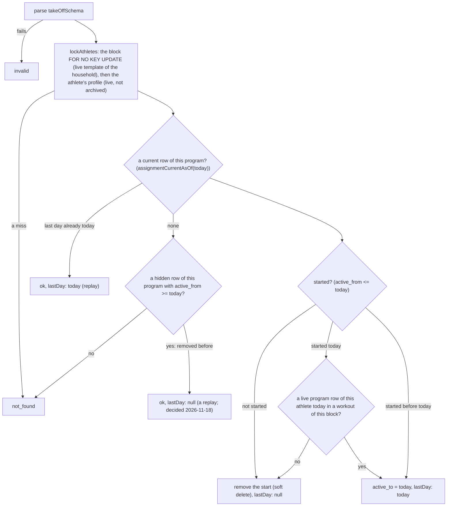

# FAM-1 6d-i: Take off

Lane P's step **6d-i**, the first half of row 6d ([fam-1-family-program.md](./fam-1-family-program.md)
§5, Lane P), split under the maintainer's overnight delegation (2026-11-18). One writer,
`takeOff`, in `packages/db/src/writers/program/take-off.ts`. Nothing in the app calls it until
step 15, which waits for it.

- **Gates:** 6c-i (#588, merged). Nothing open.
- **Not here:** 6d-ii (`reorderPrograms`, gated on #601) and the new-assignment placement (its own
  PR after the maintainer's call; ADR 0007 A2 §7 vs `putOn`'s append).
- Roadmap alignment (2026-11-18): advances FAM-1 lane P; gates step 15; touches no `ID-1` item (an
  athlete's own assignment, inside their household).

## How Take off answers

The contract: `takeOffSchema` and `ProgramActions.takeOff` (`packages/shared/src/program/`), ADR 0007
Amendment 4, contract invariants 21 and 31, and the 2026-11-18 replay decision.

1. **Parse** `takeOffSchema`; otherwise `invalid`. `today` is an ISO day the caller passes (a
   caller's bug otherwise, thrown).
2. **Lock** through one helper, `lockAthletes(tx, scope, profilePublicIds)` in `assign.ts`, that
   `putOn` also uses (the profile lock in id order, live, **not archived**, `inHousehold`). The
   block first, as every program writer does (lane guide invariant 12). An archived athlete is
   `not_found`, and their assignment is not ended (invariant 31).
3. **The current row** of this athlete and program: `assignmentCurrentAsOf(today)`, the shared
   predicate, never re-typed.
   - **None**: if a hidden row of this (profile, program) has `active_from >= today`, a Take off
     already removed it: `{ ok: true, lastDay: null }`, writing nothing (decided 2026-11-18). Otherwise
     `not_found`: never on it, a start removed in the past, or another household's.
   - **Its last day is already today**: `{ ok: true, lastDay: today }`, writing nothing.
4. **Which answer:**
   - **Not started** (`active_from > today`): the start is removed (soft delete), `lastDay: null`.
   - **Started today, nothing logged under it**: removed too, `lastDay: null`. "Logged" is lane E's
     `programRowOf(profileId, today)` (a live program entry of this athlete today) on a live session
     whose workout is one of this block's workouts, live or removed. An entry ticked and un-ticked
     is hidden, so it does not count.
   - **Otherwise**: `active_to = today`, `lastDay: today`.
5. **Never hides the weekday rows** (lane guide invariant 19: a reopen trusts them live), and never
   moves the athlete's other programs. A closed row leaves the order index, and the band closes the
   gap at the next `putOn`.

**An accepted limit, written on the function and in the guide (beside invariant 16):** "nothing
logged" is read without a lock against the row writers, and two paths leave a logged row today under
a start Take off removed:

- **a race:** `logRow` checks the assignment with a plain read (`isOnProgramThatDay`), so a ✓
  passing that check before Take off commits writes its entry after the removal;
- **no race needed:** `retickRow` and lane S's Restore all bring a hidden entry back with no
  assignment check (C24). A tick, an un-tick, a Take off (`lastDay: null`), then a re-tick does it
  every time.

Both leave contract change C24's state: a logged workout on a day no live assignment covers, which
the day page shows as a workout that left the week (lane E's proof, `verify/day-plan.ts`). The
export reads entries, so it is unaffected. Closing it would need lane E's writers to lock the
assignment, and re-tick and Restore all would still get through, so it is accepted. A proof pins the
re-tick sequence. ⚠️ "Logged" follows the session's `workout_id`: a workout purged under ADR 0008
has it set to NULL, so its rows stop counting.

## Files

- N `packages/db/src/writers/program/take-off.ts`: `takeOff`.
- E `packages/db/src/writers/program/assign.ts`: `lockAthletes`, taken out of `putOn` so both
  writers share it.
- E `packages/db/src/writers/program/index.ts`: export `takeOff`.
- E `packages/db/scripts/verify/program.ts`: `verifyTakeOff`, and the stand-ins for Take off
  (`active_to = today`) replaced by the real writer, each with the precondition its branch needs:
  - 6c-i's x on P (`verifyPutOn`, starts today, nothing logged): the real Take off would REMOVE that
    start, so x first gets a start before today. The reopen proof then sees a real end;
  - 6c-i's z (started three days back): a real Take off ends it, as the stand-in did;
  - 6c-ii's Athlete Two (started on `FIXTURE_SWITCH_DAY`): a real Take off ends it.
- E `packages/db/src/writers/program/owed.test.ts`: the 6d take-off line goes.
- E `docs/features/program-writers.md`: map rows 6d-i and 6d-ii, a files row, an invariant with the
  flowchart, and invariant 12's "6d's take off and reorder must take the same two" made true for
  take off (reorder's lock is 6d-ii's).
- E `docs/privacy/data-inventory.md`: `program_assignments`' writers (Take off closes or removes a
  row), and a dated entry.
- N changelog fragment.

## Tests (`db:verify`, in households of the proof's own)

- Bad bodies are `invalid`: a non-uuid program or athlete id.
- Logged days keep their rows: a stretch with entries from earlier days, taken off; its entries and
  sessions are untouched.
- A start dated today with nothing logged is removed and answers `lastDay: null`.
- With one live row logged today it ends today and answers today.
- A row ticked and un-ticked today does not keep the start.
- A start still to come is removed.
- A replay after an end answers `lastDay: today`; a replay after a removal answers `lastDay: null`
  (decided 2026-11-18). Both write nothing (`ctid` snapshot).
- `not_found`, writing nothing: never on it; a start removed in the past; an archived or removed
  athlete; another household's athlete or program; a legacy, removed or unknown program.
- "Logged" has four conjuncts, and each has its own negative case and patch. A start dated today is
  still removed when the only live row is:
  - a sibling's, today, in this program's workout (the athlete);
  - this athlete's, yesterday, in this program (the day);
  - this athlete's, today, in another program's workout (the block); a weigh-in is never a program row (`programRow`).
    A row logged today under a removed workout of this block does keep the start ("live or removed").
- Take off never moves the athlete's other programs: on A, B and C, a Take off of A leaves B's and
  C's rows with the same `ctid`.
- A same-day start with nothing logged, taken off then put on again: a new row, and the old one stays
  hidden (the contrast to the reopen).
- Put on after a real Take off today reopens the row, and the athlete is due today
  (`assignmentDueOn`): invariant 19's owed proof.
- The accepted limit: tick, un-tick, Take off (`lastDay: null`), re-tick leaves a live entry on a
  day with no live assignment. That the day read shows it as a workout that left the week is lane E's
  proof (`verify/day-plan.ts`, C24).
- "Writes nothing" is checked by `ctid` (`assignmentRows`), since `updated_at` cannot see a rewrite
  inside one transaction.

Mutation patches from lane P's 520–539 block (521 onward): one per refusal, branch and predicate.
**No patch for the lock order**: PGlite has one connection and row locks do not show in `pg_locks`,
so a lock-order patch would stay green. The order is recorded in the guide as reviewed, not proven
(invariant 12).

## Review-response log

The panel (correctness, db-safety, architecture/scope) ran on the combined 6d plan before the split.

| Lens                 | Finding                                                                           | Verdict                          | What changed                                                                  |
| -------------------- | --------------------------------------------------------------------------------- | -------------------------------- | ----------------------------------------------------------------------------- |
| architecture P1      | H6 should not ride in 6d; "last" departs from A2 §7 and the fake                  | **agreed**                       | its own PR, after the maintainer's call; reframed for the morning question    |
| architecture P1      | a repeated Take off of a removed start answered `not_found`                       | **decided (decided 2026-11-18)** | `lastDay: null`, writing nothing                                              |
| architecture P1      | the reorder relied on open #601                                                   | **moved**                        | 6d-ii, gated on #601                                                          |
| architecture P1      | the profile lock would be copied                                                  | **agreed**                       | `lockAthletes`, shared with `putOn`                                           |
| architecture P2      | split take off from reorder                                                       | **decided (2026-11-18)**         | this plan is 6d-i                                                             |
| architecture P2      | an unstated race; no diagram; invariant 12's sentence                             | **agreed**                       | the race on the function; a flowchart; invariant 12                           |
| architecture P2      | the "logged" predicate re-typed                                                   | **agreed**                       | built on lane E's `programRowOf`                                              |
| architecture (also)  | C24 not named                                                                     | **agreed**                       | the race paragraph cites it                                                   |
| db-safety P1         | re-tick and Restore all reach a logged row under a removed start, with no race    | **accepted, written**            | the limit stated, with a proof of the re-tick sequence                        |
| db-safety P2         | the removal replay                                                                | **decided (decided 2026-11-18)** | `lastDay: null`                                                               |
| db-safety P2         | lock-order patches cannot fail on PGlite                                          | **agreed**                       | none; the guide says reviewed, not proven                                     |
| db-safety P2         | reorder numbers a different set of rows than putOn                                | **moved**                        | 6d-ii's plan                                                                  |
| db-safety P2         | invariant 12 contradicts reorder's lock; #601 not a gate                          | **moved**                        | 6d-ii's plan                                                                  |
| db-safety NIT        | "writes nothing" needs `ctid`                                                     | **agreed**                       | `assignmentRows`                                                              |
| db-safety NIT        | reuse `programRowOf`; the purge edge                                              | **agreed**                       | both, in step 4 and the limit                                                 |
| correctness P1       | the real Take off REMOVES 6c-i's same-day start, so the reopen proof breaks       | **agreed**                       | each stand-in named with its precondition; a contrast case added              |
| correctness P1       | the removal replay                                                                | **decided (decided 2026-11-18)** | `lastDay: null`                                                               |
| correctness P1       | "logged" tests cannot catch a missing conjunct; other programs untouched unproven | **agreed**                       | three negative cases, each with a patch; a `ctid` check on the other programs |
| correctness P1       | mandatory boundary tests missing                                                  | **agreed**                       | bad bodies; unknown, removed and other-household ids                          |
| correctness P1       | reorder and #601                                                                  | **moved**                        | 6d-ii's plan                                                                  |
| correctness P2       | H6's framing and the reopen                                                       | **moved**                        | the placement PR; reframed for the morning question                           |
| correctness P2       | a ✓ racing Take off                                                               | **accepted, written**            | the limit paragraph, with lane E's C24 proof cited                            |
| correctness P2       | the owed "two open at one idx" line is already proved at the schema level         | **agreed (6d-ii)**               | it closes by pointing at `verify/schema.ts`'s FAM-1 5 proof                   |
| code: db-safety P1   | the wrong-owner tests could not fail (no row to end)                              | **fixed**                        | stray cross-household rows seeded first                                       |
| code: correctness P1 | "logged days keep their rows" unproven                                            | **fixed**                        | an entries and sessions `ctid` snapshot; mutation 532                         |
| code: correctness P1 | the replay decision's ids (D15, D16) collide with the master plan's               | **fixed**                        | cited by date; the contract's next PR records it, and the fake follows it     |
| code: P2             | a later last day answered as a replay; two current rows                           | **fixed**                        | only a last day of today is a replay; two current rows throw                  |
| code: P2             | the removed-replay check's program scope; the not-started branch alone            | **fixed**                        | proofs; mutations 533, 534                                                    |
| code: P2             | a legacy program; the end replay's message shared                                 | **fixed**                        | a refusal case; its own message                                               |
| code: P2             | `restoreHidden` missing from the limit; the guide's prose under its diagram       | **fixed**                        | both                                                                          |
| code: P2             | a weigh-in case; the day read in the limit proof                                  | **reworded**                     | a weigh-in is never a program row; the day read is lane E's proof             |
