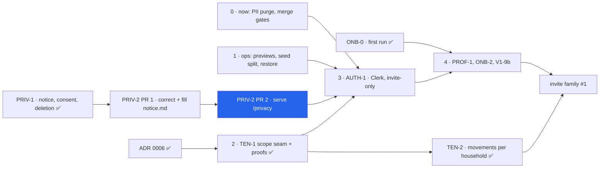

# PRIV-2 — serve the notice at `/privacy`, generated from `notice.md`

> Backlog: [plan.md](../plan.md) row `PRIV-2`. Branch: `feat/priv-2-serve-the-notice`.
> Predecessor: [PRIV-1](./priv-1-privacy-review.md) (the notice itself, and this row's four blanks).
> Consumer: [AUTH-1](./auth-1-clerk-google.md) → Q3.

## Where this sits

- **Pillar:** Onboarding & Access ([roadmap.md](../roadmap.md) → Next per pillar).
- **Milestone:** [beta-1](../milestones/beta-1.md) — step 3's gate. `beta-1.md`: _"**Live** means
  `PRIV-2` has shipped `/privacy` on the app's own domain — a `docs/` file is not a URL a consent
  screen can point at. **And the notice ships with no blanks.**"_
- **What this PR is:** the plan, plus the two-PR sequencing it settles (§ Sequencing). The
  implementation PR that follows serves the notice at a real URL and makes `PUBLIC_PATHS` two entries
  instead of one.
- **What comes next:** configuring the production Clerk instance and Google's OAuth consent screen
  ([runbooks.md](../runbooks.md) → the AUTH-1 consent checklist, box (a)), which is the step that needs
  this URL to exist. `OSS-2` §B follows in this pillar.



⚠️ [beta-1.md:77-89](../milestones/beta-1.md)'s canonical chart folds `PRIV-2` into the `PRIV` node, so
the implementation PR adds the `P1`/`P2` nodes **there** in the same PR — the two charts must agree,
and the rule is that the milestone doc owns the canonical one.

## Goal

The Clerk and Google consent screens take a privacy-policy **URL**, and
[`docs/privacy/notice.md`](../privacy/notice.md) is a file in a repository, not a URL a consent screen
can point at. This work serves that notice at `/privacy` on the app's own domain, un-gated, and wires
it so the served page **cannot drift from the reviewed source**: a committed script renders `notice.md`
into a committed TypeScript module, and a test fails when the two disagree.

**Why now:** it is the one remaining gate on configuring AUTH-1's production instance
([auth-1 → Q3](./auth-1-clerk-google.md), reason 1), and it is cheaper to land **before** AUTH-1
chunk 1a for a second reason the same section gives: `PUBLIC_PATHS` is the list AUTH-1 rewrites, so
adding `/privacy` now means 1a inherits `['/', '/privacy']` instead of editing a list whose meaning is
mid-migration ([access-gate.ts:113-127](../../apps/web/lib/access-gate.ts) — _"AUTH-1 inherits this
list as 'routes that need no session'"_).

## Sequencing — TWO PRs, and the first one is not optional

**PR 1 · `docs(priv-1)` — correct and fill `notice.md`.** Docs only, plan-exempt
([plans/README](./README.md) → Exempt: docs), no app code.
**PR 2 · `feat(priv-2)` — serve it.** This plan.

The first draft of this plan had PR 2 carry the four `⏳` blanks as a **merge gate**: a
`notice-content.test.ts` assertion of zero placeholders, _"expected to be RED for the life of the
PR"_, going green on the maintainer's final commit. Three panel lenses independently killed that, and
the reason is mechanical rather than aesthetic:

- **`.husky/pre-push` is `pnpm typecheck` then `pnpm test`, with no `set -e`** — so a red test fails
  **every `git push`** on the branch. Review fixes could not be pushed without `--no-verify`, which is
  the habit the hook exists to prevent.
- **`package.json`'s `verify` is a single `&&` chain and `test` is fourth of ten.** A red test means
  `db:verify`, `db:mutations`, `skills:check`, `actions:check`, `guards:test` and **`audit:check` never
  run** — on the one PR in the backlog that adds a dependency and whose supply-chain argument _rests_
  on `audit:check`. The gate would have disarmed the gate it leans on.
- **CI's `quality` steps are sequential too**, so `next build` would never run either. A PR whose
  build is never attempted is not a PR that is one commit from mergeable.

**So the blanks land first, in their own PR, and PRIV-2 opens green.** The zero-`⏳` assertion survives
— it is still in PR 2 — but as a **real regression gate** (green on arrival, red if a placeholder ever
comes back) rather than a red check a reviewer is asked to read as a feature. That is strictly better:
a gate that has never been green has never been proven to work.

**PR 1 is also where three factual errors in the notice get fixed**, and one of them is the only place
the notice **quantifies** a retention promise, so it is not a tidying pass.

### What PR 1 carries

| `notice.md`  | Change                                                                                                                                                                                                                                                                                                                                                                                                                                                                                                                                                                                                                                                                                                                                                                       |
| ------------ | ---------------------------------------------------------------------------------------------------------------------------------------------------------------------------------------------------------------------------------------------------------------------------------------------------------------------------------------------------------------------------------------------------------------------------------------------------------------------------------------------------------------------------------------------------------------------------------------------------------------------------------------------------------------------------------------------------------------------------------------------------------------------------- |
| `:3`         | **`Last updated` bumps** in the same commit. Non-negotiable: the whole document's credibility is that date.                                                                                                                                                                                                                                                                                                                                                                                                                                                                                                                                                                                                                                                                  |
| `:72-73`     | 🔴 **"there are no public pages" becomes false the moment PR 2 merges** — and `:219-221` lists _"anything is made publicly visible"_ as a re-review trigger, so this diff pulls the notice's own trigger. Reword to the **consequence**, not the mechanism: _"**Nobody else** — no page shows your data to anyone outside your household. The only pages anyone can open without the code are the landing page and this notice, and neither reads your data. No advertising, no analytics about you, and your data is never sold or shared for anyone else's purposes."_                                                                                                                                                                                                     |
| `:158-159`   | 🔴 **The restore window contradicts the runbook and itself.** Today: _"There is a 7-day pause between confirming and deleting, and a restore point is held for that window. After that it is gone."_ But [runbooks.md:747-749](../runbooks.md) says _"Cut a Neon restore branch immediately before applying, hold it 7 days **after** the apply (its own window — the cooling-off one has already elapsed by then)"_, and `notice.md:163-165` says the same. There is **no** restore point during the cooling-off window, and _"after that it is gone"_ is false — `:163-165` is what is true. Rewrite to: the pause is a **cancellation** window, and the restore point is the 7 days **after** the deletion, pointing at the paragraph below rather than contradicting it. |
| `:119-121`   | The three ⏳ retention windows — Sentry error reports, Vercel request logs, Neon backups — filled with the real figures read from each console.                                                                                                                                                                                                                                                                                                                                                                                                                                                                                                                                                                                                                              |
| `:130-132`   | 🔴 **A fourth ⏳ nobody had counted, and it is a _paragraph_, not a cell.** _"⏳ **Three numbers are still being confirmed** with the companies above… A made-up number in a privacy notice is worse than an admitted gap."_ When the numbers land it must be **deleted**, not filled — a notice that still says three numbers are pending while printing them is worse than either state alone.                                                                                                                                                                                                                                                                                                                                                                             |
| `:197`       | The fifth ⏳ — the permanent contact address. ⚠️ **If it is filled as a markdown `mailto:` link rather than as prose, PR 2's link allowlist throws** (§ Links). Prose is the cheaper choice; a link means PR 2's allowlist gains `mailto:` deliberately.                                                                                                                                                                                                                                                                                                                                                                                                                                                                                                                     |
| `:212-217`   | **The sign-off.** `> Role: ______________________ Date: ____________` would publish a visibly **unsigned form** on the URL a consent screen links to. **Settled: fill it as prose** (`> Reviewed and signed off by the maintainer, 2026-10-13.`) and **delete the parenthetical** at `:216-217` explaining why there is no name — the convention is in `AGENTS.md`; a privacy notice does not need to explain its own byline to a parent.                                                                                                                                                                                                                                                                                                                                    |
| `:21`, `:29` | **Two bold-only faux headings promoted to `###`** — "About the people in your household", "What gets logged". They are true subsections of "What we store", and a screen-reader user navigating by heading currently cannot reach them. **`:75` and `:161` are deliberately left as bold prose**: both end in a colon and introduce a list ("Three honest limitations during the beta:", "What remains afterwards, honestly:"), and a heading whose entire content is _here comes a list_ makes heading navigation worse, not better. axe cannot detect bold-as-heading either way, which is why it is decided here rather than discovered.                                                                                                                                  |

**Also in PR 1:** [`data-inventory.md:279-281`](../privacy/data-inventory.md)'s three ⏳ retention rows
get the same figures (they are the evidence the notice's rows cite), and `:294-296`'s _"The three ⏳
rows are named rather than guessed… Filling them is on `PRIV-2`'s acceptance"_ is rewritten to record
that they are filled. One changelog fragment: the notice's **published retention promise changes**,
which is exactly what a changelog is for.

**PR 1 → PR 2 coupling, stated so it is not discovered:** PR 2's generator is written and run against
the notice **as PR 1 leaves it**. The three shapes PR 1 can introduce that PR 2 must handle are the
filled `###` headings (already in the model), a `mailto:` link (throws unless allowlisted), and any new
markdown construct (throws by design). PR 2 regenerates after PR 1 merges, never before.

## Two decisions already made by the maintainer

Recorded here so the panel reviews the execution, not the choice.

**1 · Build-time generation with a byte-exact drift test.** A committed script renders `notice.md` into
a committed module under `apps/web/`; a test fails if the two diverge. Not relitigated. The reasons,
which are the rationale this plan is built on:

- **One source of truth.** `notice.md` stays the reviewed artifact PRIV-1 produced and every claim in
  it still traces to [data-inventory.md](../privacy/data-inventory.md). A second copy of a privacy
  notice is the failure mode that killed a separate `retention.md`
  ([priv-1 → Alternatives](./priv-1-privacy-review.md)).
- **No runtime dependency.** The parser is a devDependency used only by the script. `audit:check`
  gates the `--prod` tree ([SECURITY.md](../../.github/SECURITY.md) → Supply chain), so nothing this
  PR adds enters the audited tree, and nothing enters the shipped bundle but data and JSX.
- **Costs nothing in the bundle.** The page is a server component rendering a const array. No parser,
  no `fs`, no `dangerouslySetInnerHTML` (on AGENTS.md's "don't" list).
- **Mechanical, not remembered.** The next edit to `notice.md` reddens `pnpm test` until the page is
  regenerated. A convention would not.

**2 · The notice ships with no blanks.** Settled by PR 1 above, which is a maintainer decision (vendor
research plus the sign-off) and not a design task. **This plan invents no retention value and no
contact address.**

## Acceptance

**Verbatim, from the `PRIV-2` row in [plan.md](../plan.md):**

> - **PRIV-2 — serve the notice at `/privacy`, on the app's own domain.** The real `AUTH-1` gate: the
>   Clerk and Google consent screens need a reachable privacy-policy URL. A page, one entry in
>   `PUBLIC_PATHS` (`apps/web/lib/access-gate.ts` — the single definition), a footer link, one UX
>   reviewer. ⚠️ **Not a one-file PR:** there is **no markdown pipeline in the tree**, so it must
>   generate the page from [notice.md](./privacy/notice.md) with a drift test, or hand-transcribe it
>   and keep two copies of a privacy notice — the recommendation is the former, and it is the
>   maintainer's call ([plan](./plans/priv-1-privacy-review.md) → Alternatives). Static or generated
>   only — never a file read keyed on a request param. **Its acceptance also carries PRIV-1's four
>   unfilled blanks:** the Neon / Sentry / Vercel retention windows and the contact route. _(Beta 0.)_

### PR 1 — `docs(priv-1)`

1. `notice.md` contains **zero** `⏳` and **zero** runs of three or more underscores.
2. `notice.md:3`'s `Last updated` is the day of the commit.
3. The "no public pages" sentence states a consequence that stays true after PR 2.
4. The cooling-off paragraph and the "what remains afterwards" paragraph agree with
   `runbooks.md:747-749` and with each other.
5. `data-inventory.md` §8's three rows carry the same figures, and §8's closing paragraph no longer
   says they are pending.

### PR 2 — `feat(priv-2)`

1. `GET /privacy` with **no gate cookie** returns 200 and renders the notice — every block of
   `notice.md`, in source order, as semantic HTML.
2. `GET /privacy` **with** a gate cookie renders the same page. It does **not** bounce to the picker:
   the proxy's authed-redirect arm is `pathname === '/'` by design, and
   [proxy.ts:74-79](../../apps/web/proxy.ts) says so (_"a future public path must NOT bounce to the
   app"_). Asserted, not assumed.
3. `PUBLIC_PATHS` is `['/', PRIVACY_PATH]` from the single definition. `/privacyx`, `/privacy/x` and
   `/PRIVACY` stay **gated**; `/privacy/` **canonicalises** to `/privacy`. ⚠️ The second half of that
   sentence is deliberate: Next's internal trailing-slash redirect issues a 308 to `/privacy`
   **before the proxy runs**, so `/privacy/` never reaches `isPublicPath` over HTTP. The unit level
   still proves `isPublicPath('/privacy/') === false`; the HTTP level proves canonicalisation. Claiming
   `/privacy/` "stays gated" end-to-end would be a false criterion.
4. A footer with **two** items — `mat-plan` → `/` and `Privacy notice` → `PRIVACY_PATH` — reaches it
   from every screen, with `aria-current="page"` on the one matching the current route.
5. `pnpm test` fails if `notice.md` changes without regenerating the page. **Byte-exact**, no
   normalisation either side.
6. `pnpm typecheck` fails if the generated data stops satisfying the hand-written block model.
7. The generator **throws** on a markdown construct it does not understand, on a third table column,
   on a table with an empty header cell, and on any link target outside the allowlist — rather than
   dropping it silently from a privacy notice.
8. The rendered page carries **zero** `⏳` and zero three-underscore runs — green on arrival, so it is
   a regression gate rather than a wish.
9. axe clean, no horizontal overflow at 360px, one `<h1>`, no skipped heading levels,
   `<main>` + `<article>` + `<footer>` landmarks, ordered-list markers **visible** (see § Preflight).
10. Three-width screenshots in the PR description, light **and** dark for `/privacy`.

## File-by-file changes

### PR 1 — `docs(priv-1)`

| Path                                  | Change | What & why                                                                                      |
| ------------------------------------- | ------ | ----------------------------------------------------------------------------------------------- |
| `docs/privacy/notice.md`              | EDIT   | The nine edits in § "What PR 1 carries".                                                        |
| `docs/privacy/data-inventory.md`      | EDIT   | §8's three ⏳ rows filled; §8's closing paragraph rewritten.                                    |
| `docs/changelog/<date>-docs-priv-1-…` | NEW    | One fragment — the published retention promise changed.                                         |
| `docs/plan.md`                        | EDIT   | The `PRIV-1` row records the blanks as filled; the `PRIV-2` row drops them from its acceptance. |

### PR 2 — `feat(priv-2)`

| Path                                                    | Change        | What & why                                                                                                                                                                                                                                                                                                                                                                             |
| ------------------------------------------------------- | ------------- | -------------------------------------------------------------------------------------------------------------------------------------------------------------------------------------------------------------------------------------------------------------------------------------------------------------------------------------------------------------------------------------- |
| `apps/web/lib/privacy/notice-model.ts`                  | NEW           | Hand-written `Block` / `Inline` unions, the exhaustive `blockText` flattener and `assertNever`. **In `lib/`, not `app/`** — so `scripts/` → `lib/` and `app/` → `lib/`, which is the direction every existing script already points (`scripts/*` imports `../lib/`, `../e2e/`; **none** imports `../app/`).                                                                            |
| `apps/web/lib/privacy/notice-content.ts`                | NEW · **GEN** | The generated data: `NOTICE_TITLE`, `NOTICE_BLOCKS`, `NOTICE_SOURCE_PATH`. Committed, reviewed as data, never hand-edited.                                                                                                                                                                                                                                                             |
| `apps/web/lib/privacy/notice-content.test.ts`           | NEW           | Assertions about the **committed data** — headings, row counts, zero `⏳`, link hrefs, every block kind present. Imports no generator, so it needs no devDependency.                                                                                                                                                                                                                   |
| `apps/web/scripts/generate-privacy-notice.ts`           | NEW           | The generator. `marked.lexer` → the block model → the module text. Exports a pure `renderNoticeModule(markdown)`. In `scripts/` for devDependency containment.                                                                                                                                                                                                                         |
| `apps/web/scripts/generate-privacy-notice.test.ts`      | NEW           | Colocated per AGENTS.md: the **byte-exact drift** check, the throw cases, the hostile-escaping round trip, the link allowlist.                                                                                                                                                                                                                                                         |
| `apps/web/app/privacy/page.tsx`                         | NEW           | The route. No `params`, no `searchParams`, no `fs`, no cookie, no DAL. `metadata` with `robots: noindex` (§ Indexing) and **no `dynamic`/`revalidate` of its own**.                                                                                                                                                                                                                    |
| `apps/web/app/privacy/notice-article.tsx`               | NEW           | Hand-written server component rendering `Block[]` as semantic HTML, with the class map in § Preflight. The UX panel reviews **this**, not generated JSX.                                                                                                                                                                                                                               |
| `apps/web/components/layout/site-footer.tsx`            | NEW           | One `<footer>`, two items. New `layout/` grouping for root chrome.                                                                                                                                                                                                                                                                                                                     |
| `apps/web/app/layout.tsx`                               | EDIT          | Render `<SiteFooter pathname={…} />` after `{children}` inside `ThemeProvider`, reading the pathname from the header the proxy already forwards.                                                                                                                                                                                                                                       |
| `apps/web/proxy.ts`                                     | EDIT          | One line in `forward()`: `requestHeaders.set('x-pathname', request.nextUrl.pathname)` — the same mechanism `x-nonce` already uses, so the footer stays a server component (§ Footer).                                                                                                                                                                                                  |
| `apps/web/proxy.test.ts`                                | EDIT          | `x-pathname` is forwarded, and an **inbound** `x-pathname` is overwritten (the `x-nonce` property, re-asserted for the new header).                                                                                                                                                                                                                                                    |
| `apps/web/lib/access-gate.ts`                           | EDIT          | `PUBLIC_PATHS = ['/', PRIVACY_PATH]`; `PUBLIC_PATH_TREES` + `matchesPathTree` (§ PUBLIC_PATHS); docblock updated (it currently says "Exactly one").                                                                                                                                                                                                                                    |
| `apps/web/lib/access-gate.test.ts`                      | EDIT          | Membership via the const; the four negative cases; `matchesPathTree`'s own cases including `/sign-inevil`.                                                                                                                                                                                                                                                                             |
| `apps/web/lib/constants.ts`                             | EDIT          | **`PRIVACY_PATH` lands here**, beside `APP_HOME_PATH` — settled by [auth-1:1592](./auth-1-clerk-google.md) (_"`SIGN_IN_PATH` lands **here**… **not** in `access-gate.ts`, the module being split. Then it never moves."_). Plus `FOOTER_COPY` and `QUIET_LINK_CLASS` (second use site).                                                                                                |
| `apps/web/app/gate/page.tsx`                            | EDIT          | Use `QUIET_LINK_CLASS` instead of the inline duplicate.                                                                                                                                                                                                                                                                                                                                |
| `apps/web/e2e/privacy.spec.ts`                          | NEW           | Un-gated reachability, gated non-bounce, `/privacy/` canonicalisation, `/privacy/x` bounce, the footer links, the rewritten GitHub link.                                                                                                                                                                                                                                               |
| `apps/web/e2e/a11y.spec.ts`                             | EDIT          | `/privacy` in the `public routes` describe at 390 + 360.                                                                                                                                                                                                                                                                                                                               |
| `apps/web/e2e/landing.spec.ts`                          | EDIT          | The un-gated action-replay test loops over `PUBLIC_PATHS` instead of hard-coding `/`.                                                                                                                                                                                                                                                                                                  |
| `apps/web/package.json`                                 | EDIT          | `privacy:generate` script; `marked` at an **exact** version.                                                                                                                                                                                                                                                                                                                           |
| `package.json`                                          | EDIT          | Root alias `privacy:generate`, like `db:generate`.                                                                                                                                                                                                                                                                                                                                     |
| `.prettierignore`                                       | EDIT          | Ignore `apps/web/lib/privacy/notice-content.ts`, following the `packages/db/migrations` precedent already in the file.                                                                                                                                                                                                                                                                 |
| `apps/web/eslint.config.mjs`                            | EDIT          | 🔴 **Same file, second ignore list.** `.prettierignore` alone is not enough: `package.json`'s lint-staged runs `pnpm --filter web exec eslint --fix` on `apps/web/**/*.{ts,tsx}`, and `globalIgnores` covers only `.next/**`, `out/**`, `build/**`, `next-env.d.ts`. Without this, `eslint --fix` rewrites the generated file on commit and the drift test fails on a fix nobody made. |
| `docs/architecture.md`                                  | EDIT          | 🔴 **Missing from the first draft entirely.** §2b's prose says `/` is _"the only route in `PUBLIC_PATHS`"_ ([`:110`](../architecture.md)) and its flowchart draws two public nodes. AGENTS.md makes this the diagram home.                                                                                                                                                             |
| `docs/privacy/data-inventory.md`                        | EDIT          | `/privacy` recorded as the **second** un-gated route, and `apps/web/lib/access-gate.ts` added to the staleness command (§ Inventory).                                                                                                                                                                                                                                                  |
| `docs/milestones/beta-1.md`                             | EDIT          | The `P1`/`P2` nodes, so the canonical chart agrees with this plan's copy.                                                                                                                                                                                                                                                                                                              |
| `docs/plan.md` · `docs/roadmap.md` · `docs/changelog/…` | EDIT/NEW      | One row, one pointer, one fragment.                                                                                                                                                                                                                                                                                                                                                    |

**No feature guide is touched.** `pnpm guides:check` is green by construction: no guide's `owns:`
covers `apps/web/app/privacy/`, `apps/web/lib/privacy/`, `apps/web/lib/access-gate.ts`,
`apps/web/components/`, `apps/web/proxy.ts`, `app/layout.tsx` or `apps/web/e2e/` (checked against all
three guides' frontmatter: `strength-logging`, `write-path`, `programming`).

## `notice-model.ts` — the block model and the flattener

```ts
export type Inline =
  | { k: 'text'; text: string }
  | { k: 'strong'; children: Inline[] }
  | { k: 'em'; children: Inline[] }
  | { k: 'link'; href: string; children: Inline[] };

export type Row = { term: Inline[]; desc: Inline[] };

export type Block =
  | { k: 'h1' | 'h2' | 'h3'; children: Inline[] }
  | { k: 'p'; children: Inline[] }
  | { k: 'ul' | 'ol'; items: Block[][] } // an item is a list of blocks: notice.md:79-84 nests one
  | { k: 'dl'; head: Row; rows: Row[] }
  | { k: 'quote'; blocks: Block[] }
  | { k: 'hr' };
```

Verified against the source: two links (both `./data-inventory.md`, at `:206` and `:221`), no inline
code, no HTML, no images, two tables, one ordered list with a nested continuation paragraph, one
blockquote, one `---`, and — after PR 1 — two `###`.

### 🔴 `dl` carries `head`, because the first draft's model silently dropped both tables' headers

`notice.md:92` is `| Who it reaches | What they get |` and `:112` is `| What | How long |`. The first
draft's `dl` block was `{ rows: Row[] }` with no header field, and `marked` carries `header` separately
from `rows` — so both header rows would have vanished. **The drift test cannot catch this**: it
compares the generator's output to the committed module, never the module to the source's _meaning_.
Two tables' column headings would have disappeared from a privacy notice and every test would have
been green.

So the model carries `head`, the renderer renders it (§ Preflight), **and** the generator asserts the
shape rather than trusting it: every table must have exactly **two** columns and a **non-empty** cell
in both header positions, or it throws naming the table's first row. A third column or a blank heading
in a privacy notice is a loud failure, not a quiet drop.

### The flattener is exhaustive, with a `never` check, and it lives here

```ts
function assertNever(x: never): never {
  throw new Error(`unhandled block/inline: ${JSON.stringify(x)}`);
}

export function inlineText(nodes: readonly Inline[]): string {
  /* exhaustive switch, default: assertNever */
}

export function blockText(b: Block): string {
  switch (b.k) {
    case 'h1':
    case 'h2':
    case 'h3':
    case 'p':
      return inlineText(b.children);
    case 'ul':
    case 'ol':
      return b.items.flat().map(blockText).join(' ');
    case 'dl':
      return [b.head, ...b.rows].flatMap((r) => [inlineText(r.term), inlineText(r.desc)]).join(' ');
    case 'quote':
      return b.blocks.map(blockText).join(' ');
    case 'hr':
      return '';
    default:
      return assertNever(b);
  }
}
```

🔴 **Why this is specified rather than left to the implementer.** **Three of the five `⏳` live in
`dl` rows** (`:119`, `:120`, `:121` are retention-table cells) **and one lives in a paragraph under a
heading** (`:130`), and the fifth-blank class — the sign-off underscores — lives **in the blockquote**.
A flattener that forgets `dl.rows[].desc`, or `quote.blocks`, makes the placeholder gate pass **while
the placeholders are visible on the page**. The `never` check makes forgetting a case a compile error;
living in the same file as the union is what makes the check bind.

The gate therefore runs over `NOTICE_BLOCKS.map(blockText).join(' ')`, and is paired with probe
strings from **each nesting depth**, so a partial flattener fails loudly:

| Depth               | Probe                                                  | Source                 |
| ------------------- | ------------------------------------------------------ | ---------------------- |
| `p`                 | `'Children do not have accounts.'`                     | `notice.md:50`         |
| `h3`                | `'What gets logged'`                                   | `:29` (PR 1's `###`)   |
| `ul` item           | `'The tiles are a convenience, not a lock.'`           | `:60`                  |
| `ol` item, nested p | `'Guard the code the way you would guard a password.'` | `:85-86`               |
| `dl` head           | `'How long'`                                           | `:112`                 |
| `dl` term           | `'Upstash'`                                            | `:98`                  |
| `dl` desc           | `'Your IP address only'`                               | `:98`                  |
| `quote`             | the sign-off prose                                     | `:212-214` (post-PR 1) |

## `generate-privacy-notice.ts` — the generator

```
pnpm privacy:generate            # root alias → pnpm --filter web privacy:generate
```

1. Read `docs/privacy/notice.md`, resolved from `import.meta.dirname`, never from `cwd`.
2. `marked.lexer(md)` → token tree.
3. Walk it into `Block[]` with an **exhaustive** switch. Default branch: `throw` naming the token type
   and its raw text. A `never`-typed check backs it at compile time.
4. Resolve every link through the allowlist below.
5. Emit the module. Every string from the notice reaches it through `JSON.stringify` — see § Escaping.
6. Write it, with a header comment: what generated it, from what, and the command to regenerate.

**No `--check` flag.** The first draft carried one and its own Alternatives section then argued it was
unnecessary — a vitest file is already in `pnpm test`, which `verify` and CI's `quality` job both run.
Cut; a flag nothing calls is a second code path to keep correct.

### 🔴 Escaping — prose becomes source code, and the first draft never said how

Nothing here can inject HTML: React escapes text children and `dangerouslySetInnerHTML` is on
AGENTS.md's "don't" list. The risk is one layer earlier. A backtick or a `${…}` in `notice.md` lands
in a `.ts` module that `next build` **compiles**, and the worst shape is not hypothetical —
`${process.env.ACCESS_GATE_PASSWORD}` inside an emitted template literal would compile to the live
access code, in a file served to anyone. Today `notice.md` contains **zero** backticks and **zero**
`${`, which is exactly why this stays invisible until the first edit that adds one.

**The rule, stated once and tested:** every value derived from `notice.md` is emitted via
`JSON.stringify` — never concatenated into a template literal, never interpolated.

```ts
return [
  HEADER_COMMENT,
  `import type { Block } from '@/lib/privacy/notice-model';`,
  ``,
  `export const NOTICE_SOURCE_PATH = ${JSON.stringify(SOURCE_PATH)};`,
  `export const NOTICE_TITLE = ${JSON.stringify(title)};`,
  `export const NOTICE_BLOCKS: readonly Block[] = ${JSON.stringify(blocks, null, 2)} as const;`,
  ``,
].join('\n');
```

A backtick or `${` inside a **double-quoted JSON string** is inert in TypeScript, which is the whole
property. A **hostile round-trip fixture** proves it rather than arguing it: a synthetic markdown
document containing `` ` ``, `${process.env.ACCESS_GATE_PASSWORD}`, `"`, `'`, `\`, `*/`,
`</script>`, `U+2028` and a hard-wrapped paragraph, asserted three ways —

1. the generator does not throw;
2. the emitted module contains **no backtick at all** (the scaffold has none, so one could only come
   from an unescaped notice character);
3. slicing the `NOTICE_BLOCKS` payload out and `JSON.parse`-ing it **deep-equals** the in-memory model,
   so nothing was lost or mangled on the way out.

### 🔴 Links — `marked` does no protocol filtering, so the allowlist is ours

`marked`'s `cleanUrl` only encodes; the `sanitize` option was removed in v5, so
`[x](javascript:alert(1))` yields exactly that `href`. The generator therefore owns an **allowlist**:

```ts
const RELATIVE_LINK_REWRITES = {
  './data-inventory.md': 'blob/main/docs/privacy/data-inventory.md',
} as const;

function resolveHref(raw: string): string {
  if (raw.startsWith('https://')) return raw;
  const rewrite = RELATIVE_LINK_REWRITES[raw as keyof typeof RELATIVE_LINK_REWRITES];
  if (rewrite) return `${GITHUB_REPO_URL}/${rewrite}`;
  throw new Error(`notice.md: refusing link target ${JSON.stringify(raw)}`);
}
```

`https://` only. **Everything else throws**, including `http://` (a privacy notice must not link over
plaintext), `javascript:`, `data:`, `mailto:`, protocol-relative `//evil.example`, a bare `#fragment`
and any relative path not in the map. `GITHUB_REPO_URL` is the existing const
([constants.ts:80](../../apps/web/lib/constants.ts)) — no new URL literal. The generator **asserts the
rewritten target exists on disk** before emitting, so a move or rename fails the generator instead of
publishing a 404 in a privacy notice.

### `marked`, pinned exactly, as a devDependency only

```json
"marked": "18.1.0"
```

**Exact, not `^`** — matching the repo's tooling-pin precedent (`@axe-core/playwright: 4.13.0`,
`eslint-config-next: 16.3.8`, `embedded-postgres: 18.4.0-beta.17`). Verified: **no dependencies, no
install scripts**, MIT. The lockfile today contains **zero** markdown parsers (no `marked`,
`markdown-it`, `remark`, `micromark`, `mdx`, `gray-matter`, `rehype` at any depth), so this is a
genuinely new dependency and is reviewed as one. Dev-only, so outside `audit:check`'s `--prod` scope.

**The hand-rolled-parser fallback is cut.** The first draft kept one against the possibility that
`marked` had grown a dependency tree. It has not; the question is answered, and a documented
alternative nobody will take is a paragraph that goes stale.

## 🔴 Preflight — the renderer's classes are load-bearing, not decoration

The first draft reserved a single CSS class string for the renderer. Verified in
`tailwindcss@4.3.3/preflight.css`, that would have shipped a **221-line privacy notice as one
unbroken block of body text**:

| preflight                                                | effect on the notice                                                                                                                                                                                                                                             |
| -------------------------------------------------------- | ---------------------------------------------------------------------------------------------------------------------------------------------------------------------------------------------------------------------------------------------------------------- |
| `:13` `margin: 0` on `*` + pseudo-elements               | No space between any two blocks. Ten sections, no gaps.                                                                                                                                                                                                          |
| `:205` `ul, menu { list-style: none }`                   | **No bullets and no numbers.** 🔴 `notice.md:85` reads _"That follows from **(1) and (2)**"_ — a cross-reference to markers preflight removes, in the paragraph that tells a parent the worst-case exposure. It would point at numbers that are not on the page. |
| `h1`–`h6` `{ font-size: inherit; font-weight: inherit }` | Every heading renders identical to body text. The ten sections become invisible as sections.                                                                                                                                                                     |
| `a { color: inherit; text-decoration: inherit }`         | Prose links are indistinguishable from the text around them — no colour difference and no underline (WCAG 1.4.1).                                                                                                                                                |
| `:30` `line-height: 1.5`                                 | Fine for UI; tight for a long-form read on a phone.                                                                                                                                                                                                              |

So the renderer's classes are specified here:

```ts
const BLOCK_CLASS = {
  h1: 'text-2xl font-semibold tracking-tight',
  h2: 'mt-10 text-lg font-semibold tracking-tight',
  h3: 'mt-6 text-base font-semibold',
  p: 'mt-4 leading-relaxed',
  ul: 'mt-4 list-disc space-y-2 ps-6 leading-relaxed',
  ol: 'mt-4 list-decimal space-y-2 ps-6 leading-relaxed',
  dl: 'mt-4 space-y-4',
  quote: 'border-muted-foreground/40 mt-6 border-s-2 ps-4 leading-relaxed',
  hr: 'border-muted-foreground/40 mt-8',
} as const;

const DL_HEAD_CLASS = 'text-muted-foreground mt-6 text-xs font-semibold tracking-wide uppercase';
const DT_CLASS = 'font-semibold';
const DD_CLASS = 'mt-1 leading-relaxed';
const PROSE_LINK_CLASS =
  'focus-visible:ring-ring rounded-sm underline underline-offset-4 outline-none focus-visible:ring-3';
```

- **`list-disc` / `list-decimal` + `ps-6`** restore the markers and give them room (`padding: 0` from
  `:13` would otherwise clip an outside marker). A test asserts the `ol` class string contains
  `list-decimal`, because `notice.md:85`'s cross-reference depends on it and a screenshot review of a
  wall of text is where a missing "1." is easiest to miss.
- **`mt-*` / `space-y-*`** restore the vertical rhythm `margin: 0` removed.
- **`leading-relaxed`** over preflight's 1.5 for a document read end to end.
- **`dl` renders `head` as a caption `<p>` above the list**, not as a `<dt>`/`<dd>` pair — the column
  headings are not a term and its description, and should not claim to be. Each row is a `<div>`
  wrapping `<dt>` + `<dd>` (valid inside `<dl>`), so `space-y-4` separates rows rather than cells.
- **Prose links are underlined.** The footer link does not rely on SC 2.5.8's inline-link exception
  (it gets `min-h-11`); the notice's two prose links do, which `INTERACTIVE` in
  [`a11y.spec.ts:92`](../../apps/web/e2e/a11y.spec.ts) already encodes by excluding `<a>`.
- ⚠️ **The rules are `border-muted-foreground/40`, NOT `border-border`** — and **light is the riskier
  palette, not dark**. `--border` is `oklch(0.922 0 0)` on a `oklch(1 0 0)` background
  ([globals.css:56,71](../../apps/web/app/globals.css)) ≈ **1.2:1**, so a hairline divider is
  effectively **invisible in light mode** while being fine in dark (`oklch(1 0 0 / 10%)` on
  `oklch(0.145)`). `--muted-foreground` is `oklch(0.556)` light / `oklch(0.708)` dark, so a
  muted-derived rule is visible in both. (`--border` stays correct for component edges — cards,
  inputs; it is wrong only for a standalone rule on the page background.) The light screenshot at
  three widths is where this is confirmed, and it is called out in the PR description so a reviewer
  looks for it.
- **Tokens only** (`text-foreground`, `text-muted-foreground`, the muted-derived rules) — no raw
  colours, so the dark palette follows for free.

**No `prefers-reduced-motion` source scan.** The first draft asserted that nothing under the route
matches `animate-`, `transition-` or `duration-`. Cut: it is an invented rule that would redden on an
ordinary `transition-colors` on a link hover, and the page has nothing to animate anyway.

### Tables become `<dl>`, deliberately

Both tables are two-column label→value (`notice.md:92-100`, `:112-123`) and the second column holds
full sentences. A `<table>` at 360px either overflows (failing `expectNoHorizontalOverflow`) or needs
an `overflow-x: auto` wrapper that makes a privacy notice sideways-scrollable **on the phone it is read
on**. A `<dl>` wraps natively, is semantic, and — with `head` rendered — loses no meaning.

## The page, and how "static or generated — never a file read keyed on a request param" is guaranteed

Four independent mechanisms, because the backlog row calls this out explicitly:

1. **The page takes no request input.** `page.tsx` declares no `params` and no `searchParams`, so there
   is no value to key a read on.
2. **Nothing under `app/privacy/` or `lib/privacy/` imports `fs`.** Asserted by a test that reads those
   directories' sources and fails on `node:fs`, `from 'fs'`, `readFile` or `process.cwd`.
   ⚠️ **The `params` half of the first draft's scan is cut.** It would false-positive on the notice's
   own prose: `notice-content.ts` is ~650 lines of text, and a sentence containing the word
   "parameters" matches a naive `params` regex. The no-`params` guarantee is already carried by the
   page's own signature and by typecheck.
3. **The content is a module-level const**, compiled into the build. `notice.md` is not deployed to
   Vercel's function filesystem at all, so a read is not merely unused — it has nothing to read.
4. **The route is enrolled in the existing public-page invariants** the moment it joins
   `PUBLIC_PATHS`: [`pages-are-gated.test.ts:114-131`](../../apps/web/app/pages-are-gated.test.ts)
   then requires that `/privacy`'s whole local module graph (its segment files included) pulls in **no**
   `'use server'` module — the #153 incident class the backlog row warns about.

### 🔴 `force-dynamic` — the first draft's stated reason was wrong

The draft said opting `/privacy` out of dynamic rendering would _"poke a hole in the directive
`tenancy-is-not-cached.test.ts` deliberately pins"_. It would not:
[`tenancy-is-not-cached.test.ts:51-53`](../../apps/web/app/tenancy-is-not-cached.test.ts) matches
`export const dynamic = 'force-dynamic'` in **`app/layout.tsx` only**, so a `force-static` in
`app/privacy/page.tsx` trips nothing. Shipping that reasoning would have left the page one unreviewed
line from being broken by a test that was never watching.

**The real reason is the nonce.** [`layout.tsx:54`](../../apps/web/app/layout.tsx) does
`await headers()` to read `x-nonce`, which `proxy.ts` mints **per request** for the CSP
(`script-src 'self' 'nonce-…' 'strict-dynamic'`, no `unsafe-inline`). A cached or statically rendered
page bakes **one** nonce into its HTML while the response header carries a fresh one — so every
nonce'd script on that page is CSP-blocked, silently, and the theme script is the first casualty.

So: `/privacy` is dynamically **rendered** from statically **compiled** content, inheriting the root
layout's directive, and the test asserts the page declares **no `dynamic` and no `revalidate` of its
own** — the assertion the draft assumed already existed.

### Indexing — `robots: noindex`, and the draft's reason for omitting it was wrong

The draft shipped **no** `noindex` because _"a policy a consent screen links to should be fetchable and
indexable"_. `noindex` does not affect fetchability: the response is still a 200, and Google's OAuth
console (or any human) fetches it unchanged. The two properties are unrelated.

**Ship `noindex` until AUTH-1**, same as the gate ([gate/page.tsx:9-12](../../apps/web/app/gate/page.tsx)),
with the reason in a comment: the notice is an **inventory of the beta's weaknesses** — one shared
code, households not yet separated, _"treat the app as if anyone who was invited could see anyone's
log"_, _"delete" currently means "hidden"_ — while the gate's brute-force limiter **fails open** when
Upstash is unconfigured (`lib/rate-limit.ts` → `limiter` is `null`, the `catch` swallows, and
`runbooks.md`'s "the gate rate limit is enforcing" procedure still **opens with** _set the two
variables in Vercel and redeploy_, i.e. it has not been armed). Making that document a search result
for the app, before the lock it describes has its rate limiter on, is a free gift to a scanner for no
benefit — the audience is the invited family and the consent screen, both of which arrive by link.
**It comes off at AUTH-1**, in the PR that arms real auth, and the comment says so.

## `PUBLIC_PATHS` — the entry, and the arm's shape decided now

```ts
// lib/constants.ts — beside APP_HOME_PATH. Published on a consent screen, so it never moves.
export const PRIVACY_PATH = '/privacy';
```

🔴 **In `constants.ts`, not `access-gate.ts`.** [auth-1:1592](./auth-1-clerk-google.md) already
settled this for the identical case: _"`SIGN_IN_PATH` lands **here**, beside `APP_HOME_PATH` /
`TOKEN_SETS_PATH` — **not** in `access-gate.ts`, the module being split. Then it never moves."_ The
first draft put it in `access-gate.ts` and defended it as keeping that module import-free; that
defence is **false** — [`proxy.ts:4`](../../apps/web/proxy.ts) already imports from `@/lib/constants`,
and [`constants.ts:1-9`](../../apps/web/lib/constants.ts) itself imports from `@mat-plan/shared`.
`access-gate.ts` imports `PRIVACY_PATH` from `constants.ts`, which is the direction every other path
const already flows.

```ts
// lib/access-gate.ts
export const PUBLIC_PATHS = ['/', PRIVACY_PATH] as const;

/**
 * Public routes that own their whole SUBTREE. Empty today: `/privacy` has no children, so exact
 * membership still holds for both entries. AUTH-1 1a's `/sign-in` catch-all adds its entry HERE —
 * NOT to `PUBLIC_PATHS` — which is what keeps `/privacy/x` gated through that PR.
 */
export const PUBLIC_PATH_TREES = [] as const satisfies readonly string[];

/** `/x` and everything under it. Exported so the matcher is TESTED before any entry exists. */
export function matchesPathTree(root: string, pathname: string): boolean {
  return pathname === root || pathname.startsWith(`${root}/`);
}

export function isPublicPath(pathname: string): boolean {
  return (
    (PUBLIC_PATHS as readonly string[]).includes(pathname) ||
    (PUBLIC_PATH_TREES as readonly string[]).some((root) => matchesPathTree(root, pathname))
  );
}
```

🔴 **Why the second list exists, and why it is not dead code.** AUTH-1 1a is already written and its
arm is **generic**: [auth-1:1136](./auth-1-clerk-google.md) commits _"`isPublicPath` grows from exact
membership to `p === entry || p.startsWith(entry + '/')`"_ — applied to every `PUBLIC_PATHS` entry.
With `/privacy` on that list, **`/privacy/` and `/privacy/x` become public at 1a**, and two of this
PR's four negative cases flip. The cheapest thing to do at that keyboard is delete the two tests.

The two-list split makes the right thing the default: 1a adds one string to `PUBLIC_PATH_TREES` and
every `/privacy` case stays true. The existing docblock's objection — _"rather than ship a prefix arm
no entry can reach, this matches exactly"_ — is answered by **testing the matcher, not the list**:
`matchesPathTree` is exercised directly (`('/sign-in', '/sign-in/callback')` → true;
`('/sign-in', '/sign-inevil')` → false — DUALS-1's scar, proven **before** the entry that needs it),
and `PUBLIC_PATH_TREES`'s emptiness is itself pinned so adding an entry is a visible test edit. Eight
lines, zero untested branches, and two tests that survive the next PR.

```ts
it('is exactly the landing and the privacy notice', () => {
  expect(PUBLIC_PATHS).toEqual(['/', PRIVACY_PATH]);
});

// The one place the literal belongs: a consent screen and a footer link both depend on this value.
it('PRIVACY_PATH is a stable, published URL', () => {
  expect(PRIVACY_PATH).toBe('/privacy');
});

it.each(['/privacyx', '/privacy/', '/privacy/x', '/PRIVACY'])('keeps %j gated', (path) => {
  expect(isPublicPath(path)).toBe(false);
});

it('has no public subtrees yet — AUTH-1 1a adds /sign-in HERE, not to PUBLIC_PATHS', () => {
  expect(PUBLIC_PATH_TREES).toEqual([]);
});
```

`isUngatedPath('/privacy')` → `true` joins the existing `it.each(['/', '/gate'])` row, via the const;
the `it.each(['/p', '/gatex', '/gate/x', '/p/x'])` negative row gains `/privacyx`. The docblock at
[`access-gate.ts:113-126`](../../apps/web/lib/access-gate.ts) (_"Exactly one: the public landing"_) is
rewritten in the same edit.

## The footer

🔴 **Two items, not one — `/privacy` is the second room a stranger can walk into.** The first is the
gate, and `GATE_COPY.back`'s own comment says why it has a way out: _"the one room a stranger can walk
into needs an exit"_. A notice page with no link off it is the same dead end, for a reader who arrived
from a consent screen with no idea what this app is.

```ts
export const FOOTER_COPY = { home: APP_NAME, privacy: 'Privacy notice' } as const;

/** A quiet, tap-target-sized inline link. Extracted at PRIV-2: the gate's way-back link had it
 *  inline and the footer is the second use site (AGENTS.md — the second occurrence is the trigger). */
export const QUIET_LINK_CLASS =
  'text-muted-foreground hover:text-foreground focus-visible:ring-ring inline-flex min-h-11 items-center rounded-sm text-sm underline underline-offset-4 outline-none focus-visible:ring-3';
```

One `<footer>` in the root layout, so it is on every screen — not three use sites that drift, and not
public-routes-only, which would leave a family unable to find the notice from inside the app. A
`<ul>` of two `<li>`s (AGENTS.md: `ul`/`li` for lists), **no `<nav>`** — one `contentinfo` landmark is
enough and a second unlabeled landmark is what axe's `landmark-unique` complains about. Preflight's
`list-style: none` is **correct** here: this is a chrome link row, not prose. (That it must be _undone_
for the notice's lists and _kept_ for the footer's is the whole reason § Preflight is specified per
block rather than as one class string.)

**360px layout, with the width math done rather than left to flex-wrap.** `px-4` on the footer leaves a
**328px** content box. `mat-plan` (~62px at 14px) + `gap-x-4` (16px) + `Privacy notice` (~95px) ≈
**173px** — one line, with room to spare. The row still gets `flex-wrap gap-x-4 gap-y-1` so that at
**200% zoom** (≈164px effective) it **stacks** instead of overflowing, and `gap-y-1` keeps the stacked
rows from merging visually. Each link carries `min-h-11`, the pattern the gate's way-back link already
uses ([gate/page.tsx:30-36](../../apps/web/app/gate/page.tsx)).

**`aria-current="page"`**, which needs the current pathname in a server component. The proxy already
forwards a per-request value to the renderer this exact way, so `forward()` sets `x-pathname` beside
`x-nonce` and the layout reads it from `headers()`. That keeps the footer a **server** component
(AGENTS.md: minimize `'use client'`) instead of adding a `usePathname()` client component to every
route in the app. ⚠️ `forward()` builds its headers with `new Headers(request.headers)` and then
`.set()`s, so an **inbound** `x-pathname` is overwritten on every forwarded request — the property
`x-nonce` already depends on, re-asserted in `proxy.test.ts` for the new header. Requests that skip
the matcher (`/api`, `/_next/static`, `/_next/image`, `favicon.ico`) render no layout, so there is no
unprotected path; and the worst case of a spoof is a wrong `aria-current`, not a security property.

⚠️ **Known consequence, accepted:** the gate page now has **two** links to `/` — its own
`← About mat-plan` inside `<main>` (counted and measured by
`expectLinkTapTargets(page, 'gate…', 1)`, which is scoped to `getByRole('main')`) and the footer's
`mat-plan`. Removing the in-`main` one would change that pinned count and is `OSS-2 §B`'s call, not
this PR's. Recorded in the UX log, visible in the gate screenshots.

## `architecture.md` §2b — the diagram home

Missing from the first draft entirely. [`:110`](../architecture.md) currently reads _"`/` is the
**public landing** (OSS-2): no cookie read, no DB query, the only route in `PUBLIC_PATHS`"_ — which this
PR makes false. §2b gains:

- the prose correction: two routes in `PUBLIC_PATHS`, and what `/privacy` is (a compiled copy of
  `docs/privacy/notice.md`, no cookie, no DB, no request input) plus **why it does not bounce when
  authed** (the proxy's arm is `pathname === '/'`);
- a `PRIVACY` node in §2b's flowchart, reached by the footer from `LANDING`, `GATE` and `PICKER`, with
  the authed-non-bounce drawn so the asymmetry with `/` is visible rather than inferred.

The PR description embeds the updated §2b flowchart (AGENTS.md → Diagrams: the description diagram and
the committed one must agree).

## `data-inventory.md` — the inventory, and its staleness command

- `/privacy` is recorded as the **second** un-gated route: what it serves, that it reads no cookie, no
  DB and no request input, and that `marked` is a devDependency that reaches no runtime.
- 🔴 **`apps/web/lib/access-gate.ts` is added to the staleness command** at
  [`:35-41`](../privacy/data-inventory.md). It currently watches `schema.ts`, `lib/dal`, `proxy.ts`,
  the Sentry config, `sentry-scrub.ts`, `rate-limit.ts` and `.github/workflows` — so **this PR, which
  changes what is publicly readable, would print nothing.** The file that defines the public surface is
  not on the list that watches the public surface.

## Test plan

Everything below runs in `pnpm test` (so in `pnpm verify` and CI's `quality` job) except the Playwright
cases, which run in `pnpm e2e:local` and the `e2e` job. **No CI workflow change** — a vitest file needs
none, and `scripts/**/*.test.ts` is already inside vitest's `include` (`**/*.test.{ts,tsx}` from
`apps/web`, with only `e2e/` excluded).

### `scripts/generate-privacy-notice.test.ts` — properties of the generator

| Assertion                      | What it proves                                                                                                                                                                              |
| ------------------------------ | ------------------------------------------------------------------------------------------------------------------------------------------------------------------------------------------- |
| **Drift, byte-exact**          | `renderNoticeModule(read('docs/privacy/notice.md'))` is string-identical to the committed `lib/privacy/notice-content.ts`. No normalisation either side.                                    |
| **Throws on an unknown token** | `renderNoticeModule('')` throws naming the construct. The exhaustive switch is proven live, not just typed.                                                                      |
| **Throws on a third column**   | A three-column pipe table throws naming the table's first row.                                                                                                                              |
| **Throws on a blank header**   | `\| \| How long \|` throws — the finding the `head` field exists for.                                                                                                                       |
| **Link allowlist**             | `javascript:`, `data:`, `http://`, `//evil.example`, `#frag` and an unknown relative path each throw; `https://…` passes through; `./data-inventory.md` becomes the `GITHUB_REPO_URL` path. |
| **Rewrite target exists**      | A rewrite entry pointing at a nonexistent file throws before anything is emitted.                                                                                                           |
| **Hostile escaping**           | The three-way round trip in § Escaping: no throw · no backtick in the output · payload `JSON.parse`s back deep-equal to the model.                                                          |

### `lib/privacy/notice-content.test.ts` — properties of the committed data

**Expectations are derived from the source, never hand-pinned.** The first draft asserted
`NOTICE_BLOCKS.length > 60`; the real count is ~51, so a correct generator would have failed on day
one and the cheapest fix at the keyboard is lowering the number — the exact tautology the assertion
existed to prevent.

| Assertion              | What it proves                                                                                                                                                                                                                      |
| ---------------------- | ----------------------------------------------------------------------------------------------------------------------------------------------------------------------------------------------------------------------------------- |
| **Headings, in order** | Parse the `##` lines out of `notice.md` (**10** today — the test derives the list, so that number is not an input) and assert the rendered `h2` blocks' plain text **equals** them, in order. A dropped or reordered section fails. |
| **One `h1`**           | Exactly one `h1`, first, text equal to the `#` line.                                                                                                                                                                                |
| **Table row counts**   | The two `dl` blocks have **7** and **10** rows — parsed from the source's pipe tables, not typed in. _"At least two `dl` blocks"_ (the first draft) passes a generator that drops nine of ten **retention** rows.                   |
| **Table headers**      | Both header strings (`Who it reaches`, `What they get`, `What`, `How long`) appear in the rendered text.                                                                                                                            |
| **Every kind present** | Each member of the `Block` union appears at least once — the non-vacuity floor, derived from the union rather than from a magic length.                                                                                             |
| **Zero placeholders**  | `blockText` over every block contains no `⏳` and no run of 3+ underscores. **Green on arrival** (PR 1 landed), so it is a regression gate.                                                                                         |
| **Depth probes**       | The eight probe strings in § Flattener, one per nesting depth.                                                                                                                                                                      |
| **Links**              | Every `link` href starts with `https://`; none starts with `.` or `/`; the `data-inventory.md` href is the real path under `GITHUB_REPO_URL`.                                                                                       |
| **No `fs`**            | Every `.ts`/`.tsx` under `app/privacy/` and `lib/privacy/` (tests excluded) matches none of `node:fs`, `from 'fs'`, `readFile`, `process.cwd`.                                                                                      |
| **No own caching**     | `app/privacy/page.tsx` declares **no** `dynamic` and **no** `revalidate` — it inherits the layout's `force-dynamic`, and the nonce depends on that (§ force-dynamic).                                                               |
| **Ordered markers**    | The renderer's `ol` class string contains `list-decimal` — `notice.md:85`'s _"(1) and (2)"_ depends on it and preflight removes it by default.                                                                                      |

### Existing suites this change touches

- **`lib/access-gate.test.ts`** — the membership edits and `matchesPathTree` above.
- **`proxy.test.ts`** — `x-pathname` forwarded; an inbound one overwritten.
- **`app/pages-are-gated.test.ts`** — no edit needed, and that is the point: `/privacy` is enrolled
  automatically. It must satisfy _"gated or deliberately un-gated"_ (it is in `PUBLIC_PATHS`) **and**
  the public-page Server-Action-graph check. Confirm the latter actually picked up the new route
  (`publicPages.length` becomes 2) rather than assuming it.
- **`app/tenancy-is-not-cached.test.ts`** — unchanged; this route adds no cached read.

### Playwright

- **`e2e/privacy.spec.ts`**, in a `NO_GATE_STATE` context (the pattern
  [`landing.spec.ts:22-23`](../../apps/web/e2e/landing.spec.ts) establishes, so the project's cookie
  cannot make a gated page look public):
  - un-gated `/privacy` → URL stays `/privacy`, the `h1` is visible, no redirect to `/gate`;
  - **gated** `/privacy` → still `/privacy`, not `APP_HOME_PATH`. This is the assertion that pins
    `proxy.ts`'s `pathname === '/'` arm against a careless change to `isPublicPath`;
  - `/privacy/` → **canonicalises** to `/privacy`, with a comment saying this is Next's trailing-slash
    308 **before** the proxy and therefore not a gate assertion;
  - `/privacy/x` → bounces to `/gate?from=/privacy/x`. **This** is the subtree gate proof;
  - both footer links navigate, by `FOOTER_COPY`, from `APP_HOME_PATH`;
  - the `data-inventory.md` link's `href` is the GitHub URL (the rewrite, end to end).
- **`e2e/a11y.spec.ts`** → inside `test.describe('public routes')` ([`:771`](../../apps/web/e2e/a11y.spec.ts)),
  add `/privacy` to the `[MOBILE_VIEWPORT, NARROW]` loop: `expectNoAxeViolations` +
  `expectNoHorizontalOverflow`.
  - ⚠️ **No separate dark-mode axe pass.** The first draft added one. Cut: the renderer uses **only**
    tokens the existing `dark theme` describe (`:210-230`) already audits across four routes, and
    introduces no colour of its own — contrast is a property of the token pair, not of this page. The
    two **dark screenshots** are where a long-form page's palette is reviewed, which is the right tool
    for a judgement call.
  - ⚠️ **Do NOT call `expectTapTargets` on `/privacy`.** `INTERACTIVE` (`:92`) excludes `<a>`, and the
    page has no buttons, selects or inputs at all — the helper's own "selector matched nothing" guard
    would fail the test. The footer links are measured directly
    (`boundingBox().height >= MIN_TAP_TARGET_PX`).
  - ⚠️ **Do NOT call `expectLinkTapTargets` on `/privacy`** either: it measures **every** link in
    `<main>` ([`:723`](../../apps/web/e2e/a11y.spec.ts)) and the notice's two prose links legitimately
    sit under the inline-link exception. The existing `landing…, 2` and `gate…, 1` counts are
    unaffected — both are scoped to `getByRole('main')` and the footer is outside it.
- **`e2e/landing.spec.ts`** → the un-gated action-replay test (`:87`) loops its replay over
  `PUBLIC_PATHS` instead of hard-coding `'/'`. One line of restructuring buys `/privacy` the same
  runtime proof that an un-gated POST with a real action id runs nothing, and makes every future public
  path inherit it.

**Local:** `pnpm verify`, then `pnpm e2e:local --project=chromium` and `--project=a11y`.
**Regenerate:** `pnpm privacy:generate`.

## Screenshots

`pnpm --filter web screenshot:ephemeral /privacy`, plus the screens the global footer changes:
`/` · `/gate` · `/p`. Each emits `-mobile.png` (~390) / `-tablet.png` (~820) / `-desktop.png` (~1280)
automatically. Publish with `pnpm --filter web screenshots:publish --pr <n> --comment`; the **first**
set goes in the PR description, later rounds as a comment with `--note`.

Capture **both themes** for `/privacy` — it is a wall of text and the dark palette's first long-form
page. **Specifically check in the light capture:** the `---` rule and the blockquote rule are visible
(§ Preflight's oklch arithmetic), the ordered list shows `1.` `2.` `3.`, and the ten section headings
read as headings.

## Risks / rollback

| Risk                                                                                                                     | Mitigation                                                                                                                                                                                                                                                                                               |
| ------------------------------------------------------------------------------------------------------------------------ | -------------------------------------------------------------------------------------------------------------------------------------------------------------------------------------------------------------------------------------------------------------------------------------------------------- |
| 🔴 **The published page says something different from the reviewed notice.** The whole reason this is not transcription. | Byte-exact drift test + throw-on-unknown-construct. Neither a silent drop nor a stale copy survives `pnpm test`.                                                                                                                                                                                         |
| 🔴 **A silent drop the drift test cannot see** (the `dl` header class).                                                  | The drift test compares generator-to-module, never module-to-meaning, so the content test derives its expectations **from `notice.md`**: headings in order, both row counts, both header strings, every union member present.                                                                            |
| 🔴 **Prose becomes source code.** A `${process.env.…}` in `notice.md` compiling into a served module.                    | One rule — every emitted string goes through `JSON.stringify` — plus the three-way hostile round trip. Today the file has zero backticks and zero `${`, which is why this is specified before the first edit rather than after.                                                                          |
| 🔴 **A hostile link target.** `marked` does no protocol filtering.                                                       | `https://` allowlist plus one explicit relative rewrite; everything else throws, `http://` and `mailto:` included.                                                                                                                                                                                       |
| 🔴 **The notice ships with `⏳`** on the URL a consent screen points at.                                                 | PR 1 fills them; PR 2's zero-placeholder assertion is **green on arrival** and covers every nesting depth via the exhaustive flattener. A gate that has been green has been proven to run.                                                                                                               |
| **`/privacy` is accidentally gated** (or `/privacyx` accidentally public).                                               | One const, exact membership, four negative unit cases, `matchesPathTree` tested before it has an entry, and an e2e in a cookie-free context. The proxy matcher is anchored (`proxy.ts:113`).                                                                                                             |
| **AUTH-1 1a generalises `isPublicPath` and opens `/privacy/x`.**                                                         | `PUBLIC_PATH_TREES` is the opt-in 1a adds its entry to; the four negative cases go red if it generalises `PUBLIC_PATHS` instead. Named in this plan so 1a's author reads the decision rather than rediscovering it.                                                                                      |
| **`eslint --fix` or Prettier rewrites the generated file**, so drift fails on formatting.                                | `.prettierignore` **and** `eslint.config.mjs`'s `globalIgnores` — the second is the one the first draft missed, and lint-staged runs `eslint --fix` on `apps/web/**/*.{ts,tsx}` on every commit. If a rule still fires, the fix is the emitted shape, **never** a new `eslint-disable` (`hold-the-bar`). |
| **The page's CSP nonce is baked by a cache.**                                                                            | Inherits the layout's `force-dynamic`; the test asserts the page declares no `dynamic`/`revalidate` of its own. The draft's claim that `tenancy-is-not-cached.test.ts` guards this was false — it pins `layout.tsx` only.                                                                                |
| **The Vercel build diverges from the committed artifact.**                                                               | There is no build-time codegen step. `next build` compiles a committed module; the generator runs only when a human runs it. Nothing to race.                                                                                                                                                            |
| **An invisible divider in light mode.**                                                                                  | Rules derive from `--muted-foreground`, not `--border` (1.2:1 on white). Confirmed in the light screenshots at three widths, and called out in the PR description.                                                                                                                                       |
| **A new devDependency.**                                                                                                 | Dev-only, outside `audit:check`'s `--prod` scope; MIT; **pinned exactly**; verified dependency-free with no install scripts. Reviewed as a supply-chain change (SECURITY.md → Supply chain); Dependabot's cooldown applies like any other.                                                               |
| **The global footer regresses a screen.**                                                                                | `<footer>` outside `<main>`, so `expectLinkTapTargets`' counts are untouched; axe re-runs over the public routes; the footer links are measured against `MIN_TAP_TARGET_PX`; width math done at 360px and 200% zoom; screenshots for all four screens at three widths.                                   |
| **Reviewing ~650 generated lines.**                                                                                      | The diff is data, in source order, and the reviewable artifact is `notice.md`, which has already been reviewed — and, after PR 1, re-reviewed. The header comment says so.                                                                                                                               |

**Rollback:** revert the commit. The route disappears, `PUBLIC_PATHS` returns to one entry, and nothing
has migrated, deployed state, or changed anyone's data. ⚠️ **One ordering consequence, not a code one:**
if the production Clerk/Google consent screens have already been pointed at `/privacy`, reverting leaves
a consent screen linking to a 404 — so a revert after AUTH-1's console configuration means un-pointing it
first ([runbooks.md](../runbooks.md) → the consent checklist). **PR 1 does not roll back with it**, and
should not: a corrected notice is correct whether or not it is served.

### Sizing, honestly

≈ **580 hand-written lines** across 22 files, plus ≈ **650 generated**. Over AGENTS.md's <400-line
target, and the plan is not pretending otherwise.

**It is still one concern** — "the notice is served at a URL" — and the hand-written half is unusually
inert: a renderer, a model, a flattener, a 25-line footer and tests. **The footer does not split out.**
The seam the first draft offered (`PRIV-2b`: `site-footer.tsx`, `layout.tsx`, `proxy.ts`,
`constants.ts`, `gate/page.tsx`, three extra screenshot routes) is ≈ **80 lines** — 580 − 80 = **500**,
still over 400, so it buys no threshold, and it ships a privacy notice reachable **only by typing the
URL**. Two PRs to land under one limit neither of them meets is churn, and the backlog row names the
footer link as part of the deliverable.

## Alternatives considered, and rejected

| Option                                                                                        | Rejected because                                                                                                                                                                                                                                                                                                    |
| --------------------------------------------------------------------------------------------- | ------------------------------------------------------------------------------------------------------------------------------------------------------------------------------------------------------------------------------------------------------------------------------------------------------------------- |
| **One PR, with the blanks as a red merge gate.**                                              | `.husky/pre-push` runs `pnpm test` with no `set -e` (every push blocked); `verify` is one `&&` chain with `test` **fourth of ten**, so `audit:check` — the gate this PR's own supply-chain argument rests on — would never run; CI's `quality` steps are sequential, so `next build` wouldn't either. § Sequencing. |
| **Render the markdown at runtime** (read `notice.md` on request, or ship a parser).           | Adds a parser to the **production** tree `audit:check` gates, for content that cannot change between deploys. On Vercel the file is not reliably on the function filesystem, and most runtime renderers inject through `dangerouslySetInnerHTML`. A request-time read is precisely what the backlog row forbids.    |
| **Hand-transcribe the notice into JSX.**                                                      | Two copies of a privacy notice — the exact failure PRIV-1 rejected a separate `retention.md` for. They diverge at the first edit, invisibly.                                                                                                                                                                        |
| **Generate HTML and inject it.**                                                              | `dangerouslySetInnerHTML` is on the "don't" list, and a self-XSS sink the moment anything but a reviewed file feeds it.                                                                                                                                                                                             |
| **Generate the `.tsx` component** instead of a data module.                                   | The UX panel would be reviewing generated JSX, and every styling fix would mean editing the generator. Data out / presentation hand-written splits the two reviews cleanly.                                                                                                                                         |
| **A hand-rolled parser, no new dependency.**                                                  | ~150 lines owned forever, and the risky part is inline nesting, where a hand-rolled parser mis-parses **silently**. Kept as a fallback in the first draft against `marked` having transitive deps; `marked` has none, so the question is answered and the fallback is cut rather than left to go stale.             |
| **`remark`/`unified` or `markdown-it`.**                                                      | Many packages for one script, against SECURITY.md's "minimize dependencies". `marked`'s lexer is the smallest thing that gives a real AST.                                                                                                                                                                          |
| **A `--check` flag on the generator.**                                                        | Cut. The first draft shipped it and then argued in its own Alternatives that it was unnecessary: the drift check is a vitest file, already inside `pnpm test`, which `verify` and CI's `quality` both run.                                                                                                          |
| **Keep the tables as `<table>` in an `overflow-x: auto` wrapper.**                            | Allowed by AGENTS.md, but it makes a privacy notice scroll sideways on the phone it is read on, and both tables are label→value. A `<dl>` with a rendered header is the semantically correct element, not a workaround.                                                                                             |
| **Model the `dl` without a header field** (the first draft).                                  | Silently drops both tables' column headings, and **no test in the plan could catch it** — the drift test compares generator to module, never module to source meaning.                                                                                                                                              |
| **One CSS class string for the whole renderer** (the first draft).                            | Preflight zeroes margins, list markers, heading weight/size and link underlines, so the notice would render as one unbroken block with no bullets and no numbers — and `notice.md:85`'s _"(1) and (2)"_ would reference markers that are not on the page. § Preflight.                                              |
| **`PRIVACY_PATH` in `access-gate.ts`** (the first draft).                                     | `auth-1:1592` already settled the identical case the other way, and the draft's "keep that module import-free" defence is false: `proxy.ts:4` imports `@/lib/constants`, and `constants.ts:1-9` imports `@mat-plan/shared`.                                                                                         |
| **Let AUTH-1 1a decide the prefix arm.**                                                      | 1a's arm is already committed as generic, which makes `/privacy/x` public and two of this PR's tests red — and the cheapest fix at that keyboard is deleting them. Deciding now costs eight lines.                                                                                                                  |
| **Ship `PUBLIC_PATH_TREES` with no tested matcher.**                                          | An unreachable branch is what the existing docblock refused. Exporting and testing `matchesPathTree` (incl. `/sign-inevil`) makes the branch covered before an entry exists.                                                                                                                                        |
| **No `robots: noindex`** (the first draft, on the grounds that the page "must be fetchable"). | `noindex` does not affect fetchability — the response is still a 200. Meanwhile the page enumerates the beta's weaknesses while the gate's limiter fails open and is not armed in production. § Indexing.                                                                                                           |
| **`aria-current` via a client `usePathname()` footer.**                                       | Adds a `'use client'` component to every route in the app for one attribute. The proxy already forwards a per-request value to the renderer via a header (`x-nonce`); one more line reuses that and keeps the footer RSC.                                                                                           |
| **Footer link on the public routes only** (`/` and `/gate`).                                  | Smaller blast radius, but a family inside the app could not find the notice, and three use sites drift. One `<footer>` in the root layout is one definition and AUTH-1's sign-in page inherits it free.                                                                                                             |
| **Skip the footer; the consent screen only needs a URL.**                                     | The backlog row names the footer link, and a privacy notice reachable only by typing the path is not reachable.                                                                                                                                                                                                     |
| **Split the footer into `PRIV-2b`.**                                                          | 580 − 80 = 500, still over the 400 target, so it buys no threshold — and it ships a notice nobody can navigate to. § Sizing.                                                                                                                                                                                        |
| **Opt `/privacy` out of `force-dynamic`.**                                                    | Bakes one CSP nonce into cached HTML while `proxy.ts` mints a fresh one per request, so every nonce'd script is silently blocked. (Note: the draft's reason — that `tenancy-is-not-cached.test.ts` would catch it — was wrong; it pins `layout.tsx` only.)                                                          |
| **A `prefers-reduced-motion` / "nothing animates" source scan.**                              | An invented rule that would redden on an ordinary `transition-colors`. The page has nothing to animate.                                                                                                                                                                                                             |
| **Scan the sources for `params` too.**                                                        | False-positives on the notice's own prose — `notice-content.ts` is ~650 lines of text and a sentence containing "parameters" matches. The guarantee is carried by the page signature and typecheck.                                                                                                                 |
| **A second dark-mode axe pass on `/privacy`.**                                                | The renderer introduces no colour of its own; contrast is a token-pair property the existing `dark theme` describe already audits on four routes. The two dark screenshots are the right tool for the judgement call.                                                                                               |
| **`NOTICE_BLOCKS.length > 60` as the non-vacuity floor** (the first draft).                   | The real count is ~51, so a correct generator fails on day one and the cheapest fix is lowering the number — the tautology the assertion exists to prevent. Expectations are derived from the source instead.                                                                                                       |
| **Serve the notice from GitHub and point the consent screen there.**                          | `beta-1.md` and `runbooks.md`'s box (a) both require the app's own domain, and whether Google's console accepts a `github.com` URL is unverified. The safe-if-wrong assumption is the app's domain.                                                                                                                 |

## Out-of-scope / deferred

- **Filling the blanks and correcting the notice's three factual errors.** PR 1, which lands first.
- **Export completeness, per-item deletion, the purge window.** The notice _discloses_ these gaps;
  closing them is `PRIV-3` and its own rows. Nothing in this PR changes what the notice promises.
- **A consent step or a consent timestamp.** AUTH-1's; `PRIV-1` already decided Beta 0's record is the
  invitation.
- **Removing `robots: noindex`.** AUTH-1's, in the PR that arms real auth.
- **A markdown pipeline for the rest of `docs/`.** The generator is deliberately specific to this one
  document, throws on anything it has not seen, and should not be generalised until a second document
  needs serving.
- **In-page anchors / a table of contents.** `notice.md` cross-references sections by name in prose. If
  a reviewer wants one it is additive and cheap (`h2` ids from the heading text).
- **Deduplicating the gate's two links to `/`.** `OSS-2 §B`'s call; the in-`main` one is pinned by a
  test count.
- **`AGENTS.md` / `SECURITY.md` edits.** Nothing about the rules changes.
- **Anything under `packages/`.** No schema, no shared const, no engine change.

## Open questions

None. The three the first draft left open are settled above: the sign-off is filled as prose in PR 1
(§ What PR 1 carries); `marked` is verified dependency-free and pinned exactly, so the fallback is cut;
and the contact route stays the notice itself — PR 1 fills `:197` as prose, and a `mailto:` would need
the link allowlist widened deliberately.

## Review-response log (adversarial panel)

Six lenses — privacy, UX, security, scope, correctness, architecture — against the first draft. Per
critique: lens → **accepted** (what changed) or **rejected** (why). Blocking concerns resolved before
implementation. Every finding below was independently verified against the code before it was accepted.

### Engineering panel

| #   | Lens         | Critique                                                                                                                                                                                                                                                                           | Response                                                                                                                                                                                                                                                                                                     |
| --- | ------------ | ---------------------------------------------------------------------------------------------------------------------------------------------------------------------------------------------------------------------------------------------------------------------------------- | ------------------------------------------------------------------------------------------------------------------------------------------------------------------------------------------------------------------------------------------------------------------------------------------------------------ |
| E1  | Correctness  | 🔴 The deliberately-red blanks assertion breaks `pre-push` (`pnpm test`, no `set -e`) and short-circuits `verify`'s `&&` chain at step 4 of 10, so `audit:check` never runs on the PR that adds a dependency. CI's sequential `quality` steps mean `next build` never runs either. | **Accepted, structurally.** The plan is now **two PRs**: `docs(priv-1)` fills the blanks, PRIV-2 opens green and keeps the assertion as a regression gate. § Sequencing.                                                                                                                                     |
| E2  | Scope        | 🔴 Same finding from the other side: a check that is red for a PR's life trains a reviewer to ignore red.                                                                                                                                                                          | **Accepted** — same fix. Also noted: a gate that has never been green has never been proven to run.                                                                                                                                                                                                          |
| E3  | Architecture | 🔴 Same finding again, third lens: it inverts the gate's own failure mode (filling the blanks would _redden_ CI if anyone "fixed" the assertion to `toBe(4)`).                                                                                                                     | **Accepted** — same fix, and the inversion trap disappears with it.                                                                                                                                                                                                                                          |
| E4  | Correctness  | 🔴 The `dl` model has no header field; `marked` carries `header` separately from `rows`, so both tables' column headings vanish — and the drift test **cannot** catch it (generator↔module, never module↔meaning).                                                                 | **Accepted.** `head: Row` added to the model and rendered as a caption `<p>`; the generator throws on a third column or a blank header cell; the content test asserts both header strings appear.                                                                                                            |
| E5  | Correctness  | 🔴 `NOTICE_BLOCKS.length > 60` is wrong (~51), so a correct generator fails on day one and the cheapest fix is lowering the number — the tautology it exists to prevent. "At least two `dl` blocks" passes a generator that drops nine of ten retention rows.                      | **Accepted.** Expectations are **derived from `notice.md`**: the `##` headings asserted in order, both tables' row counts parsed from the source (7 and 10), every union member present.                                                                                                                     |
| E6  | Correctness  | 🔴 Three `⏳` live in `dl` rows and one in a paragraph; the sign-off underscores live in the blockquote. A flattener that forgets `dl.rows[].desc` or `quote.blocks` makes the gate pass while placeholders are visible.                                                           | **Accepted.** An **exhaustive `blockText` with a `never` check**, specified and living beside the union, plus eight probe strings, one per nesting depth.                                                                                                                                                    |
| E7  | Security     | 🔴 Prose becomes source code and the plan never states the escaping rule. `${process.env.ACCESS_GATE_PASSWORD}` in `notice.md` would compile into a served module. Today the file has zero backticks, which is why it stays invisible until the first edit.                        | **Accepted.** One rule — every emitted string via `JSON.stringify`, never concatenation — plus a three-way hostile round-trip fixture.                                                                                                                                                                       |
| E8  | Security     | 🔴 `marked`'s `cleanUrl` does **no** protocol filtering (the `sanitize` path was removed), so `[x](javascript:…)` yields that href.                                                                                                                                                | **Accepted.** An explicit allowlist: `https://` plus one mapped relative rewrite; everything else throws, `http://` and `mailto:` included, with the on-disk existence assertion kept.                                                                                                                       |
| E9  | Architecture | 🔴 `PRIVACY_PATH` belongs in `lib/constants.ts`; `auth-1:1592` settled the identical case, and the draft's "keep `access-gate.ts` import-free" defence is false (`proxy.ts:4`, `constants.ts:1-9`).                                                                                | **Accepted**, and the false defence deleted rather than softened.                                                                                                                                                                                                                                            |
| E10 | Architecture | 🔴 Two of the four negative `isPublicPath` tests go red at AUTH-1 1a, whose arm is already committed as generic (`auth-1:1136`).                                                                                                                                                   | **Accepted.** `PUBLIC_PATH_TREES` + an exported, tested `matchesPathTree`. **Pushback absorbed:** the lens also objected that an empty list ships an unreachable branch (the existing docblock's own argument) — answered by testing the **matcher** rather than the list, and pinning the list's emptiness. |
| E11 | Correctness  | `/privacy/` **308s to `/privacy`** before the proxy runs (Next's trailing-slash redirect), so "stays gated" is not what happens end-to-end.                                                                                                                                        | **Accepted.** Acceptance says **canonicalises**; the unit level keeps `isPublicPath('/privacy/') === false`; `/privacy/x` is the subtree gate proof.                                                                                                                                                         |
| E12 | Correctness  | `force-dynamic`'s stated reason is wrong: `tenancy-is-not-cached.test.ts:51-53` pins the directive in **`layout.tsx` only**, so a `force-static` in `app/privacy/page.tsx` trips nothing.                                                                                          | **Accepted.** The real reason is the per-request CSP nonce (`layout.tsx:54` `await headers()`), and the plan adds the assertion the draft assumed existed.                                                                                                                                                   |
| E13 | Security     | ESLint will autofix the generated file: lint-staged runs `eslint --fix` on `apps/web/**/*.{ts,tsx}` and `globalIgnores` covers only `.next/**`, `out/**`, `build/**`, `next-env.d.ts`.                                                                                             | **Accepted.** `eslint.config.mjs` joins `.prettierignore` in the file list.                                                                                                                                                                                                                                  |
| E14 | Architecture | Arrow direction: put the types in `lib/`, not `app/`, so `scripts/` → `lib/` and `app/` → `lib/` — which is what every existing script does (none imports `../app/`).                                                                                                              | **Accepted.** `lib/privacy/notice-model.ts` + `lib/privacy/notice-content.ts`; the `marked`-using generator stays in `scripts/` with its test colocated, and the content test (no generator import) sits beside the data.                                                                                    |
| E15 | Scope        | Cut the `--check` flag (the draft's own Alternatives say it's unnecessary), the "nothing animates" scan (would redden on `transition-colors`), the `params` half of the fs scan (false-positives on the notice's own prose), and the duplicate dark axe pass.                      | **Accepted, all four.** Recorded in Alternatives so the reasoning survives rather than looking like an omission.                                                                                                                                                                                             |
| E16 | Scope        | Do **not** split the footer into `PRIV-2b`.                                                                                                                                                                                                                                        | **Accepted.** 580 − 80 = 500, still over 400 — no threshold bought, and it ships a notice reachable only by typing the URL. § Sizing.                                                                                                                                                                        |
| E17 | Security     | Pin `marked` exactly, matching the tooling-pin precedent; drop the hand-rolled fallback, since the question it hedged is answered.                                                                                                                                                 | **Accepted.** `"marked": "18.1.0"`, verified no dependencies and no install scripts.                                                                                                                                                                                                                         |
| E18 | Privacy      | 🔴 `docs/architecture.md` is missing from the plan entirely: `:110` says `/` is _"the only route in `PUBLIC_PATHS`"_, and AGENTS.md makes it the diagram home.                                                                                                                     | **Accepted.** §2b's prose and its flowchart both gain `/privacy`, and the PR description embeds the updated view.                                                                                                                                                                                            |
| E19 | Privacy      | 🔴 `data-inventory.md`'s staleness command watches schema, DAL, `proxy.ts`, Sentry, rate-limit and workflows — so this PR, which changes what is publicly readable, prints **nothing**.                                                                                            | **Accepted.** `apps/web/lib/access-gate.ts` added to that command, and `/privacy` recorded as the second un-gated route.                                                                                                                                                                                     |
| E20 | Privacy      | 🔴 `notice.md:73` says _"there are no public pages"_; this PR makes it false, and `:221` lists "anything is made publicly visible" as a re-review trigger — the diff pulls the notice's own trigger.                                                                               | **Accepted**, and assigned to **PR 1**, reworded to the consequence rather than the mechanism.                                                                                                                                                                                                               |
| E21 | Privacy      | 🔴 The restore window contradicts `runbooks.md:747-749` **and** `notice.md:163-165`, and _"after that it is gone"_ is false — in the only place the notice **quantifies** a retention promise.                                                                                     | **Accepted**, PR 1. Also the sharpest finding of the six lenses: it is wrong today, independently of this PR.                                                                                                                                                                                                |
| E22 | Privacy      | There are **five** `⏳`, not four, and `:130-132` is a **paragraph** to be deleted rather than filled. `:3`'s `Last updated` must bump in the same commit.                                                                                                                         | **Accepted**, PR 1, plus the matching `data-inventory.md` §8 rows and its closing paragraph.                                                                                                                                                                                                                 |
| E23 | Security     | `robots: noindex`: the draft's reason for omitting it ("must be fetchable") is wrong, and the page enumerates the beta's weaknesses while the gate's limiter fails open and is not armed in production.                                                                            | **Accepted.** Ship `noindex` until AUTH-1, with the reason in a comment and the removal assigned.                                                                                                                                                                                                            |

### UX / interaction-design panel

Required by [AGENTS.md](../../AGENTS.md) → UI PR rules; the backlog row owes "one UX reviewer", and this
is a **new screen**, so it gets the full multi-lens panel: interaction design + first-run / cognitive
load · a11y + adaptive (360px) · trust + data-entry burden (the screen asks a parent to understand what
is held about their child — the trust lens's subject even though it collects nothing).

| #   | Lens               | Critique                                                                                                                                                                                                                                                                                                                  | Response                                                                                                                                                                                                                                                                                                                                                                        |
| --- | ------------------ | ------------------------------------------------------------------------------------------------------------------------------------------------------------------------------------------------------------------------------------------------------------------------------------------------------------------------- | ------------------------------------------------------------------------------------------------------------------------------------------------------------------------------------------------------------------------------------------------------------------------------------------------------------------------------------------------------------------------------- |
| U1  | a11y + adaptive    | 🔴 Tailwind's preflight zeroes everything the renderer needs — `margin: 0` on `*`, `list-style: none` on `ul`, `font-size`/`font-weight: inherit` on `h1`–`h6`, `text-decoration: inherit` on `a`. A 221-line notice renders as one unbroken block with no bullets, no numbers, no visible headings and no visible links. | **Accepted, and it is the panel's most load-bearing finding.** Per-block classes are now specified (§ Preflight) at the resolution the draft reserved for a single class string, with a test on the `ol`'s `list-decimal`.                                                                                                                                                      |
| U2  | interaction design | 🔴 `notice.md:85` reads _"That follows from **(1) and (2)**"_ — a cross-reference to list markers preflight removes. The paragraph telling a parent the worst-case exposure would point at numbers that are not on the page.                                                                                              | **Accepted.** `list-decimal` + `ps-6`, asserted in a test and checked in the light screenshot, because a missing "1." in a wall of text is exactly what a screenshot review misses.                                                                                                                                                                                             |
| U3  | a11y + adaptive    | ⚠️ The `--border` token is `oklch(0.922)` on `oklch(1)` ≈ **1.2:1** — a hairline divider is **invisible in light mode**, and light is the riskier palette here, not dark.                                                                                                                                                 | **Accepted.** Rules derive from `--muted-foreground` (0.556 light / 0.708 dark). `--border` stays correct for component edges; it is wrong only for a standalone rule on the page background. Confirmed in the light captures.                                                                                                                                                  |
| U4  | interaction design | 🔴 The footer has no way out. `/privacy` is the **second** room a stranger can walk into; the first is the gate, whose `GATE_COPY.back` comment says _"the one room a stranger can walk into needs an exit"_.                                                                                                             | **Accepted.** Two items — `mat-plan` → `/` and `Privacy notice` → `PRIVACY_PATH` — with `aria-current="page"`, served from a header the proxy already forwards so the footer stays RSC.                                                                                                                                                                                         |
| U5  | a11y + adaptive    | Do the width math; don't trust flex-wrap. At 360px the content box is 328px and the row uses ~167px.                                                                                                                                                                                                                      | **Accepted**, and written into the plan with the arithmetic: `flex-wrap gap-x-4 gap-y-1` so it stacks at **200% zoom** rather than overflowing, each link `min-h-11`.                                                                                                                                                                                                           |
| U6  | a11y               | Four bold-only lines are faux headings (`:21`, `:29`, `:75`, `:161`) — a screen-reader user cannot reach them by heading, and axe cannot detect bold-as-heading.                                                                                                                                                          | **Partly accepted, with a pushback.** `:21` and `:29` are promoted to `###` in PR 1 (true subsections) and `h3` joins the model. **`:75` and `:161` stay bold prose:** both end in a colon and introduce a list, and a heading whose whole content is _here comes a list_ makes heading navigation worse. The result is a 13-heading document, recorded rather than discovered. |
| U7  | trust              | A `<dl>` whose column headings were dropped asks a parent to infer what the second column means — "Neon: the database, everything stored" without "What they get".                                                                                                                                                        | **Accepted** — the same fix as E4, from the reader's side rather than the model's. The header renders as a visible caption, not as a `<dt>`/`<dd>` pair pretending to be a row.                                                                                                                                                                                                 |
| U8  | trust              | The page publishes a visibly **unsigned** sign-off form (`Role: ______ Date: ____`) on the URL a consent screen links to — a document that says "reviewed" and shows blanks reads as unreviewed.                                                                                                                          | **Accepted.** PR 1 fills it as prose and deletes the "why there's no name" parenthetical: `AGENTS.md` holds the convention, and a privacy notice does not owe a parent an explanation of its own byline.                                                                                                                                                                        |
| U9  | interaction design | The gate page will now carry **two** links to `/`.                                                                                                                                                                                                                                                                        | **Accepted as a known consequence, not fixed here.** The in-`main` one is pinned by `expectLinkTapTargets(…, 1)`; deduplicating it is `OSS-2 §B`'s call. Visible in the gate screenshots so the reviewer judges it rather than discovering it later.                                                                                                                            |
| U10 | a11y               | Don't call `expectTapTargets` or `expectLinkTapTargets` on `/privacy` — the first matches nothing (no buttons/inputs) and fails its own guard; the second measures prose links that legitimately sit under SC 2.5.8's exception.                                                                                          | **Accepted.** Both exclusions written into the test plan with the reason, and the footer links measured directly against `MIN_TAP_TARGET_PX`.                                                                                                                                                                                                                                   |
| U11 | first-run / load   | A 221-line wall of text with no table of contents is a lot to land on from a consent screen.                                                                                                                                                                                                                              | **Rejected for this PR, recorded as cheap and additive.** `notice.md` cross-references its sections by name in prose rather than by anchor, so a ToC would be a second navigation model over a document not written for one. Ten visible `h2`s and heading navigation are the Beta 0 answer; `h2` ids are a one-line follow-up if a reader asks.                                |
| U12 | trust              | Does the footer need a `mailto:` once `:197` is filled?                                                                                                                                                                                                                                                                   | **Rejected, deliberately.** The notice **is** the contact route, PRIV-1's security lens already ruled out a public GitHub issue, and a second contact surface in global chrome is a second thing to keep correct. The answer is "no" on purpose rather than by omission.                                                                                                        |
