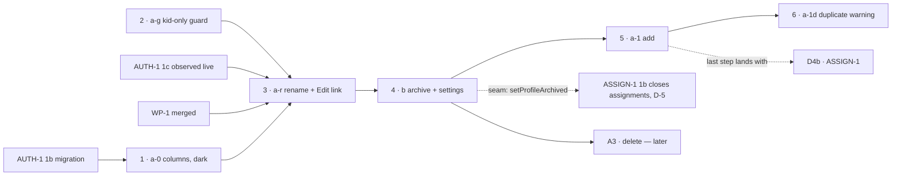
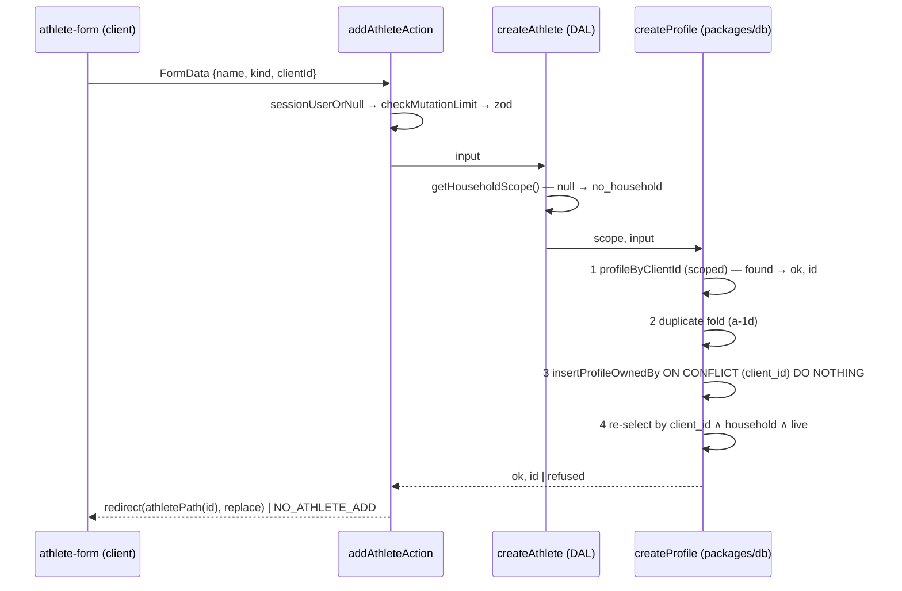

# PROF-1 (a + b) — add, rename and archive an athlete

> Backlog: [plan.md](../plan.md) row PROF-1 · Spec: [crud-1-fix-it-yourself.md](../specs/crud-1-fix-it-yourself.md)
> chunks **A1** (PROF-1a) and **A2** (PROF-1b) · Milestone: [CRUD-1](../milestones/crud-1-fix-it-yourself.md)
> (steps 1–2) · Branches: one per PR, listed under [Staging](#staging).
> Approved prototype: [`docs/prototypes/crud-1/index.html`](../prototypes/crud-1/index.html) v9 →
> screens **picker** (`vPicker`, `:2078`), **add** (`vAdd`, `:2138`; submit handler `:5043-5072`),
> **edit** (`vEdit`, `:2150`; submit `:5074-5085`), **settings** (`vSettings`, `:2239`; archive/restore
> `:4587-4611`).
>
> **Revised after round 1 of both panels** (engineering: correctness, scope, architecture, reuse,
> DB-safety, privacy; UX: lenses 1–3). The [review-response log](#review-response-log) records every
> material finding. This plan uses **post-AUTH-1-1c names only** (`sessionUserOrNull`, `requireSession`,
> `pages-need-a-session.test.ts`), because no PR here starts before 1c is live.

## Goal

Today an athlete exists only because `packages/db/src/seed.ts:163-184` wrote them: no route, action or
DAL function creates, renames or retires a profile (`apps/web/lib/dal/profiles.ts` has two reads and
one routine write, `:47`, `:93`, `:159`), and the picker's empty state sends a parent to GitHub
(`apps/web/components/onboarding/picker-empty-state.tsx:47-52`). This work makes the athlete list the
household's own: a dashed **"+ Add athlete"** tile at the bottom of the picker, a name and a
**Child / Adult** kind, a rename from the athlete's own page, and an **archive** in Household settings
that hides an athlete from the picker, keeps and exports every row they logged, and can be undone. It is
the first profile-**creating** endpoint, so it carries the full boundary-test set, and it lands only once
the session (AUTH-1 1c) is what says whose household an athlete joins.

Two things ship with it because the spec ties them to A1: the **kid-only guard** on every reader of the
household's newest block (Q15, FE-5), so an adult is not shown the kids' program; and the removal of the
last link to the routine editor (criterion 41, M30).

## Acceptance

From the spec ([Acceptance](../specs/crud-1-fix-it-yourself.md#acceptance)), by the spec's own numbers:

1. **When** a parent submits a new athlete with a non-blank name and a `kind` from `PROFILE_KINDS`, the
   system **shall** create one profile in the **session's** household and the picker **shall** list it
   on the next render. _(A1)_
2. **If** the name is blank after trimming, longer than the limit the plan sets, or `kind` is not in
   `PROFILE_KINDS`, **then** the system **shall** return a typed field error and write nothing. _(A1)_
   — the limit is `PROFILE_NAME_MAX = 40`.
3. **When** an "add athlete" submit is replayed with the same idempotency key, the system **shall**
   create exactly one profile and return the same result. _(A1)_
4. **If** a rename or archive names a profile outside the session's household, **then** the system
   **shall** respond as for an unknown profile (404 semantics, ADR 0006) and write nothing. _(A1, A2)_
5. **While** an athlete is archived, the picker **shall not** list them, their history **shall** still
   export, and a parent **shall** be able to restore them from a list of archived athletes. _(A2)_
6. _(A3 — out of scope; sketched under [Out-of-scope](#out-of-scope--deferred).)_
7. **When** PROF-1a ships, the empty state **shall not** link to GitHub. _(A1)_
8. Rename **shall** be reachable from the athlete's own page; archive and delete **shall** live only in
   household settings, never on the picker. **(R1)** _(A1, A2)_
9. The picker tile, the athlete form and household settings **shall** show `kind` as **Child** /
   **Adult**, from one display map beside `PROFILE_KINDS`; the stored values stay `kid` / `adult`.
   **(M10)** _(A1)_
10. _(not this plan)_
11. The app **shall not** link to the routine editor from anywhere — not the day page, not the
    athlete's edit page — until ACT-1 replaces it. A routine already saved **shall** keep rendering and
    logging on the day page; a profile with none **shall** keep the neutral default (Strength only,
    `apps/web/lib/routine/catalog.ts`, `NEUTRAL_DEFAULT_KEYS`). The `/p/[profileId]/routine` route stays
    in code, unlinked, as it was before V1-23 PR 2. **(M17, amended by M30)** _(A1)_
12. _(not this plan)_
13. _(not this plan)_
14. _(not this plan)_
15. _(not this plan)_
16. _(not this plan)_
17. **When** an athlete is archived while on a program, their open assignments **shall** close the day
    before, the archived athlete **shall** drop out of every "who's on it" list, and Undo **shall**
    reopen exactly those assignments. Before D3 there is nothing to close. **(R2 — IXD-5)** _(A2)_ —
    this plan delivers the "before D3" half and the seam; [ASSIGN-1](./assign-1-assignments.md) D-5
    owns the close.

Plus the decisions this plan executes: **Q1** (archive and delete in settings), **Q8** (archive is a
migration, one nullable column), **Q15** (the kid-only guard, covering the card, the form's scaffold and
prefill, and the export's `prescribedFor`).

**Done when** (observable):

- `/p` lists the household's live, unarchived athletes, then a dashed "+ Add athlete" tile, then one
  "Household settings ›" row. With zero athletes it shows the empty-state copy and the same tile; no
  GitHub link anywhere.
- Add → `/p/new` → name + Child/Adult → lands on the new athlete's page; Back returns to `/p`, not to
  the filled form (IXD-10).
- A name already in the household (archived included, folded by `foldName`) gets a **warning** callout
  with explicit choices, never a field error; rename runs the same check, excluding the athlete itself.
- The day page's "→ Edit {name}'s routine" link (`apps/web/app/p/[profileId]/page.tsx:359-364`) is gone,
  replaced by "→ Edit {name}"; nothing in `apps/web/app` or `apps/web/components` links to `/routine`.
- An **adult**'s day page shows no program card, no prescribed prefill, no "Strength A/B" label, a "Not
  a programmed day" default, and (when the household has a program) one muted line saying why; their
  CSV `prescribed` cells are empty. A **kid's** are byte-identical to today.
- `/settings` lists athletes (Edit, Archive) and archived athletes (Restore, Download history); archive
  shows an in-place result line with **Undo**; an archived athlete's export still returns their zip.
- A 40-character unbroken name renders without horizontal overflow at 360px on `/p`, `/p/<id>`,
  `/p/<id>/edit` and `/settings`.

## Staging

Six PRs, **reordered by round 1** (UX1 B2, scope S1) so there is never a window in which a parent can
add an athlete and has no way to fix or retire one: the edit and archive paths ship first, on the seeded
athletes, and **add** comes last.

| #   | PR       | Branch                                   | What                                                                                                                                                                                                 | ~lines (hand-written, incl. tests)                                                                                                                             | Gate                                                                                                                        |
| --- | -------- | ---------------------------------------- | ---------------------------------------------------------------------------------------------------------------------------------------------------------------------------------------------------- | -------------------------------------------------------------------------------------------------------------------------------------------------------------- | --------------------------------------------------------------------------------------------------------------------------- |
| 1   | **a-0**  | `db/prof-1a-0-profile-lifecycle-columns` | Migration: `profiles.client_id` (nullable, **non-partial** UNIQUE) + `profiles.archived_at`. Dark. AGENTS.md convention line + `db-migration` skill pointer                                          | ~210 (+ generated `meta/` JSON)                                                                                                                                | AUTH-1 1b's migration on `main` (numbers are serial; see [migration order](#migration-order))                               |
| 2   | **a-g**  | `fix/prof-1a-g-kid-only-program-read`    | `readsHouseholdProgram(kind)` in shared; the guard in `programDayRows`; the adult's role label/default and muted line on the day page; positive/negative/flip `db:verify`; two mutation patches      | ~260                                                                                                                                                           | none in code. **Deployed before a-r merges** (a-r can flip a kid to adult)                                                  |
| 3   | **a-r**  | `feat/prof-1a-r-rename-athlete`          | `foldName` + the name schema; `app/p/profile-actions.ts` (first module); rename/kind writer, DAL, action; `/p/[id]/edit`; "→ Edit {name}" replaces the routine link; `PROFILE_KIND_LABELS`; wrapping | ~400                                                                                                                                                           | **AUTH-1 1c observed live** + **WP-1 merged** + a-0 applied in prod + a-g deployed + UX panel reconciled + notice re-signed |
| 4   | **b**    | `feat/prof-1b-archive-athlete`           | Archive/restore writers, DAL, actions; `/settings` shell + athlete sections; picker filter + settings row; archived banner; notice + inventory                                                       | ~430 incl. the shared `UndoLine` + `Announcer` (~90); if the count runs over, those two ship first as `feat/prof-1b-0-undo-line` (unmounted, with their tests) | a-r + the settings-shell verdict (PM-5) + notice re-signed                                                                  |
| 5   | **a-1**  | `feat/prof-1a-1-add-athlete`             | `createProfile` (replay-first, in `packages/db`), `addAthleteAction`, `/p/new`, the dashed tile, the empty state without GitHub, README; notice                                                      | ~390                                                                                                                                                           | b + notice re-signed                                                                                                        |
| 6   | **a-1d** | `feat/prof-1a-1d-duplicate-warning`      | The duplicate warning for add **and** rename, archived rows included from day one; "Restore {name}" for an archived match                                                                            | ~260                                                                                                                                                           | a-1                                                                                                                         |

Each PR carries its changelog fragment, its `docs/status.md` pointer move and its `docs/roadmap.md` move
in the same PR (AGENTS.md → Status rides with the work); that line is not repeated per PR below.



**Why a-g is alone and early.** It changes a security-load-bearing program read
(`packages/db/src/queries/program-day.ts:52`) and nothing else needs it; it must be **in production**
before the first PR that can make an adult (a-r, by flipping kind). ⚠️ It edits
`apps/web/app/p/[profileId]/page.tsx`, one of 1c's files (`auth-1-clerk-google.md:1708`), so a-g and 1c
must not be open at once; whichever opens second merges `main` first (gate 1,
[parallel-work.md](../parallel-work.md)).

### Migration order

a-0 and B0 (V1-9b-0, [plan](./v1-9b-delete-and-restore.md) Staging row B0) both queue behind AUTH-1 1b's
`household_members` migration (`auth-1-clerk-google.md:833`). **Whichever of a-0 and B0 merges second
regenerates its migration from a fresh `origin/main` (`drizzle-kit generate`), never by hand-renumbering a
file**; the journal is append-only and CI-enforced. (V1-24 1d is not in this queue: it shipped as
`0012_bodyweight_one_per_day.sql`.) "**a-0 applied in prod**" means the runbook's check, not a green
`migrate.yml`: `information_schema.columns` lists `profiles.client_id` and `profiles.archived_at`, and
`pg_indexes` lists `uq_profiles_client_id` with no `WHERE` — the same three-check shape
`docs/runbooks.md:116` ("A pending migration wedges prod and the seed with it") is the recovery for.

## Design decisions (with the alternatives rejected)

### D1 · Idempotency for "add": `profiles.client_id`, **non-partial** UNIQUE, nullable

Criterion 3 needs a key, and **`profiles` has none**: `schema.ts:147-172`; the schema calls authored
household content "the profiles idiom … Config data → NO client_id" (`schema.ts:780`). ⚠️ The spec's
contract `profileUpsertSchema { name, kind }` carries no key either, against its own criterion 3.

- **Chosen:** `client_id uuid`, **nullable**, `uq_profiles_client_id` **non-partial**.
  - **Non-partial — ADR 0008 decision 3.4 applied at birth.** Every existing `client_id` arbiter is
    partial, so a hidden row is not an `ON CONFLICT` target and a replay inserts a twin
    (`docs/decisions/0008-deletion.md:127`); B0 exists to re-predicate five of them. An archived or later
    deleted profile keeps its slot.
  - **Nullable**, because the seed and `db:correct` create profiles with no client; NOT NULL would need
    a backfill plus the NOT VALID → VALIDATE split (two more migrations) to store a fabricated key. NULLs
    are distinct in a unique index, so seeded rows coexist. `addAthleteSchema` requires it for every
    app-created row.
  - **a-0 amends AGENTS.md's convention line** ("`client_id = UUIDv7, NOT NULL, UNIQUE (partial: WHERE
deleted_at IS NULL)`", AGENTS.md → Schema & migration conventions) to: _new_ `client_id` arbiters are
    **non-partial** (ADR 0008 3.4); nullable only where server-side creators exist, said in the column's
    docblock. The `db-migration` skill's §1 gains a one-line pointer to it. Otherwise the next
    migration copies the old line.
- **Rejected — client-supplied `public_id` as the key.** It makes the anti-IDOR id client-chosen, and a
  body naming another household's known `public_id` gets a refusal where a fresh one succeeds: a
  liveness oracle ADR 0006's 404 rule exists to deny (`profiles.ts:81-86`).
- **Rejected — an app-level "does it exist?" check** (write-path invariant 5) and **an
  Idempotency-Key table** (none exists; a client UUID + DB UNIQUE is how every create here meets rule 6).

### D2 · Replay first, then duplicates, then insert — one `packages/db` function owns the order

_(Correctness B1.)_ The first draft ran the duplicate check before the insert, so a replay of a
**successful** add would find its own row by name and answer "duplicate" instead of the same result —
criterion 3 broken. The sequence now lives in **one** writer, `createProfile` in
`packages/db/src/writers/profile.ts`, so `db:verify` proves the order on the shipped SQL:

1. **Look up by `client_id` inside the scope** (`profileByClientId(exec, scope, clientId)`, built on
   `inHousehold`). Found and not deleted → `{ ok: true, id }`, **before any duplicate logic**.
2. _(from a-1d)_ Unless `acknowledgedDuplicate` equals `foldName(name)`, look for a household name that
   folds equal (live **and** archived, not deleted) → `{ ok: false, reason: 'duplicate', match }`.
3. `insertProfileOwnedBy(exec, scope, row)` → `ON CONFLICT (client_id) DO NOTHING`.
4. Re-select by `client_id` **and** `inHousehold(scope)` **and** `deleted_at IS NULL` → `{ ok: true, id }`;
   no row (the key is another household's, or the row was deleted) → `{ ok: false, reason: 'refused' }`.

A concurrent double-submit both pass step 1, one inserts, the other's step 3 is a no-op and step 4
returns the same id. The DAL wraps it and has a unit test asserting step 1's query is emitted **before**
step 2's (recording-db idiom, `apps/web/lib/dal/recording-db.ts`).

### D3 · The archive marker: `profiles.archived_at timestamptz NULL` (Q8)

- **Chosen:** one nullable column. ADR 0008: archive is _"a lifecycle state a parent can see and
  restore from, orthogonal to existence; hide is invisible and ends in erasure"_ (`0008-deletion.md:77`).
  `deleted_at` would drop the profile out of `isLiveProfile` (`writers/ownership.ts:118-124`) — and so
  out of the export — and into PRIV-3's purge.
- **Archive sets `COALESCE(archived_at, now())`** _(DB S3, correctness S4)_, so a replayed archive keeps
  the first date; restore sets `NULL`. Accepted risk: a replay of "archive" that arrives **after** an Undo
  re-archives — a double tap followed by an Undo within one network retry window. The visible result line
  and Restore make it recoverable; recorded, not engineered away.
- **Not added to `isLiveProfile`** (the BOLA seam every action, page and the export resolve through,
  `profiles.ts:75-92`). Archive filters **lists** only.
- **Rejected:** a `status` text+CHECK (loses the date, still a CHECK migration later); deferring archive
  to Beta 1 (a typo'd athlete with no exit; PM-6).
- **Bundled into a-0 with `client_id`:** both additive, nullable and dark; migration numbers are a serial
  resource (AUTH-1 1b and B0 queue on them).

### D4 · The kid-only rule, defined once (Q15, FE-5)

_(Reuse B2, architecture S2.)_ One predicate in `packages/shared/src/programming.ts`:

```ts
/** Q15 stopgap (maintainer, 2026-10-22): until ASSIGN-READ (D4) an athlete reads the household's
 *  newest block only if they are a child. D4 deletes this and both of its callers' uses. */
export const PROGRAM_READ_KIND = PROFILE_KIND.kid;
export function readsHouseholdProgram(kind: ProfileKind): boolean {
  return kind === PROGRAM_READ_KIND;
}
```

- **`programDayRows`** (`program-day.ts:71-86`) adds `eq(schema.profiles.kind, PROGRAM_READ_KIND)` to the
  block subquery, whose `profiles` row is already pinned by `isThisProfile`. For an adult `blockId` is
  NULL and the query returns `[]` — the "nothing programmed" shape (`apps/web/lib/dal/programming.ts:17-18`).
  That covers the card and the scaffold/prefill (`getProgramDay`, called once at `page.tsx:85-89`) and
  the export's `prescribedFor` (`apps/web/lib/dal/export.ts:113-129`, `programDayRows` at `:121`), which
  builds its map only from those rows (`:119-128`).
- **`page.tsx`** calls `readsHouseholdProgram(profile.kind)`: role label and form default are `null` for
  an adult. `DayNav`'s `dayRoleLabel` is already optional and omitted when falsy (`day-nav.tsx:31`,
  `:64`); `StrengthSection` already takes `dayRole: DayRole | null` (`strength-section.tsx:40`) and
  passes it as the form default (`:79`), where `null` is "Not a programmed day" — the provenance the
  form documents (`strength-form.tsx:589-612`). The export keys `prescribed` by the **stored** `day_role`
  (`export.ts:155-159`) and writes `session_type` from its own column (`:55`).
- **The adult line** _(UX3 B1, UX1 S3)_: when the household has a live block and the athlete is an
  adult, a muted line under the Strength heading: "Programs are for children for now. {name} logs freely;
  their own program comes later." It needs one read: `householdHasProgram(db, { scope })` in
  `program-day.ts`, through a new prefixed helper `programBlockInHousehold(scope)` in
  `writers/ownership.ts` (the only module allowed to read `scope.householdId`, `scope.test.ts:55-56`;
  the prefixed-helper convention, `ownership.ts:152-156`).
- **Kind is read at export time** _(correctness S5)_. Flipping a kid to adult empties `prescribed` in
  **every past month** of their export; flipping back restores it. Stated as a `programming.md`
  invariant, proved by a `db:verify` flip case, and said on the edit form (D7).
- **Rejected:** guarding in `getProgramDay` and `prescribedFor` separately (two copies; `db:verify` runs
  the query, not the DAL); guarding in the page (misses the export).
- **No live bytes change:** the spec records that no live adult profile reads the program (Q15,
  `crud-1-fix-it-yourself.md:859`); the seed writes only kids (`seed.ts:170`, `:179`). The plan cannot
  query production; a-g's PR body says so.

### D5 · Where the actions live: `apps/web/app/p/profile-actions.ts` (WP-1)

The revised [WP-1 plan](./wp-1-shard-actions.md) names the module set and the registry shape, and this
plan follows it exactly. **Gate: WP-1 merged.**

- **Module:** `apps/web/app/p/profile-actions.ts`, the household-level athlete module in WP-1's fixed
  set (`wp-1-shard-actions.md:171`). a-r creates it.
- **Registry:** `MUTATING_ACTIONS` entries become `{ refusal, scope }` (`wp-1-shard-actions.md:68-70`,
  `:180-184`). `addAthleteAction` is **`scope: 'household'`**; `renameAthleteAction`,
  `archiveAthleteAction` and `restoreAthleteAction` are **`scope: 'profile'`** (they resolve a profile by
  public id and refuse a foreign one byte-identically).
- **Bindings:** profile entries `{ fn, writers }`; the household entry
  `{ fn, writers, scopeMiss }` (`:73-87`). `addAthleteAction`'s `scopeMiss` makes `createAthlete` return
  the no-household result.
- **One refusal for add:** `NO_ATHLETE_ADD = 'Couldn’t add this athlete.'` in `lib/constants.ts`, used
  **byte-identically** for (a) no session, (b) no household scope (state C/D), and (c) `createProfile`'s
  `refused` (a foreign or deleted key). Rename/archive/restore use `NO_ATHLETE_SAVE = 'No athlete found
to save.'` for unauth, foreign and unknown alike (PUX-8: "athlete", never "profile").
- **Test plumbing** (`actions.test.ts`): `vi.mock('next/navigation')` (for `redirect`); the profiles DAL
  mock gains `renameAthlete`, `archiveAthlete`, `restoreAthlete`, `createAthlete`; `VALID_BODY` gains
  one entry per action; the pinned module list gains `app/p/profile-actions.ts`; `write-path.md`
  `owns:` gains it.
- ⚠️ The **guide** collision remains: every PR here edits `lib/dal/` and `writers/` under
  `write-path.md`, so they take turns with B1, C1 and E (`wp-1-shard-actions.md:171`, item 5).
- **Note for the panel:** `mutating-actions.ts` and `action-state.ts` sit under `[profileId]/` and are
  now imported by a `/p`-level module. Moving them re-points AUTH-1 1c's plan text; this plan leaves them
  and records the move as a candidate for after 1c.

### D6 · Navigation after a write

- **Add** (a-1): `redirect(athletePath(id), RedirectType.replace)` **after** the Sentry wrapper resolves
  (in a Server Action `redirect` defaults to `push`, takes `RedirectType.replace`, and must sit outside
  any `try`:
  `apps/web/node_modules/next/dist/docs/01-app/03-api-reference/04-functions/redirect.md:29-31`, `:51`;
  Next 16.4.1). History `[/p, /p/new]` becomes `[/p, /p/<id>]`, so Back is `/p` (IXD-10). Sentry never
  sees `NEXT_REDIRECT`; a no-JS submit gets a 303 (`:215`). Before redirecting it calls
  `revalidatePath(APP_HOME_PATH)` and `revalidatePath(SETTINGS_PATH)` (the new tile and the settings
  list). **Because add redirects instead of returning `{ ok: true }`, its WP-1 binding carries the
  optional `succeeded(result, mocks)` predicate WP-1 adds (default `result.ok`)**: it asserts
  `redirect` was called with `(athletePath(id), RedirectType.replace)` and both `revalidatePath` calls
  came first, so WP-1's "valid body succeeds" guard holds for add.
- **Rename** (a-r) _(UX1 S4)_: return to where the parent came from without a duplicate history entry.
  The two in-app entries link with `?from=` set to `athletePath(id)` or `SETTINGS_PATH`; the page
  allowlists it to exactly those two values (anything else → `athletePath(id)`). The action returns
  `{ ok: true }` (no server redirect). The form's island, in an **effect** (never during render —
  `use-on-action-success.ts:20-21`), calls `router.back()` when the edit page was reached in-app (a
  `from` param is present and `window.history.length > 1`), else `router.replace(from)`. A replace-
  redirect would turn `[day, edit]` into `[day, day]`. No-JS: the page re-renders with a "Saved" status
  and a link back.
- **Archive/restore** (b): no navigation; the settings page updates in place.

### D7 · The form — controlled, kind made consequential, warnings not errors

- **Controlled state** _(UX1 B1)_: name and kind are React state, as are `clientId` (UUIDv7 minted once
  per mount) and `acknowledgedDuplicate`. React 19 resets uncontrolled fields when a form action settles,
  even on `{ ok:false }` (`docs/features/write-path.md:341`), which would empty the name under its own
  warning.
- **Kind hint names the effect** _(UX3 B1)_: "A child sees the household's program on their page. An adult
  logs without one for now. You can change this later." The edit form adds a line, shown only when the
  checked kind differs from the saved one: "Changing {name} to Adult hides the household program from
  their page and from what their export shows was prescribed." (and the reverse wording). Static text,
  referenced by the radio group's `aria-describedby`.
- **Duplicate = warning** _(UX1 S5, UX2 4, UX3 3; a-1d)_: a callout (amber, the spec's warning token,
  CD-2) under the field, referenced by the input's `aria-describedby`, **no** `aria-invalid`, **not** in
  `fieldErrors`. Choices as buttons, never "tap again": **"Add another {name}"** (submits with
  `acknowledgedDuplicate`) and **"Open {name}"** (link to the match). For an **archived** match the
  primary is **"Restore {name}"** _(UX3 2)_ (posts `restoreAthleteAction`, then opens them), with "Add
  another" secondary. Rename runs the same check **excluding the athlete being renamed** _(UX1 S8, UX3 4;
  closes the old open question 2)_, with "Save anyway" / "Cancel".
- **Form results** are announced through a persistent `role="status"` mounted with the form (UX2); errors
  sit beside their field with `aria-describedby`, focus moves to the first invalid field (A11Y-2).
- **Radios:** native inputs; the label shows focus-visible and checked states; each radio carries the
  hint's `aria-describedby`; the input uses `INPUT_CLASS` (`lib/constants.ts:287`).

### D8 · Routes, titles and path helpers

| Route                 | What                                    | Title                | Why here                                                                                                                                                                    |
| --------------------- | --------------------------------------- | -------------------- | --------------------------------------------------------------------------------------------------------------------------------------------------------------------------- |
| `/p/new`              | Add an athlete                          | "Add an athlete"     | The PROF-1 row: "create, read and edit live on `/p`" (`plan.md:2566`). A static segment beats `[profileId]`; `new` is never a UUID (`profiles.ts:100`).                     |
| `/p/[profileId]/edit` | Rename + kind                           | "Edit athlete"       | The prototype's path (`index.html:1975`); criterion 8. `getProfileByPublicId` → `notFound()`.                                                                               |
| `/settings`           | Household settings (athletes, archived) | "Household settings" | The prototype's path (`index.html:1979`); session-scoped (ADR 0006). The prototype does **not** approve the settings shell (PM-5, `index.html:1805`): PR b's UX panel does. |

Static `metadata.title` per page (UX2) — never a name, which is personal data in a browser history
entry. Helpers in `apps/web/lib/constants.ts`, built from `APP_HOME_PATH` (`:42`) _(reuse S2)_:
`athletePath(id)`, `athleteEditPath(id)`, `ADD_ATHLETE_PATH`, `SETTINGS_PATH`. Every new page calls
`requireSession()`, which `pages-need-a-session.test.ts` enforces per `page.tsx`.

### D9 · `/settings` is PROF-1b's, and an append point for others

_(Reuse S4, architecture S4.)_ PR b owns `apps/web/app/settings/page.tsx`: the Athletes and Archived
athletes sections, then a `<nav aria-label="More household settings">` list of `›` rows (CD-5) that later
chunks append to (Programs, Movements — MOV-1 adds the first). `SETTINGS_PATH` is the base for any
sub-page (`${SETTINGS_PATH}/movements`). Islands colocate with their routes, not `components/`; the one exception is the shared `UndoLine` and its announcer, which PR b builds for every plan that shows an Undo (spec seams table, `crud-1-fix-it-yourself.md:548-549`). The settings page's `<nav>` of sub-page rows is that table's second seam: other chunks append a row and their page under `SETTINGS_PATH`, and never edit the athlete sections.

**No `docs/features/household-settings.md` now.** The guide test is "four or more files across two or
more packages" (AGENTS.md → Feature guides); PR b's settings is one route, one island and a DAL function
in `apps/web`. The append rule lives in the page's docblock. Revisit when a second chunk adds a sub-page
with its own DAL (MOV-1 follows this decision).

### D10 · What "create" does NOT write

- **`routine_config` stays NULL** — the neutral default, never written (`plan.md:2797-2801`);
  `resolveProfileRoutine` maps it to `NEUTRAL_DEFAULT_KEYS = [STRENGTH_KEY]` (`catalog.ts:60`, `:76-78`).
- **No ramp targets (spec unowned 6).** The schedule is empty (`packages/shared/src/ramp-schedule.ts:49`).
  ⚠️ The spec's "a kid created by A1 silently has none" is half right: `seed.ts:262-264` selects every
  `kind = 'kid'` profile **with no household predicate**, and `migrate.yml:81` seeds production on every
  push. The day the schedule is filled, every household's kids get one family's ramp numbers. Recorded in
  `write-path.md` Traps for whoever fills it.
- **No program, no assignment, never a household.** The Daily Five is seeded at household creation by
  ONB-2 (`beta-1.md:346-354`), never via `PROGRAM_SEED`. The add flow's last step arrives with ASSIGN-1
  (D4b). AUTH-1 Q5: no request path creates a household (`auth-1-clerk-google.md:423-480`).

### D11 · Names, folding and wrapping

- **`foldName`** lives in `packages/shared/src/text.ts`, created by **a-r** (the first PROF-1 app PR, and
  the first of the three consumers to land); PICK-1 and MOV-1 import it. **NFKD**, then strip combining
  marks (`\p{M}`), map `‘ ’ ʼ` to `'`, collapse whitespace, trim, lower-case. **NFKD over NFD** because
  compatibility forms must match what a person sees: the ligature `fi` and full-width letters fold to
  `fi` and ASCII under NFKD and stay distinct under NFD, so two names a parent reads as identical would
  not warn. Pinned tests: `Zoë`→`zoe`, `O’Neil`→`o'neil`, `Crème`→`creme`, `fiona`→`fiona`, full-width `Ｚｏｅ`→`zoe`, a
  name of only combining marks → `''`.
- **The name schema** trims, **collapses interior whitespace** (so the stored name, the warning and
  A3's typed match agree), rejects a line break (`hasLineBreak`, `text.ts:27-29`), rejects a name that
  folds to `''` ("Enter a name"), and caps at `PROFILE_NAME_MAX = 40` (the prototype's `maxlength`,
  `index.html:2145`, `:2164`).
- **Wrapping** _(UX2 B1)_: `overflow-wrap:anywhere` + `min-w-0` on **every** element that renders
  `profile.name`: the tile, the day page `<h1>`, the edit `<h1>`, back links, the duplicate callout, the
  archived banner, the settings rows and the result line.

## The contract this plan adds

```
packages/shared/src/enums.ts
  PROFILE_KIND_LABELS  { kid: 'Child', adult: 'Adult' } as const satisfies Record<ProfileKind, string>
packages/shared/src/programming.ts
  PROGRAM_READ_KIND, readsHouseholdProgram(kind)                          (a-g; D4)
packages/shared/src/text.ts
  foldName(s)                                                             (a-r; D11)
packages/shared/src/profiles.ts                       (NEW, a-r; re-exported from index.ts)
  PROFILE_NAME_MAX     40
  athleteNameSchema    trim → collapse whitespace → 1..40 → no line break → foldName(v) !== ''
  profileUpsertSchema  { name: athleteNameSchema, kind: profileKindSchema }        (the spec's shape)
  renameAthleteSchema  profileUpsertSchema.extend({ profileId: uuidSchema,
                         acknowledgedDuplicate: z.string().optional() })           (a-r; a-1d uses it)
  archiveAthleteSchema { profileId: uuidSchema }                                    (b)
  addAthleteSchema     profileUpsertSchema.extend({ clientId: uuidSchema,
                         acknowledgedDuplicate: z.string().optional() })           (a-1)
apps/web/lib/dal/profiles.ts (DTOs)
  ProfileWithRoutineDTO + { archived: boolean }                                     (b)
  HouseholdAthletesDTO { live: ProfileDTO[], archived: ProfileDTO[] }               (b)
  CreateAthleteResult  { ok: true, id } | { ok: false, reason: 'no_household' | 'refused' }
                       | { ok: false, reason: 'duplicate', match: { id, name, archived } }   (a-1, a-1d)
```

## File-by-file changes

### PR a-0 — `db/prof-1a-0-profile-lifecycle-columns`

| Path                                                 | Change | What & why                                                                                                                                                                                                                                                                                                                                                                                                                                                          |
| ---------------------------------------------------- | ------ | ------------------------------------------------------------------------------------------------------------------------------------------------------------------------------------------------------------------------------------------------------------------------------------------------------------------------------------------------------------------------------------------------------------------------------------------------------------------- |
| `packages/db/src/schema.ts`                          | EDIT   | `profiles` (`:147-172`): `clientId` (nullable), `archivedAt`; `uniqueIndex('uq_profiles_client_id').on(t.clientId)` with **no** `.where`. Docblocks per D1/D3. Reword `:780` so "the profiles idiom … NO client_id" stops describing profiles.                                                                                                                                                                                                                      |
| `packages/db/migrations/00NN_profiles_lifecycle.sql` | NEW    | Generated, hand-hardened (`db-migration` skill): header (why, plan, dark, the [order rule](#migration-order)); `SET lock_timeout = '5s'`; `SET statement_timeout = '60s'`; two `ADD COLUMN IF NOT EXISTS` (nullable, no default → catalog-only); `CREATE UNIQUE INDEX "uq_profiles_client_id" …` non-concurrent on the 0012 precedent (`0012_bodyweight_one_per_day.sql:21-23`; `.squawk.toml` excludes the rule). No `IF NOT EXISTS` on the index (0012's reason). |
| `packages/db/migrations/meta/*`                      | NEW    | drizzle-kit snapshot + journal (append-only, CI-enforced).                                                                                                                                                                                                                                                                                                                                                                                                          |
| `packages/db/scripts/verify.ts`                      | EDIT   | **Appended** after every existing block, each section in its **own throwaway household** _(DB N3)_: `expectRejectedBy` a plain second `INSERT` with a used `client_id` on `uq_profiles_client_id` _(DB N2)_; the slot survives `archived_at` **and** `deleted_at` on the first row (the non-partial property); two `NULL` keys coexist; a seeded row's `archived_at` is `NULL`.                                                                                     |
| `AGENTS.md`                                          | EDIT   | The `client_id` line under Schema & migration conventions (D1) _(architecture S5, DB N4)_.                                                                                                                                                                                                                                                                                                                                                                          |
| `.claude/skills/db-migration/SKILL.md`               | EDIT   | §1: one-line pointer — new `client_id` arbiters are non-partial (ADR 0008 3.4). `skills:check` verifies the cite.                                                                                                                                                                                                                                                                                                                                                   |
| `docs/privacy/data-inventory.md`                     | EDIT   | Banner line (the dated `> **… re-read …**` list, `data-inventory.md:9-40`) for PROF-1a-0. §1a `profiles` row (`:120`): `client_id` ("device-generated idempotency key — technical, but device-linkable", the `entries` wording) and `archived_at`. §2 + re-review trigger 3 (`:90-91`): both as columns with **no writer yet**, owners PROF-1a-1 / PROF-1b. Cites by symbol (`schema.ts` → `profiles`), not line.                                                   |
| `docs/architecture.md`                               | EDIT   | ERD `profiles` gains both columns; the PR description embeds it.                                                                                                                                                                                                                                                                                                                                                                                                    |

### PR a-g — `fix/prof-1a-g-kid-only-program-read`

| Path                                                                 | Change | What & why                                                                                                                                                                                                                                                                                                                                                                                                      |
| -------------------------------------------------------------------- | ------ | --------------------------------------------------------------------------------------------------------------------------------------------------------------------------------------------------------------------------------------------------------------------------------------------------------------------------------------------------------------------------------------------------------------- |
| `packages/shared/src/programming.ts` (+ test)                        | EDIT   | `PROGRAM_READ_KIND`, `readsHouseholdProgram` (D4). Owned by `programming.md`.                                                                                                                                                                                                                                                                                                                                   |
| `packages/db/src/queries/program-day.ts`                             | EDIT   | The kind conjunct in the block subquery (`:85`); `householdHasProgram(db, { scope })`. Docblock: "Q15 stopgap; D4 removes".                                                                                                                                                                                                                                                                                     |
| `packages/db/src/writers/ownership.ts`                               | EDIT   | `programBlockInHousehold(scope)` (prefixed helper, D4).                                                                                                                                                                                                                                                                                                                                                         |
| `packages/db/scripts/verify.ts`                                      | EDIT   | Appended, own household with a block: **positive** — a kid gets the block's rows for `strength_a` and `strength_b`; **negative** — an adult in the **same** household, same block, gets `[]` for both _(correctness S6, DB S1)_; **flip** — the kid updated to adult reads `[]`, back to kid reads the rows again; `householdHasProgram` true here, false in a household with none and false across households. |
| `packages/db/scripts/mutations/NN-drop-kind-conjunct.{patch,expect}` | NEW    | Removes the kind conjunct; `db:verify` must go **RED** at the negative case. Numbered after the existing five.                                                                                                                                                                                                                                                                                                  |
| `apps/web/lib/dal/programming.ts`                                    | EDIT   | `getHouseholdHasProgram()` (scoped, `[]`-safe).                                                                                                                                                                                                                                                                                                                                                                 |
| `apps/web/app/p/[profileId]/page.tsx`                                | EDIT   | `readsHouseholdProgram(profile.kind)` → role label and form default `null` for an adult; the muted adult line when the household has a program (D4). Wrapping on the `<h1>` (D11).                                                                                                                                                                                                                              |
| `docs/features/programming.md`                                       | EDIT   | **CI-forced.** Invariants: only `readsHouseholdProgram` kinds read the newest block until D4; **kind is read at export time**, so a kind change rewrites past `prescribed` cells.                                                                                                                                                                                                                               |
| `docs/features/write-path.md`                                        | EDIT   | CI-forced (`writers/ownership.ts`): the new prefixed helper.                                                                                                                                                                                                                                                                                                                                                    |

`apps/web/lib/dal/export.ts` does not change: `prescribedFor` builds only from `programDayRows`' rows
(`:119-128`). No unit test covers `buildExportEntries` today (it is referenced only by `export.ts` and
`household.ts`); the proof is the `db:verify` cases plus `e2e/export-csv.spec.ts`'s kid assertions.

### PR a-r — `feat/prof-1a-r-rename-athlete`

| Path                                                                                        | Change   | What & why                                                                                                                                                                                                                                                                                                                                                                                                |
| ------------------------------------------------------------------------------------------- | -------- | --------------------------------------------------------------------------------------------------------------------------------------------------------------------------------------------------------------------------------------------------------------------------------------------------------------------------------------------------------------------------------------------------------- |
| `packages/shared/src/text.ts` (+ test)                                                      | EDIT     | `foldName` and its pinned cases (D11).                                                                                                                                                                                                                                                                                                                                                                    |
| `packages/shared/src/profiles.ts` (+ test), `index.ts`                                      | NEW      | `PROFILE_NAME_MAX`, `athleteNameSchema`, `profileUpsertSchema`, `renameAthleteSchema`. Tests: blank, spaces-only, ` a   b` stored as `a b`, 41 chars, interior newline, combining-marks-only, bad kind.                                                                                                                                                                                                   |
| `packages/shared/src/enums.ts`                                                              | EDIT     | `PROFILE_KIND_LABELS` beside `PROFILE_KINDS` (`:21-25`); reword the `:21` docblock, which names a person, to "a child or an adult".                                                                                                                                                                                                                                                                       |
| `packages/db/src/writers/profile.ts`                                                        | NEW      | `updateProfileIdentity(exec, scope, publicId, { name, kind })` → one guarded `UPDATE … SET name, kind, updated_at = now() WHERE isLiveProfile(publicId, scope) RETURNING public_id`; `null` = unknown/foreign/deleted. Archived athletes can be renamed. Barrel export.                                                                                                                                   |
| `packages/db/scripts/verify.ts`                                                             | EDIT     | Appended, own households: B renaming A's profile updates 0 rows; a deleted profile updates 0 rows.                                                                                                                                                                                                                                                                                                        |
| `apps/web/lib/dal/profiles.ts` (+ test)                                                     | EDIT     | `renameAthlete(publicId, input)` → `{ id } \| null`. Emitted-SQL test carries `isLiveProfile`'s three conjuncts.                                                                                                                                                                                                                                                                                          |
| `apps/web/app/p/profile-actions.ts`                                                         | NEW      | `'use server'`. `renameAthleteAction`: `sessionUserOrNull()` → `checkMutationLimit(user.userId)` → zod → `getProfileByPublicId` → `renameAthlete` → `revalidatePath(APP_HOME_PATH, athletePath(id), athleteEditPath(id))` → `{ ok: true }`. No `formData`/`headers` to Sentry (`actions.ts:60-67`: names are personal data).                                                                              |
| `apps/web/app/p/[profileId]/mutating-actions.ts`, `actions.test.ts`, the pinned module list | EDIT     | Per D5 (WP-1's shape): entry `{ refusal: NO_ATHLETE_SAVE, scope: 'profile' }`, binding with `writers: [renameAthlete]`, `VALID_BODY`, `next/navigation` mock, profiles mock fns.                                                                                                                                                                                                                          |
| `apps/web/app/p/profile-actions.test.ts`                                                    | NEW      | Per-action behaviour (bad bodies, success, revalidation), beside its module (WP-1's convention).                                                                                                                                                                                                                                                                                                          |
| `apps/web/app/p/[profileId]/edit/page.tsx`                                                  | NEW      | RSC; `requireSession()`; `getProfileByPublicId` → `notFound()`; static title; back link (`min-h-11`, wraps) to the allowlisted `from`; `<h1>Edit {name}</h1>`; the form. **No** Activities link (M30), **no** Program section (D4b).                                                                                                                                                                      |
| `apps/web/app/p/[profileId]/edit/athlete-form.tsx`                                          | NEW      | `'use client'`; colocated with its route; the add page imports it in a-1. D7: controlled state, kind hint, changed-kind line, `role="status"`, D6 navigation effect.                                                                                                                                                                                                                                      |
| `apps/web/app/p/[profileId]/page.tsx`                                                       | EDIT     | `:350-364`: the routine link → "→ Edit {name}" (`athleteEditPath(id)?from=…`), same `min-h-11` class. `← All profiles` (`:136`) → `← All athletes` (PUX-8), `min-h-11`.                                                                                                                                                                                                                                   |
| `apps/web/components/profiles/profile-tile.tsx` (+ test)                                    | EDIT     | `:30` `capitalize {profile.kind}` → `PROFILE_KIND_LABELS[profile.kind]`; wrapping on the name (D11).                                                                                                                                                                                                                                                                                                      |
| `apps/web/lib/constants.ts` (+ test)                                                        | EDIT     | `athletePath`, `athleteEditPath`, `NO_ATHLETE_SAVE`, `ATHLETE_FORM_COPY`; `PICKER_COPY.subhead` → "Tap your name to start logging." (prototype `:2083`); **`PICKER_EMPTY_COPY.next`** (`:203`) rewritten — it sends people to the routine editor criterion 41 hides. Pin each const once.                                                                                                                 |
| `apps/web/e2e/athletes.spec.ts`, `a11y.spec.ts`                                             | NEW/EDIT | Rename a seeded athlete and back, **exact** locators, retry-safe (restores the original name in `afterEach`) _(correctness S7)_; NARROW overflow + link tap-target checks on `/p/<id>` and `/p/<id>/edit`; edit route in the axe list; the `a11y.spec.ts:91` comment's "Edit routine" example.                                                                                                            |
| `docs/features/write-path.md`                                                               | EDIT     | CI-forced. `owns:` += `app/p/profile-actions.ts`; Files: `writers/profile.ts`; invariant 5: `profiles.client_id` is the one non-partial `client_id` arbiter and why; Traps: D10's ramp hazard; `updateProfileRoutine` (`profiles.ts:159-173`) noted as the pre-PROF-1 DAL-local writer, kept.                                                                                                             |
| `docs/features/programming.md`                                                              | EDIT     | The routine editor is unlinked until ACT-1 (M30), so nobody "restores" the link.                                                                                                                                                                                                                                                                                                                          |
| `docs/privacy/data-inventory.md`, `notice.md`                                               | EDIT     | Inventory banner line; §3: `profiles.name` is now **UI-editable** (rename) — the third free-text box (`:186-190` says two), typed by a parent or child, never exported (`:278`), never sent to Sentry. Notice: the "About the people" bullets (`:23-26`) say names can be changed in the app; bump **Last updated** (`:3`); `pnpm privacy:generate` regenerates `apps/web/lib/privacy/notice-content.ts`. |

### PR b — `feat/prof-1b-archive-athlete`

| Path                                                          | Change | What & why                                                                                                                                                                                                                                                                                                                                                                                                                                                                                                                                                                                                                                                                                                                     |
| ------------------------------------------------------------- | ------ | ------------------------------------------------------------------------------------------------------------------------------------------------------------------------------------------------------------------------------------------------------------------------------------------------------------------------------------------------------------------------------------------------------------------------------------------------------------------------------------------------------------------------------------------------------------------------------------------------------------------------------------------------------------------------------------------------------------------------------ |
| `packages/shared/src/profiles.ts`                             | EDIT   | `archiveAthleteSchema`.                                                                                                                                                                                                                                                                                                                                                                                                                                                                                                                                                                                                                                                                                                        |
| `packages/db/src/writers/profile.ts`                          | EDIT   | `setProfileArchived(exec, scope, publicId, archived)` → `SET archived_at = (archived ? COALESCE(archived_at, now()) : NULL), updated_at = now() WHERE isLiveProfile(publicId, scope) RETURNING public_id, archived_at`. **Seam docblock** _(scope S2)_: "[ASSIGN-1](../plans/assign-1-assignments.md) D-5 adds `closeOpenAssignments` here, in the same transaction, and returns the closed ids for Undo (criterion 47)." No tripwire test.                                                                                                                                                                                                                                                                                    |
| `packages/db/src/queries/household-profiles.ts`               | EDIT   | Select `archivedAt` too (`:39-44`); **predicate untouched** — it is the isolation boundary (`:14-25`).                                                                                                                                                                                                                                                                                                                                                                                                                                                                                                                                                                                                                         |
| `packages/db/scripts/verify.ts`                               | EDIT   | Appended, own households: archive → row has `archived_at`; **archive replayed keeps the first date** (COALESCE); B archiving A's updates 0 rows; restore clears; an archived profile still resolves through `isLiveProfile` and its month rows come back from the `export-month.ts` query (criterion 5).                                                                                                                                                                                                                                                                                                                                                                                                                       |
| `apps/web/lib/dal/profiles.ts` (+ test)                       | EDIT   | `listProfiles` drops archived (criterion 5); `listHouseholdAthletes()`; `archiveAthlete`, `restoreAthlete`; `getProfileByPublicId` adds `archived`.                                                                                                                                                                                                                                                                                                                                                                                                                                                                                                                                                                            |
| `apps/web/app/p/profile-actions.ts` + registry/bindings/tests | EDIT   | `archiveAthleteAction`, `restoreAthleteAction` (`scope: 'profile'`, `NO_ATHLETE_SAVE`) → `revalidatePath(APP_HOME_PATH, SETTINGS_PATH, athletePath(id))` → `{ ok: true, savedId }`.                                                                                                                                                                                                                                                                                                                                                                                                                                                                                                                                            |
| `apps/web/app/settings/page.tsx`                              | NEW    | D9. `requireSession()`; static title; `<h1>Household settings</h1>`; Athletes `<section>`: each `<li>` the name (wraps), "Child/Adult", **Edit** (`Button asChild` + `Link`, `athleteEditPath(id)?from=/settings`) and **Archive**, each `aria-label`led with the name (U23). Archived `<section>`: name, **Restore**, **Download history** (`/p/<id>/export`) _(privacy 3, UX3 5)_; the empty line (prototype `:2295`). Then the `<nav>` of sub-page rows.                                                                                                                                                                                                                                                                    |
| `apps/web/app/settings/athlete-list.tsx`                      | NEW    | `'use client'`, **one** page-level island _(UX1 S7, UX2 6)_: mounts `<Announcer>` and renders `UndoLine` for the result line ("{name} archived. Everything they logged is kept and still exports." + **Undo**), a persistent `role="status"` region mounted before its text changes, and focus moved **in an effect** — to Undo after archive, to the restored row after restore (prototype `:4603`, `:4610`).                                                                                                                                                                                                                                                                                                                 |
| `apps/web/components/undo-line.tsx` (+ test)                  | NEW    | **The shared Undo line** (spec → "Seams the plans settled", `crud-1-fix-it-yourself.md:548`); PROF-1 is the first to ship one, and V1-9b, ASSIGN-1, V1-22 A4, RETIRE-1 and CLONE-1 import it. Props: `message`, `undoLabel` (names what it undoes, A11Y-5), `onUndo`, `restoredFocusId`. Behaviour: static message text; Undo button `min-h-11`, `aria-describedby` → the message; focus to Undo when it mounts and to `restoredFocusId` after a successful undo, both **in effects**; announces through `announce()` below, never its own region. It owns no state the caller cannot reset, so a caller keys it (FE-6: V1-9b keys by athlete and day). Lives in `components/` (not colocated) because it is genuinely shared. |
| `apps/web/components/announcer.tsx` (+ test)                  | NEW    | The one announce helper: an `<Announcer>` that mounts a persistent `role="status"` region **before** any text, and an `announce(text)` from its context. A page that already has an announcer (the weigh-in's `SavedAnnouncer`, `apps/web/app/p/[profileId]/saved-announcer.tsx`) states in its docblock which one owns a restore; `/settings` has none, so it mounts this one.                                                                                                                                                                                                                                                                                                                                                |
| `apps/web/app/p/page.tsx`                                     | EDIT   | A `<nav aria-label="Household">` with "Household settings ›", sub-line showing the archived count when non-zero ("2 archived") _(UX3 6)_, below the tiles (prototype `:2102`). Never an archive control on the picker (criterion 8).                                                                                                                                                                                                                                                                                                                                                                                                                                                                                           |
| `apps/web/app/p/[profileId]/page.tsx`                         | EDIT   | If `profile.archived`: a notice "{name} is archived. Restore them in Household settings." (wraps) and the forms off (`writable && !profile.archived`); the export link stays.                                                                                                                                                                                                                                                                                                                                                                                                                                                                                                                                                  |
| `apps/web/app/p/[profileId]/edit/page.tsx`                    | EDIT   | "To archive an athlete, use Household settings" + link (prototype `:2188`).                                                                                                                                                                                                                                                                                                                                                                                                                                                                                                                                                                                                                                                    |
| `apps/web/lib/constants.ts`                                   | EDIT   | `SETTINGS_PATH`, `SETTINGS_COPY`.                                                                                                                                                                                                                                                                                                                                                                                                                                                                                                                                                                                                                                                                                              |
| `apps/web/e2e/athletes.spec.ts`, `a11y.spec.ts`               | EDIT   | Archive → leaves the picker, appears under Archived → **Undo** → back on the picker _(UX1 S7)_; restore; NARROW overflow + tap targets on `/settings`; axe list.                                                                                                                                                                                                                                                                                                                                                                                                                                                                                                                                                               |
| `docs/features/write-path.md`                                 | EDIT   | CI-forced. Archive is a list filter, never in `isLiveProfile`; the D-5 seam.                                                                                                                                                                                                                                                                                                                                                                                                                                                                                                                                                                                                                                                   |
| `docs/privacy/data-inventory.md`, `notice.md`                 | EDIT   | Inventory banner; §1a/§2 `archived_at` written; **§5**: archive is not deletion. Notice _(privacy 4–6)_: a **retention** row ("An archived athlete: kept in full until you restore or delete them"); under "Deleting your data", archiving **deletes nothing** and **does not hide** the athlete from anyone who opens their link or Household settings — any household member can archive and restore; under "Getting your data out", an archived athlete is exported from Household settings. Bump Last updated; regenerate `notice-content.ts`.                                                                                                                                                                             |

### PR a-1 — `feat/prof-1a-1-add-athlete`

| Path                                                                       | Change | What & why                                                                                                                                                                                                                                                                                                                                                                                                                                                |
| -------------------------------------------------------------------------- | ------ | --------------------------------------------------------------------------------------------------------------------------------------------------------------------------------------------------------------------------------------------------------------------------------------------------------------------------------------------------------------------------------------------------------------------------------------------------------- |
| `packages/shared/src/profiles.ts`                                          | EDIT   | `addAthleteSchema`.                                                                                                                                                                                                                                                                                                                                                                                                                                       |
| `packages/db/src/writers/ownership.ts`                                     | EDIT   | `insertProfileOwnedBy(exec, scope, row)` (the `insertMovementOwnedBy` precedent, `:187-200`: it performs the insert so `scope.householdId` never leaves the module) and `profileByClientId(exec, scope, clientId)`.                                                                                                                                                                                                                                       |
| `packages/db/src/writers/profile.ts`                                       | EDIT   | `createProfile` — D2's steps 1, 3, 4 (step 2 arrives in a-1d).                                                                                                                                                                                                                                                                                                                                                                                            |
| `packages/db/scripts/verify.ts`                                            | EDIT   | Appended, own households: create lands with A's `household_id`; **replay returns the same `public_id`** and count stays 1; replay after the row is archived still returns it; the same key under B's scope → `refused`, B gains no row.                                                                                                                                                                                                                   |
| `packages/db/scripts/mutations/NN-reselect-drops-household.{patch,expect}` | NEW    | Removes `inHousehold` from the re-select / `profileByClientId`; `db:verify` must go RED at the cross-household case.                                                                                                                                                                                                                                                                                                                                      |
| `apps/web/lib/dal/profiles.ts` (+ test)                                    | EDIT   | `createAthlete(input)`: no scope → `no_household`; else `createProfile`. Unit test: the `client_id` lookup is emitted before the insert.                                                                                                                                                                                                                                                                                                                  |
| `apps/web/app/p/profile-actions.ts` + registry/bindings/tests              | EDIT   | `addAthleteAction` (`scope: 'household'`, `NO_ATHLETE_ADD`, binding with `scopeMiss` **and** `succeeded` asserting `redirect(athletePath(id), RedirectType.replace)` after `revalidatePath(APP_HOME_PATH)` and `revalidatePath(SETTINGS_PATH)`); D6 redirect. `no_household` and `refused` return `NO_ATHLETE_ADD` byte-identically to the unauth refusal. Rate-limited like every mutation after 1c.                                                     |
| `apps/web/app/p/new/page.tsx`                                              | NEW    | RSC; `requireSession()`; static title; the picker's shell (`p/page.tsx:31`); `← All athletes`; `<h1>Add an athlete</h1>`; the form in add mode. If the scope does not resolve, `notFound()`.                                                                                                                                                                                                                                                              |
| `apps/web/app/p/add-athlete-tile.tsx`                                      | NEW    | Colocated with `/p`. A `Link` to `ADD_ATHLETE_PATH` with `ProfileTile`'s geometry (`profile-tile.tsx:20`), `border-2 border-dashed` at a measured ≥3:1 foreground mix, dashed `+` avatar (`aria-hidden`), "Add athlete" / "A child, or yourself" (prototype `:2100`).                                                                                                                                                                                     |
| `apps/web/app/p/page.tsx`                                                  | EDIT   | The list always ends in the add tile; the empty state above it at zero athletes. Rendered only in 1c's resolved household state (`householdState()`), never in "no household".                                                                                                                                                                                                                                                                            |
| `apps/web/components/onboarding/picker-empty-state.tsx` (+ test)           | EDIT   | Drop the GitHub link (`:47-52`) and `notYet`. **Copy** _(UX1 S6)_: heading "No athletes yet"; `what` unchanged; `next` → "Add the first athlete below — a child, or yourself. Their page starts with a weigh-in and strength."                                                                                                                                                                                                                            |
| `apps/web/lib/constants.ts` (+ test)                                       | EDIT   | `ADD_ATHLETE_PATH`, `NO_ATHLETE_ADD`; delete `PICKER_EMPTY_COPY.notYet`, `setupCta`, `setupAnchor`, and the README-anchor test (`constants.test.ts:63-68`).                                                                                                                                                                                                                                                                                               |
| `apps/web/app/design/tokens/inventory.tsx`                                 | EDIT   | Render the add tile beside `PickerEmptyState` (`:181-201`), the only axe-scanned empty picker, so the dashed border is measured in both themes.                                                                                                                                                                                                                                                                                                           |
| `README.md`                                                                | EDIT   | `## Adding an athlete` (`:63-75`) → "Use **+ Add athlete** at the bottom of the athlete list." (`plan.md:2805-2806`).                                                                                                                                                                                                                                                                                                                                     |
| `apps/web/e2e/athletes.spec.ts`, `a11y.spec.ts`                            | EDIT   | Add an athlete with a **per-attempt** unique name (run id + `testInfo.retry`), exact locators, then archive it in `afterEach` _(correctness S7)_; add one with a **40-character unbroken** name and check NARROW overflow on `/p`, `/p/<id>`, edit and `/settings` _(UX2 B1)_, archived at the end; `/p/new` in the axe list. ⚠️ `a11y.spec.ts:761`'s picker overflow test shares the DB and may see this row mid-run; wrapping makes it pass either way. |
| `docs/features/write-path.md`                                              | EDIT   | CI-forced: `createProfile`'s replay-first order (D2) and the a-1 sequence diagram (below).                                                                                                                                                                                                                                                                                                                                                                |
| `docs/privacy/data-inventory.md`, `notice.md`                              | EDIT   | Inventory banner; §2: `client_id` leaves "no writer"; §3: names now **created** in the app. Notice _(privacy 1, 2)_: "Technical bits" (`:42-43`) — the per-item device identifier now also covers each athlete added; bump Last updated; regenerate `notice-content.ts`.                                                                                                                                                                                  |



### PR a-1d — `feat/prof-1a-1d-duplicate-warning`

| Path                                                           | Change | What & why                                                                                                                                                                                                                                                                                                                                                                                                                                                                                      |
| -------------------------------------------------------------- | ------ | ----------------------------------------------------------------------------------------------------------------------------------------------------------------------------------------------------------------------------------------------------------------------------------------------------------------------------------------------------------------------------------------------------------------------------------------------------------------------------------------------- |
| `packages/db/src/writers/profile.ts`                           | EDIT   | D2 step 2 in `createProfile`; `findNameMatch(exec, scope, folded, { exclude?, clientId })` (live **and** archived, not deleted), which **excludes any row whose `client_id` is the caller's own key** — so a concurrent same-key request that loses the race to step 1 but wins it to step 2 is not answered "duplicate" by the row its twin just inserted; it falls through to steps 3–4 and returns `{ ok, id }`. `updateProfileIdentity`'s caller path runs it excluding the athlete itself. |
| `packages/db/scripts/verify.ts`                                | EDIT   | Appended: a replay of a **successful** add whose name now matches returns `ok` with the same id, not `duplicate` (correctness B1's regression); **insert a row, then run step 2 with the same `client_id` and the same name → no match** (the concurrent case); an archived `Zoë` matches `zoe`; rename to one's own name does not warn.                                                                                                                                                        |
| `apps/web/lib/dal/profiles.ts`, `profile-actions.ts` (+ tests) | EDIT   | Thread `acknowledgedDuplicate` and the `duplicate` result.                                                                                                                                                                                                                                                                                                                                                                                                                                      |
| `apps/web/app/p/[profileId]/edit/athlete-form.tsx`             | EDIT   | The warning callout and its choices (D7), including **Restore {name}** for an archived match.                                                                                                                                                                                                                                                                                                                                                                                                   |
| `apps/web/e2e/athletes.spec.ts`                                | EDIT   | The warning keeps both fields filled (UX1 B1), "Add another" adds, "Restore" restores.                                                                                                                                                                                                                                                                                                                                                                                                          |

## Gated on AUTH-1 1c — what to re-verify

AUTH-1 1a, 1b-bis and 1c-pre have shipped; **1b and 1c have not, and 1c is a one-way door**
(`auth-1-clerk-google.md:1695-1700`). a-r, b, a-1 and a-1d start only once 1c is **observed live**.
Then, before writing code:

1. **Boundary call:** `sessionUserOrNull()` then `checkMutationLimit(user.userId)` (`:1707`, `:1715`;
   Design §2, §8). `addAthleteAction` grows a table without bound, so it must be limited. Confirm the
   enumeration test was **switched, not widened** (`pages-are-gated.test.ts:211-217`, the pre-1c text).
2. **Page check:** `requireSession()` on `/p/new`, `/p/[id]/edit`, `/settings`.
3. **`getHouseholdScope()`'s five outcomes** (Design §3.2): add refuses with `NO_ATHLETE_ADD` in every
   non-resolved state, and the tile renders only in state A (`householdState()`).
4. **No household creation** (Q5, `:423-480`).
5. **The ≥2-household alert** exists (Q5).
6. **Roles.** Step-up is listed only for delete (`beta-1.md:425`); Q6 makes delete owner-only. This plan
   assumes **any member** may add, rename, archive and restore; if 1c ships a role, the panel decides.
7. **Sentry context** stays unset (`:1720`); no `formData`.
8. **`p/page.tsx` and `p/[profileId]/page.tsx` are 1c files** (`:1708`, `:1711`): merge `main` first.

## Test plan

**Boundary tests (AGENTS.md → Backend rules):**

| Case                                    | add (`household`)                                                                     | rename (`profile`)                     | archive / restore (`profile`)                                      |
| --------------------------------------- | ------------------------------------------------------------------------------------- | -------------------------------------- | ------------------------------------------------------------------ |
| unauth → reject before any DAL call     | central matrix (`MUTATING_ACTIONS`), `NO_ATHLETE_ADD`                                 | central matrix, `NO_ATHLETE_SAVE`      | central matrix                                                     |
| wrong owner / no scope                  | household suite via `scopeMiss` → `NO_ATHLETE_ADD`, byte-identical; `refused` → same  | foreign id → `NO_ATHLETE_SAVE`, 0 rows | foreign id → same, 0 rows                                          |
| bad body → zod reject, no write         | blank, 41 chars, newline, combining-only, bad kind, missing/garbage `clientId`        | same + garbage `profileId`             | garbage `profileId`                                                |
| replay → one effect, identical response | same `clientId` → 1 row, same id (also after archive; also when the name now matches) | same values → same state               | archive twice → one row, **first date kept**; restore twice → live |
| duplicate (a-1d)                        | warning, not `fieldErrors`; acknowledged → adds; changed name re-warns                | same, excluding itself                 | —                                                                  |

Actions are plain async functions with the DAL mocked; `next/navigation` mocked and `redirect` asserted
with `RedirectType.replace` on success only — for add, through the binding's `succeeded` predicate, which also asserts `revalidatePath(APP_HOME_PATH)` and `revalidatePath(SETTINGS_PATH)` ran before it. **`db:verify`** runs the real writers and queries, every new
section appended after the existing assertions in its own throwaway household; **`db:mutations`** gains
patches 06 and 07. **Unit:** `foldName`, the schemas, `PROFILE_KIND_LABELS` exhaustive, `readsHouseholdProgram`,
the tile label, the empty state without a link. **e2e:** `pnpm e2e:local` before a-r, b, a-1, a-1d;
NARROW overflow and link tap-target checks per new route; screenshots (`ui-screenshot`) at
390/820/1280. **Local:** `pnpm verify` and `pnpm guides:check` on every PR.

## 360px width math

360 − `px-4` × 2 = **328px** content (`p/page.tsx:31`).

- **Dashed tile:** 328 − `px-5` × 2 = 288 − avatar 56 − `gap-4` 16 = **216px** for "Add athlete"
  (≈100px) and "A child, or yourself" (≈140px). The tile grows (`min-h-24`).
- **A 40-character unbroken name in a tile:** 216px at `text-lg` holds ≈18 characters, so it breaks
  across 3 lines with `overflow-wrap:anywhere` + `min-w-0`; without them it overflows by ≈280px — the
  reason for D11.
- **Kind radios:** (328 − 8) / 2 = **160px** each, `min-h-11`; `flex-wrap` with `min-w-[8rem]` so 200%
  text stacks.
- **Duplicate callout choices:** "Add another {name}" can be ~40 characters; buttons are full-width and
  stacked (`CTA_CLASS`, `constants.ts:100`), never side by side.
- **Settings athlete row:** card `px-4` → 296px; name on its own line; Edit (≈64) + Archive (≈88) + gap =
  **160px**, leaving 136px for A3's "Delete…" (≈84).
- **Archived row:** Restore (≈88) and Download history (≈150) do not fit beside a name in 296px; they
  sit on their own line below it, wrapping (88 + 8 + 150 = 246 ≤ 296).

## Risks / rollback

| Risk                                                                                             | Mitigation                                                                                                                                     |
| ------------------------------------------------------------------------------------------------ | ---------------------------------------------------------------------------------------------------------------------------------------------- |
| An adult (new, or a kid flipped by rename) sees the kids' program                                | a-g is deployed before a-r; the rule lives once (`readsHouseholdProgram`); mutation patch 06 proves the conjunct is tested.                    |
| A kind flip silently rewrites past `prescribed` cells                                            | Stated on the edit form, in `programming.md`, and proved by the flip case.                                                                     |
| A replay mints a twin, or a replay of a success is answered "duplicate"                          | Non-partial UNIQUE; replay-first in one `packages/db` function (D2); `db:verify` + DAL order test.                                             |
| A crafted key returns another household's athlete                                                | Scoped lookup and re-select; patch 07 proves the conjunct is tested; `refused` is byte-identical to the unauth refusal.                        |
| Archive drops the export path                                                                    | `archived_at` not in `isLiveProfile`; `db:verify`; Download history on the archived row; notice says so.                                       |
| A replay of "archive" lands after Undo                                                           | **Accepted** (D3): rare, visible, one tap to restore.                                                                                          |
| Assignments stay open on archive after D3                                                        | ASSIGN-1 D-5 owns it (`assign-1-assignments.md:111-119`, `:736`); the seam docblock names it.                                                  |
| A long name breaks a 360px layout                                                                | D11 on every name renderer; NARROW e2e across four routes.                                                                                     |
| The dashed border fails SC 1.4.11 (the `border` token is 1.26:1, `picker-empty-state.tsx:15-18`) | A measured foreground mix, scanned on `/design/tokens`; the text also identifies the tile.                                                     |
| Names (often children's) leak                                                                    | Never in Sentry, a CSV (`data-inventory.md:278`) or a page title; inventory §3.                                                                |
| The notice goes stale                                                                            | a-r, b and a-1 each edit `notice.md`, regenerate, bump the date; the maintainer re-signs as a PR gate.                                         |
| The ramp schedule is filled and every household's kids get one family's targets                  | `write-path.md` Traps (D10); not this plan's fix.                                                                                              |
| "LLM never authors loads"; CSV byte-faithfulness                                                 | Nothing here writes a load. Names are not exported; archive changes no query; the guard changes `prescribed` only for adults, none live (Q15). |

**Rollback.** a-0 is additive and dark: revert code, keep the columns (never edit an applied
migration). a-g reverts cleanly. a-r/b/a-1/a-1d revert as code; rows they created are ordinary profiles;
an archived athlete is restorable by a build with Restore or a guarded correction.

## Out-of-scope / deferred

- **A3 — delete an athlete** _[later]_. Sketch: "Delete…" in the settings row (room budgeted above), a
  flow at `${SETTINGS_PATH}/athletes/<id>/delete` (prototype `vDel`, `:2306`) offering export (naming what
  it leaves out, `notice.md:163-165`), archive, then a typed name matched with `foldName` (SUX-9) and a
  fresh step-up; PRIV-3's runner plus a ledger entry; owner-only (Q6); the pause per Q11, with
  `notice.md` in the same PR. Gated on A2, PRIV-3's runner and Beta 1 step-up.
- **The add flow's last step** and "No program yet" — ASSIGN-1 (D4b).
- **Closing assignments on archive** — ASSIGN-1 D-5.
- **Avatars, birthdate, PIN** — stay unwritten (`data-inventory.md:179-181`).
- **Ramp-target expansion on create** — D10.
- **Programs and Movements in settings** — their chunks append rows (D9).
- **Reordering athletes** — creation order stays (`household-profiles.ts:31-32`).
- **Moving `mutating-actions.ts` / `action-state.ts`** out of `[profileId]/` — after 1c (D5).

## Open questions

1. **An archived athlete's own page** — recommended: notice + forms off, export link kept, no new check
   in the existing actions (archive is not a security boundary). _For the UX panel's re-review._
2. **Archive authority after AUTH-1** — any member, or owner only? (Re-verify item 6.) _For the
   maintainer._
3. **The notice wording** in a-r, b and a-1 needs the maintainer's re-sign before each merges.

_Closed by round 1:_ rename duplicates (the same check, excluding itself — D7); the adult's role label
and default (accepted into a-g — D4); archive's release (the milestone puts PROF-1b in **Beta 0**,
`docs/milestones/crud-1-fix-it-yourself.md:88`, `:97`; `beta-1.md:419`'s Beta 1 placement and the
spec's disagreement 1 should be updated when `plan.md` opens).

## Review-response log

### Engineering panel, round 1

| #     | Lens          | Finding                                                                                                         | Verdict  | Resolution                                                                                                        |
| ----- | ------------- | --------------------------------------------------------------------------------------------------------------- | -------- | ----------------------------------------------------------------------------------------------------------------- |
| B1    | correctness   | **BLOCKING.** Duplicate check before insert: a replay of a successful add is answered "duplicate" (criterion 3) | accepted | D2: `client_id` lookup first, in one `packages/db` function; `db:verify` regression case in a-1d; DAL order test. |
| B2    | correctness   | **BLOCKING.** Add's refusals were three shapes (unauth, no scope, foreign key)                                  | accepted | One `NO_ATHLETE_ADD`, byte-identical for all three; `refused` maps to it (D5).                                    |
| S3    | correctness   | Add's binding needs a scope-miss path                                                                           | accepted | `scope: 'household'` with `scopeMiss` (WP-1).                                                                     |
| S4    | correctness   | Re-archive overwrote the archive date                                                                           | accepted | `COALESCE(archived_at, now())` + replay test; replay-after-Undo recorded as accepted risk (D3).                   |
| S5    | correctness   | Kind is read at export time, so a flip rewrites history                                                         | accepted | Invariant, flip case, edit-form line (D4, D7).                                                                    |
| S6    | correctness   | The guard had only a negative proof                                                                             | accepted | Positive and negative on the same block, plus mutation patch 06.                                                  |
| S7    | correctness   | e2e not retry-safe                                                                                              | accepted | Per-attempt names, exact locators, cleanup in `afterEach`.                                                        |
| N     | correctness   | Interior whitespace not normalised                                                                              | accepted | Collapsed in the schema (D11).                                                                                    |
| S1    | scope         | Add shipped before any exit (rename/archive)                                                                    | accepted | Reordered: a-0, a-g, a-r, b, a-1, a-1d.                                                                           |
| S2    | scope         | The criterion 47 tripwire is machinery for another plan's job                                                   | accepted | Dropped; seam docblock pointing at ASSIGN-1 D-5.                                                                  |
| N1–N5 | scope         | Pre/post-1c names mixed; criterion numbers; per-PR status lines; line counts; OQ5                               | accepted | Post-1c names only; spec numbers, 41 and 47 in full; one staging line; recounted; OQ5 closed on the milestone.    |
| B1    | architecture  | **BLOCKING.** A second registry beside WP-1's                                                                   | accepted | `app/p/profile-actions.ts`, `{ refusal, scope }`, bindings (D5); gate "WP-1 merged".                              |
| S2    | architecture  | The kid rule in two places                                                                                      | accepted | `readsHouseholdProgram` in shared (D4).                                                                           |
| S4    | architecture  | `/settings` ownership undefined                                                                                 | accepted | D9; no guide yet, with the reason.                                                                                |
| S5    | architecture  | AGENTS.md's `client_id` line contradicts D1                                                                     | accepted | Amended in a-0, with the skill pointer.                                                                           |
| N     | architecture  | `action-state.ts` placement; a sequence diagram; `updateProfileRoutine`                                         | accepted | D5 note; diagram under a-1; write-path note.                                                                      |
| B2    | reuse         | **BLOCKING.** The kid rule duplicated (query + page)                                                            | accepted | As architecture S2.                                                                                               |
| S1    | reuse         | Separate registry / refusal copies                                                                              | accepted | WP-1 registry; two named refusals.                                                                                |
| S2    | reuse         | Path strings rebuilt                                                                                            | accepted | `athletePath`, `athleteEditPath` from `APP_HOME_PATH`.                                                            |
| S3    | reuse         | Paraphrased criteria                                                                                            | accepted | Spec numbers and text.                                                                                            |
| S4    | reuse         | Settings as an append point                                                                                     | accepted | D9.                                                                                                               |
| N2    | reuse         | `PROFILE_KIND_LABEL` singular against the repo's plural maps                                                    | accepted | `PROFILE_KIND_LABELS`.                                                                                            |
| —     | reuse (orch.) | Three folds across PROF-1, PICK-1, MOV-1                                                                        | accepted | One `foldName`, created in a-r, NFKD with the reason and pinned cases (D11).                                      |
| S1    | db-safety     | One-sided kind proof                                                                                            | accepted | As correctness S6.                                                                                                |
| S2    | db-safety     | Migration order vs B0 unstated; V1-24 1d already shipped                                                        | accepted | [Migration order](#migration-order): the second regenerates from fresh `main`; 1d dropped.                        |
| S3    | db-safety     | Archive replay                                                                                                  | accepted | COALESCE.                                                                                                         |
| N1    | db-safety     | "Applied in prod" undefined                                                                                     | accepted | `information_schema` / `pg_indexes` checks; `runbooks.md:116`.                                                    |
| N2–N4 | db-safety     | `expectRejectedBy`; shared fixtures; the skill pointer                                                          | accepted | All in a-0.                                                                                                       |
| —     | db-safety     | Re-select's household conjunct untested                                                                         | accepted | Mutation patch 07.                                                                                                |
| 1, 2  | privacy       | Notice not edited for the third free-text box and the device identifier                                         | accepted | a-r and a-1 notice edits; regenerate; date bump; re-sign gate.                                                    |
| 3     | privacy       | An archived athlete's data has no visible way out                                                               | accepted | Download history on the archived row.                                                                             |
| 4–6   | privacy       | Archive retention, authority and "does not hide" unsaid                                                         | accepted | PR b's notice edits.                                                                                              |
| 7     | privacy       | Inventory banner lines; line cites rot                                                                          | accepted | Banner line per PR; symbol cites in the inventory.                                                                |
| —     | privacy       | (author's pushback, none)                                                                                       | —        | No finding was contradicted by the code.                                                                          |

### UX panel, round 1

| #          | Lens                 | Finding                                                                                                                                | Verdict  | Resolution                                                                                                                                                      |
| ---------- | -------------------- | -------------------------------------------------------------------------------------------------------------------------------------- | -------- | --------------------------------------------------------------------------------------------------------------------------------------------------------------- |
| B1         | 1 interaction        | **BLOCKING.** Uncontrolled fields empty under the duplicate warning (`write-path.md:341`)                                              | accepted | Controlled state incl. `clientId`/`acknowledgedDuplicate`; e2e keeps the fields (D7).                                                                           |
| B2         | 1 interaction        | **BLOCKING.** Add before any way to fix or retire                                                                                      | accepted | Reordered staging.                                                                                                                                              |
| S3         | 1 interaction        | Kind's consequence invisible                                                                                                           | accepted | Hint, changed-kind line, adult day-page line.                                                                                                                   |
| S4         | 1 interaction        | Rename's return and history                                                                                                            | accepted | Allowlisted `from`, `router.back()` in an effect, no replace duplicate (D6).                                                                                    |
| S5         | 1 interaction        | Duplicate shown as an error                                                                                                            | accepted | Warning callout, explicit choices.                                                                                                                              |
| S6         | 1 interaction        | Empty-state copy unwritten                                                                                                             | accepted | Written in a-1.                                                                                                                                                 |
| S7         | 1 interaction        | Archive island, Undo, focus                                                                                                            | accepted | One page-level island using the shared `UndoLine` + `Announcer` (PR b builds both for the other plans; spec seams table); effect-based focus; e2e archive→Undo. |
| S8         | 1 interaction        | Rename skipped the duplicate check                                                                                                     | accepted | Same check, excluding itself.                                                                                                                                   |
| B1         | 2 a11y + 360px       | **BLOCKING.** Long names overflow at 360px                                                                                             | accepted | D11 on every renderer; NARROW e2e with a 40-character name across four routes.                                                                                  |
| 2, 3, 5, 7 | 2 a11y + 360px       | Per-route overflow/tap tests; back links 44px; settings Edit semantics; result announcements; radio focus/checked; input class; titles | accepted | All in the file tables (D7, D8).                                                                                                                                |
| 4          | 2 a11y + 360px       | Warning tied by `aria-invalid`                                                                                                         | accepted | `aria-describedby`, no `aria-invalid`.                                                                                                                          |
| 6          | 2 a11y + 360px       | Live region mounted with its text                                                                                                      | accepted | Persistent region in the island.                                                                                                                                |
| B1         | 3 trust + data entry | **BLOCKING.** Kind asks a parent to choose without saying what it changes                                                              | accepted | As UX1 S3.                                                                                                                                                      |
| 2          | 3 trust + data entry | An archived duplicate should offer Restore first                                                                                       | accepted | "Restore {name}" primary.                                                                                                                                       |
| 3, 4       | 3 trust + data entry | Warning copy; rename duplicates                                                                                                        | accepted | D7.                                                                                                                                                             |
| 5          | 3 trust + data entry | Archived athletes' data out                                                                                                            | accepted | Download history.                                                                                                                                               |
| 6          | 3 trust + data entry | Archived athletes invisible from the picker                                                                                            | accepted | Archived count on the settings row.                                                                                                                             |
| N7         | 3 trust + data entry | Archive date on replay                                                                                                                 | accepted | COALESCE.                                                                                                                                                       |

**Pushbacks:** none. Every finding was checked against the cited code; none was contradicted by it.

### Re-review (round 2)

8 of 9 round-1 blockers confirmed resolved; the remaining one and three new items:

| #   | Severity | Finding                                                                                         | Verdict  | Resolution                                                                                                                                      |
| --- | -------- | ----------------------------------------------------------------------------------------------- | -------- | ----------------------------------------------------------------------------------------------------------------------------------------------- |
| 1   | BLOCKING | `addAthleteAction` redirects, so WP-1's "valid body succeeds" (default `result.ok`) cannot pass | accepted | Add's binding carries WP-1's optional `succeeded(result, mocks)`, asserting the replace redirect to `athletePath(id)` (D6, a-1 row, Test plan). |
| 2   | SHOULD   | Concurrent same-key requests: step 2 can match the twin's fresh row and answer "duplicate"      | accepted | `findNameMatch` excludes rows carrying the caller's `client_id`; `db:verify` insert → step 2 with the same key → no match (a-1d).               |
| 3   | SHOULD   | Add did not revalidate before redirecting                                                       | accepted | `revalidatePath(APP_HOME_PATH)` and `(SETTINGS_PATH)` before `redirect`, asserted in `succeeded`.                                               |
| 4   | NIT      | Full-width `foldName` case unpinned                                                             | accepted | `Ｚｏｅ` → `zoe` pinned (D11).                                                                                                                  |
