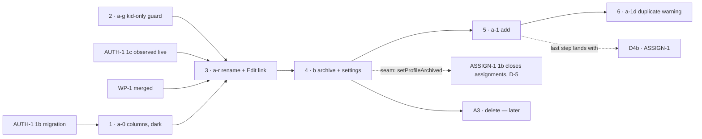
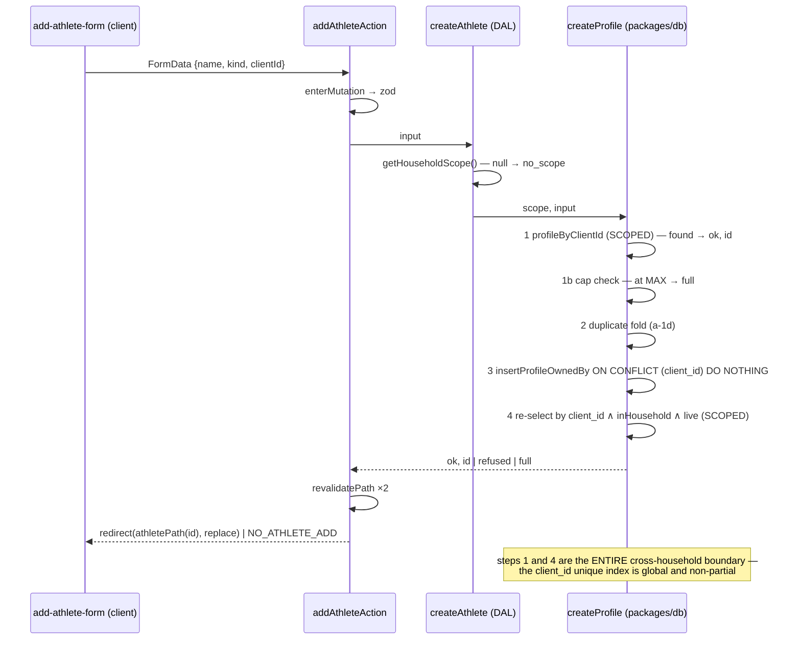

# PROF-1 (a + b) — add, rename and archive an athlete

> Backlog: [plan.md](../plan.md) row PROF-1 · Spec: [crud-1-fix-it-yourself.md](../specs/crud-1-fix-it-yourself.md)
> chunks **A1** (PROF-1a) and **A2** (PROF-1b) · Milestone: [CRUD-1](../milestones/crud-1-fix-it-yourself.md)
> (steps 1–2) · Branches: one per PR, listed under [Staging](#staging).
> Approved prototype: [`docs/prototypes/crud-1/index.html`](../prototypes/crud-1/index.html) v9 →
> screens **picker** (`vPicker`, `:2078`), **add** (`vAdd`, `:2138`; submit handler `:5043-5072`),
> **edit** (`vEdit`, `:2150`; submit `:5074-5085`), **settings** (`vSettings`, `:2239`; archive/restore
> `:4587-4611`).
>
> **Revised after round 1 of both panels** (engineering: correctness, scope, architecture, reuse,
> DB-safety, privacy; UX: lenses 1–3). The [review-response log](#review-response-log) records every
> material finding. This plan uses **post-AUTH-1-1c names only** (`sessionUserOrNull`, `requireSession`,
> `pages-need-a-session.test.ts`), because no PR here starts before 1c is live.

## Goal

Today an athlete exists only because `packages/db/src/seed.ts:163-184` wrote them: no route, action or
DAL function creates, renames or retires a profile (`apps/web/lib/dal/profiles.ts` has two reads and
one routine write, `:47`, `:93`, `:159`), and the picker's empty state sends a parent to GitHub
(`apps/web/components/onboarding/picker-empty-state.tsx:47-52`). This work makes the athlete list the
household's own: a dashed **"+ Add athlete"** tile at the bottom of the picker, a name and a
**Child / Adult** kind, a rename from the athlete's own page, and an **archive** in Household settings
that hides an athlete from the picker, **keeps** every row they logged, and can be undone. It is
the first profile-**creating** endpoint, so it carries the full boundary-test set, and it lands only once
the session (AUTH-1 1c) is what says whose household an athlete joins.

Two things ship with it because the spec ties them to A1: the **kid-only guard** on every reader of the
household's newest block (Q15, FE-5), so an adult is not shown the kids' program; and the removal of the
last link to the routine editor (criterion 41, M30).

## Acceptance

From the spec ([Acceptance](../specs/crud-1-fix-it-yourself.md#acceptance)), by the spec's own numbers:

1. **When** a parent submits a new athlete with a non-blank name and a `kind` from `PROFILE_KINDS`, the
   system **shall** create one profile in the **session's** household and the picker **shall** list it
   on the next render. _(A1)_
2. **If** the name is blank after trimming, longer than the limit the plan sets, or `kind` is not in
   `PROFILE_KINDS`, **then** the system **shall** return a typed field error and write nothing. _(A1)_
   — the limit is `PROFILE_NAME_MAX = 40`.
3. **When** an "add athlete" submit is replayed with the same idempotency key, the system **shall**
   create exactly one profile and return the same result. _(A1)_
4. **If** a rename or archive names a profile outside the session's household, **then** the system
   **shall** respond as for an unknown profile (404 semantics, ADR 0006) and write nothing. _(A1, A2)_
5. **While** an athlete is archived, the picker **shall not** list them, their history **shall** still
   export, and a parent **shall** be able to restore them from a list of archived athletes. _(A2)_
6. _(A3 — out of scope; sketched under [Out-of-scope](#out-of-scope--deferred).)_
7. **When** PROF-1a ships, the empty state **shall not** link to GitHub. _(A1)_
8. Rename **shall** be reachable from the athlete's own page; archive and delete **shall** live only in
   household settings, never on the picker. **(R1)** _(A1, A2)_
9. The picker tile, the athlete form and household settings **shall** show `kind` as **Child** /
   **Adult**, from one display map beside `PROFILE_KINDS`; the stored values stay `kid` / `adult`.
   **(M10)** _(A1)_
10. _(not this plan)_
11. The app **shall not** link to the routine editor from anywhere — not the day page, not the
    athlete's edit page — until ACT-1 replaces it. A routine already saved **shall** keep rendering and
    logging on the day page; a profile with none **shall** keep the neutral default (Strength only,
    `apps/web/lib/routine/catalog.ts`, `NEUTRAL_DEFAULT_KEYS`). The `/p/[profileId]/routine` route stays
    in code, unlinked, as it was before V1-23 PR 2. **(M17, amended by M30)** _(A1)_
12. _(not this plan)_
13. _(not this plan)_
14. _(not this plan)_
15. _(not this plan)_
16. _(not this plan)_
17. **When** an athlete is archived while on a program, their open assignments **shall** close the day
    before, the archived athlete **shall** drop out of every "who's on it" list, and Undo **shall**
    reopen exactly those assignments. Before D3 there is nothing to close. **(R2 — IXD-5)** _(A2)_ —
    this plan delivers the "before D3" half and the seam; [ASSIGN-1](./assign-1-assignments.md) D-5
    owns the close.

Plus the decisions this plan executes: **Q1** (archive and delete in settings), **Q8** (archive is a
migration, one nullable column), **Q15** (the kid-only guard, covering the card, the form's scaffold and
prefill, and the export's `prescribedFor`).

**Done when** (observable):

- `/p` lists the household's live, unarchived athletes, then a dashed "+ Add athlete" tile, then one
  "Household settings ›" row. With zero athletes it shows the empty-state copy and the same tile; no
  GitHub link anywhere.
- Add → `/p/new` → name + Child/Adult → lands on the new athlete's page; Back returns to `/p`, not to
  the filled form (IXD-10).
- A name already in the household (archived included, folded by `foldName`) gets a **warning** callout
  with explicit choices, never a field error; rename runs the same check, excluding the athlete itself.
- The day page's "→ Edit {name}'s routine" link (`apps/web/app/p/[profileId]/page.tsx:359-364`) is gone,
  replaced by "→ Edit {name}"; nothing in `apps/web/app` or `apps/web/components` links to `/routine`.
- An **adult**'s day page shows no program card, no prescribed prefill, no "Strength A/B" label, a "Not
  a programmed day" default, and (when the household has a program) one muted line saying why; their
  CSV `prescribed` cells are empty. A **kid's** are byte-identical to today.
- `/settings` lists athletes (Edit, Archive) and archived athletes (Restore, Download history); archive
  shows an in-place result line with **Undo**; an archived athlete's export still returns their zip.
- A 40-character unbroken name renders without horizontal overflow at 360px on `/p`, `/p/<id>`,
  `/p/<id>/edit` and `/settings`.

## Staging

Six PRs, **reordered by round 1** (UX1 B2, scope S1) so there is never a window in which a parent can
add an athlete and has no way to fix or retire one: the edit and archive paths ship first, on the seeded
athletes, and **add** comes last.

| #     | PR       | Branch                                   | What                                                                                                                                                                                                                                                                                                   | ~lines (hand-written, incl. tests)                                                                                                                                                                                                                                                                       | Gate                                                                                                                                                                                                                                       |
| ----- | -------- | ---------------------------------------- | ------------------------------------------------------------------------------------------------------------------------------------------------------------------------------------------------------------------------------------------------------------------------------------------------------ | -------------------------------------------------------------------------------------------------------------------------------------------------------------------------------------------------------------------------------------------------------------------------------------------------------- | ------------------------------------------------------------------------------------------------------------------------------------------------------------------------------------------------------------------------------------------ |
| 1 ✅  | **a-0**  | `db/prof-1a-0-profile-lifecycle-columns` | Migration: `profiles.client_id` (nullable, **non-partial** UNIQUE) + `profiles.archived_at`. Dark. AGENTS.md convention line + `db-migration` skill pointer                                                                                                                                            | ~210 (+ generated `meta/` JSON)                                                                                                                                                                                                                                                                          | AUTH-1 1b's migration on `main` (numbers are serial; see [migration order](#migration-order))                                                                                                                                              |
| 2 ✅  | **a-g**  | `fix/prof-1a-g-kid-only-program-read`    | `readsHouseholdProgram(kind)` in shared; the guard in `programDayRows`; the adult's role label/default and muted line on the day page; positive/negative/flip `db:verify`; two mutation patches                                                                                                        | ~260                                                                                                                                                                                                                                                                                                     | none in code. **Deployed before a-r merges** (a-r can flip a kid to adult)                                                                                                                                                                 |
| 3 ✅  | **a-r**  | `feat/prof-1a-r-rename-athlete`          | **RENAME ONLY** (kind dropped, see D7). `foldName` + the name schema; `app/p/profile-actions.ts` (first module); the rename writer, DAL, action; `/p/[id]/edit`; "→ Edit {name}" replaces the routine link; `PROFILE_KIND_LABELS` (display only); **every name renderer gets `NAME_WRAP_CLASS`** (D11) | ~400                                                                                                                                                                                                                                                                                                     | **AUTH-1 1c observed live** + **WP-1 merged** + a-0 applied in prod ✅ + a-g deployed ✅ + UX panel reconciled ✅ (round 2) + notice ✅ (decided: no edit owed) ✅ **MERGED 2026-11-07** as `feat/prof-1a-r-rename`; see "a-r as built".   |
| 4a ✅ | **b-s**  | `feat/prof-1b-s-owner-scope`             | **Dark.** `role` on `HouseholdScope` from the same membership row; `OwnerScope` + `ownerScope()`; guard assertions; `db:verify` proof. Read by nothing yet. ✅ **MERGED 2026-11-08** (#353), with a four-lens round and a follow-up correction (#354).                                                 | ~120                                                                                                                                                                                                                                                                                                     | b-s ahead of b; `a-0` applied                                                                                                                                                                                                              |
| 4     | **b**    | `feat/prof-1b-archive-athlete`           | Archive/restore writers, DAL, actions **taking `OwnerScope`**; `canManageAthletes` + the member view; `/settings` shell + athlete sections; picker filter + settings row; archived banner; notice + inventory                                                                                          | ~470 incl. the shared `UndoLine` + `Announcer` (~90) and the member view + `canManageAthletes` (~40); the `OwnerScope` seam is **not** in this count — it is `b-s`. Over 400, so if the count runs over, `UndoLine` + `Announcer` ship first as `feat/prof-1b-0-undo-line` (unmounted, with their tests) | a-r + the settings-shell verdict (PM-5) + notice re-signed                                                                                                                                                                                 |
| 5     | **a-1**  | `feat/prof-1a-1-add-athlete`             | `createProfile` (replay-first, in `packages/db`), `addAthleteAction`, `/p/new`, the dashed tile, the empty state without GitHub, README; notice                                                                                                                                                        | —                                                                                                                                                                                                                                                                                                        | **b** _(the "notice re-signed" half is STALE: `PRIV-4` (2026-11-07) batches that sign-off to AFTER the CRUD chunks and before the first invite, precisely so it is not done four times over. a-1 still edits the notice to keep it TRUE.)_ |
| 6     | **a-1d** | `feat/prof-1a-1d-duplicate-warning`      | The duplicate warning for add **and** rename, archived rows included from day one; "Restore {name}" for an archived match                                                                                                                                                                              | ~260                                                                                                                                                                                                                                                                                                     | a-1                                                                                                                                                                                                                                        |

Each PR carries its changelog fragment, its `docs/status.md` pointer move and its `docs/roadmap.md` move
in the same PR (AGENTS.md → Status rides with the work); that line is not repeated per PR below.



**Why a-g is alone and early.** It changes a security-load-bearing program read
(`packages/db/src/queries/program-day.ts:52`) and nothing else needs it; it must be **in production**
before the first PR that can make an adult (a-r, by flipping kind). ⚠️ It edits
`apps/web/app/p/[profileId]/page.tsx`, one of 1c's files (`auth-1-clerk-google.md:1708`), so a-g and 1c
must not be open at once; whichever opens second merges `main` first (gate 1,
[parallel-work.md](../parallel-work.md)).

### Migration order

a-0 and B0 (V1-9b-0, [plan](./v1-9b-delete-and-restore.md) Staging row B0) both queue behind AUTH-1 1b's
`household_members` migration (`auth-1-clerk-google.md:833`). **Whichever of a-0 and B0 merges second
regenerates its migration from a fresh `origin/main` (`drizzle-kit generate`), never by hand-renumbering a
file**; the journal is append-only and CI-enforced. (V1-24 1d is not in this queue: it shipped as
`0012_bodyweight_one_per_day.sql`.) "**a-0 applied in prod**" means the runbook's check, not a green
`migrate.yml`: `information_schema.columns` lists `profiles.client_id` and `profiles.archived_at`, and
`pg_indexes` lists `uq_profiles_client_id` with no `WHERE` — the same three-check shape
`docs/runbooks.md` → "A pending migration wedges prod and the seed with it" is the recovery for. ⚠️ **An earlier version of this line cited `:116`, which is a different section**; cite the heading, not a line number, since the file moves. **And the check set is wider than first written** — match `indexdef` byte-for-byte (a bare "has no WHERE" admits a NON-unique index), read `data_type`/`is_nullable`, and read the `drizzle.__drizzle_migrations` ledger. ⚠️ **The mechanism, read from `drizzle-orm@0.45.4`'s `pg-core/dialect.js:57` rather than assumed:** `migrate()` selects the **newest row only** (`order by created_at desc limit 1`) and applies every journal entry whose `when` exceeds that `created_at`. It never looks for a row per migration and never checks `hash`. So the check is **"newest `created_at` ≥ `1793984366840`"** (0020's journal `when`), not "a row for 0020 exists".
🔴 **And the failure mode flips once `0021` lands.** While 0020 is newest, a missing row means the next deploy **re-runs** it — and `CREATE UNIQUE INDEX` deliberately has no `IF NOT EXISTS`, so it raises `42P07`, the transaction aborts, `migrate.yml` goes red and the seed is skipped (the "pending migration wedges prod" runbook). After 0021 records, a missing 0020 row causes a **silent permanent skip** instead, which is worse because nothing goes red. Reachable only by hand-applied SQL — drizzle commits the DDL and the ledger insert in one transaction — which SECURITY.md's threat model does name.

The three reads, with what to expect:

```sql
SELECT column_name, data_type, is_nullable FROM information_schema.columns
 WHERE table_name = 'profiles' AND column_name IN ('client_id','archived_at');
-- client_id | uuid | YES      ·      archived_at | timestamp with time zone | YES

SELECT indexdef FROM pg_indexes WHERE indexname = 'uq_profiles_client_id';
-- EXACTLY this, and note it is `pg_get_indexdef()` OUTPUT, not the migration's text —
-- schema-qualified and unquoted, so a textual diff against the .sql is not the check:
-- CREATE UNIQUE INDEX uq_profiles_client_id ON public.profiles USING btree (client_id)

SELECT created_at, hash FROM drizzle.__drizzle_migrations ORDER BY created_at DESC LIMIT 1;
-- created_at >= 1793984366840
```

✅ **VERIFIED IN PRODUCTION 2026-11-07** _(maintainer, against the Neon primary)_ — all three reads,
so a-r's "a-0 applied in prod" gate is **met**:

| Read                                  | Result                                                                                                                                                                    |
| ------------------------------------- | ------------------------------------------------------------------------------------------------------------------------------------------------------------------------- |
| `information_schema.columns`          | `client_id · uuid · YES` · `archived_at · timestamp with time zone · YES`                                                                                                 |
| `pg_indexes.indexdef`                 | `CREATE UNIQUE INDEX uq_profiles_client_id ON public.profiles USING btree (client_id)` — 🔴 **no `WHERE`**, which is the non-partial property this whole chunk exists for |
| `drizzle.__drizzle_migrations` newest | `created_at = 1793984366840`, exactly `0020`'s journal `when` — so `0020` is the newest recorded migration and the next deploy will not re-run it                         |

⚠️ **Recorded here rather than in a runbook**: this was a one-time verification of one migration, not
a reusable procedure. The reusable part is the _shape_ of the check set above.

⚠️ **The migration file's own header is frozen and now superseded.** `0020`'s SQL comment carries the first, weaker version of this check set and the wrong runbook line; it is an applied migration, so forward-only forbids editing it. **This plan is the reachable copy.**

## Design decisions (with the alternatives rejected)

### D1 · Idempotency for "add": `profiles.client_id`, **non-partial** UNIQUE, nullable

Criterion 3 needs a key, and **`profiles` has none**: `schema.ts:147-172`; the schema calls authored
household content "the profiles idiom … Config data → NO client_id" (`schema.ts:780`). ⚠️ The spec's
contract `profileUpsertSchema { name, kind }` carries no key either, against its own criterion 3.

- **Chosen:** `client_id uuid`, **nullable**, `uq_profiles_client_id` **non-partial**.
  - **Non-partial — ADR 0008 decision 3.4 applied at birth.** Every existing `client_id` arbiter is
    partial, so a hidden row is not an `ON CONFLICT` target and a replay inserts a twin
    (`docs/decisions/0008-deletion.md:127`); B0 exists to re-predicate five of them. An archived or later
    deleted profile keeps its slot.
  - **Nullable**, because the seed and `db:correct` create profiles with no client; NOT NULL would need
    a backfill plus the NOT VALID → VALIDATE split (two more migrations) to store a fabricated key. NULLs
    are distinct in a unique index, so seeded rows coexist. `addAthleteSchema` requires it for every
    app-created row.
  - **a-0 amends AGENTS.md's convention line** ("`client_id = UUIDv7, NOT NULL, UNIQUE (partial: WHERE
deleted_at IS NULL)`", AGENTS.md → Schema & migration conventions) to: _new_ `client_id` arbiters are
    **non-partial** (ADR 0008 3.4); nullable only where server-side creators exist, said in the column's
    docblock. The `db-migration` skill's §1 gains a one-line pointer to it. Otherwise the next
    migration copies the old line.
- **Rejected — client-supplied `public_id` as the key.** It makes the anti-IDOR id client-chosen, and a
  body naming another household's known `public_id` gets a refusal where a fresh one succeeds: a
  liveness oracle ADR 0006's 404 rule exists to deny (`profiles.ts:81-86`).
- **Rejected — an app-level "does it exist?" check** (write-path invariant 5) and **an
  Idempotency-Key table** (none exists; a client UUID + DB UNIQUE is how every create here meets rule 6).

### D2 · Replay first, then duplicates, then insert — one `packages/db` function owns the order

_(Correctness B1.)_ The first draft ran the duplicate check before the insert, so a replay of a
**successful** add would find its own row by name and answer "duplicate" instead of the same result —
criterion 3 broken. The sequence now lives in **one** writer, `createProfile` in
`packages/db/src/writers/profile.ts`, so `db:verify` proves the order on the shipped SQL:

1. **Look up by `client_id` inside the scope** (`profileByClientId(exec, scope, clientId)`, built on
   `inHousehold`). Found and not deleted → `{ ok: true, id }`, **before any duplicate logic**.
2. _(a-1d)_ Unless `acknowledgedDuplicate` equals `foldName(name)`, look for a household name that
   folds equal (live **and** archived, not deleted) → `{ ok: false, reason: 'duplicate', match, atCap }`.
3. **The quota.** ⚠️ **After the fold, not before** — an archived twin occupies a slot, so a full
   household re-adding her must still be offered **Restore**, which needs none. The price is that the
   warning can reach a full household, which is what `atCap` is for.
4. `insertProfileOwnedBy(exec, scope, row)` → `ON CONFLICT (client_id) DO NOTHING`.
5. Re-select by `client_id` **and** `inHousehold(scope)` **and** `deleted_at IS NULL` → `{ ok: true, id }`;
   no row (the key is another household's, or the row was deleted) → `{ ok: false, reason: 'refused' }`.

⚠️ **Five steps since a-1d, and the quota was always here** — the pre-a-1d text listed four and
omitted it, while `profile.ts`'s own docblock described it. Both now say the same thing.

A concurrent double-submit both pass step 1, one inserts, the other's step 3 is a no-op and step 4
returns the same id. The DAL wraps it and has a unit test asserting step 1's query is emitted **before**
step 2's (recording-db idiom, `apps/web/lib/dal/recording-db.ts`).

### D3 · The archive marker: `profiles.archived_at timestamptz NULL` (Q8)

- **Chosen:** one nullable column. ADR 0008: archive is _"a lifecycle state a parent can see and
  restore from, orthogonal to existence; hide is invisible and ends in erasure"_ (`0008-deletion.md:77`).
  `deleted_at` would drop the profile out of `isLiveProfile` (`writers/ownership.ts:118-124`) — and so
  out of the export — and into PRIV-3's purge.
- **Archive sets `COALESCE(archived_at, now())`** _(DB S3, correctness S4)_, so a replayed archive keeps
  the first date; restore sets `NULL`. Accepted risk: a replay of "archive" that arrives **after** an Undo
  re-archives — a double tap followed by an Undo within one network retry window. The visible result line
  and Restore make it recoverable; recorded, not engineered away.
- **Not added to `isLiveProfile`** (the BOLA seam every action, page and the export resolve through,
  `profiles.ts:75-92`). Archive filters **lists** only.
- **Rejected:** a `status` text+CHECK (loses the date, still a CHECK migration later); deferring archive
  to Beta 1 (a typo'd athlete with no exit; PM-6).
- **Bundled into a-0 with `client_id`:** both additive, nullable and dark; migration numbers are a serial
  resource (AUTH-1 1b and B0 queue on them).

### D4 · The kid-only rule, defined once (Q15, FE-5)

_(Reuse B2, architecture S2.)_ One predicate in `packages/shared/src/programming.ts`:

```ts
/** Q15 stopgap (maintainer, 2026-10-22): until ASSIGN-READ (D4) an athlete reads the household's
 *  newest block only if they are a child. D4 deletes this and both of its callers' uses. */
export const PROGRAM_READ_KIND = PROFILE_KIND.kid;
export function readsHouseholdProgram(kind: ProfileKind): boolean {
  return kind === PROGRAM_READ_KIND;
}
```

- **`programDayRows`** (`program-day.ts:71-86`) adds `eq(schema.profiles.kind, PROGRAM_READ_KIND)` to the
  block subquery, whose `profiles` row is already pinned by `isThisProfile`. For an adult `blockId` is
  NULL and the query returns `[]` — the "nothing programmed" shape (`apps/web/lib/dal/programming.ts:17-18`).
  That covers the card and the scaffold/prefill (`getProgramDay`, called once at `page.tsx:85-89`) and
  the export's `prescribedFor` (`apps/web/lib/dal/export.ts:113-129`, `programDayRows` at `:121`), which
  builds its map only from those rows (`:119-128`).
- **`page.tsx`** calls `readsHouseholdProgram(profile.kind)`: role label and form default are `null` for
  an adult. `DayNav`'s `dayRoleLabel` is already optional and omitted when falsy (`day-nav.tsx:31`,
  `:64`); `StrengthSection` already takes `dayRole: DayRole | null` (`strength-section.tsx:40`) and
  passes it as the form default (`:79`), where `null` is "Not a programmed day" — the provenance the
  form documents (`strength-form.tsx:589-612`). The export keys `prescribed` by the **stored** `day_role`
  (`export.ts:155-159`) and writes `session_type` from its own column (`:55`).
- **The adult line** _(UX3 B1, UX1 S3)_: when the household has a live block and the athlete is an
  adult, a muted line under the Strength heading: "Programs are for children for now. {name} logs freely;
  their own program comes later." It needs one read: `householdHasProgram(db, { scope })` in
  `program-day.ts`, through a new prefixed helper `programBlockInHousehold(scope)` in
  `writers/ownership.ts` (the only module allowed to read `scope.householdId`, `scope.test.ts:55-56`;
  the prefixed-helper convention, `ownership.ts:152-156`).
- 🔴 **Kind is read at export time, and the justification for that is HALF-FALSE** _(correctness
  review, 2026-11-07)_. Flipping a kid to adult empties `prescribed` in **every past month** of their
  export; flipping back restores it. This plan justified that as _"a program a non-child should not
  have been reading is not retroactively theirs"_ — **true for the household's adult, false for a kid
  who ages out**, whose `prescribed` cells were legitimately theirs when logged. Ageing out is the
  realistic reason anyone changes `kind`, so the argument fails on exactly the case it most needs to
  cover. **That is why `kind` is no longer editable in a-r** (D7). Stated as a `programming.md`
  invariant, proved by a `db:verify` flip case, and said on the edit form (D7).
- **Rejected:** guarding in `getProgramDay` and `prescribedFor` separately (two copies; `db:verify` runs
  the query, not the DAL); guarding in the page (misses the export).
- **No live bytes change:** the spec records that no live adult profile reads the program (Q15,
  `crud-1-fix-it-yourself.md:859`); the seed writes only kids (`seed.ts:170`, `:179`). The plan cannot
  query production; a-g's PR body says so.

### D5 · Where the actions live: `apps/web/app/p/profile-actions.ts` (WP-1)

The revised [WP-1 plan](./wp-1-shard-actions.md) names the module set and the registry shape, and this
plan follows it exactly. **Gate: WP-1 merged.**

- **Module:** `apps/web/app/p/profile-actions.ts`, the household-level athlete module in WP-1's fixed
  set (`wp-1-shard-actions.md:171`). a-r creates it.
- **Registry:** `MUTATING_ACTIONS` entries become `{ refusal, scope }` (`wp-1-shard-actions.md:68-70`,
  `:180-184`). `addAthleteAction` is **`scope: 'household'`**; `renameAthleteAction`,
  `archiveAthleteAction` and `restoreAthleteAction` are **`scope: 'profile'`** (they resolve a profile by
  public id and refuse a foreign one byte-identically).
- **Bindings:** profile entries `{ fn, writers }`; the household entry
  `{ fn, writers, scopeMiss }` (`:73-87`). `addAthleteAction`'s `scopeMiss` makes `createAthlete` return
  the no-household result.
- **One refusal for add:** `NO_ATHLETE_ADD = 'Couldn’t add this athlete.'` in `lib/constants.ts`, used
  **byte-identically** for (a) no session, (b) no household scope (state C/D), and (c) `createProfile`'s
  `refused` (a foreign or deleted key). Rename/archive/restore use `NO_ATHLETE_SAVE = 'No athlete found
to save.'` for unauth, foreign and unknown alike (PUX-8: "athlete", never "profile").
- **Test plumbing** (`actions.test.ts`): `vi.mock('next/navigation')` (for `redirect`); the profiles DAL
  mock gains `renameAthlete`, `archiveAthlete`, `restoreAthlete`, `createAthlete`; `VALID_BODY` gains
  one entry per action; the pinned module list gains `app/p/profile-actions.ts`; `write-path.md`
  `owns:` gains it.
- ⚠️ The **guide** collision remains: every PR here edits `lib/dal/` and `writers/` under
  `write-path.md`, so they take turns with B1, C1 and E (`wp-1-shard-actions.md:171`, item 5).
- **Note for the panel:** `mutating-actions.ts` and `action-state.ts` sit under `[profileId]/` and are
  now imported by a `/p`-level module. Moving them re-points AUTH-1 1c's plan text; this plan leaves them
  and records the move as a candidate for after 1c.

### D6 · Navigation after a write

- **Add** (a-1): `redirect(athletePath(id), RedirectType.replace)` **after** the Sentry wrapper resolves
  (in a Server Action `redirect` defaults to `push`, takes `RedirectType.replace`, and must sit outside
  any `try`:
  `apps/web/node_modules/next/dist/docs/01-app/03-api-reference/04-functions/redirect.md:29-31`, `:51`;
  Next 16.4.1). History `[/p, /p/new]` becomes `[/p, /p/<id>]`, so Back is `/p` (IXD-10). Sentry never
  sees `NEXT_REDIRECT`; a no-JS submit gets a 303 (`:215`). Before redirecting it calls
  `revalidatePath(APP_HOME_PATH)` and `revalidatePath(SETTINGS_PATH)` (the new tile and the settings
  list). **Because add redirects instead of returning `{ ok: true }`, its WP-1 binding carries the
  optional `succeeded(result, mocks)` predicate WP-1 adds (default `result.ok`)**: it asserts
  `redirect` was called with `(athletePath(id), RedirectType.replace)` and both `revalidatePath` calls
  came first, so WP-1's "valid body succeeds" guard holds for add.
- **Rename** (a-r) _(UX1 S4)_: return to where the parent came from without a duplicate history entry.
  The two in-app entries link with `?from=` set to `athletePath(id)` or `SETTINGS_PATH`; the page
  allowlists it to exactly those two values (anything else → `athletePath(id)`). The action returns
  `{ ok: true }` (no server redirect). The form's island, in an **effect** (never during render —
  `use-on-action-success.ts:20-21`), calls `router.back()` when the edit page was reached in-app (a
  `from` param is present and `window.history.length > 1`), else `router.replace(from)`. A replace-
  redirect would turn `[day, edit]` into `[day, day]`. No-JS: the page re-renders with a "Saved" status
  and a link back.
- **Archive/restore** (b): no navigation; the settings page updates in place.

### D7 · The form — controlled, kind made consequential, warnings not errors

- **Controlled state** _(UX1 B1)_: name and kind are React state, as are `clientId` (UUIDv7 minted once
  per mount) and `acknowledgedDuplicate`. React 19 resets uncontrolled fields when a form action settles,
  even on `{ ok:false }` (`docs/features/write-path.md:341`), which would empty the name under its own
  warning.
- 🔴 **KIND IS NOT EDITABLE IN a-r — dropped 2026-11-07** _(maintainer, on the UX panel's unanimous
  BLOCKING)_. a-r is **rename only**. The `kind` radio stays on **a-1**'s add form, where choosing it
  has no history to rewrite.
  **Why.** One control served two opposite intents and the form could not tell them apart: _"I added
  them as the wrong kind"_, where emptying past `prescribed` is correct, and _"they turned 18"_, where
  those cells were legitimately theirs. The second is the realistic trigger. The radio sat a
  thumb-width below the name field, pre-checked, sharing one Save — so a parent fixing a typo could
  brush it, tap Save, and land on a day page with the program gone and copy written for the
  household's adult (_"Programs are for children for now"_) shown to a 17-year-old who was on that
  program yesterday.
  ⚠️ **The rationale this plan carried was half-false**, and that is what the panel found: D4 and
  `programming.md` say _"a program a non-child should not have been reading is not retroactively
  theirs"_ — true for the household's adult, **false for a kid ageing out**. Corrected in both places.
  **Neither acceptance criterion required it.** 8 says _rename_ shall be reachable; 9 says the form
  shall **show** `kind` as Child/Adult. Showing is not editing.
  🔴 **A wrong kind's recovery is ARCHIVE + ADD AGAIN** _(corrected 2026-11-09, a-1 panel B2)_. This
  said "a `db:correct` correction — this repo's stated answer for wrong data the app cannot fix", and
  **no such correction is registered**: `scripts/corrections/registry.ts` holds five and none touches
  `profiles.kind`, and `runbooks.md` has no procedure. A sentence pointing at a script nobody wrote
  is the "unwired gate cited as a safety argument" AGENTS.md forbids. The real remedy shipped with
  `b` the day before this correction: archive the athlete in Household settings and add them again,
  which costs nothing when caught before anything is logged, needs no maintainer, and is what the add
  form now tells a parent. ⚠️ It is **owner-only**, so a member who mis-adds asks the owner — which
  `SETTINGS_COPY.ownerOnly` already says. 🔴 **The prerequisite for ever making it editable** is in § Out-of-scope: the
  export must stop depending on today's `kind`.
- **Kind hint (a-1's add form only)** _(UX3 B1)_: "A child sees the household's program on their page.
  An adult logs without one for now." ⚠️ **Not "You can change this later"** — after this decision
  they cannot, in the app.
- **Duplicate = warning** _(UX1 S5, UX2 4, UX3 3; a-1d)_: a callout under the field.
  🔴 **It is NOT amber, and the plan said so wrongly** _(maintainer, 2026-11-07; UX2 round 2)_. The
  spec accepted an amber warning token (CD-2), but **the prototype reversed it** — _"no amber the app
  has no token for. A caution is the information callout, with a mark"_ — and `globals.css` defines no
  amber in either theme, so no PR was adding one. **Decision: follow the prototype.**
  `bg-muted text-foreground border rounded-lg px-4 py-3` with an `aria-hidden` ⚠ mark. Measured:
  **15:1 light, 11:1 dark**.
  ⚠️ **No `text-muted-foreground` inside the callout.** On `bg-muted` that is the **4.34:1** pair
  `design.md` already records as under AA — and it is the idiom every hint line in this app uses, so
  it is the natural mistake. The ⚠ mark and the words carry the meaning; the `border` is decoration
  (1.26:1 light), not a 3:1 boundary.
  **Add the callout to `app/design/tokens/inventory.tsx`** so axe scans it in both themes before
  a-1d renders it on a real route — today no route renders one, which is why CI is green on a pair
  that fails. Placed referenced by the input's `aria-describedby`, **no** `aria-invalid`, **not** in
  `fieldErrors`. Choices as buttons, never "tap again": **"Add another {name}"** (submits with
  `acknowledgedDuplicate`) and **"Open {name}"** (link to the match). For an **archived** match the
  primary is **"Restore {name}"** _(UX3 2)_ (posts `restoreAthleteAction`, then opens them), with "Add
  another" secondary. Rename runs the same check **excluding the athlete being renamed** _(UX1 S8, UX3 4;
  closes the old open question 2)_, with "Save anyway" / "Cancel".
- **Form results** are announced through a persistent `role="status"` mounted with the form (UX2); errors
  sit beside their field with `aria-describedby`, focus moves to the first invalid field (A11Y-2).
- **Radios:** native inputs; the label shows focus-visible and checked states; each radio carries the
  hint's `aria-describedby`; the input uses `INPUT_CLASS` (`lib/constants.ts:287`).

### D8 · Routes, titles and path helpers

| Route                 | What                                    | Title                | Why here                                                                                                                                                                    |
| --------------------- | --------------------------------------- | -------------------- | --------------------------------------------------------------------------------------------------------------------------------------------------------------------------- |
| `/p/new`              | Add an athlete                          | "Add an athlete"     | The PROF-1 row: "create, read and edit live on `/p`" (`plan.md:2566`). A static segment beats `[profileId]`; `new` is never a UUID (`profiles.ts:100`).                     |
| `/p/[profileId]/edit` | Rename + kind                           | "Edit athlete"       | The prototype's path (`index.html:1975`); criterion 8. `getProfileByPublicId` → `notFound()`.                                                                               |
| `/settings`           | Household settings (athletes, archived) | "Household settings" | The prototype's path (`index.html:1979`); session-scoped (ADR 0006). The prototype does **not** approve the settings shell (PM-5, `index.html:1805`): PR b's UX panel does. |

Static `metadata.title` per page (UX2) — never a name, which is personal data in a browser history
entry. Helpers in `apps/web/lib/constants.ts`, built from `APP_HOME_PATH` (`:42`) _(reuse S2)_:
`athletePath(id)`, `athleteEditPath(id)`, `ADD_ATHLETE_PATH`, `SETTINGS_PATH`. Every new page calls
`requireSession()`, which `pages-need-a-session.test.ts` enforces per `page.tsx`.

### D9 · `/settings` is PROF-1b's, and an append point for others

_(Reuse S4, architecture S4.)_ PR b owns `apps/web/app/settings/page.tsx`: the Athletes and Archived
athletes sections, then a `<nav aria-label="More household settings">` list of `›` rows (CD-5) that later
chunks append to (Programs, Movements — MOV-1 adds the first). `SETTINGS_PATH` is the base for any
sub-page (`${SETTINGS_PATH}/movements`). Islands colocate with their routes, not `components/`; the one exception is the shared `UndoLine` and its announcer, which PR b builds for every plan that shows an Undo (spec seams table, `crud-1-fix-it-yourself.md:548-549`). The settings page's `<nav>` of sub-page rows is that table's second seam: other chunks append a row and their page under `SETTINGS_PATH`, and never edit the athlete sections.

**No `docs/features/household-settings.md` now.** The guide test is "four or more files across two or
more packages" (AGENTS.md → Feature guides); PR b's settings is one route, one island and a DAL function
in `apps/web`. The append rule lives in the page's docblock. Revisit when a second chunk adds a sub-page
with its own DAL (MOV-1 follows this decision).

### D10 · What "create" does NOT write

- **`routine_config` stays NULL** — the neutral default, never written (`plan.md:2797-2801`);
  `resolveProfileRoutine` maps it to `NEUTRAL_DEFAULT_KEYS = [STRENGTH_KEY]` (`catalog.ts:60`, `:76-78`).
- **No ramp targets (spec unowned 6).** The schedule is empty (`packages/shared/src/ramp-schedule.ts:49`).
  ⚠️ The spec's "a kid created by A1 silently has none" is half right: `seed.ts:262-264` selects every
  `kind = 'kid'` profile **with no household predicate**, and `migrate.yml:81` seeds production on every
  push. The day the schedule is filled, every household's kids get one family's ramp numbers. Recorded in
  `write-path.md` Traps for whoever fills it.
- **No program, no assignment, never a household.** The Daily Five is seeded at household creation by
  ONB-2 (`beta-1.md:346-354`), never via `PROGRAM_SEED`. The add flow's last step arrives with ASSIGN-1
  (D4b). AUTH-1 Q5: no request path creates a household (`auth-1-clerk-google.md:423-480`).

### D11 · Names, folding and wrapping

- **`foldName`** lives in `packages/shared/src/text.ts`, created by **a-r** (the first PROF-1 app PR, and
  the first of the three consumers to land); PICK-1 and MOV-1 import it. **NFKD**, then strip combining
  marks (`\p{M}`), map `‘ ’ ʼ` to `'`, collapse whitespace, trim, lower-case. **NFKD over NFD** because
  compatibility forms must match what a person sees: the ligature `fi` and full-width letters fold to
  `fi` and ASCII under NFKD and stay distinct under NFD, so two names a parent reads as identical would
  not warn. Pinned tests: `Zoë`→`zoe`, `O’Neil`→`o'neil`, `Crème`→`creme`, `fiona`→`fiona`, full-width `Ｚｏｅ`→`zoe`, a
  name of only combining marks → `''`.
- **The name schema** trims, **collapses interior whitespace** (so the stored name, the warning and
  A3's typed match agree), rejects a line break (`hasLineBreak`, `text.ts:27-29`), rejects a name that
  folds to `''` ("Enter a name"), and caps at `PROFILE_NAME_MAX = 40` (the prototype's `maxlength`,
  `index.html:2145`, `:2164`).
- 🔴 **Wrapping — `wrap-anywhere`, NEVER `break-words`** _(UX2 B1; sharpened round 2, 2026-11-07)_.
  The two break lines identically **except** that only `anywhere` lets the break count toward
  `min-content` — so `break-words` does nothing wherever an element's width _derives_ from
  min-content. Four of the renderers are exactly that: the **tile name** (a row-flex item beside a
  `size-14 shrink-0` avatar), the **"→ Edit {name}" link** (`inline-flex w-fit`), the **callout
  buttons** (an anonymous flex item inside `inline-flex`, so `min-w-0` cannot even be applied), and
  **PR b's settings row**. ⚠️ a-g drifted to `break-words` **while citing D11 in its own comment**;
  a-r switches it.
  **One exported constant, not nine copies:** `NAME_WRAP_CLASS = 'min-w-0 wrap-anywhere'` in
  `lib/constants.ts` beside `CTA_CLASS`, applied to every renderer. Nine copies of two classes across
  three PRs is the drift AGENTS.md's constants rule exists for, and it already happened once.
  ⚠️ **`page.tsx:389` overflows at 360px TODAY** — "→ Edit {name}'s routine" is 322–384px against
  328px usable for an average 40-char name. Pre-existing since V1-23, fixed here.
  `overflow-wrap:anywhere` + `min-w-0` on **every** element that renders
  `profile.name`: the tile, the day page `<h1>`, the edit `<h1>`, back links, the duplicate callout, the
  archived banner, the settings rows, the result line **and the a-g program note** (`strength-section.tsx`'s `programNote`, added after this list was written — it is the one renderer the list missed, and a-r's narrow e2e adds the 40-char athlete as a KID, so the adult-only line is never measured by it either; flip that fixture to adult for one overflow assertion).

## The contract this plan adds

```
packages/shared/src/enums.ts
  PROFILE_KIND_LABELS  { kid: 'Child', adult: 'Adult' } as const satisfies Record<ProfileKind, string>
packages/shared/src/programming.ts
  PROGRAM_READ_KIND, readsHouseholdProgram(kind)                          (a-g; D4)
packages/shared/src/text.ts
  foldName(s)                                                             (a-r; D11)
packages/shared/src/profiles.ts                       (NEW, a-r; re-exported from index.ts)
  PROFILE_NAME_MAX     40
  athleteNameSchema    trim → collapse whitespace → 1..40 → no line break → foldName(v) !== ''
  renameAthleteSchema  { profileId: uuidSchema, name: athleteNameSchema }      (a-r — AS BUILT)
                       ⚠️ NO `kind` (D7, dropped 2026-11-07) and NO `acknowledgedDuplicate`:
                       the duplicate callout is a-1d's, and a field nothing sends is a field
                       nothing validates. a-1d extends this schema when it adds the callout.
  profileUpsertSchema  { name: athleteNameSchema, kind: profileKindSchema }    (a-1 — the spec's
                       shape, and NOT created by a-r: with `kind` off the rename body a-r has
                       no consumer for it, and `addAthleteSchema` is its first.)
  archiveAthleteSchema { profileId: uuidSchema }                                    (b)
  addAthleteSchema     profileUpsertSchema.extend({ clientId: uuidSchema,
                         acknowledgedDuplicate: z.string().optional() })           (a-1)
apps/web/lib/dal/profiles.ts (DTOs)
  ProfileWithRoutineDTO + { archived: boolean }                                     (b)
  HouseholdAthletesDTO { live: ProfileDTO[], archived: ProfileDTO[] }               (b)
  CreateAthleteResult  { ok: true, id } | { ok: false, reason: 'no_scope' | 'refused' }
                       | { ok: false, reason: 'duplicate', match: { id, name, archived } }   (a-1, a-1d)
```

## File-by-file changes

### PR a-0 — `db/prof-1a-0-profile-lifecycle-columns`

| Path                                                 | Change | What & why                                                                                                                                                                                                                                                                                                                                                                                                                                                          |
| ---------------------------------------------------- | ------ | ------------------------------------------------------------------------------------------------------------------------------------------------------------------------------------------------------------------------------------------------------------------------------------------------------------------------------------------------------------------------------------------------------------------------------------------------------------------- |
| `packages/db/src/schema.ts`                          | EDIT   | `profiles` (`:147-172`): `clientId` (nullable), `archivedAt`; `uniqueIndex('uq_profiles_client_id').on(t.clientId)` with **no** `.where`. Docblocks per D1/D3. Reword `:780` so "the profiles idiom … NO client_id" stops describing profiles.                                                                                                                                                                                                                      |
| `packages/db/migrations/00NN_profiles_lifecycle.sql` | NEW    | Generated, hand-hardened (`db-migration` skill): header (why, plan, dark, the [order rule](#migration-order)); `SET lock_timeout = '5s'`; `SET statement_timeout = '60s'`; two `ADD COLUMN IF NOT EXISTS` (nullable, no default → catalog-only); `CREATE UNIQUE INDEX "uq_profiles_client_id" …` non-concurrent on the 0012 precedent (`0012_bodyweight_one_per_day.sql:21-23`; `.squawk.toml` excludes the rule). No `IF NOT EXISTS` on the index (0012's reason). |
| `packages/db/migrations/meta/*`                      | NEW    | drizzle-kit snapshot + journal (append-only, CI-enforced).                                                                                                                                                                                                                                                                                                                                                                                                          |
| `packages/db/scripts/verify.ts`                      | EDIT   | **Appended** after every existing block, each section in its **own throwaway household** _(DB N3)_: `expectRejectedBy` a plain second `INSERT` with a used `client_id` on `uq_profiles_client_id` _(DB N2)_; the slot survives `archived_at` **and** `deleted_at` on the first row (the non-partial property); two `NULL` keys coexist; a seeded row's `archived_at` is `NULL`.                                                                                     |
| `AGENTS.md`                                          | EDIT   | The `client_id` line under Schema & migration conventions (D1) _(architecture S5, DB N4)_.                                                                                                                                                                                                                                                                                                                                                                          |
| `.claude/skills/db-migration/SKILL.md`               | EDIT   | §1: one-line pointer — new `client_id` arbiters are non-partial (ADR 0008 3.4). `skills:check` verifies the cite.                                                                                                                                                                                                                                                                                                                                                   |
| `docs/privacy/data-inventory.md`                     | EDIT   | Banner line (the dated `> **… re-read …**` list, `data-inventory.md:9-40`) for PROF-1a-0. §1a `profiles` row (`:120`): `client_id` ("device-generated idempotency key — technical, but device-linkable", the `entries` wording) and `archived_at`. §2 + re-review trigger 3 (`:90-91`): both as columns with **no writer yet**, owners PROF-1a-1 / PROF-1b. Cites by symbol (`schema.ts` → `profiles`), not line.                                                   |
| `docs/architecture.md`                               | EDIT   | ERD `profiles` gains both columns; the PR description embeds it.                                                                                                                                                                                                                                                                                                                                                                                                    |

### PR a-g — `fix/prof-1a-g-kid-only-program-read`

| Path                                                                 | Change | What & why                                                                                                                                                                                                                                                                                                                                                                                                                                                                                                                                     |
| -------------------------------------------------------------------- | ------ | ---------------------------------------------------------------------------------------------------------------------------------------------------------------------------------------------------------------------------------------------------------------------------------------------------------------------------------------------------------------------------------------------------------------------------------------------------------------------------------------------------------------------------------------------- |
| `packages/shared/src/programming.ts` (+ test)                        | EDIT   | `PROGRAM_READ_KIND`, `readsHouseholdProgram` (D4). Owned by `programming.md`.                                                                                                                                                                                                                                                                                                                                                                                                                                                                  |
| `packages/db/src/queries/program-day.ts`                             | EDIT   | The kind conjunct in the block subquery (`:85`); `householdHasProgram(db, { scope })`. Docblock: "Q15 stopgap; D4 removes".                                                                                                                                                                                                                                                                                                                                                                                                                    |
| `packages/db/src/writers/ownership.ts`                               | EDIT   | `programBlockInHousehold(scope)` (prefixed helper, D4).                                                                                                                                                                                                                                                                                                                                                                                                                                                                                        |
| `packages/db/scripts/verify.ts`                                      | EDIT   | Appended, own household with a block: **positive** — a kid gets the block's rows for `strength_a` and `strength_b`; **negative** — an adult in the **same** household, same block, gets `[]` for both _(correctness S6, DB S1)_; **flip** — the kid updated to adult reads `[]`, back to kid reads the rows again; `householdHasProgram` true here, false in a household with none and false across households.                                                                                                                                |
| `packages/db/scripts/mutations/NN-drop-kind-conjunct.{patch,expect}` | NEW    | Removes the kind conjunct; `db:verify` must go **RED** at the negative case. Numbered after the existing five.                                                                                                                                                                                                                                                                                                                                                                                                                                 |
| `apps/web/lib/dal/programming.ts`                                    | EDIT   | `getHouseholdHasProgram()` (scoped, `[]`-safe).                                                                                                                                                                                                                                                                                                                                                                                                                                                                                                |
| `apps/web/app/p/[profileId]/page.tsx`                                | EDIT   | `readsHouseholdProgram(profile.kind)` → role label and form default `null` for an adult; the muted adult line when the household has a program (D4). ~~Wrapping on the `<h1>` (D11).~~ ⚠️ **Not shipped — this row claimed work the diff did not contain** (`a5e095d`, #346, verified by `gh pr diff`). `page.tsx:155` still has no wrap rule; it is **a-r's** work, with every other renderer. The only wrap a-g's branch produced was `break-words` on the program note, added later in #347 — and even that is the **wrong utility** (D11). |
| `docs/features/programming.md`                                       | EDIT   | **CI-forced.** Invariants: only `readsHouseholdProgram` kinds read the newest block until D4; **kind is read at export time**, so a kind change rewrites past `prescribed` cells.                                                                                                                                                                                                                                                                                                                                                              |
| `docs/features/write-path.md`                                        | EDIT   | CI-forced (`writers/ownership.ts`): the new prefixed helper.                                                                                                                                                                                                                                                                                                                                                                                                                                                                                   |

`apps/web/lib/dal/export.ts` does not change: `prescribedFor` builds only from `programDayRows`' rows
(`:119-128`). No unit test covers `buildExportEntries` today (it is referenced only by `export.ts` and
`household.ts`); the proof is the `db:verify` cases plus `e2e/export-csv.spec.ts`'s kid assertions.

### PR a-r — `feat/prof-1a-r-rename-athlete`

| Path                                                                                        | Change   | What & why                                                                                                                                                                                                                                                                                                                                                                                                                                                                                                                                                                                                                                                                                                                                                                                                                                          |
| ------------------------------------------------------------------------------------------- | -------- | --------------------------------------------------------------------------------------------------------------------------------------------------------------------------------------------------------------------------------------------------------------------------------------------------------------------------------------------------------------------------------------------------------------------------------------------------------------------------------------------------------------------------------------------------------------------------------------------------------------------------------------------------------------------------------------------------------------------------------------------------------------------------------------------------------------------------------------------------- |
| `packages/shared/src/text.ts` (+ test)                                                      | EDIT     | `foldName` and its pinned cases (D11).                                                                                                                                                                                                                                                                                                                                                                                                                                                                                                                                                                                                                                                                                                                                                                                                              |
| `packages/shared/src/profiles.ts` (+ test), `index.ts`                                      | NEW      | **AS BUILT:** `PROFILE_NAME_MAX`, `athleteNameSchema`, `renameAthleteSchema`. ⚠️ **No `profileUpsertSchema`** — with `kind` off the rename body (D7) a-r has no consumer for it; `addAthleteSchema` is its first, at a-1. Tests: blank, spaces-only, ` a   b` stored as `a b`, 41 chars, interior newline, combining-marks-only, and that a `kind` in the body is IGNORED. 🔴 **The test found a real defect before the code shipped:** the whitespace collapse ran BEFORE the line-break refine, so `'Ada\nMae'` collapsed to `'Ada Mae'` and the guard could never fail. Order is now trim → reject break → collapse.                                                                                                                                                                                                                             |
| `packages/shared/src/enums.ts`                                                              | EDIT     | `PROFILE_KIND_LABELS` beside `PROFILE_KINDS` (`:21-25`); reword the `:21` docblock, which names a person, to "a child or an adult".                                                                                                                                                                                                                                                                                                                                                                                                                                                                                                                                                                                                                                                                                                                 |
| `packages/db/src/writers/profile.ts`                                                        | NEW      | **AS BUILT: `renameProfile(exec, scope, publicId, name)`** — one guarded `UPDATE … SET name, updated_at = now() WHERE isLiveProfile(publicId, scope) RETURNING public_id`; `null` = unknown/foreign/deleted. Renamed from `updateProfileIdentity` because with `kind` gone there is no identity to update, only a name, and a misnamed function invites the parameter back. Archived athletes CAN be renamed (`archived_at` is deliberately not a conjunct) — proven positively, and mutation patch `13-rename-locks-archived` proves that assertion can fail. Barrel export.                                                                                                                                                                                                                                                                       |
| `packages/db/scripts/verify.ts`                                                             | EDIT     | **AS BUILT:** appended, riding **A_SCOPE / B_SCOPE** on rows it inserts itself — `src/scope.test.ts` pins this file to exactly two named scopes (TEN-1 R5(1)), so the isolation comes from the ROWS, not from minting a third scope. Cases: A renames its own (1 row, name persisted); B→A and A→B each 0 rows **with the stored name intact** (criterion 4 in both directions); a soft-deleted row 0 rows; an unknown id 0 rows; an ARCHIVED athlete renames successfully; and the seeded sibling is the witness that exactly ONE row was touched.                                                                                                                                                                                                                                                                                                 |
| `apps/web/lib/dal/profiles.ts` (+ test)                                                     | EDIT     | `renameAthlete(publicId, input)` → `{ id } \| null`. Emitted-SQL test carries `isLiveProfile`'s three conjuncts.                                                                                                                                                                                                                                                                                                                                                                                                                                                                                                                                                                                                                                                                                                                                    |
| `apps/web/app/p/profile-actions.ts`                                                         | NEW      | `'use server'`. `renameAthleteAction`: `sessionUserOrNull()` → `checkMutationLimit(user.userId)` → zod → `getProfileByPublicId` → `renameAthlete` → `revalidatePath(APP_HOME_PATH, athletePath(id), athleteEditPath(id))` → `{ ok: true }`. No `formData`/`headers` to Sentry (`actions.ts:60-67`: names are personal data).                                                                                                                                                                                                                                                                                                                                                                                                                                                                                                                        |
| `apps/web/app/p/[profileId]/mutating-actions.ts`, `actions.test.ts`, the pinned module list | EDIT     | Per D5 (WP-1's shape): entry `{ refusal: NO_ATHLETE_SAVE, scope: 'profile' }`, binding with `writers: [renameAthlete]`, `VALID_BODY`, `next/navigation` mock, profiles mock fns.                                                                                                                                                                                                                                                                                                                                                                                                                                                                                                                                                                                                                                                                    |
| `apps/web/app/p/profile-actions.test.ts`                                                    | NEW      | Per-action behaviour (bad bodies, success, revalidation), beside its module (WP-1's convention).                                                                                                                                                                                                                                                                                                                                                                                                                                                                                                                                                                                                                                                                                                                                                    |
| `apps/web/app/p/[profileId]/edit/page.tsx`                                                  | NEW      | **AS BUILT:** RSC; `requireSession()`; `getProfileByPublicId` → `notFound()`; static title (never a name — it lands in browser history); back link (`min-h-11`, `NAME_WRAP_CLASS`) to the athlete's own day page; `<h1>Edit {name}</h1>`; the kind as a `<dl>` (criterion 9 — **not** a disabled radio, which reads as "try again later"); the form. **No** Activities link (M30), **no** Program section (D4b), **no** archive or delete (criterion 8/R1). ⚠️ **`?from=` is NOT built** — D6 describes it, but today there is exactly ONE in-app entry to this screen, so the param would carry a single legal value and the allowlist would be a list of one. PR b adds `/settings` as the second entry and adds the param with it.                                                                                                               |
| `apps/web/app/p/[profileId]/edit/athlete-form.tsx`                                          | NEW      | **AS BUILT:** `'use client'`; colocated with its route; the add page imports it at a-1. Controlled state (D7 — React 19 resets an uncontrolled field when an action settles, **including on a refusal**, which would empty the name under its own error; the e2e asserts the field keeps what was typed). ⚠️ **No kind hint and no changed-kind line** — both belonged to the radio D7 dropped. `<Announcer>` for the save, `role="alert"` for a field error, D6's navigation in an effect. The phone-keyboard attributes and `w-full` on `INPUT_CLASS` are U14's.                                                                                                                                                                                                                                                                                  |
| `apps/web/app/p/[profileId]/page.tsx`                                                       | EDIT     | **AS BUILT:** the routine link → "→ Edit {name}" (`athleteEditPath(profile.id)`, no `?from=` — see the edit page row), same `min-h-11`, plus `NAME_WRAP_CLASS` (this is the `inline-flex w-fit` element D11 is about). `← All profiles` → `← All athletes` (PUX-8), `min-h-11`. The `<h1>` gets `NAME_WRAP_CLASS` — the wrap `plan:449` claimed a-g had shipped and had not.                                                                                                                                                                                                                                                                                                                                                                                                                                                                        |
| `apps/web/components/profiles/profile-tile.tsx` (+ test)                                    | EDIT     | `:30` `capitalize {profile.kind}` → `PROFILE_KIND_LABELS[profile.kind]`; wrapping on the name (D11).                                                                                                                                                                                                                                                                                                                                                                                                                                                                                                                                                                                                                                                                                                                                                |
| `apps/web/lib/constants.ts` (+ test)                                                        | EDIT     | **AS BUILT:** `athletePath`, `athleteEditPath`, `NAME_WRAP_CLASS`, `NO_ATHLETE_SAVE`, `ATHLETE_FORM_COPY`; `PICKER_COPY.subhead` → "Tap your name to start logging." (prototype `:2083`); **`PICKER_EMPTY_COPY.next`** rewritten — it named the routine editor criterion **11** unlinks (the plan said "41", a typo for 11). `NAME_WRAP_CLASS` gets a **contract test pinning the utility by name**: `break-words` and `wrap-anywhere` are indistinguishable to every rendered assertion, so this is the one place the literal belongs.                                                                                                                                                                                                                                                                                                             |
| `apps/web/e2e/athletes.spec.ts`, `a11y.spec.ts`                                             | NEW/EDIT | **AS BUILT:** `e2e/athletes.spec.ts` — four tests, renaming **Athlete Two** (one other consumer), the new name **appending** to the seeded one so `selectProfile`'s unanchored match stays green (U13), retry-safe `afterEach`. 🔴 **`test.describe.configure({ mode: 'serial' })` is load-bearing and was found the hard way:** `fullyParallel: true` parallelises tests WITHIN a file, so the overflow test's rename landed inside the first test's exact-value assertion (`Received: "Athlete TwoWWWW…"`). A name is household-wide state, so there is no per-test partition to hand out — serial is the answer, not a workaround. Plus NARROW overflow across all three name surfaces, the back link's tap target (which `a11y.spec.ts` cannot assert — it excludes `<a>`), the edit route in the axe list, and that comment's example updated. |
| `docs/features/write-path.md`                                                               | EDIT     | CI-forced. `owns:` += `app/p/profile-actions.ts`; Files: `writers/profile.ts`; invariant 5: `profiles.client_id` is the one non-partial `client_id` arbiter and why; Traps: D10's ramp hazard; `updateProfileRoutine` (`profiles.ts:159-173`) noted as the pre-PROF-1 DAL-local writer, kept.                                                                                                                                                                                                                                                                                                                                                                                                                                                                                                                                                       |
| `docs/features/programming.md`                                                              | EDIT     | The routine editor is unlinked until ACT-1 (M30), so nobody "restores" the link.                                                                                                                                                                                                                                                                                                                                                                                                                                                                                                                                                                                                                                                                                                                                                                    |
| `docs/privacy/data-inventory.md`, `notice.md`                                               | EDIT     | **AS BUILT: inventory only; the NOTICE is not edited** _(maintainer, 2026-11-07 — see "What a-r owes the privacy notice")_. Inventory: banner line, §3's count two → **three**, the §1a `profiles` row marked UI-editable, and the retention answer for a previous name stated as **none** with the consequence (a mis-correction is unrecoverable from the app). No notice edit, so no date bump and no `privacy:generate` run — renaming stores nothing new, retains nothing and reaches no new processor, and `notice.md:23-24` already says the app holds "a name for each athlete… whatever you type".                                                                                                                                                                                                                                         |

#### Roadmap alignment

> _Roadmap alignment (2026-11-07): a-r advances `CRUD-1` step 1 and gates `PROF-1` b. It touches
> `ID-1`'s territory in one place — "where does a birthday go?", asked on the rename screen — and the
> answer is **not here**: `ID-1` keep-open item 5 owns the age policy and now owns the first
> `profiles.birthdate` write with it, because that write is a new category of personal data about a
> minor and the published notice currently promises there is none. a-r forecloses nothing: it adds no
> column, ties no profile to a login, and leaves supervision answered by `household_members.role`._

#### a-r as built — the deviations, and the four things the plan got wrong

Recorded here rather than by editing the rows away, because the rows are what the panel reviewed.

| What the plan said                                               | What shipped, and why                                                                                                                                                                                                                                                                 |
| ---------------------------------------------------------------- | ------------------------------------------------------------------------------------------------------------------------------------------------------------------------------------------------------------------------------------------------------------------------------------- |
| `updateProfileIdentity(…, { name, kind })`                       | **`renameProfile(exec, scope, publicId, name)`.** D7 dropped `kind` after these rows were written; a function still named for an "identity" invites the parameter back.                                                                                                               |
| `renameAthleteSchema = profileUpsertSchema.extend({ … })`        | **`{ profileId, name }`**, standalone. `profileUpsertSchema` exists for `kind`, which a-r does not take, and `acknowledgedDuplicate` is a-1d's. A field nothing sends is a field nothing validates.                                                                                   |
| The back link and the island navigate to an allowlisted `?from=` | **No `?from=`.** One in-app entry exists today, so the param would have a single legal value and the "allowlist" a single member. The island uses `history.length > 1 ? back() : replace(own)`, which is D6's actual requirement; PR b adds the param with `/settings`.               |
| Four new `foldName` consumers                                    | **`foldName` ships with ZERO consumers in a-r.** It is created here because D11 names a-r as the first of three PRs to land, and the duplicate warning that uses it is a-1d's. ⚠️ Stated plainly rather than left looking like dead code: it has tests, and its first caller is a-1d. |

**And the four claims that were false, each caught by a test rather than by reading:**

1. 🔴 **`athleteNameSchema` as specified could not reject an interior line break.** The collapse ran
   before the refine, so `'Ada\nMae'` became `'Ada Mae'` and the guard was unreachable. The test went
   red on the first run; the order is now trim → reject break → collapse.
2. 🔴 **The e2e as specified could not pass under `fullyParallel: true`.** Three tests mutating one
   athlete's name ran concurrently. `mode: 'serial'`, with the reason in the file.
3. 🔴 **The `db:verify` block as specified broke `src/scope.test.ts`.** It minted a third named scope,
   which that guard forbids for a real reason (R5(1)). It rides A_SCOPE / B_SCOPE on rows it inserts.
4. ⚠️ **`plan:203` cited "criterion 41"** for the routine-editor link. There is no criterion 41; it is
   **11**.

**What a-r does NOT close, said so it is not mistaken for a gap:**

- **The adult program note's 360px overflow is not measured.** It is the one name renderer whose state
  needs an adult in a household that programs, and a-r cannot create one — `kind` is not editable and
  there is no add flow until a-1. a-1 scans it on its throwaway adult. The wrap rule is applied; the
  measurement is a-1's.
- **`updateProfileRoutine` stays in the DAL.** Deliberate (see `write-path.md`'s Files row), not
  pending: it has no refusal that is itself an acceptance criterion, so `db:verify` would prove nothing
  an emitted-SQL assertion does not.
- **The four existing announce-then-focus copies are not converted.** `components/ui/announcer.tsx` is
  the home they land in; a-r is its first consumer, and converting four tested components in this PR
  would bury the behavioural change. `tech-debt.md` names the destination.

### PR b — `feat/prof-1b-archive-athlete`

| Path                                                                   | Change | What & why                                                                                                                                                                                                                                                                                                                                                                                                                                                                                                                                                                                                                                                                                                                                                                                                                                                                                                                                                                                                                                                                                                                                                                                                                                                                                                                                                                                                                                                                                                                                                                                                                                                                                                                                                                                                                                           |
| ---------------------------------------------------------------------- | ------ | ---------------------------------------------------------------------------------------------------------------------------------------------------------------------------------------------------------------------------------------------------------------------------------------------------------------------------------------------------------------------------------------------------------------------------------------------------------------------------------------------------------------------------------------------------------------------------------------------------------------------------------------------------------------------------------------------------------------------------------------------------------------------------------------------------------------------------------------------------------------------------------------------------------------------------------------------------------------------------------------------------------------------------------------------------------------------------------------------------------------------------------------------------------------------------------------------------------------------------------------------------------------------------------------------------------------------------------------------------------------------------------------------------------------------------------------------------------------------------------------------------------------------------------------------------------------------------------------------------------------------------------------------------------------------------------------------------------------------------------------------------------------------------------------------------------------------------------------------------- |
| `packages/db/src/queries/household-membership.ts`                      | EDIT   | **(b-s)** `membershipHousehold` → `{ householdId, role }[]`; both `deleted_at` conjuncts and the `LIMIT 2` ambiguity probe untouched. The role comes from **this** row — see § Role authority 1.                                                                                                                                                                                                                                                                                                                                                                                                                                                                                                                                                                                                                                                                                                                                                                                                                                                                                                                                                                                                                                                                                                                                                                                                                                                                                                                                                                                                                                                                                                                                                                                                                                                     |
| `packages/db/src/scope.ts` (+ `scope.test.ts`)                         | EDIT   | **(b-s)** `HouseholdScope` gains `readonly role`; new brand `OwnerScope` + `ownerScope(scope)`. `scope.test.ts:278-280`'s `toEqual({ householdId: 7 })` and the constructors at `:199-221` move with it; `householdScopeForScript` defaults `owner`.                                                                                                                                                                                                                                                                                                                                                                                                                                                                                                                                                                                                                                                                                                                                                                                                                                                                                                                                                                                                                                                                                                                                                                                                                                                                                                                                                                                                                                                                                                                                                                                                 |
| `apps/web/lib/dal/household.ts` (+ test)                               | EDIT   | **(b-s)** `householdScopeForRequest(id, role)`; **(b)** `householdState()` gains **`canArchiveAthletes: boolean`** (renamed 2026-11-08, security B-B7 — it gates archive only) — the page's only view of the role (invariant 2). **(b)** `archiveAthlete`/`restoreAthlete` own the refusal ORDER and return a discriminated `{ ok }                                                                                                                                                                                                                                                                                                                                                                                                                                                                                                                                                                                                                                                                                                                                                                                                                                                                                                                                                                                                                                                                                                                                                                                                                                                                                                                                                                                                                                                                                                                  | { reason: 'not_found' | 'not_owner' }`(§ Role authority 5), plus a bounded tag-only Sentry event on`not_owner` (B-B5). |
| `packages/db/src/writers/ownership.ts`                                 | EDIT   | **(b-s)** one of the **two** named readers of `scope.role` (§ Role authority 3, amended 2026-11-08); the owner conjunct, which fails a lost narrowing closed — it is not a database-side check.                                                                                                                                                                                                                                                                                                                                                                                                                                                                                                                                                                                                                                                                                                                                                                                                                                                                                                                                                                                                                                                                                                                                                                                                                                                                                                                                                                                                                                                                                                                                                                                                                                                      |
| `packages/db/scripts/mutations/14-owner-conjunct-is-a-tautology.patch` | NEW    | **(b-s)** shipped as `14`, and it sets the conjunct to `TRUE` rather than dropping it (same effect, smaller hunk). `db:mutations` asserts `db:verify` goes **RED**. Patch `15` was added in review to pin where the role is READ from — see § Role authority 3.                                                                                                                                                                                                                                                                                                                                                                                                                                                                                                                                                                                                                                                                                                                                                                                                                                                                                                                                                                                                                                                                                                                                                                                                                                                                                                                                                                                                                                                                                                                                                                                      |                       |
| `packages/shared/src/profiles.ts`                                      | EDIT   | `archiveAthleteSchema`.                                                                                                                                                                                                                                                                                                                                                                                                                                                                                                                                                                                                                                                                                                                                                                                                                                                                                                                                                                                                                                                                                                                                                                                                                                                                                                                                                                                                                                                                                                                                                                                                                                                                                                                                                                                                                              |
| `packages/db/src/writers/profile.ts`                                   | EDIT   | **Split by authority, which the type now carries:** `archiveProfile(exec, ownerScope, publicId)` takes **`OwnerScope`** (a non-owner caller is a compile error, a non-owner scope is 0 rows); `restoreProfile(exec, scope, publicId)` takes a plain `HouseholdScope`. One writer taking a boolean would have to accept the weaker scope and re-check inside — the type is the check, so the two paths are two functions. 🔴 **EXACTLY TWO exported writers, and no `setProfileArchived(scope, archived)` — corrected 2026-11-08 (security B-B1, BLOCKING).** This row previously named a third, boolean-taking `setProfileArchived(exec, scope, publicId, archived)` whose `WHERE` was `isLiveProfile(publicId, scope)` alone. Read as the shared core it looked like, that is an exported archive path taking a **plain** scope with **no owner conjunct** — a member archives, and `isOwnerOf` has no caller at all. The `db:verify` row below ("B archiving A's updates 0 rows") only exercises the household conjunct, so it would have stayed green. The predicates: `archiveProfile` → `and(isLiveProfile(publicId, owner), isOwnerOf(owner))`; `restoreProfile` → `isLiveProfile(publicId, scope)`. Both `SET archived_at = …, updated_at = now() RETURNING public_id, archived_at` (archive `COALESCE(archived_at, now())`, restore `NULL`). A module-private helper may share the SQL **only** by taking an already-built predicate, never a scope. **Seam docblock** _(scope S2)_: "[ASSIGN-1](../plans/assign-1-assignments.md) D-5 adds `closeOpenAssignments` here, in the same transaction, and returns the closed ids for Undo (criterion 47)." No tripwire test.                                                                                                                                                                     |
| `packages/db/src/queries/household-profiles.ts`                        | EDIT   | Select `archivedAt` too (`:39-44`); **predicate untouched** — it is the isolation boundary (`:14-25`).                                                                                                                                                                                                                                                                                                                                                                                                                                                                                                                                                                                                                                                                                                                                                                                                                                                                                                                                                                                                                                                                                                                                                                                                                                                                                                                                                                                                                                                                                                                                                                                                                                                                                                                                               |
| `packages/db/scripts/verify.ts`                                        | EDIT   | Appended, own households and **its own `public_id` range, stated in a comment** (#352's rule): archive → row has `archived_at`; **archive replayed keeps the first date** (COALESCE); B archiving A's updates 0 rows; restore clears; an archived profile still resolves through `isLiveProfile` and its month rows come back from the `export-month.ts` query (criterion 5). 🔴 **Drive `archiveProfile` ITSELF, with a LEGITIMATELY-MINTED MEMBER scope — added 2026-11-08 (security B-B1/B-B4).** b-s's block hand-built a select and tested a **forged** scope, which is the right test for a forgery and the wrong one for the member path: a member of the same household must get 0 rows and `null` from the real writer. Mint it by inserting a `household_members` row with `role: member` and resolving it through `membershipHousehold` → `makeHouseholdScope`, so the proof exercises the real derivation rather than a constructor. ⚠️ **`scope.test.ts`'s R5(1) currently pins "exactly two named scopes" by COUNT**, which forbids a third mint — widen it to the `Record<name, reason>` idiom this seam already uses elsewhere (architecture B12, deferred from b-s to here) and add `A_MEMBER_SCOPE`.                                                                                                                                                                                                                                                                                                                                                                                                                                                                                                                                                                                                                               |
| `apps/web/lib/dal/profiles.ts` (+ test)                                | EDIT   | `listProfiles` drops archived (criterion 5); `listHouseholdAthletes()`; `archiveAthlete`, `restoreAthlete`; `getProfileByPublicId` adds `archived`.                                                                                                                                                                                                                                                                                                                                                                                                                                                                                                                                                                                                                                                                                                                                                                                                                                                                                                                                                                                                                                                                                                                                                                                                                                                                                                                                                                                                                                                                                                                                                                                                                                                                                                  |
| `apps/web/app/p/profile-actions.ts` + registry/bindings/tests          | EDIT   | `archiveAthleteAction`, `restoreAthleteAction` (`scope: 'profile'`, `NO_ATHLETE_SAVE`) → `revalidatePath(APP_HOME_PATH, SETTINGS_PATH, athletePath(id))` → `{ ok: true, savedId }`.                                                                                                                                                                                                                                                                                                                                                                                                                                                                                                                                                                                                                                                                                                                                                                                                                                                                                                                                                                                                                                                                                                                                                                                                                                                                                                                                                                                                                                                                                                                                                                                                                                                                  |
| `apps/web/app/settings/page.tsx`                                       | NEW    | D9. `requireSession()`; static title; `<h1>Household settings</h1>`. 🔴 **EACH ROW IS TWO STACKED LINES, not one row of four — corrected 2026-11-08 (UX2 1, BLOCKING).** This row described name + kind + Edit + Archive as one flex row; the 360px section below computes 296px of card and 134px of buttons, leaving **101px for a 40-char name** — four lines of `wrap-anywhere` beside two 44px buttons floated by `items-center`. What breaks is the name, silently: `scrollWidth` never moves and the tap-target gate measures height. The shape: `<li id={athleteRowId(id)} tabIndex={-1} className="flex flex-col gap-2 px-4 py-3">` → `<p className={NAME_WRAP_CLASS}><span className="font-medium">{name}</span> <span className="text-muted-foreground text-sm">· {PROFILE_KIND_LABELS[kind]}</span></p>` — **one inline text run**, so the kind flows after the name instead of being a sibling flex item that competes for width — → `<div className="flex flex-wrap gap-2">` holding Edit (`Button asChild` + `Link`, `athleteEditPath(id)?from=/settings`) and Archive, each `aria-label`led with the name (U23) — ⚠️ **and each `aria-label` must CONTAIN its visible text** (SC 2.5.3, UX2 7): "Edit {name}" and "Archive {name}" do; a natural "Download {name}'s history" would **not** contain "Export CSV", so a voice-control user saying the visible label would miss. Write the visible string first: `aria-label={`${EXPORT_CSV_LABEL} for ${name}`}`. Archived `<section>` takes the same shape: name line, then `Restore` + `↓ Export CSV` (222px, so `flex-wrap` must be able to drop one whole item at 200% text). A **permanent** `<p id="archive-help">` sits under the Athletes `<h2>` (UX3 3) — not in the Archived empty state, which disappears the moment anyone is archived. Then the `<nav>` of sub-page rows. |
| `apps/web/app/settings/athlete-list.tsx`                               | NEW    | `'use client'`, **one** page-level island _(UX1 S7, UX2 6)_. 🔴 **The live-region API here was WRONG — corrected 2026-11-08 (UX2 3, BLOCKING).** There is no `components/announcer.tsx` and no `announce()` context; what shipped at a-r is `apps/web/components/ui/announcer.tsx`, a **controlled** `<Announcer message>`. So the island owns `const [announcement, setAnnouncement] = useState('')` exactly as `bodyweight-amend.tsx:63` does, renders `<Announcer message={announcement} />` **persistently** (never conditionally, never `empty:hidden` — see the row below), and passes the text to `UndoLine` as **visible static text**, which is a different element from the sr-only region. Focus is **transition-driven, not mount-driven** (UX2 5): `useOnActionSuccess(state, …)`, the repo's existing shape, because a mount effect fires on any remount and cannot tell "the user just archived" from "the parent re-keyed". **Order: focus first, then set the announcement one frame later** (UX2 4) — a synchronous focus change speaks the focused element and commonly suppresses a pending polite region, which the prototype handles with a 60ms gap (`:1587-1593`). Archive → focus Undo; restore/undo → focus the restored `<li>` (which is why it carries `id` + `tabIndex={-1}` above). Archive/Undo/Restore use `aria-disabled={pending}` + an early return, **never `disabled`**, which blurs the focused button mid-request and drops a screen-reader user to `<body>`.                                                                                                                                                                                                                                                                                                                                                 |
| `apps/web/components/undo-line.tsx` (+ test)                           | NEW    | **The shared Undo line** (spec → "Seams the plans settled", `crud-1-fix-it-yourself.md:548`); PROF-1 is the first to ship one, and V1-9b, ASSIGN-1, V1-22 A4, RETIRE-1 and CLONE-1 import it. Props: `message`, `undoLabel` (names what it undoes, A11Y-5), `onUndo`, `restoredFocusId`. Behaviour: renders `message` as **visible static text in a `<span id>`** and announces nothing itself — the island owns the one live region (row above). Undo button `min-h-11`, `aria-describedby` → **that visible span**, not the sr-only region, whose text is replaced later. ⚠️ **Where it renders and how long it lives, which UX2 6 found unstated and which decide whether Undo is reachable at all:** between `<h1>` and the Athletes `<section>` (prototype `:2248`), so it is the second tab stop and inside the viewport after the focus scroll — not beside the Archived section, which on a three-athlete household is 2N tabs down and below the fold. **Always mounted** (empty until a result) and with **no dismiss timer**, because a toast is the default mental model and the wrong one here. `onUndo` on `/settings` is **`restoreAthleteAction` with the same id** (UX3 5) — one writer, one matrix row, so a lost Undo line costs a scroll to Restore rather than a capability. It owns no state the caller cannot reset, so a caller keys it (FE-6: V1-9b keys by athlete and day) — but the **island** is not keyed on anything that changes with the lists, or Undo vanishes with it. Lives in `components/` (not colocated) because it is genuinely shared.                                                                                                                                                                                                                                                                    |
| ~~`apps/web/components/announcer.tsx`~~                                | —      | 🔴 **Struck 2026-11-08 (UX2 3).** This row specified a component that **already exists** at `apps/web/components/ui/announcer.tsx`, shipped by a-r, with a different contract: controlled `message`, no context, no `announce()`. PR b imports it; it builds nothing here. ⚠️ **And it must not copy its one shipped consumer.** `apps/web/app/p/[profileId]/edit/rename-form.tsx:163` passes `className="… empty:hidden"`, which is `display:none` while empty — the region leaves the accessibility tree and re-enters **with** its text, which is precisely the silent case `announcer.tsx:23-25` rule 1 exists to prevent. A page that already has an announcer (the weigh-in's `SavedAnnouncer`, `apps/web/app/p/[profileId]/saved-announcer.tsx`) states in its docblock which one owns a restore; `/settings` has none, so it mounts this one.                                                                                                                                                                                                                                                                                                                                                                                                                                                                                                                                                                                                                                                                                                                                                                                                                                                                                                                                                                                                |
| `apps/web/app/p/page.tsx`                                              | EDIT   | A `<nav aria-label="Household">` with "Household settings ›", sub-line showing the archived count when non-zero ("2 archived") _(UX3 6)_, below the tiles (prototype `:2102`). Never an archive control on the picker (criterion 8).                                                                                                                                                                                                                                                                                                                                                                                                                                                                                                                                                                                                                                                                                                                                                                                                                                                                                                                                                                                                                                                                                                                                                                                                                                                                                                                                                                                                                                                                                                                                                                                                                 |
| `apps/web/app/p/[profileId]/page.tsx`                                  | EDIT   | If `profile.archived`: a notice "{name} is archived. Restore them in **Household settings**." (wraps), **one copy for every member** (UX3 1 — no "ask the owner" branch, since restore is any-member), and the forms off (`writable && !profile.archived`); the export link stays. 🔴 **"Household settings" is a `Link` to `SETTINGS_PATH` with `NAV_LINK_CLASS` — corrected 2026-11-08 (UX3 4).** The row named no link, which makes the recovery path ← All athletes → Household settings › → Restore, i.e. **3 taps**; as a link it is 2. This page's own comment (`page.tsx:160-162`) calls its back link _"the recovery path on a phone"_ and gives it `min-h-11` for that reason — the same standard applies here, and `a11y.spec.ts` excludes `<a>` from its tap scan, so nothing in CI will notice.                                                                                                                                                                                                                                                                                                                                                                                                                                                                                                                                                                                                                                                                                                                                                                                                                                                                                                                                                                                                                                         |
| `apps/web/app/p/[profileId]/edit/page.tsx`                             | EDIT   | "To archive an athlete, use Household settings" + link (prototype `:2188`).                                                                                                                                                                                                                                                                                                                                                                                                                                                                                                                                                                                                                                                                                                                                                                                                                                                                                                                                                                                                                                                                                                                                                                                                                                                                                                                                                                                                                                                                                                                                                                                                                                                                                                                                                                          |
| `apps/web/lib/constants.ts`                                            | EDIT   | `SETTINGS_PATH`, `SETTINGS_COPY` (incl. `ownerOnly` **and `archiveHelp`**, UX3 3), `OWNER_ONLY_ATHLETE`, and **`EXPORT_CSV_LABEL`** — the day page already renders this artifact as "↓ Export CSV" (`p/[profileId]/page.tsx:196`) and the settings row called it "Download history", two names for one file, which is also the SC 2.5.3 problem below. One constant, both sites. ⚠️ The refusal joins the `NO_HOUSEHOLD_COPY`/`notYet` family — "this is not for you to do" — **not** the `NO_PROFILE_*` family, which is the 404-equivalence set that must stay byte-identical.                                                                                                                                                                                                                                                                                                                                                                                                                                                                                                                                                                                                                                                                                                                                                                                                                                                                                                                                                                                                                                                                                                                                                                                                                                                                     |                       |
| `apps/web/e2e/athletes.spec.ts`, `a11y.spec.ts`                        | EDIT   | Archive → leaves the picker, appears under Archived → **Undo** → back on the picker _(UX1 S7)_; restore; NARROW overflow + tap targets on `/settings`; axe list. **Added 2026-11-08:** archive → **reload** → Restore, the durable path once the Undo line is gone (UX3 5); the `/p/<archived-id>` → settings → Restore hop (UX3 4); a NARROW row with the **40-char** athlete measured in **both** sections (UX2 1); and the three new `<a>`s measured for height explicitly, since `a11y.spec.ts:94-108` excludes `<a>` from its `INTERACTIVE` scan so the 44px bar does not reach Edit, the export link or the picker's settings row (UX2 2, 8). ⚠️ Nothing in CI checks focus order, live-region timing or keyboard — those are the e2e rows here plus one manual VoiceOver pass before merge.                                                                                                                                                                                                                                                                                                                                                                                                                                                                                                                                                                                                                                                                                                                                                                                                                                                                                                                                                                                                                                                   |
| `docs/architecture.md`                                                 | EDIT   | **Deferred from b-s (architecture B12).** §2b still reads _"`isLiveProfile(publicId, scope)` is the single predicate they all share"_ and the SCOPE node still reads "principal → membership" — true before the scope carried a role. One clause on the node (`→ { householdId, role }`; `ownerScope()` narrows) and one sentence in the prose. It was dark at b-s; b is the PR that makes it visible, so it is owed here.                                                                                                                                                                                                                                                                                                                                                                                                                                                                                                                                                                                                                                                                                                                                                                                                                                                                                                                                                                                                                                                                                                                                                                                                                                                                                                                                                                                                                           |
| `docs/features/write-path.md`                                          | EDIT   | CI-forced. Archive is a list filter, never in `isLiveProfile`; the D-5 seam.                                                                                                                                                                                                                                                                                                                                                                                                                                                                                                                                                                                                                                                                                                                                                                                                                                                                                                                                                                                                                                                                                                                                                                                                                                                                                                                                                                                                                                                                                                                                                                                                                                                                                                                                                                         |
| `docs/privacy/data-inventory.md`, `notice.md`                          | EDIT   | Inventory banner; §1a/§2 `archived_at` written; **§5**: archive is not deletion. Notice _(privacy 4–6)_: a **retention** row ("An archived athlete: kept in full until you restore them, or ask us to delete them" — ⚠️ **not** "or delete them": in-app per-item delete is `A3`, deferred, so naming it would publish a control that does not exist, UX3 7); under "Deleting your data", archiving **deletes nothing** and **does not hide** the athlete from anyone who opens their link or Household settings — 🔴 **"the household owner archives; any member can add, rename and restore"** _(corrected 2026-11-08, security B-B6: this row still said "archives **and restores**", which R2 wrote and M1 then superseded — shipping it would have written a false sentence into the published notice)_; under "Getting your data out", an archived athlete is exported from Household settings, ⚠️ **and the notice already states what that export omits** (`notice.md:200-202`) — check-ins, life activities, the readiness colour, "how it felt" notes and prescribed targets. The app copy must not contradict it (UX3 2). Bump Last updated; regenerate `notice-content.ts`.                                                                                                                                                                                                                                                                                                                                                                                                                                                                                                                                                                                                                                                              |

### PR a-1 — add an athlete

🔴 **REFRESHED 2026-11-09, by five lenses, before any implementation code.** The rows below were
written on 2026-10-23 and the 2026-11-08 refresh concentrated on `b`. The panel found **five
BLOCKING** items in what follows, and — as on `b` — most were the plan asserting something about code
that had already shipped differently. What changed is recorded here rather than silently edited,
because the next author needs to know which parts were wrong and why.

#### 🔴 Recommended split: a DARK write path, then the UI — `b-s` → `b` again

`a-1` as planned is no longer one concern. The panel added a household test matrix that does not
exist (BLOCKING 4), a second isolation proof (BLOCKING 5), a per-household cap (decision needed), and
a form specification that was never written (BLOCKING 1). That is two PRs:

|          | What                                                                                                                                                                                    | Why it is its own PR                                                                                                                                                                                |
| -------- | --------------------------------------------------------------------------------------------------------------------------------------------------------------------------------------- | --------------------------------------------------------------------------------------------------------------------------------------------------------------------------------------------------- |
| **a-1w** | `createProfile` + `insertProfileOwnedBy` + `profileByClientId`, `createAthlete`, `addAthleteAction`, the **household matrix harness**, `db:verify` + three mutation patches. **No UI.** | The isolation question is the whole risk here, and it is answerable with no screen. Shipping it dark means the proofs land before anything can call them — exactly what `b-s` did for `OwnerScope`. |
| **a-1u** | `/p/new`, the add form, the dashed tile, the empty state, README, notice + inventory.                                                                                                   | Everything a person sees, reviewable as a unit, against a seam that is already proved.                                                                                                              |

⚠️ **The matrix harness cannot ship before the action.** A household suite with no household action is
`it.each([])`, which passes silently — so the harness and `addAthleteAction` are one PR (`a-1w`), with
a non-vacuity floor asserting the set is non-empty.

#### The five BLOCKING findings, and what each row now says

**B1 — the one screen this PR exists to build had no row.** `:626` said `/p/new` renders "the form in
add mode" and `:533` said a-r's form "is imported at a-1". There is no `athlete-form.tsx`:
a-r shipped `rename-form.tsx`, **whose own docblock says a-1's add form will NOT import it** and
gives three reasons (no `profileId`, a `kind` radio, a server redirect). Review-response row R14 had
already withdrawn the claim without updating these rows. A row for the form is below.

**B2 — `kind` is permanent, the form never said so, and the named fallback does not exist.** D7 forbids
"you can change this later" but the hint it substitutes states only the consequence. Worse: the plan's
remedy for a wrong kind is "a `db:correct` correction" — **no such correction is registered**
(`scripts/corrections/registry.ts` has five; none touches `profiles.kind`), and `runbooks.md` has no
procedure. ⚠️ And the approved prototype still carries the exact forbidden sentence
(`docs/prototypes/crud-1/index.html:2133`, "You can change it later"), so an implementer lifting that
fieldset lifts the lie. 🔴 **The real recovery exists and shipped yesterday:** archive the athlete in
Household settings and add them again, which costs nothing when caught before anything is logged.
That, not a script nobody wrote, is what the flow relies on.

**B3 — the dashed tile fails SC 1.4.11 in both themes, and the planned mitigation cannot measure it.**
The prototype's `foreground/28` renders at **1.93:1 light / 2.35:1 dark**. The row said "a measured
≥3:1 foreground mix", but ⚠️ `app/design/tokens/contrast.ts`'s `over()` composites alpha **in linear
light** (its own docblock says so) while a browser blends in gamma-encoded sRGB — so "measuring" a
translucent border with the repo's helper reports a number the screen does not draw. And axe has no
non-text-contrast rule at all, so the `/design/tokens` scan the row cites proves nothing about it.
**Use an opaque token**, which makes the compositing model moot.

**B4 — the action row depends on two test fields that were never built.** It specifies "a binding with
`scopeMiss` **and** `succeeded`". `actions.test.ts`'s `Binding` is `{ fn, writers }`; nothing calls
`actionsScoped(ACTION_SCOPE.household)`; `mutating-actions.test.ts` pins the household set to `[]` as
a tripwire for exactly this moment. WP-1's plan accepted both fields (R1, R7) and shipped neither, and
says so: _"the suite is still owed, by `PROF-1` a-1."_ **So the only matrix rows that reach
`addAthleteAction` today are unauth and rate-limit — there is no wrong-owner row at all**, which
AGENTS.md calls mandatory.

**B5 — the isolation proof is blind to the leak it exists to catch.** `uq_profiles_client_id` is
**global and non-partial** (`schema.ts:265`; migration `0020`'s header calls that "the decision this
file exists to carry"). So a caller-chosen `client_id` **will** collide across households, and D2's
two scoped reads are the entire boundary. The planned single patch bundles them, and the planned
assertion is only _"B gains no row"_ — 🔴 **which stays TRUE on the leak.** Drop step 1's conjunct and
B's lookup finds A's row; drop step 4's and the insert no-ops on the global unique and the re-select
finds A's row. Either way B receives **A's `public_id`** and the action redirects B to
`/p/<A's public_id>` — a cross-household identifier in the other household's URL bar. Two independent
patches, and an assertion on the **returned value**, not a row count.

#### File-by-file — `a-1w` (dark write path)

| Path                                                                             | Change | What & why                                                                                                                                                                                                                                                                                                                                                                                                                                                                                                                                                                                                                                                                                                                                                                                                                                                                                                                                                    |
| -------------------------------------------------------------------------------- | ------ | ------------------------------------------------------------------------------------------------------------------------------------------------------------------------------------------------------------------------------------------------------------------------------------------------------------------------------------------------------------------------------------------------------------------------------------------------------------------------------------------------------------------------------------------------------------------------------------------------------------------------------------------------------------------------------------------------------------------------------------------------------------------------------------------------------------------------------------------------------------------------------------------------------------------------------------------------------------- |
| `packages/shared/src/profiles.ts`                                                | EDIT   | `addAthleteSchema = { name: athleteNameSchema, kind: profileKindSchema, clientId: uuidSchema }` — reusing `PROFILE_KINDS` / `profileKindSchema` from `enums.ts`, never a new enum. No `.strict()` (FormData). `acknowledgedDuplicate` is a-1d's.                                                                                                                                                                                                                                                                                                                                                                                                                                                                                                                                                                                                                                                                                                              |
| `packages/shared/src/profiles.ts`                                                | EDIT   | **`MAX_HOUSEHOLD_ATHLETES`** — see § "Needs a decision". In `shared` because it feeds the writer, a DAL refusal **and** copy.                                                                                                                                                                                                                                                                                                                                                                                                                                                                                                                                                                                                                                                                                                                                                                                                                                 |
| `packages/db/src/writers/ownership.ts`                                           | EDIT   | `insertProfileOwnedBy(exec, scope, row)` — the `insertMovementOwnedBy` precedent (docblock `:243-255`, function `:283-295`; the plan's `:187-200` cite was wrong). ⚠️ **Do NOT copy its `where: movementIsOwned()`** — that exists because `uq_movements_household_slug` is partial; `uq_profiles_client_id` is not. `row`'s type **excludes `householdId`**, which the writer sets from `scope` after the spread, and **excludes `publicId`**, minted server-side with `newId()`. Plus `profileByClientId(exec, scope, clientId)` on `inHousehold`. Both belong here: `scope.test.ts`'s `UNWRAPS_SCOPE` pins `scope.householdId` reads to this module.                                                                                                                                                                                                                                                                                                       |
| `packages/db/src/writers/profile.ts`                                             | EDIT   | `createProfile(exec, scope: HouseholdScope, …)` — **any member adds**, so a plain scope, not `OwnerScope`. D2 steps 1, 3, 4 (step 2 is a-1d). 🔴 **`onConflictDoNothing({ target: schema.profiles.clientId })` — the target is NAMED.** A bare `onConflictDoNothing()` swallows every unique violation, including `profiles_public_id_unique`, turning an unrelated failure into a silent no-op the parent reads as "couldn't add". The cap check (above) runs **after step 1 and before step 3**, so a replay at the cap still returns `ok`.                                                                                                                                                                                                                                                                                                                                                                                                                 |
| `packages/db/scripts/verify.ts`                                                  | EDIT   | Rides **`A_SCOPE` / `B_SCOPE`** (never a third mint — `scope.test.ts`'s `MINTED_SCOPES` pins them, and `b`'s `A_MEMBER_SCOPE` is the one reasoned exception). Its own `public_id` range, stated in a comment. Cases: create lands with A's `household_id`; **replay returns the same `public_id`** and the count stays 1; replay after the row is archived still returns it; 🔴 **B replaying A's key asserts `deepEqual(result, { ok: false, reason: 'refused' })` — the RETURNED VALUE** — and B's row count is 0; A's success returns a `public_id` whose row is A's; the N+1th athlete is refused and a replay at the cap returns the same id.                                                                                                                                                                                                                                                                                                            |
| `packages/db/scripts/mutations/20-client-id-read-drops-household.{patch,expect}` | NEW    | `profileByClientId` loses `inHousehold`. 🔴 **ONE patch, not the two this row first asked for — see § Deviations.** D2's steps 1 and 4 are the _same function_, so there is no way to scope one and forget the other, and a second patch would prove only that two copies were still identical. Reddens on the RETURNED VALUE (B is handed A's `public_id`), never on a row count.                                                                                                                                                                                                                                                                                                                                                                                                                                                                                                                                                                            |
| `packages/db/scripts/mutations/21-insert-updates-on-conflict.{patch,expect}`     | NEW    | `DO NOTHING` → `DO UPDATE SET name`. 🔴 **This is the one edit that turns the global key into a cross-household WRITE**: B could rewrite A's row through the conflict path with every scoped read intact. `verify.ts` asserts A's name is unchanged after B's replay. (Numbered `21`, not `22`, because the read needed one patch and not two.)                                                                                                                                                                                                                                                                                                                                                                                                                                                                                                                                                                                                               |
| `packages/db/scripts/mutations/22-cap-never-binds.{patch,expect}`                | NEW    | `MAX_HOUSEHOLD_ATHLETES` → `Number.MAX_SAFE_INTEGER` in the comparison — the quota present but unreachable. Pins that `full` and `refused` are **distinct** answers, since a quota answered with the generic refusal sends a parent retrying a request that can never succeed.                                                                                                                                                                                                                                                                                                                                                                                                                                                                                                                                                                                                                                                                                |
| `packages/db/scripts/mutations/23-cap-counts-every-household.{patch,expect}`     | NEW    | `countProfilesIn` loses `inHousehold` — the cap binds, on **every profile in the database**. 🔴 **Not in the plan's first draft; added on the shipped PR's security lens.** `22` breaks the opposite direction (never binds vs binds too early), and an unscoped count is also an **oracle**: it tells one household how many athletes every other one holds. Reddens the fill loop at **13**, not 25.                                                                                                                                                                                                                                                                                                                                                                                                                                                                                                                                                        |
| `packages/db/scripts/mutations/24-quota-before-replay.{patch,expect}`            | NEW    | Swaps `createProfile`'s first two statements, so the quota is checked **before** the replay lookup. 🔴 **Not in the plan; added by the shipped PR's correctness lens.** The ORDER is the behaviour — a household at the cap retrying a spent key must still get `ok`, or a flaky connection refuses a parent's retry — and it was asserted with nothing proving the assertion load-bearing.                                                                                                                                                                                                                                                                                                                                                                                                                                                                                                                                                                   |
| `packages/db/scripts/mutations/25-cap-frees-archived.{patch,expect}`             | NEW    | `countProfilesIn` gains `archived_at IS NULL` — the "fix" a future author reaches for, since archive reads like a delete. ⚠️ **Shares `22`'s `.expect` deliberately**: `22` proves the cap EXISTS, this proves archived rows HOLD THEIR SLOT. Also from the shipped PR's correctness lens.                                                                                                                                                                                                                                                                                                                                                                                                                                                                                                                                                                                                                                                                    |
| `apps/web/lib/dal/profiles.ts` (+ test)                                          | EDIT   | `createAthlete(input): Promise<AthleteWriteResult>` — **the type `b` shipped** (`:310-311`), with its reason union widened to `'not_found' \| 'not_owner' \| 'no_scope' \| 'refused' \| 'full'`. ⚠️ The old rows said `no_household` in two places and `no_scope` in the diagram; `no_household` was **retired at 1c-4** and must not come back. Unit test: the `client_id` lookup is emitted **before** the insert (`recording-db` idiom).                                                                                                                                                                                                                                                                                                                                                                                                                                                                                                                   |
| `apps/web/app/p/profile-actions.ts` + registry/bindings/tests                    | EDIT   | `addAthleteAction` — **`scope: 'household'`, the first one.** `enterMutation(NO_ATHLETE_ADD)` in its OWN body (never in a shared helper — `b`'s rule). zod: a bad `name` → `fieldErrors.name`; a bad `kind` → a field error (the radio is visible); 🔴 a missing or garbage **`clientId` → page-level `NO_ATHLETE_ADD`, never `fieldErrors`** (hidden field; the `profileId` precedent). Then `revalidatePath(APP_HOME_PATH)` and `revalidatePath(SETTINGS_PATH)` **before** `redirect(athletePath(id), RedirectType.replace)`, because nothing runs after the throw.                                                                                                                                                                                                                                                                                                                                                                                         |
| `apps/web/app/p/[profileId]/actions.test.ts` + `mutating-actions.test.ts`        | EDIT   | 🔴 **Build the household matrix (B4).** `Binding` becomes a discriminated union on `matrixEntry(name).scope`: household entries require `scopeMiss: () => void`, all entries take an optional `succeeded(result, mocks)`. The suite: a **non-vacuity floor** (`expect(HOUSEHOLD_ACTIONS.length).toBeGreaterThan(0)` — `it.each([])` passes silently); unauth; rate-limited; `scopeMiss` → `NO_ATHLETE_ADD` with `redirect` and `revalidatePath` **not** called; `refused` → the same bytes; both `toEqual` the unauth response; `succeeded` asserts both `revalidatePath` calls precede `redirect`. ⚠️ **The central `next/navigation` mock's `redirect` must THROW** like Next's does — a `vi.fn()` returning `undefined` lets a `redirect` misplaced inside a `try` pass every test while silently doing nothing in production. Edit `mutating-actions.test.ts`'s tripwire to assert the household set is exactly `['addAthleteAction']`; do not delete it. |
| `apps/web/lib/constants.ts`                                                      | EDIT   | `ADD_ATHLETE_PATH`, `NO_ATHLETE_ADD`. ⚠️ **`NO_ATHLETE_ADD` must not be `NO_ATHLETE_SAVE`'s wording** — "No athlete found to save." is false here (there is no athlete to find). Cause-free: "Couldn't add this athlete."                                                                                                                                                                                                                                                                                                                                                                                                                                                                                                                                                                                                                                                                                                                                     |
| `docs/features/write-path.md`                                                    | EDIT   | CI-forced. `createProfile`'s replay-first order (D2), the named `ON CONFLICT` target, and the two-reads-are-the-boundary rule from B5.                                                                                                                                                                                                                                                                                                                                                                                                                                                                                                                                                                                                                                                                                                                                                                                                                        |

#### File-by-file — `a-1u` (the UI)

| Path                                                             | Change | What & why                                                                                                                                                                                                                                                                                                                                                                                                                                                                                                                                                                                                                                                                                                                                                                                                                                                                                                                                                                                                                                                                                                            |
| ---------------------------------------------------------------- | ------ | --------------------------------------------------------------------------------------------------------------------------------------------------------------------------------------------------------------------------------------------------------------------------------------------------------------------------------------------------------------------------------------------------------------------------------------------------------------------------------------------------------------------------------------------------------------------------------------------------------------------------------------------------------------------------------------------------------------------------------------------------------------------------------------------------------------------------------------------------------------------------------------------------------------------------------------------------------------------------------------------------------------------------------------------------------------------------------------------------------------------- |
| `apps/web/app/p/new/add-athlete-form.tsx`                        | NEW    | 🔴 **The row B1 found missing.** Colocated with its route (D9), **not** a parametrised `rename-form.tsx`. Controlled `name` + `kind` + a `clientId` minted once per mount. **Order: the kind fieldset ABOVE the name** — a parent types the name and taps the phone's Go key, and with the radios below the keyboard their first experience of the screen would be "Choose Child or Adult."; and the one-way choice should be the first thing seen, not the thing under the thumb. `<fieldset><legend>Who is this?</legend>` + native radios, **nothing pre-checked** (spec U29: invisible state with no undo is the hazard). Submit "Add athlete" (not `ATHLETE_FORM_COPY.save`, "Save name"). On a kind-only refusal: `aria-invalid` on both inputs, a `role="alert"` error whose id joins the hint in each input's `aria-describedby`, focus to the **first radio** (a-r's refocus effect generalised). ⚠️ **No `<Announcer>`** — success is a server `redirect`, so there is no result to announce; the only runtime message is a refusal, which is `role="alert"`. `useOnActionSuccess` likewise does not apply. |
|                                                                  |        | **Geometry:** `INPUT_CLASS` is for the **name field only** — on an `<input type="radio">` it yields a 44px-tall, 13px-wide bordered dot. The 44px belongs on the **label** (the theme-toggle precedent). Labels: `flex min-h-11 min-w-32 flex-1 items-center gap-2.5 … has-[:focus-visible]:ring-3 has-checked:border-foreground`. ⚠️ **Do not copy the prototype's `grid-template-columns: 1fr 1fr`** — at 200% text two tracks need ≈384px against 328px and the page scrolls sideways; `flex-wrap` + `min-w-32` stacks them instead.                                                                                                                                                                                                                                                                                                                                                                                                                                                                                                                                                                               |
|                                                                  |        | **Copy:** per-option consequences beside each option, not a paragraph under both — "Child — on the household's program" / "Adult — logs their own training". 🔴 **Plus the permanence, as a fact: "Set once — the app can't change it afterwards. If it's wrong, archive them in Household settings and add them again."** ⚠️ The program clause renders **only when `householdProgramsAnything()` is true** — a first-run household has no program, and a-g's day page already branches on exactly this boolean rather than claiming one exists. And a one-line minimisation hint under Name: "A first name or a nickname is enough."                                                                                                                                                                                                                                                                                                                                                                                                                                                                                |
| `apps/web/app/p/new/page.tsx`                                    | NEW    | RSC; `requireSession()` in its own body; static title (D8); the page shell; "← All athletes"; `<h1>Add an athlete</h1>`; the form; the owner/member line the rename page already carries (`SETTINGS_COPY.archiveElsewhere` / `ownerOnly`), because this is the screen where the commitment is made. 🔴 **An unresolved scope renders `<NoHouseholdState />`, NOT `notFound()`** — `/p` and `/settings` both do, and `settings/page.tsx` says why ("the same cause-free screen the picker does"). Reads `householdProgramsAnything()` for the hint.                                                                                                                                                                                                                                                                                                                                                                                                                                                                                                                                                                    |
| `apps/web/lib/constants.ts`                                      | EDIT   | ⚠️ **The page shell class is now written EIGHT times** (`p/page.tsx`, `settings/page.tsx` ×2, `[profileId]/page.tsx`, `edit/page.tsx`, `routine/page.tsx`, `p/loading.tsx`, `app/page.tsx`). A ninth copy is the wrong move under the 2026-11-08 reuse rule: extract `PAGE_SHELL_CLASS`. Extend `ATHLETE_FORM_COPY` with `legend`, `kindHint`, `add` — its docblock already reserves the legend for a-1. "← All athletes" becomes a const on its second use.                                                                                                                                                                                                                                                                                                                                                                                                                                                                                                                                                                                                                                                          |
| `apps/web/app/p/add-athlete-tile.tsx`                            | NEW    | Colocated with `/p`. `Link` to `ADD_ATHLETE_PATH` with `ProfileTile`'s geometry (the `Link` className, `profile-tile.tsx:22`), dashed `+` avatar (`aria-hidden`), "Add athlete" / "A child, or yourself". 🔴 **`border-2 border-dashed border-muted-foreground` — an OPAQUE token (4.73:1 light / 7.63:1 dark)**, not the prototype's `foreground/28` (1.93 / 2.35, B3).                                                                                                                                                                                                                                                                                                                                                                                                                                                                                                                                                                                                                                                                                                                                              |
| `apps/web/app/design/tokens/token-sets.test.ts`                  | EDIT   | Pin the tile's border where non-text contrast is actually measured: `ratioOf(muted-foreground, background) ≥ 3` in both palettes. ⚠️ The `/design/tokens` axe scan is **not** this measurement — axe has no non-text-contrast rule.                                                                                                                                                                                                                                                                                                                                                                                                                                                                                                                                                                                                                                                                                                                                                                                                                                                                                   |
| `apps/web/app/p/page.tsx`                                        | EDIT   | ⚠️ **The row no longer described this page.** `b` left the `<ul>` rendering **only** in the non-empty branch, and added a `<nav>` below the tiles. So: the `<ul>` renders in **both** resolved states, `PickerEmptyState` above it when empty, the add tile as its **final `<li>`**, `b`'s `<nav>` unchanged below it.                                                                                                                                                                                                                                                                                                                                                                                                                                                                                                                                                                                                                                                                                                                                                                                                |
| `apps/web/components/onboarding/picker-empty-state.tsx` (+ test) | EDIT   | Drop the GitHub link — **and its `GitHubMark` / `Button` / `CTA_CLASS` / `GITHUB_REPO_URL` imports, two docblock bullets, and three assertions in its test**. ⚠️ `CTA_CLASS` keeps its landing consumers; do not delete it. **Order:** `<h2>` → **tile** → one paragraph. Three paragraphs of preamble put the only control ≈440px down a 360px screen, after three negatives in a row; and "below" is positional, which means nothing to a screen reader and is wrong at 200% text.                                                                                                                                                                                                                                                                                                                                                                                                                                                                                                                                                                                                                                  |
| `apps/web/lib/constants.ts`                                      | EDIT   | Delete `PICKER_EMPTY_COPY.notYet`, `setupCta`, `setupAnchor` and the anchor test (`constants.test.ts:70-77`). ⚠️ **Four comments cite "the `PICKER_EMPTY_COPY.notYet` family" as a naming idiom** (`:193`, `:282`, `:386`, `:786`); re-point them at `SIGN_IN_COPY.notYet`, which is a different key that survives. _(An earlier reading of this row claimed deleting `notYet` would break the sign-in screen — wrong: there are two keys of that name and the picker's is the one that goes.)_                                                                                                                                                                                                                                                                                                                                                                                                                                                                                                                                                                                                                       |
| `apps/web/e2e/athletes.spec.ts`, `a11y.spec.ts`                  | EDIT   | ⚠️ **Drop the four-surface 40-character repeat** — a-r and `b` already measure `/p`, `/p/<id>`, edit and `/settings`. Add what is NOT covered: **`/p/new` at NARROW** (overflow, back-link and submit tap heights, both radio **labels** ≥44) and `/p/new` in the axe `ROUTES`; the **adult program-note overflow a-r explicitly handed to a-1**; the kind-only refusal (field keeps the typed name, focus lands on the first radio); Enter in the name field with a kind chosen submits; `maxLength` is `PROFILE_NAME_MAX`. Add with a per-attempt unique name, archive in `afterEach`.                                                                                                                                                                                                                                                                                                                                                                                                                                                                                                                              |
| `README.md`                                                      | EDIT   | "Use **+ Add athlete** at the bottom of the athlete list."                                                                                                                                                                                                                                                                                                                                                                                                                                                                                                                                                                                                                                                                                                                                                                                                                                                                                                                                                                                                                                                            |
| `docs/privacy/data-inventory.md`, `notice.md`                    | EDIT   | Inventory: `client_id` leaves "no writer"; §3 names are now **created** in the app; record `MAX_HOUSEHOLD_ATHLETES`. Notice: "Technical bits" — the per-item device identifier now also covers each athlete added; "since the rename screen" → "since the rename and add screens". Bump Last updated; regenerate `notice-content.ts`.                                                                                                                                                                                                                                                                                                                                                                                                                                                                                                                                                                                                                                                                                                                                                                                 |



#### What a screenshot and CI cannot see here, stated plainly

- **Non-text contrast** of the dashed tile: no gate measures it on a route, and axe has no such rule. The token pin above is the only check, and only because a-1 writes it.
- **200% text:** nothing in the suite zooms. The radio geometry is a hand check or nothing.
- **What a screen reader hears after the add.** The success is a server redirect, and ⚠️ the day page sets **no static title**, so Next's route announcer says _"mat-plan"_. Focus is left on `<body>`. This is pre-existing (it already makes a-r's rename confirmation inaudible) and is **not** a-1's to fix — recorded in [tech-debt](../tech-debt.md) with the one-line remedy (a static `metadata.title` on the day page, never the name).
- **The real first-run screen** (`/p` with zero athletes) is unreachable in e2e, which shares a seeded database. `--state no-profiles` screenshots are the only eyes on it.

### PR a-1d-add — `feat/prof-1a-1d-add-duplicate-warning`

🔴 **`a-1d` is SPLIT by surface** _(maintainer, 2026-11-09)_: the warning on the **add** form first,
the same check on **rename** second. Two screens and >400 lines as one PR, and the `a-1w`/`a-1u`
dark-then-UI split does **not** transfer here — a writer that starts answering `duplicate` before a
form can render it would turn a parent's second "Ada" into the generic "Couldn't add this athlete.",
which is **worse than today's silent success**. Shipping it dark would need a temporary
always-acknowledge flag, i.e. a seam built only to be removed. Splitting by surface keeps each PR
end-to-end and shippable.

⚠️ **These rows were rewritten 2026-11-09 against the shipped tree.** The originals predate the
`a-1w`/`a-1u` split and named `app/p/[profileId]/edit/athlete-form.tsx` (never existed — the add form
is `app/p/new/add-athlete-form.tsx` and the rename form is `edit/rename-form.tsx`) and
`updateProfileIdentity` (shipped as `renameProfile`). The `AUTH-1 1c` gate below is **cleared**;
AUTH-1 completed at `1d`.

| Path                                                | Change | What & why                                                                                                                                                                                                                                                                                                                                                                                                                                                                                                                                                                                                                                                                                                                                                                                                                                                                                                                                                                                                                                                                                                                                                                                                                      |
| --------------------------------------------------- | ------ | ------------------------------------------------------------------------------------------------------------------------------------------------------------------------------------------------------------------------------------------------------------------------------------------------------------------------------------------------------------------------------------------------------------------------------------------------------------------------------------------------------------------------------------------------------------------------------------------------------------------------------------------------------------------------------------------------------------------------------------------------------------------------------------------------------------------------------------------------------------------------------------------------------------------------------------------------------------------------------------------------------------------------------------------------------------------------------------------------------------------------------------------------------------------------------------------------------------------------------- |
| `packages/db/src/writers/ownership.ts`              | EDIT   | `findNameMatch(exec, scope, folded, { excludeClientId? })` — ⚠️ **`excludeProfileId` is NOT in this chunk**: an unused parameter is a promise nothing keeps and nothing can test, so `a-1d-ren` adds it WITH its caller — a **scoped** read beside `profileByClientId`, so `scope.householdId` keeps leaving this one module (`scope.test.ts`'s `UNWRAPS_SCOPE`). Matches **live AND archived**, never soft-deleted. Returns `{ publicId, name, kind, archived }` — the stored spelling, because the UI must show what is actually saved, and 🔴 **`kind`, which is load-bearing** (see B1 below). ⚠️ **`foldName` has NO SQL equivalent** (NFKD, `\p{M}`, `\p{Cf}`), so this selects the household's non-deleted rows and compares `foldName(row.name) === folded` **in JS, inside this module** — stated so nobody writes `lower(name) = $1` and forks the folding rule. A household holds ≤25 rows, so the scan is free. **Orders by `id` ascending, then prefers a live match**, because a live `Zoe` and an archived `Zoë` both match — and two live cousins named Ada is the DESIGNED case, so without a stable order "Open Ada" could point at a different cousin between submits (heap order moves after any `UPDATE`). |
| `packages/db/src/writers/profile.ts`                | EDIT   | **D2's duplicate step**, skipped when the acknowledgement matches. 🔴 **Position is contested and resolved below (C3)** — the shipped docblock at `profile.ts:198-202` already says the quota is step 2 and a-1d's fold is step 3, which the first draft of this row contradicted. Result gains `{ ok: false, reason: 'duplicate', match, atCap }`.                                                                                                                                                                                                                                                                                                                                                                                                                                                                                                                                                                                                                                                                                                                                                                                                                                                                             |
| `packages/shared/src/profiles.ts`                   | EDIT   | 🔴 **`acknowledgedDuplicate: z.string().max(…).optional()`, and the ACTION must pass `?? undefined`** — see C1: `formData.get()` returns **`null`** when a field is absent, and `z.string().optional()` **rejects `null`**. Carries the **folded name**, not a boolean, so acknowledging "Ada" and editing to "Bea" re-runs the check. Capped in length because NFKD can expand 40 characters into hundreds.                                                                                                                                                                                                                                                                                                                                                                                                                                                                                                                                                                                                                                                                                                                                                                                                                    |
| `apps/web/lib/dal/profiles.ts`                      | EDIT   | 🔴 **`createAthlete` gets its OWN result type.** Widening `AthleteWriteResult` would give archive, restore and rename a `duplicate` arm none of them can produce. `match.publicId` leaks nothing new — **evidence, not assertion**: `listHouseholdAthletes` already returns every archived name and `publicId` to every member, and `settings/page.tsx` has no owner gate.                                                                                                                                                                                                                                                                                                                                                                                                                                                                                                                                                                                                                                                                                                                                                                                                                                                      |
| `apps/web/app/p/profile-actions.ts` (+ tests)       | EDIT   | Threads the acknowledgement with `?? undefined`, and compares **server-side**: `parsed.data.acknowledgedDuplicate === foldName(parsed.data.name)` on the **parsed, collapsed** name — never a client-sent fold. ⚠️ **A crafted body can forge it, and that is fine**: duplicates are advisory, not a boundary. Do not describe the acknowledgement as protection anywhere. An unexpected `fieldErrors.acknowledgedDuplicate` returns `NO_ATHLETE_ADD`, as `clientId` already does. `ActionState` needs a deliberate extension for `match`.                                                                                                                                                                                                                                                                                                                                                                                                                                                                                                                                                                                                                                                                                      |
| `apps/web/components/ui/callout.tsx` (+ test)       | NEW    | A presentation **shell**: the ⚠ mark, a message slot, an actions slot (`children`), a forwarded `ref` and `tabIndex`. It encodes none of Add/Open/Restore, so `a-1d-ren`'s Save anyway/Cancel drops in without a mode flag. `border` is 1.26:1 light — the mark and the words carry the meaning, the border is decoration.                                                                                                                                                                                                                                                                                                                                                                                                                                                                                                                                                                                                                                                                                                                                                                                                                                                                                                      |
| `apps/web/app/design/tokens/inventory.tsx`          | EDIT   | Render it so axe scans both themes. ⚠️ **The cell is static, so axe sees only contrast** — focus, announcement and Enter are e2e's alone.                                                                                                                                                                                                                                                                                                                                                                                                                                                                                                                                                                                                                                                                                                                                                                                                                                                                                                                                                                                                                                                                                       |
| `apps/web/app/p/new/add-athlete-form.tsx`           | EDIT   | See § "The callout, as two panels reshaped it" — the first draft of this row carried six UX defects and three correctness traps, so the detail is prose, not a cell.                                                                                                                                                                                                                                                                                                                                                                                                                                                                                                                                                                                                                                                                                                                                                                                                                                                                                                                                                                                                                                                            |
| `packages/db/scripts/verify.ts`                     | EDIT   | Its own id range. Cases in § below; 🔴 **including the ones the first draft omitted**, without which patch `26` has nothing to redden.                                                                                                                                                                                                                                                                                                                                                                                                                                                                                                                                                                                                                                                                                                                                                                                                                                                                                                                                                                                                                                                                                          |
| `packages/db/scripts/mutations/`                    | NEW    | **`26`–`31` shipped**, listed in § below with the assertion each reddens FIRST. ⚠️ A SEVENTH was planned and **not shipped — dropping `excludeClientId` stays green**; see § "The proof that could not fail".                                                                                                                                                                                                                                                                                                                                                                                                                                                                                                                                                                                                                                                                                                                                                                                                                                                                                                                                                                                                                   |
| `apps/web/e2e/athletes.spec.ts`                     | EDIT   | Warning keeps both fields filled; "Add another" adds; archived offers Restore and restoring opens them; **kinds-differ** case; Enter on a duplicate warns rather than adds; focus lands on the callout; NARROW with a **40-character** name.                                                                                                                                                                                                                                                                                                                                                                                                                                                                                                                                                                                                                                                                                                                                                                                                                                                                                                                                                                                    |
| `docs/features/write-path.md`                       | EDIT   | 🔴 **Omitted from the first draft — `guides:check` would have failed the PR.** It owns `lib/dal/`, `writers/` and `profile-actions.ts`.                                                                                                                                                                                                                                                                                                                                                                                                                                                                                                                                                                                                                                                                                                                                                                                                                                                                                                                                                                                                                                                                                         |
| `docs/privacy/data-inventory.md`, `docs/changelog/` | EDIT   | §4 gains a line: a parent adding an athlete can now learn an **archived** one of that name exists and see its stored spelling and kind. Same household, no new column, no new processor. Plus the fragment `status:check` requires.                                                                                                                                                                                                                                                                                                                                                                                                                                                                                                                                                                                                                                                                                                                                                                                                                                                                                                                                                                                             |

#### The callout, as two panels reshaped it (2026-11-09)

Two pre-implementation lenses, both on the plan. 🔴 **Two BLOCKING findings, each verified by probe
before being accepted**, and each would have shipped a broken feature with green tests.

##### C1 · BLOCKING — `z.string().optional()` rejects `null`, and that is what an absent field is

`formData.get('acknowledgedDuplicate')` returns **`null`** on every add that is not a re-confirm, and
`z.string().optional().safeParse(null)` is **`false`** (probed). The parse would fail on a field the
parent has never heard of; the action's refusal branch returns `fieldErrors` for `name` and `kind`
only, so **nothing would render** — a dead Add button with no message. → Read it as
`formData.get(…) ?? undefined`, the `actions.ts` `notes` precedent, and boundary-test an add whose
body omits the field entirely.

##### C2 · BLOCKING — `client_id` is NULLABLE, so the natural exclusion erases every existing athlete

`excludeClientId` written as `ne(clientId, key)` compiles to `client_id <> $1`, which is **NULL** for
every row whose key is NULL — and Postgres drops those. `profiles.client_id` is nullable
(`schema.ts:222`), migration `0020` backfills nothing, and **the seed sets no key at all**. So a parent
adding "Ada" beside a seeded "Ada" would never be warned: the feature would be **dead in every
household that exists today**.

🔴 **And it would have shipped green.** Every fixture this plan listed is created through
`createProfile`, which always sets a key — so every planned case passes while the feature does
nothing. That is the "tests that cannot fail" bar one level deeper: the tests pass _and_ exercise the
wrong population. → Write the exclusion **null-safely** (`IS DISTINCT FROM`, or
`or(isNull(clientId), ne(clientId, key))`, or in JS), add a verify case whose existing match is a
**direct insert with `client_id` NULL** and must warn, and add a patch that reverts it to bare `ne()`.

##### C3 · The step order contradicted the shipped docblock, and "Add another" was a dead end

`profile.ts:198-202` already says the quota is step 2 and a-1d's fold is step 3; the first draft of the
row said the opposite, and D2 omits the cap entirely. Worse, with duplicate-before-cap a household at
25 gets the callout and then "Add another" dies on `HOUSEHOLD_FULL` — **the UI offering a button the
endpoint is guaranteed to reject.** Cap-first has the opposite flaw: an archived twin occupies a slot,
so re-adding her at the cap would answer "Write to us" instead of **Restore, which needs no slot.**

→ **Keep duplicate-before-cap** (it is what makes Restore reachable at the cap), and have the
`duplicate` result also carry **`atCap`**, from one `countProfilesIn` on that branch only. Below the
cap: "Add another" is offered. At the cap: only Open or Restore, with the full-household copy. **D2 is
rewritten as five steps and `profile.ts`'s docblock fixed in the same PR.**

##### C4 · The acknowledgement — where the two panels CONTRADICTED each other, and how it resolves

- **UX said:** make "Add another" `type="button"` + `requestSubmit()`, so the Enter key cannot
  acknowledge a duplicate the parent has not deliberately confirmed.
- **Correctness said:** `requestSubmit()` submits the DOM from _before_ the re-render, so the
  acknowledgement is missing and the parent **loops** on the same warning. Carry it on the
  **submitter** instead — `<button type="submit" name="acknowledgedDuplicate" value={fold}>` — which
  React 19 includes in `FormData`, making a stale acknowledgement impossible by construction.

**Resolution: the submitter wins, and the Enter hazard dissolves on its own.** There is **one** submit
button; while a duplicate is showing it relabels to "Add another {name}" and carries the
`name`/`value` pair. Enter therefore fires the button the parent is looking at, carrying the
acknowledgement for the fold **currently** displayed — and because the callout is hidden the moment
`foldName(name)` stops matching the fold it was issued for (C5), the dangerous case UX was defending
against (Enter acknowledging a warning that no longer applies to what is typed) **cannot arise**. No
`requestSubmit`, no stale state, no second submit button to capture the Enter key.

##### C5 · The callout must disappear when the typed name moves on

`state` persists in `useActionState` until the next submit, so editing "Sam" to "Samuel" leaves a
callout about Sam above a field reading Samuel. Render it only while
`foldName(name) === state.duplicate.folded` — `foldName` is in `@mat-plan/shared` and client-safe.
This is the client half of the folded-acknowledgement rule, and the precondition C4 leans on.

##### C6 · Nothing would have announced it, and it lands at the fold

`aria-describedby` is read on focus, so it announces nothing after a submit, and `disabled={pending}`
has already blurred the submit to `<body>`. On a 360×640 phone the submit is at ~y=590 **before** any
callout exists, and the soft keyboard — which `enterKeyHint="go"` invites — hides the rest. ⚠️ Less
acute at 390×844, where a-1u's published capture puts the submit at ~y=511; the fix is for the small
phone. → The same `[state]`-only effect **focuses the callout** (`tabIndex={-1}`, `scroll-mt-4`),
which is both the announcement and the scroll. **No `role="alert"`** — focus already reads it, and both
together double-announce. The message `<p id>` is the first child and is what the name input's
`aria-describedby` points at; pointing it at the whole callout would concatenate the button labels.

##### C7 · 🔴 The archived match collides with advice this app already gives, and `kind` is the collision

`ATHLETE_FORM_COPY.kindRecoveryOwnerAfter` — **on this very screen** — tells a parent who chose the
wrong kind to archive the athlete and _"add them again"_. They do exactly that, return, type "Ada" with
the corrected kind, and the first draft offered **"Restore Ada"** as the primary — which brings back the
**wrong kind**, permanently. The screen would walk them into the one mistake it had just taught them to
escape. → `match.kind` is returned and named in the message, and the branch splits:

- **kinds agree:** Restore primary — _"Ada (Child) is in your archived athletes. Restoring brings back
  everything they logged."_ — then "Add a new Ada instead".
- **kinds differ:** neither is primary. _"Ada is saved as Adult, and that can't be changed. You chose Child."_ _(the earlier draft read "Ada was added as a Child. Restoring keeps that, and it can't
  be changed."_ with **"Add a new Ada (Adult)"** at equal weight. **Its own e2e**, because it is the
  case a real parent reaches by following our own advice.

**"Open {name}" is correctly absent** for an archived match (that day page is read-only).

##### C8 · Geometry, and the link CI cannot measure

`Button` is `whitespace-nowrap` (`button.tsx:20`), so "Add another " + a 40-character name is ~364px
against the callout's ~296px inner width at 360px, and two side-by-side buttons break above ~12
characters. → Choices **stack full-width**, `h-auto whitespace-normal py-2 text-left`, `{name}` wears
`NAME_WRAP_CLASS`. ⚠️ **"Open {name}" is a `<Link>` and needs an explicit `min-h-11`** —
`a11y.spec.ts`'s tap scan is `button, [role="button"], select, textarea, input`, so a bare `<a>` is
**never measured**.

##### C9 · Restore from the add form, which was undefined

A `<form>` cannot nest; `restoreAthleteAction` returns `{ ok, savedId }` and does **not** redirect; its
failure copy is `NO_ATHLETE_SAVE` ("No athlete found to save."), nonsense on an add screen. → A second
`useActionState` and a **sibling** `<form>`, `router.replace(athletePath(savedId))` on success (the
rename form's idiom), both actions' controls disabled while either is pending, add-screen failure copy,
and ⚠️ **a boundary test that Restore works AT THE CAP** — archived rows count toward the cap, so
Restore is the one path still open to a full household and the one a naive cap guard would break.

##### C10 · What this feature does NOT promise, said out loud

- **Two different keys, same name, arriving together** both pass the check and both insert — exactly
  the duplicate this exists to prevent. A unique index on a folded name is impossible (because "Add
  another" is a _feature_), and the cap already accepts the same count-then-insert race. **The warning
  is advisory and best-effort, not an invariant.** The plan says so rather than implying otherwise.
- **The same race already bites the cap** (pre-existing, a-1w): at 24 athletes, a twin's row is counted
  and the second request answers `full` for an add that succeeded. → `docs/tech-debt.md`, not fixed here.
- **`foldName` is lossy by design**: voiced kana, Devanagari and Thai vowel signs, Persian ZWNJ
  variants, and José/Jose all fold equal. → the copy **hedges** — _"looks like"_, never _"already
  exists"_ — shows the **stored spelling beside what was typed**, and the lossiness is recorded in the
  callout's docblock.
- **A live match also needs disambiguation advice**, since tiles show name + kind only: _"Both will
  show as 'Sam'. Add an initial, like 'Sam B.', to tell them apart."_ Order for a live match (U10):
  message → **"Open {name}"** primary → "Add another {name}" secondary.

##### C11 · The proofs, including the three the first draft could not have reddened

| Patch                            | Breaks                                                | Must redden FIRST                                                                                                                                                                                                                                                                                                                                                            |
| -------------------------------- | ----------------------------------------------------- | ---------------------------------------------------------------------------------------------------------------------------------------------------------------------------------------------------------------------------------------------------------------------------------------------------------------------------------------------------------------------------- |
| `26-name-match-drops-household`  | the household conjunct                                | 🔴 **a case the first draft never listed** — household B adding a name household A holds must **not** warn. Without it this patch leaves `db:verify` green and the gate reports it did not do its job                                                                                                                                                                        |
| `27-name-match-ignores-archived` | the archived arm                                      | an archived `Zoë` matches `zoe` — otherwise Restore is unreachable                                                                                                                                                                                                                                                                                                           |
| `28-ack-skips-any-name`          | the fold comparison                                   | an acknowledgement for a **different** folded name does not skip the check                                                                                                                                                                                                                                                                                                   |
| `29-exclusion-is-not-null-safe`  | `IS DISTINCT FROM` → bare `ne()`                      | the C2 case: an existing match with `client_id` **NULL** still warns                                                                                                                                                                                                                                                                                                         |
| `30-fold-before-replay`          | moves the duplicate fold ABOVE the replay lookup      | `PROF-1 a-1d: a replay still returns ok once a SECOND Ada exists`. 🔴 **Declared unshippable and that was wrong.** With ONE Ada the exclusion removes the caller’s own row either way, which is what the first measurement saw. A SECOND same-name athlete gives the replay a match the exclusion cannot remove, and only the order keeps it `ok` — the regression D2 names. |
| `31-atcap-always-false`          | hard-codes `atCap` to `false` in the duplicate result | `PROF-1 a-1d: a FULL household still gets the duplicate warning for an archived twin`. The flag the whole duplicate-before-quota ordering rests on, and nothing asserted it TRUE until a review pointed that out.                                                                                                                                                            |

Positive cases the first draft also missed: an **acknowledged** add below the cap really inserts (catches a
variant comparing the ack to the _unfolded_ name); replays of an acknowledged key still return `ok`; a
**soft-deleted** twin does not warn.

### PR a-1d-ren — `feat/prof-1a-1d-rename-duplicate-warning`

Follows `a-1d-add` and reuses its writer and callout. The delta is the **exclusion** and the choices.

| Path                                              | Change | What & why                                                                                                                                                                                              |
| ------------------------------------------------- | ------ | ------------------------------------------------------------------------------------------------------------------------------------------------------------------------------------------------------- |
| `packages/db/src/writers/profile.ts`              | EDIT   | `renameProfile` runs `findNameMatch` with `excludeProfileId` set to the athlete being renamed — 🔴 **renaming Ada to "Ada" must not warn about Ada** _(UX1 S8, UX3 4; closes the old open question 2)_. |
| `apps/web/app/p/[profileId]/edit/rename-form.tsx` | EDIT   | The same callout, with **"Save anyway" / "Cancel"** rather than Add/Open/Restore — there is nothing to create here, so the choices are proceed or back out.                                             |
| `packages/db/scripts/verify.ts`, `mutations/`     | EDIT   | Renaming to one's **own** name does not warn (and a patch that drops the exclusion reddens exactly that).                                                                                               |

## Gated on AUTH-1 1c — what to re-verify

AUTH-1 1a, 1b-bis and 1c-pre have shipped; **1b and 1c have not, and 1c is a one-way door**
(`auth-1-clerk-google.md:1695-1700`). a-r, b, a-1 and a-1d start only once 1c is **observed live**.
Then, before writing code:

> ✅ **RUN 2026-11-06**, after `AUTH-1` completed (`1d` PR C, #337). Every item below carries its
> result. Three were wrong in the plan's favour and are corrected; one overturns a central assumption.

1. ⚠️ **Boundary call:** `sessionUserOrNull()` then `checkMutationLimit(user.userId)`, in that order,
   inside `enterMutation` (`app/p/[profileId]/mutation-entry.ts`). `addAthleteAction` grows a table
   without bound, so it must go through the same helper.
   🔴 **But it cannot, from where D5 puts it, and this plan never noticed.** D5 puts the athlete
   actions in `app/p/profile-actions.ts`; the helper is one directory deeper, and
   `pages-need-a-session.test.ts:273` pins the import **as a string literal** —
   `/import\s*\{\s*enterMutation\s*\}\s*from\s*'\.\/mutation-entry'/` — so `./mutation-entry`
   from `app/p/` resolves to `app/p/mutation-entry.ts`, which does not exist. Three ways out, and the
   plan must pick one rather than discover it mid-PR: **move** the helper to `app/p/mutation-entry.ts`
   and widen the guard's pinned module list; keep it and let `profile-actions.ts` import
   `./[profileId]/mutation-entry` (which the guard's regex would reject as written); or copy it — the
   seven-copies shape `write-path.md` invariant 1 exists to forbid. **Decided: move it**, in WP-1,
   since the household-level actions are its own fixed point. Guard edits owed: `ENTRY_IMPORT`, the
   pinned module list (`:306`) and the order assertion (`:379-386`).
   ⚠️ **This rides on WP-1, which is NOT merged** (`roadmap.md:56` still lists it as planned), so
   item 8's "merged" below covers `AUTH-1` only and D5's gate stands. The enumeration guard was **switched, not
   widened** — `1d` deleted the gate conjunct rather than folding it into an `||`, and
   `app/pages-need-a-session.test.ts` states that rule in its own docblock.
2. ✅ **Page check:** `requireSession()` on `/p/new`, `/p/[id]/edit`, `/settings`. None exists yet;
   `app/pages-need-a-session.test.ts` enumerates `**/page.tsx` and will demand the call of each new
   one, so this cannot be forgotten silently — **unless the route is listed in `PUBLIC_PATHS`**: the
   assertion is `sessioned || isPublicPath(route)` (`:65-70`). None of PROF-1's three routes is
   public, so the guard holds for this plan; the escape is stated so a later reader does not
   over-trust it.
3. ⚠️ **Five paths, two reportable values — and one retired tag.** `getHouseholdScope()` has
   (A) resolved, (B) no principal, (B′) `household_members` missing (`42P01`/`42703`), (C) a principal
   with no live membership, (D) ≥2 live memberships (`household.ts:32-38`). 🔴 **`no_household` was
   RETIRED at 1c-4** — the resolver no longer counts households, so nothing can emit it, and
   `SCOPE_OUTCOME` carries **`noMembership`** and **`schemaMissing`** only (`household.ts:181-194`).
   ✅ **`auth-1-clerk-google.md` § Design 3.2 needs no change**: it is titled "The five outcome
   states" and already lists B′ by name. _(An earlier pass of this re-verification dropped B′ and
   called for §3.2 to be rewritten — wrong on both counts, and corrected here before it could send
   anyone to edit a shipped plan. Panel round 5, architecture B1 / security 3.)_ The conclusion is
   unchanged and now exact: **add** refuses `NO_ATHLETE_ADD` on B, B′ and C (all `null`), D throws to
   `error.tsx`, and the tile renders only on A.
   ⚠️ Not a contradiction, though it reads like one: `household.ts:327` says the resolver has
   **three** outcomes — scope, `null`, throw — and the same sentence reconciles it ("the five are the
   causes that collapse into `null`"). Two levels of description, both correct.
4. ✅ **No household creation.** Nothing under `apps/web` writes a `households` or
   `household_members` row; the maintainer's membership came from a `db:correct` correction.
5. ⚠️ **It is a THROW, not an alert, and it is unreachable in production.** (D) throws
   _"household scope is ambiguous"_ rather than reporting, and
   `uq_household_members_clerk_user` is partial-unique on `clerk_user_id` alone, so the row cannot be
   constructed. Blast radius is **per-principal** — that account gets `error.tsx` everywhere, nobody
   else is affected. PROF-1 needs no special handling for (D) beyond the error boundary.
6. 🔴 **Roles — ANSWERED, and the plan's assumption is overturned.** `AUTH-1` 1c **did** ship a role:
   `HOUSEHOLD_ROLES = ['owner', 'member']` (`packages/shared/src/enums.ts`), and
   `household_members.role` is `NOT NULL`. This plan assumed **any member** may add, rename, archive
   and restore. That assumption is replaced — see § Role authority below.
   ⚠️ **The citation here was wrong:** step-up is at `beta-1.md:452`, not `:425`.
7. ✅ **Sentry context stays unset**; no `formData`, no `headers`. `lib/sentry-scrub.ts` strips by
   STRUCTURE (the whole cookie bag), so it needs no per-field edit for new actions.
8. ✅ **Merged.** `main` is at `a4e9f8e`; `AUTH-1` is complete. ⚠️ Both pages changed under `1d` —
   they now call `requireSession()` only, and `app/pages-need-a-session.test.ts` (renamed from
   `pages-are-gated.test.ts` in PR C) is what enforces that per route.

## Role authority (decided 2026-11-06, replacing this plan's "any member" assumption)

`AUTH-1` 1c shipped `HOUSEHOLD_ROLES = ['owner', 'member']` and a `NOT NULL`
`household_members.role`, which is the condition re-verify item 6 said would send this back to the
panel. ⚠️ **Today the column is stored and read by nothing** — `role` appears in no query, no DAL
function and no page. PROF-1 is the first feature that would read it.

| Action              | Who            | Why                                                                                                                                                                                                                                                                    |
| ------------------- | -------------- | ---------------------------------------------------------------------------------------------------------------------------------------------------------------------------------------------------------------------------------------------------------------------- |
| **add**, **rename** | any member     | Additive and trivially reversible. Blocking a second parent from naming an athlete is friction with no risk behind it.                                                                                                                                                 |
| **archive**         | **owner only** | _(maintainer, 2026-11-06)_ — see the reasoning below.                                                                                                                                                                                                                  |
| **restore**         | any member     | _(maintainer, 2026-11-06)_ — **split from archive on the panel's recommendation.** Restore moves toward the more visible, safer state, is itself reversible, and is the only in-app recovery when the wrong athlete is archived. See "Why the split is not arbitrary". |
| **delete**          | **owner only** | Already decided (Q6). ⚠️ Step-up is NOT available in Beta 0 — see the gap below.                                                                                                                                                                                       |

🔴 **Why owner-only for archive, when archive is reversible.** The usual argument against restricting
a reversible action does apply here: PROF-1's archive is undoable (`UndoLine`), visible (archived
athletes get their own `/settings` section rather than vanishing), and the CSVs still export. So
this is not "archive is dangerous".

The decision rests on two other things:

1. **Tightening a permission later is a breaking change; loosening one is not.** Shipping any-member
   and restricting it afterwards takes away something a parent was using. Shipping owner-only and
   loosening it is a one-line policy change nobody notices. With one membership in existence, the
   cost of starting strict is **zero today** and only begins when a second adult is invited.
2. **The app records no author.** There is no `deleted_by` and no per-entry authorship, so even a
   visible, reversible archive cannot answer "who did this?". Restricting _who can_ is the only
   control that exists. `notice.md` already concedes the entry-level version of this problem; an
   archived athlete is the larger case.
3. 🔴 **The one that actually discriminates archive from rename: archive removes the athlete from
   everyone's picker.** Reasons 1 and 2 are true of rename too, which this table leaves any-member —
   so on their own they do not yield the split, and the security lens was right to say so (round 5,
   finding 5). What makes archive different is its blast radius on someone else's screen:
   `listProfiles` drops archived athletes, so one adult can take a kid off the other adult's
   gym-floor picker mid-practice. A rename is visible in place and changes nothing about who can be
   logged against.

⚠️ **The honest cost of this split, stated rather than discovered later:** **add** is any-member and
**archive** is the only way to reverse an add (delete is A3, deferred), so **a member who adds a
wrong athlete cannot remove it** — they can rename it to something harmless, and the owner archives
it. Accepted for Beta 0, where exactly one membership exists; it becomes real the day INVITE-1 mints
a second. The alternative — letting the adding member archive within some window — needs authorship
the app does not have, which is reason 2.

### Why the split is not arbitrary — archive is a membership decision, restore is a correction

🔴 **The asymmetry is what makes the rule derivable rather than asserted** _(maintainer, 2026-11-06,
accepting the UX and security lenses' recommendation)_. Stated as one rule:

> **Anyone in the household records and corrects. The owner decides who belongs to it.**

Archive is the second kind of act — it takes an athlete off everyone's picker, which is a decision
about who the household is currently training. Restore is the first kind — it puts back something
that should not have gone, which is a correction, and the same category as fixing a typo'd name or a
wrong set. So the split falls out of the rule instead of being an exception to it.

**The scenario this exists for, and it is a gym-floor one:** the owner archives the wrong athlete at
home, practice starts, the other adult sees the tile gone and the kid's page with its forms off —
and with owner-only restore **nothing in the app recovers it** until the owner is reachable. Restore
is also strictly safer than its inverse: the worst case is an athlete visible who need not be, which
the owner can archive again.

⚠️ **It also softens, but does not remove, the add/archive asymmetry above:** a member who adds a
wrong athlete still cannot archive it. They can rename it to something harmless, and the owner
archives it. Unchanged by this split.

### An athlete who ages out — does this rule foreclose it? _(maintainer asked, 2026-11-06)_

**No, and the rule is the half that already works.** A transfer is by definition a change to who
belongs to a household, so it is an owner act at both ends — exactly what
_"the owner decides who belongs to it"_ says. Nothing here needs a second authority model, and the
any-member restore split does not touch it.

⚠️ **First, the terminology, because the question is ambiguous and the two readings have different
answers.** A **member** is an _account_ (`household_members`, keyed by `clerk_user_id`); an
**athlete** is a `profiles` row, and athletes hold no account. So:

- **An adult member leaving** is already simple and needs no new model: soft-delete their
  `household_members` row, and if they were the owner, hand ownership to another member first. Their
  account keeps nothing; the household keeps the records.
- **An athlete growing up and taking their history with them** is the interesting case, and it is
  **three problems, only one of which is permissions.**

**1. Permissions — solved by the rule.** Owner releases, owner receives.

**2. The data move — mostly free, with one real complication.** Verified against the schema:

| Carries `household_id`?                             | What a transfer must do                                                                                                                                                                                                                                                                                 |
| --------------------------------------------------- | ------------------------------------------------------------------------------------------------------------------------------------------------------------------------------------------------------------------------------------------------------------------------------------------------------- |
| `profiles`                                          | **the one authorization flip** — `ownership.ts:115` scopes by `eq(profiles.household_id, scope)`, so this single column moves the boundary                                                                                                                                                              |
| `sessions`, `day_readiness`, `prescription_targets` | **nothing** — they reach the household only through `profile_id`, so they follow for free                                                                                                                                                                                                               |
| `entries`, `prescriptions`, `ramp_targets`          | carry a **denormalized** `household_id` that would go stale. ✅ Lower risk than it looks: nothing filters `entries.household_id` (zero non-schema references), so it is defence-in-depth rather than the read path — but a transfer that leaves it pointing at the old household makes the column a lie |

🔴 **The complication is `movements`, not the athlete.** A movement is either **global**
(`household_id IS NULL`) or **household-owned** (`ownership.ts:168-178`). A transferred athlete's
entries that reference household-owned movements would point at the **sending** household's rows —
which is precisely the cross-household reference `TEN-2c`'s runbook pre-flight proves reads **ZERO**
(`verify.ts:6304`). So a naive transfer _creates_ the violation an existing invariant forbids. The
fix is known, not novel: copy the referenced household-owned movements into the receiving household
and re-point the entries, or promote them to global. **That is the actual work of a transfer**, and
it is a correction-script shape, not a feature.

**3. Identity — the deferred piece, and the same one as M45's second half.** `profiles` has no
account column, so a grown athlete cannot _claim_ their own record. Someone must assert "this
profile is now this account", which needs a new link between a minor's record and an account
identity: a migration, a uniqueness rule (one profile per account), and a privacy change — it is a
new identifier class on a minors' table, and `notice.md` twice states that children do not have
accounts. Recorded in § Role authority's superseded-answer paragraph; **unchanged by this plan.**

**4. And one question that is privacy, not engineering:** does the sending household keep a copy? The
parent's household logged the history; the athlete owns their body data, and bodyweight is
privileged ([SECURITY.md](../../.github/SECURITY.md)). "Move" and "copy" are different promises and
[notice.md](../privacy/notice.md) would have to make one of them. **Not answered here** — it belongs
to whichever chunk builds the transfer, alongside PRIV-3's export and deletion runner.

**Conclusion for this plan:** nothing to build now, and nothing to avoid. The one thing that would
foreclose it is denormalizing `household_id` onto _more_ tables, or making a second authority model
for self-service — so PROF-1 does neither. 🔴 **Correction (2026-11-06, same day): a backlog row DOES exist, and this section said it did
not.** [`ID-1`](../plan.md) — _"one athlete for life: guardians as relationships, and an athlete who
can take their own history"_ _(maintainer, 2026-10-24)_ — owns this entire question, depends on
`AUTH-1`, and comes **before** `COACH-1`, `SOCIAL-1` and `PUB-1`. It already names the complication
derived above, in its own words: _"custom movements (`movements.household_id`) and programs
(`program_blocks.household_id`) belong to the household, so 'take your history' must decide what
happens to the movements that history names."_ The analysis above was reached from the schema without
reading that row, which is reassuring about the analysis and not about the claim. **Read `ID-1`
before planning any of this**; nothing here supersedes it.

### What a member actually sees _(UX panel round 5, findings 2, 3, 5, 6)_

A member is **not** a cross-household caller — they can already see every athlete on `/settings` — so
hiding the fact helps nobody and three of PROF-1's copy lines currently route them to a control they
will not have.

- **No per-row Archive for a member.** The row renders without the control, and **one statement of
  fact** replaces a disabled button per row: `SETTINGS_COPY.ownerOnly` —
  _"Only the person who set up this household can archive an athlete."_ 🔴 **It goes in the ATHLETES
  heading slot, not the Archived section — corrected 2026-11-08 (UX3 6).** A member looks for the
  missing Archive where the athletes are; an explanation under a different heading is an explanation
  they never read. It takes the same slot the owner's `archiveHelp` text occupies, so the two are one
  branch in one place. ✅ **Restore is any-member**,
  so the Archived section keeps its per-row **Restore** control for everyone — which is the whole
  point of the split.
  ⚠️ **"The person who set up this household", never a name:** `household_members` stores
  `clerk_user_id` and `role` and **no name or email** (`schema.ts:173-195`), and the DAL reads no
  Clerk profile fields, so the app cannot say who the owner is. Copy that implies it could would be a
  promise the data model cannot keep.
- **If any inert control is kept instead, it is `aria-disabled` + `tabIndex={-1}`, not `disabled`** —
  `Button`'s `disabled:opacity-50` fails contrast at this size, and the repo already has the
  `aria-disabled` precedent. The 360px math is unaffected either way: removing a control only widens
  the row.
- 🔴 **ONE copy line moves with the decision, not three — corrected 2026-11-08 (UX3 1, BLOCKING).**
  This bullet gave `/p/[id]`'s archived notice a member branch _"Ask the person who set up this
  household to restore them"_, and demoted a-1d's "Restore {name}" for a member _"since the restore
  they are offered would refuse"_. **Both were written before M1 made restore any-member** and
  neither was updated when the ✅ Restore bullet above them was — so the plan contradicted itself and
  an implementer could have built either. The misdirection lands in exactly the scenario the split
  exists for (§ below, the gym-floor one): the owner archives the wrong kid at home, the other adult
  opens that kid's page at practice, and the app tells them to go find someone — for a control one
  tap away. So: `/p/[id]`'s archived notice is **one copy for everyone**, linking to settings;
  a-1d keeps "Restore {name}" primary for **every** member. The only member branch that survives is
  `/p/[id]/edit`'s _"Only the person who set up this household can archive an athlete."_
- **The server still refuses**, because a hidden control is not a boundary: `OWNER_ONLY_ATHLETE` on a
  crafted POST, after ownership resolved, with its own matrix row.
  🔴 **It is also the only authority refusal the app can produce, and it had no signal planned**
  _(security B-B5, 2026-11-08)_. The UI renders no Archive control for a member, so this path is
  reachable **only** by a crafted request — the clearest "a member is probing an owner control"
  event this app will ever have. Emit a bounded, tag-only event in the existing `scope_outcome`
  shape (`household.ts:385-411`): `authority_outcome: 'owner_only'`, `action: 'archive_profile'`,
  and **no** name, id or household id. Alert pointer beside the scope-miss one in
  [runbooks.md](../runbooks.md).

🔴 **What "kept" may and may not claim — corrected 2026-11-08 (UX1, UX3 2).** The result line was
_"{name} archived. Everything they logged is kept and still exports."_ and the Goal said archive
_"keeps and exports every row they logged"_. The first half is true; the second is not. `export.ts:143-180`
writes a strength log, a bodyweight log and a **header-only** check-ins file, and `notice.md:200-202`
already lists what the export omits: check-ins, life activities, the readiness colour, "how it felt"
notes and prescribed targets — all of which the app logs **today**. So the result line is
**"{name} archived. Everything they logged is kept."** and the control is labelled from
`EXPORT_CSV_LABEL`, not "Download history", because "history" says everything. The settings
explainer may add "you can still export their CSVs". A parent must not read a reassurance the file
does not honour.

### 🔴 Where the check lives — the seam, not an `if` per action

Both the security and architecture lenses returned the same design independently (round 5), and it is
the repo's existing idiom rather than a new mechanism:

1. **The role rides the scope, resolved from the SAME row in the SAME query.** `membershipHousehold`
   returns `{ householdId, role }` instead of `number[]`; `HouseholdScope` gains a `readonly role`.
   `scope.ts:10-12` was built for exactly this — _"a record rather than a `number` so COACH-1's 'not
   mine, but shared with me' can widen the return type instead of replacing it"_.
   🔴 **This is a safety property, not a tidiness one.** `uq_household_members_clerk_user` is partial
   on `deleted_at IS NULL` (`schema.ts:196-198`), so one account can hold a **soft-deleted `owner`
   row in household X beside a live `member` row in Y**. A second lookup keyed on `clerk_user_id` —
   or one that forgets the `deleted_at` conjunct — returns the dead owner row and makes a member an
   owner. Reading the role in the query that already carries both `deleted_at` conjuncts makes that
   unrepresentable. ⚠️ **Amended _(2026-11-08)_:** this also said it "removes any TOCTOU window
   between the role read and the write", which is false — the resolver is `cache()`d and the write is
   a later statement in the same request. The true property is narrower: the id and the role come
   from ONE row, so they cannot disagree with each other. The window is the request's length,
   immaterial while nothing can demote an owner, and real at `INVITE-1`.
2. **The authority is a TYPE, so forgetting it is a compile error.** A second brand `OwnerScope` and
   `ownerScope(scope): OwnerScope | null`; writers needing owner authority take `OwnerScope` **by
   parameter type**. That is `scope.ts:20-21`'s own argument — _"the REQUIRED positional parameter on
   `isLiveProfile` is the compile-time guarantee"_ — and it means INVITE-1 minting, member removal and
   PRIV-3 deletion inherit the check by signature rather than by a reviewer remembering.
3. **TWO readers of `scope.role`, each named with a reason** — amended from "one reader" when b-s
   shipped _(2026-11-08)_. Narrowing cannot avoid reading the field, so `scope.ts` reads it to
   _narrow the type_ (`ownerScope()`) and `writers/ownership.ts` reads it to _turn it into SQL_
   (`isOwnerOf`). The one-reader version would have required moving `ownerScope()` into
   `ownership.ts`, which the barrel `export *`s wholesale — abandoning the named-export discipline
   `scope.ts` keeps for exactly this symbol. `scope.test.ts` therefore holds a
   `NAMES_ROLE: Record<path, reason>` allowlist plus a dead-entry assertion, the same idiom
   `scoped.test.ts` uses, rather than a bare count.
   🔴 **And the conjunct is NOT a database-side check** — b-s's first round claimed it was, in five
   documents. `isOwnerOf` emits `$1 = $2` over the scope's own role field; it reads no column, and a
   forgery that _writes_ `role: 'owner'` passes it. The only authority is the single live-row read in
   `membershipHousehold`. What the conjunct buys is that a scope cast past `ownerScope()` while
   honestly holding `member` matches **0 rows** instead of writing — a lost narrowing fails closed,
   as a row count. A principal-keyed `EXISTS` is the real database-side check; it needs the principal
   on the scope and belongs to `INVITE-1`, when demotion goes live.
4. **The page learns it from a DAL boolean, never the role string and never the scope.**
   `householdState()` (`household.ts:343-345`) gains **`canArchiveAthletes: boolean`** — renamed from
   `canManageAthletes` on 2026-11-08 (security B-B7). Any member may add, rename and restore; the
   boolean gates **archive**, and nothing else. A later author reading "manage" would hide any-member
   controls from members, or reuse it as the guard for a new owner-only act without a second
   `OwnerScope` writer behind it. One capability per boolean. Pin it in `household.test.ts`: owner →
   `true`, member → `false`, state `none` → `false`. ⚠️ `householdState()` becomes an object, so
   `p/page.tsx:49-50`'s string comparison is a mechanical change that rides with it. A page may not name
   `getHouseholdScope` — `scope.test.ts:60-62` fails the build on it — and the capability must not
   leave `lib/dal` (`write-path.md` invariant 2).
5. **Refusal order, which ADR 0006 already settles:** session → limiter → zod → `isLiveProfile`
   (0 rows → `NO_ATHLETE_SAVE`) → **owner conjunct** → a distinct named refusal. ADR 0006:348 permits
   this precisely: _"403 only for an id inside the caller's own household that its scope does not
   permit; 404 for everything else."_ A member is not a cross-household caller — they can already see
   the athlete — so a distinct message leaks nothing, **provided** it is only reachable after
   ownership resolved.
   ⚠️ **The reason given here was INVERTED — corrected 2026-11-08 (security B-B2).** It read
   _"ordering the role branch first would hand a member different strings for their own and a foreign
   id"_. The opposite is true: **role-first hands the same string** (`OWNER_ONLY_ATHLETE`) for every
   id, and it is **ownership-first — the chosen order — that hands different strings**, own vs
   foreign. That is fine, and is the actual argument: ADR 0006:348 permits a distinct refusal for an
   id _inside the caller's own household_, a member can already list those on `/settings`, and a
   stale link to an athlete who is gone should say "no athlete found" rather than "not yours". Both
   orders are cross-household-safe; the byte-identical matrix is untouched either way.
   🔴 **And the order belongs to a LAYER, not to a call sequence.** With `archiveProfile`'s `WHERE`
   being `isLiveProfile ∧ isOwnerOf`, **0 rows is ambiguous** between "unknown id" and "not owner",
   so `OWNER_ONLY_ATHLETE` can only come from `ownerScope()` returning `null` _before_ the write.
   Today that is guaranteed only by the action calling `getProfileByPublicId` first, the way
   `profile-actions.ts:96-100` does for rename — a second caller (`/api/sync`, a correction, a later
   page) gets role-first. So the **DAL** owns it: `archiveAthlete(publicId)` resolves (scoped,
   `cache()`d, free) → narrows → writes, returning
   `{ ok: true, id } | { ok: false, reason: 'not_found' | 'not_owner' }`. `write-path.md` invariant 3
   is the rule: a guard that exists only in the action is one a second caller can skip.

**Rejected, and why** — `if (scope.role !== 'owner')` inside each action: exercised only against a
mocked DAL, and the seven-copies shape `enterMutation` was collapsed to kill
(`mutation-entry.ts:40-44`). An owner conjunct in the `packages/db` predicate keyed on the principal:
writers hold no principal, so it is a membership re-read per write.

**Staging:** the seam lands as a **dark `b-0`** ahead of PR b — the scope widening, `OwnerScope`,
the guard assertions and a `db:verify` proof, reading nothing yet — the same shape this plan already
uses for `a-0`. ⚠️ `scope.test.ts:278-280` pins the scope shape with `toEqual({ householdId: 7 })`
and `:199-221` pins the constructors, so widening is deliberate and visible;
`householdScopeForScript` and the screenshot fixture need a role (default `owner`, stated).

⚠️ **This supersedes a maintainer answer from 2026-10-23, and the earlier one is recorded rather than
erased.** It read: _"the household owner, **or the athlete themself when not a child** (M45)"_.
🔴 **The second half is not expressible in the current data model.** `profiles` has no
`clerk_user_id`; `household_members` links a person to a **household**, not to an athlete. So the app
cannot tell which profile, if any, is the signed-in member. Implementing it needs a new link between
a minor's record and an account identity — a migration **and** a privacy change that
`data-inventory.md` would have to carry. ⚠️ It also sits against `notice.md`'s published claim, twice
stated, that **children do not have accounts** and are never asked to sign in. Deferred, not rejected:
if athletes ever hold their own logins, that is its own chunk, and the notice moves with it.

### Step-up: already settled, and not this plan's problem

`beta-1.md:452` requires Clerk reverification before delete-athlete, and **step-up is a Beta 1 item**
(`beta-1.md:67`) while PROF-1b ships in Beta 0. That is not a gap, because **delete is not in
PROF-1**: § Out-of-scope stages it as **A3, _[later]_, "gated on A2, PRIV-3's runner and Beta 1
step-up"**, and `crud-1-fix-it-yourself.md:41` agrees ("delete is **later** (Beta 1 step-up)"). The
owner-only actions this plan ships are **archive and restore**, both reversible, neither needing
reverification.

_(An earlier pass of this refresh framed this as an open trade-off and asked the panel to choose
between shipping delete without step-up and holding it back. All three lenses rejected the premise:
the second option **is** the standing decision, and the first would move a milestone-owned step. The
only true part was the citation, kept above. Panel round 5, architecture B3 / security 2 / UX 8.)_

## Test plan

**Boundary tests (AGENTS.md → Backend rules):**

| Case                                    | add (`household`)                                                                     | rename (`profile`)                                                                                                                                                                                                                                                                                                                                                                                                                                                                                        | archive / restore (`profile`)                                      |
| --------------------------------------- | ------------------------------------------------------------------------------------- | --------------------------------------------------------------------------------------------------------------------------------------------------------------------------------------------------------------------------------------------------------------------------------------------------------------------------------------------------------------------------------------------------------------------------------------------------------------------------------------------------------- | ------------------------------------------------------------------ |
| unauth → reject before any DAL call     | central matrix (`MUTATING_ACTIONS`), `NO_ATHLETE_ADD`                                 | central matrix, `NO_ATHLETE_SAVE`                                                                                                                                                                                                                                                                                                                                                                                                                                                                         | central matrix                                                     |
| wrong owner / no scope                  | household suite via `scopeMiss` → `NO_ATHLETE_ADD`, byte-identical; `refused` → same  | foreign id → `NO_ATHLETE_SAVE`, 0 rows                                                                                                                                                                                                                                                                                                                                                                                                                                                                    | foreign id → same, 0 rows                                          |
| **member, own household, ARCHIVE**      | n/a (add is any-member)                                                               | **refused with `OWNER_ONLY_ATHLETE`, 0 rows** — reached only after `isLiveProfile` resolved, so the byte-identical foreign-id matrix (`actions.test.ts:1640-1656`) is unchanged                                                                                                                                                                                                                                                                                                                           | same                                                               |
| **member, own household, RESTORE**      | n/a                                                                                   | ✅ **succeeds** — the row un-archives. The NEGATIVE case is a mutation patch, and 🔴 **it must change the SQL, not the TYPE — corrected 2026-11-08 (security B-B4).** This cell said "give `restoreProfile` an `OwnerScope` parameter"; `db:mutations` runs `verify.ts` under `tsx`, where a type-only change is **erased at runtime** and the gate would stay green. The patch adds `isOwnerOf(scope as OwnerScope)` to `restoreProfile`'s `WHERE`, and the member-restore assertion (1 row) must go RED | n/a                                                                |
| bad body → zod reject, no write         | blank, 41 chars, newline, combining-only, bad kind, missing/garbage `clientId`        | same + garbage `profileId`                                                                                                                                                                                                                                                                                                                                                                                                                                                                                | garbage `profileId`                                                |
| replay → one effect, identical response | same `clientId` → 1 row, same id (also after archive; also when the name now matches) | same values → same state                                                                                                                                                                                                                                                                                                                                                                                                                                                                                  | archive twice → one row, **first date kept**; restore twice → live |
| duplicate (a-1d)                        | warning, not `fieldErrors`; acknowledged → adds; changed name re-warns                | same, excluding itself                                                                                                                                                                                                                                                                                                                                                                                                                                                                                    | —                                                                  |

Actions are plain async functions with the DAL mocked; `next/navigation` mocked and `redirect` asserted
with `RedirectType.replace` on success only — for add, through the binding's `succeeded` predicate, which also asserts `revalidatePath(APP_HOME_PATH)` and `revalidatePath(SETTINGS_PATH)` ran before it. **`db:verify`** runs the real writers and queries, every new
section appended after the existing assertions in its own throwaway household; **`db:mutations`** gains
patches 06 and 07. **Unit:** `foldName`, the schemas, `PROFILE_KIND_LABELS` exhaustive, `readsHouseholdProgram`,
the tile label, the empty state without a link. **e2e:** `pnpm e2e:local` before a-r, b, a-1, a-1d;
NARROW overflow and link tap-target checks per new route; screenshots (`ui-screenshot`) at
390/820/1280. **Local:** `pnpm verify` and `pnpm guides:check` on every PR.

## 360px width math

360 − `px-4` × 2 = **328px** content (`p/page.tsx:31`).

- **Dashed tile:** 328 − `px-5` × 2 = 288 − avatar 56 − `gap-4` 16 = **216px** for "Add athlete"
  (≈100px) and "A child, or yourself" (≈140px). The tile grows (`min-h-24`).
- **A 40-character unbroken name in a tile:** 216px at `text-lg` holds ≈18 characters, so it breaks
  across 3 lines with `overflow-wrap:anywhere` + `min-w-0`; without them it overflows by ≈280px — the
  reason for D11.
- **Kind radios:** (328 − 8) / 2 = **160px** each, `min-h-11`; `flex-wrap` with `min-w-[8rem]` so 200%
  text stacks.
- **Duplicate callout choices:** "Add another {name}" can be ~40 characters; buttons are full-width and
  stacked (`CTA_CLASS`, `constants.ts:100`), never side by side.
- **Settings athlete row:** card `px-4` → 296px; name on its own line; Edit (≈64) + Archive (≈88) + gap =
  **160px**, leaving 136px for A3's "Delete…" (≈84).
- **Archived row:** Restore (≈88) and Download history (≈150) do not fit beside a name in 296px; they
  sit on their own line below it, wrapping (88 + 8 + 150 = 246 ≤ 296).

## Risks / rollback

| Risk                                                                                             | Mitigation                                                                                                                                     |
| ------------------------------------------------------------------------------------------------ | ---------------------------------------------------------------------------------------------------------------------------------------------- |
| An adult (new, or a kid flipped by rename) sees the kids' program                                | a-g is deployed before a-r; the rule lives once (`readsHouseholdProgram`); mutation patch 06 proves the conjunct is tested.                    |
| A kind flip silently rewrites past `prescribed` cells                                            | Stated on the edit form, in `programming.md`, and proved by the flip case.                                                                     |
| A replay mints a twin, or a replay of a success is answered "duplicate"                          | Non-partial UNIQUE; replay-first in one `packages/db` function (D2); `db:verify` + DAL order test.                                             |
| A crafted key returns another household's athlete                                                | Scoped lookup and re-select; patch 07 proves the conjunct is tested; `refused` is byte-identical to the unauth refusal.                        |
| Archive drops the export path                                                                    | `archived_at` not in `isLiveProfile`; `db:verify`; Download history on the archived row; notice says so.                                       |
| A replay of "archive" lands after Undo                                                           | **Accepted** (D3): rare, visible, one tap to restore.                                                                                          |
| Assignments stay open on archive after D3                                                        | ASSIGN-1 D-5 owns it (`assign-1-assignments.md:111-119`, `:736`); the seam docblock names it.                                                  |
| A long name breaks a 360px layout                                                                | D11 on every name renderer; NARROW e2e across four routes.                                                                                     |
| The dashed border fails SC 1.4.11 (the `border` token is 1.26:1, `picker-empty-state.tsx:15-18`) | A measured foreground mix, scanned on `/design/tokens`; the text also identifies the tile.                                                     |
| Names (often children's) leak                                                                    | Never in Sentry, a CSV (`data-inventory.md:278`) or a page title; inventory §3.                                                                |
| The notice goes stale                                                                            | a-r, b and a-1 each edit `notice.md`, regenerate, bump the date; the maintainer re-signs as a PR gate.                                         |
| The ramp schedule is filled and every household's kids get one family's targets                  | `write-path.md` Traps (D10); not this plan's fix.                                                                                              |
| "LLM never authors loads"; CSV byte-faithfulness                                                 | Nothing here writes a load. Names are not exported; archive changes no query; the guard changes `prescribed` only for adults, none live (Q15). |

**Rollback.** a-0 is additive and dark: revert code, keep the columns (never edit an applied
migration). a-g reverts cleanly. a-r/b/a-1/a-1d revert as code; rows they created are ordinary profiles;
an archived athlete is restorable by a build with Restore or a guarded correction.

## Out-of-scope / deferred

🔴 **Editing `kind` in the app — deferred 2026-11-07, with a named prerequisite** _(maintainer, on
the UX panel)_. a-r is rename-only (D7). The prerequisite is **not** better warning copy; it is that
**the export stop depending on today's `kind`**:

- The export already keys `prescribed` on the **stored** `sessions.day_role` of each logged row
  (`apps/web/lib/dal/export.ts:154` — `strengthRows.map(r => r.dayRole)`, nulls filtered). It is
  only the _lookup_ that re-runs `programDayRows`, which carries the kind conjunct.
- So dropping the conjunct **for the export path alone** would leave an aged-out kid's history
  intact, while a never-kid adult still exports an empty `prescribed` because their sessions carry
  **no** stored role (a-g makes `null` the default). `strength-form.tsx` already documents a non-null
  `day_role` as provenance — _"a human asserted it"_ — which is exactly the right semantics.
- ⚠️ **This reopens Q15 R2**, which rejected guarding in two places. It is not two copies: it is one
  query with a `{ kind: 'today' | 'as-logged' }` argument, and the `db:verify` flip case gains a row
  with a stored role. **For the maintainer to decide when `kind` editing is next proposed** — not
  a-r's work, and deliberately not built speculatively.
- Until then a wrong `kind` is a **`db:correct` correction**, dry-run by default.

⚠️ **One non-recoverable shape, worth stating even though a-r no longer enables it:** a CSV already
downloaded while a profile was flipped is an artifact out in the Claude workflow. Re-exporting fixes
the file; nothing recalls the copy.

- **A3 — delete an athlete** _[later]_. Sketch: "Delete…" in the settings row (room budgeted above), a
  flow at `${SETTINGS_PATH}/athletes/<id>/delete` (prototype `vDel`, `:2306`) offering export (naming what
  it leaves out, `notice.md:163-165`), archive, then a typed name matched with `foldName` (SUX-9) and a
  fresh step-up; PRIV-3's runner plus a ledger entry; owner-only (Q6); the pause per Q11, with
  `notice.md` in the same PR. Gated on A2, PRIV-3's runner and Beta 1 step-up.
- **The add flow's last step** and "No program yet" — ASSIGN-1 (D4b).
- **Closing assignments on archive** — ASSIGN-1 D-5.
- **Avatars, birthdate, PIN** — stay unwritten (`data-inventory.md:179-181`).
- **Ramp-target expansion on create** — D10.
- **Programs and Movements in settings** — their chunks append rows (D9).
- **Reordering athletes** — creation order stays (`household-profiles.ts:31-32`).
- **Moving `mutating-actions.ts` / `action-state.ts`** out of `[profileId]/` — after 1c (D5).

## Open questions

> **Maintainer answers, 2026-10-23** (spec → review-response log, round 8): Archive authority after AUTH-1: the household owner, or the athlete themself when not a child (M45).

1. **An archived athlete's own page** — recommended: notice + forms off, export link kept, no new check
   in the existing actions (archive is not a security boundary). _For the UX panel's re-review._
2. ✅ **Archive authority after AUTH-1 — ANSWERED 2026-11-06: owner only.** See § Role authority,
   including why it supersedes the 2026-10-23 answer and why that answer's second half is not
   expressible today. _(An earlier pass of this refresh opened a step-up question here; all three
   lenses showed it was already settled — delete is A3, Beta 1. Removed, not answered.)_
3. ✅ **Should RESTORE be any-member, while archive stays owner-only? — ANSWERED 2026-11-06: yes**
   _(maintainer)_. See § "Why the split is not arbitrary", which **derives** it from the household
   rule rather than asserting it: archive is a decision about who belongs, restore is a correction.
   _Original framing, kept:_ The UX
   and security lenses argued it independently (round 5). The case for splitting them: restore moves
   toward the **more visible, safer** state and is itself reversible, so the asymmetry is coherent —
   "you need the owner to take a kid off everyone's screen; anyone can put them back". The scenario
   is concrete and on the gym floor: the owner archives the wrong athlete at home, practice starts,
   the other adult sees the tile gone and the kid's page with its forms off, and **nothing in the app
   can recover it** until the owner is reachable. It also softens the add/archive asymmetry recorded
   in § Role authority. The case against: two policies to hold in mind instead of one, and the
   recorded decision was "archive/restore, owner only". **Recommended: split them** — archive
   owner-only, restore any-member. Cost if taken: one row in the matrix, one `OwnerScope` parameter
   not taken on the restore writer, and `SETTINGS_COPY.ownerOnly` narrows to archive.
4. ✅ **Does the owner-only rule belong to PROF-1, or to the household model? — ANSWERED 2026-11-06:
   the household model** _(maintainer)_. Stated once in `docs/specs/crud-1-fix-it-yourself.md`
   § "Seams the plans settled" as **seam 7**, with M45 pointed at it and
   `docs/plans/v1-9b-delete-and-restore.md` noting it inherits rather than restating. `V1-9b` and
   `RETIRE-1` now read one rule instead of a superseded answer. Done in this PR: it is the same
   concern as the decision, and splitting it would leave the spec contradicting the plan in the
   interval.
5. **The notice wording** in a-r, b and a-1 needs the maintainer's re-sign before each merges.

_Closed by round 1:_ rename duplicates (the same check, excluding itself — D7); the adult's role label
and default (accepted into a-g — D4); archive's release (the milestone puts PROF-1b in **Beta 0**,
`docs/milestones/crud-1-fix-it-yourself.md:88`, `:97`; `beta-1.md:419`'s Beta 1 placement and the
spec's disagreement 1 should be updated when `plan.md` opens).

## Review-response log

### Engineering panel, round 1

| #     | Lens          | Finding                                                                                                         | Verdict  | Resolution                                                                                                        |
| ----- | ------------- | --------------------------------------------------------------------------------------------------------------- | -------- | ----------------------------------------------------------------------------------------------------------------- |
| B1    | correctness   | **BLOCKING.** Duplicate check before insert: a replay of a successful add is answered "duplicate" (criterion 3) | accepted | D2: `client_id` lookup first, in one `packages/db` function; `db:verify` regression case in a-1d; DAL order test. |
| B2    | correctness   | **BLOCKING.** Add's refusals were three shapes (unauth, no scope, foreign key)                                  | accepted | One `NO_ATHLETE_ADD`, byte-identical for all three; `refused` maps to it (D5).                                    |
| S3    | correctness   | Add's binding needs a scope-miss path                                                                           | accepted | `scope: 'household'` with `scopeMiss` (WP-1).                                                                     |
| S4    | correctness   | Re-archive overwrote the archive date                                                                           | accepted | `COALESCE(archived_at, now())` + replay test; replay-after-Undo recorded as accepted risk (D3).                   |
| S5    | correctness   | Kind is read at export time, so a flip rewrites history                                                         | accepted | Invariant, flip case, edit-form line (D4, D7).                                                                    |
| S6    | correctness   | The guard had only a negative proof                                                                             | accepted | Positive and negative on the same block, plus mutation patch 06.                                                  |
| S7    | correctness   | e2e not retry-safe                                                                                              | accepted | Per-attempt names, exact locators, cleanup in `afterEach`.                                                        |
| N     | correctness   | Interior whitespace not normalised                                                                              | accepted | Collapsed in the schema (D11).                                                                                    |
| S1    | scope         | Add shipped before any exit (rename/archive)                                                                    | accepted | Reordered: a-0, a-g, a-r, b, a-1, a-1d.                                                                           |
| S2    | scope         | The criterion 47 tripwire is machinery for another plan's job                                                   | accepted | Dropped; seam docblock pointing at ASSIGN-1 D-5.                                                                  |
| N1–N5 | scope         | Pre/post-1c names mixed; criterion numbers; per-PR status lines; line counts; OQ5                               | accepted | Post-1c names only; spec numbers, 41 and 47 in full; one staging line; recounted; OQ5 closed on the milestone.    |
| B1    | architecture  | **BLOCKING.** A second registry beside WP-1's                                                                   | accepted | `app/p/profile-actions.ts`, `{ refusal, scope }`, bindings (D5); gate "WP-1 merged".                              |
| S2    | architecture  | The kid rule in two places                                                                                      | accepted | `readsHouseholdProgram` in shared (D4).                                                                           |
| S4    | architecture  | `/settings` ownership undefined                                                                                 | accepted | D9; no guide yet, with the reason.                                                                                |
| S5    | architecture  | AGENTS.md's `client_id` line contradicts D1                                                                     | accepted | Amended in a-0, with the skill pointer.                                                                           |
| N     | architecture  | `action-state.ts` placement; a sequence diagram; `updateProfileRoutine`                                         | accepted | D5 note; diagram under a-1; write-path note.                                                                      |
| B2    | reuse         | **BLOCKING.** The kid rule duplicated (query + page)                                                            | accepted | As architecture S2.                                                                                               |
| S1    | reuse         | Separate registry / refusal copies                                                                              | accepted | WP-1 registry; two named refusals.                                                                                |
| S2    | reuse         | Path strings rebuilt                                                                                            | accepted | `athletePath`, `athleteEditPath` from `APP_HOME_PATH`.                                                            |
| S3    | reuse         | Paraphrased criteria                                                                                            | accepted | Spec numbers and text.                                                                                            |
| S4    | reuse         | Settings as an append point                                                                                     | accepted | D9.                                                                                                               |
| N2    | reuse         | `PROFILE_KIND_LABEL` singular against the repo's plural maps                                                    | accepted | `PROFILE_KIND_LABELS`.                                                                                            |
| —     | reuse (orch.) | Three folds across PROF-1, PICK-1, MOV-1                                                                        | accepted | One `foldName`, created in a-r, NFKD with the reason and pinned cases (D11).                                      |
| S1    | db-safety     | One-sided kind proof                                                                                            | accepted | As correctness S6.                                                                                                |
| S2    | db-safety     | Migration order vs B0 unstated; V1-24 1d already shipped                                                        | accepted | [Migration order](#migration-order): the second regenerates from fresh `main`; 1d dropped.                        |
| S3    | db-safety     | Archive replay                                                                                                  | accepted | COALESCE.                                                                                                         |
| N1    | db-safety     | "Applied in prod" undefined                                                                                     | accepted | `information_schema` / `pg_indexes` checks; `runbooks.md:116`.                                                    |
| N2–N4 | db-safety     | `expectRejectedBy`; shared fixtures; the skill pointer                                                          | accepted | All in a-0.                                                                                                       |
| —     | db-safety     | Re-select's household conjunct untested                                                                         | accepted | Mutation patch 07.                                                                                                |
| 1, 2  | privacy       | Notice not edited for the third free-text box and the device identifier                                         | accepted | a-r and a-1 notice edits; regenerate; date bump; re-sign gate.                                                    |
| 3     | privacy       | An archived athlete's data has no visible way out                                                               | accepted | Download history on the archived row.                                                                             |
| 4–6   | privacy       | Archive retention, authority and "does not hide" unsaid                                                         | accepted | PR b's notice edits.                                                                                              |
| 7     | privacy       | Inventory banner lines; line cites rot                                                                          | accepted | Banner line per PR; symbol cites in the inventory.                                                                |
| —     | privacy       | (author's pushback, none)                                                                                       | —        | No finding was contradicted by the code.                                                                          |

### UX panel, round 1

| #          | Lens                 | Finding                                                                                                                                | Verdict  | Resolution                                                                                                                                                      |
| ---------- | -------------------- | -------------------------------------------------------------------------------------------------------------------------------------- | -------- | --------------------------------------------------------------------------------------------------------------------------------------------------------------- |
| B1         | 1 interaction        | **BLOCKING.** Uncontrolled fields empty under the duplicate warning (`write-path.md:341`)                                              | accepted | Controlled state incl. `clientId`/`acknowledgedDuplicate`; e2e keeps the fields (D7).                                                                           |
| B2         | 1 interaction        | **BLOCKING.** Add before any way to fix or retire                                                                                      | accepted | Reordered staging.                                                                                                                                              |
| S3         | 1 interaction        | Kind's consequence invisible                                                                                                           | accepted | Hint, changed-kind line, adult day-page line.                                                                                                                   |
| S4         | 1 interaction        | Rename's return and history                                                                                                            | accepted | Allowlisted `from`, `router.back()` in an effect, no replace duplicate (D6).                                                                                    |
| S5         | 1 interaction        | Duplicate shown as an error                                                                                                            | accepted | Warning callout, explicit choices.                                                                                                                              |
| S6         | 1 interaction        | Empty-state copy unwritten                                                                                                             | accepted | Written in a-1.                                                                                                                                                 |
| S7         | 1 interaction        | Archive island, Undo, focus                                                                                                            | accepted | One page-level island using the shared `UndoLine` + `Announcer` (PR b builds both for the other plans; spec seams table); effect-based focus; e2e archive→Undo. |
| S8         | 1 interaction        | Rename skipped the duplicate check                                                                                                     | accepted | Same check, excluding itself.                                                                                                                                   |
| B1         | 2 a11y + 360px       | **BLOCKING.** Long names overflow at 360px                                                                                             | accepted | D11 on every renderer; NARROW e2e with a 40-character name across four routes.                                                                                  |
| 2, 3, 5, 7 | 2 a11y + 360px       | Per-route overflow/tap tests; back links 44px; settings Edit semantics; result announcements; radio focus/checked; input class; titles | accepted | All in the file tables (D7, D8).                                                                                                                                |
| 4          | 2 a11y + 360px       | Warning tied by `aria-invalid`                                                                                                         | accepted | `aria-describedby`, no `aria-invalid`.                                                                                                                          |
| 6          | 2 a11y + 360px       | Live region mounted with its text                                                                                                      | accepted | Persistent region in the island.                                                                                                                                |
| B1         | 3 trust + data entry | **BLOCKING.** Kind asks a parent to choose without saying what it changes                                                              | accepted | As UX1 S3.                                                                                                                                                      |
| 2          | 3 trust + data entry | An archived duplicate should offer Restore first                                                                                       | accepted | "Restore {name}" primary.                                                                                                                                       |
| 3, 4       | 3 trust + data entry | Warning copy; rename duplicates                                                                                                        | accepted | D7.                                                                                                                                                             |
| 5          | 3 trust + data entry | Archived athletes' data out                                                                                                            | accepted | Download history.                                                                                                                                               |
| 6          | 3 trust + data entry | Archived athletes invisible from the picker                                                                                            | accepted | Archived count on the settings row.                                                                                                                             |
| N7         | 3 trust + data entry | Archive date on replay                                                                                                                 | accepted | COALESCE.                                                                                                                                                       |

**Pushbacks:** none. Every finding was checked against the cited code; none was contradicted by it.

### Re-review (round 2)

8 of 9 round-1 blockers confirmed resolved; the remaining one and three new items:

| #   | Severity | Finding                                                                                         | Verdict  | Resolution                                                                                                                                      |
| --- | -------- | ----------------------------------------------------------------------------------------------- | -------- | ----------------------------------------------------------------------------------------------------------------------------------------------- |
| 1   | BLOCKING | `addAthleteAction` redirects, so WP-1's "valid body succeeds" (default `result.ok`) cannot pass | accepted | Add's binding carries WP-1's optional `succeeded(result, mocks)`, asserting the replace redirect to `athletePath(id)` (D6, a-1 row, Test plan). |
| 2   | SHOULD   | Concurrent same-key requests: step 2 can match the twin's fresh row and answer "duplicate"      | accepted | `findNameMatch` excludes rows carrying the caller's `client_id`; `db:verify` insert → step 2 with the same key → no match (a-1d).               |
| 3   | SHOULD   | Add did not revalidate before redirecting                                                       | accepted | `revalidatePath(APP_HOME_PATH)` and `(SETTINGS_PATH)` before `redirect`, asserted in `succeeded`.                                               |
| 4   | NIT      | Full-width `foldName` case unpinned                                                             | accepted | `Ｚｏｅ` → `zoe` pinned (D11).                                                                                                                  |

### Refresh panel, round 5 — 2026-11-06, after `AUTH-1` completed

> Three lenses on the refresh only (UX · security · architecture), not a re-review of the design.
> Panel cost: ux 118k · 4m22s, security 138k · 6m17s, architecture 119k · 5m49s.

🔴 **Two of this refresh's own additions were the panel's two blocking findings, and a third was a
correction that was itself wrong.** Recorded in full because the pattern is the useful part: a
decision stated without a seam reads as planned when it is not, and a re-verification is exactly
where a confident miscount does the most damage.

| #   | Lens            | Finding                                                                                                                                     | Verdict           | Resolution                                                                                                                                                       |
| --- | --------------- | ------------------------------------------------------------------------------------------------------------------------------------------- | ----------------- | ---------------------------------------------------------------------------------------------------------------------------------------------------------------- |
| R1  | ux · sec · arch | **BLOCKING.** § Role authority decides owner-only but nothing implements it — no seam, file row, test row, refusal const or page projection | **accepted**      | § "Where the check lives" + six file rows (`scope.ts`, `household-membership.ts`, `household.ts`, `ownership.ts`, `profile.ts`, a mutation patch) + a matrix row |
| R2  | ux · arch       | **BLOCKING.** PR b's notice row still published "any household member can archive and restore"                                              | **accepted**      | Row now reads "the household owner archives and restores; any member can add and rename"                                                                         |
| R3  | sec · arch · ux | **BLOCKING.** The step-up section argued a settled question — delete is A3, Beta 1, behind step-up (`:689`)                                 | **accepted**      | Section cut to two lines stating the standing decision; "newly open" removed from Q2                                                                             |
| R4  | sec · arch      | **Re-verify item 3 was wrong**: five paths, not four — B′ (`schema_missing`) dropped, and §3.2 needed no rewrite                            | **accepted**      | Item 3 restored to five paths; the manufactured "rewrite §3.2" task struck; the `no_household`-retired half kept                                                 |
| R5  | sec             | Item 1 is unsatisfiable from where D5 puts the actions: `./mutation-entry` does not resolve from `app/p/`                                   | **accepted**      | Item 1 now names the move, the three options and the three guard edits owed; WP-1 restated as **not merged**                                                     |
| R6  | sec             | The stated reasons do not discriminate archive from rename, and a member cannot undo their own add                                          | **accepted**      | Reason 3 added (archive removes the athlete from everyone's picker); the add/archive asymmetry stated as an accepted cost                                        |
| R7  | sec · arch      | Carry `role` on the scope from the same row — a second lookup can return a soft-deleted `owner` row                                         | **accepted**      | § Role authority 1, with the `uq_household_members_clerk_user` partial-index hazard as the reason                                                                |
| R8  | arch            | Make the authority a **type** (`OwnerScope`), so later features inherit it by signature                                                     | **accepted**      | § Role authority 2; `setProfileArchived` takes `OwnerScope` by parameter type                                                                                    |
| R9  | ux · sec        | Specify the member's view and a distinct refusal, joined to the `notYet` family not `NO_PROFILE_*`                                          | **accepted**      | § "What a member actually sees"; `OWNER_ONLY_ATHLETE`; refusal order fixed to post-ownership per ADR 0006:348                                                    |
| R10 | ux · sec        | Restore has gym-floor recovery urgency that archive does not; consider any-member restore                                                   | **to maintainer** | Open question 4, with the scenario, the cost of taking it, and a recommendation to split                                                                         |
| R11 | ux              | M45 and `v1-9b:618` still bind siblings to the superseded answer                                                                            | **to maintainer** | Open question 5; not editable here without widening a plan refresh into a spec change                                                                            |
| R12 | arch            | `household.ts:327` carries a **third** outcome count ("three")                                                                              | **rejected**      | Not a defect: the same sentence reconciles it — "the five are the causes that collapse into `null`". Two levels of description, both correct                     |
| R13 | arch · sec      | NITs: `reason: 'no_household'` reuses a retired name; item 2 overstates the page guard                                                      | **accepted**      | Renamed `no_scope` (matches `SCOPE_MISS_OUTCOME.noScope`); item 2 now says "unless listed public"                                                                |

### Maintainer decisions, 2026-11-06 (after round 5)

| #   | Question                                                        | Answer                        | Where it landed                                                                                                                                    |
| --- | --------------------------------------------------------------- | ----------------------------- | -------------------------------------------------------------------------------------------------------------------------------------------------- |
| M1  | Should restore be any-member while archive stays owner-only?    | **yes**                       | § "Why the split is not arbitrary"; the writer splits into `archiveProfile(OwnerScope)` / `restoreProfile(HouseholdScope)`; matrix gains both rows |
| M2  | Does the rule belong to PROF-1 or the household model?          | **the household model**       | `crud-1-fix-it-yourself.md` § "Who may do what in a household"; M45 marked superseded; `v1-9b` inherits rather than restating                      |
| M3  | Does the rule foreclose an athlete ageing out of the household? | **no** — asked, answered here | § "An athlete who ages out"; the spec carries a forward requirement so no later chunk adds a second authority model                                |

🔴 **M1 improved the rule rather than complicating it.** With restore owner-only, the split had to be
asserted; with restore any-member it **derives** — archive is a decision about who belongs, restore
is a correction, and the rule already separates those. The gym-floor recovery case works as a
consequence rather than as a special case.

⚠️ **M3 surfaced an ambiguity that would have shipped into the spec.** "Who is in the household"
reads two ways — accounts (`household_members`) and athletes (`profiles`) — and athletes are **not**
members, since they hold no account. The spec now says which, because a rule about "people in the
household" is read the wrong way exactly once and then built on.

### `ID-1`'s six keep-open items, answered for the role-authority work (2026-11-06)

[`ID-1`](../plan.md) requires that _"a plan for AUTH-1 1c, or any later auth chunk, answers these six
in its review-response log."_ The owner-only decision and the `OwnerScope` seam are an auth chunk in
substance, so they are answered here. ⚠️ **This was owed and not noticed until the maintainer asked
whether the current work feeds the longer-term roadmap** — the panel did not catch it either, because
no lens was pointed at `ID-1`.

| #   | `ID-1` keeps open                                                                                                                            | This work                                                                                                                                                                                                                                                                                                                                                                                                                                                                                                                                                                                                                                                                                                                                                                                                                                                                                                                                                                                                                                                                                                                                                                                                                              |
| --- | -------------------------------------------------------------------------------------------------------------------------------------------- | -------------------------------------------------------------------------------------------------------------------------------------------------------------------------------------------------------------------------------------------------------------------------------------------------------------------------------------------------------------------------------------------------------------------------------------------------------------------------------------------------------------------------------------------------------------------------------------------------------------------------------------------------------------------------------------------------------------------------------------------------------------------------------------------------------------------------------------------------------------------------------------------------------------------------------------------------------------------------------------------------------------------------------------------------------------------------------------------------------------------------------------------------------------------------------------------------------------------------------------- |
| 1   | The principal is a **login**, never a profile; add no column tying one to the other                                                          | ✅ **Honoured, and the reason the superseded answer stayed unimplemented.** The role comes from `household_members.clerk_user_id`. `a-0` adds `profiles.client_id` + `archived_at` — neither is an identity link. The 2026-10-23 "or the athlete themself" answer would have required exactly the forbidden column, which is why it is deferred rather than built.                                                                                                                                                                                                                                                                                                                                                                                                                                                                                                                                                                                                                                                                                                                                                                                                                                                                     |
| 2   | Every access decision still goes through `getHouseholdScope()`, so a later grant widens **one** function                                     | ✅ **Honoured, and strengthened.** The role rides the scope that one resolver returns; `OwnerScope` narrows that same value. A guardian or athlete-self grant later widens `getHouseholdScope()` and `ownerScope()` — still one derivation, pinned by `scope.test.ts`'s single-`DERIVES_SCOPE` assertion.                                                                                                                                                                                                                                                                                                                                                                                                                                                                                                                                                                                                                                                                                                                                                                                                                                                                                                                              |
| 3   | State D (two memberships throws) is a **Beta 0 invariant, not the model**; nothing outside the resolver may rely on one-household-per-person | ✅ **Honoured.** The reliance is inside the resolver, which already probes with `LIMIT 2`. Reading `role` from the same row adds no new dependence on the count: a future multi-membership model returns a different scope, and `ownerScope()` keeps working on whatever it returns.                                                                                                                                                                                                                                                                                                                                                                                                                                                                                                                                                                                                                                                                                                                                                                                                                                                                                                                                                   |
| 4   | Nothing pins an athlete to a household — no key, unique index or cache key on `(household_id, profile)` that moving a profile would break    | ✅ **Honoured, and checked against the actual index.** `uq_profiles_client_id` is `.on(t.clientId)` — **global, no `household_id`, no `WHERE`** (§ D1). A transfer does not break it. ⚠️ The one to watch in later chunks is a cache key: `revalidatePath`/tag choices in `b` and `a-1` must not key on the household in a way a transfer invalidates wrongly.                                                                                                                                                                                                                                                                                                                                                                                                                                                                                                                                                                                                                                                                                                                                                                                                                                                                         |
| 5   | **No age-based permission logic** (`profiles.kind`, `birthdate`) in any auth chunk — the age policy arrives with `ID-1`, in one place        | ✅ **Honoured for authority, and worth stating precisely because PROF-1 is close to the line.** No authority in this plan reads `kind`: archive is owner-only, restore is any-member, and both key on `household_members.role`. `a-g`'s `readsHouseholdProgram(kind)` reads `kind` to decide **which program a profile reads**, which is content selection, not a permission granted to a principal. 🔴 **And this is the second, independent reason the superseded answer is unimplementable:** "the athlete themself when not a child" is age-based permission logic by construction. ⚠️ **The clause that used to follow — _"and `kind` is writable by any member via rename, so the discriminator would be editable by the people it authorizes"_ — has been FALSE since #349 took `kind` off the rename form**, and a-r shipped with no way to write it at all. The argument above does not need it and is unaffected; the clause is struck rather than silently dropped because the ID-1 answer leans on this row. **What is true today:** `kind` is set once, at add (a-1), and is otherwise a `db:correct` correction — which is a _stronger_ reason not to key authority on it, since nothing in the app can fix a wrong one. |
| 6   | Household roles stay a **shared const + CHECK**, so adding `guardian` later is additive                                                      | ✅ **Honoured.** `HOUSEHOLD_ROLES` is untouched and no new role is introduced; `ownerScope()` narrows on the existing `owner` member. ⚠️ **Noted as a shape, not a defect:** a binary owner/not-owner narrowing answers "is this the owner", so a later `guardian` with partial authority would want a capability predicate rather than a second brand. Additive either way — `guardian` simply does not satisfy `ownerScope()` — but `ID-1` should expect to generalise the narrowing, not just extend the const.                                                                                                                                                                                                                                                                                                                                                                                                                                                                                                                                                                                                                                                                                                                     |

**Where this leaves the longer-term work:** `AUTH-1` is done, which is `ID-1`'s stated dependency, so
`ID-1` is now unblocked. Nothing in PROF-1 blocks it and two things help it — the single scope
derivation it asked for, and a global `client_id` that survives a transfer.

### What a-r owes the privacy notice, now that it is rename-only

**Materially less than when it could flip `kind`.** The gate still says "notice re-signed"; here is
what that now means, so the maintainer is signing something specific rather than a checkbox.

- **Renaming stores nothing new.** `updateProfileIdentity` is one `UPDATE … SET name`; the old value
  is **overwritten, not retained**. `notice.md:23-24` already says the app holds "a name for each
  athlete… whatever you type", which stays true after a rename. **No new category, no new processor,
  no new retention** — so by AGENTS.md's trigger ("a change to what is stored, who receives it, or
  how long it is kept") a-r arguably triggers nothing.
- ⚠️ **The one thing worth adding is the absence.** Nothing tells a person that correcting a name
  leaves no history — which also means a _mis_-correction is unrecoverable from the app. One sentence
  under "What this app stores": _"Renaming an athlete replaces the old name — the app keeps no record
  of what it was before."_ That is a statement of fact about a limitation, and the kind of thing the
  notice exists to say.
- ✅ **DECIDED 2026-11-07 — no notice edit, and no name history** _(maintainer)_: _"they can rename
  it back based off their memory if it is that important; we do not need to keep versions of the
  names they used to use for their athletes."_ So **a-r's "notice re-signed" gate is met by this
  decision**, not by an edit: renaming stores nothing new, retains nothing, and reaches no new
  processor, so the notice stays true as written.
  ⚠️ **The consequence, recorded because it is a real limitation and not an oversight:** a
  mis-correction is unrecoverable from the app — the previous name exists only in whatever the
  household remembers. At two to five people choosing their own labels that is proportionate; it
  stops being so if names ever become identifying beyond the household, which is `ID-1`'s territory.
  🔴 **This is also a schema decision, not only a copy one.** No `profile_name_history` table, no
  `previous_name` column, no audit row. A later feature that wants rename history is adding storage
  about a minor and owes `data-inventory.md` a row and the notice a sentence — it cannot treat the
  absence as an accident.
- ✅ **The export warning is no longer owed here.** It belonged to the `kind` flip, which a-r no
  longer performs.

### Review panel on the shipped PR (#350) — 2026-11-07, six lenses

> Correctness · security · UX (all three sub-lenses) · privacy · reuse · architecture, run on the
> pushed diff rather than on a plan. Cost: 145k · 222k · 124k · 202k · 138k · 199k tokens.

**It found seven things no gate did, four of them claims this plan or the code asserted and did not
deliver.** Recorded because the pattern matters more than any one item: every false claim here was
_assertable_ — a docblock, a test name or a guide sentence — and every one of them passed `verify`,
`db:verify`, `db:mutations` and 66 e2e tests.

| #   | Lens                            | Finding                                                                                                                                                                                                | Verdict                        | Resolution                                                                                                                                                                                                                                                                                                                                                            |
| --- | ------------------------------- | ------------------------------------------------------------------------------------------------------------------------------------------------------------------------------------------------------ | ------------------------------ | --------------------------------------------------------------------------------------------------------------------------------------------------------------------------------------------------------------------------------------------------------------------------------------------------------------------------------------------------------------------- |
| R1  | correctness                     | 🔴 The criterion-11 e2e assertion **could not fail**: `/Edit routine/` never matched the link it proved absent (`→ Edit {name}’s routine`)                                                             | **accepted**                   | Asserts the **destination** now — `a[href*="/routine"]` — which cannot drift with the copy                                                                                                                                                                                                                                                                            |
| R2  | UX · architecture · correctness | 🔴 **Three lenses, independently:** `history.length > 1` is not "arrived in-app" — it is true in almost every phone tab, so `back()` ejected a parent who typed the URL                                | **accepted**                   | `?from=` **built as D6 specified**. Present ⇒ in-app ⇒ `back()`; absent ⇒ `replace`. A new e2e drives the outside-app branch. The "allowlist of one" argument answered what `from` POINTS AT and ignored what it SIGNALS                                                                                                                                              |
| R3  | UX                              | 🔴 The `role="status"` line **never rendered**: `useOnActionSuccess` seeds `useState(state)`, so the no-JS re-render — the one case the docblock claimed it served — never fires the transition        | **accepted**                   | `saved = state.ok`, derived. The docblock now says what each mode actually shows (the day page's `<h1>` with JS; this line without)                                                                                                                                                                                                                                   |
| R4  | security                        | 🔴 `db:verify`'s new block was the **first code outside `ownership.ts` to unwrap the scope**, and `scope.test.ts` stayed green — its regex was case-sensitive, so `A_SCOPE.householdId` walked past it | **accepted**                   | Fixture inserts take the raw ids, as every sibling block does; **and the guard's regex is now `/i`**, probed RED against the pre-fix code                                                                                                                                                                                                                             |
| R5  | correctness                     | A zero-width space is accepted and stored — `foldName` strips `\p{M}` only, so step 5's "folds to nothing" guard never saw it                                                                          | **accepted**                   | `foldName` strips `\p{Cf}` too. Folding only, never storage                                                                                                                                                                                                                                                                                                           |
| R6  | correctness                     | `'\u0000Ada'` passes zod, Postgres rejects the byte, and the action **throws past the typed envelope**                                                                                                 | **accepted**                   | Collapse first, then refuse any **surviving** control character. ⚠️ The first fix over-corrected and refused `'Ada\tMae'` — a tab is `\p{Cc}`, and a spreadsheet paste is a real way to type a name                                                                                                                                                                   |
| R7  | privacy                         | The "no notice edit owed" conclusion held on storage but skipped `notice.md`'s **"Two text boxes have no filter"** — the plain-language derivation of the §3 count this PR changed to three            | **accepted in part**           | Notice edited to **three**, saying which reach the export. 🔴 **The "no undo" warning the same fix drafted was REMOVED before merge** _(maintainer, 2026-11-07)_: nothing requires disclosing what is _not_ retained, and a rename with no undo is ordinary behaviour. A notice carries what a person needs to know; the retention answer lives in the inventory's §8 |
| R8  | UX                              | The Kind `<dl>`'s `<dt>` carried the same weight as the Name `<label>`, so a parent saw two field labels and one box; "not editable **here**" promises an elsewhere that does not exist                | **accepted, then cut further** | First to one muted line with a caption, then to **the label alone** _(maintainer, 2026-11-07: "I find it weird that we have Kind / Child / Set when the athlete was added")_. The kind is page metadata, the same shape as the day role on the date line (V1-23 D1) — it needs no caption, and the absence of a control is not a thing to apologise for               |
| R9  | UX                              | "Edit {name}" over-promises on a page with one field, and sits directly under the day's logged entries where "Edit" reads as _edit today_                                                              | **accepted**                   | **"→ Rename {name}"**, `<h1>Rename {name}`, title "Rename athlete". Criterion 8's own word                                                                                                                                                                                                                                                                            |
| R10 | UX                              | `disabled={pending}` drops focus to `<body>`; a refusal leaves a keyboard user Tabbing from the top. D7 promised focus-to-invalid-field and it was not built                                           | **accepted**                   | An effect keyed on `state` returns focus to the input on a refusal                                                                                                                                                                                                                                                                                                    |
| R11 | reuse · architecture            | `athletePath`'s docblock claims it replaces nine literals; the PR replaced two                                                                                                                         | **accepted**                   | Swept: `actions.ts`, its 12 test assertions, `day-nav.tsx`, `routine/page.tsx`, the export link, both specs. **Zero `/p/${…}` literals left in `apps/web` outside the helper's own docblock**                                                                                                                                                                         |
| R12 | reuse                           | The quiet-link class was hand-typed five times beside an existing `QUIET_LINK_CLASS`                                                                                                                   | **accepted**                   | `NAV_LINK_CLASS` — the same tokens without the underline, which is what distinguishes a nav arrow from a link inside prose                                                                                                                                                                                                                                            |
| R13 | architecture                    | The changelog's "every renderer that shows a name" was **false by one page**: `routine/page.tsx` renders it twice, unlinked but still scanned                                                          | **accepted**                   | Both renderers take the wrap rule; the claim is now true. An unlinked page is not an exempt page                                                                                                                                                                                                                                                                      |
| R14 | architecture                    | `AthleteForm` claims a-1 imports it; a-1's form has no `profileId`, carries a `kind` radio and navigates by a server `redirect`                                                                        | **accepted**                   | `RenameForm` / `rename-form.tsx`, and the claim is withdrawn. `ATHLETE_FORM_COPY` is the piece that really is shared                                                                                                                                                                                                                                                  |
| R15 | architecture                    | `components/announcer.tsx` is the first loose file at the `components/` root                                                                                                                           | **accepted**                   | `components/ui/announcer.tsx`, beside the other hand-written primitives                                                                                                                                                                                                                                                                                               |
| R16 | architecture                    | The PR's flow diagram has no counterpart in `docs/architecture.md`, which AGENTS.md requires to agree                                                                                                  | **accepted**                   | §2b gains the rename route and the second action module                                                                                                                                                                                                                                                                                                               |
| R17 | architecture                    | The `packages/db`-vs-DAL rule as written ("a writer is shared iff its refusal was phrased as a criterion") is not applicable from the code                                                             | **accepted**                   | `write-path.md` states the **bound** (until ACT-1 retires the editor) and names the usable rule: a write whose REFUSAL is the behaviour under test needs a real database                                                                                                                                                                                              |
| R18 | reuse · privacy                 | Re-typed fixtures (`'user_…e2e'`, `kind: 'kid'`, `NARROW`, `form()`); the invented test names are not labelled as invented                                                                             | **accepted**                   | `E2E_SESSION_BYPASS_USER`, `PROFILE_KIND.kid`, `NARROW_VIEWPORT` in `e2e/contexts.ts`; a one-line note that every name in the schema tests is invented, so the next sweep need not ask                                                                                                                                                                                |
| R19 | correctness                     | A stale edit tab silently overwrites a concurrent rename, unrecoverably (no history)                                                                                                                   | **deferred**                   | Real, and the cheap guard (`eq(name, previousName)` + a typed "changed on another device" refusal) is a behaviour change that needs its own panel. At two to five people it has not happened; recorded here and in `tech-debt.md` rather than built under review pressure                                                                                             |
| R20 | security                        | `VALID_BODY` is `Record<string, …>`, so a forgotten entry is a runtime `TypeError` rather than a compile error                                                                                         | **deferred**                   | Pre-existing WP-1 shape, and it throws rather than passing — not vacuous. Worth one line in WP-1's follow-up, not in this PR                                                                                                                                                                                                                                          |
| R21 | reuse                           | The rationale for two decisions is restated in six to eight places                                                                                                                                     | **noted**                      | Trimmed where it was verbatim; the repo's docblock convention is deliberately heavy, and a canonical-home-plus-pointer sweep across eight sites is its own change                                                                                                                                                                                                     |

🔴 **What this round cost, stated plainly.** The PR was green on every gate the repo has — 1452
tests, `db:verify`, 13 mutation patches RED, 66 e2e, lint, typecheck, the audit — and it carried a
test that could not fail, a guard that could not see its own file, two character classes that
reached Postgres, a status line that rendered nothing, and four sentences asserting work that was
not done. **None of that is a gate gap that a new gate would close**; it is what a reader finds and
a runner cannot.

### UX panel round 2 — 2026-11-07, on a-r's `/p/[id]/edit` before implementation

> Three lenses: interaction · a11y+360px · trust. Cost: lens 1 129k · 4m47s, lens 2 130k · 9m17s,
> lens 3 99k · 3m53s.

**Round 1 reconciled this screen's design. This round re-reviewed it against what changed since** —
a-g shipped (so the adult state exists and a-r is what makes it reachable), restore became
any-member (#338), and a correctness review found the export rationale half-false. Two lenses
converged on the same BLOCKING without conferring.

| #   | Lens  | Finding                                                                                                                                                                                                                          | Verdict                                           | Resolution                                                                                                                                                                                                      |
| --- | ----- | -------------------------------------------------------------------------------------------------------------------------------------------------------------------------------------------------------------------------------- | ------------------------------------------------- | --------------------------------------------------------------------------------------------------------------------------------------------------------------------------------------------------------------- |
| U1  | 1 · 3 | 🔴 **BLOCKING.** One `kind` control serves two opposite intents — a correction (emptying past `prescribed` is right) and ageing out (those cells were legitimately theirs) — and the form cannot tell them apart                 | **accepted**                                      | **`kind` dropped from a-r** _(maintainer, 2026-11-07)_. a-r is rename-only; the radio stays on a-1's add form, where there is no history to rewrite                                                             |
| U2  | 1 · 3 | The plan's justification — "not retroactively theirs" — is false for the case that triggers it                                                                                                                                   | **accepted**                                      | Corrected in D4 **and** in the shipped `programming.md` invariant 8                                                                                                                                             |
| U3  | 3     | The export already keys on the **stored** `sessions.day_role`; dropping the kind conjunct for the export path alone would preserve an aged-out kid's history                                                                     | **accepted as the PREREQUISITE**, not as a-r work | § Out-of-scope. It reopens Q15 R2, so it is the maintainer's call when `kind` editing is next proposed — and it is the real fix, not better warning copy                                                        |
| U4  | 2     | 🔴 **BLOCKING.** `break-words` does nothing where width derives from `min-content` — the tile, the `w-fit` Edit link, the callout buttons and b's settings row are all intrinsic-sized                                           | **accepted**                                      | D11 names `wrap-anywhere` explicitly; one exported `NAME_WRAP_CLASS`, not nine copies. a-g's `break-words` switches                                                                                             |
| U5  | 2     | 🔴 **BLOCKING.** The spec's amber warning token (CD-2) **does not exist** — the prototype reversed it and `globals.css` has no amber; and `text-muted-foreground` on `bg-muted` is the **4.34:1** pair `design.md` already flags | **accepted**                                      | **Follow the prototype** _(maintainer, 2026-11-07)_: `bg-muted text-foreground` + ⚠ mark, 15:1 / 11:1, no new token. No `text-muted-foreground` inside the callout. Added to the token inventory so axe sees it |
| U6  | 2     | The flip warning is never heard on VoiceOver iOS — `aria-describedby` reads on focus, and the cursor lands on the radio _before_ selection                                                                                       | **moot**                                          | Dropped with the radio (U1). ⚠️ The underlying rule — a region must mount before its text changes — is the repo's own (`set-mode-toggles.tsx:40`) and applies to a-1's form                                     |
| U7  | 2     | 🔴 `plan:449` claimed a-g shipped "Wrapping on the `<h1>`". **It shipped no wrap at all** (verified by `gh pr diff 346`)                                                                                                         | **accepted**                                      | Row struck through and corrected. `page.tsx:155` is still unwrapped; it is a-r's work                                                                                                                           |
| U8  | 2     | `page.tsx:389` "→ Edit {name}'s routine" **overflows at 360px today** — 322–384px against 328px usable                                                                                                                           | **accepted**                                      | Fixed in a-r with the rest; pre-existing since V1-23, not charged here                                                                                                                                          |
| U9  | 1     | After a kind flip `router.back()` lands the parent on the consequence with no visible way back                                                                                                                                   | **moot**                                          | Dropped with the radio. A pure rename's confirmation is the new `<h1>`, which is right                                                                                                                          |
| U10 | 1 · 3 | The duplicate callout lists "Add another {name}" first — the one choice that creates a second record                                                                                                                             | **accepted**                                      | Primary becomes "Open {name}" / "Restore {name}"; "Add another" secondary. **Never Restore from the rename form** — it would un-archive a _different_ athlete from a form that renames this one                 |
| U11 | 1     | "Cancel" beside "Save anyway" reads as "throw away my typing"                                                                                                                                                                    | **accepted**                                      | **"Keep editing"**, which the prototype already uses for exactly this                                                                                                                                           |
| U12 | 2     | a-r makes a **fifth** copy of announce-then-focus (`tech-debt.md` lists four)                                                                                                                                                    | **accepted**                                      | Pull `components/announcer.tsx` forward from PR b; a-r is its first consumer, a-1 and b follow                                                                                                                  |
| U13 | 2     | The e2e proves nothing about D11 with the seeded short name, and a rename race breaks sibling specs                                                                                                                              | **accepted**                                      | The 40-char case **appends** to the seeded name so `selectProfile`'s unanchored match stays green; the adult day page is scanned from a-1's throwaway athlete, never the seed                                   |
| U14 | 1 · 2 | Phone keyboard attributes, radio chip sizing, `INPUT_CLASS` has no width, "Who is this?" as an edit legend                                                                                                                       | **accepted**                                      | Folded into a-r's and a-1's form rows                                                                                                                                                                           |

🔴 **What this round cost, stated plainly.** Round 1 reconciled a design in which the heaviest write
in the feature sat one thumb-width below the lightest, sharing a Save — and justified it with a
sentence that is false for the person most likely to trigger it. No gate would have caught that;
three lenses did, before any code existed.

### Review panel on the shipped PR (#353, b-s) — 2026-11-08, four lenses

> Panel: reuse · architecture · security · correctness. Two ran `db:verify` and the full mutation
> gate against the head; three ran their own probes. **Four of the four independently reported the
> same P1**, which is the finding below — and it was the one the panel was explicitly asked to
> attack ("is `isOwnerOf` actually load-bearing, or is patch 14 reddening something incidental?").

| #   | Lens                                              | Critique (short)                                                                                                                                                | Verdict      | Resolution                                                                                                                                                                                                                                                                                                                                                                                                                  |
| --- | ------------------------------------------------- | --------------------------------------------------------------------------------------------------------------------------------------------------------------- | ------------ | --------------------------------------------------------------------------------------------------------------------------------------------------------------------------------------------------------------------------------------------------------------------------------------------------------------------------------------------------------------------------------------------------------------------------- |
| B1  | **reuse · architecture · security · correctness** | 🔴 `isOwnerOf` is documented as a database-side check in **six** documents; it emits `$1 = $2` over the scope's own role field and reads no column              | **accepted** | Confirmed by probe (`PgDialect().sqlToQuery` → params `['member','owner']`) before accepting. ⚠️ This row said **seven** until 2026-11-08; `git grep` at the reviewed commit finds **six** (changelog, `write-path.md`, `mutations/README.md`, `verify.ts`, `scope.ts`, `ownership.ts`). All six corrected; the true, narrower property stated instead (a lost narrowing fails closed, as a row count). § Role authority 3. |
| B2  | **security · correctness**                        | 🔴 The soft-deleted-owner proof (4b-bis) cannot fail: the dead `owner` row sat in a household that was itself soft-deleted, so both conjuncts covered it        | **accepted** | Verified — patches `07` and `09` each left the block green. Dead row moved to a LIVE household. ⚠️ `07` still reddens earlier and can never reach the block, so patch `15` was added to attack what it is named for: the role's source.                                                                                                                                                                                     |
| B3  | **security (b lens) · architecture**              | The brand's escape hatch is **one word** (`as OwnerScope`), not `as unknown as` — four docblocks said otherwise, and `verify.ts` itself used the one-word form  | **accepted** | Proved by compiling it. Docblocks corrected; a new lexical guard permits the cast only in `ownerScope()` and one named `verify.ts` forgery, because a cast in the DAL fails closed but **invisibly** (0 rows → the 404-shaped refusal).                                                                                                                                                                                     |
| B4  | **correctness**                                   | `household.test.ts` (A) passes vacuously — a one-column stub minted `role: undefined` and `toEqual` ignores an undefined-valued key                             | **accepted** | `toStrictEqual` + a member case (the owner case alone cannot tell "reads the column" from "hard-codes the owner"). `makeHouseholdScope` now rejects an invalid role, which **caught a second** one-column stub in `entries.test.ts`.                                                                                                                                                                                        |
| B5  | **architecture · correctness**                    | "no TOCTOU window between the role read and the write" is false in three places — the resolver is `cache()`d and the write is a later statement                 | **accepted** | Replaced with the property that is true: the id and the role come from ONE row, so they cannot disagree. The window is the request's length — immaterial until `INVITE-1` can demote.                                                                                                                                                                                                                                       |
| B6  | **architecture**                                  | The plan said "the ONE reader of `scope.role`"; the PR ships **two**, and the diff did not touch the plan                                                       | **accepted** | § Role authority 3 amended with the reason (narrowing cannot avoid reading the field; the one-reader form would need the barrel's `export *`). The `NAMES_ROLE` allowlist + dead-entry assertion is the record.                                                                                                                                                                                                             |
| B7  | **security**                                      | Nothing pins "`role` has no default"; `household-scope-script.ts` ships the exact line a future author will copy, and the risk is a silent **upgrade** to owner | **accepted** | Guard added over both trees, with the script exempt by name and its reason. ⚠️ The first regex, copied from its `scope` sibling, matched JSX `role="status"` in 16 files and the real target in **none** — re-derived and probed red.                                                                                                                                                                                       |
| B8  | **architecture**                                  | `Membership.householdId` is hand-typed `number` while its sibling types from the row                                                                            | **accepted** | `HouseholdRow['id']`.                                                                                                                                                                                                                                                                                                                                                                                                       |
| B9  | **security**                                      | The b-s `verify.ts` block does not declare its id range (#352's lesson)                                                                                         | **accepted** | One comment line; `…04e0xx`.                                                                                                                                                                                                                                                                                                                                                                                                |
| B10 | **security**                                      | Make the role structurally unreachable (a `unique symbol` key + a `roleOf()` reader) rather than lexically guarded                                              | **rejected** | Real improvement, wrong PR. It reshapes the capability's representation for every reader of `householdId` too, and b-s is already 4× its estimate. The lexical guard plus the new cast guard closes the reachable hole; filed as the shape to revisit at `INVITE-1`, when the scope gains a principal anyway.                                                                                                               |
| B11 | **architecture**                                  | Rename `isOwnerOf` → `scopeIsOwner` / `heldByOwner` (its siblings read `inHousehold(scope)`)                                                                    | **rejected** | Taste, and the docblock rewrite already carries the meaning. A rename touches the guard allowlist, two docs and a patch header for no behavioural gain.                                                                                                                                                                                                                                                                     |
| B12 | **architecture · security**                       | `architecture.md` §2b and the default-`owner` script scope's effect on PR b's member-path proofs                                                                | **deferred** | Both belong to PR b, which adds the member path: §2b's SCOPE node gains the role there, and R5(1) widens from a count to a named `Record<name, reason>` with `A_MEMBER_SCOPE`. Written into b's rows so it is owed, not forgotten.                                                                                                                                                                                          |

🔴 **What this round cost, stated plainly.** The PR's headline claim — "both halves proved
separately" — was half wrong, and the half that was wrong is the one a later author would have leaned
on. Three of the four lenses probed rather than argued, which is the only reason it resolved in one
round instead of becoming a disagreement. The second finding is worse in kind: a proof the PR body
called _"the case the whole design rests on"_ could not fail, and `15/15 RED` would have kept saying
so, because fail-fast meant no patch ever reached the block.

### UX + security panel on PR b, before implementation — 2026-11-08, four lenses

> Lenses: UX 1 (interaction / first-run) · UX 2 (a11y + 360px) · UX 3 (trust + data-entry burden) ·
> security. Run **before** any implementation code, per AGENTS.md → UI PR rules. Three of the four
> verified their findings against the shipped code rather than the plan, which is what turned two of
> them from style notes into BLOCKING.

_Roadmap alignment (2026-11-08): advances `PROF-1` b, CRUD-1 step 2; gates `a-1`. Checked against
`ID-1`'s keep-open items — item 2 (every access decision still goes through `getHouseholdScope()`)
holds, because the authority reaches the page as a DAL-derived boolean and no scope leaves
`lib/dal`; item 4 (nothing pins an athlete to a household) holds, because `archived_at` is a plain
column on `profiles`, not a key, unique index or cache key on `(household_id, profile)`; item 5 (no
age-based permission logic) holds, because the archive authority is the household **role** and never
`profiles.kind`. **One question this chunk should NOT answer:** whether an athlete who later moves
households arrives archived — `archived_at` travels with the row, and that is `ID-1`'s call, not b's.
`COACH-1` is not cornered: the authority is a capability narrowing rather than a brand per role, so a
later "mine, or a profile I am a guardian of" scope widens the one `isLiveProfile` predicate instead
of replacing a type per actor._

| #    | Lens            | Critique (short)                                                                                                                                            | Verdict           | Resolution                                                                                                                                                                                                                                                                                                            |
| ---- | --------------- | ----------------------------------------------------------------------------------------------------------------------------------------------------------- | ----------------- | --------------------------------------------------------------------------------------------------------------------------------------------------------------------------------------------------------------------------------------------------------------------------------------------------------------------- |
| bB1  | **security**    | 🔴 BLOCKING — the `profile.ts` row named a third writer, `setProfileArchived(exec, scope, publicId, archived)`, whose `WHERE` has **no owner conjunct**     | **accepted**      | Verified: read as the shared core it looks like, that is an exported archive path on a plain scope, `isOwnerOf` has no caller, and the planned `db:verify` row would have stayed green. Row rewritten to exactly two writers with their predicates spelled out; a private helper may take a predicate, never a scope. |
| bB2  | **UX 2**        | 🔴 BLOCKING — the `/settings` row describes one flex row of four items; the plan's own 360px math needs two stacked lines                                   | **accepted**      | Verified by the width table: 296px of card, 134px of buttons, **101px left for a 40-char name** — four lines of `wrap-anywhere` beside two floated buttons, and `scrollWidth` never moves so neither CI gate sees it. Row now carries the structure an implementer reads.                                             |
| bB3  | **UX 2**        | 🔴 BLOCKING — the live-region rows specify `components/announcer.tsx` + an `announce()` context; neither exists                                             | **accepted**      | Verified: the component shipped at `components/ui/announcer.tsx` as a **controlled** `<Announcer message>`. The row is struck, the island owns the state, and the plan now warns that the one shipped consumer (`rename-form.tsx:163`, `empty:hidden`) is the trap, not the template.                                 |
| bB4  | **UX 3**        | 🔴 BLOCKING — pre-M1 copy tells a member _"Ask the person who set up this household to restore them"_ and demotes a-1d's "Restore {name}"                   | **accepted**      | Verified: both predate M1 (restore is any-member) and sit two bullets below the ✅ bullet that says so, so the plan contradicted itself. Struck. The misdirection landed in the exact scenario the split exists for — the other adult at practice, one tap from the control.                                          |
| bB5  | **security**    | The refusal order belongs to no layer, and the sentence justifying it is **inverted**                                                                       | **accepted**      | Verified both halves. Role-first hands the **same** string for every id; ownership-first — the chosen order — hands different ones, which ADR 0006:348 permits. Order moved into the DAL with a discriminated result, since 0 rows is ambiguous and a second caller would otherwise get role-first.                   |
| bB6  | **security**    | The notice row still publishes "the household owner archives **and restores**", which M1 made false                                                         | **accepted**      | Corrected, with the retention line too: in-app per-item delete is `A3`/deferred, so "or delete them" named a control that does not exist.                                                                                                                                                                             |
| bB7  | **security**    | `canManageAthletes` names more than it gates — any member may add, rename and restore                                                                       | **accepted**      | `canArchiveAthletes`. One capability per boolean, pinned three ways in `household.test.ts`.                                                                                                                                                                                                                           |
| bB8  | **security**    | The restore negative-mutation is vacuous as specified: a **type-only** patch is erased at runtime                                                           | **accepted**      | The patch adds the SQL conjunct instead. Also: `db:verify` cannot mint the member scope the archive proof needs, because R5(1) pins the count at two — widened to the `Record<name, reason>` idiom, which is also architecture B12 from b-s.                                                                          |
| bB9  | **security**    | The app's first in-household authority refusal produces **no signal**, and it is only reachable by a crafted request                                        | **accepted**      | A bounded, tag-only event in the existing `scope_outcome` shape — no name, id or household id — plus a runbook pointer beside the scope-miss alert.                                                                                                                                                                   |
| bB10 | **UX 1 · UX 3** | "Everything they logged is kept **and still exports**" and the "Download history" label promise more than the zip contains                                  | **accepted**      | Verified against `export.ts:143-180` (header-only check-ins file) and `notice.md:200-202`, which already lists five logged things the export omits. Result line drops the export clause; the control takes `EXPORT_CSV_LABEL`, the same constant the day page already uses — it had two names for one file.           |
| bB11 | **UX 3**        | "Archive" is explained only in the Archived **empty state**, which disappears the moment anyone is archived                                                 | **accepted**      | A permanent `archiveHelp` line under the Athletes `<h2>`, `aria-describedby` from each Archive button; the empty state shortens. For a member the same slot carries `ownerOnly` (bB13).                                                                                                                               |
| bB12 | **UX 3**        | The day-page recovery path is unspecified as a link, so it is 3 taps                                                                                        | **accepted**      | "Household settings" becomes a `Link` with `NAV_LINK_CLASS` → 2 taps. This page's own comment calls its back link "the recovery path on a phone" for the same reason.                                                                                                                                                 |
| bB13 | **UX 2 · UX 3** | Focus is mount-driven; `disabled={pending}` drops focus mid-request; announce-then-focus order unspecified; `ownerOnly` in the wrong section; Label in Name | **accepted**      | Transition-driven via `useOnActionSuccess`; `aria-disabled` + early return; focus first then announce one frame later; `ownerOnly` moves to the Athletes slot; `aria-label`s contain their visible text.                                                                                                              |
| bB14 | **UX 2 · UX 3** | `UndoLine`'s DOM position, persistence and `onUndo` are unstated — they decide whether Undo is reachable at all                                             | **accepted**      | Between `<h1>` and the Athletes section, always mounted, no dismiss timer, `onUndo` = `restoreAthleteAction`. A toast is the default mental model and the wrong one: the durable path is Restore, and the e2e now covers archive → reload → Restore.                                                                  |
| bB15 | **UX 1**        | The chunk estimates are 4–6× low (a-r planned ~400 → 2,458 insertions; b-s ~120 → 502)                                                                      | **accepted**      | Recorded on the chunk table rather than re-estimated: the gap is review-driven work (proofs, guards, panels), which is the plan's own policy, so the honest fix is to stop treating the number as a budget.                                                                                                           |
| bB16 | **UX 3**        | Archive has no confirm step, relying on an Undo line                                                                                                        | **not a finding** | The lens examined and accepted it: a confirm adds a tap to every archive to protect against a mis-tap that costs one tap to reverse, and the Archived section is a durable second Undo. Recorded because the next reader will ask.                                                                                    |
| bB17 | **UX 3**        | An athlete with **no logged months** exports an EOCD-only (empty) zip, indistinguishable from a failed download on iOS                                      | **deferred**      | Pre-existing since V1-13b and not b's to fix — but b puts a per-row export beside exactly the athletes most likely to have no history. Filed to [tech-debt](../tech-debt.md); not a blocker.                                                                                                                          |

🔴 **What this round cost, stated plainly.** Four of the seventeen were things the plan asserted about
code that had already shipped differently — a component's contract, a writer's signature, a copy
branch superseded by a decision recorded in the same document, and an export's contents. None was
reachable by reading the plan alone; each needed someone to open the file the plan named. Two would
have produced working code that passed every gate: an archive path a member could call, and a
`/settings` row whose names shatter at 360px without moving `scrollWidth`.

### Maintainer decisions, 2026-11-08 (on the four-lens round)

| #   | Question                                                               | Decision                 | What it changes                                                                                                                                                                                                                                                                                                                                          |
| --- | ---------------------------------------------------------------------- | ------------------------ | -------------------------------------------------------------------------------------------------------------------------------------------------------------------------------------------------------------------------------------------------------------------------------------------------------------------------------------------------------- |
| N1  | Approve the refreshed plan?                                            | **approved**             | `b` may be implemented against this document.                                                                                                                                                                                                                                                                                                            |
| N2  | Emit a tag-only Sentry event when a member's archive is refused (bB9)? | **yes, as specified**    | `archiveAthlete` emits `authority_outcome: 'owner_only'` + `action: 'archive_profile'` and nothing else — no name, id or household id, the same constraints `ScopeMissEvent` carries. Runbook pointer beside the scope-miss alert.                                                                                                                       |
| N3  | What happens when an athlete has nothing to export (bB17)?             | **surface it in the UI** | 🔴 **Moved OUT of tech-debt and INTO `b`.** The export control is **disabled with a visible reason** when the athlete has no logged months — the settings page already counts them, so it costs a prop. A disabled control plus a stated reason is the whole fix: no `204`, no header-only CSV, no silent EOCD-only zip that iOS Files opens as nothing. |
| N4  | Keep chunk estimates?                                                  | **drop them**            | The line-count column comes off the chunk table. ⚠️ **Replaced by a reuse obligation, not by nothing:** the estimates were a proxy for "is this chunk too big", and the real risk they were standing in for is duplication. See below.                                                                                                                   |

🔴 **N4's replacement, which is a standing rule and not a one-off** _(maintainer, 2026-11-08)_:
**a block of code that appears more than once gets parameterized into one helper, at the second copy.**
The trigger was a PR that nearly shipped the same block **seven or more times verbatim** where one
function taking a single argument would have done — the shape `enterMutation` exists to have killed
(`mutation-entry.ts:40-44`). AGENTS.md's "Constants, enums & shared values" rule already covers named
_values_; this is about _logic_, and it is the kind of duplication a reviewer is least likely to flag
because each copy looks fine on its own. For this plan it binds two places concretely:

- **`b`'s two actions** (`archiveAthleteAction`, `restoreAthleteAction`) are near-identical — resolve,
  narrow or not, write, revalidate three paths, return `{ ok, savedId }`. They share one helper that
  takes the writer and the refusal, rather than being written twice and then copied a third time by
  `V1-9b`.
- **`/settings`'s two sections** (Athletes, Archived) are the same row shape with a different control
  set. One row component with a `controls` prop, not two near-copies — which is also what keeps the
  360px math from being fixed in one section and missed in the other.

### UX + security panel on a-1, before implementation — 2026-11-09, five lenses

> Lenses: UX 1 (interaction) · UX 2 (a11y + 360px) · UX 3 (trust) · security · a plan-vs-shipped-code
> fact check. Run **before** any implementation code (AGENTS.md → UI PR rules).

_Roadmap alignment (2026-11-09): advances `PROF-1` a-1, CRUD-1 step 2b; gates `a-1d`. Checked against
`ID-1`'s keep-open items — **item 5 is the live one here**: a-1 is where `kind` is set, and the panel
confirmed it stays **content selection, never authority** (the only reads are
`readsHouseholdProgram(kind)` and the program block's `kind` conjunct; no privilege path reads it, and
bodyweight privilege is not kind-gated anywhere). **Birthdate is confirmed absent and not drifting** —
`addAthleteSchema` is name + kind + `clientId`, and a date of birth is `ID-1`'s because it is a new
category of personal data about a minor that raises the regulatory floor. Nothing in the private
roadmap reshapes this chunk._

| #    | Lens                      | Critique (short)                                                                                                                                                                                                               | Verdict                                          | Resolution                                                                                                                                                                                                                                                                                                                                                                                   |
| ---- | ------------------------- | ------------------------------------------------------------------------------------------------------------------------------------------------------------------------------------------------------------------------------ | ------------------------------------------------ | -------------------------------------------------------------------------------------------------------------------------------------------------------------------------------------------------------------------------------------------------------------------------------------------------------------------------------------------------------------------------------------------- |
| aB1  | **UX 1 · fact check**     | 🔴 BLOCKING — the one screen a-1 exists to build has **no plan row**; the rows point at `athlete-form.tsx`, which does not exist                                                                                               | **accepted**                                     | Verified: a-r shipped `rename-form.tsx`, **whose docblock says a-1 will not import it**, with three reasons; R14 had withdrawn the claim without updating the rows. A full row for `p/new/add-athlete-form.tsx` is written, including field order, no pre-checked radio, error placement, focus on refusal and the no-JS path.                                                               |
| aB2  | **UX 1 · UX 3**           | 🔴 BLOCKING — `kind` is permanent, the form never says so, and the plan's `db:correct` fallback **does not exist**                                                                                                             | **accepted**                                     | Verified against `corrections/registry.ts` (five, none for `kind`). D7 corrected; the form states permanence as a fact and names **archive + add again** — the remedy `b` shipped the day before. ⚠️ The approved prototype still carries "You can change it later", so the row says to copy from D7, not from it.                                                                           |
| aB3  | **UX 2**                  | 🔴 BLOCKING — the dashed tile is **1.93:1 light / 2.35:1 dark**, and the planned "measured ≥3:1" cannot be measured                                                                                                            | **accepted**                                     | `contrast.ts`'s `over()` composites alpha **in linear light** (its own docblock) while browsers blend in gamma-encoded sRGB, and axe has no non-text-contrast rule — so both halves of the mitigation were inert. Switched to an **opaque** token (4.73 / 7.63) and pinned in `token-sets.test.ts`, where non-text contrast is actually checked.                                             |
| aB4  | **security · fact check** | 🔴 BLOCKING — the action row uses `scopeMiss` / `succeeded` bindings and a household matrix that **were never built**                                                                                                          | **accepted**                                     | WP-1's plan accepted both (R1, R7) and shipped neither, and says so. So **today the only matrix rows reaching `addAthleteAction` are unauth and rate-limit — there is no wrong-owner row**, which AGENTS.md calls mandatory. Building the harness is now an a-1 row, with a non-vacuity floor and a **throwing** `redirect` mock.                                                            |
| aB5  | **security**              | 🔴 BLOCKING — the isolation proof is **blind to the leak it exists to catch**                                                                                                                                                  | **accepted**                                     | `uq_profiles_client_id` is global and non-partial, so a caller-chosen key collides across households by design and D2's two scoped reads are the whole boundary. Dropping **either** returns **A's `public_id`** to B, which the action then redirects B to — and the planned assertion ("B gains no row") stays TRUE. Two independent patches, plus an assertion on the **returned value**. |
| aS6  | **security**              | A create with no delete path, behind a **fail-open** per-principal limiter: 34,560 rows/day per member, unbounded if Upstash is down                                                                                           | **accepted in principle; N is the maintainer's** | A per-**household** cap (`MAX_HOUSEHOLD_ATHLETES`), checked after step 1 and before step 3 so a replay at the cap still returns `ok`, with its own refusal that need not be byte-identical. See § Needs a decision.                                                                                                                                                                          |
| aS7  | **security**              | `ON CONFLICT` must **name its target**, and `DO UPDATE` must be forbidden by a patch                                                                                                                                           | **accepted**                                     | A bare `onConflictDoNothing()` swallows every unique violation; `DO UPDATE` would let B **rewrite A's row** through the conflict path with every scoped read intact. Patch `22` covers it.                                                                                                                                                                                                   |
| aS8  | **security**              | `client_id` is a caller-chosen global key: a per-key existence oracle, and a squat that denies a retry                                                                                                                         | **accepted, narrowly**                           | Infeasible for app-minted UUIDv7 (74 random bits) and bounded entirely by "never observable" — so that becomes a **test**, not prose: no DTO, URL, export, log or Sentry context carries `client_id`. Also: the form mints a fresh `clientId` after a refusal so a collision is not a dead end.                                                                                              |
| aS9  | **UX 2**                  | After the add, a screen reader hears **"mat-plan"** and focus is on `<body>`                                                                                                                                                   | **accepted as a statement; the fix is deferred** | True, and **pre-existing**: the day page sets no static title, which already makes a-r's rename confirmation inaudible. a-1 states the real experience rather than claiming the redirect confirms; the one-line remedy is filed to tech-debt because it is a day-page edit, not a-1's.                                                                                                       |
| aS10 | **UX 1 · UX 2**           | The kind radio: the prototype's grid overflows at 200% text, `INPUT_CLASS` is wrong on a radio, and the label carries no focus style                                                                                           | **accepted**                                     | `flex-wrap` + `min-w-32`; 44px on the **label**; `has-[:focus-visible]`, not `focus-within` (which sticks after a tap). Per-option consequences beside each option, and the program clause only when the household actually has a program.                                                                                                                                                   |
| aS11 | **UX 1 · fact check**     | The empty state puts its only control ≈440px down, after three negatives, and says "below"                                                                                                                                     | **accepted**                                     | `<h2>` → tile → one paragraph. The family's "statements of fact, no imperative" rule was written _because_ the button did not exist; it does now, so the rule's comment is amended rather than silently broken.                                                                                                                                                                              |
| aS12 | **fact check**            | Six rows describe code `b` and a-r changed: `/p/new`'s no-scope answer, the picker's `<ul>`, the result-type vocabulary, the e2e duplication, the ownership precedent's line cites, and the page shell written **eight** times | **accepted**                                     | All corrected in the rows. The result type is `b`'s `AthleteWriteResult`; `no_household` was retired at 1c-4 and does not come back.                                                                                                                                                                                                                                                         |
| aN13 | **UX 1**                  | `/settings` has no "Add" entry                                                                                                                                                                                                 | **rejected for a-1**                             | Adding one would make D6's fixed `redirect(athletePath)` wrong for that caller and drag `?from=` along. Noted for D9's append point.                                                                                                                                                                                                                                                         |

🔴 **What this round cost, stated plainly.** Five of the thirteen were the plan asserting something
about code that had already shipped differently — the same failure `b`'s refresh found four times,
in a document that had just been refreshed. Two of those five were **proofs that could not fail**:
a matrix with no wrong-owner row at all, and an isolation assertion that stays green while a
cross-household identifier reaches the other household's URL bar. Neither is visible from the plan;
both took someone opening the file the plan named.

### Maintainer decisions, 2026-11-09 (on the a-1 panel)

| #   | Question                              | Decision  | What it changes                                                                                                                                                                                                                                                                                                                                                                   |
| --- | ------------------------------------- | --------- | --------------------------------------------------------------------------------------------------------------------------------------------------------------------------------------------------------------------------------------------------------------------------------------------------------------------------------------------------------------------------------- |
| aD1 | `MAX_HOUSEHOLD_ATHLETES` — what is N? | **25**    | ⚠️ **With a stated revisit condition:** _"we can revisit if we ever surface a delete"_ — the cap is sized for a world where a wrong row is permanent without the operator. `A3`/`V1-9b`'s per-item delete is what changes the arithmetic, so whichever chunk ships an in-app delete for a profile re-opens this number. Recorded here so the condition travels with the constant. |
| aD2 | Split a-1?                            | **split** | `a-1w` (dark write path + proofs + the household matrix) then `a-1u` (the UI).                                                                                                                                                                                                                                                                                                    |
| aD3 | Write the `kind` correction?          | **no**    | Archive + add again is the recovery. 🔴 **And a second instruction came with it: the UI must never show the word "kind".** See the rule below.                                                                                                                                                                                                                                    |

#### 🔴 The word "kind" is the schema's, never the screen's _(maintainer, 2026-11-09)_

The column is `profiles.kind`; a person sees **"Child"** or **"Adult"** and never the category's name.
This is already true — #349 removed a `Kind` label from the rename screen on exactly this ground
("I find it weird that we have 'Kind' / 'Child'"), and a grep for a user-visible `Kind` across
`app/`, `components/` and `constants.ts` finds nothing today.

⚠️ **a-1 is the chunk most likely to undo it**, because it introduces the only control that sets the
value and therefore needs a legend, a hint, an error and an accessible name for a radio group. All
four must be written in the human register:

| Surface                                    | Say                                  | Never                                                       |
| ------------------------------------------ | ------------------------------------ | ----------------------------------------------------------- |
| the fieldset's `<legend>`                  | "Who is this?"                       | "Kind"                                                      |
| the refusal when nothing is chosen         | "Choose Child or Adult."             | "Kind is required"                                          |
| each option's label and consequence        | "Child — on the household's program" | anything naming the column                                  |
| the zod message for `kind ∉ PROFILE_KINDS` | the same "Choose Child or Adult."    | zod's default, which prints the raw ENUM VALUES — see below |

🔴 **The zod row bites silently, and it is a different leak than it first looked.** Probed on the
pinned zod (4.6.7), `profileKindSchema` with no explicit message emits:

```
Invalid option: expected one of "kid"|"adult"
```

So it prints the **raw enum values**, not the field name. ⚠️ **`kid` is precisely the word this rule
exists to keep off a screen** — the column stores `kid` and every surface renders it as **"Child"**
through `PROFILE_KIND_LABELS`. A crafted body, or any later refactor that surfaces this field error
instead of the page-level refusal, puts the schema's vocabulary in front of a parent.

_(An earlier draft of this paragraph said zod interpolates the field name and would print `kind`.
It does not. The probe is what settled it, and the real leak is the values — which matters more
here, not less.)_

Give `addAthleteSchema`'s `kind` an explicit message, and **assert that string** in the shared
schema's test, the way `athleteNameSchema`'s messages are authored at the schema rather than at the
use site.

### Needs a decision before `a-1w` is coded (2026-11-09)

| #                       | Question                                                                                                                                                                                                                                                                                                                                                                                                                                                                                                                                                            | Options                                                                          | Recommendation                                                                                                                                                                                                                                                            |
| ----------------------- | ------------------------------------------------------------------------------------------------------------------------------------------------------------------------------------------------------------------------------------------------------------------------------------------------------------------------------------------------------------------------------------------------------------------------------------------------------------------------------------------------------------------------------------------------------------------- | -------------------------------------------------------------------------------- | ------------------------------------------------------------------------------------------------------------------------------------------------------------------------------------------------------------------------------------------------------------------------- |
| ~~aD1~~ ✅ **25**       | **`MAX_HOUSEHOLD_ATHLETES` — what is N?** `addAthleteAction` is the first endpoint that grows a table with no in-app delete, behind a limiter that is per-**principal** and **fails open**: 120 attempts / 5 min = 24/min = **34,560 rows/day** per member, unbounded if Upstash is unconfigured or erroring. The cost is not stolen data — the names are the attacker's own — it is that the rows are permanent without the operator, and that `householdProfileRows` has no `LIMIT` and runs one `EXISTS` per row on the one Neon project every household shares. | **25** (generous for two households of kids) · 50 · no cap, and accept the above | **25.** Archived rows count (they hold the slot); a replay at the cap still returns `ok`; the refusal is its own message and need **not** be byte-identical to unauth, since it is only reachable after the scope resolved and the caller can already see their own list. |
| ~~aD2~~ ✅ **split**    | **Split `a-1` into `a-1w` (dark write path) + `a-1u` (UI)?** The panel added a test harness, a second isolation proof, a cap and a form spec; the chunk is no longer one concern.                                                                                                                                                                                                                                                                                                                                                                                   | split · keep as one                                                              | **Split**, the same shape `b-s` → `b` used successfully: the isolation question is the whole risk and is answerable with no screen, so the proofs land before anything can call them.                                                                                     |
| ~~aD3~~ ✅ **leave it** | **Ship a `profile-kind` correction, or strike the claim?** D7 now names archive + add again as the recovery, so the correction is no longer load-bearing — but `kind` is also the column that marks a row as a minor, and `ID-1` will lean on it.                                                                                                                                                                                                                                                                                                                   | ship `profile-kind-<date>` in a-1 · leave it unwritten and keep the ask channel  | **Leave it.** Archive + add again covers the in-app case; the notice's "correct something → write to…" covers the rest. Revisit when `ID-1` makes `kind` load-bearing.                                                                                                    |

### Deviations from this plan, as shipped in `a-1w` (#359)

Recorded here rather than silently absorbed, because two of them push back on critiques the log above
marks **accepted**.

| Plan said                                                                              | Shipped                                                                                                                                 | Why                                                                                                                                                                                                                                                                                                                                                                                                                                                                                                                                                               |
| -------------------------------------------------------------------------------------- | --------------------------------------------------------------------------------------------------------------------------------------- | ----------------------------------------------------------------------------------------------------------------------------------------------------------------------------------------------------------------------------------------------------------------------------------------------------------------------------------------------------------------------------------------------------------------------------------------------------------------------------------------------------------------------------------------------------------------- |
| **aB5 (accepted):** "Two independent patches", one per scoped read                     | **one** patch, `20`                                                                                                                     | 🔴 **A pushback on an accepted finding, so it is logged rather than dropped.** aB5's substance was accepted in full: the boundary is the two reads, the planned "B gains no row" assertion is blind to the leak, and the proof now asserts the **returned value**. Only the patch COUNT changed — because D2's steps 1 and 4 resolved to **one function** (`profileByClientId`), called twice. Two patches would need two copies of the predicate, which is the duplication `N4` forbids, and the second patch would prove only that the copies had not diverged. |
| Patches numbered `20`/`21`/`22` as lookup / re-select / conflict                       | `20` read · `21` conflict · `22` cap · `23` cap scope                                                                                   | Follows from the row above, plus two patches the plan did not ask for: the cap shipped with no patch at all until the shipped PR's security lens pointed out that a quota nothing attacks is a quota nobody has checked.                                                                                                                                                                                                                                                                                                                                          |
| `HOUSEHOLD_FULL` was unspecified copy                                                  | "A household can hold 25 athletes. Write to us if you need more."                                                                       | The first version said "Archive someone you no longer train before adding another", which **cannot work**: `countProfilesIn` counts archived rows on purpose (aD1), so archiving frees nothing. Caught by the security lens on the shipped PR — the copy contradicted an invariant asserted three files away in the same PR. There is no in-app way to free a slot today, so the honest instruction is the notice's ask channel.                                                                                                                                  |
| `createAthlete`'s unit test: "the `client_id` lookup is emitted **before** the insert" | that, plus the household conjunct on **all three** queries, the minted `public_id`, the named conflict target, and the no-scope refusal | Ordering alone would have passed with the household conjunct missing from the quota count — which is both a cross-household denial failure and an oracle. The two scoping assertions were **probed red** by removing each conjunct before being trusted.                                                                                                                                                                                                                                                                                                          |

**Roadmap alignment (2026-11-09):** checked against the private roadmap; nothing to add here beyond
what `a-1u` already carries. `a-1w` advances `CRUD-1` step 2b and gates `a-1u` (the form); the
athlete-identity questions it brushes against (who may add, whether `kind` is editable later) belong
to `ID-1`, not here, and `ID-1`'s six keep-open items are answered for the role-authority work in the
section above.

### Review panel on the shipped PR (#359, a-1w) — 2026-11-09, two rounds

**Round 1, three lenses**, whose findings are folded into the deviation table above. **Round 2, three
FRESH lenses that did not write round 1's fixes** — correctness, security, privacy. 🔴 **No lens in
either round returned a P0 or a P1.** Every P2 below was verified against the code before being
accepted; none was taken on a lens's word, and one was rejected on inspection.

| #   | Lens        | Critique (short)                                                                                                           | Verdict      | Resolution                                                                                                                                                                                                                                                                                 |
| --- | ----------- | -------------------------------------------------------------------------------------------------------------------------- | ------------ | ------------------------------------------------------------------------------------------------------------------------------------------------------------------------------------------------------------------------------------------------------------------------------------------ |
| wS1 | security    | `HOUSEHOLD_FULL` told a parent to archive, which frees no slot — copy contradicting an invariant asserted three files away | **accepted** | Rewritten to name the ask channel. The constant's docblock carries the reason, because that is where the next author will reach for "just exclude archived rows". The single most useful finding of either round                                                                           |
| wS2 | security    | aS8's "never observable" mitigation was promised as a **test** and shipped as prose                                        | **accepted** | `scope.test.ts` pins the SET of files that may name `profiles.clientId`, with a non-vacuity floor and a dead-entry check. **Probed:** a DAL reference fails it by filename. Raised in round 1 and **re-raised independently in round 2**                                                   |
| wS3 | security    | `insertProfileOwnedBy` spreads the caller's row into `.values()` — the mass-assignment shape                               | **accepted** | Columns enumerated. Safe today only because the schema is non-strict **and** the server-owned columns sat after the spread; `a-1d` widens that input                                                                                                                                       |
| wS4 | security    | The burst overshoot's bound ("the limiter") is contradicted by the same docblock four paragraphs up                        | **accepted** | True — `checkMutationLimit` fails open. Sentence corrected, honest bound filed in `docs/tech-debt.md`. ⚠️ **The suggested FIX (a transaction + `pg_advisory_xact_lock`) is deferred, not adopted** — it changes the `Executor` contract on the write path and wants its own reviewed chunk |
| wC1 | correctness | `createAthlete` had **no test at any tier**                                                                                | **accepted** | Six in the DAL's SQL-recording suite; the two scoping ones probed red first                                                                                                                                                                                                                |
| wC2 | correctness | "mints public_id" ended on an assertion the line above had already guaranteed — it could not fail                          | **accepted** | 🔴 **A tautology in a test written during this very chunk, whose subject is proofs that cannot fail.** Now two calls asserting the minted ids differ: one call cannot distinguish `newId()` from a constant                                                                                |
| wC3 | correctness | Replay-first ordering and "archived rows hold their slot" were asserted with no patch                                      | **accepted** | Patches `24` and `25`. Both reuse existing assertions — no new `verify.ts` code                                                                                                                                                                                                            |
| wC4 | correctness | `expect.objectContaining` on a threaded DAL argument                                                                       | **accepted** | The whole object (lessons.md → Vitest), and the hidden field's literal extracted to a const rather than copied a third time                                                                                                                                                                |
| wC5 | correctness | `verify.ts` resolved the archive fixture through `profileByClientId` — half the boundary under test                        | **accepted** | Uses the fill loop's returned id. The block states this rule about itself twelve lines later                                                                                                                                                                                               |
| wC6 | correctness | A stale range comment, and fill keys in nobody's declared range                                                            | **accepted** | Comment deleted, keys moved to `451xx`                                                                                                                                                                                                                                                     |
| wP1 | privacy     | A dated re-read line was rewritten to assert a state that did not exist on its date                                        | **accepted** | The a-0 line says what was true at a-0; a-1w has its own dated line, matching the file's one-line-per-chunk convention                                                                                                                                                                     |
| wP2 | privacy     | "the create's **two** reads select `public_id` only" — there are **three**                                                 | **accepted** | Corrected. The conclusion held; the sentence supporting it did not, which is this chunk's own defect class                                                                                                                                                                                 |
| wP3 | privacy     | The inventory says the writer changes nothing; the code adds a probe surface                                               | **accepted** | §2 now states the oracle and its three real mitigations (entropy, never echoed, and a probe that MISSES costs the prober a slot — so the cap bounds it to 25 attempts before it stops answering)                                                                                           |
| wX1 | mine        | `…0000e0` is used as a `public_id` literal twice in `verify.ts`                                                            | **rejected** | Checked before reporting: one is an `entries` id, one a `profiles` id, and `public_id` is unique **per table**. Not a collision                                                                                                                                                            |

**Reported, not fixed here** — both pre-existing and outside this PR's one concern. The maintainer's
first name appears in four source-file attributions and a dozen docs; AGENTS.md makes that rule
going-forward and states that a working-tree sweep is not a removal, so it is the maintainer's call.
And `runbooks.md`'s preamble still says the app has "no delete path at any level — not for an entry",
which entry soft-delete made false before this chunk.

### Verification pass on the round-2 fixes — 2026-11-09, one fresh lens

Required by the shipit bar: a correctness lens that wrote **none** of the fixes, reviewing
`724df67..HEAD`. 🔴 **No P0, no P1.** It confirmed, against the code rather than the commit messages:
the containment allowlist has no dead entry and both files are real namers; `mintOnce` clearing the
shared query log is safe (the file-level `beforeEach` already does, and each test queries after its
own call); a module-level constant `publicId` **would** fail the two-call assertion; patches `21`,
`24` and `25` each apply and redden the assertion their `.expect` names **first**; `25` sharing
`22`'s `.expect` is sound, because weakening the assertion to the no-archive case leaves `22` red and
`25` green — which is the discrimination `25` exists for; and enumerating the insert's columns drops
nothing, every other `profiles` column being nullable or defaulted.

| #   | Critique (short)                                                                      | Verdict      | Resolution                                                                                                                                                                                                                                                                                                     |
| --- | ------------------------------------------------------------------------------------- | ------------ | -------------------------------------------------------------------------------------------------------------------------------------------------------------------------------------------------------------------------------------------------------------------------------------------------------------- |
| vC1 | The containment guard's non-vacuity floor **passed with `apps/web` unscanned**        | **accepted** | 🔴 The floor summed three globs and `DB` + `SHARED` alone are 72, so an empty web glob cleared `> 50` while the tree holding every DTO went unread. Per-glob floors plus a named file per glob. **Probed:** killing the web glob fails four assertions                                                         |
| vC2 | The "what it does not catch" table omitted a **whole-row select**, the likeliest leak | **accepted** | A whole-row `.select()`/`.returning()` carries `client_id` **without naming it**, and "just return the row" is how a DTO leak really happens. Added, with the aliased table, local alias, Prettier-split chain and `getTableColumns`. An inaccurate "does not catch" table invites the trust it has not earned |
| vC3 | `code()`'s comment-stripping can hide a reference in two string forms                 | **accepted** | Stated in the docblock; no file in the tree is affected today, and the helper is shared and pre-existing. Documented, not rewritten                                                                                                                                                                            |
| vC4 | The range comment says `451xx` is "inside `0450xx`", which is literally false         | **accepted** | The block's range is `045xxx`; both the header and the fill-loop comment say so                                                                                                                                                                                                                                |

⚠️ **What the whole-row miss means for the claim, said plainly here as well as in the docblock:** this
guard stops the plausible _accident_ of adding `clientId` to an explicit select list, and stops
nothing a determined author does. The whole-row case is covered by a **different** rule already
enforced — the DAL returns a minimal DTO, never a raw row (AGENTS.md → "Data Access Layer") — and
every current select on `profiles` passes an explicit column list.

### Review panel on the shipped PR (#360, a-1u) — 2026-11-09, two lenses

**UX (all three sub-lenses) and correctness, on the implementation.** 🔴 **No P0.** The UX panel that
governs this screen ran **before** implementation (2026-11-09, three lenses, § "UX + security panel on
a-1"); this round reviewed what was built against it, which is where the plan's own rule about the
camera waiting for the review paid for itself.

| #   | Lens        | Critique (short)                                                                                                                                                                                   | Verdict      | Resolution                                                                                                                                                                                                                                                                                                                                                                                                                                                                                                                                                                                                                                                                                                                                                                                              |
| --- | ----------- | -------------------------------------------------------------------------------------------------------------------------------------------------------------------------------------------------- | ------------ | ------------------------------------------------------------------------------------------------------------------------------------------------------------------------------------------------------------------------------------------------------------------------------------------------------------------------------------------------------------------------------------------------------------------------------------------------------------------------------------------------------------------------------------------------------------------------------------------------------------------------------------------------------------------------------------------------------------------------------------------------------------------------------------------------------- |
| uC1 | correctness | 🔴 The `kind is CONTROLLED` test **could not fail** — `toHaveProperty('onchange')` is true of every DOM input, and its docblock excused the gap by claiming the refusal path could not be injected | **accepted** | False excuse: the mocked action can resolve a refusal. Four real tests drive a settle via `fireEvent.submit` + `act`; the name-only case was **probed red** by reverting `defaultChecked` → `checked`                                                                                                                                                                                                                                                                                                                                                                                                                                                                                                                                                                                                   |
| uC2 | correctness | The `useEffect` radio re-assert works but is the wrong fix; `defaultChecked` is simpler                                                                                                            | **accepted** | **Probed three ways myself** before adopting: `checked` wiped, `defaultChecked` survives, effect survives but paints a frame of unchecked radios. Also corrected the MECHANISM in my comments — React freezes a controlled radio's `defaultChecked` at mount; it does not "track checked separately"                                                                                                                                                                                                                                                                                                                                                                                                                                                                                                    |
| uC3 | correctness | The trap took more than one attempt, so `lessons.md` + `write-path.md` are owed                                                                                                                    | **accepted** | Both written. The guide already held the `<select>` half of this family; the radio half sits beside it, with the warning that "make it controlled" is the wrong generalisation since React DOES sync a text input's `value`                                                                                                                                                                                                                                                                                                                                                                                                                                                                                                                                                                             |
| uC4 | correctness | Four stale `write-path.md:341` citations (the trap is ~L543), copied from `rename-form.tsx`                                                                                                        | **accepted** | All cite the section by heading now, including the original in `rename-form.tsx` — left unfixed it would be copied again, which is how it reached four files                                                                                                                                                                                                                                                                                                                                                                                                                                                                                                                                                                                                                                            |
| uC5 | correctness | The e2e cleanup does not wait for the archive to land; the long-name assertion matches `/W/`                                                                                                       | **accepted** | Waits for the Undo button; matches the real name                                                                                                                                                                                                                                                                                                                                                                                                                                                                                                                                                                                                                                                                                                                                                        |
| uC6 | correctness | "at most one field's errors per submit in practice" is false — the action returns both                                                                                                             | **accepted** | Comment corrected, and it was the justification for the single shared alert (see uX5)                                                                                                                                                                                                                                                                                                                                                                                                                                                                                                                                                                                                                                                                                                                   |
| uX1 | UX 1 · 3    | 🔴 The child's consequence **vanished at first run**, leaving "Child" beside "Adult — logs their own training" — implying children do not log, to this form's main audience                        | **accepted** | Both options always carry a consequence; only the child's WORDING branches on whether a program exists. The pair is parallel and states the one fact that separates them                                                                                                                                                                                                                                                                                                                                                                                                                                                                                                                                                                                                                                |
| uX2 | UX 3        | 🔴 The permanence sentence promised a recovery **members cannot use**, two inches above the line saying only the owner can archive — and hid its cost                                              | **accepted** | Recovery moved to the page, role-branched, and it now says the archived athlete keeps its history (so adding again splits one record in two). The form keeps the fact; the page owns the remedy                                                                                                                                                                                                                                                                                                                                                                                                                                                                                                                                                                                                         |
| uX3 | UX 2        | A **name-only refusal dropped focus on `<body>`**, while the effect's own comment claimed it focused "the input that is wrong"                                                                     | **accepted** | Found independently by correctness too. Fixed, with an e2e `toBeFocused`                                                                                                                                                                                                                                                                                                                                                                                                                                                                                                                                                                                                                                                                                                                                |
| uX4 | UX 2        | The radio labels rendered as cramped ~160px columns; `min-w-32 flex-1` never wrapped at 360px                                                                                                      | **accepted** | Measured and confirmed (264 < 328, so they never wrapped; the consequence broke over four lines in a ~108px column, and the wrap only engaged at 200% text). One full-width row per option                                                                                                                                                                                                                                                                                                                                                                                                                                                                                                                                                                                                              |
| uX5 | UX 2        | One shared alert cross-wired `aria-describedby`, and the kind error persisted after the kind was chosen                                                                                            | **accepted** | Per-field alerts; the kind error clears on choice rather than at the next submit                                                                                                                                                                                                                                                                                                                                                                                                                                                                                                                                                                                                                                                                                                                        |
| uX6 | UX 1        | The back link sat BELOW the submit — past the irreversible choice, ~5 tab stops in                                                                                                                 | **accepted** | Into the header, where the day page puts it. The form's comment claiming it was "already above this form" is now true                                                                                                                                                                                                                                                                                                                                                                                                                                                                                                                                                                                                                                                                                   |
| uX7 | UX 1        | The legend "Who is this?" is announced with every radio, and its answer is a **name**                                                                                                              | **accepted** | "Child or adult?"                                                                                                                                                                                                                                                                                                                                                                                                                                                                                                                                                                                                                                                                                                                                                                                       |
| uX8 | UX 1        | At 360px the empty state's only control is at or below the fold                                                                                                                                    | **accepted** | 🔴 **The plan already said "`<h2>` → tile → one paragraph" and the first implementation kept two.** Dropping `next` lifts the tile to ~y=310–405 against an 844px viewport, confirmed in the published `--state no-profiles` capture                                                                                                                                                                                                                                                                                                                                                                                                                                                                                                                                                                    |
| uX9 | UX 3        | Consider "Under 18" / "18 or older" instead of Child / Adult                                                                                                                                       | **rejected** | 🔴 **It would make `kind` an assertion about AGE**, and `kind` answers exactly one behavioural question — does this profile read the household’s program (`readsHouseholdProgram`). The label would be false for a 17-year-old training independently, and it would plant a second, informal age signal beside the birthdate-derived policy `ID-1` introduces — which is what that row’s **keep-open item 5** ("no age-based permission logic on `profiles.kind` / `profiles.birthdate` in any auth chunk; the age policy arrives with this row, in one place") exists to prevent. The ripple through `PROFILE_KIND_LABELS`, the tile, settings and the day page is the lesser reason. _(Written up as "deferred"; corrected the same day, after the maintainer asked why a-1u collects no birthdate.)_ |

**Found outside the diff, reported not fixed:** `createProfile` (a-1w) replays a spent `client_id`
without comparing `name`/`kind`, so a first POST that succeeded with its response lost, followed by an
edit and resubmit on the same mounted form, silently returns the FIRST athlete. Low probability, and
`kind` is immutable, so it is worth a decision rather than a silent accept.

### Deviations from this plan, as shipped in `a-1u` (#360)

| Plan said                                                             | Shipped                                                                                                | Why                                                                                                                                                                                                        |
| --------------------------------------------------------------------- | ------------------------------------------------------------------------------------------------------ | ---------------------------------------------------------------------------------------------------------------------------------------------------------------------------------------------------------- |
| "Four comments cite `PICKER_EMPTY_COPY.notYet`"                       | **two** re-pointed                                                                                     | Only two dangled after the deletion; the others cite `PICKER_EMPTY_COPY` or `notYet` generically and survive. Counted rather than trusted                                                                  |
| `token-sets.test.ts`: pin `ratioOf(muted-foreground, background) ≥ 3` | the token is **read out of the component's source**                                                    | A re-typed pin is redundant with the `TEXT` list (already 4.5:1) **and** would stay green if the tile switched to `foreground/28`, which is the regression worth catching. Probed red on that exact switch |
| `ATHLETE_FORM_COPY` gains `legend`, `kindHint`, `add`                 | `legend`, `add`, `adding`, `nameHint`, `kindPermanence`, the two consequences, the two recovery halves | One `kindHint` could not carry a permanence fact, a role-branched recovery and two per-option consequences                                                                                                 |
| Inventory: "`client_id` leaves 'no writer'"                           | already done by **a-1w**                                                                               | a-1u's privacy obligation is different: a name is now **UI-originated**, not seed-only                                                                                                                     |
| (not in the plan)                                                     | `export const runtime = 'nodejs'`, `ALL_ATHLETES_LINK`, the radio-reset fix                            | The runtime matches the four sibling `/p` pages (`pg` is Node-only); the rest came out of implementation and review                                                                                        |

**Roadmap alignment (2026-11-09):** advances `PROF-1` a-1u, CRUD-1 step 2b; gates `a-1d`. The form
collects **no birthdate**, and ⚠️ **that is not this chunk's decision to make or re-open** — it was
asked during `a-r` and answered in [plan.md](../plan.md)'s `ID-1` row, keep-open item 5, on
2026-11-07: the ordering is **ADR → age policy module → first write**, and _"adding the field to
a-1's add form instead would scatter the policy into a form, which is exactly what keep-open item 5
exists to prevent."_

Two constraints make it a gate rather than a preference: [notice.md](../privacy/notice.md) currently
publishes _"there is no age and no date of birth"_, which a first write makes **false**; and a date
of birth is what makes COPPA's under-13 tier knowable, so holding one raises the regulatory floor the
moment it exists — today with zero readers.

✅ **Waiting costs almost nothing, which is worth stating rather than assuming.** A birthdate is
**static, not a time series**: captured later it reconstructs the athlete's age at every past date
exactly, so the gap loses no information. `ID-1` needs an entry-and-correction surface for it
regardless — athletes added after it ships, and typos — so the backfill is not extra work, it is work
that row already owns. The privacy inventory records that it was considered and declined, so the
absence is explained rather than merely true.

### Shipit review on #360 — 2026-11-09, one fresh lens

Required by the shipit bar: a reviewer that wrote none of the fixes, on the head being approved.
**Verdict: ready to merge, no P0, no P1.** It verified by MUTATION rather than re-reading — deleting
each fix and watching which test failed — which is how it found that focus had no unit coverage at
all.

| #   | Critique (short)                                                                                      | Verdict      | Resolution                                                                                                                                                                                                                                                            |
| --- | ----------------------------------------------------------------------------------------------------- | ------------ | --------------------------------------------------------------------------------------------------------------------------------------------------------------------------------------------------------------------------------------------------------------------- |
| sA1 | 🔴 With BOTH fields invalid, choosing a kind **stole focus to the name field**                        | **accepted** | The effect depended on the derived `kindInvalid`, which flips on a keystroke. A refusal is an **event, not a condition**: it reads `state.fieldErrors` and depends on `state` alone. A keyboard user was being thrown out of the radio group on their first arrow key |
| sA2 | **Focus had no unit coverage** — a no-op effect passed all sixteen tests                              | **accepted** | Two tests, probed against both regressions: the no-op fails them, and the old derived-deps version fails exactly the focus-stealing one                                                                                                                               |
| sA3 | The `OWN alert` test asserted only the negative, so deleting the name's own `aria-describedby` passed | **accepted** | Both directions, plus the group's wiring                                                                                                                                                                                                                              |
| sA4 | The member branch rendered a bare refusal under the form, reading as orphaned                         | **accepted** | A lead-in composed with the shared `OWNER_ONLY_ATHLETE`, not a second copy of it                                                                                                                                                                                      |
| sA5 | A stale e2e comment still described the `flex-wrap` + `min-w-32` layout                               | **accepted** | Reworded to the single column that shipped                                                                                                                                                                                                                            |
| sA6 | The README's recovery claim was uncommitted in the worktree                                           | **accepted** | Already committed — the lens saw it mid-flight. It was drift I introduced reconciling the earlier round: the recovery moved to the page, so "the form says so" had stopped being true                                                                                 |

⚠️ **Not fixed, and named so the absence is deliberate:** neither role branch of the recovery
paragraph has a test. It is an async RSC, so it would have to be e2e, and the member path needs a
second membership the seed does not create. `a-1d` touches this screen next and is the place for it.

### Pre-implementation panel on `a-1d-add` — 2026-11-09, two lenses

Run **before any implementation code** (AGENTS.md → UI PR rules). UX (all three sub-lenses) and
correctness, both on the refreshed plan. 🔴 **Two BLOCKING findings, each verified by probe before
being accepted, and each would have shipped a broken feature with green tests.**

| #   | Lens        | Critique (short)                                                                                                     | Verdict      | Resolution                                                                                                                                                                                                                                                                                                                  |
| --- | ----------- | -------------------------------------------------------------------------------------------------------------------- | ------------ | --------------------------------------------------------------------------------------------------------------------------------------------------------------------------------------------------------------------------------------------------------------------------------------------------------------------------- |
| C1  | correctness | 🔴 **BLOCKING** — `z.string().optional()` rejects `null`, which is what `formData.get()` returns for an absent field | **accepted** | Probed: `null` → false, `undefined` → true. Every ordinary add would have failed the parse and rendered **nothing**. `?? undefined` in the action, plus a boundary test for a body omitting the field                                                                                                                       |
| C2  | correctness | 🔴 **BLOCKING** — `client_id` is NULLABLE, so `ne(clientId, key)` drops every seeded and legacy athlete              | **accepted** | Verified: `schema.ts:222` has no `.notNull()`, `0020` backfills nothing, the seed sets no key. The warning would have been **dead in every existing household** — and green, because every planned fixture goes through `createProfile`, which always sets a key. Null-safe exclusion, a NULL-key fixture, and patch `29`   |
| C3  | correctness | The step order contradicted the shipped docblock, and "Add another" was a dead end at the cap                        | **accepted** | Duplicate-before-cap kept (it is what makes Restore reachable at the cap); the result carries `atCap`; D2 becomes five steps and `profile.ts`'s docblock is fixed in the same PR                                                                                                                                            |
| C4  | **both**    | ⚠️ **The two lenses CONTRADICTED each other** on the acknowledgement mechanism                                       | **resolved** | UX wanted `type="button"` + `requestSubmit()` to stop Enter acknowledging; correctness showed `requestSubmit()` submits the pre-render DOM and **loops** the parent. The **submitter** (`name`/`value` on one submit button) wins, and the Enter hazard dissolves because C5 hides the callout once the typed name moves on |
| C5  | both        | The callout would go stale over an edited name                                                                       | **accepted** | Rendered only while `foldName(name)` matches the fold it was issued for — also the precondition C4 relies on                                                                                                                                                                                                                |
| C6  | UX          | Nothing announces the warning, and it lands at the fold on a 360×640 phone                                           | **accepted** | The `[state]` effect focuses the callout; no `role="alert"` (focus already reads it). ⚠️ Noted that it is less acute at 390×844, so the fix is for the small phone                                                                                                                                                          |
| C7  | UX          | 🔴 **The archived match contradicts advice this screen already gives** — `kind` is the collision                     | **accepted** | The single best finding of the round. The recovery copy says "archive and add them again"; the parent returns and would be offered Restore, which brings back the **wrong kind permanently**. `match.kind` returned, the branch split, its own e2e                                                                          |
| C8  | UX          | `Button` is `whitespace-nowrap`; a 40-character name overflows, and a `<Link>` escapes the tap scan                  | **accepted** | Stacked full-width, `whitespace-normal`, `NAME_WRAP_CLASS`, explicit `min-h-11` on the link                                                                                                                                                                                                                                 |
| C9  | UX          | The Restore mechanism was undefined and its failure copy wrong for this screen                                       | **accepted** | Sibling form, second `useActionState`, `router.replace`, add-screen copy, and a boundary test that Restore works **at the cap**                                                                                                                                                                                             |
| C10 | correctness | The plan never said what the feature does **not** promise                                                            | **accepted** | Said out loud: two different keys with the same name still both insert; the same race already bites the cap (→ tech-debt); `foldName` is lossy, so the copy hedges and shows the stored spelling                                                                                                                            |
| C11 | correctness | Patch `26` had **no assertion to redden**, and the B1 regression had no patch at all                                 | **accepted** | Six patches with the assertion each must redden first, plus the positive cases the draft omitted. ⚠️ The concurrency proof **could not fail** as planned — it called `findNameMatch` directly, testing the parameter rather than the call site                                                                              |
| C12 | correctness | No `docs/features/write-path.md` row — `guides:check` would have failed the PR                                       | **accepted** | Added, with the changelog fragment                                                                                                                                                                                                                                                                                          |

**Roadmap alignment (2026-11-09):** advances `PROF-1` a-1d (CRUD-1 step 2b); `a-1d-ren` follows.
Checked against the private roadmap — **nothing there bears on athlete-name duplicates**; its
"Duplicate" entries are about _programs_ (`CLONE-1`). Recorded so the absence of a note is a result
rather than an omission.

### 🔴 The proof that could not fail — `a-1d-add`, 2026-11-10

The plan asked for two patches this chunk could not ship as written. **One of those judgements was
itself wrong, and a review caught it** — recorded here because the correction matters more than the
original claim.

| Planned patch                           | Outcome              | Why                                                                                                                                                                                                                                                                                                                                                                                                                                                          |
| --------------------------------------- | -------------------- | ------------------------------------------------------------------------------------------------------------------------------------------------------------------------------------------------------------------------------------------------------------------------------------------------------------------------------------------------------------------------------------------------------------------------------------------------------------ |
| move the fold ABOVE the replay lookup   | ✅ **ships as `30`** | It stays green only while the household holds ONE athlete of that name, because `excludeClientId` removes the caller's own row either way — which is all the first measurement had. Add a **second** same-name athlete and the replay meets a match the exclusion cannot remove, so only the step order keeps it an `ok`. That is the real regression D2 names: a replay after a cousin of the same name was added. The assertion came first, then the patch |
| drop `excludeClientId` at the call site | ❌ **not shipped**   | Genuinely green. The replay lookup returns at step 1, so the exclusion is never consulted sequentially, and the interleaving it guards — a twin inserting _between_ two reads — cannot be staged in single-connection PGlite                                                                                                                                                                                                                                 |

⚠️ **The line without a patch stays, and is documented at the call site.** It is a real hazard against
a pooled Neon. What does not ship is a patch that reddens nothing: `db:mutations` exists to catch
proofs that cannot fail, and adding one to it would invert its purpose.

⚠️ **Consequence for D2's rationale, stated plainly:** "replay first, then duplicates" is correct, and
it IS what protects a replay — but only once a second same-name athlete exists. With one, the
exclusion is doing the work. Both carry their share; the earlier write-up credited the ordering with
all of it, then over-corrected and credited it with none.

### Review panel on the shipped PR (#361, a-1d-add) — 2026-11-10, two lenses

⚠️ **The first attempt at this panel failed as infrastructure, not as review**: five lenses spawned at
once all stalled on a stream watchdog, and one had mutated `profile.ts` for a probe before dying. The
tree was checked immediately and was clean. Re-run two at a time with an explicit read-only
instruction. **No P0.** The two lenses CONVERGED on the two worst findings, which is the signal that
matters.

| #    | Lens        | Critique (short)                                                                                                                                                                                           | Verdict      | Resolution                                                                                                                                                                                                                                                                                                                    |
| ---- | ----------- | ---------------------------------------------------------------------------------------------------------------------------------------------------------------------------------------------------------- | ------------ | ----------------------------------------------------------------------------------------------------------------------------------------------------------------------------------------------------------------------------------------------------------------------------------------------------------------------------- |
| dA1  | **both**    | 🔴 **Enter in the name field ACKNOWLEDGES the duplicate.** The primary submit is unmounted while the callout shows, so the form's default button becomes "Add another" — which carries the acknowledgement | **accepted** | Both lenses traced the same HTML default-button rule independently. A keydown guard cancels Enter and re-focuses the callout. ⚠️ **The first unit test for it could not fail** — jsdom has no implicit submission, so "no submit fired" is true either way; it asserts `defaultPrevented` now, and an e2e drives the real key |
| dA2  | **both**    | 🔴 **The archived branch had no `atCap` guard**, so a full household was offered "Add another" — a button `createProfile` answers `full` to                                                                | **accepted** | The live branch guarded and the archived did not. Both now go through **one** `addAnotherButton`, so the guard and the wrap cannot diverge in one branch again                                                                                                                                                                |
| dA3  | correctness | 🔴 **`atCap` and the duplicate-before-quota ordering had NO test at any tier** — verify only ever asserted `atCap: false`                                                                                  | **accepted** | The flag the whole C3 decision rests on was unproven. A cap-fill-then-archive case asserts `atCap: true` and that acknowledging at the cap answers `full`; patch **`31`** breaks it                                                                                                                                           |
| dA4  | correctness | 🔴 **Two documents claimed unit coverage that did not exist** — "the unit suite proves the Restore button renders and the kinds-differ copy appears", while the test file held only two `vi.mock` lines    | **accepted** | The worst finding, because the passage was written to be honest about coverage. **Seven unit tests written** rather than the claim weakened; `tech-debt.md` now records that the claim was false for a day                                                                                                                    |
| dA5  | correctness | 🔴 **"Both planned patches stay green" was HALF WRONG** — the ordering one is shippable                                                                                                                    | **accepted** | With ONE Ada the exclusion removes the caller's own row either way; with a **second** same-name athlete a replay meets a match the exclusion cannot remove, and only the order keeps it `ok`. Assertion added, patch **`30`** ships. The exclusion half stands: its interleaving is unreachable on one connection             |
| dA6  | UX          | The archived branch's button omitted `NAME_WRAP_CLASS`, so a 40-char name overflows at 360px                                                                                                               | **accepted** | Fixed by the shared button (dA2). The shipped e2e only drove the live branch, so it could not have caught this                                                                                                                                                                                                                |
| dA7  | correctness | `findNameMatch` had no `ORDER BY`, so the pick is heap-dependent                                                                                                                                           | **accepted** | Two live cousins named Ada is the DESIGNED case, so "Open Ada" could point at a different one between submits. `orderBy(asc(id))` — oldest first                                                                                                                                                                              |
| dA8  | UX          | The callout's focus target had no role or name, and `messageId` was wired to nothing                                                                                                                       | **accepted** | `role="group"` + `aria-labelledby`, so it announces as a named group rather than silence. A focus ring restored for the keyboard path Enter now creates                                                                                                                                                                       |
| dA9  | UX          | `"${stored} was added as a ${kind}"` renders "a Adult", and never names the kind they chose                                                                                                                | **accepted** | Rewritten: _"Ada is saved as Adult, and that can't be changed. You chose Child."_                                                                                                                                                                                                                                             |
| dA10 | UX          | "Both will show as X" is FALSE in exactly the false-positive case the hedging exists for                                                                                                                   | **accepted** | José/Jose render as two different tiles. The line now requires an exact spelling match **and** equal kinds                                                                                                                                                                                                                    |
| dA11 | correctness | A failed Restore left a stale error visible under a later, different callout                                                                                                                               | **accepted** | Scoped to an archived match                                                                                                                                                                                                                                                                                                   |
| dA12 | correctness | `excludeProfileId` was dead — no caller, no test                                                                                                                                                           | **accepted** | Removed. It belongs to `a-1d-ren` and arrives with its caller; an unused parameter is a promise nothing keeps                                                                                                                                                                                                                 |

**Still not covered, and still named:** the archived → Restore **click** has no e2e (the Playwright
hang, `docs/tech-debt.md`). Everything else about that branch is now unit-tested, which narrows the
gap to the navigation itself.

### Shipit review on #361 — 2026-11-10, one fresh lens

**Verdict: NOT ready**, and it was right. Two P1s, one of them the same bug class the previous round
had just "fixed".

| #   | Critique                                                                                                                                                                                 | Verdict      | Resolution                                                                                                                                                                                                                                                                                                                                                                                                                                                                                                                             |
| --- | ---------------------------------------------------------------------------------------------------------------------------------------------------------------------------------------- | ------------ | -------------------------------------------------------------------------------------------------------------------------------------------------------------------------------------------------------------------------------------------------------------------------------------------------------------------------------------------------------------------------------------------------------------------------------------------------------------------------------------------------------------------------------------- |
| sB1 | 🔴 **Enter on a focused RADIO still acknowledged the duplicate.** The keydown guard covered the name input only; the lens probed the radio path in Chromium and it slipped straight past | **accepted** | 🔴 **The guard was the wrong shape, not merely incomplete.** A form's default button is the first submit in TREE ORDER, so unmounting the primary promoted "Add another" into that role and _every_ implicit submission activated it — radio, soft-keyboard Go, IME confirm. A per-element guard can only ever cover the element it is on. Replaced by a **hidden submit sentinel first in the form**, which absorbs them all: the re-post carries no acknowledgement, the server re-warns with no write. The keydown guard is deleted |
| sB2 | 🔴 Three documents now claimed patches `30`/`31` were **not shipped** — they are                                                                                                         | **accepted** | The claim-vs-reality class again, this time created by the _previous_ round's correction. The plan, the changelog and the PR body now name all six, and the "proof that could not fail" section records that calling the ordering patch unshippable was itself wrong                                                                                                                                                                                                                                                                   |
| sB3 | The Enter unit test's focus half was vacuous — it never focused the field, and the effect had already focused the callout                                                                | **accepted** | Rewritten entirely around the structural invariant: **the first submit button in the form must not carry `acknowledgedDuplicate`**. Probed by turning the sentinel into a `type="button"`                                                                                                                                                                                                                                                                                                                                              |
| sB4 | The Enter e2e could false-pass — the acknowledging POST is in flight while the URL and text assertions both succeed                                                                      | **accepted** | Asserts `toBeFocused()` on the callout instead, and drives the **radio** path too                                                                                                                                                                                                                                                                                                                                                                                                                                                      |
| sB5 | The kinds-differ test never asserted "You chose Child", so swapping the two kind arguments would pass                                                                                    | **accepted** | Asserted                                                                                                                                                                                                                                                                                                                                                                                                                                                                                                                               |
| sB6 | The at-cap test's live half had no positive assertion, so a callout that never rendered would pass                                                                                       | **accepted** | `Open Ada` asserted first                                                                                                                                                                                                                                                                                                                                                                                                                                                                                                              |
| sB7 | `orderBy(asc(id))` was unproven — removing it left `db:verify` green on PGlite                                                                                                           | **accepted** | A third Ada must be warned about the FIRST. Probed by reversing to `desc`                                                                                                                                                                                                                                                                                                                                                                                                                                                              |
| sB8 | A contradictory comment in `callout.tsx`, and `changeTheName` was dead copy                                                                                                              | **accepted** | `outline-none` + `focus-visible:ring` is the repo's idiom (`INPUT_CLASS` is the same pair) — the code was right and the comment muddled. Dead const removed                                                                                                                                                                                                                                                                                                                                                                            |

⚠️ **The lens also reported a dirty working tree it had not caused** (`entries.ts`, `export-month.ts`,
`registry.ts`). Checked: those were transient `db:mutations` patch applications from a concurrent
`pnpm verify`, reverted by the runner. Worth knowing that a read-only reviewer sees them.
