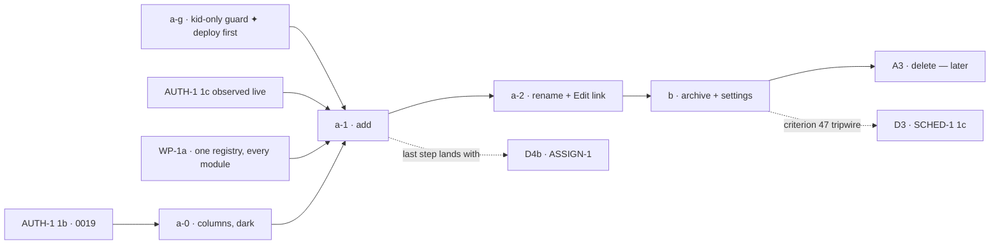

# PROF-1 (a + b) — add, rename and archive an athlete

> Backlog: [plan.md](../plan.md) row PROF-1 · Spec: [crud-1-fix-it-yourself.md](../specs/crud-1-fix-it-yourself.md)
> chunks **A1** (PROF-1a) and **A2** (PROF-1b) · Milestone: [CRUD-1](../milestones/crud-1-fix-it-yourself.md)
> (steps 1–2) · Branches: one per PR,
> listed under [Staging](#staging) (`db/prof-1a-0-profile-lifecycle-columns`, `fix/prof-1a-g-kid-only-program-read`,
> `feat/prof-1a-1-add-athlete`, `feat/prof-1a-2-rename-athlete`, `feat/prof-1b-archive-athlete`).
> Approved prototype: [`docs/prototypes/crud-1/index.html`](../prototypes/crud-1/index.html) v9 →
> screens **picker** (`vPicker`, `:2078`), **add** (`vAdd`, `:2138`; submit handler `:5043-5072`),
> **edit** (`vEdit`, `:2150`; submit `:5074-5085`), **settings** (`vSettings`, `:2239`; archive/restore
> `:4587-4611`).

## Goal

Today an athlete exists only because `packages/db/src/seed.ts:163-184` wrote them: no route, action or
DAL function creates, renames or retires a profile (`apps/web/lib/dal/profiles.ts` has two reads and
one routine write, `:47`, `:93`, `:159`), and the picker's empty state sends a parent to GitHub
(`apps/web/components/onboarding/picker-empty-state.tsx:47-52`). This work makes the athlete list the
household's own: a dashed **"+ Add athlete"** tile at the bottom of the picker, a name and a
**Child / Adult** kind, a rename from the athlete's own page, and an **archive** in Household settings
that hides an athlete from the picker, keeps and exports every row they logged, and can be undone. It is
the first profile-**creating** endpoint, so it carries the full boundary-test set, and it lands only once
the session (AUTH-1 1c) is what says whose household an athlete joins.

Two things ship with it because the spec ties them to A1: the **kid-only guard** on every reader of the
household's newest block (Q15, FE-5), so an adult added here is not shown the kids' program; and the
removal of the last link to the routine editor (criterion 41, M30).

## Acceptance

Copied from the spec ([Acceptance](../specs/crud-1-fix-it-yourself.md#acceptance)), criteria tagged A1/A2:

1. **When** a parent submits a new athlete with a non-blank name and a `kind` from `PROFILE_KINDS`, the
   system **shall** create one profile in the **session's** household and the picker **shall** list it
   on the next render. _(A1)_
2. **If** the name is blank after trimming, longer than the limit the plan sets, or `kind` is not in
   `PROFILE_KINDS`, **then** the system **shall** return a typed field error and write nothing. _(A1)_
3. **When** an "add athlete" submit is replayed with the same idempotency key, the system **shall**
   create exactly one profile and return the same result. _(A1)_
4. **If** a rename or archive names a profile outside the session's household, **then** the system
   **shall** respond as for an unknown profile (404 semantics, ADR 0006) and write nothing. _(A1, A2)_
5. **While** an athlete is archived, the picker **shall not** list them, their history **shall** still
   export, and a parent **shall** be able to restore them from a list of archived athletes. _(A2)_
6. _(A3 — out of scope here; sketched under [Out-of-scope](#out-of-scope--deferred).)_
7. **When** PROF-1a ships, the empty state **shall not** link to GitHub. _(A1)_
8. Rename **shall** be reachable from the athlete's own page; archive and delete **shall** live only in
   household settings, never on the picker. _(A1, A2)_
9. The picker tile, the athlete form and household settings **shall** show `kind` as **Child** /
   **Adult**, from one display map beside `PROFILE_KINDS`; the stored values stay `kid` / `adult`. _(A1)_
10. The app **shall not** link to the routine editor from anywhere … until ACT-1 replaces it. A routine
    already saved **shall** keep rendering and logging on the day page; a profile with none **shall**
    keep the neutral default (`apps/web/lib/routine/catalog.ts`, `NEUTRAL_DEFAULT_KEYS`). The
    `/p/[profileId]/routine` route stays in code, unlinked. _(A1)_
11. **When** an athlete is archived while on a program, their open assignments **shall** close the day
    before … and Undo **shall** reopen exactly those assignments. Before D3 there is nothing to close.
    _(A2)_

Plus the decisions this plan executes: **Q1** (archive and delete in settings), **Q8** (archive is a
migration, one nullable column), **Q15** (the kid-only guard, covering the card, the form's scaffold and
prefill, and the export's `prescribedFor`).

**Done when** (observable):

- `/p` lists the household's live, unarchived athletes, then a dashed "+ Add athlete" tile, then (from
  A2) one "Household settings" row. With zero athletes it shows the empty-state copy and the same tile,
  and no GitHub link anywhere (`grep -r GITHUB_REPO_URL apps/web/components/onboarding` is empty).
- Add → `/p/new` → name + Child/Adult → lands on the new athlete's page with `history.replace`
  semantics (IXD-10), so Back returns to `/p`, not to the filled form.
- A name already in the household (archived included, folded for case, spaces, accents and curly
  apostrophes) warns once next to the field; a second submit adds it anyway (IXD-7, prototype `:5056-5066`).
- The day page's "→ Edit {name}'s routine" link (`apps/web/app/p/[profileId]/page.tsx:359-364`) is gone,
  replaced by "→ Edit {name}" to `/p/<id>/edit` (name + kind); no file under `apps/web/app` or
  `apps/web/components` links to `/routine`.
- An **adult** profile's day page shows no program card, no prescribed prefill, no "Strength A/B" role
  label, and a "Not a programmed day" default; its CSV `prescribed` cells are empty. A **kid's** are
  byte-identical to today.
- `/settings` lists athletes with Edit and Archive, and archived athletes with Restore; archive shows an
  in-place "{name} archived. Everything they logged is kept." line with **Undo**; an archived athlete's
  `/p/<id>/export` still returns their zip.

## Staging

Five PRs. The spec's chunk table counts A1 + A2 as two; the extra three are a migration that must not
share review with UI (one migration per PR; spec → B0's row states the same rule), a guard that must be
**live before** the first adult can be created, and a split that keeps each PR under ~400 lines.

| PR      | Branch                                   | What                                                                                                                                              | ~lines | Gate                                                                                                              |
| ------- | ---------------------------------------- | ------------------------------------------------------------------------------------------------------------------------------------------------- | ------ | ----------------------------------------------------------------------------------------------------------------- |
| **a-0** | `db/prof-1a-0-profile-lifecycle-columns` | Migration `00NN`: `profiles.client_id uuid` (nullable) + **non-partial** `uq_profiles_client_id`, and `profiles.archived_at timestamptz`. Dark.   | ~180   | AUTH-1 1b's migration (`0019`, `household_members`) merged — migration numbers are serial                         |
| **a-g** | `fix/prof-1a-g-kid-only-program-read`    | Q15's guard in `programDayRows`, plus the adult's day-role label/default on the day page. `db:verify`                                             | ~140   | none in code; **must be deployed before a-1 merges**                                                              |
| **a-1** | `feat/prof-1a-1-add-athlete`             | Add: shared schema + labels, writer, DAL, `addAthleteAction`, `/p/new`, the dashed tile, the empty state without GitHub, `Child`/`Adult`          | ~400   | **AUTH-1 1c observed live** (below) + **WP-1a merged** + a-0 applied in prod + a-g deployed + UX panel reconciled |
| **a-2** | `feat/prof-1a-2-rename-athlete`          | Rename/kind: writer, `renameAthleteAction`, `/p/[id]/edit`, "→ Edit {name}" replacing the routine link (criterion 41)                             | ~260   | a-1                                                                                                               |
| **b**   | `feat/prof-1b-archive-athlete`           | Archive/restore: writers, two actions, `/settings`, picker filter + settings row, archived-page banner, criterion 47 tripwire, notice + inventory | ~380   | a-2 (shares `athlete-actions.ts`) + UX panel's settings-shell verdict (PM-5)                                      |



**Why a-g goes first and alone.** It changes the one security-load-bearing program read
(`packages/db/src/queries/program-day.ts:52`) and nothing else needs it to exist, so it can merge now; it
must be **in production** before a-1 can create an adult, or the first adult created sees the kids'
program for one deploy. It touches no AUTH-1 file (the 1c file table names `household.ts`, `actions.ts`,
four `page.tsx` files — `docs/plans/auth-1-clerk-google.md:1695-1722`); ⚠️ a-g edits
`apps/web/app/p/[profileId]/page.tsx`, which **is** one of 1c's four pages, so a-g and 1c must not be
open at once — whichever opens second merges `main` first (gate 1, [parallel-work.md](../parallel-work.md)).

**Why a-0 can precede 1c.** Two nullable columns with no reader or writer; the 0006/0013/0014 dark idiom
(`packages/db/migrations/0014_household_synthetic.sql:21-26`). It only has to follow 1b's `0019` in
number.

## Design decisions (with the alternatives rejected)

### D1 · Idempotency for "add": a new `profiles.client_id`, **non-partial** UNIQUE, nullable

Criterion 3 needs an idempotency key, and **`profiles` has none**: its columns are `id`, `public_id`,
`name`, `kind`, `household_id`, `birthdate`, `avatar`, `pin_hash`, `routine_config` and the timestamps
(`packages/db/src/schema.ts:147-172`), and the schema calls authored household content "the profiles
idiom … Config data → NO client_id" (`schema.ts:780`). That was true while only the seed wrote profiles.
⚠️ **The spec's contract (`profileUpsertSchema { name, kind }`) carries no key either**, which
contradicts its own criterion 3 — this plan adds one (see [Contract](#the-contract-this-plan-adds)).

- **Chosen:** `client_id uuid` **nullable**, with `uq_profiles_client_id` **non-partial** (no
  `WHERE deleted_at IS NULL`). The insert is `ON CONFLICT (client_id) DO NOTHING`, then a re-select by
  `client_id` **inside the scope** (`inHousehold`). NULLs are distinct in a unique index, so the seed's
  rows (`seed.ts:163-184`, which never set it) and any correction-made row coexist without a backfill.
  - **Non-partial on purpose — ADR 0008 decision 3.4's lesson applied at birth.** Every existing
    `client_id` arbiter is partial, so a hidden row is not an `ON CONFLICT` target and a replay inserts a
    second row (`docs/decisions/0008-deletion.md:127`); B0 exists to re-predicate five of them. A new
    arbiter should not be the sixth. An archived (or later soft-deleted) profile keeps its slot, so a
    replayed add can never mint a twin of an athlete who was archived in between.
  - **Nullable, against AGENTS.md's "client_id NOT NULL"**, because not every profile has a client: the
    seed and `db:correct` create profiles server-side. Making it NOT NULL would need a backfill and the
    NOT VALID → VALIDATE split across two PRs (AGENTS.md → Database rules), i.e. two more migrations, to
    store a fabricated key on rows no client ever retries. The column's docblock says so, and the
    add action's zod schema makes it required for **every app-created** row.
- **Rejected — the client supplies `public_id` and the insert arbitrates on it.** No migration, but it
  turns the anti-IDOR id into a client-chosen value, and a crafted body naming another household's
  known `public_id` gets a refusal where a fresh id gets success — a liveness oracle for a leaked id,
  which is the exact thing ADR 0006's 404-not-403 rule exists to deny (`profiles.ts:81-86`).
- **Rejected — an app-level "does a profile with this name exist?" check.** AGENTS.md forbids it by name
  (write-path invariant 5); it races, and names may legitimately repeat (the prototype warns, never
  blocks).
- **Rejected — an `Idempotency-Key` table persisting the first response** (backend rule 6's literal
  form). No such table exists; a client UUID + DB UNIQUE is how every other create in this repo meets the
  rule (`write-path.md` invariant 5).

### D2 · The archive marker: `profiles.archived_at timestamptz NULL` (Q8)

- **Chosen:** one nullable column, `NULL` = live. Archive sets `now()`, restore sets `NULL`. ADR 0008:
  _"archive is a lifecycle state a parent can see and restore from, orthogonal to existence; hide is
  invisible and ends in erasure"_ (`0008-deletion.md:77`), so it cannot be `deleted_at` — a profile
  hidden with `deleted_at` drops out of `isLiveProfile` (`packages/db/src/writers/ownership.ts:118-124`)
  and therefore out of the export route, and would be purged at `N` once PRIV-3 exists.
- **`archived_at` is NOT added to `isLiveProfile`.** That predicate is the BOLA seam every action, page
  and the export resolve through (`profiles.ts:75-92`); an archived athlete must stay resolvable so
  criterion 5's "their history shall still export" holds without a second resolver. Archive filters
  only the **lists** (picker, "who's on it" later).
- **Rejected — a `status text CHECK (status in ('active','archived'))`.** It loses the date (the
  settings list and a future dashboard filter want "archived since"), and a second lifecycle value later
  is a CHECK migration either way.
- **Rejected — defer archive to Beta 1** (Q8's other answer): a typo'd or test athlete would have no exit
  until step-up exists (PM-6).
- **Bundled into a-0 with `client_id`**, one migration: both are additive, nullable, unread and
  unwritten when they land, and migration numbers are a serial resource that AUTH-1 1b, B0 and V1-24 1d
  also queue on. The alternative (archive's column in PR b) costs a second migration PR and a second DB
  review for one `ADD COLUMN`.

### D3 · Where the kid-only guard lives: inside `programDayRows`, once (Q15, FE-5)

Every reader of the newest block goes through one query: the day page's card and the form's scaffold and
prefill via `getProgramDay` (`apps/web/lib/dal/programming.ts:29-41`, called once at
`apps/web/app/p/[profileId]/page.tsx:85-89` and handed to `StrengthSection` as `programDay`), and the
export's `prescribedFor` (`apps/web/lib/dal/export.ts:113-129`, `programDayRows` at `:121`).

- **Chosen:** add `eq(schema.profiles.kind, PROGRAM_READ_KIND)` to the **block subquery**
  (`packages/db/src/queries/program-day.ts:71-86`), whose `profiles` join is already pinned to this
  profile by `isThisProfile`. For an adult the subquery yields no block, `blockId` is NULL, and the outer
  query returns `[]` — the same "nothing programmed" shape a household with no block returns today
  (`programming.ts:17-18`), so the card does not render (`strength-section.tsx:46-50`) and `prescribed`
  is empty. `PROGRAM_READ_KIND = PROFILE_KIND.kid` is a named, exported const in `program-day.ts` with a
  docblock: _"Q15 stopgap (maintainer, 2026-10-22). ASSIGN-READ (D4) deletes this: from D4 an athlete
  reads their assignment, never the household's newest block."_
- **Rejected — guard in `getProgramDay` and `prescribedFor` separately.** Two copies of one rule in two
  files; the second is exactly the drift `programDayRows`' docblock exists to prevent (`program-day.ts:10-13`),
  and `db:verify` would prove neither, since it runs the query, not the DAL.
- **Rejected — guard in the page.** It would cover the card and not the export.

**Beyond the spec's list, and proposed for the panel:** two more things read the **calendar rotation**
for an adult, and both write or show "the kids' program" by another route.

1. The header's role label: `DayNav dayRoleLabel={DAY_ROLE_LABELS[dayRole]}` (`page.tsx:152-158`), so an
   adult's page says "Strength B".
2. The form's "Which day is this?" default: `defaultDayRole={dayRole}` (`strength-section.tsx:79`) seeds
   the select (`strength-form.tsx:597-612`), whose value is stored as `sessions.day_role` — documented as
   **provenance** ("a non-null day_role must mean a human asserted it", `strength-form.tsx:589-595`). A
   pre-selected "Strength A" on an adult's unprogrammed day is a guess frozen into a row.

The fix is one line in `page.tsx`: `const roleForPage = profile.kind === PROFILE_KIND.kid ? dayRole : null`,
passed to both `DayNav` (label omitted when null) and `StrengthSection` (`dayRole: DayRole | null` is
already its type, `strength-section.tsx:40`, and `null` already means "Not a programmed day"). `page.tsx`
is not owned by `strength-logging.md`, so this stays out of that guide's files. The export keys
`prescribed` by the **stored** `day_role` (`export.ts:155-159`) and writes `session_type` from its own
column (`:55`), so an adult's session saved with no role gets an empty `prescribed` and keeps the
`session_type` it was logged with. `DayNav`'s `dayRoleLabel` is already optional and omitted when
falsy (`day-nav.tsx:31`, `:64`), so `day-nav.tsx` does not change.

**No live bytes change.** The spec records that no live adult profile reads the program today (Q15,
`crud-1-fix-it-yourself.md:859`); the seed writes only kids (`seed.ts:170`, `:179`). The plan cannot
query production, so this rests on that statement; a-g's PR body says so.

### D4 · Where the actions live: a new `apps/web/app/p/athlete-actions.ts`, not `actions.ts`

- **Chosen:** a second `'use server'` module, `apps/web/app/p/athlete-actions.ts` — the household-level
  form of the convention the sibling [WP-1 plan](./wp-1-shard-actions.md) writes into `write-path.md`
  (`app/p/<feature>-actions.ts` for a household-level action). Add has no `profileId` route segment, and
  the spec warns that every mutating chunk queues on `app/p/[profileId]/actions.ts` (spec → "The
  critical path", ⚠️ paragraph). Its actions are registered in the **one** `MUTATING_ACTIONS` registry
  (`apps/web/app/p/[profileId]/mutating-actions.ts:24-32`), grouped under a `// app/p/athlete-actions.ts`
  comment, so `actions.test.ts`'s central unauth and wrong-household matrices cover them — the
  byte-identical-refusal argument is strongest where one place asserts it for every action.
- **Gate: WP-1a merged** (milestone step 0). Its cross-check reads the **union** of every `'use server'`
  module's exports against `MUTATING_ACTIONS`; before it, `actions.test.ts:1619-1628` reads
  `actions.ts` alone, so a new module's actions would be invisible to that half of the guard. If WP-1a
  is not merged when a-1 is ready, a-1 waits rather than inventing a second registry.
- **What that costs, and the plan pays it in a-1:**
  - `apps/web/app/pages-are-gated.test.ts:227-229` asserts the discovered `'use server'` set **equals**
    `['app/gate/actions.ts', 'app/p/[profileId]/actions.ts']`; it gains `app/p/athlete-actions.ts`. The
    per-function boundary-call check (`:255-271`) then covers the new module automatically.
  - `actions.test.ts`'s `ACTION_FNS` and `VALID_BODY` gain one entry per new action (the
    `Record<MutatingActionName, ActionFn>` type forces the binding).
  - `docs/features/write-path.md` `owns:` gains `app/p/athlete-actions.ts` (so `guides:check` covers
    it).
- **Rejected — a separate `athlete-mutating-actions.ts` registry.** A second registry is a second matrix
  and a second place the refusal copy can drift; WP-1a exists to make one registry span modules.
- **Rejected — append to `app/p/[profileId]/actions.ts`.** Collides with B1, C1, E on one file under one
  guide; and a household-level action in a module whose every other action takes a `profileId` is
  misplaced.
- **Not needed — WP-1b's full split of `actions.ts`.** This plan touches none of the seven existing
  actions. ⚠️ The **guide** collision remains whatever the module layout: every PR here edits
  `lib/dal/` and `writers/`, both owned by `write-path.md`, so a-1, a-2 and b serialize with B1, C1 and
  E on that guide (WP-1 plan, finding 2).
- ⚠️ **`mutating-actions.ts` sits under `[profileId]/` and will now name a `/p`-level action.** The WP-1
  plan defers moving it to "the first `/p`-level action's plan … once 1c has landed"; this plan
  **leaves it in place** (moving it re-points AUTH-1 1c's plan text) and raises it for the panel.

### D5 · Navigation after a write: `redirect(..., RedirectType.replace)` outside the Sentry wrapper

IXD-10 asks that Back after an add not return to the filled form. In a Server Action `redirect` defaults
to **push** and takes `RedirectType.replace` (`apps/web/node_modules/next/dist/docs/01-app/03-api-reference/04-functions/redirect.md:29-31`,
Next 16.4.1), and must be called outside any `try` (`:51`). So the action is:

```ts
export async function addAthleteAction(_: ActionState, formData: FormData): Promise<ActionState> {
  const result = await Sentry.withServerActionInstrumentation('addAthleteAction', async () => { … });
  if (result.ok && result.savedId) redirect(`${APP_HOME_PATH}/${result.savedId}`, RedirectType.replace);
  return result;
}
```

`redirect` is called **after** the wrapper resolves, so Sentry never sees `NEXT_REDIRECT`, and it serves
a 303 to a no-JS submit (`redirect.md:215`). **Rejected — return `savedId` and `router.replace` in
`useOnActionSuccess`:** that hook may only touch the caller's own state during render
(`apps/web/app/p/[profileId]/use-on-action-success.ts:20-21`), and a navigation is not that. ⚠️ The
pages-are-gated per-function slice (`pages-are-gated.test.ts:261-268`) still finds the boundary call,
because it slices from the `export async function` line, and the call sits inside the wrapper.

### D6 · Routes

| Route                 | What                                    | Why here                                                                                                                                                                                                                                             |
| --------------------- | --------------------------------------- | ---------------------------------------------------------------------------------------------------------------------------------------------------------------------------------------------------------------------------------------------------- |
| `/p/new`              | Add an athlete                          | The PROF-1 row: "create, read and edit live on `/p`" (`plan.md:2566`). A static segment beats `[profileId]` in App Router matching, and `new` is never a UUID, so `getProfileByPublicId` would 404 it anyway (`profiles.ts:100`). Back goes to `/p`. |
| `/p/[profileId]/edit` | Rename + kind                           | The prototype's path (`index.html:1975`); criterion 8 puts rename on the athlete's own page. Resolves through `getProfileByPublicId` → `notFound()` for unknown/foreign ids (ADR 0006).                                                              |
| `/settings`           | Household settings (athletes, archived) | The prototype's path (`index.html:1979`). Session-scoped like everything (ADR 0006: the household is never in the URL). ⚠️ The prototype's banner says the **settings shell is not approved** (PM-5, `index.html:1805`); PR b's UX panel decides it. |

Each path is a named const in `apps/web/lib/constants.ts` beside `APP_HOME_PATH` (`:42`):
`ADD_ATHLETE_PATH`, `SETTINGS_PATH`, and `athleteEditPath(id)`. All three pages are gated by the proxy's
default deny (`apps/web/lib/public-paths.ts` → `PUBLIC_PATHS` is `/` and `/privacy` only) **and** call the
page-level check, which `pages-are-gated.test.ts:50-57` enforces for every `page.tsx` automatically.

### D7 · The neutral default, ramp targets, and The Daily Five — what "create" does NOT write

- **`routine_config` stays NULL** on create. NULL **is** the neutral default and is never written
  (`plan.md:2797-2801`); `resolveProfileRoutine` maps it to `NEUTRAL_DEFAULT_KEYS = [STRENGTH_KEY]`
  (`apps/web/lib/routine/catalog.ts:60`, `:76-78`). So a new athlete's day is a weigh-in and Strength —
  and with criterion 41 there is no link to change that until ACT-1, which is the intended outcome (M30).
- **No ramp targets are expanded (spec unowned 6).** The schedule is empty
  (`packages/shared/src/ramp-schedule.ts:49`). ⚠️ **The spec's "a kid created by A1 silently has none"
  is only half right:** `seed.ts:262-264` selects **every** `kind = 'kid'` profile with **no household
  predicate**, and `migrate.yml:81` runs `db:seed` against production on every push to `main`. So the day
  the schedule is filled, the next deploy expands targets for app-created kids too — **and for every
  household's kids**, applying one family's ramp numbers to all of them. That is the real hazard, and it
  belongs to whoever fills the schedule; this plan records it in `write-path.md`'s Traps rather than
  writing targets on create. (A kind change kid→adult leaves existing targets in place; adult→kid gets
  them on the next seed. Both latent while the schedule is empty.)
- **No program assignment, no program copy.** The Daily Five is seeded at **household** creation by
  ONB-2 (`beta-1.md:346-354`), never per athlete and never via `PROGRAM_SEED`. Before D4 a kid reads the
  household's newest block through `programDayRows`; an adult reads nothing (D3). The add flow's last
  step ("Put {name} on a program?", prototype `vFirst` `:4124`) arrives with ASSIGN-1 (D4b) and is not
  built here.
- **Never a household.** AUTH-1 Q5: no request path may create a household before TEN-2b
  (`auth-1-clerk-google.md:423-480`). A null scope → the action refuses; it never inserts.

## The contract this plan adds

```
packages/shared/src/enums.ts
  PROFILE_KIND_LABEL   { kid: 'Child', adult: 'Adult' } as const satisfies Record<ProfileKind, string>
                       — beside PROFILE_KINDS (enums.ts:21-25); spec contract, criterion 39
packages/shared/src/profiles.ts                                   (NEW — re-exported from index.ts)
  PROFILE_NAME_MAX     40   — the prototype's maxlength (index.html:2145, :2164); one home
  athleteNameSchema    z.string().trim().min(1).max(PROFILE_NAME_MAX)
                         .refine(v => !hasLineBreak(v))           — reuses text.ts:27-29
  profileUpsertSchema  { name: athleteNameSchema, kind: profileKindSchema }       (the spec's shape)
  addAthleteSchema     profileUpsertSchema.extend({ clientId: uuidSchema,
                         acknowledgedDuplicate: z.string().optional() })          ← the key criterion 3 needs
  renameAthleteSchema  profileUpsertSchema.extend({ profileId: uuidSchema })
  archiveAthleteSchema { profileId: uuidSchema }      — archive and restore both
packages/shared/src/text.ts
  foldName(s)          NFKD → strip combining marks → curly ’ ‘ ʼ → ' → collapse spaces → trim → lowercase
                       — the prototype's `fold` (index.html:1577-1584); A3's typed-name match reuses it (SUX-9)
apps/web/lib/dal/profiles.ts (DTOs)
  ProfileDTO           unchanged: { id, name, kind, avatar }
  ProfileWithRoutineDTO + { archived: boolean }        (PR b — the page banner)
  HouseholdAthletesDTO { live: ProfileDTO[], archived: ProfileDTO[] }               (PR b — /settings)
  AddAthleteResult     { ok: true, id } | { ok: false, reason: 'no_household' | 'duplicate',
                                             duplicateOf?: { name, archived } }
```

`acknowledgedDuplicate` carries the **folded** name the person already saw the warning for (the
prototype's `dataset.dupOk`, `:5059-5060`), so a changed name re-warns. The duplicate lookup is a read of
the household's own names through the existing picker query — a **warning**, never an arbiter; two
concurrent adds of the same name both succeed, which is the decided behaviour (warn, never block).

## File-by-file changes

### PR a-0 — `db/prof-1a-0-profile-lifecycle-columns`

| Path                                                 | Change | What & why                                                                                                                                                                                                                                                                                                                                                                                                                                                                                                                                                                                                                                                             |
| ---------------------------------------------------- | ------ | ---------------------------------------------------------------------------------------------------------------------------------------------------------------------------------------------------------------------------------------------------------------------------------------------------------------------------------------------------------------------------------------------------------------------------------------------------------------------------------------------------------------------------------------------------------------------------------------------------------------------------------------------------------------------- |
| `packages/db/src/schema.ts`                          | EDIT   | `profiles` (`:147-172`): `clientId: uuid('client_id')` (nullable) + `archivedAt: timestamp('archived_at', { withTimezone: true })`; `uniqueIndex('uq_profiles_client_id').on(t.clientId)` **with no `.where`**. Docblocks: D1's three reasons (nullable, non-partial, ADR 0008 3.4) and D2's "not `deleted_at`, not in `isLiveProfile`". Replace the "profiles idiom … NO client_id" wording at `:780` so it stops describing profiles.                                                                                                                                                                                                                                |
| `packages/db/migrations/00NN_profiles_lifecycle.sql` | NEW    | Generated, then hand-hardened per the `db-migration` skill: header comment (why, plan link, dark); `SET lock_timeout = '5s'`, `SET statement_timeout = '60s'`; two `ALTER TABLE profiles ADD COLUMN IF NOT EXISTS …` (nullable, no default → catalog-only); `CREATE UNIQUE INDEX "uq_profiles_client_id" ON "profiles" ("client_id")` — **not CONCURRENTLY**, on the 0012 precedent (`0012_bodyweight_one_per_day.sql:21-23`, `.squawk.toml` excludes the rule because no transaction-stripping runner exists). `profiles` holds a handful of rows. No `IF NOT EXISTS` on the index (0012's reason: it would silently keep a same-named index with another predicate). |
| `packages/db/migrations/meta/*`                      | NEW    | drizzle-kit's snapshot + journal entry (append-only, CI-enforced).                                                                                                                                                                                                                                                                                                                                                                                                                                                                                                                                                                                                     |
| `packages/db/scripts/verify.ts`                      | EDIT   | **Appended** after the existing blocks (fail-fast ordering, `auth-1-clerk-google.md` Test plan): (1) two inserts with one `client_id` → the second `ON CONFLICT DO NOTHING` returns no row and the count stays 1; (2) the same `client_id` survives an `archived_at` and a `deleted_at` on the first row (the non-partial property — the inverse of today's partial arbiters); (3) two `NULL` `client_id` rows coexist; (4) `archived_at` defaults to `NULL` for a seeded row.                                                                                                                                                                                         |
| `docs/privacy/data-inventory.md`                     | EDIT   | §1a `profiles` row (`:120`): add `client_id` ("device-generated idempotency key — technical, but device-linkable", the `entries` wording) and `archived_at`. §2 + re-review trigger 3 (`:90-91`): both listed as columns with **no writer yet**, owner PROF-1a / PROF-1b, so the PR that wakes each one must edit this file.                                                                                                                                                                                                                                                                                                                                           |
| `docs/architecture.md`                               | EDIT   | The ERD's `profiles` entity gains the two columns (AGENTS.md → Diagrams). The PR description embeds it.                                                                                                                                                                                                                                                                                                                                                                                                                                                                                                                                                                |

### PR a-g — `fix/prof-1a-g-kid-only-program-read`

| Path                                             | Change | What & why                                                                                                                                                                                                                                                                                                                                                                          |
| ------------------------------------------------ | ------ | ----------------------------------------------------------------------------------------------------------------------------------------------------------------------------------------------------------------------------------------------------------------------------------------------------------------------------------------------------------------------------------- |
| `packages/db/src/queries/program-day.ts`         | EDIT   | `export const PROGRAM_READ_KIND = PROFILE_KIND.kid` + docblock (D3); `eq(schema.profiles.kind, PROGRAM_READ_KIND)` in the block subquery's `where` (`:85`). The function's docblock gains a "Q15 stopgap" shape note naming D4 as the remover.                                                                                                                                      |
| `packages/db/scripts/verify.ts`                  | EDIT   | Appended: an adult profile in the seeded household (which holds the YDP block) → `programDayRows` returns `[]` for `strength_a` **and** `strength_b`; the existing kid assertions (`:3939-3990`, 7 and 6 rows) unchanged and re-run after the adult exists.                                                                                                                         |
| `apps/web/app/p/[profileId]/page.tsx`            | EDIT   | `roleForPage` (D3): `DayNav` gets `dayRoleLabel` only for a kid; `StrengthSection` gets `dayRole={roleForPage}`. Comment cites Q15.                                                                                                                                                                                                                                                 |
| `apps/web/lib/dal/export.ts`                     | —      | **No change.** `prescribedFor` builds its map only from `programDayRows`' rows (`:119-128`), so the guard empties an adult's `prescribed` with no edit here. No unit test covers `buildExportEntries` today (none references it outside `export.ts` and `household.ts`); the proof is the `db:verify` case above plus `export-csv.spec.ts`'s existing kid assertions staying green. |
| `docs/features/programming.md`                   | EDIT   | **CI-forced** (owns `program-day.ts`). An invariant: "until D4 only `kind = kid` reads the household's newest block; an adult reads nothing and is not offered a role", with the D4 removal obligation.                                                                                                                                                                             |
| `docs/changelog/<fragment>.md`, `docs/status.md` | EDIT   | Per AGENTS.md → Status rides with the work.                                                                                                                                                                                                                                                                                                                                         |

### PR a-1 — `feat/prof-1a-1-add-athlete`

| Path                                                                                  | Change      | What & why                                                                                                                                                                                                                                                                                                                                                                                                                                                                                                                                                                                                                                                                                                                                                                                         |
| ------------------------------------------------------------------------------------- | ----------- | -------------------------------------------------------------------------------------------------------------------------------------------------------------------------------------------------------------------------------------------------------------------------------------------------------------------------------------------------------------------------------------------------------------------------------------------------------------------------------------------------------------------------------------------------------------------------------------------------------------------------------------------------------------------------------------------------------------------------------------------------------------------------------------------------- |
| `packages/shared/src/enums.ts`                                                        | EDIT        | `PROFILE_KIND_LABEL` beside `PROFILE_KINDS` (`:21-25`). Reword the `:21` docblock, which names a person, to "a child or an adult" (AGENTS.md: no personal names).                                                                                                                                                                                                                                                                                                                                                                                                                                                                                                                                                                                                                                  |
| `packages/shared/src/profiles.ts` + `index.ts`                                        | NEW         | `PROFILE_NAME_MAX`, `athleteNameSchema`, `profileUpsertSchema`, `addAthleteSchema` (contract above). Unit tests beside it: blank/space-only, 41 chars, an interior newline, an unknown kind, a missing `clientId` — each rejected.                                                                                                                                                                                                                                                                                                                                                                                                                                                                                                                                                                 |
| `packages/shared/src/text.ts`                                                         | EDIT        | `foldName` + tests (`Zoë` = `zoe`, `O’Neil` = `o'neil`, ` Ana   Lu` = `ana lu`).                                                                                                                                                                                                                                                                                                                                                                                                                                                                                                                                                                                                                                                                                                                   |
| `packages/db/src/writers/ownership.ts`                                                | EDIT        | `insertProfileOwnedBy(exec, scope, row)` — the `insertMovementOwnedBy` precedent (`:187-200`): it **performs** the insert so `scope.householdId` never leaves the one module `scope.test.ts` allows to unwrap it (`packages/db/src/scope.test.ts:55-56`). `ON CONFLICT (client_id) DO NOTHING`, no `where` (the index is non-partial). Returns `void`.                                                                                                                                                                                                                                                                                                                                                                                                                                             |
| `packages/db/src/writers/profile.ts`                                                  | NEW         | `createProfile(exec, scope, { clientId, name, kind })` → `{ id: publicId } \| null`: mints `publicId = newId()`, calls `insertProfileOwnedBy`, then re-selects `public_id` **by `client_id` AND `inHousehold(scope)` AND `deleted_at IS NULL`** — the bodyweight writer's lesson that a replay lookup must be scoped (`write-path.md` invariant 6 (b)). `null` = the key belongs to another household or a deleted row; never another household's id. Exported from the barrel.                                                                                                                                                                                                                                                                                                                    |
| `packages/db/scripts/verify.ts`                                                       | EDIT        | Appended, two households: create in A lands with A's `household_id`; replay returns the **same** `public_id` and the row count is 1; the same `client_id` replayed under B's scope returns `null` and B gains no row; the picker query for B does not list it.                                                                                                                                                                                                                                                                                                                                                                                                                                                                                                                                     |
| `apps/web/lib/dal/profiles.ts`                                                        | EDIT        | `createAthlete({ clientId, name, kind, acknowledgedDuplicate })`: scope (null → `{ ok:false, reason:'no_household' }`), the duplicate check over `householdProfileRows` **plus archived** (PR b adds the column to that select; in a-1 archived does not yet exist, so live rows only), then `createProfile`. Returns the `AddAthleteResult` DTO.                                                                                                                                                                                                                                                                                                                                                                                                                                                  |
| `apps/web/lib/dal/profiles.test.ts`                                                   | EDIT        | Emitted SQL: the insert carries the scope's household and `on conflict ("client_id") do nothing`; the re-select carries the household conjunct.                                                                                                                                                                                                                                                                                                                                                                                                                                                                                                                                                                                                                                                    |
| `apps/web/app/p/athlete-actions.ts`                                                   | NEW         | `'use server'`; `addAthleteAction` per D5: boundary call first line (`hasGateAccess` until 1c, then `sessionUserOrNull` + `checkMutationLimit(user.userId)` — see [AUTH-1 1c](#gated-on-auth-1-1c--what-to-re-verify)) → `addAthleteSchema.safeParse` → `fieldErrors` → `createAthlete` → `revalidatePath(APP_HOME_PATH)` → `redirect(..., replace)`. No `formData`/`headers` to Sentry (`actions.ts:60-67`: a name is personal data).                                                                                                                                                                                                                                                                                                                                                             |
| `apps/web/app/p/athlete-actions.test.ts`                                              | NEW         | The per-action behaviour suites (bad body, duplicate warning, replay, redirect). The unauth and wrong-household rows come from the central matrix in `app/p/[profileId]/actions.test.ts` (WP-1a), which gains `ACTION_FNS`/`VALID_BODY` entries — see [Test plan](#test-plan).                                                                                                                                                                                                                                                                                                                                                                                                                                                                                                                     |
| `apps/web/app/pages-are-gated.test.ts`                                                | EDIT        | `:228` expected module list gains `app/p/athlete-actions.ts`. ⚠️ After 1c this file is `pages-need-a-session.test.ts` (`auth-1-clerk-google.md:1710`).                                                                                                                                                                                                                                                                                                                                                                                                                                                                                                                                                                                                                                             |
| `apps/web/app/p/new/page.tsx`                                                         | NEW         | RSC, gated; `<main>` `max-w-2xl px-4 py-12` (the picker's shell, `apps/web/app/p/page.tsx:31`); "← All athletes" `Link`; `<h1>Add an athlete</h1>`; renders `AddAthleteForm`.                                                                                                                                                                                                                                                                                                                                                                                                                                                                                                                                                                                                                      |
| `apps/web/components/profiles/athlete-form.tsx`                                       | NEW         | `'use client'`. One form for add and (a-2) edit: `useActionState`; `<form>`; `<label htmlFor>` Name `<input>` (`maxLength={PROFILE_NAME_MAX}`, `autoComplete="off"`, `autoCapitalize="words"`, `spellCheck={false}`, `text-base`, `aria-describedby` → hint + error, `aria-invalid` on error); a `<fieldset><legend>Who is this?</legend>` of two native radios labelled from `PROFILE_KIND_LABEL`, **no default** (U29), each label `min-h-11`; the kind hint ("Shown on their tile. You can change it later." — IXD-8's corrected claim; "used when suggesting a program" waits for D4b); a hidden `clientId` (UUIDv7 minted once per mount, kept across a duplicate-warning resubmit); a hidden `acknowledgedDuplicate`; errors beside their field and focus to the first invalid one (A11Y-2). |
| `apps/web/components/profiles/add-athlete-tile.tsx`                                   | NEW         | A `Link` to `ADD_ATHLETE_PATH` with the `ProfileTile` geometry (`profile-tile.tsx:20`: `min-h-24 px-5 py-4 rounded-xl`), `border-2 border-dashed` at a contrast the UX panel measures (see Risks), a dashed `+` avatar (`aria-hidden`), "Add athlete" + "A child, or yourself" (prototype `:2100`).                                                                                                                                                                                                                                                                                                                                                                                                                                                                                                |
| `apps/web/components/profiles/profile-tile.tsx`                                       | EDIT        | `:30` `capitalize {profile.kind}` → `PROFILE_KIND_LABEL[profile.kind]` ("Kid" → "Child", M10).                                                                                                                                                                                                                                                                                                                                                                                                                                                                                                                                                                                                                                                                                                     |
| `apps/web/app/p/page.tsx`                                                             | EDIT        | The tile list always renders, ending in `<li><AddAthleteTile/></li>`; the empty state renders above it when there are no athletes. ⚠️ After 1c this page branches on `householdState()` (`auth-1-clerk-google.md:1711`): the tile renders **only** in the resolved state, never in "this account has no household".                                                                                                                                                                                                                                                                                                                                                                                                                                                                                |
| `apps/web/components/onboarding/picker-empty-state.tsx`                               | EDIT        | Drop the `Button`/`GitHubMark` link (`:47-52`) and `notYet`; the dashed tile below it is the CTA. Docblock updated.                                                                                                                                                                                                                                                                                                                                                                                                                                                                                                                                                                                                                                                                                |
| `apps/web/lib/constants.ts`                                                           | EDIT        | `PICKER_COPY.subhead` → "Tap your name to start logging." (PUX-8; prototype `:2083`). `PICKER_EMPTY_COPY`: delete `notYet`, `setupCta`, `setupAnchor`; rewrite **`next`**, which says "you add the rest from their routine editor" (`:203`) — false once criterion 41 removes the link. `ADD_ATHLETE_PATH`, `ATHLETE_FORM_COPY`, `NO_ATHLETE_SAVE` ("No athlete found to save." — "athlete", never "profile", PUX-8).                                                                                                                                                                                                                                                                                                                                                                              |
| `apps/web/lib/constants.test.ts`                                                      | EDIT        | Remove the `setupAnchor` → README heading test (`:63-68`); pin `PROFILE_NAME_MAX` and `NO_ATHLETE_SAVE` once each.                                                                                                                                                                                                                                                                                                                                                                                                                                                                                                                                                                                                                                                                                 |
| `apps/web/components/onboarding/picker-empty-state.test.tsx`, `profile-tile.test.tsx` | EDIT        | No link; "Child"/"Adult" through the const.                                                                                                                                                                                                                                                                                                                                                                                                                                                                                                                                                                                                                                                                                                                                                        |
| `apps/web/app/design/tokens/inventory.tsx`                                            | EDIT        | It renders `PickerEmptyState` as the only axe-scanned empty picker (`:181-201`); add `AddAthleteTile` beside it so the dashed border is scanned in both themes.                                                                                                                                                                                                                                                                                                                                                                                                                                                                                                                                                                                                                                    |
| `README.md`                                                                           | EDIT        | `## Adding an athlete` (`:63-75`) → one paragraph: "Use **+ Add athlete** at the bottom of the athlete list." The PROF-1 row assigns this removal (`plan.md:2805-2806`).                                                                                                                                                                                                                                                                                                                                                                                                                                                                                                                                                                                                                           |
| `apps/web/e2e/add-athlete.spec.ts` + `a11y.spec.ts`                                   | NEW/EDIT    | Add an athlete with a **unique** name (a run-scoped suffix), assert the tile and the landing page; `/p/new` added to the a11y route list (spec unowned 8). ⚠️ The shared e2e DB keeps the row; tiles append at the end (`household-profiles.ts:31-32`, `asc(id)`), so the indexed tiles other specs use do not move.                                                                                                                                                                                                                                                                                                                                                                                                                                                                               |
| `docs/features/write-path.md`                                                         | EDIT        | **CI-forced** (owns `lib/dal/`, `writers/`). `owns:` += the two action modules; Files table: `writers/profile.ts`, `insertProfileOwnedBy`; invariant 1 says "the action modules"; invariant 5 notes `profiles.client_id` is the one **non-partial** `client_id` arbiter and why; Traps: D7's ramp-target hazard.                                                                                                                                                                                                                                                                                                                                                                                                                                                                                   |
| `docs/privacy/data-inventory.md`                                                      | EDIT        | §2: `client_id` leaves the "no writer" list. **§3:** `profiles.name` becomes the **third** UI-reachable free-text box (`:186-190` says two), typed by a parent or a child, never exported (§6, `:278`), never sent to Sentry. §1a `profiles` note: "written in the app since PROF-1a".                                                                                                                                                                                                                                                                                                                                                                                                                                                                                                             |
| `docs/privacy/notice.md`                                                              | — (checked) | "A name for each athlete … whatever you type" (`:23-24`) and "adult or a child" (`:25`) are already true; no edit. The privacy lens confirms.                                                                                                                                                                                                                                                                                                                                                                                                                                                                                                                                                                                                                                                      |

### PR a-2 — `feat/prof-1a-2-rename-athlete`

| Path                                                                          | Change | What & why                                                                                                                                                                                                                                                                                                                                                                               |
| ----------------------------------------------------------------------------- | ------ | ---------------------------------------------------------------------------------------------------------------------------------------------------------------------------------------------------------------------------------------------------------------------------------------------------------------------------------------------------------------------------------------- |
| `packages/shared/src/profiles.ts`                                             | EDIT   | `renameAthleteSchema`.                                                                                                                                                                                                                                                                                                                                                                   |
| `packages/db/src/writers/profile.ts`                                          | EDIT   | `updateProfileIdentity(exec, scope, publicId, { name, kind })` → one guarded `UPDATE profiles SET name, kind, updated_at = now() WHERE isLiveProfile(publicId, scope) RETURNING public_id`; `null` = unknown/foreign/deleted. Idempotent by construction (same values). Archived athletes **can** be renamed (a parent fixing a name in settings).                                       |
| `packages/db/scripts/verify.ts`                                               | EDIT   | Appended: B's scope renaming A's profile updates 0 rows and A's name is unchanged; a deleted profile updates 0 rows.                                                                                                                                                                                                                                                                     |
| `apps/web/lib/dal/profiles.ts`                                                | EDIT   | `renameAthlete(publicId, input)` → `{ id } \| null`.                                                                                                                                                                                                                                                                                                                                     |
| `apps/web/app/p/athlete-actions.ts` (+ `MUTATING_ACTIONS`, `actions.test.ts`) | EDIT   | `renameAthleteAction`: boundary → zod → `getProfileByPublicId` (the gate, `profiles.ts:75-92`) → `renameAthlete` → `revalidatePath` (`/p`, `/p/<id>`, `/p/<id>/edit`) → `redirect('/p/<id>', replace)` (the prototype returns to the day page, `:5083`). Foreign or unknown id → `NO_ATHLETE_SAVE`, byte-identical.                                                                      |
| `apps/web/app/p/[profileId]/edit/page.tsx`                                    | NEW    | RSC, gated; `getProfileByPublicId` → `notFound()`; "← {name}" back link; `<h1>Edit {name}</h1>`; `AthleteForm` in edit mode (name prefilled, kind checked, Save labelled "Save name and kind" under the fields — CD-6). **No** Activities link (M30); **no** Program section (D4b). From PR b, the hint "To archive an athlete, use Household settings" with a link (prototype `:2188`). |
| `apps/web/app/p/[profileId]/page.tsx`                                         | EDIT   | `:350-364`: the routine link and its comment are **replaced** by "→ Edit {name}" (`athleteEditPath`), same class (`min-h-11`, the unguarded tap-target note kept). Criterion 41: no other link to `/routine` exists (`grep` above found only this one in app code). `← All profiles` (`:136`) → `← All athletes` (PUX-8).                                                                |
| `apps/web/lib/constants.ts`                                                   | EDIT   | `athleteEditPath`; edit copy.                                                                                                                                                                                                                                                                                                                                                            |
| `apps/web/e2e/add-athlete.spec.ts`, `a11y.spec.ts`                            | EDIT   | Rename the athlete the spec added; `/p/<seed>/edit` in the a11y list; the `a11y.spec.ts:91` comment's "Edit routine" example updated.                                                                                                                                                                                                                                                    |
| `docs/features/write-path.md`                                                 | EDIT   | CI-forced (writers, DAL). The rename writer's row.                                                                                                                                                                                                                                                                                                                                       |
| `docs/features/programming.md`                                                | EDIT   | Not CI-forced (`page.tsx` is unowned) but its "Routine" axis describes the editor's entry point; it must say the route is unlinked until ACT-1 (M30), so the next reader does not "restore" the link.                                                                                                                                                                                    |

### PR b — `feat/prof-1b-archive-athlete`

| Path                                                                          | Change | What & why                                                                                                                                                                                                                                                                                                                                                                                                                                                                                                                                                                                                                         |
| ----------------------------------------------------------------------------- | ------ | ---------------------------------------------------------------------------------------------------------------------------------------------------------------------------------------------------------------------------------------------------------------------------------------------------------------------------------------------------------------------------------------------------------------------------------------------------------------------------------------------------------------------------------------------------------------------------------------------------------------------------------- |
| `packages/db/src/writers/profile.ts`                                          | EDIT   | `setProfileArchived(exec, scope, publicId, archived: boolean)` → one guarded `UPDATE … SET archived_at = (archived ? now() : NULL), updated_at = now() WHERE isLiveProfile(publicId, scope) RETURNING public_id, archived_at`. Not conditional on the current value, so a replayed archive is a no-op that still returns the row (idempotent; the replay test asserts one effect). **The criterion 47 seam:** the function's docblock says D3 adds "close open `program_assignments` (`active_to` = athlete-local yesterday) in the same transaction, return the closed ids for Undo", and the tripwire below fails until it does. |
| `packages/db/src/writers/profile.test.ts`                                     | NEW    | **The criterion 47 tripwire:** `if ('programAssignments' in schema)` then `profile.ts`'s source must reference `programAssignments` — so SCHED-1 1c cannot merge the table while archive silently leaves an archived athlete "on" a program. A vacuity check asserts the source is read.                                                                                                                                                                                                                                                                                                                                           |
| `packages/db/src/queries/household-profiles.ts`                               | EDIT   | Select `archivedAt` as well (`:39-44`); **the predicate is not touched** — it is the isolation boundary (`:14-25`) and archive is not a tenancy fact. Docblock: "callers split live from archived".                                                                                                                                                                                                                                                                                                                                                                                                                                |
| `packages/db/scripts/verify.ts`                                               | EDIT   | Appended: archive in A → `householdProfileRows` still returns it with `archivedAt` set; B archiving A's profile updates 0 rows; restore clears it; an archived profile still resolves through `isLiveProfile` (so the export path is intact — criterion 5); `buildExportEntries`' month query returns the archived athlete's rows (via the `export-month.ts` query `db:verify` already runs).                                                                                                                                                                                                                                      |
| `apps/web/lib/dal/profiles.ts`                                                | EDIT   | `listProfiles` filters `archivedAt === null` (the picker — criterion 5); `listHouseholdAthletes()` → `HouseholdAthletesDTO`; `archiveAthlete` / `restoreAthlete`; `getProfileByPublicId` adds `archived`; `createAthlete`'s duplicate check now includes archived (IXD-7).                                                                                                                                                                                                                                                                                                                                                         |
| `apps/web/app/p/athlete-actions.ts` (+ `MUTATING_ACTIONS`, `actions.test.ts`) | EDIT   | `archiveAthleteAction`, `restoreAthleteAction`: boundary → zod → `getProfileByPublicId` → DAL → `revalidatePath` (`/p`, `/settings`, `/p/<id>`) → `{ ok: true, savedId }` (no redirect: the settings page updates in place).                                                                                                                                                                                                                                                                                                                                                                                                       |
| `apps/web/app/settings/page.tsx`                                              | NEW    | RSC, gated. `<h1>Household settings</h1>`; `<section aria-labelledby>` "Athletes": a `<ul>`, each `<li>` the name, "· Child/Adult", an **Edit** `Link` and an **Archive** button, each `aria-label`led with the athlete's name (U23); `<section>` "Archived athletes": rows with **Restore**, or the empty line "None. Archiving hides an athlete from the athlete list and keeps everything they logged." (prototype `:2295`). No Programs/Movements rows: those chunks add theirs.                                                                                                                                               |
| `apps/web/components/profiles/archive-controls.tsx`                           | NEW    | `'use client'` island: the two forms, the in-place static result line ("{name} archived. Everything they logged is kept." + **Undo**, which posts `restoreAthleteAction`), focus to Undo after archive and to the restored row after restore (prototype `:4603`, `:4610`), announced through **one** persistent live region mounted before its text changes (the `saved-announcer.tsx` idiom; criterion 11's rule).                                                                                                                                                                                                                |
| `apps/web/app/p/page.tsx`                                                     | EDIT   | A `<nav aria-label="Household">` with one row, "Household settings ›", **below** the tiles (prototype `:2102`; Q5). Never an archive control on the picker (criterion 8).                                                                                                                                                                                                                                                                                                                                                                                                                                                          |
| `apps/web/app/p/[profileId]/page.tsx`                                         | EDIT   | If `profile.archived`: a notice "{name} is archived. Restore them from Household settings." with a link, and the forms off (`writable && !profile.archived`). See Open question 1.                                                                                                                                                                                                                                                                                                                                                                                                                                                 |
| `apps/web/app/p/[profileId]/edit/page.tsx`                                    | EDIT   | The settings hint + link.                                                                                                                                                                                                                                                                                                                                                                                                                                                                                                                                                                                                          |
| `apps/web/lib/constants.ts`                                                   | EDIT   | `SETTINGS_PATH`, `SETTINGS_COPY`.                                                                                                                                                                                                                                                                                                                                                                                                                                                                                                                                                                                                  |
| `apps/web/e2e/add-athlete.spec.ts`, `a11y.spec.ts`                            | EDIT   | Archive the athlete the spec added (which also tidies the shared DB), assert it leaves the picker and appears under Archived, Undo, archive again; `/settings` in the a11y list.                                                                                                                                                                                                                                                                                                                                                                                                                                                   |
| `docs/features/write-path.md`                                                 | EDIT   | CI-forced (`household-profiles.ts`, writers, DAL). Archive is a lifecycle column read by lists, **never** by `isLiveProfile`; the tripwire.                                                                                                                                                                                                                                                                                                                                                                                                                                                                                        |
| `docs/privacy/data-inventory.md`                                              | EDIT   | §1a/§2: `archived_at` now written. **§5:** "Archive is not deletion: an archived athlete's rows are kept in full, still export, and are restorable; nothing is purged." §4 unchanged (any household member can archive — Q6 governs only delete).                                                                                                                                                                                                                                                                                                                                                                                  |
| `docs/privacy/notice.md`                                                      | EDIT   | One sentence under "Deleting your data" (`:172`): archiving an athlete hides them from the athlete list and **deletes nothing**; ask, or (later) delete, to remove them. A parent who reads "archive" as "remove" has been told something false by omission.                                                                                                                                                                                                                                                                                                                                                                       |

## Gated on AUTH-1 1c — what to re-verify

AUTH-1 1a, 1b-bis and 1c-pre have shipped; **1b and 1c have not, and 1c is a one-way door**
(`auth-1-clerk-google.md:1695-1700`). a-1, a-2 and b start only once 1c is **observed live**. At that
point, before writing code, re-read and re-verify:

1. **The boundary call.** 1c switches every action's first line from `hasGateAccess` to
   `sessionUserOrNull()` and follows it with `checkMutationLimit(user.userId)` (`:1707`, `:1715`; Design
   §2, §8). The new actions use exactly that pair, and `addAthleteAction` **must** be rate-limited — it is
   the one endpoint that grows a table without bound. Confirm the enumeration test's `BOUNDARY_CALL` was
   **switched, not widened** (`pages-are-gated.test.ts:211-217`).
2. **The page check.** `requireGatedPage` → `requireSession` on `/p/new`, `/p/[id]/edit`, `/settings`, and
   the test file's new name (`pages-need-a-session.test.ts`).
3. **`getHouseholdScope()`'s five outcomes** (Design §3.2). `addAthleteAction` must refuse — never insert —
   in every non-resolved state, including **C** (signed in, no membership) and **D** (ambiguous), and
   `createProfile` must never be reachable with a scope minted outside `household.ts`. Re-read
   `householdState()` and render the add tile only in state A.
4. **No household creation.** Re-confirm Q5 held: no request path creates a household
   (`:423-480`); PROF-1 adds profiles to an existing household only.
5. **The ≥2-household alert** (Q5) exists, because from the moment household #2 is real, "add an
   athlete" writes into a session-resolved household and `movements` remains the one carve-out.
6. **Roles.** Who may add, rename and archive. beta-1 lists step-up only for delete
   (`beta-1.md:425`); the spec's Q6 makes delete owner-only. If 1c ships a role on
   `household_members`, the panel decides whether archive is owner-only too; this plan assumes **any
   member** for add, rename and archive.
7. **Sentry context.** 1c's AGENTS.md line says the app does not set `userId`/`householdId` context
   (`:1720`); the new actions keep that, and pass no `formData`.
8. **`p/page.tsx` and `p/[profileId]/page.tsx` are 1c files** (`:1708`, `:1711`): merge `main` and re-read
   both before editing.

## Test plan

**Boundary tests (AGENTS.md → Backend rules; every mutating action, verified by tests):**

| Case                                    | add                                                                                                                 | rename                                 | archive / restore                                   |
| --------------------------------------- | ------------------------------------------------------------------------------------------------------------------- | -------------------------------------- | --------------------------------------------------- |
| unauth → reject before any DAL call     | ✓ (from `MUTATING_ACTIONS`, never re-typed)                                                                         | ✓                                      | ✓                                                   |
| wrong owner → same refusal as unknown   | n/a — instead: **no scope → refuse, no insert**                                                                     | foreign id → `NO_ATHLETE_SAVE`, 0 rows | foreign id → same, 0 rows                           |
| bad body → zod field error, no write    | blank, 41 chars, newline, bad kind, missing/garbage `clientId`                                                      | same + garbage `profileId`             | garbage `profileId`                                 |
| replay → one effect, identical response | same `clientId` twice → 1 row, same `savedId`                                                                       | same values twice → same state         | archive twice → archived once; restore twice → live |
| duplicate name                          | warns once (`fieldErrors.name`), second submit with `acknowledgedDuplicate` succeeds; a **different** name re-warns | —                                      | —                                                   |

Actions are tested as plain async functions with the DAL mocked (`actions.test.ts` idiom), plus an
entry in `actions.test.ts`'s central matrix (WP-1a's union cross-check proves the module's exports equal the registry). `redirect` is mocked and asserted with
`RedirectType.replace`, and asserted **not** called on any failure.

**`db:verify` (PGlite):** the cases listed per PR above — all **appended** to the end of `verify.ts`.
They run the real writers (`createProfile`, `updateProfileIdentity`, `setProfileArchived`) and the real
`programDayRows` / `householdProfileRows`, so the proof covers the shipped SQL (write-path invariant 3).

**Unit:** `foldName`; the shared schemas; `PROFILE_KIND_LABEL` exhaustive over `PROFILE_KINDS`;
`ProfileTile` renders "Child"; the empty state renders no link; the criterion 47 tripwire.

**e2e:** `pnpm e2e:local` before a-1, a-2 and b (each touches a flow the smoke covers). The axe scan
gains each new route (unowned 8). Screenshots via the `ui-screenshot` skill at 390/820/1280 for the
picker (empty and populated), `/p/new` (empty, error, duplicate warning), `/p/<id>/edit`, `/settings`
(with and without archived).

**Local:** `pnpm verify` (format → lint → typecheck → test → `db:verify` → `db:mutations` → …) and
`pnpm guides:check` on every PR.

## 360px width math

Viewport 360 − `px-4` × 2 = **328px** content (the picker's shell, `p/page.tsx:31`).

- **Dashed tile:** 328 − `px-5` × 2 = 288; − avatar 56 − `gap-4` 16 = **216px** for "Add athlete"
  (`text-lg`, ≈100px) and "A child, or yourself" (`text-sm`, ≈140px). Fits; at 200% text the sub-line
  wraps inside the 216px column, and the tile grows (`min-h-24`, not `h-24`).
- **Kind radios:** two labels side by side, (328 − `gap-2` 8) / 2 = **160px** each, `min-h-11`. At 200%
  text "Child" ≈ 2 × 40px + the 20px radio + padding fits; the row is `flex-wrap` with
  `min-w-[8rem]` labels so it stacks rather than overflows.
- **Settings athlete row:** card `px-4` → 296px. Name on its own line (`overflow-wrap:anywhere`,
  `min-w-0`, so a 40-character name wraps — U27/A11Y-9); buttons below: Edit (≈64) + Archive (≈88) +
  `gap-2` = **160px**, leaving 136px for A3's "Delete…" (≈84) later. Each `min-h-11`.
- **Archived row:** 296 − Restore (≈88) − gap 8 = **200px** for the name and "· history kept", which wraps.
- **Name input:** full width, `text-base` (16px — iOS does not zoom a focused input at ≥16px).

## Risks / rollback

| Risk                                                                                                                               | Mitigation                                                                                                                                                                                                                                |
| ---------------------------------------------------------------------------------------------------------------------------------- | ----------------------------------------------------------------------------------------------------------------------------------------------------------------------------------------------------------------------------------------- |
| **An adult is created before the guard is live** and sees (and logs against, and exports) the kids' program                        | a-g is its own PR and a-1's gate says **deployed**, not merged. a-1's PR body links the a-g deploy.                                                                                                                                       |
| **A replay mints a second athlete** (double tap, flaky network, an archive in between)                                             | `client_id` + **non-partial** UNIQUE + `ON CONFLICT DO NOTHING`; `db:verify` proves replay-after-archive and replay-after-delete keep the slot. The form keeps one `clientId` per mount, including across the duplicate-warning resubmit. |
| **A crafted `clientId` that belongs to another household** returns that household's athlete                                        | The re-select is scoped (`inHousehold`) and returns `null` → refusal; `db:verify` case. The `client_id` never leaves the server, so guessing one is the only route.                                                                       |
| **Archive drops the export path** (a parent archives, then cannot get the data)                                                    | `archived_at` is deliberately **not** in `isLiveProfile`; `db:verify` asserts an archived profile resolves and its months export. Notice + inventory say so.                                                                              |
| **D3 lands and archive leaves athletes "on" programs** (criterion 47)                                                              | The tripwire test in `packages/db` fails the build the moment `schema.programAssignments` exists without `profile.ts` touching it.                                                                                                        |
| **The dashed border is invisible** — the app's `border` token measures 1.26:1 and fails SC 1.4.11 (`picker-empty-state.tsx:15-18`) | The tile's text identifies it, so the border is not the only cue; still, the UX panel picks a `foreground`-mix value and the token-sets page measures it in both themes (the inventory edit above).                                       |
| **Names are personal data, and many are children's**                                                                               | Never in Sentry (no `formData`, `actions.ts:60-67`), never in a CSV (`data-inventory.md:278`), never in a log line; inventory §3 lists the new free-text box.                                                                             |
| **The e2e DB accumulates athletes** across runs of `add-athlete.spec.ts`                                                           | Run-scoped unique names; tiles append at the end (`asc(id)`), so indexed tiles are stable; PR b's spec archives what it added.                                                                                                            |
| **The ramp schedule is later filled** and every household's kids get one family's targets (D7)                                     | Recorded in `write-path.md` Traps by a-1; not this plan's fix.                                                                                                                                                                            |
| **"LLM never authors loads"**                                                                                                      | Untouched: nothing here writes or reads a load; the guard only **removes** prescribed text from an adult's surfaces.                                                                                                                      |
| **CSV byte-faithfulness**                                                                                                          | Names are not exported; archive changes no query; the guard changes `prescribed` only for `kind = adult`, of which none is live (Q15). `db:verify`'s existing kid assertions and the e2e export spec pin a kid's bytes unchanged.         |

**Rollback.** a-0 is additive and dark: revert the app code, leave the columns (forward-only; never edit
the applied migration). a-g reverts cleanly (one predicate, one page line). a-1/a-2/b revert as code; rows
they created stay valid profiles (they are ordinary rows with a `client_id`), and an archived athlete is
restorable by reverting to a build that has Restore or by a guarded correction setting `archived_at = NULL`.

## Out-of-scope / deferred

- **A3 — delete an athlete** _[later]_. Sketch only, so nothing here blocks it: a "Delete…" button in the
  settings athlete row (room budgeted in the width math), a flow at `/settings/athletes/<id>/delete`
  (prototype `vDel`, `:2306`) offering export (naming what it leaves out — `notice.md:163-165`), archive,
  then typed-name confirm matched with `foldName` (SUX-9) and a fresh step-up; the delete itself is
  PRIV-3's runner (the runbook's statements as code) plus a ledger entry, owner-only (Q6), with the 7-day
  pause decided by Q11 and `notice.md` updated in the same PR. Gated on A2, PRIV-3's runner and Beta 1
  step-up. Nothing in this plan writes `deleted_at` on a profile.
- **The add flow's last step** ("Put {name} on a program?", "No program yet") — ASSIGN-1 (D4b).
- **Closing assignments on archive** — D3 has not created the table; the tripwire hands it over.
- **Avatars, birthdate, PIN** — `profiles.avatar`/`birthdate`/`pin_hash` stay unwritten
  (`data-inventory.md:179-181`); a writer for any of them is re-review trigger 3.
- **Ramp-target expansion on create** — D7.
- **The rest of Household settings** (Programs, Movements) — their chunks add their rows.
- **Duplicate warning on rename** — see Open question 2.
- **Reordering athletes** — tile order stays creation order (`household-profiles.ts:31-32`).

## Open questions

1. **An archived athlete's own page.** The picker hides them, but a bookmarked tablet can still open
   `/p/<id>`. Recommendation: render the page with a notice and the forms off (`writable && !archived`),
   keep the export link, and **do not** add an archived check to the seven existing actions (archive is
   not a security boundary, and touching `actions.ts` re-opens the collision D4 avoids). Alternative:
   404 it — rejected, since the export must stay reachable (criterion 5). _For the UX panel._
2. **Rename and duplicates.** IXD-7 reads "duplicate names warned, archived included, and a blank rename
   refused"; the prototype warns only on add (`:5056-5066`) and checks only blank on edit (`:5076-5081`).
   This plan follows the prototype. _For the maintainer._
3. **Archive authority after AUTH-1.** Any member, or owner only? (Re-verify item 6.)
4. **The adult's day-role label and form default** (D3, beyond the spec's FE-5 list). Recommended in;
   _for the engineering panel_.
5. **beta-1 vs the spec on archive's release.** `beta-1.md:65` and `:419` put "rename + archive" in
   Beta 1; the spec puts rename in A1 and says A2 "ships in Beta 0 beside A1" (PM-6), while its
   disagreement 1 says "beta-1's Beta 0 / Beta 1 split stays the release cut". The spec contradicts
   itself; this plan stages b to ship whenever it is ready, and the milestone doc settles the release.

## Review-response log

_Pending: engineering panel + UX panel (round 1)._
