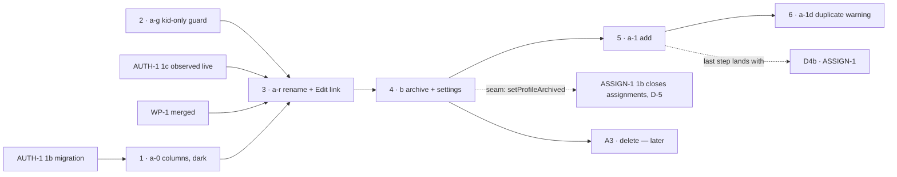
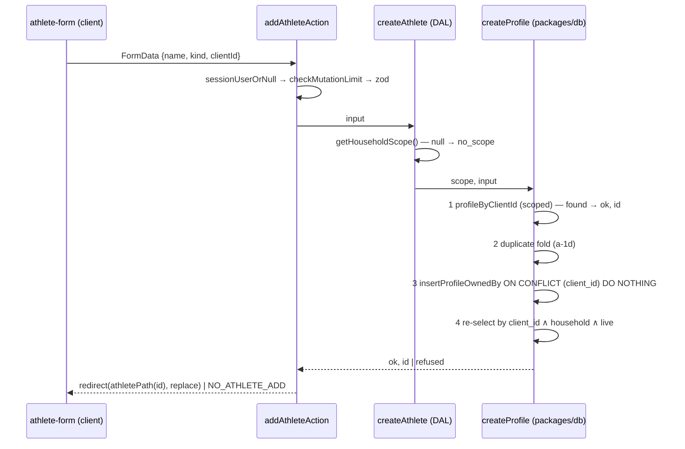

# PROF-1 (a + b) — add, rename and archive an athlete

> Backlog: [plan.md](../plan.md) row PROF-1 · Spec: [crud-1-fix-it-yourself.md](../specs/crud-1-fix-it-yourself.md)
> chunks **A1** (PROF-1a) and **A2** (PROF-1b) · Milestone: [CRUD-1](../milestones/crud-1-fix-it-yourself.md)
> (steps 1–2) · Branches: one per PR, listed under [Staging](#staging).
> Approved prototype: [`docs/prototypes/crud-1/index.html`](../prototypes/crud-1/index.html) v9 →
> screens **picker** (`vPicker`, `:2078`), **add** (`vAdd`, `:2138`; submit handler `:5043-5072`),
> **edit** (`vEdit`, `:2150`; submit `:5074-5085`), **settings** (`vSettings`, `:2239`; archive/restore
> `:4587-4611`).
>
> **Revised after round 1 of both panels** (engineering: correctness, scope, architecture, reuse,
> DB-safety, privacy; UX: lenses 1–3). The [review-response log](#review-response-log) records every
> material finding. This plan uses **post-AUTH-1-1c names only** (`sessionUserOrNull`, `requireSession`,
> `pages-need-a-session.test.ts`), because no PR here starts before 1c is live.

## Goal

Today an athlete exists only because `packages/db/src/seed.ts:163-184` wrote them: no route, action or
DAL function creates, renames or retires a profile (`apps/web/lib/dal/profiles.ts` has two reads and
one routine write, `:47`, `:93`, `:159`), and the picker's empty state sends a parent to GitHub
(`apps/web/components/onboarding/picker-empty-state.tsx:47-52`). This work makes the athlete list the
household's own: a dashed **"+ Add athlete"** tile at the bottom of the picker, a name and a
**Child / Adult** kind, a rename from the athlete's own page, and an **archive** in Household settings
that hides an athlete from the picker, keeps and exports every row they logged, and can be undone. It is
the first profile-**creating** endpoint, so it carries the full boundary-test set, and it lands only once
the session (AUTH-1 1c) is what says whose household an athlete joins.

Two things ship with it because the spec ties them to A1: the **kid-only guard** on every reader of the
household's newest block (Q15, FE-5), so an adult is not shown the kids' program; and the removal of the
last link to the routine editor (criterion 41, M30).

## Acceptance

From the spec ([Acceptance](../specs/crud-1-fix-it-yourself.md#acceptance)), by the spec's own numbers:

1. **When** a parent submits a new athlete with a non-blank name and a `kind` from `PROFILE_KINDS`, the
   system **shall** create one profile in the **session's** household and the picker **shall** list it
   on the next render. _(A1)_
2. **If** the name is blank after trimming, longer than the limit the plan sets, or `kind` is not in
   `PROFILE_KINDS`, **then** the system **shall** return a typed field error and write nothing. _(A1)_
   — the limit is `PROFILE_NAME_MAX = 40`.
3. **When** an "add athlete" submit is replayed with the same idempotency key, the system **shall**
   create exactly one profile and return the same result. _(A1)_
4. **If** a rename or archive names a profile outside the session's household, **then** the system
   **shall** respond as for an unknown profile (404 semantics, ADR 0006) and write nothing. _(A1, A2)_
5. **While** an athlete is archived, the picker **shall not** list them, their history **shall** still
   export, and a parent **shall** be able to restore them from a list of archived athletes. _(A2)_
6. _(A3 — out of scope; sketched under [Out-of-scope](#out-of-scope--deferred).)_
7. **When** PROF-1a ships, the empty state **shall not** link to GitHub. _(A1)_
8. Rename **shall** be reachable from the athlete's own page; archive and delete **shall** live only in
   household settings, never on the picker. **(R1)** _(A1, A2)_
9. The picker tile, the athlete form and household settings **shall** show `kind` as **Child** /
   **Adult**, from one display map beside `PROFILE_KINDS`; the stored values stay `kid` / `adult`.
   **(M10)** _(A1)_
10. _(not this plan)_
11. The app **shall not** link to the routine editor from anywhere — not the day page, not the
    athlete's edit page — until ACT-1 replaces it. A routine already saved **shall** keep rendering and
    logging on the day page; a profile with none **shall** keep the neutral default (Strength only,
    `apps/web/lib/routine/catalog.ts`, `NEUTRAL_DEFAULT_KEYS`). The `/p/[profileId]/routine` route stays
    in code, unlinked, as it was before V1-23 PR 2. **(M17, amended by M30)** _(A1)_
12. _(not this plan)_
13. _(not this plan)_
14. _(not this plan)_
15. _(not this plan)_
16. _(not this plan)_
17. **When** an athlete is archived while on a program, their open assignments **shall** close the day
    before, the archived athlete **shall** drop out of every "who's on it" list, and Undo **shall**
    reopen exactly those assignments. Before D3 there is nothing to close. **(R2 — IXD-5)** _(A2)_ —
    this plan delivers the "before D3" half and the seam; [ASSIGN-1](./assign-1-assignments.md) D-5
    owns the close.

Plus the decisions this plan executes: **Q1** (archive and delete in settings), **Q8** (archive is a
migration, one nullable column), **Q15** (the kid-only guard, covering the card, the form's scaffold and
prefill, and the export's `prescribedFor`).

**Done when** (observable):

- `/p` lists the household's live, unarchived athletes, then a dashed "+ Add athlete" tile, then one
  "Household settings ›" row. With zero athletes it shows the empty-state copy and the same tile; no
  GitHub link anywhere.
- Add → `/p/new` → name + Child/Adult → lands on the new athlete's page; Back returns to `/p`, not to
  the filled form (IXD-10).
- A name already in the household (archived included, folded by `foldName`) gets a **warning** callout
  with explicit choices, never a field error; rename runs the same check, excluding the athlete itself.
- The day page's "→ Edit {name}'s routine" link (`apps/web/app/p/[profileId]/page.tsx:359-364`) is gone,
  replaced by "→ Edit {name}"; nothing in `apps/web/app` or `apps/web/components` links to `/routine`.
- An **adult**'s day page shows no program card, no prescribed prefill, no "Strength A/B" label, a "Not
  a programmed day" default, and (when the household has a program) one muted line saying why; their
  CSV `prescribed` cells are empty. A **kid's** are byte-identical to today.
- `/settings` lists athletes (Edit, Archive) and archived athletes (Restore, Download history); archive
  shows an in-place result line with **Undo**; an archived athlete's export still returns their zip.
- A 40-character unbroken name renders without horizontal overflow at 360px on `/p`, `/p/<id>`,
  `/p/<id>/edit` and `/settings`.

## Staging

Six PRs, **reordered by round 1** (UX1 B2, scope S1) so there is never a window in which a parent can
add an athlete and has no way to fix or retire one: the edit and archive paths ship first, on the seeded
athletes, and **add** comes last.

| #   | PR       | Branch                                   | What                                                                                                                                                                                                                                                                                                   | ~lines (hand-written, incl. tests)                                                                                                                                                                                                                                                                       | Gate                                                                                                                                                                                                                                     |
| --- | -------- | ---------------------------------------- | ------------------------------------------------------------------------------------------------------------------------------------------------------------------------------------------------------------------------------------------------------------------------------------------------------ | -------------------------------------------------------------------------------------------------------------------------------------------------------------------------------------------------------------------------------------------------------------------------------------------------------- | ---------------------------------------------------------------------------------------------------------------------------------------------------------------------------------------------------------------------------------------- |
| 1   | **a-0**  | `db/prof-1a-0-profile-lifecycle-columns` | Migration: `profiles.client_id` (nullable, **non-partial** UNIQUE) + `profiles.archived_at`. Dark. AGENTS.md convention line + `db-migration` skill pointer                                                                                                                                            | ~210 (+ generated `meta/` JSON)                                                                                                                                                                                                                                                                          | AUTH-1 1b's migration on `main` (numbers are serial; see [migration order](#migration-order))                                                                                                                                            |
| 2   | **a-g**  | `fix/prof-1a-g-kid-only-program-read`    | `readsHouseholdProgram(kind)` in shared; the guard in `programDayRows`; the adult's role label/default and muted line on the day page; positive/negative/flip `db:verify`; two mutation patches                                                                                                        | ~260                                                                                                                                                                                                                                                                                                     | none in code. **Deployed before a-r merges** (a-r can flip a kid to adult)                                                                                                                                                               |
| 3   | **a-r**  | `feat/prof-1a-r-rename-athlete`          | **RENAME ONLY** (kind dropped, see D7). `foldName` + the name schema; `app/p/profile-actions.ts` (first module); the rename writer, DAL, action; `/p/[id]/edit`; "→ Edit {name}" replaces the routine link; `PROFILE_KIND_LABELS` (display only); **every name renderer gets `NAME_WRAP_CLASS`** (D11) | ~400                                                                                                                                                                                                                                                                                                     | **AUTH-1 1c observed live** + **WP-1 merged** + a-0 applied in prod ✅ + a-g deployed ✅ + UX panel reconciled ✅ (round 2) + notice ✅ (decided: no edit owed) ✅ **MERGED 2026-11-07** as `feat/prof-1a-r-rename`; see "a-r as built". |
| 4a  | **b-s**  | `feat/prof-1b-s-owner-scope`             | **Dark.** `role` on `HouseholdScope` from the same membership row; `OwnerScope` + `ownerScope()`; guard assertions; `db:verify` proof. Read by nothing yet.                                                                                                                                            | ~120                                                                                                                                                                                                                                                                                                     | b-s ahead of b; `a-0` applied                                                                                                                                                                                                            |
| 4   | **b**    | `feat/prof-1b-archive-athlete`           | Archive/restore writers, DAL, actions **taking `OwnerScope`**; `canManageAthletes` + the member view; `/settings` shell + athlete sections; picker filter + settings row; archived banner; notice + inventory                                                                                          | ~470 incl. the shared `UndoLine` + `Announcer` (~90) and the member view + `canManageAthletes` (~40); the `OwnerScope` seam is **not** in this count — it is `b-s`. Over 400, so if the count runs over, `UndoLine` + `Announcer` ship first as `feat/prof-1b-0-undo-line` (unmounted, with their tests) | a-r + the settings-shell verdict (PM-5) + notice re-signed                                                                                                                                                                               |
| 5   | **a-1**  | `feat/prof-1a-1-add-athlete`             | `createProfile` (replay-first, in `packages/db`), `addAthleteAction`, `/p/new`, the dashed tile, the empty state without GitHub, README; notice                                                                                                                                                        | ~390                                                                                                                                                                                                                                                                                                     | b + notice re-signed                                                                                                                                                                                                                     |
| 6   | **a-1d** | `feat/prof-1a-1d-duplicate-warning`      | The duplicate warning for add **and** rename, archived rows included from day one; "Restore {name}" for an archived match                                                                                                                                                                              | ~260                                                                                                                                                                                                                                                                                                     | a-1                                                                                                                                                                                                                                      |

Each PR carries its changelog fragment, its `docs/status.md` pointer move and its `docs/roadmap.md` move
in the same PR (AGENTS.md → Status rides with the work); that line is not repeated per PR below.



**Why a-g is alone and early.** It changes a security-load-bearing program read
(`packages/db/src/queries/program-day.ts:52`) and nothing else needs it; it must be **in production**
before the first PR that can make an adult (a-r, by flipping kind). ⚠️ It edits
`apps/web/app/p/[profileId]/page.tsx`, one of 1c's files (`auth-1-clerk-google.md:1708`), so a-g and 1c
must not be open at once; whichever opens second merges `main` first (gate 1,
[parallel-work.md](../parallel-work.md)).

### Migration order

a-0 and B0 (V1-9b-0, [plan](./v1-9b-delete-and-restore.md) Staging row B0) both queue behind AUTH-1 1b's
`household_members` migration (`auth-1-clerk-google.md:833`). **Whichever of a-0 and B0 merges second
regenerates its migration from a fresh `origin/main` (`drizzle-kit generate`), never by hand-renumbering a
file**; the journal is append-only and CI-enforced. (V1-24 1d is not in this queue: it shipped as
`0012_bodyweight_one_per_day.sql`.) "**a-0 applied in prod**" means the runbook's check, not a green
`migrate.yml`: `information_schema.columns` lists `profiles.client_id` and `profiles.archived_at`, and
`pg_indexes` lists `uq_profiles_client_id` with no `WHERE` — the same three-check shape
`docs/runbooks.md` → "A pending migration wedges prod and the seed with it" is the recovery for. ⚠️ **An earlier version of this line cited `:116`, which is a different section**; cite the heading, not a line number, since the file moves. **And the check set is wider than first written** — match `indexdef` byte-for-byte (a bare "has no WHERE" admits a NON-unique index), read `data_type`/`is_nullable`, and read the `drizzle.__drizzle_migrations` ledger. ⚠️ **The mechanism, read from `drizzle-orm@0.45.4`'s `pg-core/dialect.js:57` rather than assumed:** `migrate()` selects the **newest row only** (`order by created_at desc limit 1`) and applies every journal entry whose `when` exceeds that `created_at`. It never looks for a row per migration and never checks `hash`. So the check is **"newest `created_at` ≥ `1793984366840`"** (0020's journal `when`), not "a row for 0020 exists".
🔴 **And the failure mode flips once `0021` lands.** While 0020 is newest, a missing row means the next deploy **re-runs** it — and `CREATE UNIQUE INDEX` deliberately has no `IF NOT EXISTS`, so it raises `42P07`, the transaction aborts, `migrate.yml` goes red and the seed is skipped (the "pending migration wedges prod" runbook). After 0021 records, a missing 0020 row causes a **silent permanent skip** instead, which is worse because nothing goes red. Reachable only by hand-applied SQL — drizzle commits the DDL and the ledger insert in one transaction — which SECURITY.md's threat model does name.

The three reads, with what to expect:

```sql
SELECT column_name, data_type, is_nullable FROM information_schema.columns
 WHERE table_name = 'profiles' AND column_name IN ('client_id','archived_at');
-- client_id | uuid | YES      ·      archived_at | timestamp with time zone | YES

SELECT indexdef FROM pg_indexes WHERE indexname = 'uq_profiles_client_id';
-- EXACTLY this, and note it is `pg_get_indexdef()` OUTPUT, not the migration's text —
-- schema-qualified and unquoted, so a textual diff against the .sql is not the check:
-- CREATE UNIQUE INDEX uq_profiles_client_id ON public.profiles USING btree (client_id)

SELECT created_at, hash FROM drizzle.__drizzle_migrations ORDER BY created_at DESC LIMIT 1;
-- created_at >= 1793984366840
```

⚠️ **The migration file's own header is frozen and now superseded.** `0020`'s SQL comment carries the first, weaker version of this check set and the wrong runbook line; it is an applied migration, so forward-only forbids editing it. **This plan is the reachable copy.**

## Design decisions (with the alternatives rejected)

### D1 · Idempotency for "add": `profiles.client_id`, **non-partial** UNIQUE, nullable

Criterion 3 needs a key, and **`profiles` has none**: `schema.ts:147-172`; the schema calls authored
household content "the profiles idiom … Config data → NO client_id" (`schema.ts:780`). ⚠️ The spec's
contract `profileUpsertSchema { name, kind }` carries no key either, against its own criterion 3.

- **Chosen:** `client_id uuid`, **nullable**, `uq_profiles_client_id` **non-partial**.
  - **Non-partial — ADR 0008 decision 3.4 applied at birth.** Every existing `client_id` arbiter is
    partial, so a hidden row is not an `ON CONFLICT` target and a replay inserts a twin
    (`docs/decisions/0008-deletion.md:127`); B0 exists to re-predicate five of them. An archived or later
    deleted profile keeps its slot.
  - **Nullable**, because the seed and `db:correct` create profiles with no client; NOT NULL would need
    a backfill plus the NOT VALID → VALIDATE split (two more migrations) to store a fabricated key. NULLs
    are distinct in a unique index, so seeded rows coexist. `addAthleteSchema` requires it for every
    app-created row.
  - **a-0 amends AGENTS.md's convention line** ("`client_id = UUIDv7, NOT NULL, UNIQUE (partial: WHERE
deleted_at IS NULL)`", AGENTS.md → Schema & migration conventions) to: _new_ `client_id` arbiters are
    **non-partial** (ADR 0008 3.4); nullable only where server-side creators exist, said in the column's
    docblock. The `db-migration` skill's §1 gains a one-line pointer to it. Otherwise the next
    migration copies the old line.
- **Rejected — client-supplied `public_id` as the key.** It makes the anti-IDOR id client-chosen, and a
  body naming another household's known `public_id` gets a refusal where a fresh one succeeds: a
  liveness oracle ADR 0006's 404 rule exists to deny (`profiles.ts:81-86`).
- **Rejected — an app-level "does it exist?" check** (write-path invariant 5) and **an
  Idempotency-Key table** (none exists; a client UUID + DB UNIQUE is how every create here meets rule 6).

### D2 · Replay first, then duplicates, then insert — one `packages/db` function owns the order

_(Correctness B1.)_ The first draft ran the duplicate check before the insert, so a replay of a
**successful** add would find its own row by name and answer "duplicate" instead of the same result —
criterion 3 broken. The sequence now lives in **one** writer, `createProfile` in
`packages/db/src/writers/profile.ts`, so `db:verify` proves the order on the shipped SQL:

1. **Look up by `client_id` inside the scope** (`profileByClientId(exec, scope, clientId)`, built on
   `inHousehold`). Found and not deleted → `{ ok: true, id }`, **before any duplicate logic**.
2. _(from a-1d)_ Unless `acknowledgedDuplicate` equals `foldName(name)`, look for a household name that
   folds equal (live **and** archived, not deleted) → `{ ok: false, reason: 'duplicate', match }`.
3. `insertProfileOwnedBy(exec, scope, row)` → `ON CONFLICT (client_id) DO NOTHING`.
4. Re-select by `client_id` **and** `inHousehold(scope)` **and** `deleted_at IS NULL` → `{ ok: true, id }`;
   no row (the key is another household's, or the row was deleted) → `{ ok: false, reason: 'refused' }`.

A concurrent double-submit both pass step 1, one inserts, the other's step 3 is a no-op and step 4
returns the same id. The DAL wraps it and has a unit test asserting step 1's query is emitted **before**
step 2's (recording-db idiom, `apps/web/lib/dal/recording-db.ts`).

### D3 · The archive marker: `profiles.archived_at timestamptz NULL` (Q8)

- **Chosen:** one nullable column. ADR 0008: archive is _"a lifecycle state a parent can see and
  restore from, orthogonal to existence; hide is invisible and ends in erasure"_ (`0008-deletion.md:77`).
  `deleted_at` would drop the profile out of `isLiveProfile` (`writers/ownership.ts:118-124`) — and so
  out of the export — and into PRIV-3's purge.
- **Archive sets `COALESCE(archived_at, now())`** _(DB S3, correctness S4)_, so a replayed archive keeps
  the first date; restore sets `NULL`. Accepted risk: a replay of "archive" that arrives **after** an Undo
  re-archives — a double tap followed by an Undo within one network retry window. The visible result line
  and Restore make it recoverable; recorded, not engineered away.
- **Not added to `isLiveProfile`** (the BOLA seam every action, page and the export resolve through,
  `profiles.ts:75-92`). Archive filters **lists** only.
- **Rejected:** a `status` text+CHECK (loses the date, still a CHECK migration later); deferring archive
  to Beta 1 (a typo'd athlete with no exit; PM-6).
- **Bundled into a-0 with `client_id`:** both additive, nullable and dark; migration numbers are a serial
  resource (AUTH-1 1b and B0 queue on them).

### D4 · The kid-only rule, defined once (Q15, FE-5)

_(Reuse B2, architecture S2.)_ One predicate in `packages/shared/src/programming.ts`:

```ts
/** Q15 stopgap (maintainer, 2026-10-22): until ASSIGN-READ (D4) an athlete reads the household's
 *  newest block only if they are a child. D4 deletes this and both of its callers' uses. */
export const PROGRAM_READ_KIND = PROFILE_KIND.kid;
export function readsHouseholdProgram(kind: ProfileKind): boolean {
  return kind === PROGRAM_READ_KIND;
}
```

- **`programDayRows`** (`program-day.ts:71-86`) adds `eq(schema.profiles.kind, PROGRAM_READ_KIND)` to the
  block subquery, whose `profiles` row is already pinned by `isThisProfile`. For an adult `blockId` is
  NULL and the query returns `[]` — the "nothing programmed" shape (`apps/web/lib/dal/programming.ts:17-18`).
  That covers the card and the scaffold/prefill (`getProgramDay`, called once at `page.tsx:85-89`) and
  the export's `prescribedFor` (`apps/web/lib/dal/export.ts:113-129`, `programDayRows` at `:121`), which
  builds its map only from those rows (`:119-128`).
- **`page.tsx`** calls `readsHouseholdProgram(profile.kind)`: role label and form default are `null` for
  an adult. `DayNav`'s `dayRoleLabel` is already optional and omitted when falsy (`day-nav.tsx:31`,
  `:64`); `StrengthSection` already takes `dayRole: DayRole | null` (`strength-section.tsx:40`) and
  passes it as the form default (`:79`), where `null` is "Not a programmed day" — the provenance the
  form documents (`strength-form.tsx:589-612`). The export keys `prescribed` by the **stored** `day_role`
  (`export.ts:155-159`) and writes `session_type` from its own column (`:55`).
- **The adult line** _(UX3 B1, UX1 S3)_: when the household has a live block and the athlete is an
  adult, a muted line under the Strength heading: "Programs are for children for now. {name} logs freely;
  their own program comes later." It needs one read: `householdHasProgram(db, { scope })` in
  `program-day.ts`, through a new prefixed helper `programBlockInHousehold(scope)` in
  `writers/ownership.ts` (the only module allowed to read `scope.householdId`, `scope.test.ts:55-56`;
  the prefixed-helper convention, `ownership.ts:152-156`).
- 🔴 **Kind is read at export time, and the justification for that is HALF-FALSE** _(correctness
  review, 2026-11-07)_. Flipping a kid to adult empties `prescribed` in **every past month** of their
  export; flipping back restores it. This plan justified that as _"a program a non-child should not
  have been reading is not retroactively theirs"_ — **true for the household's adult, false for a kid
  who ages out**, whose `prescribed` cells were legitimately theirs when logged. Ageing out is the
  realistic reason anyone changes `kind`, so the argument fails on exactly the case it most needs to
  cover. **That is why `kind` is no longer editable in a-r** (D7). Stated as a `programming.md`
  invariant, proved by a `db:verify` flip case, and said on the edit form (D7).
- **Rejected:** guarding in `getProgramDay` and `prescribedFor` separately (two copies; `db:verify` runs
  the query, not the DAL); guarding in the page (misses the export).
- **No live bytes change:** the spec records that no live adult profile reads the program (Q15,
  `crud-1-fix-it-yourself.md:859`); the seed writes only kids (`seed.ts:170`, `:179`). The plan cannot
  query production; a-g's PR body says so.

### D5 · Where the actions live: `apps/web/app/p/profile-actions.ts` (WP-1)

The revised [WP-1 plan](./wp-1-shard-actions.md) names the module set and the registry shape, and this
plan follows it exactly. **Gate: WP-1 merged.**

- **Module:** `apps/web/app/p/profile-actions.ts`, the household-level athlete module in WP-1's fixed
  set (`wp-1-shard-actions.md:171`). a-r creates it.
- **Registry:** `MUTATING_ACTIONS` entries become `{ refusal, scope }` (`wp-1-shard-actions.md:68-70`,
  `:180-184`). `addAthleteAction` is **`scope: 'household'`**; `renameAthleteAction`,
  `archiveAthleteAction` and `restoreAthleteAction` are **`scope: 'profile'`** (they resolve a profile by
  public id and refuse a foreign one byte-identically).
- **Bindings:** profile entries `{ fn, writers }`; the household entry
  `{ fn, writers, scopeMiss }` (`:73-87`). `addAthleteAction`'s `scopeMiss` makes `createAthlete` return
  the no-household result.
- **One refusal for add:** `NO_ATHLETE_ADD = 'Couldn’t add this athlete.'` in `lib/constants.ts`, used
  **byte-identically** for (a) no session, (b) no household scope (state C/D), and (c) `createProfile`'s
  `refused` (a foreign or deleted key). Rename/archive/restore use `NO_ATHLETE_SAVE = 'No athlete found
to save.'` for unauth, foreign and unknown alike (PUX-8: "athlete", never "profile").
- **Test plumbing** (`actions.test.ts`): `vi.mock('next/navigation')` (for `redirect`); the profiles DAL
  mock gains `renameAthlete`, `archiveAthlete`, `restoreAthlete`, `createAthlete`; `VALID_BODY` gains
  one entry per action; the pinned module list gains `app/p/profile-actions.ts`; `write-path.md`
  `owns:` gains it.
- ⚠️ The **guide** collision remains: every PR here edits `lib/dal/` and `writers/` under
  `write-path.md`, so they take turns with B1, C1 and E (`wp-1-shard-actions.md:171`, item 5).
- **Note for the panel:** `mutating-actions.ts` and `action-state.ts` sit under `[profileId]/` and are
  now imported by a `/p`-level module. Moving them re-points AUTH-1 1c's plan text; this plan leaves them
  and records the move as a candidate for after 1c.

### D6 · Navigation after a write

- **Add** (a-1): `redirect(athletePath(id), RedirectType.replace)` **after** the Sentry wrapper resolves
  (in a Server Action `redirect` defaults to `push`, takes `RedirectType.replace`, and must sit outside
  any `try`:
  `apps/web/node_modules/next/dist/docs/01-app/03-api-reference/04-functions/redirect.md:29-31`, `:51`;
  Next 16.4.1). History `[/p, /p/new]` becomes `[/p, /p/<id>]`, so Back is `/p` (IXD-10). Sentry never
  sees `NEXT_REDIRECT`; a no-JS submit gets a 303 (`:215`). Before redirecting it calls
  `revalidatePath(APP_HOME_PATH)` and `revalidatePath(SETTINGS_PATH)` (the new tile and the settings
  list). **Because add redirects instead of returning `{ ok: true }`, its WP-1 binding carries the
  optional `succeeded(result, mocks)` predicate WP-1 adds (default `result.ok`)**: it asserts
  `redirect` was called with `(athletePath(id), RedirectType.replace)` and both `revalidatePath` calls
  came first, so WP-1's "valid body succeeds" guard holds for add.
- **Rename** (a-r) _(UX1 S4)_: return to where the parent came from without a duplicate history entry.
  The two in-app entries link with `?from=` set to `athletePath(id)` or `SETTINGS_PATH`; the page
  allowlists it to exactly those two values (anything else → `athletePath(id)`). The action returns
  `{ ok: true }` (no server redirect). The form's island, in an **effect** (never during render —
  `use-on-action-success.ts:20-21`), calls `router.back()` when the edit page was reached in-app (a
  `from` param is present and `window.history.length > 1`), else `router.replace(from)`. A replace-
  redirect would turn `[day, edit]` into `[day, day]`. No-JS: the page re-renders with a "Saved" status
  and a link back.
- **Archive/restore** (b): no navigation; the settings page updates in place.

### D7 · The form — controlled, kind made consequential, warnings not errors

- **Controlled state** _(UX1 B1)_: name and kind are React state, as are `clientId` (UUIDv7 minted once
  per mount) and `acknowledgedDuplicate`. React 19 resets uncontrolled fields when a form action settles,
  even on `{ ok:false }` (`docs/features/write-path.md:341`), which would empty the name under its own
  warning.
- 🔴 **KIND IS NOT EDITABLE IN a-r — dropped 2026-11-07** _(maintainer, on the UX panel's unanimous
  BLOCKING)_. a-r is **rename only**. The `kind` radio stays on **a-1**'s add form, where choosing it
  has no history to rewrite.
  **Why.** One control served two opposite intents and the form could not tell them apart: _"I added
  them as the wrong kind"_, where emptying past `prescribed` is correct, and _"they turned 18"_, where
  those cells were legitimately theirs. The second is the realistic trigger. The radio sat a
  thumb-width below the name field, pre-checked, sharing one Save — so a parent fixing a typo could
  brush it, tap Save, and land on a day page with the program gone and copy written for the
  household's adult (_"Programs are for children for now"_) shown to a 17-year-old who was on that
  program yesterday.
  ⚠️ **The rationale this plan carried was half-false**, and that is what the panel found: D4 and
  `programming.md` say _"a program a non-child should not have been reading is not retroactively
  theirs"_ — true for the household's adult, **false for a kid ageing out**. Corrected in both places.
  **Neither acceptance criterion required it.** 8 says _rename_ shall be reachable; 9 says the form
  shall **show** `kind` as Child/Adult. Showing is not editing.
  **A wrong kind is a `db:correct` correction** until then — this repo's stated answer for wrong data
  the app cannot fix. 🔴 **The prerequisite for ever making it editable** is in § Out-of-scope: the
  export must stop depending on today's `kind`.
- **Kind hint (a-1's add form only)** _(UX3 B1)_: "A child sees the household's program on their page.
  An adult logs without one for now." ⚠️ **Not "You can change this later"** — after this decision
  they cannot, in the app.
- **Duplicate = warning** _(UX1 S5, UX2 4, UX3 3; a-1d)_: a callout under the field.
  🔴 **It is NOT amber, and the plan said so wrongly** _(maintainer, 2026-11-07; UX2 round 2)_. The
  spec accepted an amber warning token (CD-2), but **the prototype reversed it** — _"no amber the app
  has no token for. A caution is the information callout, with a mark"_ — and `globals.css` defines no
  amber in either theme, so no PR was adding one. **Decision: follow the prototype.**
  `bg-muted text-foreground border rounded-lg px-4 py-3` with an `aria-hidden` ⚠ mark. Measured:
  **15:1 light, 11:1 dark**.
  ⚠️ **No `text-muted-foreground` inside the callout.** On `bg-muted` that is the **4.34:1** pair
  `design.md` already records as under AA — and it is the idiom every hint line in this app uses, so
  it is the natural mistake. The ⚠ mark and the words carry the meaning; the `border` is decoration
  (1.26:1 light), not a 3:1 boundary.
  **Add the callout to `app/design/tokens/inventory.tsx`** so axe scans it in both themes before
  a-1d renders it on a real route — today no route renders one, which is why CI is green on a pair
  that fails. Placed referenced by the input's `aria-describedby`, **no** `aria-invalid`, **not** in
  `fieldErrors`. Choices as buttons, never "tap again": **"Add another {name}"** (submits with
  `acknowledgedDuplicate`) and **"Open {name}"** (link to the match). For an **archived** match the
  primary is **"Restore {name}"** _(UX3 2)_ (posts `restoreAthleteAction`, then opens them), with "Add
  another" secondary. Rename runs the same check **excluding the athlete being renamed** _(UX1 S8, UX3 4;
  closes the old open question 2)_, with "Save anyway" / "Cancel".
- **Form results** are announced through a persistent `role="status"` mounted with the form (UX2); errors
  sit beside their field with `aria-describedby`, focus moves to the first invalid field (A11Y-2).
- **Radios:** native inputs; the label shows focus-visible and checked states; each radio carries the
  hint's `aria-describedby`; the input uses `INPUT_CLASS` (`lib/constants.ts:287`).

### D8 · Routes, titles and path helpers

| Route                 | What                                    | Title                | Why here                                                                                                                                                                    |
| --------------------- | --------------------------------------- | -------------------- | --------------------------------------------------------------------------------------------------------------------------------------------------------------------------- |
| `/p/new`              | Add an athlete                          | "Add an athlete"     | The PROF-1 row: "create, read and edit live on `/p`" (`plan.md:2566`). A static segment beats `[profileId]`; `new` is never a UUID (`profiles.ts:100`).                     |
| `/p/[profileId]/edit` | Rename + kind                           | "Edit athlete"       | The prototype's path (`index.html:1975`); criterion 8. `getProfileByPublicId` → `notFound()`.                                                                               |
| `/settings`           | Household settings (athletes, archived) | "Household settings" | The prototype's path (`index.html:1979`); session-scoped (ADR 0006). The prototype does **not** approve the settings shell (PM-5, `index.html:1805`): PR b's UX panel does. |

Static `metadata.title` per page (UX2) — never a name, which is personal data in a browser history
entry. Helpers in `apps/web/lib/constants.ts`, built from `APP_HOME_PATH` (`:42`) _(reuse S2)_:
`athletePath(id)`, `athleteEditPath(id)`, `ADD_ATHLETE_PATH`, `SETTINGS_PATH`. Every new page calls
`requireSession()`, which `pages-need-a-session.test.ts` enforces per `page.tsx`.

### D9 · `/settings` is PROF-1b's, and an append point for others

_(Reuse S4, architecture S4.)_ PR b owns `apps/web/app/settings/page.tsx`: the Athletes and Archived
athletes sections, then a `<nav aria-label="More household settings">` list of `›` rows (CD-5) that later
chunks append to (Programs, Movements — MOV-1 adds the first). `SETTINGS_PATH` is the base for any
sub-page (`${SETTINGS_PATH}/movements`). Islands colocate with their routes, not `components/`; the one exception is the shared `UndoLine` and its announcer, which PR b builds for every plan that shows an Undo (spec seams table, `crud-1-fix-it-yourself.md:548-549`). The settings page's `<nav>` of sub-page rows is that table's second seam: other chunks append a row and their page under `SETTINGS_PATH`, and never edit the athlete sections.

**No `docs/features/household-settings.md` now.** The guide test is "four or more files across two or
more packages" (AGENTS.md → Feature guides); PR b's settings is one route, one island and a DAL function
in `apps/web`. The append rule lives in the page's docblock. Revisit when a second chunk adds a sub-page
with its own DAL (MOV-1 follows this decision).

### D10 · What "create" does NOT write

- **`routine_config` stays NULL** — the neutral default, never written (`plan.md:2797-2801`);
  `resolveProfileRoutine` maps it to `NEUTRAL_DEFAULT_KEYS = [STRENGTH_KEY]` (`catalog.ts:60`, `:76-78`).
- **No ramp targets (spec unowned 6).** The schedule is empty (`packages/shared/src/ramp-schedule.ts:49`).
  ⚠️ The spec's "a kid created by A1 silently has none" is half right: `seed.ts:262-264` selects every
  `kind = 'kid'` profile **with no household predicate**, and `migrate.yml:81` seeds production on every
  push. The day the schedule is filled, every household's kids get one family's ramp numbers. Recorded in
  `write-path.md` Traps for whoever fills it.
- **No program, no assignment, never a household.** The Daily Five is seeded at household creation by
  ONB-2 (`beta-1.md:346-354`), never via `PROGRAM_SEED`. The add flow's last step arrives with ASSIGN-1
  (D4b). AUTH-1 Q5: no request path creates a household (`auth-1-clerk-google.md:423-480`).

### D11 · Names, folding and wrapping

- **`foldName`** lives in `packages/shared/src/text.ts`, created by **a-r** (the first PROF-1 app PR, and
  the first of the three consumers to land); PICK-1 and MOV-1 import it. **NFKD**, then strip combining
  marks (`\p{M}`), map `‘ ’ ʼ` to `'`, collapse whitespace, trim, lower-case. **NFKD over NFD** because
  compatibility forms must match what a person sees: the ligature `fi` and full-width letters fold to
  `fi` and ASCII under NFKD and stay distinct under NFD, so two names a parent reads as identical would
  not warn. Pinned tests: `Zoë`→`zoe`, `O’Neil`→`o'neil`, `Crème`→`creme`, `fiona`→`fiona`, full-width `Ｚｏｅ`→`zoe`, a
  name of only combining marks → `''`.
- **The name schema** trims, **collapses interior whitespace** (so the stored name, the warning and
  A3's typed match agree), rejects a line break (`hasLineBreak`, `text.ts:27-29`), rejects a name that
  folds to `''` ("Enter a name"), and caps at `PROFILE_NAME_MAX = 40` (the prototype's `maxlength`,
  `index.html:2145`, `:2164`).
- 🔴 **Wrapping — `wrap-anywhere`, NEVER `break-words`** _(UX2 B1; sharpened round 2, 2026-11-07)_.
  The two break lines identically **except** that only `anywhere` lets the break count toward
  `min-content` — so `break-words` does nothing wherever an element's width _derives_ from
  min-content. Four of the renderers are exactly that: the **tile name** (a row-flex item beside a
  `size-14 shrink-0` avatar), the **"→ Edit {name}" link** (`inline-flex w-fit`), the **callout
  buttons** (an anonymous flex item inside `inline-flex`, so `min-w-0` cannot even be applied), and
  **PR b's settings row**. ⚠️ a-g drifted to `break-words` **while citing D11 in its own comment**;
  a-r switches it.
  **One exported constant, not nine copies:** `NAME_WRAP_CLASS = 'min-w-0 wrap-anywhere'` in
  `lib/constants.ts` beside `CTA_CLASS`, applied to every renderer. Nine copies of two classes across
  three PRs is the drift AGENTS.md's constants rule exists for, and it already happened once.
  ⚠️ **`page.tsx:389` overflows at 360px TODAY** — "→ Edit {name}'s routine" is 322–384px against
  328px usable for an average 40-char name. Pre-existing since V1-23, fixed here.
  `overflow-wrap:anywhere` + `min-w-0` on **every** element that renders
  `profile.name`: the tile, the day page `<h1>`, the edit `<h1>`, back links, the duplicate callout, the
  archived banner, the settings rows, the result line **and the a-g program note** (`strength-section.tsx`'s `programNote`, added after this list was written — it is the one renderer the list missed, and a-r's narrow e2e adds the 40-char athlete as a KID, so the adult-only line is never measured by it either; flip that fixture to adult for one overflow assertion).

## The contract this plan adds

```
packages/shared/src/enums.ts
  PROFILE_KIND_LABELS  { kid: 'Child', adult: 'Adult' } as const satisfies Record<ProfileKind, string>
packages/shared/src/programming.ts
  PROGRAM_READ_KIND, readsHouseholdProgram(kind)                          (a-g; D4)
packages/shared/src/text.ts
  foldName(s)                                                             (a-r; D11)
packages/shared/src/profiles.ts                       (NEW, a-r; re-exported from index.ts)
  PROFILE_NAME_MAX     40
  athleteNameSchema    trim → collapse whitespace → 1..40 → no line break → foldName(v) !== ''
  renameAthleteSchema  { profileId: uuidSchema, name: athleteNameSchema }      (a-r — AS BUILT)
                       ⚠️ NO `kind` (D7, dropped 2026-11-07) and NO `acknowledgedDuplicate`:
                       the duplicate callout is a-1d's, and a field nothing sends is a field
                       nothing validates. a-1d extends this schema when it adds the callout.
  profileUpsertSchema  { name: athleteNameSchema, kind: profileKindSchema }    (a-1 — the spec's
                       shape, and NOT created by a-r: with `kind` off the rename body a-r has
                       no consumer for it, and `addAthleteSchema` is its first.)
  archiveAthleteSchema { profileId: uuidSchema }                                    (b)
  addAthleteSchema     profileUpsertSchema.extend({ clientId: uuidSchema,
                         acknowledgedDuplicate: z.string().optional() })           (a-1)
apps/web/lib/dal/profiles.ts (DTOs)
  ProfileWithRoutineDTO + { archived: boolean }                                     (b)
  HouseholdAthletesDTO { live: ProfileDTO[], archived: ProfileDTO[] }               (b)
  CreateAthleteResult  { ok: true, id } | { ok: false, reason: 'no_scope' | 'refused' }
                       | { ok: false, reason: 'duplicate', match: { id, name, archived } }   (a-1, a-1d)
```

## File-by-file changes

### PR a-0 — `db/prof-1a-0-profile-lifecycle-columns`

| Path                                                 | Change | What & why                                                                                                                                                                                                                                                                                                                                                                                                                                                          |
| ---------------------------------------------------- | ------ | ------------------------------------------------------------------------------------------------------------------------------------------------------------------------------------------------------------------------------------------------------------------------------------------------------------------------------------------------------------------------------------------------------------------------------------------------------------------- |
| `packages/db/src/schema.ts`                          | EDIT   | `profiles` (`:147-172`): `clientId` (nullable), `archivedAt`; `uniqueIndex('uq_profiles_client_id').on(t.clientId)` with **no** `.where`. Docblocks per D1/D3. Reword `:780` so "the profiles idiom … NO client_id" stops describing profiles.                                                                                                                                                                                                                      |
| `packages/db/migrations/00NN_profiles_lifecycle.sql` | NEW    | Generated, hand-hardened (`db-migration` skill): header (why, plan, dark, the [order rule](#migration-order)); `SET lock_timeout = '5s'`; `SET statement_timeout = '60s'`; two `ADD COLUMN IF NOT EXISTS` (nullable, no default → catalog-only); `CREATE UNIQUE INDEX "uq_profiles_client_id" …` non-concurrent on the 0012 precedent (`0012_bodyweight_one_per_day.sql:21-23`; `.squawk.toml` excludes the rule). No `IF NOT EXISTS` on the index (0012's reason). |
| `packages/db/migrations/meta/*`                      | NEW    | drizzle-kit snapshot + journal (append-only, CI-enforced).                                                                                                                                                                                                                                                                                                                                                                                                          |
| `packages/db/scripts/verify.ts`                      | EDIT   | **Appended** after every existing block, each section in its **own throwaway household** _(DB N3)_: `expectRejectedBy` a plain second `INSERT` with a used `client_id` on `uq_profiles_client_id` _(DB N2)_; the slot survives `archived_at` **and** `deleted_at` on the first row (the non-partial property); two `NULL` keys coexist; a seeded row's `archived_at` is `NULL`.                                                                                     |
| `AGENTS.md`                                          | EDIT   | The `client_id` line under Schema & migration conventions (D1) _(architecture S5, DB N4)_.                                                                                                                                                                                                                                                                                                                                                                          |
| `.claude/skills/db-migration/SKILL.md`               | EDIT   | §1: one-line pointer — new `client_id` arbiters are non-partial (ADR 0008 3.4). `skills:check` verifies the cite.                                                                                                                                                                                                                                                                                                                                                   |
| `docs/privacy/data-inventory.md`                     | EDIT   | Banner line (the dated `> **… re-read …**` list, `data-inventory.md:9-40`) for PROF-1a-0. §1a `profiles` row (`:120`): `client_id` ("device-generated idempotency key — technical, but device-linkable", the `entries` wording) and `archived_at`. §2 + re-review trigger 3 (`:90-91`): both as columns with **no writer yet**, owners PROF-1a-1 / PROF-1b. Cites by symbol (`schema.ts` → `profiles`), not line.                                                   |
| `docs/architecture.md`                               | EDIT   | ERD `profiles` gains both columns; the PR description embeds it.                                                                                                                                                                                                                                                                                                                                                                                                    |

### PR a-g — `fix/prof-1a-g-kid-only-program-read`

| Path                                                                 | Change | What & why                                                                                                                                                                                                                                                                                                                                                                                                                                                                                                                                     |
| -------------------------------------------------------------------- | ------ | ---------------------------------------------------------------------------------------------------------------------------------------------------------------------------------------------------------------------------------------------------------------------------------------------------------------------------------------------------------------------------------------------------------------------------------------------------------------------------------------------------------------------------------------------- |
| `packages/shared/src/programming.ts` (+ test)                        | EDIT   | `PROGRAM_READ_KIND`, `readsHouseholdProgram` (D4). Owned by `programming.md`.                                                                                                                                                                                                                                                                                                                                                                                                                                                                  |
| `packages/db/src/queries/program-day.ts`                             | EDIT   | The kind conjunct in the block subquery (`:85`); `householdHasProgram(db, { scope })`. Docblock: "Q15 stopgap; D4 removes".                                                                                                                                                                                                                                                                                                                                                                                                                    |
| `packages/db/src/writers/ownership.ts`                               | EDIT   | `programBlockInHousehold(scope)` (prefixed helper, D4).                                                                                                                                                                                                                                                                                                                                                                                                                                                                                        |
| `packages/db/scripts/verify.ts`                                      | EDIT   | Appended, own household with a block: **positive** — a kid gets the block's rows for `strength_a` and `strength_b`; **negative** — an adult in the **same** household, same block, gets `[]` for both _(correctness S6, DB S1)_; **flip** — the kid updated to adult reads `[]`, back to kid reads the rows again; `householdHasProgram` true here, false in a household with none and false across households.                                                                                                                                |
| `packages/db/scripts/mutations/NN-drop-kind-conjunct.{patch,expect}` | NEW    | Removes the kind conjunct; `db:verify` must go **RED** at the negative case. Numbered after the existing five.                                                                                                                                                                                                                                                                                                                                                                                                                                 |
| `apps/web/lib/dal/programming.ts`                                    | EDIT   | `getHouseholdHasProgram()` (scoped, `[]`-safe).                                                                                                                                                                                                                                                                                                                                                                                                                                                                                                |
| `apps/web/app/p/[profileId]/page.tsx`                                | EDIT   | `readsHouseholdProgram(profile.kind)` → role label and form default `null` for an adult; the muted adult line when the household has a program (D4). ~~Wrapping on the `<h1>` (D11).~~ ⚠️ **Not shipped — this row claimed work the diff did not contain** (`a5e095d`, #346, verified by `gh pr diff`). `page.tsx:155` still has no wrap rule; it is **a-r's** work, with every other renderer. The only wrap a-g's branch produced was `break-words` on the program note, added later in #347 — and even that is the **wrong utility** (D11). |
| `docs/features/programming.md`                                       | EDIT   | **CI-forced.** Invariants: only `readsHouseholdProgram` kinds read the newest block until D4; **kind is read at export time**, so a kind change rewrites past `prescribed` cells.                                                                                                                                                                                                                                                                                                                                                              |
| `docs/features/write-path.md`                                        | EDIT   | CI-forced (`writers/ownership.ts`): the new prefixed helper.                                                                                                                                                                                                                                                                                                                                                                                                                                                                                   |

`apps/web/lib/dal/export.ts` does not change: `prescribedFor` builds only from `programDayRows`' rows
(`:119-128`). No unit test covers `buildExportEntries` today (it is referenced only by `export.ts` and
`household.ts`); the proof is the `db:verify` cases plus `e2e/export-csv.spec.ts`'s kid assertions.

### PR a-r — `feat/prof-1a-r-rename-athlete`

| Path                                                                                        | Change   | What & why                                                                                                                                                                                                                                                                                                                                                                                                                                                                                                                                                                                                                                                                                                                                                                                                                                          |
| ------------------------------------------------------------------------------------------- | -------- | --------------------------------------------------------------------------------------------------------------------------------------------------------------------------------------------------------------------------------------------------------------------------------------------------------------------------------------------------------------------------------------------------------------------------------------------------------------------------------------------------------------------------------------------------------------------------------------------------------------------------------------------------------------------------------------------------------------------------------------------------------------------------------------------------------------------------------------------------- |
| `packages/shared/src/text.ts` (+ test)                                                      | EDIT     | `foldName` and its pinned cases (D11).                                                                                                                                                                                                                                                                                                                                                                                                                                                                                                                                                                                                                                                                                                                                                                                                              |
| `packages/shared/src/profiles.ts` (+ test), `index.ts`                                      | NEW      | **AS BUILT:** `PROFILE_NAME_MAX`, `athleteNameSchema`, `renameAthleteSchema`. ⚠️ **No `profileUpsertSchema`** — with `kind` off the rename body (D7) a-r has no consumer for it; `addAthleteSchema` is its first, at a-1. Tests: blank, spaces-only, ` a   b` stored as `a b`, 41 chars, interior newline, combining-marks-only, and that a `kind` in the body is IGNORED. 🔴 **The test found a real defect before the code shipped:** the whitespace collapse ran BEFORE the line-break refine, so `'Ada\nMae'` collapsed to `'Ada Mae'` and the guard could never fail. Order is now trim → reject break → collapse.                                                                                                                                                                                                                             |
| `packages/shared/src/enums.ts`                                                              | EDIT     | `PROFILE_KIND_LABELS` beside `PROFILE_KINDS` (`:21-25`); reword the `:21` docblock, which names a person, to "a child or an adult".                                                                                                                                                                                                                                                                                                                                                                                                                                                                                                                                                                                                                                                                                                                 |
| `packages/db/src/writers/profile.ts`                                                        | NEW      | **AS BUILT: `renameProfile(exec, scope, publicId, name)`** — one guarded `UPDATE … SET name, updated_at = now() WHERE isLiveProfile(publicId, scope) RETURNING public_id`; `null` = unknown/foreign/deleted. Renamed from `updateProfileIdentity` because with `kind` gone there is no identity to update, only a name, and a misnamed function invites the parameter back. Archived athletes CAN be renamed (`archived_at` is deliberately not a conjunct) — proven positively, and mutation patch `13-rename-locks-archived` proves that assertion can fail. Barrel export.                                                                                                                                                                                                                                                                       |
| `packages/db/scripts/verify.ts`                                                             | EDIT     | **AS BUILT:** appended, riding **A_SCOPE / B_SCOPE** on rows it inserts itself — `src/scope.test.ts` pins this file to exactly two named scopes (TEN-1 R5(1)), so the isolation comes from the ROWS, not from minting a third scope. Cases: A renames its own (1 row, name persisted); B→A and A→B each 0 rows **with the stored name intact** (criterion 4 in both directions); a soft-deleted row 0 rows; an unknown id 0 rows; an ARCHIVED athlete renames successfully; and the seeded sibling is the witness that exactly ONE row was touched.                                                                                                                                                                                                                                                                                                 |
| `apps/web/lib/dal/profiles.ts` (+ test)                                                     | EDIT     | `renameAthlete(publicId, input)` → `{ id } \| null`. Emitted-SQL test carries `isLiveProfile`'s three conjuncts.                                                                                                                                                                                                                                                                                                                                                                                                                                                                                                                                                                                                                                                                                                                                    |
| `apps/web/app/p/profile-actions.ts`                                                         | NEW      | `'use server'`. `renameAthleteAction`: `sessionUserOrNull()` → `checkMutationLimit(user.userId)` → zod → `getProfileByPublicId` → `renameAthlete` → `revalidatePath(APP_HOME_PATH, athletePath(id), athleteEditPath(id))` → `{ ok: true }`. No `formData`/`headers` to Sentry (`actions.ts:60-67`: names are personal data).                                                                                                                                                                                                                                                                                                                                                                                                                                                                                                                        |
| `apps/web/app/p/[profileId]/mutating-actions.ts`, `actions.test.ts`, the pinned module list | EDIT     | Per D5 (WP-1's shape): entry `{ refusal: NO_ATHLETE_SAVE, scope: 'profile' }`, binding with `writers: [renameAthlete]`, `VALID_BODY`, `next/navigation` mock, profiles mock fns.                                                                                                                                                                                                                                                                                                                                                                                                                                                                                                                                                                                                                                                                    |
| `apps/web/app/p/profile-actions.test.ts`                                                    | NEW      | Per-action behaviour (bad bodies, success, revalidation), beside its module (WP-1's convention).                                                                                                                                                                                                                                                                                                                                                                                                                                                                                                                                                                                                                                                                                                                                                    |
| `apps/web/app/p/[profileId]/edit/page.tsx`                                                  | NEW      | **AS BUILT:** RSC; `requireSession()`; `getProfileByPublicId` → `notFound()`; static title (never a name — it lands in browser history); back link (`min-h-11`, `NAME_WRAP_CLASS`) to the athlete's own day page; `<h1>Edit {name}</h1>`; the kind as a `<dl>` (criterion 9 — **not** a disabled radio, which reads as "try again later"); the form. **No** Activities link (M30), **no** Program section (D4b), **no** archive or delete (criterion 8/R1). ⚠️ **`?from=` is NOT built** — D6 describes it, but today there is exactly ONE in-app entry to this screen, so the param would carry a single legal value and the allowlist would be a list of one. PR b adds `/settings` as the second entry and adds the param with it.                                                                                                               |
| `apps/web/app/p/[profileId]/edit/athlete-form.tsx`                                          | NEW      | **AS BUILT:** `'use client'`; colocated with its route; the add page imports it at a-1. Controlled state (D7 — React 19 resets an uncontrolled field when an action settles, **including on a refusal**, which would empty the name under its own error; the e2e asserts the field keeps what was typed). ⚠️ **No kind hint and no changed-kind line** — both belonged to the radio D7 dropped. `<Announcer>` for the save, `role="alert"` for a field error, D6's navigation in an effect. The phone-keyboard attributes and `w-full` on `INPUT_CLASS` are U14's.                                                                                                                                                                                                                                                                                  |
| `apps/web/app/p/[profileId]/page.tsx`                                                       | EDIT     | **AS BUILT:** the routine link → "→ Edit {name}" (`athleteEditPath(profile.id)`, no `?from=` — see the edit page row), same `min-h-11`, plus `NAME_WRAP_CLASS` (this is the `inline-flex w-fit` element D11 is about). `← All profiles` → `← All athletes` (PUX-8), `min-h-11`. The `<h1>` gets `NAME_WRAP_CLASS` — the wrap `plan:449` claimed a-g had shipped and had not.                                                                                                                                                                                                                                                                                                                                                                                                                                                                        |
| `apps/web/components/profiles/profile-tile.tsx` (+ test)                                    | EDIT     | `:30` `capitalize {profile.kind}` → `PROFILE_KIND_LABELS[profile.kind]`; wrapping on the name (D11).                                                                                                                                                                                                                                                                                                                                                                                                                                                                                                                                                                                                                                                                                                                                                |
| `apps/web/lib/constants.ts` (+ test)                                                        | EDIT     | **AS BUILT:** `athletePath`, `athleteEditPath`, `NAME_WRAP_CLASS`, `NO_ATHLETE_SAVE`, `ATHLETE_FORM_COPY`; `PICKER_COPY.subhead` → "Tap your name to start logging." (prototype `:2083`); **`PICKER_EMPTY_COPY.next`** rewritten — it named the routine editor criterion **11** unlinks (the plan said "41", a typo for 11). `NAME_WRAP_CLASS` gets a **contract test pinning the utility by name**: `break-words` and `wrap-anywhere` are indistinguishable to every rendered assertion, so this is the one place the literal belongs.                                                                                                                                                                                                                                                                                                             |
| `apps/web/e2e/athletes.spec.ts`, `a11y.spec.ts`                                             | NEW/EDIT | **AS BUILT:** `e2e/athletes.spec.ts` — four tests, renaming **Athlete Two** (one other consumer), the new name **appending** to the seeded one so `selectProfile`'s unanchored match stays green (U13), retry-safe `afterEach`. 🔴 **`test.describe.configure({ mode: 'serial' })` is load-bearing and was found the hard way:** `fullyParallel: true` parallelises tests WITHIN a file, so the overflow test's rename landed inside the first test's exact-value assertion (`Received: "Athlete TwoWWWW…"`). A name is household-wide state, so there is no per-test partition to hand out — serial is the answer, not a workaround. Plus NARROW overflow across all three name surfaces, the back link's tap target (which `a11y.spec.ts` cannot assert — it excludes `<a>`), the edit route in the axe list, and that comment's example updated. |
| `docs/features/write-path.md`                                                               | EDIT     | CI-forced. `owns:` += `app/p/profile-actions.ts`; Files: `writers/profile.ts`; invariant 5: `profiles.client_id` is the one non-partial `client_id` arbiter and why; Traps: D10's ramp hazard; `updateProfileRoutine` (`profiles.ts:159-173`) noted as the pre-PROF-1 DAL-local writer, kept.                                                                                                                                                                                                                                                                                                                                                                                                                                                                                                                                                       |
| `docs/features/programming.md`                                                              | EDIT     | The routine editor is unlinked until ACT-1 (M30), so nobody "restores" the link.                                                                                                                                                                                                                                                                                                                                                                                                                                                                                                                                                                                                                                                                                                                                                                    |
| `docs/privacy/data-inventory.md`, `notice.md`                                               | EDIT     | **AS BUILT: inventory only; the NOTICE is not edited** _(maintainer, 2026-11-07 — see "What a-r owes the privacy notice")_. Inventory: banner line, §3's count two → **three**, the §1a `profiles` row marked UI-editable, and the retention answer for a previous name stated as **none** with the consequence (a mis-correction is unrecoverable from the app). No notice edit, so no date bump and no `privacy:generate` run — renaming stores nothing new, retains nothing and reaches no new processor, and `notice.md:23-24` already says the app holds "a name for each athlete… whatever you type".                                                                                                                                                                                                                                         |

#### a-r as built — the deviations, and the four things the plan got wrong

Recorded here rather than by editing the rows away, because the rows are what the panel reviewed.

| What the plan said                                               | What shipped, and why                                                                                                                                                                                                                                                                 |
| ---------------------------------------------------------------- | ------------------------------------------------------------------------------------------------------------------------------------------------------------------------------------------------------------------------------------------------------------------------------------- |
| `updateProfileIdentity(…, { name, kind })`                       | **`renameProfile(exec, scope, publicId, name)`.** D7 dropped `kind` after these rows were written; a function still named for an "identity" invites the parameter back.                                                                                                               |
| `renameAthleteSchema = profileUpsertSchema.extend({ … })`        | **`{ profileId, name }`**, standalone. `profileUpsertSchema` exists for `kind`, which a-r does not take, and `acknowledgedDuplicate` is a-1d's. A field nothing sends is a field nothing validates.                                                                                   |
| The back link and the island navigate to an allowlisted `?from=` | **No `?from=`.** One in-app entry exists today, so the param would have a single legal value and the "allowlist" a single member. The island uses `history.length > 1 ? back() : replace(own)`, which is D6's actual requirement; PR b adds the param with `/settings`.               |
| Four new `foldName` consumers                                    | **`foldName` ships with ZERO consumers in a-r.** It is created here because D11 names a-r as the first of three PRs to land, and the duplicate warning that uses it is a-1d's. ⚠️ Stated plainly rather than left looking like dead code: it has tests, and its first caller is a-1d. |

**And the four claims that were false, each caught by a test rather than by reading:**

1. 🔴 **`athleteNameSchema` as specified could not reject an interior line break.** The collapse ran
   before the refine, so `'Ada\nMae'` became `'Ada Mae'` and the guard was unreachable. The test went
   red on the first run; the order is now trim → reject break → collapse.
2. 🔴 **The e2e as specified could not pass under `fullyParallel: true`.** Three tests mutating one
   athlete's name ran concurrently. `mode: 'serial'`, with the reason in the file.
3. 🔴 **The `db:verify` block as specified broke `src/scope.test.ts`.** It minted a third named scope,
   which that guard forbids for a real reason (R5(1)). It rides A_SCOPE / B_SCOPE on rows it inserts.
4. ⚠️ **`plan:203` cited "criterion 41"** for the routine-editor link. There is no criterion 41; it is
   **11**.

**What a-r does NOT close, said so it is not mistaken for a gap:**

- **The adult program note's 360px overflow is not measured.** It is the one name renderer whose state
  needs an adult in a household that programs, and a-r cannot create one — `kind` is not editable and
  there is no add flow until a-1. a-1 scans it on its throwaway adult. The wrap rule is applied; the
  measurement is a-1's.
- **`updateProfileRoutine` stays in the DAL.** Deliberate (see `write-path.md`'s Files row), not
  pending: it has no refusal that is itself an acceptance criterion, so `db:verify` would prove nothing
  an emitted-SQL assertion does not.
- **The four existing announce-then-focus copies are not converted.** `components/announcer.tsx` is
  the home they land in; a-r is its first consumer, and converting four tested components in this PR
  would bury the behavioural change. `tech-debt.md` names the destination.

### PR b — `feat/prof-1b-archive-athlete`

| Path                                                          | Change | What & why                                                                                                                                                                                                                                                                                                                                                                                                                                                                                                                                                                                                                                                                                                                                                                                                                                                           |
| ------------------------------------------------------------- | ------ | -------------------------------------------------------------------------------------------------------------------------------------------------------------------------------------------------------------------------------------------------------------------------------------------------------------------------------------------------------------------------------------------------------------------------------------------------------------------------------------------------------------------------------------------------------------------------------------------------------------------------------------------------------------------------------------------------------------------------------------------------------------------------------------------------------------------------------------------------------------------- |
| `packages/db/src/queries/household-membership.ts`             | EDIT   | **(b-s)** `membershipHousehold` → `{ householdId, role }[]`; both `deleted_at` conjuncts and the `LIMIT 2` ambiguity probe untouched. The role comes from **this** row — see § Role authority 1.                                                                                                                                                                                                                                                                                                                                                                                                                                                                                                                                                                                                                                                                     |
| `packages/db/src/scope.ts` (+ `scope.test.ts`)                | EDIT   | **(b-s)** `HouseholdScope` gains `readonly role`; new brand `OwnerScope` + `ownerScope(scope)`. `scope.test.ts:278-280`'s `toEqual({ householdId: 7 })` and the constructors at `:199-221` move with it; `householdScopeForScript` defaults `owner`.                                                                                                                                                                                                                                                                                                                                                                                                                                                                                                                                                                                                                 |
| `apps/web/lib/dal/household.ts` (+ test)                      | EDIT   | **(b-s)** `householdScopeForRequest(id, role)`; **(b)** `householdState()` gains `canManageAthletes: boolean` — the page's only view of the role (invariant 2).                                                                                                                                                                                                                                                                                                                                                                                                                                                                                                                                                                                                                                                                                                      |
| `packages/db/src/writers/ownership.ts`                        | EDIT   | **(b-s)** the ONE reader of `scope.role` (`scope.test.ts:60`); owner conjunct for owner-authority writes.                                                                                                                                                                                                                                                                                                                                                                                                                                                                                                                                                                                                                                                                                                                                                            |
| `packages/db/scripts/mutations/NN-archive-ignores-role.patch` | NEW    | **(b-s)** drops the owner conjunct; `db:mutations` asserts `db:verify` goes **RED**. Without it the conjunct is a boundary test that cannot fail.                                                                                                                                                                                                                                                                                                                                                                                                                                                                                                                                                                                                                                                                                                                    |
| `packages/shared/src/profiles.ts`                             | EDIT   | `archiveAthleteSchema`.                                                                                                                                                                                                                                                                                                                                                                                                                                                                                                                                                                                                                                                                                                                                                                                                                                              |
| `packages/db/src/writers/profile.ts`                          | EDIT   | **Split by authority, which the type now carries:** `archiveProfile(exec, ownerScope, publicId)` takes **`OwnerScope`** (a non-owner caller is a compile error, a non-owner scope is 0 rows); `restoreProfile(exec, scope, publicId)` takes a plain `HouseholdScope`. One writer taking a boolean would have to accept the weaker scope and re-check inside — the type is the check, so the two paths are two functions. `setProfileArchived(exec, scope, publicId, archived)` → `SET archived_at = (archived ? COALESCE(archived_at, now()) : NULL), updated_at = now() WHERE isLiveProfile(publicId, scope) RETURNING public_id, archived_at`. **Seam docblock** _(scope S2)_: "[ASSIGN-1](../plans/assign-1-assignments.md) D-5 adds `closeOpenAssignments` here, in the same transaction, and returns the closed ids for Undo (criterion 47)." No tripwire test. |
| `packages/db/src/queries/household-profiles.ts`               | EDIT   | Select `archivedAt` too (`:39-44`); **predicate untouched** — it is the isolation boundary (`:14-25`).                                                                                                                                                                                                                                                                                                                                                                                                                                                                                                                                                                                                                                                                                                                                                               |
| `packages/db/scripts/verify.ts`                               | EDIT   | Appended, own households: archive → row has `archived_at`; **archive replayed keeps the first date** (COALESCE); B archiving A's updates 0 rows; restore clears; an archived profile still resolves through `isLiveProfile` and its month rows come back from the `export-month.ts` query (criterion 5).                                                                                                                                                                                                                                                                                                                                                                                                                                                                                                                                                             |
| `apps/web/lib/dal/profiles.ts` (+ test)                       | EDIT   | `listProfiles` drops archived (criterion 5); `listHouseholdAthletes()`; `archiveAthlete`, `restoreAthlete`; `getProfileByPublicId` adds `archived`.                                                                                                                                                                                                                                                                                                                                                                                                                                                                                                                                                                                                                                                                                                                  |
| `apps/web/app/p/profile-actions.ts` + registry/bindings/tests | EDIT   | `archiveAthleteAction`, `restoreAthleteAction` (`scope: 'profile'`, `NO_ATHLETE_SAVE`) → `revalidatePath(APP_HOME_PATH, SETTINGS_PATH, athletePath(id))` → `{ ok: true, savedId }`.                                                                                                                                                                                                                                                                                                                                                                                                                                                                                                                                                                                                                                                                                  |
| `apps/web/app/settings/page.tsx`                              | NEW    | D9. `requireSession()`; static title; `<h1>Household settings</h1>`; Athletes `<section>`: each `<li>` the name (wraps), "Child/Adult", **Edit** (`Button asChild` + `Link`, `athleteEditPath(id)?from=/settings`) and **Archive**, each `aria-label`led with the name (U23). Archived `<section>`: name, **Restore**, **Download history** (`/p/<id>/export`) _(privacy 3, UX3 5)_; the empty line (prototype `:2295`). Then the `<nav>` of sub-page rows.                                                                                                                                                                                                                                                                                                                                                                                                          |
| `apps/web/app/settings/athlete-list.tsx`                      | NEW    | `'use client'`, **one** page-level island _(UX1 S7, UX2 6)_: mounts `<Announcer>` and renders `UndoLine` for the result line ("{name} archived. Everything they logged is kept and still exports." + **Undo**), a persistent `role="status"` region mounted before its text changes, and focus moved **in an effect** — to Undo after archive, to the restored row after restore (prototype `:4603`, `:4610`).                                                                                                                                                                                                                                                                                                                                                                                                                                                       |
| `apps/web/components/undo-line.tsx` (+ test)                  | NEW    | **The shared Undo line** (spec → "Seams the plans settled", `crud-1-fix-it-yourself.md:548`); PROF-1 is the first to ship one, and V1-9b, ASSIGN-1, V1-22 A4, RETIRE-1 and CLONE-1 import it. Props: `message`, `undoLabel` (names what it undoes, A11Y-5), `onUndo`, `restoredFocusId`. Behaviour: static message text; Undo button `min-h-11`, `aria-describedby` → the message; focus to Undo when it mounts and to `restoredFocusId` after a successful undo, both **in effects**; announces through `announce()` below, never its own region. It owns no state the caller cannot reset, so a caller keys it (FE-6: V1-9b keys by athlete and day). Lives in `components/` (not colocated) because it is genuinely shared.                                                                                                                                       |
| `apps/web/components/announcer.tsx` (+ test)                  | NEW    | The one announce helper: an `<Announcer>` that mounts a persistent `role="status"` region **before** any text, and an `announce(text)` from its context. A page that already has an announcer (the weigh-in's `SavedAnnouncer`, `apps/web/app/p/[profileId]/saved-announcer.tsx`) states in its docblock which one owns a restore; `/settings` has none, so it mounts this one.                                                                                                                                                                                                                                                                                                                                                                                                                                                                                      |
| `apps/web/app/p/page.tsx`                                     | EDIT   | A `<nav aria-label="Household">` with "Household settings ›", sub-line showing the archived count when non-zero ("2 archived") _(UX3 6)_, below the tiles (prototype `:2102`). Never an archive control on the picker (criterion 8).                                                                                                                                                                                                                                                                                                                                                                                                                                                                                                                                                                                                                                 |
| `apps/web/app/p/[profileId]/page.tsx`                         | EDIT   | If `profile.archived`: a notice "{name} is archived. Restore them in Household settings." (wraps) and the forms off (`writable && !profile.archived`); the export link stays.                                                                                                                                                                                                                                                                                                                                                                                                                                                                                                                                                                                                                                                                                        |
| `apps/web/app/p/[profileId]/edit/page.tsx`                    | EDIT   | "To archive an athlete, use Household settings" + link (prototype `:2188`).                                                                                                                                                                                                                                                                                                                                                                                                                                                                                                                                                                                                                                                                                                                                                                                          |
| `apps/web/lib/constants.ts`                                   | EDIT   | `SETTINGS_PATH`, `SETTINGS_COPY` (incl. `ownerOnly`), `OWNER_ONLY_ATHLETE`. ⚠️ The refusal joins the `NO_HOUSEHOLD_COPY`/`notYet` family — "this is not for you to do" — **not** the `NO_PROFILE_*` family, which is the 404-equivalence set that must stay byte-identical.                                                                                                                                                                                                                                                                                                                                                                                                                                                                                                                                                                                          |     |
| `apps/web/e2e/athletes.spec.ts`, `a11y.spec.ts`               | EDIT   | Archive → leaves the picker, appears under Archived → **Undo** → back on the picker _(UX1 S7)_; restore; NARROW overflow + tap targets on `/settings`; axe list.                                                                                                                                                                                                                                                                                                                                                                                                                                                                                                                                                                                                                                                                                                     |
| `docs/features/write-path.md`                                 | EDIT   | CI-forced. Archive is a list filter, never in `isLiveProfile`; the D-5 seam.                                                                                                                                                                                                                                                                                                                                                                                                                                                                                                                                                                                                                                                                                                                                                                                         |
| `docs/privacy/data-inventory.md`, `notice.md`                 | EDIT   | Inventory banner; §1a/§2 `archived_at` written; **§5**: archive is not deletion. Notice _(privacy 4–6)_: a **retention** row ("An archived athlete: kept in full until you restore or delete them"); under "Deleting your data", archiving **deletes nothing** and **does not hide** the athlete from anyone who opens their link or Household settings — **the household owner archives and restores; any member can add and rename**; under "Getting your data out", an archived athlete is exported from Household settings. Bump Last updated; regenerate `notice-content.ts`.                                                                                                                                                                                                                                                                                   |

### PR a-1 — `feat/prof-1a-1-add-athlete`

| Path                                                                       | Change | What & why                                                                                                                                                                                                                                                                                                                                                                                                                                                |
| -------------------------------------------------------------------------- | ------ | --------------------------------------------------------------------------------------------------------------------------------------------------------------------------------------------------------------------------------------------------------------------------------------------------------------------------------------------------------------------------------------------------------------------------------------------------------- |
| `packages/shared/src/profiles.ts`                                          | EDIT   | `addAthleteSchema`.                                                                                                                                                                                                                                                                                                                                                                                                                                       |
| `packages/db/src/writers/ownership.ts`                                     | EDIT   | `insertProfileOwnedBy(exec, scope, row)` (the `insertMovementOwnedBy` precedent, `:187-200`: it performs the insert so `scope.householdId` never leaves the module) and `profileByClientId(exec, scope, clientId)`.                                                                                                                                                                                                                                       |
| `packages/db/src/writers/profile.ts`                                       | EDIT   | `createProfile` — D2's steps 1, 3, 4 (step 2 arrives in a-1d).                                                                                                                                                                                                                                                                                                                                                                                            |
| `packages/db/scripts/verify.ts`                                            | EDIT   | Appended, own households: create lands with A's `household_id`; **replay returns the same `public_id`** and count stays 1; replay after the row is archived still returns it; the same key under B's scope → `refused`, B gains no row.                                                                                                                                                                                                                   |
| `packages/db/scripts/mutations/NN-reselect-drops-household.{patch,expect}` | NEW    | Removes `inHousehold` from the re-select / `profileByClientId`; `db:verify` must go RED at the cross-household case.                                                                                                                                                                                                                                                                                                                                      |
| `apps/web/lib/dal/profiles.ts` (+ test)                                    | EDIT   | `createAthlete(input)`: no scope → `no_household`; else `createProfile`. Unit test: the `client_id` lookup is emitted before the insert.                                                                                                                                                                                                                                                                                                                  |
| `apps/web/app/p/profile-actions.ts` + registry/bindings/tests              | EDIT   | `addAthleteAction` (`scope: 'household'`, `NO_ATHLETE_ADD`, binding with `scopeMiss` **and** `succeeded` asserting `redirect(athletePath(id), RedirectType.replace)` after `revalidatePath(APP_HOME_PATH)` and `revalidatePath(SETTINGS_PATH)`); D6 redirect. `no_household` and `refused` return `NO_ATHLETE_ADD` byte-identically to the unauth refusal. Rate-limited like every mutation after 1c.                                                     |
| `apps/web/app/p/new/page.tsx`                                              | NEW    | RSC; `requireSession()`; static title; the picker's shell (`p/page.tsx:31`); `← All athletes`; `<h1>Add an athlete</h1>`; the form in add mode. If the scope does not resolve, `notFound()`.                                                                                                                                                                                                                                                              |
| `apps/web/app/p/add-athlete-tile.tsx`                                      | NEW    | Colocated with `/p`. A `Link` to `ADD_ATHLETE_PATH` with `ProfileTile`'s geometry (`profile-tile.tsx:20`), `border-2 border-dashed` at a measured ≥3:1 foreground mix, dashed `+` avatar (`aria-hidden`), "Add athlete" / "A child, or yourself" (prototype `:2100`).                                                                                                                                                                                     |
| `apps/web/app/p/page.tsx`                                                  | EDIT   | The list always ends in the add tile; the empty state above it at zero athletes. Rendered only in 1c's resolved household state (`householdState()`), never in "no household".                                                                                                                                                                                                                                                                            |
| `apps/web/components/onboarding/picker-empty-state.tsx` (+ test)           | EDIT   | Drop the GitHub link (`:47-52`) and `notYet`. **Copy** _(UX1 S6)_: heading "No athletes yet"; `what` unchanged; `next` → "Add the first athlete below — a child, or yourself. Their page starts with a weigh-in and strength."                                                                                                                                                                                                                            |
| `apps/web/lib/constants.ts` (+ test)                                       | EDIT   | `ADD_ATHLETE_PATH`, `NO_ATHLETE_ADD`; delete `PICKER_EMPTY_COPY.notYet`, `setupCta`, `setupAnchor`, and the README-anchor test (`constants.test.ts:63-68`).                                                                                                                                                                                                                                                                                               |
| `apps/web/app/design/tokens/inventory.tsx`                                 | EDIT   | Render the add tile beside `PickerEmptyState` (`:181-201`), the only axe-scanned empty picker, so the dashed border is measured in both themes.                                                                                                                                                                                                                                                                                                           |
| `README.md`                                                                | EDIT   | `## Adding an athlete` (`:63-75`) → "Use **+ Add athlete** at the bottom of the athlete list." (`plan.md:2805-2806`).                                                                                                                                                                                                                                                                                                                                     |
| `apps/web/e2e/athletes.spec.ts`, `a11y.spec.ts`                            | EDIT   | Add an athlete with a **per-attempt** unique name (run id + `testInfo.retry`), exact locators, then archive it in `afterEach` _(correctness S7)_; add one with a **40-character unbroken** name and check NARROW overflow on `/p`, `/p/<id>`, edit and `/settings` _(UX2 B1)_, archived at the end; `/p/new` in the axe list. ⚠️ `a11y.spec.ts:761`'s picker overflow test shares the DB and may see this row mid-run; wrapping makes it pass either way. |
| `docs/features/write-path.md`                                              | EDIT   | CI-forced: `createProfile`'s replay-first order (D2) and the a-1 sequence diagram (below).                                                                                                                                                                                                                                                                                                                                                                |
| `docs/privacy/data-inventory.md`, `notice.md`                              | EDIT   | Inventory banner; §2: `client_id` leaves "no writer"; §3: names now **created** in the app. Notice _(privacy 1, 2)_: "Technical bits" (`:42-43`) — the per-item device identifier now also covers each athlete added; bump Last updated; regenerate `notice-content.ts`.                                                                                                                                                                                  |



### PR a-1d — `feat/prof-1a-1d-duplicate-warning`

| Path                                                           | Change | What & why                                                                                                                                                                                                                                                                                                                                                                                                                                                                                      |
| -------------------------------------------------------------- | ------ | ----------------------------------------------------------------------------------------------------------------------------------------------------------------------------------------------------------------------------------------------------------------------------------------------------------------------------------------------------------------------------------------------------------------------------------------------------------------------------------------------- |
| `packages/db/src/writers/profile.ts`                           | EDIT   | D2 step 2 in `createProfile`; `findNameMatch(exec, scope, folded, { exclude?, clientId })` (live **and** archived, not deleted), which **excludes any row whose `client_id` is the caller's own key** — so a concurrent same-key request that loses the race to step 1 but wins it to step 2 is not answered "duplicate" by the row its twin just inserted; it falls through to steps 3–4 and returns `{ ok, id }`. `updateProfileIdentity`'s caller path runs it excluding the athlete itself. |
| `packages/db/scripts/verify.ts`                                | EDIT   | Appended: a replay of a **successful** add whose name now matches returns `ok` with the same id, not `duplicate` (correctness B1's regression); **insert a row, then run step 2 with the same `client_id` and the same name → no match** (the concurrent case); an archived `Zoë` matches `zoe`; rename to one's own name does not warn.                                                                                                                                                        |
| `apps/web/lib/dal/profiles.ts`, `profile-actions.ts` (+ tests) | EDIT   | Thread `acknowledgedDuplicate` and the `duplicate` result.                                                                                                                                                                                                                                                                                                                                                                                                                                      |
| `apps/web/app/p/[profileId]/edit/athlete-form.tsx`             | EDIT   | The warning callout and its choices (D7), including **Restore {name}** for an archived match.                                                                                                                                                                                                                                                                                                                                                                                                   |
| `apps/web/e2e/athletes.spec.ts`                                | EDIT   | The warning keeps both fields filled (UX1 B1), "Add another" adds, "Restore" restores.                                                                                                                                                                                                                                                                                                                                                                                                          |

## Gated on AUTH-1 1c — what to re-verify

AUTH-1 1a, 1b-bis and 1c-pre have shipped; **1b and 1c have not, and 1c is a one-way door**
(`auth-1-clerk-google.md:1695-1700`). a-r, b, a-1 and a-1d start only once 1c is **observed live**.
Then, before writing code:

> ✅ **RUN 2026-11-06**, after `AUTH-1` completed (`1d` PR C, #337). Every item below carries its
> result. Three were wrong in the plan's favour and are corrected; one overturns a central assumption.

1. ⚠️ **Boundary call:** `sessionUserOrNull()` then `checkMutationLimit(user.userId)`, in that order,
   inside `enterMutation` (`app/p/[profileId]/mutation-entry.ts`). `addAthleteAction` grows a table
   without bound, so it must go through the same helper.
   🔴 **But it cannot, from where D5 puts it, and this plan never noticed.** D5 puts the athlete
   actions in `app/p/profile-actions.ts`; the helper is one directory deeper, and
   `pages-need-a-session.test.ts:273` pins the import **as a string literal** —
   `/import\s*\{\s*enterMutation\s*\}\s*from\s*'\.\/mutation-entry'/` — so `./mutation-entry`
   from `app/p/` resolves to `app/p/mutation-entry.ts`, which does not exist. Three ways out, and the
   plan must pick one rather than discover it mid-PR: **move** the helper to `app/p/mutation-entry.ts`
   and widen the guard's pinned module list; keep it and let `profile-actions.ts` import
   `./[profileId]/mutation-entry` (which the guard's regex would reject as written); or copy it — the
   seven-copies shape `write-path.md` invariant 1 exists to forbid. **Decided: move it**, in WP-1,
   since the household-level actions are its own fixed point. Guard edits owed: `ENTRY_IMPORT`, the
   pinned module list (`:306`) and the order assertion (`:379-386`).
   ⚠️ **This rides on WP-1, which is NOT merged** (`roadmap.md:56` still lists it as planned), so
   item 8's "merged" below covers `AUTH-1` only and D5's gate stands. The enumeration guard was **switched, not
   widened** — `1d` deleted the gate conjunct rather than folding it into an `||`, and
   `app/pages-need-a-session.test.ts` states that rule in its own docblock.
2. ✅ **Page check:** `requireSession()` on `/p/new`, `/p/[id]/edit`, `/settings`. None exists yet;
   `app/pages-need-a-session.test.ts` enumerates `**/page.tsx` and will demand the call of each new
   one, so this cannot be forgotten silently — **unless the route is listed in `PUBLIC_PATHS`**: the
   assertion is `sessioned || isPublicPath(route)` (`:65-70`). None of PROF-1's three routes is
   public, so the guard holds for this plan; the escape is stated so a later reader does not
   over-trust it.
3. ⚠️ **Five paths, two reportable values — and one retired tag.** `getHouseholdScope()` has
   (A) resolved, (B) no principal, (B′) `household_members` missing (`42P01`/`42703`), (C) a principal
   with no live membership, (D) ≥2 live memberships (`household.ts:32-38`). 🔴 **`no_household` was
   RETIRED at 1c-4** — the resolver no longer counts households, so nothing can emit it, and
   `SCOPE_OUTCOME` carries **`noMembership`** and **`schemaMissing`** only (`household.ts:181-194`).
   ✅ **`auth-1-clerk-google.md` § Design 3.2 needs no change**: it is titled "The five outcome
   states" and already lists B′ by name. _(An earlier pass of this re-verification dropped B′ and
   called for §3.2 to be rewritten — wrong on both counts, and corrected here before it could send
   anyone to edit a shipped plan. Panel round 5, architecture B1 / security 3.)_ The conclusion is
   unchanged and now exact: **add** refuses `NO_ATHLETE_ADD` on B, B′ and C (all `null`), D throws to
   `error.tsx`, and the tile renders only on A.
   ⚠️ Not a contradiction, though it reads like one: `household.ts:327` says the resolver has
   **three** outcomes — scope, `null`, throw — and the same sentence reconciles it ("the five are the
   causes that collapse into `null`"). Two levels of description, both correct.
4. ✅ **No household creation.** Nothing under `apps/web` writes a `households` or
   `household_members` row; the maintainer's membership came from a `db:correct` correction.
5. ⚠️ **It is a THROW, not an alert, and it is unreachable in production.** (D) throws
   _"household scope is ambiguous"_ rather than reporting, and
   `uq_household_members_clerk_user` is partial-unique on `clerk_user_id` alone, so the row cannot be
   constructed. Blast radius is **per-principal** — that account gets `error.tsx` everywhere, nobody
   else is affected. PROF-1 needs no special handling for (D) beyond the error boundary.
6. 🔴 **Roles — ANSWERED, and the plan's assumption is overturned.** `AUTH-1` 1c **did** ship a role:
   `HOUSEHOLD_ROLES = ['owner', 'member']` (`packages/shared/src/enums.ts`), and
   `household_members.role` is `NOT NULL`. This plan assumed **any member** may add, rename, archive
   and restore. That assumption is replaced — see § Role authority below.
   ⚠️ **The citation here was wrong:** step-up is at `beta-1.md:452`, not `:425`.
7. ✅ **Sentry context stays unset**; no `formData`, no `headers`. `lib/sentry-scrub.ts` strips by
   STRUCTURE (the whole cookie bag), so it needs no per-field edit for new actions.
8. ✅ **Merged.** `main` is at `a4e9f8e`; `AUTH-1` is complete. ⚠️ Both pages changed under `1d` —
   they now call `requireSession()` only, and `app/pages-need-a-session.test.ts` (renamed from
   `pages-are-gated.test.ts` in PR C) is what enforces that per route.

## Role authority (decided 2026-11-06, replacing this plan's "any member" assumption)

`AUTH-1` 1c shipped `HOUSEHOLD_ROLES = ['owner', 'member']` and a `NOT NULL`
`household_members.role`, which is the condition re-verify item 6 said would send this back to the
panel. ⚠️ **Today the column is stored and read by nothing** — `role` appears in no query, no DAL
function and no page. PROF-1 is the first feature that would read it.

| Action              | Who            | Why                                                                                                                                                                                                                                                                    |
| ------------------- | -------------- | ---------------------------------------------------------------------------------------------------------------------------------------------------------------------------------------------------------------------------------------------------------------------- |
| **add**, **rename** | any member     | Additive and trivially reversible. Blocking a second parent from naming an athlete is friction with no risk behind it.                                                                                                                                                 |
| **archive**         | **owner only** | _(maintainer, 2026-11-06)_ — see the reasoning below.                                                                                                                                                                                                                  |
| **restore**         | any member     | _(maintainer, 2026-11-06)_ — **split from archive on the panel's recommendation.** Restore moves toward the more visible, safer state, is itself reversible, and is the only in-app recovery when the wrong athlete is archived. See "Why the split is not arbitrary". |
| **delete**          | **owner only** | Already decided (Q6). ⚠️ Step-up is NOT available in Beta 0 — see the gap below.                                                                                                                                                                                       |

🔴 **Why owner-only for archive, when archive is reversible.** The usual argument against restricting
a reversible action does apply here: PROF-1's archive is undoable (`UndoLine`), visible (archived
athletes get their own `/settings` section rather than vanishing), and the history still exports. So
this is not "archive is dangerous".

The decision rests on two other things:

1. **Tightening a permission later is a breaking change; loosening one is not.** Shipping any-member
   and restricting it afterwards takes away something a parent was using. Shipping owner-only and
   loosening it is a one-line policy change nobody notices. With one membership in existence, the
   cost of starting strict is **zero today** and only begins when a second adult is invited.
2. **The app records no author.** There is no `deleted_by` and no per-entry authorship, so even a
   visible, reversible archive cannot answer "who did this?". Restricting _who can_ is the only
   control that exists. `notice.md` already concedes the entry-level version of this problem; an
   archived athlete is the larger case.
3. 🔴 **The one that actually discriminates archive from rename: archive removes the athlete from
   everyone's picker.** Reasons 1 and 2 are true of rename too, which this table leaves any-member —
   so on their own they do not yield the split, and the security lens was right to say so (round 5,
   finding 5). What makes archive different is its blast radius on someone else's screen:
   `listProfiles` drops archived athletes, so one adult can take a kid off the other adult's
   gym-floor picker mid-practice. A rename is visible in place and changes nothing about who can be
   logged against.

⚠️ **The honest cost of this split, stated rather than discovered later:** **add** is any-member and
**archive** is the only way to reverse an add (delete is A3, deferred), so **a member who adds a
wrong athlete cannot remove it** — they can rename it to something harmless, and the owner archives
it. Accepted for Beta 0, where exactly one membership exists; it becomes real the day INVITE-1 mints
a second. The alternative — letting the adding member archive within some window — needs authorship
the app does not have, which is reason 2.

### Why the split is not arbitrary — archive is a membership decision, restore is a correction

🔴 **The asymmetry is what makes the rule derivable rather than asserted** _(maintainer, 2026-11-06,
accepting the UX and security lenses' recommendation)_. Stated as one rule:

> **Anyone in the household records and corrects. The owner decides who belongs to it.**

Archive is the second kind of act — it takes an athlete off everyone's picker, which is a decision
about who the household is currently training. Restore is the first kind — it puts back something
that should not have gone, which is a correction, and the same category as fixing a typo'd name or a
wrong set. So the split falls out of the rule instead of being an exception to it.

**The scenario this exists for, and it is a gym-floor one:** the owner archives the wrong athlete at
home, practice starts, the other adult sees the tile gone and the kid's page with its forms off —
and with owner-only restore **nothing in the app recovers it** until the owner is reachable. Restore
is also strictly safer than its inverse: the worst case is an athlete visible who need not be, which
the owner can archive again.

⚠️ **It also softens, but does not remove, the add/archive asymmetry above:** a member who adds a
wrong athlete still cannot archive it. They can rename it to something harmless, and the owner
archives it. Unchanged by this split.

### An athlete who ages out — does this rule foreclose it? _(maintainer asked, 2026-11-06)_

**No, and the rule is the half that already works.** A transfer is by definition a change to who
belongs to a household, so it is an owner act at both ends — exactly what
_"the owner decides who belongs to it"_ says. Nothing here needs a second authority model, and the
any-member restore split does not touch it.

⚠️ **First, the terminology, because the question is ambiguous and the two readings have different
answers.** A **member** is an _account_ (`household_members`, keyed by `clerk_user_id`); an
**athlete** is a `profiles` row, and athletes hold no account. So:

- **An adult member leaving** is already simple and needs no new model: soft-delete their
  `household_members` row, and if they were the owner, hand ownership to another member first. Their
  account keeps nothing; the household keeps the records.
- **An athlete growing up and taking their history with them** is the interesting case, and it is
  **three problems, only one of which is permissions.**

**1. Permissions — solved by the rule.** Owner releases, owner receives.

**2. The data move — mostly free, with one real complication.** Verified against the schema:

| Carries `household_id`?                             | What a transfer must do                                                                                                                                                                                                                                                                                 |
| --------------------------------------------------- | ------------------------------------------------------------------------------------------------------------------------------------------------------------------------------------------------------------------------------------------------------------------------------------------------------- |
| `profiles`                                          | **the one authorization flip** — `ownership.ts:115` scopes by `eq(profiles.household_id, scope)`, so this single column moves the boundary                                                                                                                                                              |
| `sessions`, `day_readiness`, `prescription_targets` | **nothing** — they reach the household only through `profile_id`, so they follow for free                                                                                                                                                                                                               |
| `entries`, `prescriptions`, `ramp_targets`          | carry a **denormalized** `household_id` that would go stale. ✅ Lower risk than it looks: nothing filters `entries.household_id` (zero non-schema references), so it is defence-in-depth rather than the read path — but a transfer that leaves it pointing at the old household makes the column a lie |

🔴 **The complication is `movements`, not the athlete.** A movement is either **global**
(`household_id IS NULL`) or **household-owned** (`ownership.ts:168-178`). A transferred athlete's
entries that reference household-owned movements would point at the **sending** household's rows —
which is precisely the cross-household reference `TEN-2c`'s runbook pre-flight proves reads **ZERO**
(`verify.ts:6304`). So a naive transfer _creates_ the violation an existing invariant forbids. The
fix is known, not novel: copy the referenced household-owned movements into the receiving household
and re-point the entries, or promote them to global. **That is the actual work of a transfer**, and
it is a correction-script shape, not a feature.

**3. Identity — the deferred piece, and the same one as M45's second half.** `profiles` has no
account column, so a grown athlete cannot _claim_ their own record. Someone must assert "this
profile is now this account", which needs a new link between a minor's record and an account
identity: a migration, a uniqueness rule (one profile per account), and a privacy change — it is a
new identifier class on a minors' table, and `notice.md` twice states that children do not have
accounts. Recorded in § Role authority's superseded-answer paragraph; **unchanged by this plan.**

**4. And one question that is privacy, not engineering:** does the sending household keep a copy? The
parent's household logged the history; the athlete owns their body data, and bodyweight is
privileged ([SECURITY.md](../../.github/SECURITY.md)). "Move" and "copy" are different promises and
[notice.md](../privacy/notice.md) would have to make one of them. **Not answered here** — it belongs
to whichever chunk builds the transfer, alongside PRIV-3's export and deletion runner.

**Conclusion for this plan:** nothing to build now, and nothing to avoid. The one thing that would
foreclose it is denormalizing `household_id` onto _more_ tables, or making a second authority model
for self-service — so PROF-1 does neither. 🔴 **Correction (2026-11-06, same day): a backlog row DOES exist, and this section said it did
not.** [`ID-1`](../plan.md) — _"one athlete for life: guardians as relationships, and an athlete who
can take their own history"_ _(maintainer, 2026-10-24)_ — owns this entire question, depends on
`AUTH-1`, and comes **before** `COACH-1`, `SOCIAL-1` and `PUB-1`. It already names the complication
derived above, in its own words: _"custom movements (`movements.household_id`) and programs
(`program_blocks.household_id`) belong to the household, so 'take your history' must decide what
happens to the movements that history names."_ The analysis above was reached from the schema without
reading that row, which is reassuring about the analysis and not about the claim. **Read `ID-1`
before planning any of this**; nothing here supersedes it.

### What a member actually sees _(UX panel round 5, findings 2, 3, 5, 6)_

A member is **not** a cross-household caller — they can already see every athlete on `/settings` — so
hiding the fact helps nobody and three of PROF-1's copy lines currently route them to a control they
will not have.

- **No per-row Archive for a member.** The row renders without the control, and the Archived section
  carries **one statement of fact** instead of a disabled button per row: `SETTINGS_COPY.ownerOnly` —
  _"Only the person who set up this household can archive an athlete."_ ✅ **Restore is any-member**,
  so the Archived section keeps its per-row **Restore** control for everyone — which is the whole
  point of the split.
  ⚠️ **"The person who set up this household", never a name:** `household_members` stores
  `clerk_user_id` and `role` and **no name or email** (`schema.ts:173-195`), and the DAL reads no
  Clerk profile fields, so the app cannot say who the owner is. Copy that implies it could would be a
  promise the data model cannot keep.
- **If any inert control is kept instead, it is `aria-disabled` + `tabIndex={-1}`, not `disabled`** —
  `Button`'s `disabled:opacity-50` fails contrast at this size, and the repo already has the
  `aria-disabled` precedent. The 360px math is unaffected either way: removing a control only widens
  the row.
- **Three copy lines move with the decision**, each gaining an owner branch: `/p/[id]`'s archived
  notice ("Restore them in Household settings" → for a member, "Ask the person who set up this
  household to restore them"), `/p/[id]/edit`'s "To archive an athlete, use Household settings", and
  a-1d's duplicate callout, whose **primary** is "Restore {name}" — a member must get the
  acknowledge-and-add path as primary instead, since the restore they are offered would refuse.
- **The server still refuses**, because a hidden control is not a boundary: `OWNER_ONLY_ATHLETE` on a
  crafted POST, after ownership resolved, with its own matrix row.

### 🔴 Where the check lives — the seam, not an `if` per action

Both the security and architecture lenses returned the same design independently (round 5), and it is
the repo's existing idiom rather than a new mechanism:

1. **The role rides the scope, resolved from the SAME row in the SAME query.** `membershipHousehold`
   returns `{ householdId, role }` instead of `number[]`; `HouseholdScope` gains a `readonly role`.
   `scope.ts:10-12` was built for exactly this — _"a record rather than a `number` so COACH-1's 'not
   mine, but shared with me' can widen the return type instead of replacing it"_.
   🔴 **This is a safety property, not a tidiness one.** `uq_household_members_clerk_user` is partial
   on `deleted_at IS NULL` (`schema.ts:196-198`), so one account can hold a **soft-deleted `owner`
   row in household X beside a live `member` row in Y**. A second lookup keyed on `clerk_user_id` —
   or one that forgets the `deleted_at` conjunct — returns the dead owner row and makes a member an
   owner. Reading the role in the query that already carries both `deleted_at` conjuncts makes that
   unrepresentable, and removes any TOCTOU window between the role read and the write.
2. **The authority is a TYPE, so forgetting it is a compile error.** A second brand `OwnerScope` and
   `ownerScope(scope): OwnerScope | null`; writers needing owner authority take `OwnerScope` **by
   parameter type**. That is `scope.ts:20-21`'s own argument — _"the REQUIRED positional parameter on
   `isLiveProfile` is the compile-time guarantee"_ — and it means INVITE-1 minting, member removal and
   PRIV-3 deletion inherit the check by signature rather than by a reviewer remembering.
3. **One reader of `scope.role`,** in `packages/db/src/writers/ownership.ts` — already the ONE module
   allowed to unwrap the capability (`scope.test.ts:60`). `setProfileArchived` takes `OwnerScope` and
   its predicate grows a fourth conjunct, so a non-owner write affects **0 rows** against a real
   database.
4. **The page learns it from a DAL boolean, never the role string and never the scope.**
   `householdState()` (`household.ts:343-345`) gains `canManageAthletes: boolean`. A page may not name
   `getHouseholdScope` — `scope.test.ts:60-62` fails the build on it — and the capability must not
   leave `lib/dal` (`write-path.md` invariant 2).
5. **Refusal order, which ADR 0006 already settles:** session → limiter → zod → `isLiveProfile`
   (0 rows → `NO_ATHLETE_SAVE`) → **owner conjunct** → a distinct named refusal. ADR 0006:348 permits
   this precisely: _"403 only for an id inside the caller's own household that its scope does not
   permit; 404 for everything else."_ A member is not a cross-household caller — they can already see
   the athlete — so a distinct message leaks nothing, **provided** it is only reachable after
   ownership resolved. Ordering the role branch first would hand a member different strings for their
   own and a foreign id, breaking the byte-identical matrix `actions.test.ts:1640-1656` pins, for no
   gain.

**Rejected, and why** — `if (scope.role !== 'owner')` inside each action: exercised only against a
mocked DAL, and the seven-copies shape `enterMutation` was collapsed to kill
(`mutation-entry.ts:40-44`). An owner conjunct in the `packages/db` predicate keyed on the principal:
writers hold no principal, so it is a membership re-read per write.

**Staging:** the seam lands as a **dark `b-0`** ahead of PR b — the scope widening, `OwnerScope`,
the guard assertions and a `db:verify` proof, reading nothing yet — the same shape this plan already
uses for `a-0`. ⚠️ `scope.test.ts:278-280` pins the scope shape with `toEqual({ householdId: 7 })`
and `:199-221` pins the constructors, so widening is deliberate and visible;
`householdScopeForScript` and the screenshot fixture need a role (default `owner`, stated).

⚠️ **This supersedes a maintainer answer from 2026-10-23, and the earlier one is recorded rather than
erased.** It read: _"the household owner, **or the athlete themself when not a child** (M45)"_.
🔴 **The second half is not expressible in the current data model.** `profiles` has no
`clerk_user_id`; `household_members` links a person to a **household**, not to an athlete. So the app
cannot tell which profile, if any, is the signed-in member. Implementing it needs a new link between
a minor's record and an account identity — a migration **and** a privacy change that
`data-inventory.md` would have to carry. ⚠️ It also sits against `notice.md`'s published claim, twice
stated, that **children do not have accounts** and are never asked to sign in. Deferred, not rejected:
if athletes ever hold their own logins, that is its own chunk, and the notice moves with it.

### Step-up: already settled, and not this plan's problem

`beta-1.md:452` requires Clerk reverification before delete-athlete, and **step-up is a Beta 1 item**
(`beta-1.md:67`) while PROF-1b ships in Beta 0. That is not a gap, because **delete is not in
PROF-1**: § Out-of-scope stages it as **A3, _[later]_, "gated on A2, PRIV-3's runner and Beta 1
step-up"**, and `crud-1-fix-it-yourself.md:41` agrees ("delete is **later** (Beta 1 step-up)"). The
owner-only actions this plan ships are **archive and restore**, both reversible, neither needing
reverification.

_(An earlier pass of this refresh framed this as an open trade-off and asked the panel to choose
between shipping delete without step-up and holding it back. All three lenses rejected the premise:
the second option **is** the standing decision, and the first would move a milestone-owned step. The
only true part was the citation, kept above. Panel round 5, architecture B3 / security 2 / UX 8.)_

## Test plan

**Boundary tests (AGENTS.md → Backend rules):**

| Case                                    | add (`household`)                                                                     | rename (`profile`)                                                                                                                                                                                                          | archive / restore (`profile`)                                      |
| --------------------------------------- | ------------------------------------------------------------------------------------- | --------------------------------------------------------------------------------------------------------------------------------------------------------------------------------------------------------------------------- | ------------------------------------------------------------------ |
| unauth → reject before any DAL call     | central matrix (`MUTATING_ACTIONS`), `NO_ATHLETE_ADD`                                 | central matrix, `NO_ATHLETE_SAVE`                                                                                                                                                                                           | central matrix                                                     |
| wrong owner / no scope                  | household suite via `scopeMiss` → `NO_ATHLETE_ADD`, byte-identical; `refused` → same  | foreign id → `NO_ATHLETE_SAVE`, 0 rows                                                                                                                                                                                      | foreign id → same, 0 rows                                          |
| **member, own household, ARCHIVE**      | n/a (add is any-member)                                                               | **refused with `OWNER_ONLY_ATHLETE`, 0 rows** — reached only after `isLiveProfile` resolved, so the byte-identical foreign-id matrix (`actions.test.ts:1640-1656`) is unchanged                                             | same                                                               |
| **member, own household, RESTORE**      | n/a                                                                                   | ✅ **succeeds** — the row un-archives. The NEGATIVE case is a mutation patch: give `restoreProfile` an `OwnerScope` parameter and `db:verify` must go RED, proving the split is deliberate rather than a forgotten conjunct | n/a                                                                |
| bad body → zod reject, no write         | blank, 41 chars, newline, combining-only, bad kind, missing/garbage `clientId`        | same + garbage `profileId`                                                                                                                                                                                                  | garbage `profileId`                                                |
| replay → one effect, identical response | same `clientId` → 1 row, same id (also after archive; also when the name now matches) | same values → same state                                                                                                                                                                                                    | archive twice → one row, **first date kept**; restore twice → live |
| duplicate (a-1d)                        | warning, not `fieldErrors`; acknowledged → adds; changed name re-warns                | same, excluding itself                                                                                                                                                                                                      | —                                                                  |

Actions are plain async functions with the DAL mocked; `next/navigation` mocked and `redirect` asserted
with `RedirectType.replace` on success only — for add, through the binding's `succeeded` predicate, which also asserts `revalidatePath(APP_HOME_PATH)` and `revalidatePath(SETTINGS_PATH)` ran before it. **`db:verify`** runs the real writers and queries, every new
section appended after the existing assertions in its own throwaway household; **`db:mutations`** gains
patches 06 and 07. **Unit:** `foldName`, the schemas, `PROFILE_KIND_LABELS` exhaustive, `readsHouseholdProgram`,
the tile label, the empty state without a link. **e2e:** `pnpm e2e:local` before a-r, b, a-1, a-1d;
NARROW overflow and link tap-target checks per new route; screenshots (`ui-screenshot`) at
390/820/1280. **Local:** `pnpm verify` and `pnpm guides:check` on every PR.

## 360px width math

360 − `px-4` × 2 = **328px** content (`p/page.tsx:31`).

- **Dashed tile:** 328 − `px-5` × 2 = 288 − avatar 56 − `gap-4` 16 = **216px** for "Add athlete"
  (≈100px) and "A child, or yourself" (≈140px). The tile grows (`min-h-24`).
- **A 40-character unbroken name in a tile:** 216px at `text-lg` holds ≈18 characters, so it breaks
  across 3 lines with `overflow-wrap:anywhere` + `min-w-0`; without them it overflows by ≈280px — the
  reason for D11.
- **Kind radios:** (328 − 8) / 2 = **160px** each, `min-h-11`; `flex-wrap` with `min-w-[8rem]` so 200%
  text stacks.
- **Duplicate callout choices:** "Add another {name}" can be ~40 characters; buttons are full-width and
  stacked (`CTA_CLASS`, `constants.ts:100`), never side by side.
- **Settings athlete row:** card `px-4` → 296px; name on its own line; Edit (≈64) + Archive (≈88) + gap =
  **160px**, leaving 136px for A3's "Delete…" (≈84).
- **Archived row:** Restore (≈88) and Download history (≈150) do not fit beside a name in 296px; they
  sit on their own line below it, wrapping (88 + 8 + 150 = 246 ≤ 296).

## Risks / rollback

| Risk                                                                                             | Mitigation                                                                                                                                     |
| ------------------------------------------------------------------------------------------------ | ---------------------------------------------------------------------------------------------------------------------------------------------- |
| An adult (new, or a kid flipped by rename) sees the kids' program                                | a-g is deployed before a-r; the rule lives once (`readsHouseholdProgram`); mutation patch 06 proves the conjunct is tested.                    |
| A kind flip silently rewrites past `prescribed` cells                                            | Stated on the edit form, in `programming.md`, and proved by the flip case.                                                                     |
| A replay mints a twin, or a replay of a success is answered "duplicate"                          | Non-partial UNIQUE; replay-first in one `packages/db` function (D2); `db:verify` + DAL order test.                                             |
| A crafted key returns another household's athlete                                                | Scoped lookup and re-select; patch 07 proves the conjunct is tested; `refused` is byte-identical to the unauth refusal.                        |
| Archive drops the export path                                                                    | `archived_at` not in `isLiveProfile`; `db:verify`; Download history on the archived row; notice says so.                                       |
| A replay of "archive" lands after Undo                                                           | **Accepted** (D3): rare, visible, one tap to restore.                                                                                          |
| Assignments stay open on archive after D3                                                        | ASSIGN-1 D-5 owns it (`assign-1-assignments.md:111-119`, `:736`); the seam docblock names it.                                                  |
| A long name breaks a 360px layout                                                                | D11 on every name renderer; NARROW e2e across four routes.                                                                                     |
| The dashed border fails SC 1.4.11 (the `border` token is 1.26:1, `picker-empty-state.tsx:15-18`) | A measured foreground mix, scanned on `/design/tokens`; the text also identifies the tile.                                                     |
| Names (often children's) leak                                                                    | Never in Sentry, a CSV (`data-inventory.md:278`) or a page title; inventory §3.                                                                |
| The notice goes stale                                                                            | a-r, b and a-1 each edit `notice.md`, regenerate, bump the date; the maintainer re-signs as a PR gate.                                         |
| The ramp schedule is filled and every household's kids get one family's targets                  | `write-path.md` Traps (D10); not this plan's fix.                                                                                              |
| "LLM never authors loads"; CSV byte-faithfulness                                                 | Nothing here writes a load. Names are not exported; archive changes no query; the guard changes `prescribed` only for adults, none live (Q15). |

**Rollback.** a-0 is additive and dark: revert code, keep the columns (never edit an applied
migration). a-g reverts cleanly. a-r/b/a-1/a-1d revert as code; rows they created are ordinary profiles;
an archived athlete is restorable by a build with Restore or a guarded correction.

## Out-of-scope / deferred

🔴 **Editing `kind` in the app — deferred 2026-11-07, with a named prerequisite** _(maintainer, on
the UX panel)_. a-r is rename-only (D7). The prerequisite is **not** better warning copy; it is that
**the export stop depending on today's `kind`**:

- The export already keys `prescribed` on the **stored** `sessions.day_role` of each logged row
  (`apps/web/lib/dal/export.ts:154` — `strengthRows.map(r => r.dayRole)`, nulls filtered). It is
  only the _lookup_ that re-runs `programDayRows`, which carries the kind conjunct.
- So dropping the conjunct **for the export path alone** would leave an aged-out kid's history
  intact, while a never-kid adult still exports an empty `prescribed` because their sessions carry
  **no** stored role (a-g makes `null` the default). `strength-form.tsx` already documents a non-null
  `day_role` as provenance — _"a human asserted it"_ — which is exactly the right semantics.
- ⚠️ **This reopens Q15 R2**, which rejected guarding in two places. It is not two copies: it is one
  query with a `{ kind: 'today' | 'as-logged' }` argument, and the `db:verify` flip case gains a row
  with a stored role. **For the maintainer to decide when `kind` editing is next proposed** — not
  a-r's work, and deliberately not built speculatively.
- Until then a wrong `kind` is a **`db:correct` correction**, dry-run by default.

⚠️ **One non-recoverable shape, worth stating even though a-r no longer enables it:** a CSV already
downloaded while a profile was flipped is an artifact out in the Claude workflow. Re-exporting fixes
the file; nothing recalls the copy.

- **A3 — delete an athlete** _[later]_. Sketch: "Delete…" in the settings row (room budgeted above), a
  flow at `${SETTINGS_PATH}/athletes/<id>/delete` (prototype `vDel`, `:2306`) offering export (naming what
  it leaves out, `notice.md:163-165`), archive, then a typed name matched with `foldName` (SUX-9) and a
  fresh step-up; PRIV-3's runner plus a ledger entry; owner-only (Q6); the pause per Q11, with
  `notice.md` in the same PR. Gated on A2, PRIV-3's runner and Beta 1 step-up.
- **The add flow's last step** and "No program yet" — ASSIGN-1 (D4b).
- **Closing assignments on archive** — ASSIGN-1 D-5.
- **Avatars, birthdate, PIN** — stay unwritten (`data-inventory.md:179-181`).
- **Ramp-target expansion on create** — D10.
- **Programs and Movements in settings** — their chunks append rows (D9).
- **Reordering athletes** — creation order stays (`household-profiles.ts:31-32`).
- **Moving `mutating-actions.ts` / `action-state.ts`** out of `[profileId]/` — after 1c (D5).

## Open questions

> **Maintainer answers, 2026-10-23** (spec → review-response log, round 8): Archive authority after AUTH-1: the household owner, or the athlete themself when not a child (M45).

1. **An archived athlete's own page** — recommended: notice + forms off, export link kept, no new check
   in the existing actions (archive is not a security boundary). _For the UX panel's re-review._
2. ✅ **Archive authority after AUTH-1 — ANSWERED 2026-11-06: owner only.** See § Role authority,
   including why it supersedes the 2026-10-23 answer and why that answer's second half is not
   expressible today. _(An earlier pass of this refresh opened a step-up question here; all three
   lenses showed it was already settled — delete is A3, Beta 1. Removed, not answered.)_
3. ✅ **Should RESTORE be any-member, while archive stays owner-only? — ANSWERED 2026-11-06: yes**
   _(maintainer)_. See § "Why the split is not arbitrary", which **derives** it from the household
   rule rather than asserting it: archive is a decision about who belongs, restore is a correction.
   _Original framing, kept:_ The UX
   and security lenses argued it independently (round 5). The case for splitting them: restore moves
   toward the **more visible, safer** state and is itself reversible, so the asymmetry is coherent —
   "you need the owner to take a kid off everyone's screen; anyone can put them back". The scenario
   is concrete and on the gym floor: the owner archives the wrong athlete at home, practice starts,
   the other adult sees the tile gone and the kid's page with its forms off, and **nothing in the app
   can recover it** until the owner is reachable. It also softens the add/archive asymmetry recorded
   in § Role authority. The case against: two policies to hold in mind instead of one, and the
   recorded decision was "archive/restore, owner only". **Recommended: split them** — archive
   owner-only, restore any-member. Cost if taken: one row in the matrix, one `OwnerScope` parameter
   not taken on the restore writer, and `SETTINGS_COPY.ownerOnly` narrows to archive.
4. ✅ **Does the owner-only rule belong to PROF-1, or to the household model? — ANSWERED 2026-11-06:
   the household model** _(maintainer)_. Stated once in `docs/specs/crud-1-fix-it-yourself.md`
   § "Seams the plans settled" as **seam 7**, with M45 pointed at it and
   `docs/plans/v1-9b-delete-and-restore.md` noting it inherits rather than restating. `V1-9b` and
   `RETIRE-1` now read one rule instead of a superseded answer. Done in this PR: it is the same
   concern as the decision, and splitting it would leave the spec contradicting the plan in the
   interval.
5. **The notice wording** in a-r, b and a-1 needs the maintainer's re-sign before each merges.

_Closed by round 1:_ rename duplicates (the same check, excluding itself — D7); the adult's role label
and default (accepted into a-g — D4); archive's release (the milestone puts PROF-1b in **Beta 0**,
`docs/milestones/crud-1-fix-it-yourself.md:88`, `:97`; `beta-1.md:419`'s Beta 1 placement and the
spec's disagreement 1 should be updated when `plan.md` opens).

## Review-response log

### Engineering panel, round 1

| #     | Lens          | Finding                                                                                                         | Verdict  | Resolution                                                                                                        |
| ----- | ------------- | --------------------------------------------------------------------------------------------------------------- | -------- | ----------------------------------------------------------------------------------------------------------------- |
| B1    | correctness   | **BLOCKING.** Duplicate check before insert: a replay of a successful add is answered "duplicate" (criterion 3) | accepted | D2: `client_id` lookup first, in one `packages/db` function; `db:verify` regression case in a-1d; DAL order test. |
| B2    | correctness   | **BLOCKING.** Add's refusals were three shapes (unauth, no scope, foreign key)                                  | accepted | One `NO_ATHLETE_ADD`, byte-identical for all three; `refused` maps to it (D5).                                    |
| S3    | correctness   | Add's binding needs a scope-miss path                                                                           | accepted | `scope: 'household'` with `scopeMiss` (WP-1).                                                                     |
| S4    | correctness   | Re-archive overwrote the archive date                                                                           | accepted | `COALESCE(archived_at, now())` + replay test; replay-after-Undo recorded as accepted risk (D3).                   |
| S5    | correctness   | Kind is read at export time, so a flip rewrites history                                                         | accepted | Invariant, flip case, edit-form line (D4, D7).                                                                    |
| S6    | correctness   | The guard had only a negative proof                                                                             | accepted | Positive and negative on the same block, plus mutation patch 06.                                                  |
| S7    | correctness   | e2e not retry-safe                                                                                              | accepted | Per-attempt names, exact locators, cleanup in `afterEach`.                                                        |
| N     | correctness   | Interior whitespace not normalised                                                                              | accepted | Collapsed in the schema (D11).                                                                                    |
| S1    | scope         | Add shipped before any exit (rename/archive)                                                                    | accepted | Reordered: a-0, a-g, a-r, b, a-1, a-1d.                                                                           |
| S2    | scope         | The criterion 47 tripwire is machinery for another plan's job                                                   | accepted | Dropped; seam docblock pointing at ASSIGN-1 D-5.                                                                  |
| N1–N5 | scope         | Pre/post-1c names mixed; criterion numbers; per-PR status lines; line counts; OQ5                               | accepted | Post-1c names only; spec numbers, 41 and 47 in full; one staging line; recounted; OQ5 closed on the milestone.    |
| B1    | architecture  | **BLOCKING.** A second registry beside WP-1's                                                                   | accepted | `app/p/profile-actions.ts`, `{ refusal, scope }`, bindings (D5); gate "WP-1 merged".                              |
| S2    | architecture  | The kid rule in two places                                                                                      | accepted | `readsHouseholdProgram` in shared (D4).                                                                           |
| S4    | architecture  | `/settings` ownership undefined                                                                                 | accepted | D9; no guide yet, with the reason.                                                                                |
| S5    | architecture  | AGENTS.md's `client_id` line contradicts D1                                                                     | accepted | Amended in a-0, with the skill pointer.                                                                           |
| N     | architecture  | `action-state.ts` placement; a sequence diagram; `updateProfileRoutine`                                         | accepted | D5 note; diagram under a-1; write-path note.                                                                      |
| B2    | reuse         | **BLOCKING.** The kid rule duplicated (query + page)                                                            | accepted | As architecture S2.                                                                                               |
| S1    | reuse         | Separate registry / refusal copies                                                                              | accepted | WP-1 registry; two named refusals.                                                                                |
| S2    | reuse         | Path strings rebuilt                                                                                            | accepted | `athletePath`, `athleteEditPath` from `APP_HOME_PATH`.                                                            |
| S3    | reuse         | Paraphrased criteria                                                                                            | accepted | Spec numbers and text.                                                                                            |
| S4    | reuse         | Settings as an append point                                                                                     | accepted | D9.                                                                                                               |
| N2    | reuse         | `PROFILE_KIND_LABEL` singular against the repo's plural maps                                                    | accepted | `PROFILE_KIND_LABELS`.                                                                                            |
| —     | reuse (orch.) | Three folds across PROF-1, PICK-1, MOV-1                                                                        | accepted | One `foldName`, created in a-r, NFKD with the reason and pinned cases (D11).                                      |
| S1    | db-safety     | One-sided kind proof                                                                                            | accepted | As correctness S6.                                                                                                |
| S2    | db-safety     | Migration order vs B0 unstated; V1-24 1d already shipped                                                        | accepted | [Migration order](#migration-order): the second regenerates from fresh `main`; 1d dropped.                        |
| S3    | db-safety     | Archive replay                                                                                                  | accepted | COALESCE.                                                                                                         |
| N1    | db-safety     | "Applied in prod" undefined                                                                                     | accepted | `information_schema` / `pg_indexes` checks; `runbooks.md:116`.                                                    |
| N2–N4 | db-safety     | `expectRejectedBy`; shared fixtures; the skill pointer                                                          | accepted | All in a-0.                                                                                                       |
| —     | db-safety     | Re-select's household conjunct untested                                                                         | accepted | Mutation patch 07.                                                                                                |
| 1, 2  | privacy       | Notice not edited for the third free-text box and the device identifier                                         | accepted | a-r and a-1 notice edits; regenerate; date bump; re-sign gate.                                                    |
| 3     | privacy       | An archived athlete's data has no visible way out                                                               | accepted | Download history on the archived row.                                                                             |
| 4–6   | privacy       | Archive retention, authority and "does not hide" unsaid                                                         | accepted | PR b's notice edits.                                                                                              |
| 7     | privacy       | Inventory banner lines; line cites rot                                                                          | accepted | Banner line per PR; symbol cites in the inventory.                                                                |
| —     | privacy       | (author's pushback, none)                                                                                       | —        | No finding was contradicted by the code.                                                                          |

### UX panel, round 1

| #          | Lens                 | Finding                                                                                                                                | Verdict  | Resolution                                                                                                                                                      |
| ---------- | -------------------- | -------------------------------------------------------------------------------------------------------------------------------------- | -------- | --------------------------------------------------------------------------------------------------------------------------------------------------------------- |
| B1         | 1 interaction        | **BLOCKING.** Uncontrolled fields empty under the duplicate warning (`write-path.md:341`)                                              | accepted | Controlled state incl. `clientId`/`acknowledgedDuplicate`; e2e keeps the fields (D7).                                                                           |
| B2         | 1 interaction        | **BLOCKING.** Add before any way to fix or retire                                                                                      | accepted | Reordered staging.                                                                                                                                              |
| S3         | 1 interaction        | Kind's consequence invisible                                                                                                           | accepted | Hint, changed-kind line, adult day-page line.                                                                                                                   |
| S4         | 1 interaction        | Rename's return and history                                                                                                            | accepted | Allowlisted `from`, `router.back()` in an effect, no replace duplicate (D6).                                                                                    |
| S5         | 1 interaction        | Duplicate shown as an error                                                                                                            | accepted | Warning callout, explicit choices.                                                                                                                              |
| S6         | 1 interaction        | Empty-state copy unwritten                                                                                                             | accepted | Written in a-1.                                                                                                                                                 |
| S7         | 1 interaction        | Archive island, Undo, focus                                                                                                            | accepted | One page-level island using the shared `UndoLine` + `Announcer` (PR b builds both for the other plans; spec seams table); effect-based focus; e2e archive→Undo. |
| S8         | 1 interaction        | Rename skipped the duplicate check                                                                                                     | accepted | Same check, excluding itself.                                                                                                                                   |
| B1         | 2 a11y + 360px       | **BLOCKING.** Long names overflow at 360px                                                                                             | accepted | D11 on every renderer; NARROW e2e with a 40-character name across four routes.                                                                                  |
| 2, 3, 5, 7 | 2 a11y + 360px       | Per-route overflow/tap tests; back links 44px; settings Edit semantics; result announcements; radio focus/checked; input class; titles | accepted | All in the file tables (D7, D8).                                                                                                                                |
| 4          | 2 a11y + 360px       | Warning tied by `aria-invalid`                                                                                                         | accepted | `aria-describedby`, no `aria-invalid`.                                                                                                                          |
| 6          | 2 a11y + 360px       | Live region mounted with its text                                                                                                      | accepted | Persistent region in the island.                                                                                                                                |
| B1         | 3 trust + data entry | **BLOCKING.** Kind asks a parent to choose without saying what it changes                                                              | accepted | As UX1 S3.                                                                                                                                                      |
| 2          | 3 trust + data entry | An archived duplicate should offer Restore first                                                                                       | accepted | "Restore {name}" primary.                                                                                                                                       |
| 3, 4       | 3 trust + data entry | Warning copy; rename duplicates                                                                                                        | accepted | D7.                                                                                                                                                             |
| 5          | 3 trust + data entry | Archived athletes' data out                                                                                                            | accepted | Download history.                                                                                                                                               |
| 6          | 3 trust + data entry | Archived athletes invisible from the picker                                                                                            | accepted | Archived count on the settings row.                                                                                                                             |
| N7         | 3 trust + data entry | Archive date on replay                                                                                                                 | accepted | COALESCE.                                                                                                                                                       |

**Pushbacks:** none. Every finding was checked against the cited code; none was contradicted by it.

### Re-review (round 2)

8 of 9 round-1 blockers confirmed resolved; the remaining one and three new items:

| #   | Severity | Finding                                                                                         | Verdict  | Resolution                                                                                                                                      |
| --- | -------- | ----------------------------------------------------------------------------------------------- | -------- | ----------------------------------------------------------------------------------------------------------------------------------------------- |
| 1   | BLOCKING | `addAthleteAction` redirects, so WP-1's "valid body succeeds" (default `result.ok`) cannot pass | accepted | Add's binding carries WP-1's optional `succeeded(result, mocks)`, asserting the replace redirect to `athletePath(id)` (D6, a-1 row, Test plan). |
| 2   | SHOULD   | Concurrent same-key requests: step 2 can match the twin's fresh row and answer "duplicate"      | accepted | `findNameMatch` excludes rows carrying the caller's `client_id`; `db:verify` insert → step 2 with the same key → no match (a-1d).               |
| 3   | SHOULD   | Add did not revalidate before redirecting                                                       | accepted | `revalidatePath(APP_HOME_PATH)` and `(SETTINGS_PATH)` before `redirect`, asserted in `succeeded`.                                               |
| 4   | NIT      | Full-width `foldName` case unpinned                                                             | accepted | `Ｚｏｅ` → `zoe` pinned (D11).                                                                                                                  |

### Refresh panel, round 5 — 2026-11-06, after `AUTH-1` completed

> Three lenses on the refresh only (UX · security · architecture), not a re-review of the design.
> Panel cost: ux 118k · 4m22s, security 138k · 6m17s, architecture 119k · 5m49s.

🔴 **Two of this refresh's own additions were the panel's two blocking findings, and a third was a
correction that was itself wrong.** Recorded in full because the pattern is the useful part: a
decision stated without a seam reads as planned when it is not, and a re-verification is exactly
where a confident miscount does the most damage.

| #   | Lens            | Finding                                                                                                                                     | Verdict           | Resolution                                                                                                                                                       |
| --- | --------------- | ------------------------------------------------------------------------------------------------------------------------------------------- | ----------------- | ---------------------------------------------------------------------------------------------------------------------------------------------------------------- |
| R1  | ux · sec · arch | **BLOCKING.** § Role authority decides owner-only but nothing implements it — no seam, file row, test row, refusal const or page projection | **accepted**      | § "Where the check lives" + six file rows (`scope.ts`, `household-membership.ts`, `household.ts`, `ownership.ts`, `profile.ts`, a mutation patch) + a matrix row |
| R2  | ux · arch       | **BLOCKING.** PR b's notice row still published "any household member can archive and restore"                                              | **accepted**      | Row now reads "the household owner archives and restores; any member can add and rename"                                                                         |
| R3  | sec · arch · ux | **BLOCKING.** The step-up section argued a settled question — delete is A3, Beta 1, behind step-up (`:689`)                                 | **accepted**      | Section cut to two lines stating the standing decision; "newly open" removed from Q2                                                                             |
| R4  | sec · arch      | **Re-verify item 3 was wrong**: five paths, not four — B′ (`schema_missing`) dropped, and §3.2 needed no rewrite                            | **accepted**      | Item 3 restored to five paths; the manufactured "rewrite §3.2" task struck; the `no_household`-retired half kept                                                 |
| R5  | sec             | Item 1 is unsatisfiable from where D5 puts the actions: `./mutation-entry` does not resolve from `app/p/`                                   | **accepted**      | Item 1 now names the move, the three options and the three guard edits owed; WP-1 restated as **not merged**                                                     |
| R6  | sec             | The stated reasons do not discriminate archive from rename, and a member cannot undo their own add                                          | **accepted**      | Reason 3 added (archive removes the athlete from everyone's picker); the add/archive asymmetry stated as an accepted cost                                        |
| R7  | sec · arch      | Carry `role` on the scope from the same row — a second lookup can return a soft-deleted `owner` row                                         | **accepted**      | § Role authority 1, with the `uq_household_members_clerk_user` partial-index hazard as the reason                                                                |
| R8  | arch            | Make the authority a **type** (`OwnerScope`), so later features inherit it by signature                                                     | **accepted**      | § Role authority 2; `setProfileArchived` takes `OwnerScope` by parameter type                                                                                    |
| R9  | ux · sec        | Specify the member's view and a distinct refusal, joined to the `notYet` family not `NO_PROFILE_*`                                          | **accepted**      | § "What a member actually sees"; `OWNER_ONLY_ATHLETE`; refusal order fixed to post-ownership per ADR 0006:348                                                    |
| R10 | ux · sec        | Restore has gym-floor recovery urgency that archive does not; consider any-member restore                                                   | **to maintainer** | Open question 4, with the scenario, the cost of taking it, and a recommendation to split                                                                         |
| R11 | ux              | M45 and `v1-9b:618` still bind siblings to the superseded answer                                                                            | **to maintainer** | Open question 5; not editable here without widening a plan refresh into a spec change                                                                            |
| R12 | arch            | `household.ts:327` carries a **third** outcome count ("three")                                                                              | **rejected**      | Not a defect: the same sentence reconciles it — "the five are the causes that collapse into `null`". Two levels of description, both correct                     |
| R13 | arch · sec      | NITs: `reason: 'no_household'` reuses a retired name; item 2 overstates the page guard                                                      | **accepted**      | Renamed `no_scope` (matches `SCOPE_MISS_OUTCOME.noScope`); item 2 now says "unless listed public"                                                                |

### Maintainer decisions, 2026-11-06 (after round 5)

| #   | Question                                                        | Answer                        | Where it landed                                                                                                                                    |
| --- | --------------------------------------------------------------- | ----------------------------- | -------------------------------------------------------------------------------------------------------------------------------------------------- |
| M1  | Should restore be any-member while archive stays owner-only?    | **yes**                       | § "Why the split is not arbitrary"; the writer splits into `archiveProfile(OwnerScope)` / `restoreProfile(HouseholdScope)`; matrix gains both rows |
| M2  | Does the rule belong to PROF-1 or the household model?          | **the household model**       | `crud-1-fix-it-yourself.md` § "Who may do what in a household"; M45 marked superseded; `v1-9b` inherits rather than restating                      |
| M3  | Does the rule foreclose an athlete ageing out of the household? | **no** — asked, answered here | § "An athlete who ages out"; the spec carries a forward requirement so no later chunk adds a second authority model                                |

🔴 **M1 improved the rule rather than complicating it.** With restore owner-only, the split had to be
asserted; with restore any-member it **derives** — archive is a decision about who belongs, restore
is a correction, and the rule already separates those. The gym-floor recovery case works as a
consequence rather than as a special case.

⚠️ **M3 surfaced an ambiguity that would have shipped into the spec.** "Who is in the household"
reads two ways — accounts (`household_members`) and athletes (`profiles`) — and athletes are **not**
members, since they hold no account. The spec now says which, because a rule about "people in the
household" is read the wrong way exactly once and then built on.

### `ID-1`'s six keep-open items, answered for the role-authority work (2026-11-06)

[`ID-1`](../plan.md) requires that _"a plan for AUTH-1 1c, or any later auth chunk, answers these six
in its review-response log."_ The owner-only decision and the `OwnerScope` seam are an auth chunk in
substance, so they are answered here. ⚠️ **This was owed and not noticed until the maintainer asked
whether the current work feeds the longer-term roadmap** — the panel did not catch it either, because
no lens was pointed at `ID-1`.

| #   | `ID-1` keeps open                                                                                                                            | This work                                                                                                                                                                                                                                                                                                                                                                                                                                                                                                                                                                                                                                                                                                  |
| --- | -------------------------------------------------------------------------------------------------------------------------------------------- | ---------------------------------------------------------------------------------------------------------------------------------------------------------------------------------------------------------------------------------------------------------------------------------------------------------------------------------------------------------------------------------------------------------------------------------------------------------------------------------------------------------------------------------------------------------------------------------------------------------------------------------------------------------------------------------------------------------- |
| 1   | The principal is a **login**, never a profile; add no column tying one to the other                                                          | ✅ **Honoured, and the reason the superseded answer stayed unimplemented.** The role comes from `household_members.clerk_user_id`. `a-0` adds `profiles.client_id` + `archived_at` — neither is an identity link. The 2026-10-23 "or the athlete themself" answer would have required exactly the forbidden column, which is why it is deferred rather than built.                                                                                                                                                                                                                                                                                                                                         |
| 2   | Every access decision still goes through `getHouseholdScope()`, so a later grant widens **one** function                                     | ✅ **Honoured, and strengthened.** The role rides the scope that one resolver returns; `OwnerScope` narrows that same value. A guardian or athlete-self grant later widens `getHouseholdScope()` and `ownerScope()` — still one derivation, pinned by `scope.test.ts`'s single-`DERIVES_SCOPE` assertion.                                                                                                                                                                                                                                                                                                                                                                                                  |
| 3   | State D (two memberships throws) is a **Beta 0 invariant, not the model**; nothing outside the resolver may rely on one-household-per-person | ✅ **Honoured.** The reliance is inside the resolver, which already probes with `LIMIT 2`. Reading `role` from the same row adds no new dependence on the count: a future multi-membership model returns a different scope, and `ownerScope()` keeps working on whatever it returns.                                                                                                                                                                                                                                                                                                                                                                                                                       |
| 4   | Nothing pins an athlete to a household — no key, unique index or cache key on `(household_id, profile)` that moving a profile would break    | ✅ **Honoured, and checked against the actual index.** `uq_profiles_client_id` is `.on(t.clientId)` — **global, no `household_id`, no `WHERE`** (§ D1). A transfer does not break it. ⚠️ The one to watch in later chunks is a cache key: `revalidatePath`/tag choices in `b` and `a-1` must not key on the household in a way a transfer invalidates wrongly.                                                                                                                                                                                                                                                                                                                                             |
| 5   | **No age-based permission logic** (`profiles.kind`, `birthdate`) in any auth chunk — the age policy arrives with `ID-1`, in one place        | ✅ **Honoured for authority, and worth stating precisely because PROF-1 is close to the line.** No authority in this plan reads `kind`: archive is owner-only, restore is any-member, and both key on `household_members.role`. `a-g`'s `readsHouseholdProgram(kind)` reads `kind` to decide **which program a profile reads**, which is content selection, not a permission granted to a principal. 🔴 **And this is the second, independent reason the superseded answer is unimplementable:** "the athlete themself when not a child" is age-based permission logic by construction, and `kind` is writable by any member via rename — the discriminator would be editable by the people it authorizes. |
| 6   | Household roles stay a **shared const + CHECK**, so adding `guardian` later is additive                                                      | ✅ **Honoured.** `HOUSEHOLD_ROLES` is untouched and no new role is introduced; `ownerScope()` narrows on the existing `owner` member. ⚠️ **Noted as a shape, not a defect:** a binary owner/not-owner narrowing answers "is this the owner", so a later `guardian` with partial authority would want a capability predicate rather than a second brand. Additive either way — `guardian` simply does not satisfy `ownerScope()` — but `ID-1` should expect to generalise the narrowing, not just extend the const.                                                                                                                                                                                         |

**Where this leaves the longer-term work:** `AUTH-1` is done, which is `ID-1`'s stated dependency, so
`ID-1` is now unblocked. Nothing in PROF-1 blocks it and two things help it — the single scope
derivation it asked for, and a global `client_id` that survives a transfer.

### What a-r owes the privacy notice, now that it is rename-only

**Materially less than when it could flip `kind`.** The gate still says "notice re-signed"; here is
what that now means, so the maintainer is signing something specific rather than a checkbox.

- **Renaming stores nothing new.** `updateProfileIdentity` is one `UPDATE … SET name`; the old value
  is **overwritten, not retained**. `notice.md:23-24` already says the app holds "a name for each
  athlete… whatever you type", which stays true after a rename. **No new category, no new processor,
  no new retention** — so by AGENTS.md's trigger ("a change to what is stored, who receives it, or
  how long it is kept") a-r arguably triggers nothing.
- ⚠️ **The one thing worth adding is the absence.** Nothing tells a person that correcting a name
  leaves no history — which also means a _mis_-correction is unrecoverable from the app. One sentence
  under "What this app stores": _"Renaming an athlete replaces the old name — the app keeps no record
  of what it was before."_ That is a statement of fact about a limitation, and the kind of thing the
  notice exists to say.
- ✅ **DECIDED 2026-11-07 — no notice edit, and no name history** _(maintainer)_: _"they can rename
  it back based off their memory if it is that important; we do not need to keep versions of the
  names they used to use for their athletes."_ So **a-r's "notice re-signed" gate is met by this
  decision**, not by an edit: renaming stores nothing new, retains nothing, and reaches no new
  processor, so the notice stays true as written.
  ⚠️ **The consequence, recorded because it is a real limitation and not an oversight:** a
  mis-correction is unrecoverable from the app — the previous name exists only in whatever the
  household remembers. At two to five people choosing their own labels that is proportionate; it
  stops being so if names ever become identifying beyond the household, which is `ID-1`'s territory.
  🔴 **This is also a schema decision, not only a copy one.** No `profile_name_history` table, no
  `previous_name` column, no audit row. A later feature that wants rename history is adding storage
  about a minor and owes `data-inventory.md` a row and the notice a sentence — it cannot treat the
  absence as an accident.
- ✅ **The export warning is no longer owed here.** It belonged to the `kind` flip, which a-r no
  longer performs.

### UX panel round 2 — 2026-11-07, on a-r's `/p/[id]/edit` before implementation

> Three lenses: interaction · a11y+360px · trust. Cost: lens 1 129k · 4m47s, lens 2 130k · 9m17s,
> lens 3 99k · 3m53s.

**Round 1 reconciled this screen's design. This round re-reviewed it against what changed since** —
a-g shipped (so the adult state exists and a-r is what makes it reachable), restore became
any-member (#338), and a correctness review found the export rationale half-false. Two lenses
converged on the same BLOCKING without conferring.

| #   | Lens  | Finding                                                                                                                                                                                                                          | Verdict                                           | Resolution                                                                                                                                                                                                      |
| --- | ----- | -------------------------------------------------------------------------------------------------------------------------------------------------------------------------------------------------------------------------------- | ------------------------------------------------- | --------------------------------------------------------------------------------------------------------------------------------------------------------------------------------------------------------------- |
| U1  | 1 · 3 | 🔴 **BLOCKING.** One `kind` control serves two opposite intents — a correction (emptying past `prescribed` is right) and ageing out (those cells were legitimately theirs) — and the form cannot tell them apart                 | **accepted**                                      | **`kind` dropped from a-r** _(maintainer, 2026-11-07)_. a-r is rename-only; the radio stays on a-1's add form, where there is no history to rewrite                                                             |
| U2  | 1 · 3 | The plan's justification — "not retroactively theirs" — is false for the case that triggers it                                                                                                                                   | **accepted**                                      | Corrected in D4 **and** in the shipped `programming.md` invariant 8                                                                                                                                             |
| U3  | 3     | The export already keys on the **stored** `sessions.day_role`; dropping the kind conjunct for the export path alone would preserve an aged-out kid's history                                                                     | **accepted as the PREREQUISITE**, not as a-r work | § Out-of-scope. It reopens Q15 R2, so it is the maintainer's call when `kind` editing is next proposed — and it is the real fix, not better warning copy                                                        |
| U4  | 2     | 🔴 **BLOCKING.** `break-words` does nothing where width derives from `min-content` — the tile, the `w-fit` Edit link, the callout buttons and b's settings row are all intrinsic-sized                                           | **accepted**                                      | D11 names `wrap-anywhere` explicitly; one exported `NAME_WRAP_CLASS`, not nine copies. a-g's `break-words` switches                                                                                             |
| U5  | 2     | 🔴 **BLOCKING.** The spec's amber warning token (CD-2) **does not exist** — the prototype reversed it and `globals.css` has no amber; and `text-muted-foreground` on `bg-muted` is the **4.34:1** pair `design.md` already flags | **accepted**                                      | **Follow the prototype** _(maintainer, 2026-11-07)_: `bg-muted text-foreground` + ⚠ mark, 15:1 / 11:1, no new token. No `text-muted-foreground` inside the callout. Added to the token inventory so axe sees it |
| U6  | 2     | The flip warning is never heard on VoiceOver iOS — `aria-describedby` reads on focus, and the cursor lands on the radio _before_ selection                                                                                       | **moot**                                          | Dropped with the radio (U1). ⚠️ The underlying rule — a region must mount before its text changes — is the repo's own (`set-mode-toggles.tsx:40`) and applies to a-1's form                                     |
| U7  | 2     | 🔴 `plan:449` claimed a-g shipped "Wrapping on the `<h1>`". **It shipped no wrap at all** (verified by `gh pr diff 346`)                                                                                                         | **accepted**                                      | Row struck through and corrected. `page.tsx:155` is still unwrapped; it is a-r's work                                                                                                                           |
| U8  | 2     | `page.tsx:389` "→ Edit {name}'s routine" **overflows at 360px today** — 322–384px against 328px usable                                                                                                                           | **accepted**                                      | Fixed in a-r with the rest; pre-existing since V1-23, not charged here                                                                                                                                          |
| U9  | 1     | After a kind flip `router.back()` lands the parent on the consequence with no visible way back                                                                                                                                   | **moot**                                          | Dropped with the radio. A pure rename's confirmation is the new `<h1>`, which is right                                                                                                                          |
| U10 | 1 · 3 | The duplicate callout lists "Add another {name}" first — the one choice that creates a second record                                                                                                                             | **accepted**                                      | Primary becomes "Open {name}" / "Restore {name}"; "Add another" secondary. **Never Restore from the rename form** — it would un-archive a _different_ athlete from a form that renames this one                 |
| U11 | 1     | "Cancel" beside "Save anyway" reads as "throw away my typing"                                                                                                                                                                    | **accepted**                                      | **"Keep editing"**, which the prototype already uses for exactly this                                                                                                                                           |
| U12 | 2     | a-r makes a **fifth** copy of announce-then-focus (`tech-debt.md` lists four)                                                                                                                                                    | **accepted**                                      | Pull `components/announcer.tsx` forward from PR b; a-r is its first consumer, a-1 and b follow                                                                                                                  |
| U13 | 2     | The e2e proves nothing about D11 with the seeded short name, and a rename race breaks sibling specs                                                                                                                              | **accepted**                                      | The 40-char case **appends** to the seeded name so `selectProfile`'s unanchored match stays green; the adult day page is scanned from a-1's throwaway athlete, never the seed                                   |
| U14 | 1 · 2 | Phone keyboard attributes, radio chip sizing, `INPUT_CLASS` has no width, "Who is this?" as an edit legend                                                                                                                       | **accepted**                                      | Folded into a-r's and a-1's form rows                                                                                                                                                                           |

🔴 **What this round cost, stated plainly.** Round 1 reconciled a design in which the heaviest write
in the feature sat one thumb-width below the lightest, sharing a Save — and justified it with a
sentence that is false for the person most likely to trigger it. No gate would have caught that;
three lenses did, before any code existed.
