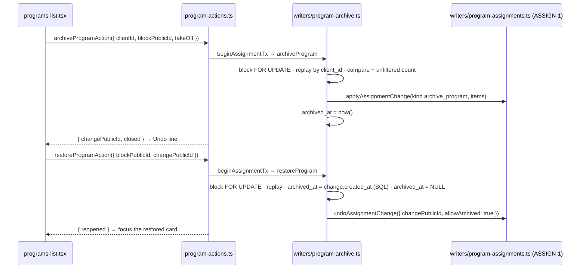

# RETIRE-1 — archive a program so it stops appearing, without losing its history

> Backlog: [plan.md](../plan.md) row **RETIRE-1** (`docs/plan.md:1966`) · Spec:
> [crud-1-fix-it-yourself.md](../specs/crud-1-fix-it-yourself.md) chunk **D6** · Milestone:
> [PROG-1](../milestones/prog-1-programs-and-scheduling.md) step 8 · Branch: `feat/retire-1-archive-program`
> (staged as four branches, below).
>
> **Plan only. No implementation code, no migration, no schema edit in this PR.** Status: engineering
> panel (five lenses, DB-safety included) and UX panel (three lenses) **reconciled, round 1** — see the
> Review-response log. Aligned with the spec's "Seams the plans settled (2026-10-23)" table and the
> ASSIGN-1 ↔ RETIRE-1 cross-plan contract the orchestrator settled on 2026-10-23 (applied verbatim; each
> item is cited below as "contract N").

## Goal

CLONE-1 makes old programs pile up: every "save as a copy" leaves the source behind, and the household's
Programs list, the editor's program list, the copy source list and the assignment sheet's "which program?"
list keep offering all of them. RETIRE-1 lets a parent **archive** a program: it leaves those lists, and
nothing about the past changes. Entries, their snapshotted prescriptions, the assignment rows and dates, the
day page for a past date and the CSV export all read exactly as before. An archived program is listed under
**"Archived programs (n)"** and can be restored.

It lands the decision the spec recorded as **Q3** (spec → "Open decisions — for the maintainer, at
prototype review"): _"**Resolve in place** (Move / Take off beside each name, then archive). Undo restores
the archive and the assignments as one event."_ Archive composes with SCHED-1's `active_to` by **never
coexisting with an open assignment**: a program is archivable only once nobody is on it, and the server
holds that invariant at every site that can open a period.

RETIRE-1 also provides the three things V1-22 A4's last PR (**A4-4, "Start from The Daily Five"**) needs,
because archiving every program is, after ONB-2, the only way a household reaches "no live program":
`programIsListed`, the archived mode of `listHouseholdPrograms`, and `restoreProgram`. A4-4 itself stays
A4's PR, gated on RETIRE-1 PR d (see "What A4-4 consumes").

Why now: PROG-1 step 8. Its real dependencies are ASSIGN-1 (the writer and Undo it calls) and V1-22
chunk 4 (the list query it filters); CLONE-1 is the motivation, not a gate (Staging).

## Acceptance

### Verbatim from the backlog row (`docs/plan.md:1966-1985`)

> **RETIRE-1 — archive a program so it stops appearing, without losing its history.** _(Maintainer,
> 2026-10-08.)_ CLONE-1 makes old versions pile up: every replacement leaves the previous program behind.
> Archiving hides a program from the program editor, from the list of programs to clone, and from new
> assignments. It changes nothing about the past: entries, their snapshotted prescriptions, and the
> assignment dates still render and export exactly as before.
>
> - **Archived is not deleted.** An archived program's history must stay readable, so archiving needs its
>   own marker, and the plan decides its shape. […]
> - **Undo is required:** an archived program can be restored.
> - **Open for the plan:** archiving a program that an athlete is still assigned to. Either it is
>   refused, or it closes the open assignments; both are defensible, and the UX panel should weigh which
>   one surprises a parent less.

The open question is **answered by Q3**: resolve in place. The UX panel overturned "close all" (spec →
"Review-response log", U25).

### Spec criteria this plan carries (spec → "Acceptance", criteria 26–27)

> 26. **While** anyone is on a program, archiving it **shall** first resolve each of them (move or take
>     off) in place — or, under Q3's other answer, close their assignments and say they have no program
>     in its place; **either way** Undo **shall** restore the archive **and** every assignment it closed
>     as one event. **(R1)** _(D6)_
> 27. **While** a program is archived, it **shall not** appear in the editor's program list, the copy
>     source list, or the move-to list, and every past entry against it **shall** render and export as
>     before. _(D6)_

Criterion 33 ("Start from The Daily Five" / "Create a program" when the household has no live program)
is **step 6's** (V1-22 A4, A4-4), not this plan's. RETIRE-1 supplies the predicate and the restore A4-4
calls.

### Done when (observable)

1. `program_blocks.archived_at timestamptz NULL` exists in prod, applied by `migrate.yml` and confirmed
   green **before PR a's production deploy is promoted** (PR a checklist), and observed applied before
   PR b merges.
2. Archiving a program **with nobody on it** sets `archived_at` and writes **one**
   `program_assignment_changes` row of kind `ASSIGNMENT_CHANGE_KINDS` `archive_program` with zero items
   (contract 2); the program leaves every list in criterion 27 and the Programs list, and appears under
   "Archived programs (n)".
3. Archiving a program **with someone on it** is refused `AssignmentRefusal('stale', { onIt })`, writing
   nothing, unless the request's `takeOff` names exactly the open periods **and** an unfiltered count of
   every live open row on the block agrees (contract 10). Then they close through `applyAssignmentChange`
   (one change row, `archive_program`) and the program archives in the same transaction.
4. In the UI, Take off inside the Archive panel **stages** (nothing saved); one **Archive** button posts
   the whole `takeOff` list, so one change and one Undo bring back the program **and every athlete taken
   off in the panel** — criterion 26, literally.
5. **Undo** of an archive takes its `changePublicId`; `restoreProgram` replays first (contract 6), then
   guards `archived_at = change.created_at` in SQL, clears `archived_at`, and calls
   `undoAssignmentChange(…, { allowArchived: true })`, in one transaction, all-or-nothing. A stale or
   expired change writes nothing; an expired one says where Restore lives.
6. **Restore** from "Archived programs (n)" clears `archived_at` and reopens nobody; its message names who
   was on it, and each archived row shows "Archived {date}" and "was used by {names}".
7. No write can open a period on an archived program. Three writer sites refuse it under a lock on the
   block: archive itself, `applyAssignmentChange` (an archived **target**), and `undoAssignmentChange`
   step 4 (contract 5). The SCHED-1 1d seed's assignment pass gains an `archived_at IS NULL` conjunct.
8. A month exported before and after an archive is **byte-identical**, with a non-empty `prescribed`
   cell in the fixture (an equality test on `''` passes vacuously, V1-22 spec finding A1); a past date
   inside a closed period still renders the archived program's workout on the day page.
9. `db:seed` after an archive of a seeded program leaves it archived and reopens nobody, for both close
   shapes (an `active_to` close and a same-day soft delete).
10. With every program archived, `programIsListed` finds nothing and `householdHasLiveProgram` is false;
    `restoreProgram(…, { changePublicId: null })` restores an archived block and is a replay on a live
    one — the two facts A4-4 builds on.

## Where this sits in the code today (measured)

- `program_blocks` has **no lifecycle marker**, only `timestamps` (`created_at`, `updated_at`,
  `deleted_at`, `packages/db/src/schema.ts:35-40`) on the block (`schema.ts:785-806`). The slug arbiter
  `uq_program_blocks_household_slug` is partial on `deleted_at IS NULL` only (`schema.ts:800-802`).
- **Drizzle's INSERT names every column.** `buildInsertQuery` builds its column list from every column
  in the table definition (`drizzle-orm` 0.45.4, `pg-core/dialect.js:356-362`) and fills an unset one
  with `default` (`:387`). So once `archivedAt` is in `schema.ts`, every `db.insert(schema.programBlocks)`
  emits `"archived_at"`, and fails `42703` against a database that has not migrated yet. Today the only
  insert is the seed's (`packages/db/src/seed.ts:418`), which is safe because `migrate.yml` migrates
  before it seeds; by D6, A4's create, CLONE-1's copy and ONB-2's household creation insert from app code.
- `program_assignments` / `program_assignment_weekdays` **do not exist** yet (last migration `0018`,
  `packages/db/migrations/0018_ten2d_validate_global_row_has_pattern.sql`). Their shape is SCHED-1
  chunk 1c's; `program_assignment_changes` and `opened_by_change_id` / `closed_by_change_id` are ASSIGN-1's
  (ASSIGN-1 → "The columns and the table: who owns them").
- The only app reader of `program_blocks` is `programDayRows` (`packages/db/src/queries/program-day.ts:71-85`,
  newest live block holding a prescription for the role); the CSV export's `prescribed` column re-resolves
  through it per stored `day_role` (`apps/web/lib/dal/export.ts:113-135`). Its docblock still says _"An
  explicit active-block marker is the real fix"_ (`program-day.ts:45-46`), which ADR 0007 decision 4
  **withdrew** (`docs/decisions/0007-scheduling-model.md:296-303`). `archived_at` is **not** that marker
  and must never be read there (Decision 4).
- `seedProgram` inserts a block with `onConflictDoNothing` on `(household_id, slug) WHERE deleted_at IS
NULL` and re-resolves it by the same key (`packages/db/src/seed.ts:417-441`), and runs on every merge
  (`seed.ts:295`; `.github/workflows/migrate.yml`).
- `scope.householdId` may be unwrapped **only** in `packages/db/src/writers/ownership.ts`
  (`packages/db/src/scope.test.ts:56`), where `programBlockInHousehold(scope)` lands (spec seams row).
- "Today" is `getActiveLocalDay()` (`apps/web/lib/active-timezone.ts:23`), the request's active day.
- `ActionState` is `{ ok, error, fieldErrors?, savedId? }` in `apps/web/app/p/[profileId]/action-state.ts:8-17`;
  PROF-1 defers moving it out of `[profileId]/` until after AUTH-1 1c (`prof-1-athletes.md:625`).
- The page-level announcer idiom is `SavedAnnouncer`, rendered in both states so its live region exists
  before its text changes (`apps/web/app/p/[profileId]/saved-announcer.tsx:8-11`).
- `AMEND_ERROR_COPY.staleWrite` says _"changed on another device"_ (`apps/web/lib/constants.ts:540`) —
  wrong for an archive panel, where the usual cause is another tab on the same phone.
- The a11y tap-target selector `INTERACTIVE` excludes `<summary>` (`apps/web/e2e/a11y.spec.ts:94`), so a
  short disclosure summary passes CI.

## What this plan uses from the sibling plans (the settled seams)

Each row names the spec's "Seams the plans settled (2026-10-23)" row or a cross-plan contract item; the
signature lives there, not here. All are plans, not code, so each RETIRE-1 PR re-checks the merged
signature; a mismatch is a plan revision.

| Seam (spec row / contract item)                                                                                                | How RETIRE-1 uses it                                                                                                                                                                                    |
| ------------------------------------------------------------------------------------------------------------------------------ | ------------------------------------------------------------------------------------------------------------------------------------------------------------------------------------------------------- |
| "Assignment writes" — `applyAssignmentChange`, `AssignmentRefusal`, `toAssignmentOutcome`                                      | `archiveProgram` calls it inside its own transaction with kind `archive_program` and one take-off item per athlete. RETIRE-1 has no close/reopen/open writer.                                           |
| "Replaying or undoing an assignment change" — the change table, `undoAssignmentChange` with `allowArchived`                    | The archive event **is** one change row, always written (contract 2). `restoreProgram` calls `undoAssignmentChange(tx, scope, { changePublicId, today, allowArchived: true })` (contract 4).            |
| `ASSIGNMENT_CHANGE_KINDS` (contract 1)                                                                                         | Imported for the writer argument and every `db:verify` assertion; no `'archive_program'` literal outside ASSIGN-1's contract test.                                                                      |
| "Lock order, and the lock timeout" — `beginAssignmentTx`, `ASSIGNMENT_LOCK_TIMEOUT` (contracts 7, 8)                           | Every RETIRE-1 DAL transaction opens with `beginAssignmentTx`, so `SET LOCAL lock_timeout` is statement one, before the block's `FOR UPDATE`. `55P03` / `40P01` → `'busy'`.                             |
| "Which assignments are open on day D" — `openAssignmentsForBlock`                                                              | The panel's list, and the comparison re-run under the block lock, beside the unfiltered count (contract 10).                                                                                            |
| `programBlockInHousehold(scope)`                                                                                               | Reused for every block read.                                                                                                                                                                            |
| "The household's program lists" — `listHouseholdPrograms(db, { scope, mode })` (contract 11)                                   | PR b edits **only** this function: `programIsListed()` in `listed` mode, and the `archived` mode. `programIsListed` lives beside it in `packages/db/src/queries/program-blocks.ts`.                     |
| Exported shapes (contract 9): `AthleteOnProgram`, `assignmentItemBase`, `AssignmentChangeResult['items']`, the Undo schema key | The take-off item is `assignmentItemBase.pick({ profilePublicId, expectedAssignmentPublicId })`; every "athlete on it" array is `AthleteOnProgram[]`; the wire key is `changePublicId`, never `undoOf`. |
| `ASSIGNMENT_ERROR_COPY.{busy, undoExpired, alreadyOn}`, `ASSIGNMENT_CHANGE_MAX_ITEMS` (contract 9)                             | `busy` reused as is; the `takeOff` cap is `ASSIGNMENT_CHANGE_MAX_ITEMS`. An **archive** Undo that expired gets RETIRE-1's own `PROGRAM_ARCHIVE_COPY.undoExpired` (it names Restore), not ASSIGN-1's.    |
| "The athlete's today" — `getActiveLocalDay()`                                                                                  | Called once per request in the DAL, passed as `today`.                                                                                                                                                  |
| "Every Server Action is in the boundary matrix" — `app/p/program-actions.ts`, scope `'household'`                              | `archiveProgramAction`, `restoreProgramAction`, in `MUTATING_ACTIONS` + `ACTION_BINDINGS`.                                                                                                              |
| "The Undo line beside a change" (contract 12)                                                                                  | Imported, not built. One page-level island owns it (PR d).                                                                                                                                              |
| "`/settings`" — `app/settings/page.tsx`, `SETTINGS_PATH`                                                                       | The Programs list lives under it (spec Q5); PR d adds its row if no earlier chunk did.                                                                                                                  |
| "Program name rules" / `householdHasLiveProgram` (V1-22 A4)                                                                    | PR b re-points `householdHasLiveProgram` at `programIsListed` — A4 already assigns that one-function edit to RETIRE-1.                                                                                  |
| "The shared sheet" (U0)                                                                                                        | Only through ASSIGN-1's Move sheet; RETIRE-1's panel is inline.                                                                                                                                         |
| AUTH-1 1c's `getHouseholdScope()` (`apps/web/lib/dal/household.ts:68`)                                                         | See "AUTH-1 1c: what to re-verify".                                                                                                                                                                     |

**Withdrawn from earlier drafts:** RETIRE-1's own close / reopen / open writers; its "athlete-local today";
its `FOR SHARE` edit to ASSIGN-1's writer (ASSIGN-1 carries the archived-target conjunct, landing with this
plan's column); the `updated_at = archived_at` Undo derivation; the `undoOf` key; "an archive with nobody
on it writes no change row"; and PR e (A4-4 stays A4's).

## Decisions

### 1. The marker: `program_blocks.archived_at timestamptz NULL`

One nullable column on the block. `NULL` = live; a value = archived, and **when**.

- **Why on `program_blocks`.** An assignment points at a block (SCHED-1 1c), the clone grain is a block
  (CLONE-1 row), and the UI's "program" is a block. Nothing below the block has a lifecycle of its own.
- **Why a timestamp, not a boolean.** It orders and dates the Archived list ("Archived {date}"), and it
  gives Undo a one-row guard: `archived_at = change.created_at`, since both are the same transaction's
  `now()`. **Both are written as SQL `now()` and compared in SQL** (a join or subquery), never through a
  JS `Date`, whose millisecond truncation would make the equality permanently false. The writer's
  docblock says so.
- **Why nullable with no default and no backfill.** `ADD COLUMN … timestamptz` with no default is a
  catalog-only change on Postgres 11+ (no rewrite); every existing block is live, so `NULL` is correct for
  every existing row. No constraint, so no `NOT VALID` → `VALIDATE`.
- **No index.** Every reader already filters by `household_id` through `idx_program_blocks_household`
  (`schema.ts:799`), and a household holds a handful of blocks.
- **The slug arbiter is NOT changed.** An archived block keeps its slug in `uq_program_blocks_household_slug`.
  Deliberate: (a) Restore can never collide; (b) `seedProgram`'s arbiter keeps matching an archived seeded
  block, so the seed **cannot resurrect** it (`seed.ts:426-441`); (c) re-predicating a unique index is a
  drop + `CREATE … CONCURRENTLY` in its own file, the most expensive migration shape in AGENTS.md. The
  cost is that a new program cannot take an archived program's name; A4-4 settles that for The Daily
  Five by restoring rather than re-inserting (A4's plan).
- **Consistency with A2.** PROF-1's athlete archive marker should share the name and type
  (`profiles.archived_at timestamptz NULL`), so a dashboard filters both lifecycles one way (spec →
  "Later milestones this must not get in the way of"). Whichever lands second matches the first.

**Alternatives rejected:**

| Alternative                                                                                             | Why rejected                                                                                                                                                                                                                                                                                                                |
| ------------------------------------------------------------------------------------------------------- | --------------------------------------------------------------------------------------------------------------------------------------------------------------------------------------------------------------------------------------------------------------------------------------------------------------------------- |
| **Reuse `deleted_at`**                                                                                  | Forbidden: ADR 0008 → Backlog impact, `RETIRE-1` must NOT _"reuse `deleted_at`"_ (`docs/decisions/0008-deletion.md:158`). A hide is invisible and ends in erasure at `N`; an archived program must stay readable in place (`:77`). It would also free the slug, and the seed would re-insert a live copy on the next merge. |
| **Derive "archived" from "no open assignment"**                                                         | A fresh copy nobody is on yet is live (prototype: _"Nobody is on this program"_ in the live list, `index.html:3684`), and a just-restored program has nobody on it. Lifecycle ≠ occupancy.                                                                                                                                  |
| **`status text` + CHECK (`'live'`/`'archived'`)**                                                       | Two states, one of which is "absent"; a NOT NULL status needs a default on a live table for no extra meaning, and loses the "when". `archived_at` → `status` is an additive expand if a third state ever arrives.                                                                                                           |
| **An `archived` boolean**                                                                               | Loses the Undo guard and the list order.                                                                                                                                                                                                                                                                                    |
| **A `program_block_archives` event table**                                                              | The archive event already has a row — ASSIGN-1's `program_assignment_changes`, kind `archive_program`, written on every archive (contract 2). A second event table would be a second Undo mechanism.                                                                                                                        |
| **The withdrawn "active-block marker"** (ADR 0007 decision 4)                                           | "Which block answers today" is a query over live assignments. `archived_at` answers "is this offered in lists" and is never read by dueness (Decision 4).                                                                                                                                                                   |
| **Free the slug on archive** (re-predicate the arbiter to `deleted_at IS NULL AND archived_at IS NULL`) | Restore could collide, the seed would resurrect archived seeded programs, and the migration is an index rebuild.                                                                                                                                                                                                            |

### 2. Archive composes with `active_to` by never coexisting with an open assignment

**The invariant:** _no `program_assignments` row with `active_to IS NULL AND deleted_at IS NULL` points at
a block whose `archived_at IS NOT NULL`._ Writer-enforced (no CHECK can state a cross-table rule), at
**three** writer sites, each under a lock on the block row, plus the seed:

| Site                                                      | Owner (lands in)                                            | Lock                                                                                                       | Rule                                                                                                                                                                                                                                                                                                |
| --------------------------------------------------------- | ----------------------------------------------------------- | ---------------------------------------------------------------------------------------------------------- | --------------------------------------------------------------------------------------------------------------------------------------------------------------------------------------------------------------------------------------------------------------------------------------------------- |
| **Archive** (`archiveProgram`)                            | RETIRE-1 (PR b)                                             | `FOR UPDATE` on the block                                                                                  | Refuses `'stale'` unless `takeOff` names exactly the open set **and** an unfiltered count agrees (step 4).                                                                                                                                                                                          |
| **Open a period** (`applyAssignmentChange`, target block) | ASSIGN-1's function; conjunct in RETIRE-1 PR b              | `FOR SHARE` on the block                                                                                   | An archived **target** → `AssignmentRefusal('archived')`. Recorded in ASSIGN-1 §3 as a forward note; it cannot exist before the column.                                                                                                                                                             |
| **Reopen a period** (`undoAssignmentChange` step 4)       | ASSIGN-1's function; conjunct in RETIRE-1 PR b (contract 5) | the `FOR SHARE` it already holds                                                                           | Any row it would reopen on a block with `archived_at IS NOT NULL` → `'archived'`, **never bypassed**: `allowArchived` skips only the archived-**athlete** check; `restoreProgram` clears `archived_at` before it reopens, so it never needs to (round 2, B1). Recorded in ASSIGN-1 §4 the same way. |
| **The seed's assignment pass** (SCHED-1 1d)               | SCHED-1's code; conjunct in RETIRE-1 PR b                   | `FOR SHARE` on the block (contract 8 order), so it cannot interleave with an archive's count (round 2, S1) | `archived_at IS NULL` on the block it would assign to, so a seeded period closed by a **same-day soft delete** (no live row left to conflict with) is not re-inserted onto an archived block.                                                                                                       |

`FOR SHARE` conflicts with `FOR UPDATE`, so the writer sites serialize under READ COMMITTED. Without the
third site, two sequences reopen a period on an archived block: an earlier take-off's or Move's Undo
tapped after the archive (another tab, an older Undo line, CLONE-1's "Undo after a copy"), and the generic
Undo action given an archive's change id. Contract 4 closes the second (the generic action refuses
`kind <> 'assign'`); the step 4 conjunct closes the first.

**Lock order and the athlete archive.** The global order is `program_blocks → program_assignment_changes →
profiles → program_assignments` (contract 8). PROF-1's athlete-archive hook calls `applyAssignmentChange`
(kind `archive_athlete`) **before** its `profiles` UPDATE; otherwise an athlete archive and a program
archive naming the same athlete deadlock (`40P01`, mapped to `'busy'` as the backstop, contract 7).

**`archiveProgram`, in one transaction opened by `beginAssignmentTx`:**

```ts
// packages/db/src/writers/program-archive.ts (NEW, PR b)
// The caller opens tx with ASSIGN-1's beginAssignmentTx: SET LOCAL lock_timeout is statement one.
export async function archiveProgram(
  tx: Executor,
  scope: HouseholdScope,
  args: z.infer<typeof programArchiveSchema> & { today: string }, // today = getActiveLocalDay()
): Promise<{
  archivedAt: string;
  changePublicId: string; // always: every archive writes its change row (contract 2)
  closed: AthleteOnProgram[];
  replayed: boolean;
}>; // throws AssignmentRefusal
```

1. **`program_blocks`** — `SELECT … FOR UPDATE` by `public_id`, `programBlockInHousehold(scope)`,
   `deleted_at IS NULL`. Missing → `'not_found'`.
2. **Replay first** (contract 3), whatever the block's state: look up the change by
   `(household, client_id)`. Found, kind `archive_program`, and it names this block → return the rebuilt
   result, write nothing. Found otherwise (another kind, or another block) → `'stale'`. This is what stops
   a retry that lands **after its own Undo** from re-archiving a program the athlete is back on, and a
   crafted body reusing an unrelated change's id from archiving anything.
3. **Already archived** (and no change under this `client_id`) → `'stale'` (another request archived it).
4. **Compare, under the lock:** `openAssignmentsForBlock({ scope, blockPublicId, on: today })` against
   `takeOff`, **and** an unfiltered count of every live open row on the block — any profile, any
   `active_from` (contract 10). The sets differ, or the count differs from what the query shows (a
   future-dated period opened from a device a day ahead; an open period held by an archived athlete) →
   `'stale'` with `detail.onIt`, and the panel re-renders from it.
5. `applyAssignmentChange(tx, scope, { clientId, today, kind, items })` with `kind` the
   `archive_program` member of `ASSIGNMENT_CHANGE_KINDS`, one take-off item per athlete (`to = null`), **zero items allowed** (both archive kinds; `assign` never)
   (contract 2). It takes the change row, the profiles and the periods in order, closes each
   (`active_to = today − 1`, or a same-day soft delete), and records one change. If it returns
   `replayed: true` while the block was live at step 1 → `'stale'` (contract 3).
6. `UPDATE program_blocks SET archived_at = now(), updated_at = now() WHERE id = $ AND archived_at IS NULL`.

The DAL wraps it in ASSIGN-1's caller shape — `try { beginAssignmentTx(…) } catch (e) { return
toAssignmentOutcome(e) }` — because a typed non-ok **return** inside drizzle's `transaction()` commits what
the callback already wrote. RETIRE-1 adds no refusal type: `not_found`, `stale` (with `onIt`), `busy`,
`expired` and `archived` cover it.

**The change names its block** (contract 14, settled). `program_assignment_changes.program_block_id` is
nullable, FK + covering index, and a CHECK requires it for `archive_program`; ASSIGN-1's 1a-db creates it.
Step 2 and the Undo's step 2 read "names this block" from that column, never from the closed rows, so a
zero-item archive is checkable too.

**How the UI uses it (PR d; a deliberate change to the approved v8/v9 prototype, Open question 1).**
"Archive…" opens an inline panel naming who is on it. Beside each name: **Move…** (primary; ASSIGN-1's
sheet, its own change and Undo, saved at once because the athlete keeps a program) and **Take off**
(secondary). **Take off stages**: the row reads _"{athlete} · comes off today"_ with a **Keep on** button,
and nothing is saved. Once nobody is left un-staged, the panel shows one confirm naming the staged
athletes and one **Archive** button, which posts `archiveProgram` with the whole `takeOff` list. **Cancel**
discards the staged rows. With nobody on it from the start, the same confirm reads _"Archive {name}? Nobody
is on it."_ and posts `takeOff = []`. There is **one confirm on every path**, which settles the old Open
question 1.

**Q3's other answer** ("close all") is the same call with everyone in `takeOff`; not built in the UI, and
nothing on the server changes if the maintainer reverses Q3.

**Alternatives rejected:** _refuse while anyone is on it, with no in-place resolution_ — overturned by the
UX panel (U25); _close silently on archive_ — Q3's overturned answer; _let open periods run on an archived
program until they end_ — "archived but still due" is the second, drifting answer to "is this active" ADR
0007 decision 4 rejects; _save each Take off on tap_ (the v8/v9 prototype) — Cancel then cancels nothing,
each tap replaces the last one's Undo, and the archive's Undo brings back only the last athlete (UX
round 1, below).

### 3. Undo and Restore: the change id wins, and the archive is one event

**The change id is the Undo key**, not `archived_at` or `updated_at` (ASSIGN-1 §4; spec seams row).
Because every archive writes a change row (contract 2), every archive Undo is keyed by `changePublicId`.

```ts
export async function restoreProgram(
  tx: Executor, // opened by beginAssignmentTx
  scope: HouseholdScope,
  args: { blockPublicId: string; changePublicId: string | null; today: string },
): Promise<{ reopened: AssignmentChangeResult['items']; replayed: boolean }>; // throws AssignmentRefusal
```

- **Undo of an archive** (`changePublicId` set):
  1. lock the block `FOR UPDATE`;
  2. read the change in scope: kind `archive_program`, naming this block — else `'not_found'`;
  3. **replay first** (contract 6): `undone_at IS NOT NULL` and `archived_at IS NULL` → `replayed: true`
     with the rebuilt items, nothing written;
  4. only then: `archived_at` ≠ `change.created_at`, compared **in SQL** → `'stale'` (restored, or archived
     again, since);
  5. `UPDATE … SET archived_at = NULL, updated_at = now() WHERE id = $ AND archived_at IS NOT NULL` —
     **before** the reopen, so the new step 4 conjunct does not refuse the program's own Undo (contract 5);
  6. `undoAssignmentChange(tx, scope, { changePublicId, today, allowArchived: true })`, which locks in the
     global order, compares full state, refuses `'stale'` / `'expired'` (`effective_day ≠ today`), reopens
     what the change closed and sets `undone_at`. A zero-item change still goes through it, so its
     `undone_at` is set and a retry replays.

  **One transaction, one event**: the archive and every assignment its change closed come back together,
  or nothing does. A thrown `'expired'` rolls step 5 back too.

- **Restore** from "Archived programs (n)" (`changePublicId: null`): lock the block; already live →
  `replayed: true`, nothing written; otherwise the same `UPDATE … WHERE archived_at IS NOT NULL`. Reopens
  nobody. This is also the call A4-4 makes.
- **The Undo window is ASSIGN-1's:** same active day only. After that the Undo line says
  `PROGRAM_ARCHIVE_COPY.undoExpired` — _"Too late to undo. {Program} is under Archived programs. Restore it
  there, then put {names} back on it."_ — with the names from the change's closed rows and a **Restore**
  button inline.
- **No second Undo mechanism.** `restoreProgramAction` exists only because only RETIRE-1 can unarchive; it
  reverses assignments solely through `undoAssignmentChange`. The generic `undoAssignmentChangeAction`
  refuses an archive's change id (contract 4).

**One event, said against criterion 26.** With staged Take off, the archive's change closes **everyone
taken off in the panel**, so its Undo restores the program and all of them: criterion 26, read literally.
A **Move** made in the panel is its own ASSIGN-1 change with its own Undo, because the moved athlete still
has a program and reversing the archive should not move them back.



### 4. Archive filters lists — and only lists; `programIsListed` is THE live-program predicate

```ts
// packages/db/src/queries/program-blocks.ts — beside listHouseholdPrograms (contract 11)
/** A program offered in LISTS: not hidden, not archived. THE live-program predicate — every list and
 *  "does this household have a live program" reads it. NEVER in a dueness, history or export read
 *  (RETIRE-1 Decision 4). */
export function programIsListed() {
  return and(isNull(schema.programBlocks.deletedAt), isNull(schema.programBlocks.archivedAt));
}
```

RETIRE-1 **owns** it, and it is the one definition. It sits beside the one list query rather than in
`writers/ownership.ts`, because it does not touch scope and its readers are queries. V1-22 A4's
`householdHasLiveProgram` becomes `EXISTS (programBlockInHousehold(scope) AND programIsListed())` in PR b.
Named `programIsListed`, not `isLiveProgram`, so nobody reaches for it in a dueness read.

| Reader                                                                                                            | Reads `archived_at`?     | Why                                                                                                                                                                                                                                                                                                                                                                                                        |
| ----------------------------------------------------------------------------------------------------------------- | ------------------------ | ---------------------------------------------------------------------------------------------------------------------------------------------------------------------------------------------------------------------------------------------------------------------------------------------------------------------------------------------------------------------------------------------------------- |
| `listHouseholdPrograms` `listed` mode (Programs list; editor list; copy source list; ASSIGN-1's "which program?") | **yes** — listed only    | criterion 27; one query, so one `db:mutations` patch covers all four lists                                                                                                                                                                                                                                                                                                                                 |
| `listHouseholdPrograms` `archived` mode ("Archived programs (n)")                                                 | **yes** — archived only  | the Restore surface; newest first; returns `archivedAt` and `wasUsedBy` (live athletes on the latest un-undone archive change's closed rows on this block)                                                                                                                                                                                                                                                 |
| `householdHasLiveProgram` (criteria 32–33)                                                                        | **yes**                  | archived ≠ live                                                                                                                                                                                                                                                                                                                                                                                            |
| `applyAssignmentChange` target; `undoAssignmentChange` step 4; the seed's assignment pass                         | **yes** (refuse / skip)  | Decision 2                                                                                                                                                                                                                                                                                                                                                                                                 |
| `programDayRows` (`program-day.ts:52-141`)                                                                        | **no — must not**        | it still feeds the export's legacy `prescribed` path (`export.ts:121`); filtering would change which block the legacy match resolves and rewrite old bytes                                                                                                                                                                                                                                                 |
| ASSIGN-READ's dueness read (Today, and any past day)                                                              | **no — must not**        | an archived program has no open period, so it is never due today; a past date inside a closed period must still render it (criterion 27)                                                                                                                                                                                                                                                                   |
| `openAssignmentsForBlock`, HIST-1, the CSV export, the snapshot writer                                            | **no — must not**        | history; the export's immobility stays **structural**, as SCHED-1's "export finding" made it                                                                                                                                                                                                                                                                                                               |
| The V1-22 editor's save and CLONE-1's copy writers                                                                | **no** (UI absence only) | once V1-22 chunks 2–3 ship, history reads snapshots, so editing an archived program changes no logged day **that carries a snapshot**; an older entry with a **NULL** snapshot still re-resolves through `programDayRows` and could read the edit — the same exposure any live program's edit has today. A copy of an archived program is a live program, a legitimate "start again from last season" path |

### What A4-4 consumes (and what moved there)

"Start from The Daily Five" stays **V1-22 A4's PR A4-4**, gated on RETIRE-1 PR d. RETIRE-1 provides, and
A4-4 calls rather than restates:

- `programIsListed()` and `householdHasLiveProgram()` (PR b) — "is there a live program";
- `listHouseholdPrograms(…, { mode: 'archived' })` (PR b) — what is archived;
- `restoreProgram(tx, scope, { blockPublicId, changePublicId: null, today })` (PR b) — restore an archived
  block inside A4-4's own `beginAssignmentTx` transaction; its `UPDATE` carries `WHERE archived_at IS NOT
NULL`, and a live block is a replay.

Everything else about that path is A4-4's, including what the panel raised about it and the orchestrator
forwarded: the restore-branch Undo (it touches only the put-on, so no pre-image is needed), the copy
when the household's own Daily Five is restored rather than the shipped one ("Restore your Daily Five",
"edited" in the DTO), whether archived programs appear on "No program yet" (a criterion 33 amendment, the
maintainer's call), and the adult caution's next step.

## Staging

Four PRs, one concern each. None starts before Beta 1's gate (D3).

| PR    | Branch                             | What                                                                                                                                                                                                            | ~lines (hand-written) | Gate                                                                                                                                                                                |
| ----- | ---------------------------------- | --------------------------------------------------------------------------------------------------------------------------------------------------------------------------------------------------------------- | --------------------- | ----------------------------------------------------------------------------------------------------------------------------------------------------------------------------------- |
| **a** | `db/retire-1a-program-archived-at` | The column, shipped dark: schema, migration, `db:verify` shape proof, inventory row, architecture ERD, the deploy-window checklist, the lessons entry                                                           | ~110 + generated meta | ADR 0008 signed (`0008:46`). The column needs neither SCHED-1 1c nor ASSIGN-1's table                                                                                               |
| **b** | `feat/retire-1b-archive-writer`    | `archiveProgram` / `restoreProgram`; `programIsListed` + the archived mode in `listHouseholdPrograms`; the conjuncts in `applyAssignmentChange`, `undoAssignmentChange` and the seed; `householdHasLiveProgram` | ~330                  | **a observed applied in prod**; ASSIGN-1 1b merged (writer, Undo, change table, `beginAssignmentTx`); V1-22 chunk 4's `listHouseholdPrograms` merged; SCHED-1 1d's seed pass merged |
| **c** | `feat/retire-1c-archive-actions`   | DAL `lib/dal/program-archive.ts` + `archiveProgramAction` / `restoreProgramAction` in `app/p/program-actions.ts` (scope `'household'`) + boundary tests, still no UI                                            | ~260                  | b; WP-1 merged                                                                                                                                                                      |
| **d** | `feat/retire-1d-archive-ui`        | Programs list: Archive…, the staged resolve panel, the page island with the shared Undo line, "Archived programs (n)"; a11y + NARROW scans; screenshots; the prototype updated to staged Take off               | ~300                  | c + the Programs list exists + PROF-1's Undo line + **UX panel reconciled** + Open question 1 confirmed                                                                             |

**Why a is alone.** One migration per PR (AGENTS.md), and the column must be **applied before** any
deployed code inserts into or reads `program_blocks` with it in the schema: `migrate.yml` and the Vercel
deploy both fire on merge. **b and c split** on review lens (DB-safety vs the backend rules). **No CLONE-1
gate:** RETIRE-1 has no file or contract dependency on CLONE-1; gate 1 on `program-actions.ts` serializes
them by the milestone's order anyway (the milestone chart's CL → RT edge is the milestone's to keep with
that reason or drop).

## File-by-file changes

The Programs list's path is `PROGRAMS_PATH`, defined by whichever PR first ships the list (A4's plan says
so); this plan writes `<programs>` for its directory until then (spec Q5: under `/settings`).

### PR a — the column, dark

| Path                                                                 | Change   | What & why                                                                                                                                                                                                                                                                                                                                                                                                                                                              |
| -------------------------------------------------------------------- | -------- | ----------------------------------------------------------------------------------------------------------------------------------------------------------------------------------------------------------------------------------------------------------------------------------------------------------------------------------------------------------------------------------------------------------------------------------------------------------------------- |
| `packages/db/src/schema.ts`                                          | EDIT     | `archivedAt: timestamp('archived_at', { withTimezone: true })` on `programBlocks`, after `notes`. Docblock: archive ≠ hide (ADR 0008 `:71`, `:77`); lists only (Decision 4); the slug is kept (Decision 1); the writer-enforced invariant (Decision 2).                                                                                                                                                                                                                 |
| `packages/db/migrations/00NN_retire1_program_blocks_archived_at.sql` | NEW      | Generated, hand-hardened in the 0015 house style: `SET lock_timeout = '5s'; SET statement_timeout = '60s';` then `ALTER TABLE "program_blocks" ADD COLUMN IF NOT EXISTS "archived_at" timestamp with time zone;`. Header: WHY, the lock (`ACCESS EXCLUSIVE`, catalog-only, no rewrite, no scan), re-run safety, what `db:verify` does not prove; no production numbers. `NN` is whatever is next at generate time.                                                      |
| `packages/db/migrations/meta/_journal.json` + snapshot               | EDIT/NEW | Generated; `generate` must leave a clean tree.                                                                                                                                                                                                                                                                                                                                                                                                                          |
| `packages/db/scripts/verify.ts`                                      | EDIT     | `columnsOf('program_blocks')`: `archived_at` is `timestamp with time zone`, nullable, no default.                                                                                                                                                                                                                                                                                                                                                                       |
| `docs/architecture.md`                                               | EDIT     | §4 ERD: `program_blocks.archived_at`.                                                                                                                                                                                                                                                                                                                                                                                                                                   |
| `docs/privacy/data-inventory.md`                                     | EDIT     | The `program_blocks` row: `archived_at` — when a parent archived it; an archived program is **kept in full**, is **not** a hide, is **not** purged at `N`, and goes with the household under the deletion runbook. No new personal data.                                                                                                                                                                                                                                |
| `docs/lessons.md`                                                    | EDIT     | **Drizzle's INSERT names every column**, so an additive column on a table with app-side inserts breaks those inserts from deploy until `migrate.yml` finishes; the select-only "projection-less read" grep and TEN-2a's dark-reader test do not catch it. Covers TEN-2a's `movements.household_id` (0015, `findOrCreateMovement`) after the fact, and notes that `migrate.yml`'s "racing the Vercel deploy is safe" comment holds only for tables nothing inserts into. |
| `docs/changelog/<date>-db-retire-1a-program-archived-at.md`          | NEW      | `status:check`.                                                                                                                                                                                                                                                                                                                                                                                                                                                         |
| `docs/plan.md`, `docs/roadmap.md`, `docs/status.md`                  | EDIT     | One line each.                                                                                                                                                                                                                                                                                                                                                                                                                                                          |

**Squawk:** a plain nullable `ADD COLUMN` should trip no rule (**unverified until run**:
`npx squawk-cli@2.66.0 -c .squawk.toml <file>`, the CI invocation; output in the PR body).

**The deploy window (db B1).** From the moment the Vercel production deploy carrying PR a's `schema.ts`
goes live until `migrate.yml` has added the column, **every app-side `program_blocks` insert fails
`42703`** (Drizzle names every column, `dialect.js:356-362`, `:387`), and so does any projection-less
`.returning()` or relational `db.query.programBlocks` read. By D6 that is A4's create, CLONE-1's copy and
ONB-2's household creation. So PR a:

- **greps** for every `insert(schema.programBlocks)`, projection-less `select()` / `.returning()`, and
  `db.query.programBlocks` call site, and **lists them in the PR body** (a stronger check than the old
  select-only grep);
- **closes the window with option (a)**: the PR a checklist runs `migrate.yml` (via `workflow_dispatch`
  from `main` once merged) and confirms it is green on the merge SHA **before the production deploy is
  promoted**. If the project's Vercel settings auto-promote, the checklist names the hold step it uses;
- names the recovery path if the migration waits out its `lock_timeout` and stays pending: the runbook's
  "A pending migration wedges prod and the seed with it" (`docs/runbooks.md:116-143`);
- notes the **preview** window: PR a's preview runs on the pre-migration schema by design
  (`.github/workflows/migrate-preview.yml`, "schema lag is deliberate"), so create / copy on that preview
  fail. The pre-merge proof is `e2e:local` on a migrated ephemeral database.

### PR b — the writers, the predicate and the conjuncts

| Path                                                                          | Change | What & why                                                                                                                                                                                                                                                                                   |
| ----------------------------------------------------------------------------- | ------ | -------------------------------------------------------------------------------------------------------------------------------------------------------------------------------------------------------------------------------------------------------------------------------------------- |
| `packages/db/src/queries/program-blocks.ts`                                   | EDIT   | `programIsListed()` beside `listHouseholdPrograms`; that function — and only that one — gets the predicate in `listed` mode and an `archived` mode (`isNotNull(archivedAt)`, `isNull(deletedAt)`, newest first, with `archivedAt` and `wasUsedBy: AthleteOnProgram[]`).                      |
| `packages/db/src/writers/program-archive.ts`                                  | NEW    | `archiveProgram`, `restoreProgram` (Decisions 2–3). Call `applyAssignmentChange` / `undoAssignmentChange`; never write `program_assignments` directly. `archived_at` written as SQL `now()` and compared in SQL.                                                                             |
| `packages/db/src/writers/program-assignments.ts`                              | EDIT   | Two conjuncts in ASSIGN-1's functions: the archived **target** in `applyAssignmentChange` (ASSIGN-1 §3's forward note) and the archived **reopen** in `undoAssignmentChange` step 4 (contract 5, ASSIGN-1 §4's forward note).                                                                |
| `packages/db/src/seed.ts` (SCHED-1 1d's assignment pass)                      | EDIT   | `archived_at IS NULL` on the block it would assign to.                                                                                                                                                                                                                                       |
| `packages/db/src/index.ts`                                                    | EDIT   | Export the two writers and `programIsListed`.                                                                                                                                                                                                                                                |
| `apps/web/lib/dal/programs.ts` (A4's)                                         | EDIT   | `householdHasLiveProgram()` → `EXISTS (programBlockInHousehold ∧ programIsListed)` — the one-function edit A4 assigns to RETIRE-1. Nothing else of RETIRE-1's goes in A4's file.                                                                                                             |
| `packages/shared/src/programming.ts`                                          | EDIT   | `programArchiveSchema`, `programRestoreSchema` (below) — additive to the spec's contract, which has no archive shape.                                                                                                                                                                        |
| `packages/db/scripts/verify.ts`                                               | EDIT   | The proofs under Test plan.                                                                                                                                                                                                                                                                  |
| `packages/db/scripts/mutations/NN-archive-lists-everything.patch` + `.expect` | NEW    | Drops `programIsListed()` from `listHouseholdPrograms` → `db:verify` red.                                                                                                                                                                                                                    |
| `packages/db/scripts/mutations/NN-assign-into-archived.patch` + `.expect`     | NEW    | Drops the archived-target conjunct → red.                                                                                                                                                                                                                                                    |
| `packages/db/scripts/mutations/NN-undo-into-archived.patch` + `.expect`       | NEW    | Drops the `undoAssignmentChange` step 4 conjunct → red.                                                                                                                                                                                                                                      |
| `packages/db/scripts/mutations/NN-seed-into-archived.patch` + `.expect`       | NEW    | Drops the seed conjunct → red (the soft-delete close shape).                                                                                                                                                                                                                                 |
| `docs/features/write-path.md`                                                 | EDIT   | `guides:check` (owns `writers/`, `lib/dal/`): archive and restore run in a `beginAssignmentTx` transaction, block lock first; the three enforcement sites.                                                                                                                                   |
| `docs/features/programming.md`                                                | EDIT   | `guides:check` (owns `packages/shared/src/programming.ts`): one line — **"`archived_at` filters lists only; never read it in dueness, history or export"** — linking to Decision 4 rather than copying its table; and that `program-day.ts:45-46`'s "active-block marker" sentence is stale. |
| `docs/architecture.md`                                                        | EDIT   | The archive / Undo sequence diagram (Decision 3): `archiveProgram → applyAssignmentChange`, `restoreProgram → undoAssignmentChange`.                                                                                                                                                         |
| `docs/decisions/0008-deletion.md`                                             | EDIT   | A dated pointer note under "What this does not settle": _"Whether archiving closes open assignments"_ was settled by Q3 (resolve in place) — the decision text is not edited.                                                                                                                |
| `docs/changelog/…`                                                            | NEW    | Fragment.                                                                                                                                                                                                                                                                                    |

```ts
// packages/shared/src/programming.ts
const takeOffItem = assignmentItemBase.pick({
  profilePublicId: true,
  expectedAssignmentPublicId: true,
});
export const programArchiveSchema = z
  .object({
    clientId: uuidSchema, // the change's client_id (contract 3)
    blockPublicId: uuidSchema,
    takeOff: z.array(takeOffItem).max(ASSIGNMENT_CHANGE_MAX_ITEMS).default([]), // + refine: unique profiles
  })
  .strict();
export const programRestoreSchema = z
  .object({
    blockPublicId: uuidSchema,
    changePublicId: undoAssignmentChangeSchema.shape.changePublicId.nullable().default(null), // null = Restore
  })
  .strict();
```

### PR c — the DAL and the actions

| Path                                                                        | Change | What & why                                                                                                                                                                                                                                                                                                                                                                                                         |
| --------------------------------------------------------------------------- | ------ | ------------------------------------------------------------------------------------------------------------------------------------------------------------------------------------------------------------------------------------------------------------------------------------------------------------------------------------------------------------------------------------------------------------------ |
| `apps/web/lib/dal/program-archive.ts`                                       | NEW    | `archiveProgram(input)` / `restoreProgram(input)`: `getHouseholdScope()` (null → `not_found`), `today = await getActiveLocalDay()`, `beginAssignmentTx` inside `try`, `toAssignmentOutcome` in `catch`, a DTO. `listArchivedPrograms()` over `listHouseholdPrograms({ mode: 'archived' })`. `server-only`. Mirrors the writer's module name, as CLONE-1 (`program-clone.ts`) and HIST-1 (`program-history.ts`) do. |
| `apps/web/app/p/program-actions.ts`                                         | EDIT   | `archiveProgramAction`, `restoreProgramAction` beside A4's and CLONE-1's: `Sentry.withServerActionInstrumentation`, session + household re-checked inside, zod first (bad body → `fieldErrors`, nothing written), DAL, then `revalidatePath` for `athletePath(id)` of **every athlete in `closed` / `reopened`**, plus `PROGRAMS_PATH` and `SETTINGS_PATH` (constants, never literals), the envelope. Thin.        |
| The action registry (`MUTATING_ACTIONS` + `ACTION_BINDINGS`, WP-1)          | EDIT   | Both actions with scope `'household'` and their writers, so the household suite enumerates them; never on the exclusion list.                                                                                                                                                                                                                                                                                      |
| `apps/web/app/p/program-action-state.ts` (or WP-1's sibling for the module) | EDIT   | `ProgramArchiveState = ActionState & { changePublicId?: string; closed?: AthleteOnProgram[]; onIt?: AthleteOnProgram[] }`. `ActionState` is **imported** from PROF-1's moved module if the move has landed, otherwise across from `app/p/[profileId]/action-state.ts`; no third copy. A `'use server'` module exports only async functions, hence the sibling.                                                     |
| `apps/web/lib/constants.ts`                                                 | EDIT   | `PROGRAM_ARCHIVE_COPY` — only the archive-specific strings: the panel sentence, the confirm, archived, restored, `stale` (no "another device"), `undoExpired`. `busy` → `ASSIGNMENT_ERROR_COPY.busy`, reused.                                                                                                                                                                                                      |
| `apps/web/app/p/program-actions.test.ts`                                    | EDIT   | The boundary tests (Test plan).                                                                                                                                                                                                                                                                                                                                                                                    |
| `docs/features/write-path.md`                                               | EDIT   | Owns `lib/dal/` and (per WP-1) the module.                                                                                                                                                                                                                                                                                                                                                                         |

Rate limit: whatever WP-1 / ASSIGN-1 apply to household mutations (A4 names "the mutation limiter");
RETIRE-1 adds none of its own.

### PR d — the UI (prototype screen **programs**, approved v8/v9, with staged Take off)

| Path                                                 | Change | What & why                                                                                                                                                                                                                                                                                                                                              |
| ---------------------------------------------------- | ------ | ------------------------------------------------------------------------------------------------------------------------------------------------------------------------------------------------------------------------------------------------------------------------------------------------------------------------------------------------------- |
| `apps/web/app/<programs>/page.tsx`                   | EDIT   | `listArchivedPrograms()` beside the live list (one more await in the existing `Promise.all`); the panel's athletes from `openAssignmentsForBlock` through ASSIGN-1's DAL. Renders the cards and archived rows as server components, passed into the island as children.                                                                                 |
| `apps/web/components/programs/programs-list.tsx`     | NEW    | **The one page-level `'use client'` island**: owns the archive and restore action state (`useActionState`), the always-mounted `UndoLine` (contract 12) and focus for archive, Undo and Restore, and gives the per-card panels and Restore buttons a context to submit through. Cards and archived rows stay server-rendered children.                  |
| `apps/web/components/programs/archive-panel.tsx`     | NEW    | `'use client'`, per card: **Archive…** (`aria-expanded`, `aria-controls`), the inline panel (`role="group" aria-labelledby` its sentence), the staging state, the confirm, **Archive** / **Cancel**. Submits through the island.                                                                                                                        |
| `apps/web/components/programs/archived-programs.tsx` | NEW    | Server `<details>` "Archived programs (n)", **not rendered when n = 0**; `<summary class="flex min-h-11 items-center">`; a `<ul>` of rows: name, "Archived {date}", "was used by {names}", and a **Restore** button (client, submitting through the island).                                                                                            |
| (PROF-1's) `apps/web/components/undo-line.tsx`       | —      | **Imported, not built.**                                                                                                                                                                                                                                                                                                                                |
| `/settings` (`app/settings/page.tsx`)                | EDIT   | The Programs sub-page row, only if no earlier chunk added it.                                                                                                                                                                                                                                                                                           |
| `docs/prototypes/crud-1/index.html`                  | EDIT   | The programs screen's Take off stages instead of saving (Open question 1), so the prototype and the code agree.                                                                                                                                                                                                                                         |
| `apps/web/e2e/a11y.spec.ts`                          | EDIT   | The Programs list with the panel open (two athletes, one staged) and the disclosure expanded; plus a **NARROW (360px)** test with a 40-character program name and 40-character athlete names, panel open with two athletes, disclosure open: axe + `expectTapTargets` + `expectNoHorizontalOverflow`; and a direct height assertion on the `<summary>`. |
| `apps/web/e2e/<programs>.spec.ts`                    | EDIT   | Two flows: archive an empty program → gone → Undo → back; stage two athletes off → Archive → Undo → program and **both** athletes back.                                                                                                                                                                                                                 |
| `docs/features/programming.md`                       | EDIT   | Owns `apps/web/components/programs/` (A4 adds it to `owns:`).                                                                                                                                                                                                                                                                                           |

**Panel copy** (`PROGRAM_ARCHIVE_COPY`):

- sentence (the group's label): _"{names} is/are on {program}. Move them or take them off, then archive.
  Taking someone off leaves them with no program until you choose one. Everything logged stays."_
- staged row: _"{athlete} · comes off today"_ with **Keep on**;
- confirm, someone staged: _"Archive {program}? {staged names} come off today and will have no program
  until you choose one. Every logged day stays, and you can restore it from Archived programs."_ (UX3 S4) — **Archive** / **Cancel**;
- confirm, nobody on it: _"Archive {program}? Nobody is on it. Every logged day stays, and you can restore
  it from Archived programs."_;
- archived: _"{program} archived."_ + Undo; after Undo: _"{program} is back, with {names}."_;
- restored: _"{program} restored. Nobody is on it yet. Before it was archived, {names} were on it."_ (the
  last sentence only when `wasUsedBy` is non-empty); the verb is **put someone on it**, the card's own
  control;
- Undo refused as stale (someone on the list was moved since): _"Can't undo: {names} changed program
  since. {Program} is under Archived programs: Restore it there, then put the others back on it."_ with
  Restore inline, a string of its own in `PROGRAM_ARCHIVE_COPY` (`undoStale`), never the panel's (round 2
  UX3 S1); a Move's Undo refused as `'archived'` uses ASSIGN-1's `ASSIGNMENT_ERROR_COPY.archived`, and
  the e2e names that flow (UX3 S2);
- staged rows are React state keyed by `profilePublicId`: they survive a completed Move's or a stale
  refusal's re-render, and a staged athlete no longer in `onIt` is dropped from the staging and announced
  ("{athlete} is no longer on {program}"). A refresh discards staging, the safe direction (nothing was
  saved). The e2e covers both re-renders (round 2, S2 / UX3 S3);
- stale: _"Who is on {program} changed since you opened this. The list is up to date."_ — never "another
  device"; if the re-render leaves nobody, the panel switches to the "Nobody is on it" confirm.

**Semantics and focus.**

- Every repeated control names its subject: `"Archive {program}…"`, `"Move {athlete}"`,
  `aria-label="Take off {athlete} from {program}"` (label-in-name: it starts with the visible text),
  `"Keep {athlete} on {program}"`, `"Restore {program}"`.
- **Archive…** → focus to the panel sentence (`tabindex="-1"`); **Cancel** → back to **Archive…**.
- **Take off** → focus to that row's **Keep on**; **Keep on** → back to that row's **Take off**. Staging is
  local; nothing is announced until the Archive post.
- **Move…** opens ASSIGN-1's sheet (its in-sheet status is ASSIGN-1's, criterion 46). **Completed** →
  focus the panel sentence, which now lists who is left; **cancelled** → focus returns to that **Move…**.
- **Archive** → the card leaves; focus goes to the Undo line's Undo (contract 12). **Undo** or
  **Restore** → focus the restored card.
- A **stale** refusal renders in the panel, the sentence gets `aria-describedby` the error, and the message
  goes through the island's one announcer — never focus-with-describedby **and** a second announcement.
- **Move…** is the primary treatment; **Take off** is secondary (tinted, not filled destructive; U22).

**360px width math.** The Programs page does not exist yet; this assumes it uses the app's page gutter,
`px-4` as in `apps/web/app/p/page.tsx:31`, capped at `max-w-2xl` (CD-8). The PR measures the real page.

- Page: 360 − 16 × 2 = **328**.
- Card content: 328 − `--card-spacing` 16 × 2 (`components/ui/card.tsx:15`) = **296**.
- **Panel treatment:** a section inside the card separated by `border-t pt-3`, with **no padding or border
  of its own** (CD-7, no card in a card), so its rows get the full **296**. (Built as the prototype's
  12px-padded banner instead, every panel row below loses 26px.)
- Each athlete is an `<li>` in a `<ul>`, laid out as `grid grid-cols-[minmax(0,1fr)_auto_auto] items-center
gap-2`; the name is `min-w-0 [overflow-wrap:anywhere]`, the buttons `shrink-0`. A grid never wraps a
  button under the wrong name.

| Row                                                          | Contents (text-sm 14px ≈ 7px/char, `px-2.5` 20px + 2px border per button, `gap-2` 8px) | Width                                                                                    |
| ------------------------------------------------------------ | -------------------------------------------------------------------------------------- | ---------------------------------------------------------------------------------------- |
| athlete chips: `{athlete} · {days} ▾`, "+ Put someone on it" | a 40-char name + an irregular day list ≈ 68 chars ≈ 476 + 22 — wider than 296          | chips wrap **inside**: `whitespace-normal text-left max-w-full min-w-0`; each chip ≤ 296 |
| resolve row: `[name] [Move…] [Take off]`                     | Move… ≈ 38 + 22 = 60; Take off ≈ 56 + 22 = 78; two gaps 16                             | buttons 154 → **name column 142px**, wrapping                                            |
| staged row: `[name · comes off today] [] [Keep on]`          | Keep on ≈ 49 + 22 = 71; two gaps 16                                                    | name column 209                                                                          |
| confirm buttons: `[Archive] [Cancel]`                        | ≈ 71 + ≈ 64 + 8                                                                        | 143 of 296                                                                               |
| card actions: `[Edit] [Archive…]`                            | ≈ 50 + ≈ 78 + 8                                                                        | 136 of 296                                                                               |
| archived row (page level, not in a card): `[text] [Restore]` | Restore ≈ 49 + 22 = 71; one gap 8                                                      | text column ≈ 249 of 328                                                                 |

Glyph widths are **estimates**; the NARROW test is the proof. Every button is `min-h-11` from the button
base (`components/ui/button.tsx:10-20`); width is **not** guaranteed by construction (`min-w-11` is only on
the icon sizes), but every text button here measures above 44px. Screenshots at 390 / 820 / 1280
(`ui-screenshot`): panel open with two athletes (one staged), after archive, disclosure open.

## Test plan

**`db:verify` (PGlite, PRs a and b).** Every fixture in a rolled-back transaction, the TEN-2a idiom.

- (a) `archived_at` is nullable `timestamptz` with no default.
- **Nobody on it:** archive sets `archived_at` and writes **one** change row (kind `archive_program`, zero
  items); `listHouseholdPrograms` `listed` omits the block, `archived` returns it with `archivedAt`;
  `householdHasLiveProgram` is false when every block is archived, true after a Restore.
- **Resolve in place:** one open period, `takeOff = []` → `stale` with `onIt`, nothing written; `takeOff`
  naming a different athlete → `stale`; `takeOff` = exactly the open set → one change row, the period
  closed (`closed_by_change_id` = it), `archived_at` = the change's `created_at` (compared in SQL, through
  the real writer).
- **Unfiltered count:** a period with a future `active_from`, and an open period held by an archived
  athlete → `stale`, nothing written.
- **Replay:** the same archive again → deep-equal result, nothing written; archive → Undo → replay the
  original `clientId` → the rebuilt result, block **still live**, the athlete **still on**; a `clientId`
  that belongs to an `assign` change → `stale`, nothing written.
- **Undo:** `restoreProgram({ changePublicId })` reopens exactly the change's periods and clears the marker
  in one transaction; a mismatched `archived_at` → `stale`; next day → `expired`, the block **still
  archived** (the clear rolled back); a retried Undo → `replayed`, nothing written; a zero-item archive's
  Undo sets `undone_at` and a retry replays. A plain Restore reopens nobody; a Restore of a live block →
  `replayed`.
- **The three sites:** `applyAssignmentChange` putting someone on an archived block → `archived`, no row;
  take athlete A off (change C1), archive the now-empty program, Undo C1 → `archived`, nothing written;
  the generic Undo given an archive's change id → refused (ASSIGN-1's contract 4 test, cited); athlete A
  archived, the now-empty program archived, PROF-1's restore of A (`allowArchived`) → `'archived'`, A's
  period not reopened (round 2, B1); a `clientId` from **another** block's zero-item archive → `'stale'`
  (round 2, B2); a seeded period soft-deleted the same day on an archived block is not re-inserted. The race is
  not provable on single-connection PGlite; the lock order is review-enforced.
- **Cross-household:** archive / restore another household's block → `not_found`; a `takeOff` naming
  another household's profile → refused, nothing written.
- **History does not move:** one entry with a non-empty `prescribed_snapshot` and one with a **NULL**
  snapshot whose legacy match is non-empty (`export.ts:98-135`); export → archive → export, byte-identical.
  ASSIGN-READ's due read for a past date inside the closed period still returns the archived block.
- **The seed cannot resurrect:** archive the seeded YDP, call `seedProgram` and the assignment pass again,
  once with the seeded period closed by `active_to` and once by a same-day soft delete → still archived,
  one row for the slug, no open period (⚠️ verify the harness can call them inside the fixture
  transaction).
- **`db:mutations`:** all four patches go red.

**Vitest (PRs b, c).** Schema: non-uuid, duplicate profiles, over the cap, unknown keys → rejected.
Actions as plain async functions with mocked auth and DAL, through WP-1's matrix at scope `'household'`:
**unauth → reject**; **wrong household → `not_found` semantics, nothing written**; **bad body →
`fieldErrors`, DAL not called**; **replay → one effect, identical response**; `busy` → `ASSIGNMENT_ERROR_COPY.busy`;
an **expired archive Undo → `PROGRAM_ARCHIVE_COPY.undoExpired`**, not ASSIGN-1's; `stale` → the archive
`stale` copy; the DAL opens its transaction through `beginAssignmentTx`; `revalidatePath` called with
`athletePath(id)` for each athlete in `closed` / `reopened`, `PROGRAMS_PATH` and `SETTINGS_PATH`.

**E2E / a11y (PR d).** `pnpm e2e:local`: the two flows, the a11y scan of the open panel and the expanded
disclosure, the NARROW test, and the `<summary>` height. No new real-phone check: the panel is not a
modal; the Move sheet's checks are ASSIGN-1's.

**Local:** `pnpm verify && pnpm guides:check` per PR; a also `pnpm db:generate` → clean tree.

## Risks / rollback

| Risk                                                                                                                     | Mitigation                                                                                                                                                                  |
| ------------------------------------------------------------------------------------------------------------------------ | --------------------------------------------------------------------------------------------------------------------------------------------------------------------------- |
| **Archive and a concurrent put-on or Undo interleave** → an archived program with someone on it, due on Today            | Three writer sites under the block lock (Decision 2); `db:mutations` patches for each conjunct                                                                              |
| **Deadlock** between archive, ASSIGN-1, CLONE-1 and the athlete archive                                                  | One global lock order (contract 8), PROF-1's hook calling `applyAssignmentChange` before its `profiles` UPDATE; `40P01` → `'busy'` as the backstop                          |
| **A block lock waits without bound**                                                                                     | `beginAssignmentTx`'s `SET LOCAL lock_timeout` is statement one of every RETIRE-1 transaction; `55P03` → `'busy'`                                                           |
| **A later change reads `archived_at` in `programDayRows`, ASSIGN-READ or the export** and rewrites history               | Named `programIsListed`, docblocked "never in dueness/history/export"; the programming guide's invariant; the NULL-snapshot export proof                                    |
| **The seed resurrects an archived seeded program or its period**                                                         | The slug stays occupied (Decision 1); the assignment pass's conjunct; both close shapes proved                                                                              |
| **A retry re-archives after its own Undo, or a borrowed `clientId` archives**                                            | Replay first, by `(household, client_id)`, kind and block (contract 3)                                                                                                      |
| **A typed non-ok return commits half an archive**                                                                        | Refusals are thrown (`AssignmentRefusal`) and mapped outside the transaction                                                                                                |
| **Migration deploys after its first inserter or reader**                                                                 | a ships alone; its checklist runs `migrate.yml` green before the production deploy is promoted; the insert/select grep in the PR body; b merges after a is observed applied |
| **The LLM authors a load**                                                                                               | Archive and restore write no prescription or target                                                                                                                         |
| **CSV byte-faithfulness**                                                                                                | Structural: `export.ts` and `program-day.ts` are in no RETIRE-1 diff; plus the proof                                                                                        |
| **Gate-1 collisions** with ASSIGN-1 / CLONE-1 / A4 on `program-actions.ts`, `program-blocks.ts`, `writers/`, both guides | Serial by the milestone; WP-1's rule that modules take turns; RETIRE-1's DAL is its own file, so A4's `programs.ts` sees one function edit                                  |

**Rollback.** a: additive, reversible by omission; fix-forward, no restore branch (no destructive step, no
backfill). b–d: revert the code. A revert **un-hides, never loses**: old code ignores `archived_at`, so
archived programs reappear in lists with their periods still closed. But reverting b also removes the
three conjuncts while archived rows exist, so a parent can put someone on an archived program in that
window; **re-landing b first runs a pre-check query for open periods on archived blocks** (and restores or
corrects any it finds). A wrong archive is fixed in the app (Restore), never by a correction.

## AUTH-1 1c: what to re-verify

RETIRE-1 sits behind Beta 1's gate, so AUTH-1 1c (the one-way door) will have landed; 1a, 1b-bis and 1c-pre
have shipped, 1b/1c/1d have not. Before PR c:

1. **`getHouseholdScope()`'s post-1c semantics** — session → membership → household
   (`docs/plans/auth-1-clerk-google.md:69-80`) — and that a household-scoped action with **no profile in the
   request** is authorized by the scope alone.
2. **The unauth test's shape** after 1c ("no session", not "no gate cookie"), via WP-1's household suite.
3. **The `'use server'` allowlist** (`pages-are-gated.test.ts:228`) as WP-1 and 1c leave it.
4. **Who may archive.** ADR 0008 decision 4 revisits authority at AUTH-1; beta-1 → Roles names
   invite/remove/delete as owner acts (`docs/milestones/beta-1.md:423`). Archive is reversible and not a
   delete, so this plan **recommends any member**; if owner-only, c adds the role check and a wrong-role
   test.

## Out of scope / deferred

- **Deleting a program** — archive is not delete (ADR 0008); a program goes only with its household.
- **Archive history** and **who** archived, before AUTH-1.
- **A read-only view of an archived program** — HIST-1 opens programs as snapshotted.
- **Freeing the slug**, renaming on archive, "restore as a copy".
- **Server-refusing edits to, or copies of, an archived program** (Decision 4).
- **"Put them back?"** — a checklist after Restore that re-puts the athletes who were on it, from their
  last periods. The restored message names them instead; a later item.
- **"Start from The Daily Five"** (A4-4), **"Create a program"** (A4) and **athlete archive** (PROF-1).
- **Q3's "close all" UI.**

## Open questions

> **Maintainer answers, 2026-10-23** (spec → review-response log, round 8): Archive authority after AUTH-1: the household owner, or the athlete themself when not a child (M45). Still open: staged Take off (asked again with the difference spelled out).

1. **(Maintainer)** Staged Take off **deviates from the approved v8/v9 prototype's per-tap Take off**. The
   UX panel's three lenses found per-tap saving makes Cancel cancel nothing and the archive's Undo bring
   back only the last athlete. Confirm the change; the prototype is updated in the PR that builds PR d.
2. ~~Zero-item archive cannot name its block~~ — **settled** as contract 14 (`program_block_id` on the
   change row, ASSIGN-1 1a-db).
3. **(Maintainer, at AUTH-1)** Any member may archive, or owner only?

## Contradictions and drift found while planning

- **Criterion 26 vs the approved prototype:** the prototype's per-tap Take off made the archive's change
  close at most the last athlete. Resolved by staging (Decision 2), which deviates from the prototype
  instead (Open question 1).
- **`program-day.ts:45-46`** still calls an "explicit active-block marker" the real fix, which ADR 0007
  decision 4 withdrew; `archived_at` must not be mistaken for it.
- **`migrate.yml`'s header says racing the Vercel deploy is safe for additive migrations.** Not for a
  table the app inserts into (Drizzle names every column); PR a's lessons entry records it.
- **The SCHED-1 plan numbers its migration `0017`**, which TEN-2c has taken
  (`0017_ten2c_drop_global_slug_unique.sql`); every PROG-1 migration numbers at generate time.
- **ADR 0008's "What this does not settle"** still lists _"Whether archiving closes open assignments"_
  (`0008-deletion.md:166`); Q3 settled it. PR b adds a dated pointer note rather than editing the
  decision text.
- **The PROG-1 milestone chart draws CL → RT.** RETIRE-1 has no file or contract dependency on CLONE-1;
  the milestone keeps the edge with that reason (gate 1 orders them) or drops it — the milestone's call.

## Review-response log

Round 1 (2026-10-23): engineering panel — scope, correctness, architecture, reuse, DB-safety — and UX
panel — interaction (UX1), a11y + 360px (UX2), trust + data entry (UX3). The orchestrator settled the
ASSIGN-1 ↔ RETIRE-1 cross-plan contract and two structural calls (drop PR e; stage Take off) before this
reconciliation; each finding records which.

### Scope (simplicity)

| #   | Finding                                                                                     | Sev      | Response                                | What changed                                                                                                                           |
| --- | ------------------------------------------------------------------------------------------- | -------- | --------------------------------------- | -------------------------------------------------------------------------------------------------------------------------------------- |
| B1  | The Daily Five restore branch's Undo needs a value nothing stores and an `updated_at` guard | BLOCKING | moved to A4-4                           | PR e dropped; A4-4's Undo touches only the put-on. Forwarded by the orchestrator.                                                      |
| S2  | PR e is a second concern with its own human gate                                            | SHOULD   | accepted                                | PR e dropped; A4-4 stays A4's, gated on RETIRE-1 PR d; "What A4-4 consumes".                                                           |
| S3  | Milestone and plan disagree on criterion 33's step                                          | SHOULD   | accepted                                | Criterion 33 is step 6's (A4) again; the drift bullets about it are removed.                                                           |
| S4  | Criterion 26 vs the prototype left open; amend criterion 26                                 | SHOULD   | withdrawn                               | Staged Take off meets criterion 26 literally (one change, one Undo), so no amendment; the prototype changes instead (Open question 1). |
| S5  | One mutation patch guards N list queries                                                    | SHOULD   | accepted (contract 11)                  | One `listHouseholdPrograms`; one patch covers all four lists.                                                                          |
| N6  | The CLONE-1 gate guards nothing                                                             | NIT      | accepted                                | Gate dropped from PR a; old Open question 4 answered; the milestone edge noted under drift.                                            |
| N7  | `plan.md` row does not link the plan                                                        | NIT      | accepted, deferred to this PR's opening | `plan.md` is off-limits until the PR opens (spec); the link lands then.                                                                |
| N8  | "c+d may merge" is dead text                                                                | NIT      | accepted                                | Sentence dropped.                                                                                                                      |
| AF  | The ADR 0008 pointer would sit better in PR a                                               | note     | rejected                                | The note points at the enforcement PR b lands; architecture N4 asked for it in b.                                                      |

### Correctness

| #   | Finding                                                               | Sev      | Response                  | What changed                                                                                                                       |
| --- | --------------------------------------------------------------------- | -------- | ------------------------- | ---------------------------------------------------------------------------------------------------------------------------------- |
| B1  | A third opening site: any other Undo reopens onto an archived program | BLOCKING | accepted (contracts 4, 5) | `undoAssignmentChange` step 4 conjunct in PR b; `restoreProgram` clears first; generic Undo refuses archive kinds; proofs + patch. |
| B2  | A retry after its own Undo re-archives with the athlete on it         | BLOCKING | accepted (contracts 2, 3) | Replay first by `client_id`, kind and block; every archive writes its change row; proof.                                           |
| B3  | A replayed archive Undo answers `stale`                               | BLOCKING | accepted (contract 6)     | Replay before the stale guard.                                                                                                     |
| S1  | The occupancy check skips archived athletes                           | SHOULD   | accepted (contract 10)    | Unfiltered count under the lock; proof.                                                                                            |
| S2  | Athlete archive locks in the opposite order                           | SHOULD   | accepted (contracts 7, 8) | PROF-1's hook calls the writer before its `profiles` UPDATE; `40P01` → `busy`; Risks row corrected.                                |
| S3  | The Daily Five restore-branch Undo cannot be built                    | SHOULD   | moved to A4-4             | Forwarded by the orchestrator.                                                                                                     |
| S4  | No lock timeout before the block lock                                 | SHOULD   | accepted (contract 7)     | `beginAssignmentTx` opens every RETIRE-1 transaction; Vitest asserts it.                                                           |
| S5  | An empty archive's Undo never expires                                 | SHOULD   | accepted (contract 2)     | Every archive has a change row, so every archive Undo is keyed and expires.                                                        |
| N   | Replay must check kind and block                                      | NIT      | accepted (contract 3)     | Step 2; Open question 2 for zero-item changes.                                                                                     |
| N   | Compare `archived_at` in SQL                                          | NIT      | accepted                  | Decision 1 and the writer docblock; proof through the real writer.                                                                 |
| N   | Cross-household `takeOff` boundary test                               | NIT      | accepted                  | Test plan.                                                                                                                         |
| N   | "Changes no logged day" ignores NULL-snapshot rows                    | NIT      | accepted                  | Decision 4's last row qualified.                                                                                                   |

### Architecture

| #   | Finding                                                    | Sev      | Response                 | What changed                                                                                                      |
| --- | ---------------------------------------------------------- | -------- | ------------------------ | ----------------------------------------------------------------------------------------------------------------- |
| B1  | `undoAssignmentChange` is a third opening site             | BLOCKING | accepted (contract 5)    | As correctness B1; recorded in ASSIGN-1 §4 by ASSIGN-1.                                                           |
| S1  | A replayed archive after its Undo re-archives              | SHOULD   | accepted (contract 3)    | As correctness B2.                                                                                                |
| S2  | A per-card island cannot host the Undo line                | SHOULD   | accepted                 | One page-level `programs-list.tsx` island; cards and rows server-rendered children.                               |
| S3  | `revalidatePath('/p')` misses the day pages; bare literals | SHOULD   | accepted                 | `athletePath(id)` per athlete in `closed` / `reopened`, `PROGRAMS_PATH`, `SETTINGS_PATH`; tests assert the calls. |
| S4  | Decision 5's restore Undo and A4's token Undo              | SHOULD   | moved to A4-4            | Forwarded by the orchestrator; A4's plan has already withdrawn the token.                                         |
| S5  | No single household-program-list query                     | SHOULD   | accepted (contract 11)   | Spec seams row; PR b edits only `listHouseholdPrograms`.                                                          |
| S6  | The milestone has not moved the Daily Five to step 8       | SHOULD   | moved to A4-4            | Moot: it stays at step 6 with A4-4. Forwarded by the orchestrator.                                                |
| S7  | The DAL sits in A4's file                                  | SHOULD   | accepted                 | `apps/web/lib/dal/program-archive.ts`; only `householdHasLiveProgram` stays in `programs.ts`.                     |
| N1  | Spec citations drifted                                     | NIT      | accepted                 | Spec sections cited by name.                                                                                      |
| N2  | Criterion 33 quoted under the label "28."                  | NIT      | accepted                 | The quote is gone; criterion 33 is named as step 6's.                                                             |
| N3  | `programIsListed` in `writers/ownership.ts`                | NIT      | accepted (contract 11)   | It lives beside `listHouseholdPrograms`.                                                                          |
| N4  | ADR 0008 pointer missing from PR b's table                 | NIT      | accepted                 | Added.                                                                                                            |
| N5  | No sequence diagram for archive / Undo                     | NIT      | accepted                 | In Decision 3 and PR b's `docs/architecture.md` row.                                                              |
| N6  | ASSIGN-1's stale back-references to this plan              | NIT      | ASSIGN-1's (contract 13) | Not this file's.                                                                                                  |
| N7  | Where the action-state type comes from                     | NIT      | accepted                 | Imported from PROF-1's moved module, or across from `[profileId]/`; no third copy.                                |

### Reuse

| #   | Finding                                                                 | Sev      | Response               | What changed                                                                                                                   |
| --- | ----------------------------------------------------------------------- | -------- | ---------------------- | ------------------------------------------------------------------------------------------------------------------------------ |
| 1   | PR e inherits A4's token Undo, a second Undo mechanism                  | BLOCKING | moved to A4-4          | PR e dropped. Forwarded by the orchestrator.                                                                                   |
| 2   | Decision 5 writes `archived_at` a third way, with an `updated_at` guard | SHOULD   | moved to A4-4          | A4-4 calls `restoreProgram`; no `archived_at` write of its own. Forwarded by the orchestrator.                                 |
| 3   | Shapes re-typed instead of imported                                     | SHOULD   | accepted (contract 9)  | `assignmentItemBase.pick`, `AthleteOnProgram`, `AssignmentChangeResult['items']`, `z.infer` writer args.                       |
| 4   | `undoOf` is a second name for `changePublicId`                          | SHOULD   | accepted (contract 9)  | `changePublicId` everywhere, derived from `undoAssignmentChangeSchema.shape`.                                                  |
| 5   | `busy` / `expired` copy would be re-typed                               | SHOULD   | accepted               | `busy` → `ASSIGNMENT_ERROR_COPY.busy`; an **archive** Undo's expiry gets its own string because it must name Restore (UX3 S1). |
| 6   | List readers not enumerated; no seam for the list query                 | SHOULD   | accepted (contract 11) | One query, one patch.                                                                                                          |
| 7   | `kind: 'archive'` as a literal                                          | SHOULD   | accepted (contract 1)  | `ASSIGNMENT_CHANGE_KINDS` imported everywhere.                                                                                 |
| 8   | Spec citations off; the seams table copies signatures                   | NIT      | accepted               | Cited by name; the table keeps only "How RETIRE-1 uses it".                                                                    |
| AF  | The guide edit copies the Decision 4 table                              | note     | accepted               | One line plus a link.                                                                                                          |

### DB safety

| #   | Finding                                                                                  | Sev      | Response                  | What changed                                                                                                                                                                                                |
| --- | ---------------------------------------------------------------------------------------- | -------- | ------------------------- | ----------------------------------------------------------------------------------------------------------------------------------------------------------------------------------------------------------- |
| B1  | Drizzle's INSERT names every column, so inserts throw `42703` while deploy leads migrate | BLOCKING | accepted                  | Verified (`dialect.js:356-362`, `:387`). Grep widened to inserts / `.returning()` / `db.query.programBlocks`, listed in the PR body; option (a) checklist; runbook recovery; preview window; lessons entry. |
| B2  | Undo is an unguarded third and fourth writer                                             | BLOCKING | accepted (contracts 4, 5) | As correctness B1.                                                                                                                                                                                          |
| S1  | A retried Undo answers `stale`                                                           | SHOULD   | accepted (contract 6)     | Replay first.                                                                                                                                                                                               |
| S2  | The comparison is narrower than the invariant                                            | SHOULD   | accepted (contract 10)    | Unfiltered count; future-dated proof.                                                                                                                                                                       |
| S3  | `FOR UPDATE` before any `lock_timeout`                                                   | SHOULD   | accepted (contract 7)     | `beginAssignmentTx`.                                                                                                                                                                                        |
| S4  | A borrowed `clientId` still archives                                                     | SHOULD   | accepted (contract 3)     | Replay with kind and block; `replayed` while live → `stale`; Open question 2.                                                                                                                               |
| S5a | The seed's assignment pass ignores `archived_at`                                         | SHOULD   | accepted                  | Conjunct in PR b; both close shapes proved; a fourth mutation patch.                                                                                                                                        |
| S5b | PR e's Undo restores a value never stored                                                | SHOULD   | moved to A4-4             | Forwarded by the orchestrator.                                                                                                                                                                              |
| N1  | Compare `archived_at` in SQL                                                             | NIT      | accepted                  | As correctness.                                                                                                                                                                                             |
| AF  | Re-landing b after a revert                                                              | note     | accepted                  | Rollback: a pre-check for open periods on archived blocks.                                                                                                                                                  |
| AF  | PR e's concurrent start                                                                  | note     | moved to A4-4             | A4's plan already selects the archived block `FOR UPDATE` and re-checks.                                                                                                                                    |
| AF  | PR a's gate is over-tight                                                                | note     | accepted                  | PR a gates on ADR 0008 only; the dependencies move to b.                                                                                                                                                    |
| OOD | TEN-2a had the same insert window                                                        | note     | accepted                  | PR a's lessons entry covers it.                                                                                                                                                                             |

### UX1 — interaction and first run

| #   | Finding                                                                     | Sev      | Response      | What changed                                                                                                              |
| --- | --------------------------------------------------------------------------- | -------- | ------------- | ------------------------------------------------------------------------------------------------------------------------- |
| 1   | Each Take off saves at once: Cancel cancels nothing, Undo restores the last | BLOCKING | accepted      | Staged Take off, one Archive, one Undo (Decision 2); Open question 1 for the prototype deviation; a two-athlete e2e flow. |
| 2   | The panel does not say what Take off does to the child                      | SHOULD   | accepted      | The panel sentence; Move… primary, Take off secondary.                                                                    |
| 3   | "No program yet" hides archived programs                                    | SHOULD   | moved to A4-4 | Forwarded; the criterion 33 amendment is the maintainer's call.                                                           |
| 4   | Restoring the household's Daily Five is described as the shipped one        | SHOULD   | moved to A4-4 | Forwarded by the orchestrator.                                                                                            |
| 5   | After Restore nobody is told who was on it; wrong verb                      | SHOULD   | accepted      | "Archived {date}", "was used by {names}", the restored message names them; "put someone on it".                           |
| 6   | The adult caution gives no next step                                        | NIT      | moved to A4-4 | Forwarded; criterion 33's screen.                                                                                         |
| AF  | "Archived programs (0)"                                                     | note     | accepted      | Not rendered at 0.                                                                                                        |
| AF  | `staleWrite` says "another device"; an emptied stale panel                  | note     | accepted      | Own `stale` string; switches to the "Nobody is on it" confirm.                                                            |

### UX2 — a11y and 360px

| #   | Finding                                                                                    | Sev    | Response | What changed                                                                                                                       |
| --- | ------------------------------------------------------------------------------------------ | ------ | -------- | ---------------------------------------------------------------------------------------------------------------------------------- |
| 1   | An RSC Restore cannot move focus or announce                                               | SHOULD | accepted | The island owns Restore; focus to the restored card.                                                                               |
| 2   | Width math assumes a no-wrap layout the prototype lacks; rows aren't a list                | SHOULD | accepted | `<ul>` / `<li>`, the grid, `min-w-0 [overflow-wrap:anywhere]`, `shrink-0`; panel treatment stated; math redone.                    |
| 3   | Athlete chips missing from the width math                                                  | SHOULD | accepted | Chip row in the table; chips wrap inside.                                                                                          |
| 4   | No 360px test; `<summary>` height not checked                                              | SHOULD | accepted | NARROW test; `flex min-h-11 items-center` with a direct assertion (`a11y.spec.ts:94` excludes summary). PR e's half moved to A4-4. |
| 5   | Focus and announcements for in-between states                                              | SHOULD | accepted | Undo line always mounted; Take off ↔ Keep on focus; stale in the panel with `aria-describedby` and the one announcer.              |
| 6   | Nameless focused panel; Archive… lacks `aria-expanded`; focus after a cancelled Move       | SHOULD | accepted | `role="group" aria-labelledby`; `aria-expanded` / `aria-controls`; completed Move → sentence, cancelled → that Move….              |
| 7   | Take off fails label-in-name; the last one also archives                                   | SHOULD | accepted | `aria-label="Take off {athlete} from {program}"`; staging removes the hidden archive.                                              |
| 8   | Gutter from the wrong page; archived list width; "≥44px by construction"; (0); PR e's name | NIT    | accepted | Assumed gutter stated; archived row measured at page level; the claim fixed; (0) hidden; PR e's item moved to A4-4.                |

### UX3 — trust and data entry

| #   | Finding                                                            | Sev      | Response        | What changed                                                                                                                                                  |
| --- | ------------------------------------------------------------------ | -------- | --------------- | ------------------------------------------------------------------------------------------------------------------------------------------------------------- |
| B1  | An archive is several commits; Undo reverses the last; Cancel lies | BLOCKING | accepted        | Staged Take off (as UX1 1).                                                                                                                                   |
| B2  | Restoring an edited Daily Five under the shipped one's copy        | BLOCKING | moved to A4-4   | Forwarded by the orchestrator; A4's plan now carries "restored" / "edited" in its DTO.                                                                        |
| S1  | An expired archive Undo points nowhere                             | SHOULD   | accepted        | `PROGRAM_ARCHIVE_COPY.undoExpired` with names and Restore inline; Vitest.                                                                                     |
| S2  | Restore throws away who was on it; "Put them back?" checklist      | SHOULD   | partly accepted | Names shown on the row and in the restored message. **The checklist is rejected for scope**: a new multi-athlete put-on surface, a later item (Out of scope). |
| S3  | The last Take off silently archives                                | SHOULD   | accepted        | Staging: Archive is always its own explicit button.                                                                                                           |
| S4  | The confirm never says history is kept                             | SHOULD   | accepted        | "Every logged day stays, and you can restore it from Archived programs."                                                                                      |
| N1  | "Move someone to it" is the wrong verb                             | NIT      | accepted        | "put someone on it".                                                                                                                                          |
| N2  | Archived rows show only the name                                   | NIT      | accepted        | "Archived {date}".                                                                                                                                            |

### Round 2 (light re-review: correctness, UX3)

| #   | Lens        | Critique (short)                                    | Verdict      | Resolution                                                                                      |
| --- | ----------- | --------------------------------------------------- | ------------ | ----------------------------------------------------------------------------------------------- |
| B1  | Correctness | `allowArchived` could reopen onto an archived block | **Accepted** | The block conjunct is never bypassed; `allowArchived` skips only the athlete check; proof added |
| B2  | Correctness | Contract 14 (`program_block_id`) not applied        | **Accepted** | Settled; steps read the column; Open question 2 closed; cross-block proof added                 |
| S1  | Correctness | The seed's conjunct races an archive                | **Accepted** | Seed pass takes `FOR SHARE` on the block                                                        |
| S2  | Corr · UX3  | Staged rows across a re-render unspecified          | **Accepted** | Keyed by `profilePublicId`, survive re-renders, departed athletes dropped and announced; e2e    |
| S1  | UX3         | A stale archive Undo has no recovery copy           | **Accepted** | `PROGRAM_ARCHIVE_COPY.undoStale` with names and Restore inline                                  |
| S2  | UX3         | A Move's Undo refused as `'archived'` has no copy   | **Accepted** | `ASSIGNMENT_ERROR_COPY.archived` (ASSIGN-1); e2e names the flow                                 |
| S4  | UX3         | The confirm drops the "no program" consequence      | **Accepted** | Added to the staged confirm                                                                     |

Round 1's three blockers and the deploy window were confirmed closed.
