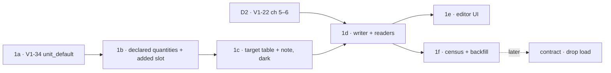
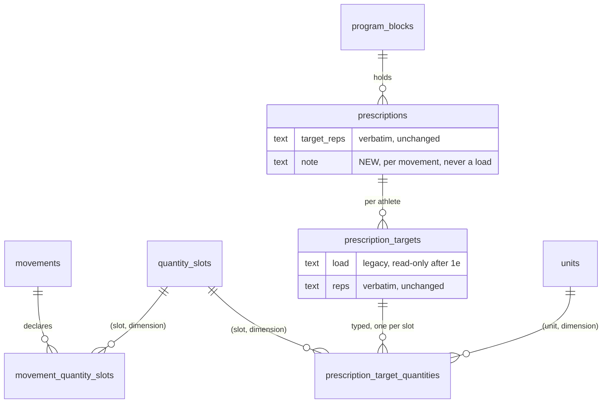

# TGT-1 — typed per-athlete targets: the movement's own quantity, one weight, and a note

> Backlog: TGT-1 _(proposed, unfiled — no `plan.md` row yet; this plan does not file one)_ · Spec:
> [crud-1-fix-it-yourself.md](../specs/crud-1-fix-it-yourself.md) chunk **D8** · Milestone:
> [PROG-1](../milestones/prog-1-programs-and-scheduling.md) _(the milestone file is written after
> sign-off, spec sequence step 5)_ · Branch: `db/tgt-1-typed-targets` (per-PR branches in
> [Staging](#staging)).
>
> Criteria: **50** and **51** (spec `:444-454`) · Unowned **9** (spec `:696-721`) · Decision **Q18**
> (spec `:863`): the maintainer's M31, revised by M34 — _"We do not need to specify both held dumbells or
> weighted vest, maybe just a weight field and notes."_ Prototype: v9
> ([`docs/prototypes/crud-1/index.html`](../prototypes/crud-1/index.html)), the program editor's
> "… per athlete, and a note" disclosure (`rxCard`, `:3130-3282`; `targetFields`, `:1467-1481`).

## Goal

A per-athlete program target today is verbatim text: `prescription_targets.load` and `.reps`
(`packages/db/src/schema.ts:870-873`), beside a prescription's `sets` and verbatim `target_reps`
(`schema.ts:829-830`). So "24 in" for a box jump is storable only inside `load`, the free-text shape
GAP-3 removed from the **log** path. TGT-1 makes the **plan** say what the log already says: a target is
the movement's own quantity when that is not a weight (box height, distance, time), **one** weight (a
number and a mass unit), and, per movement, one optional **note** a person types ("dumbbell in each
hand", "20 lb vest"). The quantities live in a child table with the **same** `(slot, dimension)` and
`(unit, dimension)` composite foreign keys as `entry_set_quantities` (`schema.ts:354-406`), so a mass
unit in a height field is unrepresentable, and a target and a logged set use one vocabulary. Why now:
V1-22 chunk 4 gives the program its first write path, and every load that path writes as text is a load
this PR's backfill would later have to parse; and the maintainer decided the shape (Q18) against the
approved prototype.

## Acceptance

Verbatim from the spec:

- **Criterion 50.** _Where a movement measures something other than a weight, or more than one thing,
  the program editor shall show one per-athlete field for each quantity the movement declares, each
  labelled with what it holds and its unit, and each opening the numeric keypad: Box Jump → box height
  (in) and weight (lb); Sled Push → weight (lb) and distance (ft); a hold → time (s). Only a movement that
  declares a single weight says "load". (M27, M29)_
- **Criterion 51.** _When a movement is added to a program, the editor shall offer, per athlete, a typed
  field for the movement's own quantity when it is not a weight (box height, distance, time), one typed
  weight field (a number and a mass unit), and, per movement, an optional note a person types ("dumbbell
  in each hand", "20 lb vest"). There shall not be separate held and vest fields. If a weight has letters
  or no unit, then it shall be refused, not stored as text; the note shall never be read as a load.
  (M31, revised by M34)_

Done when:

1. **V1-34 is fixed first.** Box Jump, Broad Jump and Hollow-Body Hold open in the log form as a
   length / length / time with a matching unit, in every environment, without a manual step.
2. A movement's **declared** quantities are stored: its primary dimension (already
   `movements.unit_default`, read through `units.dimension`) plus any **additional** quantity it
   measures (Sled Push and Farmer Carry: a distance). A household movement declares none and gets one
   weight field.
3. `quantity_slots` holds one new seeded pair, `('added', 'mass')`: the weight on a movement whose own
   quantity is not a weight, or on a bodyweight movement. Seed change only; **no DDL** — `quantity_slots`
   has a CHECK on `dimension` and none on `code` (`schema.ts:87-103`, verified).
4. A typed target is stored as `prescription_target_quantities` rows; the note as `prescriptions.note`.
   Both FK pairs reject a mass unit in a length slot **in the database**, and `db:verify` proves it.
5. Submitting a weight of `20lb`, `~145`, `35-45`, `20` with no unit, or `twenty` is **refused** with a
   typed field error and writes nothing. A note of `20 lb vest` with the weight left blank writes **no**
   quantity row, and nothing reads a number out of it.
6. The export's `prescribed` column is **byte-identical** for every row that exports today, and every
   legacy `load` text that is backfilled renders back to **exactly** its original bytes (the backfill
   only types a value when that holds).
7. Today's card, the editor and the export read the typed target; the legacy `load` text is read only
   when a target has no typed quantity, and nothing writes it after TGT-1e.
8. The household-deletion procedure and its `db:verify` proof cover the new table; the data inventory
   names the note.

## Staging

One concern per PR, one migration per PR, each under ~400 lines. The **gate** column is what must be
true before the PR may merge.

| PR         | What                                                                                                                                                                  | ~lines | Migration | Gate                                                                                                                      |
| ---------- | --------------------------------------------------------------------------------------------------------------------------------------------------------------------- | ------ | --------- | ------------------------------------------------------------------------------------------------------------------------- |
| **TGT-1a** | **V1-34** — `unitDefault` for the three rows in the catalog const + a guarded data `UPDATE` migration for databases that already hold them                            | ~120   | yes       | nothing (may ship **now**; a Logging-track bug fix, owner Logging)                                                        |
| **TGT-1b** | The declaration: `movement_quantity_slots` (additional quantities only) seeded from the catalog; the `added` slot; `targetFieldsFor()` in `shared`                    | ~330   | yes       | 1a merged; migration-number order with B0, V1-24 1d, AUTH-1 1b, SCHED-1 1c                                                |
| **TGT-1c** | `prescription_target_quantities` + `prescriptions.note`, **shipped dark**; runbook deletion step + proof; data inventory                                              | ~360   | yes       | 1b merged                                                                                                                 |
| **TGT-1d** | Writer + submit schema (typed fields **beside** legacy text — expand) + readers: Today's card, the editor DTO, the export's `load` derivation                         | ~400   | no        | **D2 merged** (V1-22 chunks 5–6: the seed's day guard and the editor whose writer this extends) + 1c observed applied     |
| **TGT-1e** | The editor UI: the disclosure, per-athlete typed fields, the note; the submit schema stops accepting text in the same deploy                                          | ~350   | no        | 1d merged; **UX panel** reconciled before code                                                                            |
| **TGT-1f** | Census + backfill of legacy `load` text, as a `db:correct` correction: round-trip-exact shapes only, counts by shape class, never a value                             | ~200   | no        | 1d deployed (the typed reader must exist before a typed row does); **dropped to a recorded census if the census reads 0** |
| _later_    | **Contract:** drop `prescription_targets.load` once the census reads zero live non-null text and one release has passed with no writer. Not in PROG-1; filed as a row | ~60    | yes       | 1f applied + a release with no writer                                                                                     |

**Why this order and not another.** 1a first because the spec says so (D8 is gated on "V1-34 fixed") and
because 1b's declaration **reads** `unit_default` as the primary dimension: with Box Jump's null, 1b would
declare a box jump's own quantity as "none" and 1e would show it a weight field only. 1b before 1c because
the writer's validation in 1d needs both, and a DB PR must not share review with a UI PR (spec `:147`).
1d before 1f because a typed row with no typed reader would export **nothing** for that cell. 1e after 1d
because the UI must post a shape the deployed server already accepts.



## Decisions, with the alternatives rejected

### D-1 · V1-34: a migration, not a correction, not a seed `DO UPDATE`

`MOVEMENT_SEED_ROWS` has `unitDefault: null` for `box_jump` (`packages/shared/src/catalog-movements.ts:38-43`),
`broad_jump` (`:246-252`) and `hollow-body_hold` (`:270-276`), so the scaffold falls back to the form's
default unit (`apps/web/app/p/[profileId]/strength-form-scaffold.ts:83`, `declaredUnit` `:143-149`) and a
box jump opens as Weight / lb (`docs/plan.md:2058-2061`). The seed is `ON CONFLICT DO NOTHING`
(`packages/db/src/seed.ts:249-252`), so editing the const alone fixes only a fresh database.

**Chosen:** edit the const (`box_jump` → `in`, `broad_jump` → `in`, `hollow-body_hold` → `sec`; the two
length units are an open question below) **and** a data-only migration:

```sql
SET lock_timeout = '3s'; SET statement_timeout = '15s';
UPDATE movements SET unit_default = 'in', updated_at = now()
 WHERE public_id = '<seedPublicId(050)>' AND household_id IS NULL AND unit_default IS NULL;
-- …one statement per row, each guarded the same way
```

The guard is the value being corrected **from** (`unit_default IS NULL`) plus the seed `public_id` and the
global namespace, so a re-run, or a row a human already changed, is a no-op. On a fresh database the
migration runs **before** `db:seed` and matches nothing; the seed then inserts the corrected const. So
both paths converge without anyone remembering a step.

**Rejected — a `db:correct` correction.** It is a manual `--apply` on production only; the seed-only
preview project (OPS-1) and every developer database keep the bug until someone re-seeds. The corrections
README scopes corrections to "data already on the board" that the app cannot fix
(`packages/db/scripts/corrections/README.md:12-17`); curated reference data drifting from its own const
is a schema-adjacent fact, and the migration is the reviewed artifact that runs everywhere.
**Rejected — switch the movements seed to `ON CONFLICT DO UPDATE`.** `units` does this
(`seed.ts:119-129`), but movements share the partial arbiter `uq_movements_slug_global` with
`household_id IS NULL` (`schema.ts:586-588`), the shape of the `42P10` trap (`docs/lessons.md:23-28`),
and a standing `DO UPDATE` would silently revert any later hand-correction of a catalog row on every push
to `main` (`migrate.yml` seeds production on each push, `seed.ts:230-232`).

### D-2 · Where the declaration lives: `unit_default` for the primary, a child table for the rest

`movements` has no column for "what this movement measures" (`schema.ts:544-564`, verified). The primary
dimension is **already** declared, by `unit_default` read through `units.dimension`: V1-26 reads it that
way (`strength-form-scaffold.ts:91`, `declaredMass`), and ADR 0004's banner item 4 calls it a default the
athlete can change (`docs/decisions/0004-typed-measurements.md:31-33`). What is missing is the **second**
quantity: Sled Push and Farmer Carry are a mass over a distance (`catalog-movements.ts:201-207`, `:262-268`;
ADR 0004 `:123`, _"Sled → mass + length"_).

**Chosen:** `movement_quantity_slots (movement_id, slot, dimension)` — **additional** quantities only,
`CHECK (slot <> 'primary')`, PK `(movement_id, slot)`, composite FK `(slot, dimension)` →
`quantity_slots`, `movement_id` FK `ON DELETE CASCADE`. Seeded from a new optional field on
`MOVEMENT_SEED_ROWS` (`additionalQuantities: [{ slot: 'distance', dimension: 'length' }]`, two rows
today). This is the "movement's declared slot set" `schema.ts:84-85` and GAP-3 §7.2c
(`docs/plans/gap3-typed-measurements.md:299-310`) already promise, and the shape later CAT-2 rows and a
household's own movements (MOV-1) can use without another migration.

**Rejected — a `movements.primary_dimension` column.** A second source for a fact `unit_default` already
states; the two would drift on the first hand edit, and it still has no home for a sled's distance.
**Rejected — declare everything, primary included, in the table.** The same two-sources problem for the
primary. **Rejected — `movements.measures_distance boolean`.** Smallest DDL, but it is a one-off column
for a role vocabulary that already exists as a reference table; the vest/ankle/wrist declarations GAP-3
§7.2c names would each need another. **Rejected — derive it in code, keyed by catalog slug.** No
migration, but the writer's validation then cannot see a household movement, and the declaration stops
being data the schema comment says it is. **Kept in code, deliberately:** the per-movement **label** of a
quantity ("Box height" for a box jump's length, "Distance" for a broad jump's), because
`quantity_slots`' docblock already rules that labels are rendering and live in `shared`
(`schema.ts:84`). A `Partial` map keyed by seeded slug, falling back to
`LOGGABLE_DIMENSION_LABELS` (`packages/shared/src/units.ts:153-157`).

### D-3 · The weight's slot: `primary` or one new seeded `added` slot

The log vocabulary is `primary`, `vest`, `ankle`, `wrist`, `distance`
(`packages/shared/src/quantity-slots.ts:25`), and the three masses besides `primary` are all **worn**. A
box jump's `primary` is its height, so its weight needs a mass slot that is not `primary`.

**Chosen:** one rule, one helper, `targetWeightSlot(movement)` in `shared`:

| The movement                                                         | Its weight goes in | Examples (from the catalog)                                   |
| -------------------------------------------------------------------- | ------------------ | ------------------------------------------------------------- |
| `unit_default` is a mass, or null, **and** `is_bodyweight` is false  | `primary`          | Back Squat, KB Swings, Sled Push, Med-Ball Slam (null, false) |
| `unit_default` is a length or a time, **or** `is_bodyweight` is true | `added`            | Box Jump, Hollow-Body Hold, Push-Ups, Pull-Up, Dips           |

`added` is seeded at `mass` only, labelled **"Added weight"** in `QUANTITY_SLOT_LABELS`
(`quantity-slots.ts:34-40`, a `Record<QuantitySlot, …>`, so the compiler forces the label and the
dimension). The editor's field reads **"Weight"** either way (criterion 51); the slot is invisible to the
person. The note says what carries it.

**Rejected — reuse `vest`.** Labels a dumbbell in each hand as a vest in the database, the export's
`(vest)` token (`packages/shared/src/csv/load.ts:73-76`) and every future reader. **Rejected — seed
`held`** (the spec's M31 resolution, `:1119`, still says "the `held` slot is one seeded row"). M34
withdrew the held/vest split: a target does not know which carries the weight, so a role-specific slot
would make the editor ask a question the maintainer decided it must not. **Accepted overlap:** `added` and
`vest`/`ankle`/`wrist` are all "external mass". A set may legitimately carry two (a vest **and**
dumbbells), so the per-slot arity rule (`uq_entry_set_quantities_set_slot`, `schema.ts:387-389`) still
means something; but "how much external weight" is now a sum over four slots for any reader that asks it.
Said here so a later reader does not assume one slot.

⚠️ **The log side cannot write `added` yet, and that is not this plan's gap.** The strength writer writes
the `primary` quantity only (`packages/db/src/writers/strength-session.ts:254`); no auxiliary slot,
`vest` included, is loggable until GAP-3 PR 4b (`docs/plan.md:2365`). Seeding `added` therefore opens no
log path, and the CSV `load` column cannot emit `(added)` until 4b decides to offer it, which is
byte-affecting and needs Insight's sign-off then (recorded in Out of scope).

### D-4 · The target table mirrors `entry_set_quantities`, minus the offline columns

`prescription_target_quantities`: `id` identity PK · `prescription_target_id` FK → `prescription_targets`
**`ON DELETE CASCADE`** · `slot`, `dimension`, `unit` (text, NOT NULL) · `value_num numeric(8,3)` NOT NULL
`CHECK (value_num > 0)` · `timestamps`. Two composite FKs with the **same names' pattern** as
`entry_set_quantities_slot_dimension_fkey` / `_unit_dimension_fkey` (`schema.ts:370-385`): the pair targets
are `quantity_slots`' composite PK and `uq_units_code_dimension` (`schema.ts:70`), both already in the
database, so the drizzle "a `uniqueIndex` target is emitted after the FK" trap (`docs/lessons.md:13-16`)
does not arise for a **new** child table. Partial unique `(prescription_target_id, slot) WHERE deleted_at IS
NULL` (the arity rule), plus covering indexes on the three FKs: five indexes, inside AGENTS.md's ~5–10.

- **No `client_id`, no `public_id`.** This is **config** data, the `prescription_targets` idiom
  (`schema.ts:851-857`: "Config → no client_id; natural key"), not offline log data. Its address is the
  target plus the slot. Idempotency is the natural key: a replayed save upserts the same `(target, slot)`
  to the same value (see the Backend rules below).
- **`> 0`, not `>= 0`** (the log's CHECK is `>= 0`, `schema.ts:394`). A zero target is a cleared target,
  which is the **absence** of the row; storing `0` would make two spellings of "none".
- **`CASCADE`** because the only hard delete in this app is the household deletion, and
  `entry_set_quantities` already cascades for the same reason (`schema.ts:350-352`). The runbook still
  deletes it **explicitly** first, because "the counts are the proof" (`docs/runbooks.md:972-987`).
- **No denormalized `movement_id`.** A composite FK to `movement_quantity_slots` would make "a target only
  at a declared slot" schema-enforced, at the cost of carrying the movement on every row and breaking the
  first time a prescription's movement is swapped. It is **writer-enforced** instead (the
  `prescription_targets` household precedent, `schema.ts:851-857`), with a `db:verify` case.

`prescriptions.note text`, nullable, `CHECK (note IS NULL OR char_length(note) BETWEEN 1 AND 80)`, with
`PRESCRIPTION_NOTE_MAX = 80` in `shared` (the prototype's `maxlength="80"`, `:3277`). Blank stores `NULL`,
never `''` (V1-22 acceptance 4's idiom). **Per prescription, not per athlete**: a note describes the
movement in this workout ("dumbbell in each hand"), and the prototype puts it once per movement.

**Rejected — typed columns on `prescription_targets`** (`height_num`, `weight_num`, …). That is the shape
GAP-3 rejected on the log side after the second real program overflowed fixed columns
(`0004-typed-measurements.md:23-27`).

### D-5 · The legacy text: expand → backfill → contract, and the backfill can never change a byte

`prescription_targets.load` stays through PROG-1. After TGT-1d, every reader takes the **typed** target
when the athlete has one live quantity, and the text otherwise. After TGT-1e nothing writes the text,
except that saving a typed weight over a legacy text value clears it in the same transaction (the editor
shows the old text as read-only "Was: …" so the person sees what they are replacing).

The backfill's safety rule is a **round trip**, not a parser's opinion. For each live non-null `load`, it
builds a candidate typed target from the movement's declaration and keeps it **only if**
`buildLoad(candidate) === load` byte-for-byte, using the export's own load builder
(`packages/shared/src/csv/load.ts:46-84`). So:

| Legacy text                     | Movement                      | Candidate                 | Renders       | Typed?        |
| ------------------------------- | ----------------------------- | ------------------------- | ------------- | ------------- |
| `135`                           | Back Squat (`lb`, not BW)     | `primary` 135 lb          | `135`         | ✅            |
| `30in`                          | Box Jump (after 1a: `in`)     | `primary` 30 in           | `30in`        | ✅            |
| `20s`                           | Hollow-Body Hold (after 1a)   | `primary` 20 sec          | `20s`         | ✅            |
| `50ft`                          | Sled Push                     | `distance` 50 ft          | `(50ft)`      | ❌ stays text |
| `BW`, `BW+8 (vest)`, `~145-150` | any                           | none / not a typed target | —             | ❌ stays text |
| `20`                            | Push-Ups (null, BW → `added`) | `added` 20 lb             | `+20 (added)` | ❌ stays text |

A bare number becoming `lb` is **not** an invented unit: the CSV contract defines `lb` as "the implicit
unit of the whole column" (`packages/shared/src/csv/value.ts:38`), so `135` already **means** 135 lb in
every file this app has exported. Anything the round trip rejects stays text, still renders, still exports
the same bytes, and is counted. The census prints **counts per shape class, never a value**: a
per-athlete load is a minor's prescribed training data in a public repo's Actions log or PR comment
(corrections README rule 9, `:45-46`).

⚠️ **Likely a no-op, unverified.** The only writer of `prescription_targets` today is `seedProgram`
(`packages/db/src/seed.ts:483-497`; grep of `apps/web` finds readers only), `PROGRAM_SEED` seeds every
load as `null` (`packages/shared/src/programming.ts:140-161`, `open()` / `fixed()`), and V1-22 chunk 1's
migration records "11 of 13 live prescriptions render empty" (`packages/db/migrations/0013_prescribed_snapshot.sql:20-21`).
But the archived Kids S&C Foundation block once carried per-athlete loads
(`docs/privacy/data-inventory.md:452-457`), and whether that block is still in the production database is
**not** something this plan could check. Hence the census first; if it reads zero, 1f is a recorded census
and no correction code ships.

**Why export bytes cannot move.** Three layers. (1) Since V1-22 chunk 3, every logged entry carries a
frozen `prescribed_snapshot` (`schema.ts:205-217`), so a **past** row never re-reads the program. (2) The
live fallback, for any row still `NULL`, gets `load = typed ? buildLoad(typed) : legacyText`, which is
the legacy text exactly until a row is typed, and the round-trip rule makes typing invisible. (3) New
entries snapshot through the **one** renderer, `formatPrescribedForExport` (V1-22 chunk 2 plan,
`docs/plans/v1-22-2-renderer-and-writer.md:68`, `:149-155`), whose `@ ${load}` composition TGT-1 does not
touch. What **does** change is the content of `prescribed` for an entry logged against a **newly typed**
target: `3x5 @ 24in+20 (added)` is a string the corpus never had. That is a format addition for
Insight to sign off before 1d merges (Open question 3).

## File-by-file changes

Files marked _(V1-22)_ do not exist on `main` today; the V1-22 editor plan names them
(`docs/plans/v1-22-program-editor.md:192-195`, `:227`). If chunk 4 lands them under other names, the
rows below follow, and this plan says so in 1d's PR.

### TGT-1a — V1-34 (branch `fix/v1-34-jump-hold-units`)

| Path                                                        | Change   | What & why                                                                                                                                                                                                                     |
| ----------------------------------------------------------- | -------- | ------------------------------------------------------------------------------------------------------------------------------------------------------------------------------------------------------------------------------ |
| `packages/shared/src/catalog-movements.ts`                  | EDIT     | `unitDefault` for `box_jump`, `broad_jump`, `hollow-body_hold`. One comment naming V1-34 and why the migration exists.                                                                                                         |
| `packages/db/migrations/00NN_v1_34_jump_hold_units.sql`     | NEW      | D-1's three guarded `UPDATE`s, `lock_timeout` + `statement_timeout`, a header saying it is data-only and why a const edit alone is not enough. Number = next free at implementation (0018 is the last today).                  |
| `packages/db/migrations/meta/*`                             | EDIT     | Journal entry (drizzle `generate --custom`); append-only, as the forward-only guard proves.                                                                                                                                    |
| `packages/db/scripts/verify.ts`                             | EDIT     | After migrate + seed twice: every `MOVEMENT_SEED_ROWS` row's `unit_default` equals the const (catches the next drift too); the guard holds — pre-set `box_jump` to `cm`, re-run the three statements, assert it is still `cm`. |
| `apps/web/app/p/[profileId]/strength-form-scaffold.test.ts` | EDIT     | Box Jump scaffolds `in` / length, Hollow-Body Hold `sec` / time; the V1-26 no-`load` guard untouched.                                                                                                                          |
| `docs/features/strength-logging.md`                         | EDIT     | `guides:check` (the scaffold test sits beside an owned file); one line under the V1-26 trap: the three rows now declare a non-mass default.                                                                                    |
| `docs/changelog/<fragment>.md`, `docs/status.md`            | NEW/EDIT | Per AGENTS.md "Status rides with the work".                                                                                                                                                                                    |

⚠️ `catalog-movements.ts` is owned by **no** guide (`docs/features/*.md` frontmatter, checked); the spec's C3
row says it is the write-path guide's (`spec:153`). Disagreement 2 below.

### TGT-1b — the declaration (branch `db/tgt-1b-declared-quantities`)

| Path                                                             | Change | What & why                                                                                                                                                                                                                                                                                                                                                   |
| ---------------------------------------------------------------- | ------ | ------------------------------------------------------------------------------------------------------------------------------------------------------------------------------------------------------------------------------------------------------------------------------------------------------------------------------------------------------------ |
| `packages/shared/src/quantity-slots.ts`                          | EDIT   | `'added'` in `QUANTITY_SLOT_CODES`; `added: ['mass']`; `added: 'Added weight'`. Docblock: why a new role and not `vest` (D-3), and that the log cannot write it until GAP-3 4b.                                                                                                                                                                              |
| `packages/shared/src/catalog-movements.ts`                       | EDIT   | `movementSeedRowSchema` gains `additionalQuantities: z.array(declaredQuantitySchema).default([])`; `sled_push` and `farmer_carry` declare `distance`/`length`. `declaredQuantitySchema` refines `slot !== 'primary'` and `slotAcceptsDimension` (`quantity-slots.ts:72-74`) — reused, not re-typed.                                                          |
| `packages/shared/src/program-targets.ts`                         | NEW    | `targetWeightSlot()` (D-3), `targetFieldsFor(movement)` → ordered `TargetField[]` (own non-mass primary, then the weight, then additional quantities in `QUANTITY_SLOT_CODES` order), `TARGET_QUANTITY_LABEL_BY_SLUG` (D-2). The one source the editor, the writer's validation and the card read.                                                           |
| `packages/shared/src/program-targets.test.ts`                    | NEW    | Criterion 50's examples as a table over the **real** catalog rows (below).                                                                                                                                                                                                                                                                                   |
| `packages/shared/src/index.ts`                                   | EDIT   | Export the new module.                                                                                                                                                                                                                                                                                                                                       |
| `packages/db/src/schema.ts`                                      | EDIT   | `movementQuantitySlots` (D-2) with a docblock: primary is declared by `unit_default`, this table holds the **rest**, reference-only (seeded rows; nothing in the app writes it).                                                                                                                                                                             |
| `packages/db/migrations/00NN_tgt_1b_movement_quantity_slots.sql` | NEW    | `drizzle-kit generate`, then hand-hardened: timeouts, `CREATE TABLE IF NOT EXISTS`. A new empty table with FKs needs no `NOT VALID`.                                                                                                                                                                                                                         |
| `packages/db/src/seed.ts`                                        | EDIT   | After the movements insert: resolve the seeded ids by slug in the **global** namespace (`movementIsGlobal()`, the arbiter `seed.ts:252` uses) in one `inArray` query, insert `movement_quantity_slots` with `onConflictDoNothing` on the PK. `quantity_slots` picks up `added` through the existing `QUANTITY_SLOT_ROWS` insert (`:137-140`) with no change. |
| `packages/db/scripts/verify.ts`                                  | EDIT   | Seeded set equals the const-derived set, idempotent across the two seeds; `('added','mass')` present and `('added','length')` rejected by the FK; `CHECK (slot <> 'primary')` rejects; a household movement deleted by runbook step 11 cascades its declarations (insert one first).                                                                         |
| `docs/features/strength-logging.md`                              | EDIT   | Owns `quantity-slots.ts`: the `added` role, and that no log path writes it yet.                                                                                                                                                                                                                                                                              |
| `docs/features/programming.md`                                   | EDIT   | `owns:` gains `packages/shared/src/program-targets.ts`; a "Declared quantities" paragraph.                                                                                                                                                                                                                                                                   |
| `docs/features/write-path.md`                                    | EDIT   | Owns `seed.ts`: the declaration insert and its namespace.                                                                                                                                                                                                                                                                                                    |

```ts
// packages/shared/src/program-targets.ts — the shapes, not the implementation
export type DeclaringMovement = {
  slug: string; // for the label override only
  unitDefault: Unit | null;
  isBodyweight: boolean;
  additionalQuantities: readonly { slot: QuantitySlot; dimension: UnitDimension }[];
};
export type TargetField = {
  slot: QuantitySlot;
  dimension: UnitDimension;
  label: string; // "Box height", "Weight", "Distance", "Time"; "Load" when it is the only field
  defaultUnit: Unit; // unit_default when its dimension matches, else the dimension's first loggable unit
  units: readonly Unit[]; // loggableUnitsOf(dimension) — units.ts:144-146, reused
};
export function targetWeightSlot(m: DeclaringMovement): QuantitySlot;
export function targetFieldsFor(m: DeclaringMovement): TargetField[];
```

The test table (criterion 50, against `MOVEMENT_SEED_ROWS` as 1a + 1b leave it):

| Movement         | Fields, in order                                                    |
| ---------------- | ------------------------------------------------------------------- |
| Box Jump         | Box height (`primary`, in) · Weight (`added`, lb)                   |
| Sled Push        | Weight (`primary`, lb) · Distance (`distance`, ft)                  |
| Hollow-Body Hold | Time (`primary`, sec) · Weight (`added`, lb)                        |
| Back Squat       | **Load** (`primary`, lb) — the only movement shape that says "load" |
| Push-Ups         | Weight (`added`, lb)                                                |

### TGT-1c — the target table and the note, dark (branch `db/tgt-1c-target-quantities`)

| Path                                                       | Change | What & why                                                                                                                                                                                                                                                                                                                                                                                                                              |
| ---------------------------------------------------------- | ------ | --------------------------------------------------------------------------------------------------------------------------------------------------------------------------------------------------------------------------------------------------------------------------------------------------------------------------------------------------------------------------------------------------------------------------------------- |
| `packages/db/src/schema.ts`                                | EDIT   | `prescriptionTargetQuantities` (D-4) with an `entry_set_quantities`-style docblock (why the pair guard, why no `client_id`, why `> 0`, why `CASCADE`, "every reader joins a live parent"). `prescriptions.note`. The `prescriptionTargets` docblock (`:851-857`) gains one sentence: `load` is legacy, read-only after TGT-1e, dropped by the contract row.                                                                             |
| `packages/db/migrations/00NN_tgt_1c_target_quantities.sql` | NEW    | Generated + hardened. `ADD COLUMN IF NOT EXISTS note text` is metadata-only. The note's CHECK on a 13-row table: Squawk's `constraint-missing-not-valid` would demand a `NOT VALID` + `VALIDATE` split across **two PRs** (AGENTS.md, DB rules). Justified `-- squawk-ignore` **directly above** the statement, reasoning above that (`docs/lessons.md:91-95`): the column is new and every row is `NULL`, so validation reads 13 rows. |
| `packages/shared/src/programming.ts`                       | EDIT   | `PRESCRIPTION_NOTE_MAX = 80`. `prescriptionTargetSeedRowSchema` gains `quantities: z.array(targetQuantitySeedSchema).default([])` so a future seeded program authors typed targets; `load` stays (all `null`) until the contract row.                                                                                                                                                                                                   |
| `packages/db/src/seed.ts`                                  | EDIT   | `seedProgram` inserts a target's `quantities` (none today) under the same natural-key `onConflictDoNothing` + repeated predicate idiom as the target insert (`:483-497`).                                                                                                                                                                                                                                                               |
| `packages/db/scripts/verify.ts`                            | EDIT   | See Test plan → 1c.                                                                                                                                                                                                                                                                                                                                                                                                                     |
| `docs/runbooks.md`                                         | EDIT   | "Delete a household": a step before 8 deleting `prescription_target_quantities` for H's targets, and its line in the count query (`:845`). Without it, the counts stop being the proof.                                                                                                                                                                                                                                                 |
| `docs/privacy/data-inventory.md`                           | EDIT   | `prescriptions` row (`:129`) gains **`note`** (free text a person types); a `prescription_target_quantities` row ("a per-minor prescribed load, typed; no free text"); §6's "What it does not contain" (`:290-291`) names both. Re-review trigger: the schema.                                                                                                                                                                          |
| `docs/features/programming.md`                             | EDIT   | Map diagram (`:44`) gains the child table; invariant 2 rewritten (below).                                                                                                                                                                                                                                                                                                                                                               |
| `docs/architecture.md`                                     | EDIT   | The programming ERD (AGENTS.md "Diagrams in the PR description"; the PR embeds the same view).                                                                                                                                                                                                                                                                                                                                          |



**Programming guide invariant 2, rewritten in 1c** (it says today _"Do not 'fix' them into numbers"_,
`docs/features/programming.md:95-97`): `target_reps` and the per-athlete `reps` stay verbatim text;
**loads are typed from TGT-1** by the maintainer's decision (Q18, M31/M34), and the text `load` is legacy.
ADR 0004 gets a banner item 5 saying the same, because its §2 (`0004-typed-measurements.md:58-65`) still
says structuring prescribed loads is "explicitly out of scope" — see Disagreement 1.

### TGT-1d — writer and readers (branch `feat/tgt-1d-typed-target-writer`)

| Path                                                                   | Change | What & why                                                                                                                                                                                                                                                                                                                                                                                                                                                                                                                         |
| ---------------------------------------------------------------------- | ------ | ---------------------------------------------------------------------------------------------------------------------------------------------------------------------------------------------------------------------------------------------------------------------------------------------------------------------------------------------------------------------------------------------------------------------------------------------------------------------------------------------------------------------------------- |
| `packages/shared/src/program-targets.ts`                               | EDIT   | `targetQuantityInputSchema` = `{ slot: quantitySlotSchema, unit: loggableUnitSchema, value: string }` with a refine: decimal digits only (`QUANTITY_DECIMALS`, `units.ts:183`), `> 0`, `≤ quantityCeiling(unit)` treating `undefined` as refuse (`units.ts:254-261`), and `unit`'s dimension accepted by the slot. A blank value is **absent**, not zero.                                                                                                                                                                          |
| `packages/shared/src/programming.ts` _(V1-22: `programEditSchema`)_    | EDIT   | Each target gains `quantities: targetQuantityInputSchema[]` (max one per slot); each prescription gains `note` (trimmed, `1..PRESCRIPTION_NOTE_MAX`, blank → `null`). The legacy `load` string stays **accepted** in this PR only (expand), so an editor tab open across the deploy still saves.                                                                                                                                                                                                                                   |
| `packages/db/src/writers/program.ts` _(V1-22)_                         | EDIT   | Inside the editor's existing transaction and version guard (spec FE-7): resolve each prescription and target **through** `program_blocks.household_id = scope.householdId`, resolve the movement's declaration, and **refuse** any submitted `(slot, dimension)` not in `targetFieldsFor(movement)` (writer-enforced, D-4). Upsert on `(prescription_target_id, slot) WHERE deleted_at IS NULL` with `targetWhere` (lessons `:23`); a cleared field soft-deletes its row; a typed weight clears legacy `load` text on that target. |
| `packages/db/src/queries/program-day.ts`                               | EDIT   | One extra query per day (`inArray` over the day's live target ids, live parent joined, `deleted_at IS NULL` at every level — programming invariant 4, `programming.md:136-137`) returning typed quantities; `note` off the already-joined prescription. No N+1.                                                                                                                                                                                                                                                                    |
| `packages/db/src/queries/program-blocks.ts` _(V1-22)_                  | EDIT   | The editor read: the same typed quantities, the note, and each movement's declaration (`unit_default`, `is_bodyweight`, its `movement_quantity_slots`).                                                                                                                                                                                                                                                                                                                                                                            |
| `apps/web/lib/programming/program-day.ts`                              | EDIT   | `ProgramDayDTO` gains `targets: TargetQuantityDTO[]` and `note: string \| null`; `load` becomes **derived**: `buildLoad({ reps: null, isBodyweight: false, isBand: false, quantities })` when there is one, else the legacy text. One function, `targetLoadText()`, so the card and the export cannot disagree.                                                                                                                                                                                                                    |
| `apps/web/lib/programming/program-edit.ts` _(V1-22: `ProgramEditDTO`)_ | EDIT   | `targets[]` gains `quantities` and `legacyLoad` (the read-only "Was: …"); `prescription` gains `note` and `fields: TargetField[]`.                                                                                                                                                                                                                                                                                                                                                                                                 |
| `apps/web/app/p/[profileId]/program-reference.tsx`                     | EDIT   | Today's card: "Box height 24 in · Weight 20 lb", then the note in muted text on its own line, from a display formatter beside `formatPrescription` (`program-day.ts:62-70`). **Display and CSV formatters stay separate**, as V1-22 chunk 2 already requires (its plan `:458`).                                                                                                                                                                                                                                                    |
| `apps/web/lib/dal/export.ts`                                           | EDIT   | None if V1-22 chunk 2 has already moved `prescribedFor` (`:113-133`) onto `formatPrescribedForExport`; it reads `p.load`, which is now the derived string. Otherwise the same one-line swap.                                                                                                                                                                                                                                                                                                                                       |
| `apps/web/app/p/[profileId]/strength-form-scaffold.test.ts`            | EDIT   | The containment assertion widens: `ScaffoldRow` has no `targets`, `note` or `load` (`@ts-expect-error`), the way it already pins `load` (programming guide trap, `:251-258`).                                                                                                                                                                                                                                                                                                                                                      |
| `apps/web/app/p/[profileId]/program/actions.ts` _(V1-22)_              | EDIT   | No new action: the editor's one save action carries the new fields. Its tests gain the four boundary cases (Test plan → 1d).                                                                                                                                                                                                                                                                                                                                                                                                       |
| `docs/features/programming.md`, `docs/features/write-path.md`          | EDIT   | The reader's precedence (typed, else text), the writer's declaration check, and the trap that the note is never parsed.                                                                                                                                                                                                                                                                                                                                                                                                            |

### TGT-1e — the editor UI (branch `feat/tgt-1e-target-fields`)

| Path                                                  | Change | What & why                                                                                                                                                                                                                                                                                                                                                                                                        |
| ----------------------------------------------------- | ------ | ----------------------------------------------------------------------------------------------------------------------------------------------------------------------------------------------------------------------------------------------------------------------------------------------------------------------------------------------------------------------------------------------------------------- |
| `apps/web/app/p/[profileId]/program/*` _(V1-22)_      | EDIT   | Per movement, a native `<details>` whose `<summary>` names what is inside ("Box height and weight per athlete, and a note"; "Note" when no athlete is on the program), open when anything is set (prototype `:3253-3267`). Inside: the note (`<label for>`, `maxlength={PRESCRIPTION_NOTE_MAX}`, hint below), then one `<fieldset>` per athlete with a `<legend>` of their name and `targetFieldsFor()`'s fields. |
| `apps/web/app/p/[profileId]/program/target-field.tsx` | NEW    | One labelled number input (`inputmode="decimal"`, `step` from `QUANTITY_DECIMALS`) plus a unit `<select>` limited to `TargetField.units`; error beside the field via `aria-describedby` (spec A11Y-2).                                                                                                                                                                                                            |
| `packages/shared/src/programming.ts`                  | EDIT   | The submit schema **stops accepting** the legacy `load` string (contract of the submit shape, same deploy as the UI that no longer sends it). Targets become `z.strictObject`, so a stale tab's `load` is a refusal with the stale-write copy, not a silent drop (`z.object` strips unknown keys, the trap V1-22 chunk 2's plan records at `:228`).                                                               |
| `apps/web/e2e/a11y.spec.ts`                           | EDIT   | The editor route with a disclosure **open** (spec unowned 8).                                                                                                                                                                                                                                                                                                                                                     |
| `docs/features/programming.md`                        | EDIT   | The UI's file map.                                                                                                                                                                                                                                                                                                                                                                                                |

**360px width math** (assumptions marked). Viewport 360 − 2 × 16 gutter = 328; a card's 1px border and
16px padding leave **294** (the spec's measurement, `:785-792`; that the editor list sits in such a card is
**unverified** until chunk 4's markup exists). A movement row (`.rx`, prototype `:759-766`): 294 − 2 − 24 =
**268**. The prototype's two-column grid (`.rx-grid`, `:773-777`): (268 − 8) / 2 = **130px** per field.
Number + unit in 130px: input **70** (12px padding each side leaves 46px, five digits of a 16px font at
≈9px each) + 4 gap + select **56** ("lb ▾", "cm ▾") = 130. It fits with no slack, every control 44px tall.
If the panel finds 70px too tight for `135.25`, the fallback is one field per row (268px: input 196 +
4 + select 68), which costs height, not width.

### TGT-1f — census and backfill (branch `fix/tgt-1f-target-load-backfill`)

| Path                                                            | Change | What & why                                                                                                                                                                                                                                                                                                                                                                                         |
| --------------------------------------------------------------- | ------ | -------------------------------------------------------------------------------------------------------------------------------------------------------------------------------------------------------------------------------------------------------------------------------------------------------------------------------------------------------------------------------------------------- |
| `packages/db/scripts/corrections/registry.ts`                   | EDIT   | `prescription-target-load-typed-2026-MM-DD`: dry run prints counts per shape class (typed / bodyweight / range-or-approx / unit-mismatch / other) and per household **count**, never a value or a name; `--apply` writes the round-trip-exact candidates in one transaction, guarded by "no live typed quantity on this target yet" (rule 2), targeted through `public_id`s, `updated_at = now()`. |
| `packages/db/scripts/corrections/README.md`                     | EDIT   | The Applied row after `--apply` (counts only).                                                                                                                                                                                                                                                                                                                                                     |
| `packages/db/scripts/verify.ts`                                 | EDIT   | Each table row of D-5 as a fixture; a second `--apply` is a no-op; the export's `prescribed` for every fixture is byte-identical before and after.                                                                                                                                                                                                                                                 |
| `packages/db/scripts/corrections/backfill-target-loads.test.ts` | NEW    | The round-trip classifier, unit-level, including the "never invent" cases.                                                                                                                                                                                                                                                                                                                         |

## Backend / API rules (AGENTS.md "Backend / API PR rules"), applied to 1d

1. **AuthN inside the action**: the editor's save action keeps its own check (today `hasGateAccess()`,
   `apps/web/app/p/[profileId]/actions.ts:606`; after AUTH-1 1c, `requireSession()`).
2. **AuthZ**: every prescription and target resolves through `program_blocks.household_id =
getHouseholdScope().householdId` (`apps/web/lib/dal/household.ts:68`) **inside the query**; a target's
   profile must be a live profile of the **same** household (V1-22 acceptance 6). A foreign id is the
   unknown-id answer (ADR 0006: 404 semantics), never a distinguishable "forbidden".
3. **zod first**: the submit schema, before any query. The declaration check is a second, server-only
   validation, because the client's field list is advisory.
4. **DTO out**: `ActionState` (`action-state.ts`), no row.
5. **Thin action**: validate → DAL/writer → `revalidatePath` for the editor and the athlete's day page.
6. **Idempotency**: config data, so the natural key is the idempotency key — a replay upserts the same
   `(target, slot)` rows to the same values and returns the same `ActionState`. This is the `editRoutineAction`
   precedent (`actions.ts:595-633`), and the V1-22 editor's version guard (spec FE-7) turns a replay
   **after** someone else's save into `AMEND_ERROR_COPY.staleWrite`, never an overwrite.
7. **Sentry**: the action is already wrapped (`withServerActionInstrumentation`); structured context is
   ids only — **never the note** and never a value. Rate limit: chunk 4's.

## Test plan

Local: `pnpm verify` (every PR), `pnpm e2e:local` for 1e. CI: the `quality` job plus forward-only and
Squawk on 1a, 1b, 1c.

**1a.** `db:verify`: the const parity and the guard case (above). Scaffold unit tests. The e2e scaffold
smoke is not expected to move (it does not open these three movements; `apps/web/e2e/scaffold-submit.spec.ts`
names no jump or hold, grep-checked), and the PR runs `e2e:local` to prove it.

**1b.** `program-targets.test.ts`: the criterion-50 table over the real catalog; every catalog row yields
≥1 field; no field list contains two fields at one slot; `targetWeightSlot` is `primary` exactly for the
non-bodyweight mass-or-null rows (an exhaustive loop, so a CAT-2 row is checked when it lands).
`db:verify`: seeded declarations equal the const-derived set across two seeds; the FK pair and the CHECK
reject (`expectRejectedBy`); cascade under the runbook's step 11.

**1c.** `db:verify`, each case **mutation-tested** (delete the constraint in a scratch copy of the
migration, watch the case go red — the `db:mutations` harness, AGENTS.md "Local hooks"):
`('primary','length','lb')` rejected by the unit pair; `('distance','mass','lb')` by the slot pair;
`value_num = 0` by the CHECK; a second live row at one `(target, slot)` by the partial unique, and a
soft-deleted one then a new one **accepted**; `note = ''` and an 81-character note rejected; the runbook's
deletion of a household with typed targets leaves **zero** rows in all of `prescription_targets`,
`prescription_target_quantities`, `prescriptions` for H, and the counts query names the new table.

**1d** (Vitest for the action as a plain async function, Clerk/gate and the writer mocked at the seam the
existing `actions.test.ts` uses; `db:verify` for the writer against PGlite):

- **unauth → reject**, nothing written.
- **wrong owner → 404 semantics**: a prescription public id from household B, and a target profile from
  household B on a household-A prescription, each refused with the unknown-id answer and **zero** writes.
- **bad body → zod-reject**: `20lb`, `~145`, `35-45`, `twenty`, `20` with no unit, `0`, a value over the
  unit's ceiling, `kg` in a `distance` slot, two quantities at one slot, a note of 81 characters.
- **undeclared slot → refused by the writer**: a `distance` on a Box Jump; a weight at `primary` on Push-Ups.
- **replay → one effect**: the same save twice leaves one live row per `(target, slot)` with identical
  values and identical `updated_at` on the second (no-op detection, V1-22 acceptance 13's idiom), and the
  same `ActionState`.
- **the note is never a load**: weight blank + note `20 lb vest` → zero quantity rows; the export's
  `prescribed` for an entry logged against it has no `20`; Today's card shows the note as text.
- **reader precedence**: a target with typed rows renders typed; one with only legacy text renders the
  text; an **unedited** prescription's export bytes are identical before and after the PR (V1-22
  acceptance 11's discriminating test, asserting non-empty first).
- **containment**: `ScaffoldRow` cannot carry `targets`, `note` or `load` (type test).

**1e.** Component tests: labels name what the field holds and its unit; `inputmode="decimal"`; a refused
value keeps the typed text and focuses the field; the summary text per movement shape. Playwright:
`a11y.spec.ts` on the editor with the disclosure open; screenshots at 390 / 820 / 1280 via
`screenshot:ephemeral` (UI PR rules).

**1f.** `db:verify` fixtures per D-5 row, the second-apply no-op, and the byte-identity of `prescribed`.

## Risks / rollback

| Risk                                                                                                            | Mitigation                                                                                                                                                                                                                                                                                                                                                                                                             |
| --------------------------------------------------------------------------------------------------------------- | ---------------------------------------------------------------------------------------------------------------------------------------------------------------------------------------------------------------------------------------------------------------------------------------------------------------------------------------------------------------------------------------------------------------------- |
| **A prescribed load reaches the log form as a performed value** (the one inviolable rule)                       | `ScaffoldRow` excludes `targets`, `note` and `load` by **type** (1d test); the card renders outside the `<form>` (programming invariant 1b). No model touches any of it: TGT-1 adds no LLM path, and a note is text a person typed.                                                                                                                                                                                    |
| **The note is read as a load** — by a later parser, NL logging (AI-1), or a person copying "20 lb" into a field | No code parses it; the 1d test pins "weight blank + note with a number → no quantity". AI-1's plan inherits a stated rule here: the note is never an input to a load. The card shows it as prose, never beside a number field.                                                                                                                                                                                         |
| **The note holds personal data** — a child's name ("go light, Athlete One"), a medical remark                   | Free text on a **per-movement** row that every athlete on the program sees; the editor hint says so (UX panel to word it). Inventory row in 1c; never logged to Sentry; deleted with the household; copied by CLONE-1 with the rest. Not exported (the notice already says program targets are not in the export, `docs/privacy/notice.md:163-165`; Open question 4 asks whether "program notes" should be named too). |
| **Export bytes move**                                                                                           | D-5's three layers; the round-trip rule; byte tests in 1d and 1f. A **new** token in `prescribed` for typed targets is a deliberate format addition, held for Insight (Open question 3).                                                                                                                                                                                                                               |
| **A cleared quantity comes back from the dead** (V1-22's risk, spec `:234`)                                     | Clearing soft-deletes a **child** row; the seed never writes a target into a day that already has a live prescription once V1-22 chunk 5's day guard exists — which is why 1d is gated on **D2**. `PROGRAM_SEED` seeds no quantities anyway.                                                                                                                                                                           |
| **Deploy skew**: an editor tab from before 1e posts text after the deploy                                       | 1d accepts both shapes; 1e refuses text **strictly** with the stale-write copy (reload), never a silent drop.                                                                                                                                                                                                                                                                                                          |
| **Household deletion fails** (`23503`) because a new child table was missed                                     | `CASCADE`, plus the explicit runbook step and its `db:verify` count in 1c.                                                                                                                                                                                                                                                                                                                                             |
| **CLONE-1 (D5) copies targets without their typed rows or the note** (criterion 23, "identical values")         | Whichever of D5 and TGT-1d lands **second** extends the copier and criterion 23's test to typed quantities and `note`. Named here and to be named in D5's plan.                                                                                                                                                                                                                                                        |
| **`added` overlaps the worn slots** and a later "total external weight" reader counts one slot                  | D-3 says so; the slot docblock says so; the first such reader owes a test with a vest **and** an added weight.                                                                                                                                                                                                                                                                                                         |
| **Ranges disappear**: a coach's `35-45` has no typed home (ADR 0004 §2 calls a range a legitimate prescription) | Open question 1. Until it is answered, an existing range stays as legacy text and still renders; a new one cannot be entered as a weight.                                                                                                                                                                                                                                                                              |

**Rollback.** 1a: forward-fix (an `UPDATE` back to `NULL` would re-introduce the bug; nothing else reads the
three values). 1b, 1c: additive and dark; revert the app code, leave the tables (forward-only, never edit
an applied migration). 1d, 1e: revert the PR; typed rows stay and the old code ignores them, and since 1d
keeps the legacy text on every untouched target, the old reader still shows it. A target typed **after**
1e and then reverted would show **no** load until re-deployed: accepted, because it is a display gap, not a
wrong number. 1f: cut a Neon restore branch before `--apply` (AGENTS.md DB rules → Rollback); the typed rows
can be soft-deleted by a follow-up correction, and the legacy text was never removed.

## AUTH-1

TGT-1 is **not** gated on AUTH-1 1c, and nothing in it is a 1c file (1c names `lib/dal/household.ts`,
`app/p/[profileId]/actions.ts`, four `page.tsx` files and `lib/constants.ts`, spec `:184-186`). 1d edits
the **editor's** action file, not `app/p/[profileId]/actions.ts`, if V1-22 chunk 4 keeps them separate;
otherwise gate 1 serializes them. **If 1c lands before 1d, 1d's PR re-verifies:**

1. The action's first line is the post-1c check (`requireSession()`, `docs/plans/auth-1-clerk-google.md:269-272`),
   not `hasGateAccess()`.
2. `getHouseholdScope()` now resolves from the session's membership (`household.ts:63-67`): the
   wrong-owner tests construct household B through a **membership**, not a second gate code.
3. The unauth test mocks Clerk `auth()` returning no session, as 1c's own tests do.
4. The editor page calls 1c's page guard, and the 1e screenshots and e2e log in through the post-1c
   helper (`docs/plans/auth-1-clerk-google.md:502-509`).

## Out-of-scope / deferred

- **Logging an `added` weight** (and any auxiliary slot): GAP-3 PR 4b. It is byte-affecting for the CSV
  `load` column (`(added)` is a new token) and needs Insight's sign-off then.
- **Typed `reps`**: `target_reps` and per-athlete `reps` stay verbatim (`AMRAP`, `8-12`); criterion 51 does
  not ask, and GAP-3 §7.4 still holds for reps.
- **Ranges, per-side, approximations** as typed values (Open question 1).
- **A household unit preference** (ADR 0004 §6 rule 3): the field defaults from the movement; there is no
  "always kg" setting.
- **Editing a movement's declaration in the app** (a household declaring "my sled push is for distance"):
  MOV-1's or CAT-2's; the table is ready for it.
- **The contract PR** that drops `prescription_targets.load`: filed as a row, not in PROG-1.
- **Prefilling the log form from a target**: forbidden by the product rule, not deferred.

## Open questions

1. **Ranges.** ADR 0004 §2 says a prescribed load may legitimately be a range (`75-85`), and the
   programming guide calls `~145-150` the coach's cue. Criterion 51 refuses anything but a number. Options:
   (a) refuse, and a person writes the range in the note — but the note is per movement, so a per-athlete
   range has no home; (b) a `max` slot later, a typed upper bound beside the weight. **Recommendation:**
   (a) now, recorded as an accepted loss; no live target carries a range as far as this plan could check
   (`PROGRAM_SEED` seeds none).
2. **Units for the two jumps.** Box Jump `in` is the program's own spelling (`units.ts:50`, "`30in`,
   `36in`"); Broad Jump could be `in` or `ft`. **Recommendation:** `in` for both, so one household reads
   one unit for "how far / how high you jumped".
3. **Insight's sign-off on new `prescribed` text** (`3x5 @ 24in+20 (added)`) before 1d merges. Or render
   `added` without its slot name in `prescribed` only — which would make the target and the logged set
   spell the same weight differently.
4. **Does `notice.md` name "program notes"** among what the export leaves out, or is "per-athlete
   prescribed targets" (`notice.md:163-165`) enough? For the privacy reviewer on 1c.
5. **A unit `<select>` per field, or the unit fixed in the label** (prototype v9 shows the fixed unit,
   `:1468-1480`)? Criterion 51 says "a number and a mass unit", and a metric household cannot type kg
   without a select. **Recommendation:** the select, within the 130px arithmetic above. For the UX panel.

## Where the spec, the prototype and the code disagree

1. **Typed prescribed loads vs ADR 0004 §2 and programming invariant 2.** ADR 0004 (`:58-65`), GAP-3
   §7.4 (`docs/plans/gap3-typed-measurements.md:350-356`) and the guide (`programming.md:95-97`, _"Do not
   'fix' them into numbers"_) all keep prescribed loads as verbatim text, ranges included. Q18 (M31, M34)
   reverses that for loads; the spec does not name the three records it overrides. 1c updates the guide
   and adds an ADR banner item; the range consequence is Open question 1.
2. **`catalog-movements.ts` has no feature-guide owner.** The spec's C3 row places it under the write-path
   guide (`spec:153`); no guide's `owns:` lists it (checked all three). 1a and 1b edit it without a
   `guides:check` obligation; this plan updates the programming and strength-logging guides by judgment,
   and proposes adding the file to `programming.md`'s `owns:` in 1b.
3. **The prototype's hold has no weight field; criterion 51 gives every movement one.** `targetFields`
   returns only Time for a hold (`index.html:1479`), and criterion 50's own example says "a hold → time
   (s)". Criterion 51 says "one typed weight field" with no exception. This plan follows **criterion 51**
   (a weighted plank exists) and asks the UX panel to confirm.
4. **The prototype's generic "Load" field has no unit** (`index.html:1480`, `unit: ''`); criterion 51
   requires "a number and a mass unit". This plan follows the criterion.
5. **The spec's M31 resolution still says "the `held` slot is one seeded row"** (`spec:1119`); M34
   (`:1127`) and unowned 9 (`:713-717`) supersede it. This plan seeds `added`, not `held` (D-3).
6. **GAP-3's plan says the `movements.dimension` row "still stands"** (`gap3-typed-measurements.md:317`);
   it was never built, and `unit_default` has played that role since V1-26. D-2 keeps it that way rather
   than adding the column GAP-3 proposed.

## Feature guides and privacy

| PR  | Guides (`guides:check`)                                                                                          | `data-inventory.md`                                                      |
| --- | ---------------------------------------------------------------------------------------------------------------- | ------------------------------------------------------------------------ |
| 1a  | `strength-logging.md`                                                                                            | no                                                                       |
| 1b  | `strength-logging.md` (`quantity-slots.ts`), `programming.md` (new module, `owns:`), `write-path.md` (`seed.ts`) | no (reference data only)                                                 |
| 1c  | `programming.md`, `write-path.md` (`seed.ts`)                                                                    | **yes** — `note`, the new table                                          |
| 1d  | `programming.md`, `write-path.md`                                                                                | no, unless the reviewer finds a new reader that exposes the note further |
| 1e  | `programming.md`                                                                                                 | no                                                                       |
| 1f  | `write-path.md` only if `registry.ts` is owned (it is not today)                                                 | no                                                                       |

Every PR also carries its changelog fragment and, where it moves one, the `status.md` pointer and the
roadmap item (AGENTS.md "Status rides with the work"; this plan edits neither).

## Review-response log

_Pending: engineering panel + UX panel (round 1)._
