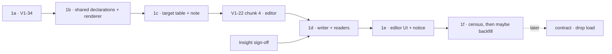
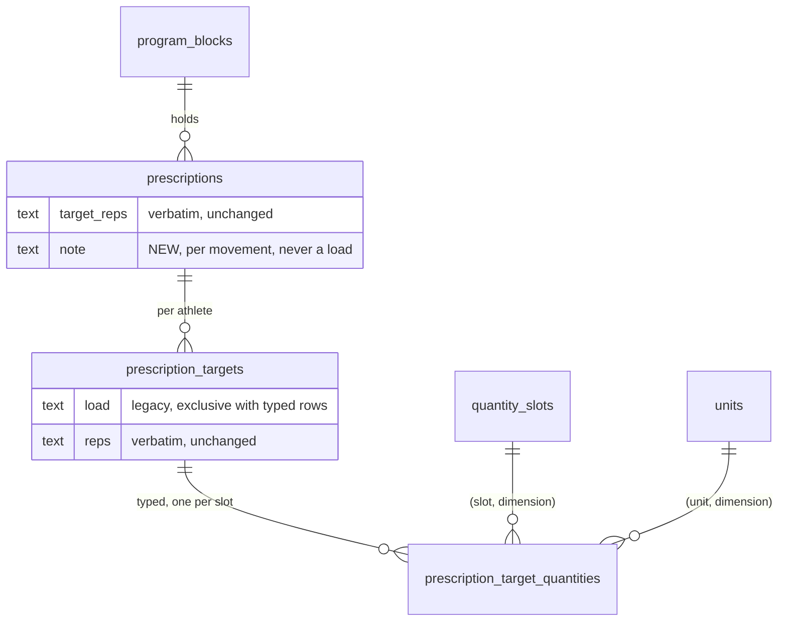

# TGT-1 — typed per-athlete targets: the movement's own quantity, one weight, and a note

> Backlog: TGT-1 _(proposed; its `plan.md` row, and the later contract row, are filed when the PR
> carrying this plan opens)_ · Spec: [crud-1-fix-it-yourself.md](../specs/crud-1-fix-it-yourself.md)
> chunk **D8** · Milestone: [PROG-1](../milestones/prog-1-programs-and-scheduling.md) step 10 ·
> Branch: `db/tgt-1-typed-targets` (per-PR branches in [Staging](#staging)).
>
> Criteria: **50** and **51** (spec `:444-454`) · Unowned **9** (spec `:696-721`) · Decision **Q18**:
> the maintainer's M31, revised by M34 — _"We do not need to specify both held dumbells or weighted vest,
> maybe just a weight field and notes."_ Prototype: v9
> ([`docs/prototypes/crud-1/index.html`](../prototypes/crud-1/index.html)), the program editor's
> "… per athlete, and a note" disclosure (`rxCard`, `:3130-3282`; `targetFields`, `:1467-1481`).
> Seams: the editor lives under `app/p/[profileId]/program/`, `ProgramEditDTO` in
> `apps/web/lib/dal/programming.ts`, create/copy/archive in `app/p/program-actions.ts` (spec → "Seams the
> plans settled", `:530-560`).

## Goal

A per-athlete program target today is verbatim text: `prescription_targets.load` and `.reps`
(`packages/db/src/schema.ts:870-873`), beside a prescription's `sets` and verbatim `target_reps`
(`schema.ts:829-830`). So "24 in" for a box jump is storable only inside `load`, the free-text shape
GAP-3 removed from the **log** path. TGT-1 makes the **plan** say what the log already says: a target is
the movement's own quantity when that is not a weight (box height, distance, time), **one** weight (a
number and a mass unit), and, per movement, one optional **note** a person types ("dumbbell in each
hand", "20 lb vest"). The quantities live in a child table with the **same** `(slot, dimension)` and
`(unit, dimension)` composite foreign keys as `entry_set_quantities` (`schema.ts:354-406`), so a mass
unit in a height field is unrepresentable, and a target and a logged set use one vocabulary.

**Why now, and why before V1-22 chunk 4.** Chunk 4 gives the program its first write path. If 1a–1c land
first, chunk 4's per-athlete field can be typed from its first commit, and the only legacy text the
backfill ever sees is whatever chunk 4 writes before it adopts the typed schema. If chunk 4 lands first
with a text field, every load it writes is one the backfill must later classify.

## Acceptance

Verbatim from the spec:

- **Criterion 50.** _Where a movement measures something other than a weight, or more than one thing,
  the program editor shall show one per-athlete field for each quantity the movement declares, each
  labelled with what it holds and its unit, and each opening the numeric keypad: Box Jump → box height
  (in) and weight (lb); Sled Push → weight (lb) and distance (ft); a hold → time (s). Only a movement that
  declares a single weight says "load". (M27, M29)_
- **Criterion 51.** _When a movement is added to a program, the editor shall offer, per athlete, a typed
  field for the movement's own quantity when it is not a weight (box height, distance, time), one typed
  weight field (a number and a mass unit), and, per movement, an optional note a person types ("dumbbell
  in each hand", "20 lb vest"). There shall not be separate held and vest fields. If a weight has letters
  or no unit, then it shall be refused, not stored as text; the note shall never be read as a load.
  (M31, revised by M34)_

The milestone's exit wording is already _"no target is written as free text; legacy text counted and
read-only"_ (`docs/milestones/prog-1-programs-and-scheduling.md`).

Done when:

1. **V1-34 is fixed first.** Box Jump and Broad Jump open in the log form as a length with a matching
   unit, and Hollow-Body Hold as a time once V1-37 allows it (D-1), in every environment, without a
   manual step.
2. A movement's **declared** quantities come from code: the primary dimension from
   `movements.unit_default` (through `units.dimension`), plus `additionalQuantities` and an optional
   `primaryLabel` on its seed row. A household movement declares nothing and gets one weight field.
3. `quantity_slots` holds one new seeded pair, `('added', 'mass')`. Seed change only; **no DDL** —
   `quantity_slots` has a CHECK on `dimension` and none on `code` (`schema.ts:87-103`, verified).
4. A typed target is stored as `prescription_target_quantities` rows; the note as `prescriptions.note`.
   Both FK pairs reject a mass unit in a length slot **in the database**, and `db:verify` proves it.
5. A weight of `20lb`, `~145`, `35-45`, `twenty`, or `0` is **refused** with a typed field error and
   writes nothing. A note of `20 lb vest` with the weight blank writes **no** quantity row.
6. **One renderer.** `targetLoadText(quantities, legacyLoad, movement)` in `packages/shared` is the only
   producer of a target's load string; Today's card (through its display sibling), the export's live
   fallback and V1-22 chunk 2's snapshot writer all get the same bytes from it.
7. The export's `prescribed` column is **byte-identical** for every row that exports today; the new
   tokens for typed targets are signed off by Insight and written into
   [csv-export-contract.md](../csv-export-contract.md) before 1d merges.
8. **The note hint is part of the acceptance:** _"Shown to every athlete on this program. Don't write
   names or injuries."_ under the note field, asserted by a component test.
9. The household-deletion procedure (now 14 DELETEs), its `db:verify` proof, the data inventory and the
   notice cover the new table and the note.

## Staging

One concern per PR, one migration per PR, each under ~400 lines. The **gate** column is what must be
true before the PR may merge.

| PR         | What                                                                                                                                                                                   | ~lines     | Migration | Gate                                                                                                                                                |
| ---------- | -------------------------------------------------------------------------------------------------------------------------------------------------------------------------------------- | ---------- | --------- | --------------------------------------------------------------------------------------------------------------------------------------------------- |
| **TGT-1a** | **V1-34** — `unitDefault` in the catalog const + a guarded data `UPDATE` migration; prod probe recorded; existing mass rows counted                                                    | ~140       | yes       | nothing for the jumps; the hold's row waits on **V1-37** (D-1). Owner: Logging                                                                      |
| **TGT-1b** | Shared only: `additionalQuantities` + `primaryLabel` on seed rows, the `added` slot, `targetFieldsFor`, `targetWeightSlot`, `targetLoadText`, the shared quantity value schema; no DDL | ~300       | no        | 1a merged. **Before V1-22 chunk 4**                                                                                                                 |
| **TGT-1c** | `prescription_target_quantities` + `prescriptions.note`; runbook step 7a + proof; inventory                                                                                            | ~340       | yes       | 1b merged; migration-number order with B0, V1-24 1d, AUTH-1 1b, SCHED-1 1c. **Before V1-22 chunk 4**; merged when idle, `migrate.yml` green (Risks) |
| **TGT-1d** | Writer (typed and text exclusive per target), readers, the snapshot writer's input, Insight's tokens in the CSV contract                                                               | ~400       | no        | **V1-22 chunk 4 merged + 1c observed applied + Insight sign-off**                                                                                   |
| **TGT-1e** | The editor UI; the submit schema stops accepting text in the same deploy; `notice.md`                                                                                                  | ~350       | no        | 1d merged; **UX panel** reconciled                                                                                                                  |
| **TGT-1f** | A read-only **census** of legacy text; the maintainer re-types below ~20 rows; the round-trip backfill is built **only above** that threshold                                          | ~80 / ~250 | no        | **1e deployed** (nothing writes text any more)                                                                                                      |
| _later_    | **Contract:** drop `prescription_targets.load`. Not in PROG-1                                                                                                                          | ~80        | yes       | census zero or every row dispositioned + an earlier PR removing the last read and write + restore branch + justified `squawk-ignore` (D-5)          |

**If V1-22 chunk 4 adopts 1b's schema** (recommended to its plan), chunk 4 writes typed targets from its
first commit and 1d shrinks to the readers, the snapshot writer's input and the exclusivity rule. If it
does not, 1d is as written and chunk 4 is the expected source of legacy text (D-5).



## Decisions, with the alternatives rejected

### D-1 · V1-34: a migration, not a correction, not a seed `DO UPDATE`

`MOVEMENT_SEED_ROWS` has `unitDefault: null` for `box_jump` (`packages/shared/src/catalog-movements.ts:38-43`),
`broad_jump` (`:246-252`) and `hollow-body_hold` (`:270-276`), so the scaffold falls back to the form's
default unit (`apps/web/app/p/[profileId]/strength-form-scaffold.ts:83`, `declaredUnit` `:143-149`) and a
box jump opens as Weight / lb (`docs/plan.md:2058-2061`). The seed is `ON CONFLICT DO NOTHING`
(`packages/db/src/seed.ts:249-252`), so editing the const alone fixes only a fresh database.

**Chosen:** edit the const and ship a data-only migration, one guarded statement per row:

```sql
SET lock_timeout = '3s'; SET statement_timeout = '15s';
UPDATE movements SET unit_default = 'in', updated_at = now()
 WHERE public_id = '<seedPublicId(050)>' AND household_id IS NULL AND unit_default IS NULL;
```

The guard is the value being corrected **from** plus the seed `public_id` and the global namespace, so a
re-run, or a row a human already changed, is a no-op. On a fresh database the migration runs **before**
`db:seed` and matches nothing; the seed then inserts the corrected const.

**Order against V1-37.** Hollow-Body Hold opening as a **time** card hits V1-37 (`docs/plan.md:2063-2067`):
a kid's `30` lands in reps and a slip saves `30 × 1 sec`, which cannot be edited (V1-33). So 1a ships the
**two jumps** now and the hold's statement lands with or after V1-37's fix, as its own migration in that
PR. A length card has no reps trap.

**Before merging, 1a records two read-only probes in the PR** (corr S3, S4): the three rows'
`unit_default` in production (expected `NULL`, so the migration's guard matches), and the count of live
`('primary','mass')` quantities logged against the three movements. A non-zero count is history logged
in the wrong dimension: it gets its own correction and backlog row, never a silent rewrite here.

**Rejected — a `db:correct` correction.** It is a manual `--apply` on production only; the seed-only
preview project (OPS-1) and every developer database keep the bug. Corrections are for data already on
the board that the app cannot fix (`packages/db/scripts/corrections/README.md:12-17`); curated reference
data drifting from its own const is schema-adjacent. **Rejected — a movements seed `DO UPDATE`.** `units`
does this (`seed.ts:119-129`), but movements share the partial arbiter `uq_movements_slug_global`
(`schema.ts:586-588`), the shape of the `42P10` trap (`docs/lessons.md:23-28`), and a standing `DO UPDATE`
would silently revert any hand-correction of a catalog row on every push (`seed.ts:230-232`).

### D-2 · Declarations live in code, on the seed rows; the table is the upgrade path

`movements` has no column for "what this movement measures" (`schema.ts:544-564`). The primary dimension
is **already** declared, by `unit_default` read through `units.dimension`: V1-26 reads it that way
(`strength-form-scaffold.ts:91`, `declaredMass`). What is missing is the **second** quantity (Sled Push,
Farmer Carry: a distance; `catalog-movements.ts:201-207`, `:262-268`; ADR 0004 `:123`) and a better label
than a dimension for some primaries ("Box height").

**Chosen (scope B1, arch N7):** `movementSeedRowSchema` gains `additionalQuantities:
z.array(declaredQuantitySchema).default([])` and `primaryLabel: z.string().optional()`. Only seeded
(global) rows can carry them; a household movement declares nothing. Readers join `movements` by id and
look the declaration up in `MOVEMENT_SEED_ROWS` by `public_id` for global rows only, through one helper,
`declarationOf(movement)`. No second slug-keyed map.

**Upgrade path, recorded:** a `movement_quantity_slots (movement_id, slot, dimension)` table with a
composite FK to `quantity_slots`, seeded from the same field, the day a household (MOV-1) or CAT-2 needs a
declaration that is not curated reference data. Every reader already goes through `declarationOf`, so
that swap is one function.

**What this costs, stated (arch S3):** a parent's own household movement — say "Plank" — gets only a
weight field until something lets a household declare a quantity. **No row owns that**; it is filed as
**unowned 11** in this plan's PR (Open question 2). And ADR 0004's banner gains item 5: `unit_default`
now gates which target fields a movement shows, not only the log form's default.

**Rejected — the table now.** A migration, a seed path, `db:verify` cases and a runbook step for two
seeded rows whose only writer is the seed. **Rejected — `movements.primary_dimension` or
`measures_distance`.** A second source for `unit_default`'s fact, or a one-off column for a role
vocabulary that already exists.

### D-3 · The weight's slot: `primary` or one new seeded `added` slot

The log vocabulary is `primary`, `vest`, `ankle`, `wrist`, `distance` (`quantity-slots.ts:25`); the three
masses besides `primary` are all **worn**. A box jump's `primary` is its height.

**Chosen:** `targetWeightSlot(declaration)` in `shared`:

| The movement                                                         | Weight slot | Examples                                                      |
| -------------------------------------------------------------------- | ----------- | ------------------------------------------------------------- |
| `unit_default` is a mass, or null, **and** `is_bodyweight` is false  | `primary`   | Back Squat, KB Swings, Sled Push, Med-Ball Slam (null, false) |
| `unit_default` is a length or a time, **or** `is_bodyweight` is true | `added`     | Box Jump, Hollow-Body Hold, Push-Ups, Pull-Up, Dips           |

`added` is seeded at `mass` only and labelled **"Added weight"** in `QUANTITY_SLOT_LABELS`
(`quantity-slots.ts:34-40`, a `Record<QuantitySlot, …>`, so the compiler forces a label and a dimension).
The editor shows **"Added weight"** with the hint _"leave blank for bodyweight only"_ for the `added`
slot, and **"Weight"** (or **"Load"** when it is the only field) for `primary` (UX 1).

**Rejected — reuse `vest`:** a dumbbell in each hand would read as a vest in the database and in the
export's `(vest)` token (`packages/shared/src/csv/load.ts:73-76`). **Rejected — seed `held`** (spec
`:1119`): M34 withdrew the held/vest split. **Accepted overlap:** `added` and the worn slots are all
external mass; a set may carry a vest **and** dumbbells, so the arity rule (`schema.ts:387-389`) still
holds, but "total external weight" is a sum over four slots for any reader that asks.

⚠️ **The log cannot write `added` yet.** The strength writer writes `primary` only
(`packages/db/src/writers/strength-session.ts:254`); no auxiliary slot is loggable until GAP-3 PR 4b
(`docs/plan.md:2365`). So a target can say "Added weight 20 lb" that the athlete cannot log as such
(Open question 1, for the maintainer).

### D-4 · The target table mirrors `entry_set_quantities`, minus the offline columns

`prescription_target_quantities`: `id` identity PK · `prescription_target_id` FK → `prescription_targets`
**`ON DELETE CASCADE`** · `slot`, `dimension`, `unit` (text, NOT NULL) · `value_num numeric(8,3)` NOT NULL
`CHECK (value_num > 0)` · `timestamps`. Two composite FKs named like `entry_set_quantities`'
(`schema.ts:370-385`); the pair targets are `quantity_slots`' composite PK and `uq_units_code_dimension`
(`schema.ts:70`), both already in the database, so the drizzle "`uniqueIndex` target emitted after the
FK" trap (`docs/lessons.md:13-16`) does not arise for a new child. Partial unique `(prescription_target_id,
slot) WHERE deleted_at IS NULL`, plus covering indexes on the three FKs: five indexes.

- **No `client_id`, no `public_id`**: config data, the `prescription_targets` idiom (`schema.ts:851-857`).
  The natural key is the idempotency key.
- **`> 0`** (the log's CHECK is `>= 0`, `schema.ts:394`): a zero target is a cleared target, which is the
  absence of the row.
- **Removal is a hard `DELETE`, inside the writer (privacy S2).** Clearing a field, a text save over a
  typed target (D-5), and a slot the movement no longer declares (corr S1) all delete the row. A cleared
  prescribed load has no history value — the snapshot on each logged entry already froze what was asked
  — and a tombstone would keep a minor's prescribed number for no reader. This is the first app-side hard
  delete; `data-inventory.md` §5 (`:244-248`, "There is no hard `DELETE` anywhere") records it as the
  one exception, in 1c. The `deleted_at` column and partial index stay for the repo's convention and
  ADR 0008's resolver rule; nothing in TGT-1 sets `deleted_at`.
- **`CASCADE`** because the only other hard delete is the household deletion; the runbook still deletes
  the table explicitly (privacy S3, below).
- **No denormalized `movement_id`**: "a target only at a declared slot" is writer-enforced (the
  `prescription_targets` household precedent), with a `db:verify` case.

`prescriptions.note text`, nullable, `CHECK (note IS NULL OR char_length(note) BETWEEN 1 AND 80)`, with
`PRESCRIPTION_NOTE_MAX = 80` (prototype `maxlength="80"`, `:3277`). The submit schema is a cap-parameterised
`freeTextNoteSchema` (`packages/shared/src/text.ts:55-60`; privacy N1): 1b refactors it into
`freeTextNoteSchemaOf(max)` with `freeTextNoteSchema = freeTextNoteSchemaOf(FREE_TEXT_NOTE_MAX)`, so the
note gets the same trim, single-line guard and blank → `undefined` → `NULL` as every other free-text box.

**Rejected — typed columns on `prescription_targets`**: the shape GAP-3 rejected after fixed columns
overflowed (`0004-typed-measurements.md:23-27`).

### D-5 · Legacy text: exclusive per target, counted, re-typed by hand unless there are many

**Where legacy text comes from.** Today the only writer of `prescription_targets` is `seedProgram`
(`seed.ts:483-497`), and `PROGRAM_SEED` seeds every load as `null` (`packages/shared/src/programming.ts:140-161`).
The **expected** source is V1-22 chunk 4, if it ships a text field before adopting 1b's schema. A third,
unverified source is the archived Kids S&C Foundation block, which once carried per-athlete loads
(`docs/privacy/data-inventory.md:452-457`) and may still be in production.

**Exclusive per target (corr B2).** Inside the save transaction, a target holds **either** typed rows
**or** legacy text, never both: a typed save sets `load = NULL`; a text save (1d only, until 1e removes it)
deletes the target's typed rows. On the submit: a missing `quantities` key means **don't touch**; `[]`
means **clear**. The note is always submitted by the editor, so absent or blank stores `NULL`.

**1f is a census first (corr B1, db S4, scope S3, reuse S4).** A read-only correction prints counts by
shape class (typed-able / bodyweight / range-or-approximate / unit mismatch / other) and households as
ordinals ("household 1, 2…"), never a value, a name or a `public_id` (privacy S5; corrections README rule
9, `:45-46`). **Below ~20 rows** the maintainer re-types them in the editor and the census is recorded as
the disposition. **Only above it** does 1f build the backfill:

- the candidate comes from `targetFieldsFor(declarationOf(movement))`, pre-filtered by the shared
  quantity value schema (reuse S1);
- a bare number becomes `lb` **only** on a seed-authored row (its block's slug is in `PROGRAM_SEED`),
  because the CSV contract defines `lb` as the column's implicit unit (`packages/shared/src/csv/value.ts:38`);
  a parent-typed `135` in chunk 4's field could be kg and stays text;
- the candidate is inserted in a savepoint, its `numeric(8,3)` **read back**, rendered through
  `targetLoadText`, and kept only if the bytes equal the original text; otherwise the savepoint rolls back.

**Why export bytes cannot move.** (1) Since V1-22 chunk 3, every logged entry carries a frozen
`prescribed_snapshot` (`schema.ts:205-217`). (2) The live fallback gets `targetLoadText(typed, legacy)`,
which is the legacy text until a target is typed, and the round trip makes typing invisible. (3) New
entries snapshot through the one renderer (V1-22 chunk 2 plan, `docs/plans/v1-22-2-renderer-and-writer.md:68`,
`:149-155`), whose `@ ${load}` composition TGT-1 does not touch. What **does** change is `prescribed` for
an entry logged against a typed target: a format addition Insight signs off (D-6).

**The contract (db S2)**, filed as its own row: gated on the census reading zero untyped text or every
row dispositioned; an **earlier** PR that removes the last read and the last write of `load` and ships a
release; a Neon restore branch cut before; and the `DROP COLUMN` carrying a justified
`-- squawk-ignore` directly above it (`docs/lessons.md:91-95`).

### D-6 · One renderer, and the bodyweight rule

`targetLoadText(quantities, legacyLoad, declaration)` in `packages/shared/src/program-targets.ts` returns
`buildLoad({ reps: null, isBodyweight, isBand: false, quantities }, 'target')` when there are typed
quantities, else `legacyLoad` (`load.ts:46-84`; the context string is only `'target'` plus the slot,
never a name or id). **The bodyweight rule:** `isBodyweight` is the movement's `is_bodyweight` **and** no
non-mass primary — so Push-Ups with 20 lb reads `BW+20 (added)` (the log's `BW+8 (vest)` grammar),
Box Jump 24 in + 20 lb reads `24in+20 (added)`, never `BW+24in…`.

`programDayRows` returns the quantities plus the declaration, and `toProgramDay` derives `load` through
this helper, so Today's card, the export fallback (`apps/web/lib/dal/export.ts:113-133`) and the snapshot
writer all receive one string. The card's human line ("Box height 24 in · Added weight 20 lb") is a
**display** sibling in the same module, beside `formatPrescription` (`apps/web/lib/programming/program-day.ts:62-70`);
V1-22 chunk 2 already requires the display and CSV formatters to stay separate (its plan `:458`).

Insight's sign-off on the new tokens is a **1d gate** (corr S6, arch S4, scope S5): a row in
[csv-export-contract.md](../csv-export-contract.md) and golden vectors for Push-Ups and Box Jump in the
load builder's tests (`apps/web/lib/csv/strength-log.test.ts`).

⚠️ **Seam ownership.** The spec's seams row names V1-22 chunk 4 as owner of "the single per-target load
renderer" (`spec:530-560`). With 1a–1c before chunk 4, TGT-1b defines it and chunk 4 imports it; the row
should name TGT-1b (Disagreement 7).

## File-by-file changes

`app/p/[profileId]/program/*` and `apps/web/lib/dal/programming.ts` do not exist on `main`; they are
V1-22 chunk 4's (spec seams row). Rows marked _(chunk 4)_ follow its final names.

### TGT-1a — V1-34 (branch `fix/v1-34-jump-units`)

| Path                                                             | Change   | What & why                                                                                                                                                                                                                                                                      |
| ---------------------------------------------------------------- | -------- | ------------------------------------------------------------------------------------------------------------------------------------------------------------------------------------------------------------------------------------------------------------------------------- |
| `packages/shared/src/catalog-movements.ts`                       | EDIT     | `unitDefault: 'in'` for `box_jump`, `broad_jump`; a comment naming V1-34 and the migration. (`hollow-body_hold` → `sec` with V1-37.)                                                                                                                                            |
| `packages/db/migrations/00NN_v1_34_jump_units.sql`               | NEW      | D-1's guarded `UPDATE`s with timeouts and a header. Number = next free (0018 is the last today).                                                                                                                                                                                |
| `packages/db/migrations/meta/*`                                  | EDIT     | Journal entry; append-only.                                                                                                                                                                                                                                                     |
| `packages/db/scripts/verify.ts`                                  | EDIT     | **Executes the committed migration file** against PGlite twice: once on a row reset to `NULL` (updated), once on a row pre-set to `cm` (untouched); asserts the file's uuid literals equal `seedPublicId('050')` / `('069')`; const parity for every seed row's `unit_default`. |
| `packages/db/scripts/mutations/NN-v1-34-guard.patch` + `.expect` | NEW      | Drops the `unit_default IS NULL` conjunct; `db:mutations` must see the pre-set case go red (arch S6).                                                                                                                                                                           |
| `apps/web/app/p/[profileId]/strength-form-scaffold.test.ts`      | EDIT     | Box Jump scaffolds `in` / length.                                                                                                                                                                                                                                               |
| `docs/features/strength-logging.md`                              | EDIT     | The V1-26 trap: the jumps now declare a length.                                                                                                                                                                                                                                 |
| `docs/changelog/<fragment>.md`, `docs/status.md`                 | NEW/EDIT | Status rides with the work.                                                                                                                                                                                                                                                     |

### TGT-1b — shared declarations and the renderer (branch `feat/tgt-1b-target-declarations`)

| Path                                                                     | Change | What & why                                                                                                                                                                                                                                                                                                                                                                                                                                                 |
| ------------------------------------------------------------------------ | ------ | ---------------------------------------------------------------------------------------------------------------------------------------------------------------------------------------------------------------------------------------------------------------------------------------------------------------------------------------------------------------------------------------------------------------------------------------------------------- |
| `packages/shared/src/quantity-slots.ts`                                  | EDIT   | `'added'` in `QUANTITY_SLOT_CODES`, `added: ['mass']`, `added: 'Added weight'`. Docblock: D-3, and that the log cannot write it until GAP-3 4b. The seed picks up `('added','mass')` through the existing `QUANTITY_SLOT_ROWS` insert (`seed.ts:137-140`).                                                                                                                                                                                                 |
| `packages/shared/src/catalog-movements.ts`                               | EDIT   | `additionalQuantities` (sled push, farmer carry: `distance`/`length`), `primaryLabel` (box jump: "Box height"; broad jump: "Distance"). `declaredQuantitySchema` refines `slot !== 'primary'` with `slotAcceptsDimension` (`quantity-slots.ts:72-74`).                                                                                                                                                                                                     |
| `packages/shared/src/units.ts`                                           | EDIT   | **Hoisted** from the app (reuse S2, S5): `declaredUnit` / `declaredMass` (today `strength-form-scaffold.ts:143-155`) and `QUANTITY_STEP` (today `set-fields.tsx:10`). **Extracted** (reuse S1): `quantityValueSchema(unit)` — decimal digits up to `QUANTITY_DECIMALS` (`:183`), `≤ quantityCeiling(unit)` treating `undefined` as refuse (`:254-261`) — called by the log session refine (`strength-session.ts:285-288`) and by targets, which add `> 0`. |
| `packages/shared/src/text.ts`                                            | EDIT   | `freeTextNoteSchemaOf(max)`; `freeTextNoteSchema` re-expressed through it.                                                                                                                                                                                                                                                                                                                                                                                 |
| `packages/shared/src/program-targets.ts`                                 | NEW    | `declarationOf`, `targetWeightSlot`, `targetFieldsFor`, `targetLoadText`, `formatTargetForDisplay`, `targetQuantityInputSchema`. Types derived: `DeclaringMovement = Pick<MovementSeedRow, …>`, `TargetQuantity = ExportQuantity` (`load.ts:6-10`), input via `z.infer`.                                                                                                                                                                                   |
| `packages/shared/src/program-targets.test.ts`                            | NEW    | The criterion-50 table, built by iterating `MOVEMENT_SEED_ROWS` and the consts, not re-typed literals (reuse N2); golden `targetLoadText` cases.                                                                                                                                                                                                                                                                                                           |
| `apps/web/app/p/[profileId]/strength-form-scaffold.ts`, `set-fields.tsx` | EDIT   | Import the hoisted helpers; no behaviour change.                                                                                                                                                                                                                                                                                                                                                                                                           |
| `docs/features/programming.md`                                           | EDIT   | `owns:` gains `program-targets.ts` and `catalog-movements.ts` (Disagreement 2); "Declared quantities" paragraph.                                                                                                                                                                                                                                                                                                                                           |
| `docs/features/strength-logging.md`                                      | EDIT   | `quantity-slots.ts`, `units.ts` owned here: the `added` role; the hoists.                                                                                                                                                                                                                                                                                                                                                                                  |
| `docs/decisions/0004-typed-measurements.md`                              | EDIT   | Banner item 5: prescribed loads are typed from TGT-1 (Q18); `unit_default` gates target fields.                                                                                                                                                                                                                                                                                                                                                            |

```ts
// packages/shared/src/program-targets.ts — shapes, not the implementation
export type DeclaringMovement = Pick<MovementSeedRow, 'unitDefault' | 'isBodyweight'> & {
  additionalQuantities: readonly DeclaredQuantity[]; // [] for a household movement
  primaryLabel?: string;
};
export type TargetField = {
  slot: QuantitySlot;
  dimension: UnitDimension;
  label: string;
  hint?: string; // "leave blank for bodyweight only" on `added`
  unit: Unit; // fixed: declaredUnit(unitDefault) when the dimension matches, else the dimension's first loggable unit
};
export function targetFieldsFor(m: DeclaringMovement): TargetField[];
export function targetLoadText(
  q: readonly TargetQuantity[],
  legacyLoad: string | null,
  m: DeclaringMovement,
): string | null;
```

**Label precedence (reuse N1):** `primaryLabel` → "Load" when the weight is the movement's only field →
`QUANTITY_SLOT_LABELS[slot]` for `added` / `distance` → `LOGGABLE_DIMENSION_LABELS[dimension]`
(`units.ts:153-157`) for a primary. The unit is shown as text from `UNIT_LABELS`, spelled the way the log
form spells it (UX 5, UX NIT on `sec` vs `s`).

| Movement         | Fields, in order                                                     |
| ---------------- | -------------------------------------------------------------------- |
| Box Jump         | Box height (`primary`, in) · Added weight (`added`, lb)              |
| Sled Push        | Weight (`primary`, lb) · Distance (`distance`, ft)                   |
| Hollow-Body Hold | Time (`primary`, sec, once V1-37 lands) · Added weight (`added`, lb) |
| Back Squat       | **Load** (`primary`, lb)                                             |
| Push-Ups         | Added weight (`added`, lb)                                           |

### TGT-1c — the target table and the note (branch `db/tgt-1c-target-quantities`)

| Path                                                          | Change | What & why                                                                                                                                                                                                                                                                                                                          |
| ------------------------------------------------------------- | ------ | ----------------------------------------------------------------------------------------------------------------------------------------------------------------------------------------------------------------------------------------------------------------------------------------------------------------------------------- |
| `packages/db/src/schema.ts`                                   | EDIT   | `prescriptionTargetQuantities` (D-4) with a docblock; `prescriptions.note`; one sentence on `prescriptionTargets` (`:851-857`): `load` is legacy.                                                                                                                                                                                   |
| `packages/db/migrations/00NN_tgt_1c_target_quantities.sql`    | NEW    | Generated + hardened. `ADD COLUMN IF NOT EXISTS note text`; the note's CHECK on a 13-row table with a justified `-- squawk-ignore constraint-missing-not-valid` directly above it (`docs/lessons.md:91-95`): every row is `NULL`, so validation reads 13 rows.                                                                      |
| `packages/db/migrations/meta/*`                               | EDIT   | Journal + snapshot.                                                                                                                                                                                                                                                                                                                 |
| `packages/shared/src/programming.ts`                          | EDIT   | `PRESCRIPTION_NOTE_MAX`; `prescriptionTargetSeedRowSchema` gains `quantities` (default `[]`).                                                                                                                                                                                                                                       |
| `packages/db/src/seed.ts`                                     | EDIT   | `seedProgram` inserts a target's `quantities` (none today) with the natural-key `onConflictDoNothing` + repeated predicate (`:483-497`).                                                                                                                                                                                            |
| `packages/db/scripts/verify.ts`                               | EDIT   | Test plan → 1c.                                                                                                                                                                                                                                                                                                                     |
| `packages/db/scripts/mutations/NN-tgt-1c-*.patch` + `.expect` | NEW    | One per FK pair and one for the `> 0` CHECK (arch S6).                                                                                                                                                                                                                                                                              |
| `docs/runbooks.md`                                            | EDIT   | "Delete a household": **step 7a** `prescription_target_quantities` whose target matches **step 8's OR predicate** (`profile_id` ∈ H **or** `prescription_id` ∈ prescriptions of H, `:979`), in both the `DELETE` and the count query (`:845`); "The 13 DELETEs" (`:960`) becomes **14**; a line that PRIV-3's runner must carry it. |
| `docs/privacy/data-inventory.md`                              | EDIT   | `prescriptions` row (`:129`) gains **`note`**; a `prescription_target_quantities` row; **19 tables, fourteen household-reachable** (`:102`); §3 lists the note as a free-text entry point; §5 records the writer's hard delete as the exception; §6 names both as omitted from the export.                                          |
| `docs/features/programming.md`                                | EDIT   | Map (`:44`) gains the child table; invariant 2 (`:95-97`) rewritten: reps stay verbatim, loads are typed from TGT-1, the text is legacy.                                                                                                                                                                                            |
| `docs/architecture.md`                                        | EDIT   | The programming ERD (the PR embeds it).                                                                                                                                                                                                                                                                                             |



### TGT-1d — writer and readers (branch `feat/tgt-1d-typed-target-writer`)

| Path                                                                                    | Change | What & why                                                                                                                                                                                                                                                                                                                                                                                                                                                                                              |
| --------------------------------------------------------------------------------------- | ------ | ------------------------------------------------------------------------------------------------------------------------------------------------------------------------------------------------------------------------------------------------------------------------------------------------------------------------------------------------------------------------------------------------------------------------------------------------------------------------------------------------------- |
| `packages/shared/src/programming.ts` _(chunk 4: `programEditSchema`)_                   | EDIT   | Each target gains optional `quantities: targetQuantityInputSchema[]` (max one per slot; missing = don't touch, `[]` = clear); each prescription gains `note: freeTextNoteSchemaOf(PRESCRIPTION_NOTE_MAX)`. Legacy `load` text still accepted in this PR only.                                                                                                                                                                                                                                           |
| `packages/db/src/writers/program.ts` _(chunk 4)_                                        | EDIT   | In the editor's transaction and version guard (spec FE-7): resolve prescriptions and targets **through** `program_blocks.household_id = scope.householdId`; resolve `declarationOf(movement)`; **refuse** a submitted slot not in `targetFieldsFor`; upsert on `(prescription_target_id, slot)` with `targetWhere` (`docs/lessons.md:23`); **hard-delete** cleared rows and rows at slots the movement no longer declares (corr S1); typed save sets `load = NULL`, text save deletes typed rows (D-5). |
| `packages/db/src/queries/program-day.ts`                                                | EDIT   | One extra `inArray` query per day over the day's live target ids (live parents, `deleted_at IS NULL` at every level — programming invariant 4, `programming.md:136-137`); the movement's `unit_default`, `is_bodyweight`, `public_id` for `declarationOf`; `note` off the joined prescription.                                                                                                                                                                                                          |
| `apps/web/lib/programming/program-day.ts`                                               | EDIT   | `ProgramDayDTO` gains `targets: TargetQuantity[]`, `note`; `load` derived through `targetLoadText`.                                                                                                                                                                                                                                                                                                                                                                                                     |
| **The snapshot writer** _(V1-22 chunk 2: the log-time writer of `prescribed_snapshot`)_ | EDIT   | Reads `load` from the same derivation, so a snapshot of a typed target equals the export fallback (arch B1).                                                                                                                                                                                                                                                                                                                                                                                            |
| `apps/web/lib/dal/programming.ts` _(chunk 4: `ProgramEditDTO`)_                         | EDIT   | `targets[]` gains `quantities` and `legacyLoad`; `prescription` gains `note` and `fields: TargetField[]`.                                                                                                                                                                                                                                                                                                                                                                                               |
| `apps/web/app/p/[profileId]/program-reference.tsx`                                      | EDIT   | Today's card: `formatTargetForDisplay`, then the note as muted prose on its own line.                                                                                                                                                                                                                                                                                                                                                                                                                   |
| `apps/web/lib/dal/export.ts`                                                            | EDIT   | Only if `prescribedFor` (`:113-133`) still composes inline; it reads `p.load`, now derived.                                                                                                                                                                                                                                                                                                                                                                                                             |
| `apps/web/app/p/[profileId]/strength-form-scaffold.test.ts`                             | EDIT   | `ScaffoldRow` has no `targets`, `note` or `load` (`@ts-expect-error`).                                                                                                                                                                                                                                                                                                                                                                                                                                  |
| `app/p/[profileId]/program/actions.ts` _(chunk 4)_                                      | EDIT   | No new action; the save carries the new fields; boundary tests (Test plan → 1d).                                                                                                                                                                                                                                                                                                                                                                                                                        |
| `docs/csv-export-contract.md`                                                           | EDIT   | The typed-target `prescribed` shapes Insight signed off.                                                                                                                                                                                                                                                                                                                                                                                                                                                |
| `apps/web/lib/csv/strength-log.test.ts`                                                 | EDIT   | Golden vectors: Push-Ups `BW+20 (added)`, Box Jump `24in+20 (added)`.                                                                                                                                                                                                                                                                                                                                                                                                                                   |
| `docs/privacy/data-inventory.md`                                                        | EDIT   | §4: the note is now read on Today's card by every viewer of each athlete on the program.                                                                                                                                                                                                                                                                                                                                                                                                                |
| `docs/features/programming.md`, `write-path.md`                                         | EDIT   | Reader precedence, the writer's declaration check, exclusivity, the hard delete, "the note is never parsed".                                                                                                                                                                                                                                                                                                                                                                                            |

### TGT-1e — the editor UI (branch `feat/tgt-1e-target-fields`)

| Path                                         | Change | What & why                                                                                                                                                                                                                                                                                                                                                                           |
| -------------------------------------------- | ------ | ------------------------------------------------------------------------------------------------------------------------------------------------------------------------------------------------------------------------------------------------------------------------------------------------------------------------------------------------------------------------------------ |
| `app/p/[profileId]/program/*` _(chunk 4)_    | EDIT   | Per movement, a native `<details>` whose `<summary>` names its contents (prototype `:3253-3267`), open when anything is set **or any field inside has an error**; the `<form>` is `noValidate` so the server's error, not a hidden native bubble, is what the person sees (UX 3). Inside: the note with its hint, then one `<fieldset>` per athlete with a `<legend>` of their name. |
| `app/p/[profileId]/program/target-field.tsx` | NEW    | A labelled `<input type="text" inputMode="decimal">` (so typed letters reach the server's refusal rather than being dropped as `badInput`, UX 2), the unit shown as text, the hint and error referenced by `aria-describedby` (spec A11Y-2). Placeholder per UX NIT.                                                                                                                 |
| `packages/shared/src/programming.ts`         | EDIT   | The submit schema stops accepting legacy `load`; targets become `z.strictObject`, so a stale tab gets the stale-write copy, not a silent drop (`z.object` strips unknown keys; V1-22 chunk 2 plan `:228`).                                                                                                                                                                           |
| `apps/web/e2e/a11y.spec.ts`                  | EDIT   | The editor with a disclosure open, at `NARROW` (`:69`): no horizontal overflow, the `<summary>` ≥ 44px tall (UX 4).                                                                                                                                                                                                                                                                  |
| `docs/privacy/notice.md`                     | EDIT   | Three free-text boxes, not two; the per-movement note and who sees it; the export omits program notes; "Last updated" (`:3`) (privacy B1).                                                                                                                                                                                                                                           |
| `docs/features/programming.md`               | EDIT   | The UI's file map.                                                                                                                                                                                                                                                                                                                                                                   |

**360px width math (UX 4).** Viewport 360 − 2 × 16 gutter = 328; a card's 1px border and 16px padding
leave **294** (spec `:785-792`; that the editor sits in such a card is unverified until chunk 4's markup
exists). A movement row (`.rx`, prototype `:759-766`): 294 − 2 − 24 = **268**. **Below `sm` (640px), one
field per row**: label above, the input 268 − 4 − unit text ≈ 32 = **232px**. From `sm`, the prototype's
two columns: at 640 the card is ≈ 608 − 34 = 574, so (574 − 26 − 8) / 2 = **270px** per field. The unit
is text, not a select, so there is no 56px control to fit (UX 5).

### TGT-1f — census, then maybe backfill (branch `fix/tgt-1f-target-load-census`)

| Path                                          | Change | What & why                                                                                                                                                                            |
| --------------------------------------------- | ------ | ------------------------------------------------------------------------------------------------------------------------------------------------------------------------------------- |
| `packages/db/scripts/corrections/registry.ts` | EDIT   | `prescription-target-load-census`: read-only; counts per shape class and per household **ordinal** (D-5). **Above ~20 rows only:** `prescription-target-load-typed` with D-5's rules. |
| `packages/db/scripts/corrections/README.md`   | EDIT   | The Applied row: counts only.                                                                                                                                                         |
| `packages/db/scripts/verify.ts`               | EDIT   | Census classes on fixtures; if the backfill exists, its fixtures, the second-apply no-op and byte identity of `prescribed`.                                                           |

**UX 7:** if the census reads zero, the editor's read-only "Was: …" line is removed in 1f (it can never
render).

## Backend / API rules (AGENTS.md "Backend / API PR rules"), applied to 1d

1. **AuthN inside the action**: the editor's save keeps its own check (today `hasGateAccess()`,
   `apps/web/app/p/[profileId]/actions.ts:606`; after AUTH-1 1c, `requireSession()`).
2. **AuthZ inside the query**: prescriptions and targets through `program_blocks.household_id =
getHouseholdScope().householdId` (`apps/web/lib/dal/household.ts:68`); a target's profile must be live
   in the **same** household (V1-22 acceptance 6). A foreign id gets the unknown-id answer (ADR 0006).
3. **zod first**; the declaration check is a second, server-only validation.
4. **DTO out**: `ActionState`.
5. **Thin action**: validate → writer → `revalidatePath` for the editor and the day page.
6. **Idempotency**: the natural key; a replay writes the same rows and returns the same `ActionState`
   (the `editRoutineAction` precedent, `actions.ts:595-633`); the editor's version guard (FE-7) turns a
   replay after someone else's save into `AMEND_ERROR_COPY.staleWrite`.
7. **Sentry**: already wrapped; context is ids only — **never the note**, never a value.

## Test plan

Local: `pnpm verify` on every PR, `pnpm e2e:local` on 1a and 1e. CI: `quality`, plus forward-only and
Squawk on 1a and 1c. Mutation patches are committed under `packages/db/scripts/mutations/` with `.expect`
files and run by `db:mutations`; any case not covered by a patch says "hand-checked" in its PR.

**1a.** The committed-file execution (NULL row updated, pre-set row untouched), the literal check, the
const parity, the guard mutant. Scaffold test. `e2e:local` (the scaffold smoke opens card 1, Push-Ups,
`apps/web/e2e/scaffold-submit.spec.ts:77-80`).

**1b.** `program-targets.test.ts` from the consts: every seed row yields ≥1 field; no two fields share a
slot; `targetWeightSlot` is `primary` exactly for non-bodyweight mass-or-null rows; `targetLoadText`
golden cases including the bodyweight rule and legacy pass-through. The log path's existing value tests
still pass through the extracted `quantityValueSchema`.

**1c.** `db:verify`: `('primary','length','lb')` rejected by the unit pair; `('distance','mass','lb')` by
the slot pair; `value_num = 0` by the CHECK; a second live row at one `(target, slot)` by the partial
unique; `note = ''` and an 81-character note rejected; the runbook's 14 DELETEs leave zero rows for H in
the new table, `prescription_targets` and `prescriptions`, and the count query names step 7a.

**1d** (Vitest for the action as a plain async function; `db:verify` for the writer):

- **unauth → reject**, nothing written.
- **wrong owner → 404 semantics**: a household-B prescription; a household-B profile on a household-A
  prescription; zero writes each.
- **bad body → zod-reject**: `20lb`, `~145`, `35-45`, `twenty`, `20` with no unit, `0`, over the unit's
  ceiling, `kg` at `distance`, two quantities at one slot, an 81-character note, a note with a line break.
- **undeclared slot → refused**: `distance` on Box Jump; `primary` mass on Push-Ups.
- **movement swap** (corr S1): a target typed for Box Jump, its prescription's movement changed to Back
  Squat, then saved — the `added` row is gone, no orphan at an undeclared slot.
- **exclusivity**: typed save clears `load`; text save deletes typed rows; a submit with no `quantities`
  key leaves typed rows untouched; `[]` deletes them.
- **replay → one effect**: same save twice, one row per `(target, slot)`, identical `updated_at` on the
  second (V1-22 acceptance 13's no-op idiom), same `ActionState`.
- **the note is never a load**: weight blank + note `20 lb vest` → no quantity row; the snapshot and the
  export contain no `20`; the card shows the note as prose.
- **one renderer (arch B1)**: an entry logged against a typed Box Jump target stores
  `prescribed_snapshot` ending `@ 24in+20 (added)`, equal to the export fallback for the same row; an
  **unedited** prescription's export bytes are identical before and after (V1-22 acceptance 11, asserting
  non-empty first).
- **containment**: `ScaffoldRow` cannot carry `targets`, `note` or `load`.

**1e.** Component tests: labels and units per the 1b table; `inputMode="decimal"` on a text input; a
refused value keeps its text, opens the disclosure and focuses the field; the note hint text (acceptance
8). Playwright: a11y at `NARROW` with the disclosure open, overflow and summary height. Screenshots at
390 / 820 / 1280.

**1f.** Census classes on fixtures; the backfill's cases only if it is built.

## Risks / rollback

| Risk                                                                                                                                                                                               | Mitigation                                                                                                                                                                                                                                                                 |
| -------------------------------------------------------------------------------------------------------------------------------------------------------------------------------------------------- | -------------------------------------------------------------------------------------------------------------------------------------------------------------------------------------------------------------------------------------------------------------------------- |
| **A prescribed load reaches the log form** (the one inviolable rule)                                                                                                                               | `ScaffoldRow` excludes `targets`, `note`, `load` by **type**; the card renders outside the `<form>` (programming invariant 1b). No model touches any of it.                                                                                                                |
| **1c is not dark once anything inserts into `prescriptions`** (db S1): drizzle's INSERT names every schema column, so a build with `note` in `schema.ts` fails `42703` until the migration applies | 1c lands **before** chunk 4 and V1-22 A4, so today nothing in the app inserts prescriptions (the seed does, inside `migrate.yml` after `migrate`). Merge when idle, confirm `migrate.yml` green before the next app PR; the PR body says so.                               |
| **The note is read as a load** — by a parser, NL logging (AI-1), or a person copying "20 lb"                                                                                                       | No code parses it; the 1d test pins it; AI-1's plan inherits the rule. Shown as prose, never beside a number field.                                                                                                                                                        |
| **The note holds personal data** — a child's name, an injury                                                                                                                                       | The hint is an acceptance item with a test; inventory and notice updated (1c, 1d, 1e); never sent to Sentry; deleted with the household (cascade through `prescriptions`); copied by CLONE-1 with the rest (privacy N2: D5's copier and criterion 23's test carry `note`). |
| **Export bytes move**                                                                                                                                                                              | D-5's three layers; one renderer (D-6); byte tests in 1d; Insight's sign-off is a 1d gate.                                                                                                                                                                                 |
| **A cleared quantity comes back** (V1-22 risk, spec `:234`)                                                                                                                                        | `PROGRAM_SEED` seeds no quantities, and V1-22 chunk 5's day guard keeps the seed out of edited days.                                                                                                                                                                       |
| **Deploy skew**: a tab from before 1e posts text                                                                                                                                                   | 1d accepts both; 1e refuses text strictly with the stale-write copy.                                                                                                                                                                                                       |
| **Household deletion fails `23503`**                                                                                                                                                               | `CASCADE` plus step 7a and its count in 1c; PRIV-3's runner is told.                                                                                                                                                                                                       |
| **A target the athlete cannot log** (`added` before GAP-3 4b)                                                                                                                                      | Open question 1.                                                                                                                                                                                                                                                           |
| **A household movement shows only a weight**                                                                                                                                                       | D-2's stated loss; unowned 11.                                                                                                                                                                                                                                             |
| **Ranges disappear** (ADR 0004 §2)                                                                                                                                                                 | Open question 3. An existing range stays as legacy text and still renders.                                                                                                                                                                                                 |

**Rollback.** 1a: forward-fix. 1b: plain revert (no data). 1c: additive; revert app code, keep the table
(forward-only). 1d, 1e: revert; typed rows stay and the old code ignores them; a target typed after 1e
and then reverted shows **no** load until redeployed (a display gap, not a wrong number). 1f: restore
branch before any `--apply`; the census writes nothing.

## AUTH-1

TGT-1 is **not** gated on AUTH-1 1c, and nothing in it is a 1c file (spec `:184-186`). 1d edits the
editor's action under `app/p/[profileId]/program/`, not `app/p/[profileId]/actions.ts`. **If 1c lands
before 1d, 1d re-verifies:** (1) the action's first check is `requireSession()`
(`docs/plans/auth-1-clerk-google.md:269-272`), not `hasGateAccess()`; (2) `getHouseholdScope()` resolves
from membership (`household.ts:63-67`), so wrong-owner fixtures build household B through a membership;
(3) the unauth test mocks Clerk `auth()` with no session; (4) the page guard and the 1e screenshots and
e2e use the post-1c login helper (`auth-1-clerk-google.md:502-509`).

## Out-of-scope / deferred

- **Logging an `added` weight** — GAP-3 PR 4b; byte-affecting (`(added)` in the `load` column), Insight's
  call then.
- **Typed `reps`** — `target_reps` and per-athlete `reps` stay verbatim.
- **Ranges, per-side, approximations** (Open question 3).
- **A unit choice per field or a household unit preference** (ADR 0004 §6 rule 3): the unit is fixed from
  the movement (UX 5). A metric household cannot enter kg until that preference exists.
- **A household declaring a movement's quantities** — unowned 11 (D-2).
- **The contract PR** — its own row (D-5).
- **Prefilling the log form from a target** — forbidden by the product rule.

## Open questions

1. **For the maintainer — the added weight before GAP-3 4b (UX 6).** A target can say "Added weight
   20 lb" for a box jump that the log form cannot record as such. (a) Hide the `added` field until 4b
   ships; (b) show it with a cue on Today's card ("log the jump; the weight can't be recorded yet").
   **Recommendation:** (b) — the target is the coach's cue, and hiding it loses the maintainer's M31 case.
2. **For the maintainer — unowned 11.** A household movement ("Plank") shows only a weight field until
   something lets a household declare a quantity. File it under MOV-1 or as its own row?
3. **Ranges.** ADR 0004 §2 calls a prescribed range legitimate; criterion 51 refuses it. **Recommendation:**
   refuse; a range goes in the note, accepted as a loss (no seeded target carries one).
4. **Broad Jump's unit** — `in` (recommended, one unit for jumps; `units.ts:50`) or `ft`.

## Where the spec, the prototype and the code disagree

1. **Typed prescribed loads vs ADR 0004 §2 and programming invariant 2.** ADR 0004 (`:58-65`), GAP-3 §7.4
   (`docs/plans/gap3-typed-measurements.md:356-361`) and the guide (`programming.md:95-97`) keep prescribed
   loads as text. Q18 reverses that; 1b adds the ADR banner item, 1c rewrites the invariant.
2. **`catalog-movements.ts` has no guide owner**; spec C3 (`:153`) says write-path. 1b adds it to
   `programming.md`'s `owns:`.
3. **The prototype's hold has no weight field** (`index.html:1479`); criterion 51 gives every movement one.
   This plan follows criterion 51.
4. **The prototype's generic "Load" has no unit** (`index.html:1480`); criterion 51 requires one. The unit
   is shown as text.
5. **The spec's M31 resolution still says a `held` slot** (`spec:1119`); M34 supersedes it.
6. **GAP-3's `movements.dimension` "still stands"** (`gap3-typed-measurements.md:317`); never built.
7. **The seams row names V1-22 chunk 4 as owner of the per-target load renderer**; with 1a–1c first,
   TGT-1b defines `targetLoadText` and chunk 4 imports it.

## Feature guides and privacy

| PR  | Guides (`guides:check`)                                                  | Privacy docs                                                   |
| --- | ------------------------------------------------------------------------ | -------------------------------------------------------------- |
| 1a  | `strength-logging.md`                                                    | —                                                              |
| 1b  | `strength-logging.md`, `programming.md` (`owns:` grows)                  | —                                                              |
| 1c  | `programming.md`, `write-path.md` (`seed.ts`)                            | `data-inventory.md`: note, table, counts, §3, §5 exception, §6 |
| 1d  | `programming.md`, `write-path.md`, `strength-logging.md` (scaffold test) | `data-inventory.md` §4: who reads the note                     |
| 1e  | `programming.md`                                                         | `notice.md`                                                    |
| 1f  | —                                                                        | —                                                              |

Every PR carries its changelog fragment and, where it moves one, `status.md` and the roadmap item.

## Review-response log

### Engineering panel, round 1 (2026-10-23)

**Correctness**

| #     | Critique                                                                           | Verdict      | Change                                                                                        |
| ----- | ---------------------------------------------------------------------------------- | ------------ | --------------------------------------------------------------------------------------------- |
| B1    | Bare-number backfill guesses units; the round trip compared before numeric storage | **accepted** | D-5: census first; `lb` only on seed-authored rows; compare after reading `numeric(8,3)` back |
| B2    | Typed and text could coexist on one target; the gate on D2 was wrong               | **accepted** | D-5 exclusivity; missing key vs `[]`; 1d gated on chunk 4 + 1c applied; 1a–1c before chunk 4  |
| S1    | A movement swap leaves rows at undeclared slots                                    | **accepted** | Writer deletes them; `db:verify` swap case                                                    |
| S2    | 1a's proof did not execute the committed SQL                                       | **accepted** | Executes the file; literal check; mutant                                                      |
| S3    | Prod state of the three rows assumed                                               | **accepted** | Read-only probe recorded in the PR                                                            |
| S4    | Order vs V1-37; existing wrong-dimension logs                                      | **accepted** | The hold waits on V1-37; mass rows counted, correction filed if non-zero                      |
| S5    | Backfill candidate not validated like a submit                                     | **accepted** | Pre-filtered by the shared value schema                                                       |
| S6    | New `prescribed` tokens need Insight before writing                                | **accepted** | 1d gate; contract row; golden vectors                                                         |
| N1–N3 | Wording and citation nits                                                          | **accepted** | Batched                                                                                       |

**Simplicity & scope**

| #   | Critique                                                   | Verdict      | Change                                                       |
| --- | ---------------------------------------------------------- | ------------ | ------------------------------------------------------------ |
| B1  | `movement_quantity_slots` is a table for two seeded rows   | **accepted** | Dropped; seed-row fields; table recorded as the upgrade path |
| S1  | Land the schema before chunk 4 so it is typed from day one | **accepted** | Staging and Goal                                             |
| S2  | 1d's gate                                                  | **accepted** | Chunk 4 merged + 1c applied                                  |
| S3  | The backfill may be work for a handful of rows             | **accepted** | Census; ~20-row threshold; maintainer re-types below it      |
| S4  | The plan says it files no row                              | **accepted** | Rows filed when this docs PR opens                           |
| S5  | Insight sign-off belongs in a gate, not an open question   | **accepted** | 1d gate                                                      |

**Architecture & consistency**

| #   | Critique                                                          | Verdict      | Change                                                         |
| --- | ----------------------------------------------------------------- | ------------ | -------------------------------------------------------------- |
| B1  | Two producers of the load string (card/export vs snapshot writer) | **accepted** | D-6, `targetLoadText`; snapshot writer in 1d; `db:verify` case |
| S2  | Editor paths contradict the seams row                             | **accepted** | `app/p/[profileId]/program/`, `lib/dal/programming.ts`         |
| S3  | Household-movement declarations have no owner                     | **accepted** | Unowned 11, Open question 2, ADR banner item                   |
| S4  | CSV contract row                                                  | **accepted** | 1d                                                             |
| S5  | Milestone exit wording                                            | **accepted** | Already reworded in the milestone; cited                       |
| S6  | Mutation tests claimed without patches                            | **accepted** | Committed `.patch` + `.expect`, or "hand-checked"              |
| N7  | No second slug-keyed label map                                    | **accepted** | `primaryLabel` on the seed row                                 |
| N8  | Stale citations; stale milestone clause                           | **accepted** | Refreshed; clause dropped                                      |

**Code reuse / DRY**

| #   | Critique                                           | Verdict      | Change                                    |
| --- | -------------------------------------------------- | ------------ | ----------------------------------------- |
| B1  | One renderer                                       | **accepted** | D-6                                       |
| S1  | A shared quantity value schema for log and targets | **accepted** | `quantityValueSchema(unit)` in `units.ts` |
| S2  | Promote `declaredUnit`                             | **accepted** | Hoisted in 1b                             |
| S3  | Derive types; `TargetQuantity = ExportQuantity`    | **accepted** | 1b shapes                                 |
| S4  | Backfill renders through the shared helper         | **accepted** | D-5                                       |
| S5  | Hoist `QUANTITY_STEP`                              | **accepted** | 1b                                        |
| N1  | State label precedence                             | **accepted** | 1b                                        |
| N2  | Tests from the consts                              | **accepted** | 1b tests                                  |
| —   | `buildLoad`'s context argument                     | **accepted** | `'target'` + slot, never a name (D-6)     |

**DB safety**

| #     | Critique                                                                             | Verdict      | Change                                                                    |
| ----- | ------------------------------------------------------------------------------------ | ------------ | ------------------------------------------------------------------------- |
| S1    | drizzle INSERTs name every column, so 1c is not dark once prescriptions are inserted | **accepted** | Risks row; land before chunk 4 / A4; merge when idle, `migrate.yml` green |
| S2    | Contract gate too loose                                                              | **accepted** | D-5 contract gate                                                         |
| S3    | 1a proof                                                                             | **accepted** | As corr S2                                                                |
| S4    | Backfill as a census first                                                           | **accepted** | D-5                                                                       |
| N1–N4 | Hardening and wording nits                                                           | **accepted** | Batched                                                                   |

**Privacy**

| #   | Critique                                                   | Verdict      | Change                                                      |
| --- | ---------------------------------------------------------- | ------------ | ----------------------------------------------------------- |
| B1  | Notice and inventory not updated where the facts change    | **accepted** | Inventory in 1c/1d; notice in 1e                            |
| S1  | The note hint must be enforced, not suggested              | **accepted** | Acceptance 8 + component test                               |
| S2  | Soft-deleted targets keep a minor's numbers with no reader | **accepted** | Hard delete in the writer; inventory §5 exception           |
| S3  | Runbook step placement and predicate                       | **accepted** | Step 7a with step 8's OR predicate, 14 DELETEs, PRIV-3      |
| S4  | Table counts                                               | **accepted** | 19 / fourteen (only the target table is new after scope B1) |
| S5  | Census output can identify households                      | **accepted** | Ordinals, counts only                                       |
| N1  | Reuse `freeTextNoteSchema`                                 | **accepted** | `freeTextNoteSchemaOf(max)`                                 |
| N2  | CLONE-1 copies the note                                    | **accepted** | Risks row                                                   |

No pushbacks: every finding checked against the cited code held.

### UX panel, round 1 (2026-10-23) — one reviewer, all lenses

| #   | Critique                                                     | Verdict      | Change                                                                                                                   |
| --- | ------------------------------------------------------------ | ------------ | ------------------------------------------------------------------------------------------------------------------------ |
| 1   | "Weight" on a box jump reads as total weight                 | **accepted** | "Added weight" + "leave blank for bodyweight only"                                                                       |
| 2   | `type="number"` swallows letters, so the refusal never shows | **accepted** | Text input, `inputMode="decimal"`                                                                                        |
| 3   | An error inside a closed disclosure is invisible             | **accepted** | Opens on error; `noValidate`                                                                                             |
| 4   | Two columns at 360px, unasserted                             | **accepted** | One field per row below `sm`; `NARROW` overflow and summary height                                                       |
| 5   | A unit select is weight the log form does not carry          | **accepted** | Unit shown as text; Open question 5 removed                                                                              |
| 6   | A target the athlete cannot log                              | **open**     | Open question 1, for the maintainer                                                                                      |
| 7   | "Was: …" may never render                                    | **accepted** | Removed in 1f if the census is zero                                                                                      |
| NIT | Copy for `0`; `sec` vs `s`; placeholder                      | **accepted** | Batched: zero refused with the shared copy; unit spelled as the log form spells it; placeholder from the field's example |
