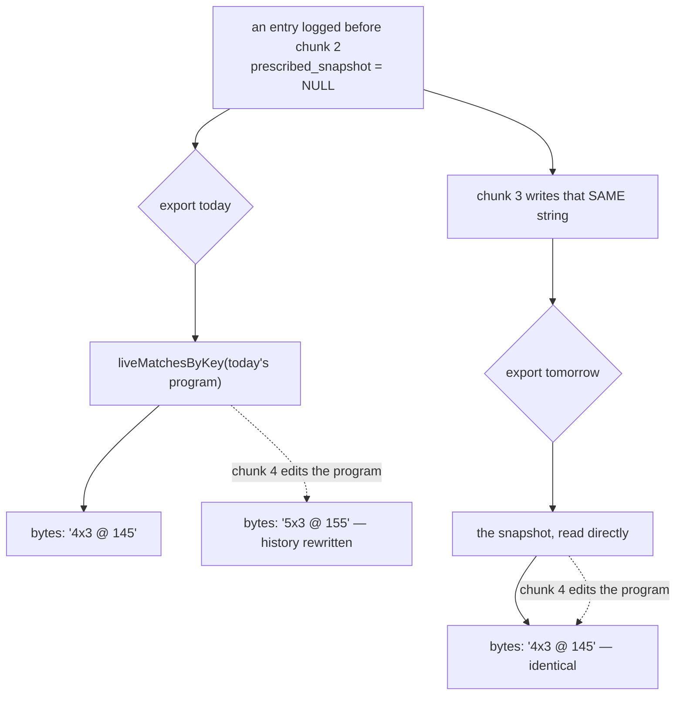

# V1-22 chunk 3 — freeze the history: the `prescribed` backfill

**Branch:** `db/v1-22-3-backfill` · **Chunk:** 3 of 6 ·
**Spec:** [v1-22-authoring-program-editing](../specs/v1-22-authoring-program-editing.md) (`:149`) ·
**Milestone:** [PROG-1](../milestones/prog-1-programs-and-scheduling.md)

> ⚠️ **Read [chunk 2's § Decisions](./v1-22-2-renderer-and-writer.md) first.** D1 reshaped the wire
> and D2 settled what this chunk writes on a miss. Everything below depends on both.

## Goal

**Every strength row that predates chunk 2 gets its `prescribed` value frozen, so chunk 4's first
program edit cannot rewrite a past month's CSV.**

Chunk 2 made the log-time writer freeze `entries.prescribed_snapshot` going forward. Rows logged
before it carry `NULL`, and the export still reconstructs those from **today's** program — which is
safe only while prescriptions are seed-immutable. Chunk 4 makes them editable. This chunk is the one
that closes the window, and the spec places it **after 2, before 4**: chunk 4 cannot merge until this
correction's `--apply` is recorded in the corrections **Applied** table with a row count (`spec:149`,
`spec:191`).

**Not a migration — a listed `db:correct` correction.** The spec amended this itself (`A18`,
`spec:294`): the backfill re-implements the renderer against live data, and a migration would freeze
that implementation in an immutable file forever under the forward-only rule, where the renderer it
must agree with lives in TypeScript and keeps evolving. The procedural cost is real and is stated in
§ Gates below: a human runs it, once, per database.

## Acceptance

1. `pnpm --filter @mat-plan/db db:correct prescribed-backfill-2026-11-12` lists the rows it would
   change and **writes nothing**. `--apply` writes, inside one transaction, and prints the count.
2. Every entry with an asserted day role and `prescribed_snapshot IS NULL` ends with a **non-NULL**
   value: the renderer's string where the day's program matches exactly once, `''` where it matches
   twice or not at all (`spec:280` A8; chunk 2 D2).
3. **Rows with no asserted day role are left `NULL`** — see Decision 1, which proves they are not at
   risk.
4. A second `--apply` reports **0 rows**. The guard is `prescribed_snapshot IS NULL`, which is the
   value being corrected _from_ (corrections rule 2).
5. 🔴 **The export's bytes do not change on the day it runs** — the acceptance that makes this chunk
   provable rather than asserted. See § Acceptance 11, which the spec assigns here (`spec:183`).
6. `db:verify` gains a case that backfills a seeded fixture and reads the three outcomes back —
   a matched string, an ambiguous `''`, an unmatched `''` — plus a committed mutation patch that
   turns it red.
7. The correction appears in the README's **Applied** table as `pending`, dated in a follow-up
   commit once it has run (corrections rule 6).

## 🔴 The thing that makes this chunk safe to write: it changes no bytes

A backfill of a column the CSV reads sounds like it rewrites history. It does the opposite, and the
reason is worth stating before any code:



The backfill writes **exactly what the export would have emitted at that moment**, because it calls
the same two functions the export calls — `programDayRows` and `liveMatchesByKey`. So:

- **today** the bytes are unchanged, which acceptance 5 asserts directly;
- **after chunk 4** the bytes stay unchanged, which is the whole point.

That identity is also what makes a wrong backfill loud instead of quiet: any divergence between this
correction and the export shows up as a byte difference on the day it runs, not six months later.

## Decisions

### Decision 1 · A row with no asserted day role stays `NULL`, and it is not at risk

Chunk 2's writer states that `NULL` means "logged before chunk 2, **or** logged with no day role"
(`writers/prescribed-snapshot.ts`), and the backfill cannot tell those apart. It does not need to:

```ts
// apps/web/lib/csv/prescribed-snapshot.ts
if (row.prescribedSnapshot !== null) return row.prescribedSnapshot;
if (row.dayRole === null || row.movementId === null) return ''; // ← never reaches `live`
return live?.get(row.dayRole)?.get(row.movementId) ?? '';
```

A row with no day role returns `''` **before the live program is consulted**. A program edit cannot
move it, so freezing it buys nothing — and freezing it would make this correction write a value
chunk 2's writer deliberately declines to write for the same shape (its rule 1), so the two writers
would disagree about a row the form produces in one tap.

**Consequence, stated so it is not discovered later:** after this runs, `NULL` means "no asserted day
role" and nothing else. That is a _narrowing_ of chunk 2's two meanings, and it is the meaning
`rolesNeedingLiveMatch` already keys on.

### Decision 2 · 🔴 It touches soft-deleted rows — the one place this plan departs from a correction rule

Corrections rule 5 says `deleted_at IS NULL` everywhere, "so a correction never resurrects a deleted
row". **This correction includes soft-deleted entries**, and the rule's own reason is why that is
safe: writing one text column on a row whose `deleted_at` stays set resurrects nothing — the export
filters `isNull(entries.deletedAt)` at every level (`queries/export-month.ts:113,156,183`), so the
row remains invisible before and after.

The reason to include them is `V1-9b`: **restore is being built.** A soft-deleted entry restored
after chunk 4 comes back with `prescribed_snapshot IS NULL`, and the export then reconstructs it from
a program that has since been edited — the exact defect this chunk exists to close, arriving through
the one door left open. Skipping those rows would honour the letter of rule 5 and lose the month.

**This plan amends the README**, in the form rule 8 established: the exception is written next to the
rule it excuses, with its reasoning, rather than left as a silent deviation in one `run`.

### Decision 3 · It iterates households and reuses `programDayRows` with a real scope

`programDayRows` takes a `HouseholdScope` and builds its own ownership predicate
(`isLiveProfile`, single-sourced since TEN-1 1c). A backfill is not a request and has no scope to
inherit, and the tempting shortcut is a correction-local query with no household conjunct.

**It does not take that shortcut.** It resolves a scope per live household (`householdScopeForScript`,
already used by `nullRoutineToFull` and the TEN-1 corrections) and calls `programDayRows` per
`(profile, dayRole)`. Three reasons, in order of weight:

1. **Reusing the query is what makes the byte identity true.** A hand-written join is a third
   composer of this value, and chunk 2's § "There are TWO live composers" is the record of what
   having two cost.
2. The household conjunct stays **live code under the `db:mutations` gate**. A correction-local copy
   would be scope logic no mutation patch covers.
3. One household exists today. Writing it per-household costs one loop and removes the assumption.

### Decision 4 · One transaction, and the row count is measured before it is trusted

Corrections rule 7 requires every write in one `db.transaction`. AGENTS.md's migration guidance wants
backfills in **bounded batches** — written for DDL under `lock_timeout`, not for a correction, and the
two would conflict at a large enough row count.

**Resolved by measuring, not by guessing:** the dry run prints the count, and the operator reads it
before `--apply`. The expectation is **hundreds, not millions** — one household, one athlete logging
since 2026-09. ⚠️ **If the dry run ever prints more than ~50k rows, stop and re-plan**, because at
that size a single transaction holds row locks on `entries` long enough to matter and the correction
needs a `--batch` flag it does not have. That threshold is a judgement, written down so the next
operator inherits it rather than re-deriving it.

`updated_at = now()` on every touched row (rule 4). ⚠️ **Consequence for v1.5:** the sync compares
client-supplied `updated_at`, so every backfilled row becomes server-newer than any offline copy. For
`prescribed_snapshot` that is correct — a client never authors it — but a client holding an unsynced
edit to another column of the same row would lose it. v1.5 does not exist, no client holds anything,
and the alternative (leaving `updated_at` stale) breaks LWW for a column that genuinely changed.
Recorded, not deferred.

## Acceptance 11 — the golden-byte test, and where it can actually live

The spec assigns acceptance 11 to this chunk at **month grain** over a real month (`spec:183`), and
chunk 2's § "What chunk 2 owes toward acceptance 11" explains why it could not land earlier: there was
nothing to populate a historical month with until the backfill existed.

**The claim to prove:** exporting a month before the backfill and after it yields **identical bytes**.

**Where it goes: `apps/web/e2e/prescribed-backfill.spec.ts`**, and the reasoning matters because the
obvious homes do not work:

| Candidate                 | Why not                                                                                                                                                                                                                                                                                  |
| ------------------------- | ---------------------------------------------------------------------------------------------------------------------------------------------------------------------------------------------------------------------------------------------------------------------------------------- |
| `db:verify` (PGlite)      | It can call the queries and the renderer, but `buildExportEntries` is in the `server-only` DAL and the month's **bytes** come from `foldStrengthRows` + the zip builder. A `db:verify` version would compare this correction to the renderer it already calls — a test that cannot fail. |
| A `packages/db` unit test | Same problem, one layer down.                                                                                                                                                                                                                                                            |
| A Playwright spec         | ✅ The export is a real download on a real database, which is the only place the bytes exist.                                                                                                                                                                                            |

The shape, on the ephemeral database `pnpm e2e:local` already provisions:

1. log a strength session with an asserted day role, then **clear its snapshot** to manufacture a
   pre-chunk-2 row (`UPDATE … SET prescribed_snapshot = NULL`) — the honest way to get history,
   since the writer now always freezes;
2. download the export; keep the `strength.csv` bytes;
3. run the correction with `--apply`;
4. download again; assert **byte equality**;
5. 🔴 then **edit a prescription** and download a third time, asserting the bytes **still** match —
   which is the claim the first four steps do not make. Without step 5 the test passes against a
   backfill that wrote nothing at all.

⚠️ Step 1 writes SQL in a test to create a state the app can no longer produce. That is a fixture,
not a shortcut, and it is the only way to test a backfill after the thing being backfilled stopped
occurring. It gets a comment saying so.

⚠️ **Step 3 needs the correction runnable from a spec.** `db:correct` is a `pnpm` script against
`DATABASE_URL`; the spec shells out to it with the ephemeral URL the harness already exports. If that
proves awkward, the fallback is to import the correction's `run` directly — it takes `(db, apply)`,
which is exactly why it has that signature.

## File-by-file changes

| Path                                                                       | Change | What & why                                                                                                                                                                    |
| -------------------------------------------------------------------------- | ------ | ----------------------------------------------------------------------------------------------------------------------------------------------------------------------------- |
| `packages/db/scripts/corrections/prescribed-backfill.ts`                   | NEW    | The correction's `run(db, apply)`. Its own module, not a 120-line entry inline in `registry.ts`: it iterates households, profiles and day roles, and `registry.ts` is a list. |
| `packages/db/scripts/corrections/registry.ts`                              | EDIT   | One entry — `name`, `what`, `issue: 'V1-22 chunk 4'`, `run`.                                                                                                                  |
| `packages/db/scripts/corrections/README.md`                                | EDIT   | Decision 2's exception to rule 5, written beside the rule; the **Applied** row as `pending`.                                                                                  |
| `packages/db/scripts/verify.ts`                                            | EDIT   | Acceptance 6's three outcomes against the seeded program.                                                                                                                     |
| `packages/db/scripts/mutations/NN-backfill-skips-ambiguous.{patch,expect}` | NEW    | Drops the ambiguity rule so a doubly-programmed movement freezes a string → the `''` case goes red. (`NN` = next free at merge.)                                              |
| `apps/web/e2e/prescribed-backfill.spec.ts`                                 | NEW    | Acceptance 11, five steps, step 5 load-bearing.                                                                                                                               |
| `docs/features/programming.md`                                             | EDIT   | What `NULL` means after this runs (Decision 1); the restore interaction (Decision 2).                                                                                         |
| `docs/features/write-path.md`                                              | EDIT   | The second writer of `prescribed_snapshot`, and that it is one-time.                                                                                                          |
| `docs/runbooks.md`                                                         | EDIT   | The procedure: RESTORE branch → dry run → read the count → `--apply` → record. `spec:239` requires the branch.                                                                |
| `docs/specs/v1-22-authoring-program-editing.md`                            | EDIT   | Mark chunk 3 done; acceptance 11 satisfied and where.                                                                                                                         |
| `docs/plan.md`, `docs/roadmap.md`, `docs/status.md`, `docs/changelog/…`    | EDIT   | Chunk 3 done; chunk 4 unblocked **once `--apply` is recorded**, not once this merges.                                                                                         |

## Gates, and what to re-verify

- **Chunk 2 is merged** ✅ (#367).
- **Chunk 4 must not merge** until the **Applied** table carries a date and a row count for this
  correction, in every database that matters. That is a human gate, in `docs/runbooks.md`, not a CI
  check — and `spec:191` is where it is written down.
- **A Neon RESTORE branch is cut before `--apply`** (`spec:239`). The correction is guarded and
  idempotent, so the branch is for the case the guard is wrong, which is the case a branch is for.
- ⚠️ **Parallel work:** this edits `programming.md` and `write-path.md`, so
  [parallel-work.md](../parallel-work.md) gate 1 fails against any other PROG-1 or write-path lane.
  `PICK-1` PR 4 edits `programming.md` too — **pick an order**.

## Risks / rollback

| Risk                                                                            | Mitigation                                                                                                                                                                                                                                                      |
| ------------------------------------------------------------------------------- | --------------------------------------------------------------------------------------------------------------------------------------------------------------------------------------------------------------------------------------------------------------- |
| The correction and the export disagree, so the backfill changes bytes.          | Acceptance 5 / 11 is exactly this assertion, and it runs before `--apply` on a real export. Both paths call the same two functions.                                                                                                                             |
| A row is frozen with a value from a program that was _already_ edited.          | Impossible before chunk 4 — there is no edit path. This is why the spec orders 3 before 4 rather than leaving it to judgement.                                                                                                                                  |
| An athlete already `adult` when this runs freezes `''` for their whole history. | Recorded in chunk 2's D2 and **not** acted on here: `kind` is not editable (`PROF-1` a-r), and the fix belongs to whatever makes it editable. This chunk must not be asked to distinguish "no longer programmed" from "never programmed" — both return no rows. |
| A partial failure leaves half the rows frozen.                                  | One transaction (rule 7) plus the `IS NULL` guard: a rollback leaves nothing, and a re-run after a committed partial write is a no-op over what landed.                                                                                                         |
| **Rollback**                                                                    | None needed and none possible by design: the written value is what the export already emitted. Fix-forward — a second correction can overwrite a wrong value, and the RESTORE branch is the floor.                                                              |

## Out of scope / deferred

- **Editable `kind`** and the aged-out-athlete consequence → whatever row makes `kind` editable.
- **A `--batch` flag** on the runner → only if the dry run ever prints more than ~50k rows
  (Decision 4). Not built speculatively.
- **`PRIV-3`'s `--household` / `--user` runner flags** → unchanged by this chunk; this correction
  takes no operator input at all, which is deliberate.

## Open questions

1. **Does `db:correct` run cleanly from a Playwright spec, or does acceptance 11 import `run`
   directly?** Both work; the first is more honest about what the operator does. Settle it while
   writing the spec, not in the plan.
2. **Should the dry run print one line per row, or a summary plus the first N?** Hundreds of lines is
   unreadable, and corrections rule 1 says the operator reads the diff. Proposal: the three counts
   (matched / ambiguous / unmatched) plus every ambiguous and unmatched row, since those are the ones
   a human can actually judge.

## Roadmap alignment (2026-11-12)

Checked before writing: this advances `V1-22` chunk 3 and **unblocks chunk 4** (`spec:149`), and it
is what lets `programming.md` invariant 8's prerequisite — "the export stop depending on today's
`kind`" — eventually be met, which is a precondition for any future editable `kind`. It gates nothing
else. Nothing to add from the roadmap beyond that.
