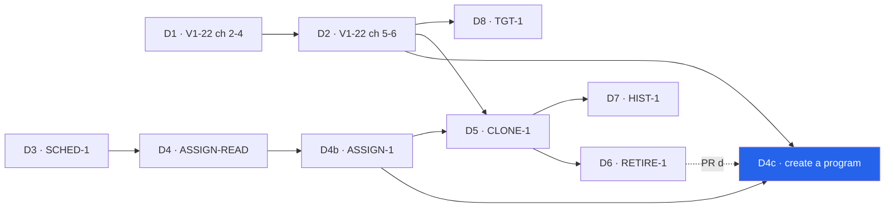

# V1-22 A4 — create a program

> Backlog: [plan.md](../plan.md) row **V1-22** (scope A, chunk **A4**) · Spec:
> [crud-1-fix-it-yourself.md](../specs/crud-1-fix-it-yourself.md) chunk **D4c** · Milestone:
> [PROG-1](../milestones/prog-1-programs-and-scheduling.md) · Branch: `feat/v1-22-a4-create-program`
> (one branch per PR in the Staging table below).
>
> **Round 1 reconciled** (engineering panel: correctness, scope, architecture, reuse, db-safety; UX
> panel: interaction + first-run, a11y + 360px, trust + data entry). The log is at the bottom. Written
> against `origin/main@27847ca`. Every `path:line` into code was opened on that commit; anything owned
> by a sibling plan that has not merged is cited to that plan and marked **planned**.
>
> **Imports, never re-derives** (spec → "The data contract" → "Seams the plans settled",
> `crud-1-fix-it-yourself.md:525-552`): `applyAssignmentChange` / `undoAssignmentChangeAction` /
> `blockInHousehold` / `rotationFor` / `workoutLabel` / `WeekdaysField` (ASSIGN-1), the movement resolver
> and the `movementPublicId` wire key (PICK-1), `foldName` and `UndoLine` (PROF-1), the action registry and
> `app/p/program-actions.ts` (WP-1), `programIsListed()` and `restoreProgram` (RETIRE-1 PR d, for A4-4), `getActiveLocalDay()` (`apps/web/lib/active-timezone.ts:23-25`).
> **Owns** (the same table): `PROGRAM_NAME_MAX`, `programNameSchema`, the reserved-slug check, and
> `program_blocks.client_id` + the block anchor in A4-1's migration.

## Goal

A parent can make a program without the maintainer: a name, one to three **workouts**, each with a
label the parent types ("Workout A" until renamed) and its movements, and — when started from an
athlete — the weekdays that athlete runs it. A created program's name and workout labels can be
renamed afterwards. Today `PROGRAM_SEED` → `seedProgram` is the only writer of `program_blocks`
(`packages/shared/src/programming.ts:198`, `packages/db/src/seed.ts:345`), and `apps/web` may not call
it (`packages/db/src/scope.test.ts:118-124`).

Gated on **D4** (Today reads the athlete's _set_ of assignments — ADR 0007 decision 4, creating a block
_"is safe only once Today renders the athlete's set of active assignments"_,
`docs/decisions/0007-scheduling-model.md:284-287`), **D4b** (ASSIGN-1's writer, Undo and weekday field)
and **D2** (the editor rows and the picker this fills).

**"Start from The Daily Five" (criterion 33) stays this chunk's, as its last PR (A4-4), gated on RETIRE-1
PR d.** Once ONB-2 seeds every new household, only an archive makes "a household with no live program"
reachable, and RETIRE-1 PR d ships the single live-program predicate `programIsListed()`
(`docs/plans/retire-1-archive-program.md:296-310`) and the "restore, don't re-insert" path for an archived
Daily Five. A4-4 reuses both rather than restating them.

**The design question the spec handed this plan (Q16, FE-3): where a workout's label lives.**
`DAY_ROLES` is a closed list inlined in a CHECK (`programming.ts:28`; `schema.ts:840-843`). Answer under
"Label storage".

## Where this sits

- **Pillar:** Authoring & Scheduling ([roadmap.md](../roadmap.md)).
- **Milestone:** [PROG-1](../milestones/prog-1-programs-and-scheduling.md) step 6.
- **This plan:** an ADR amendment, one dark migration, then six code PRs (Staging).
- **Next:** D5 CLONE-1 — its copy must carry `workouts` rows and the anchor, or a carried athlete's
  rotation breaks (the carry precondition, below) — and D8 TGT-1 (typed targets on a created program).



## Acceptance

Verbatim from the spec, the criteria this chunk carries:

- **33.** _When the household has no live program … that step shall offer exactly two paths, "Start from
  The Daily Five" and "Create a program". The Daily Five shall be copied by ONB-2's household-creation
  writer, never from `PROGRAM_SEED`, with no load or per-athlete target, and only once its doses carry the
  maintainer's sign-off. Where the athlete is an adult, the step shall say The Daily Five was written for
  young athletes._ — A4-4, after RETIRE-1 PR d; an archived copy is restored, not re-inserted.
- **35.** _When a created program is saved, its rotation anchor shall be the save day, so its first
  workout falls on that day._ — With two refinements recorded under D-3: the anchor is set by the
  **first put-on** (which is the save, when created from an athlete), and the first workout falls on the
  first **scheduled** day on or after it.
- **36** (the D4c half). _Wherever a parent is asked to choose a program … "Create a program" shall be
  one tap away._ — For an athlete with **no** live assignment; see D-7.
- **42** (the D4c half). _A created program [is shown] by a label the parent types, defaulting to
  "Workout A", "Workout B". The editor's add control shall read "+ Add another workout" and shall stop
  at `DAY_ROLES`' strength roles (three) without a CHECK migration. No screen shall say "Day A"._
- **45** (the D4c half). _Undo after "Create a program" from an athlete's page shall take the athlete
  off it and keep the program._
- **49.** _If a created program is saved with a workout that has no movements, then the save shall be
  refused with the workout named and focus on its "+ Add a movement" control, and each workout after the
  first shall have a Remove control._ (Tagged D4b in the spec; D-1.)

Concrete "done when":

1. From the household's program list, **"+ New program"** opens an empty editor; Save writes one
   `program_blocks` row, one `workouts` row per workout and their `prescriptions` in **one transaction**,
   with nobody assigned and no anchor.
2. From an athlete with no live assignment (the "No program yet" card, the assignment sheet's "None of
   these fit?", the add flow's last step), the editor also shows ASSIGN-1's `WeekdaysField`; Save calls
   `applyAssignmentChange` **in the same transaction**, which sets the anchor to that day, and lands on the
   athlete's day with ASSIGN-1's Undo: Undo takes the athlete off and keeps the program.
3. Save is refused, nothing written, for: a blank name; a name whose slug is reserved or held by a live
   program in the household; zero or more than `MAX_WORKOUTS` workouts; a blank workout name; a workout
   with no movements (named, focus on its add control); two workouts whose names fold equal; an
   athlete-scoped save with no weekday; a movement id that is neither global nor this household's; a typed
   movement name with a comma or no letter; an athlete who already has a live assignment.
4. Every block with no `workouts` rows (the YDP, ONB-2's blocks) resolves its rotation **byte-identically**
   to before; a created block resolves from its own rows and anchor.
5. Today, the editor, the assignment sheet and the program list show a created workout by its typed
   label, under `workoutLabel`'s one precedence.
6. **The editor never loses what was typed** (M25, as a requirement): name, workout labels, movements and
   sets/reps survive adding a movement, opening and closing the picker, adding or removing a workout, and
   a refused save.
7. A created program's name and workout labels can be renamed from D2's editor; a rename to a taken or
   reserved name is refused as `name_taken`.
8. With no listed program (`programIsListed()`), the athlete step offers exactly the two paths; "Start from
   The Daily Five" restores an archived copy or inserts one via ONB-2's writer (zero
   `prescription_targets`), puts the athlete on it, and its Undo takes the athlete off and leaves the
   program listed.

## Staging

| PR    | Branch                                   | What                                                                                                                                                                                                                                                      | ~lines | Gate                                                                                                                                                |
| ----- | ---------------------------------------- | --------------------------------------------------------------------------------------------------------------------------------------------------------------------------------------------------------------------------------------------------------- | ------ | --------------------------------------------------------------------------------------------------------------------------------------------------- |
| A4-0  | `docs/v1-22-a4-0-adr-0007-amendment`     | **ADR 0007 amendment, signed by the maintainer:** the "does not authorize" table (`0007:435-436`) authorizes `workouts` (additive step only), the block anchor, slots **derived** from workouts rows, and `program_blocks.client_id`                      | ~40    | the maintainer's signature. Docs only                                                                                                               |
| A4-1  | `db/v1-22-a4-1-workouts`                 | **The one migration**, dark: `workouts`; `program_blocks.rotation_anchor_date`, `.client_id`, `uq_program_blocks_household_client_id`; `schema.ts` and its docblock; the shared consts; `db:verify`; the "still dark" check; inventory; runbook; lessons  | ~350   | A4-0 merged · earlier migrations merged (numbering is serial) · **before ONB-2's writer merges** (ONB-2 depends on this)                            |
| A4-2  | `feat/v1-22-a4-2-rotation-and-labels`    | Read side: extend ASSIGN-1's `rotationFor` and `workoutLabel`; the carry precondition asserted; the anchor-on-first-put-on step in `applyAssignmentChange`; the legacy-equivalence proof; the `program_blocks.deleted_at` reader audit                    | ~300   | A4-1 **observed applied** (migrate log) · ASSIGN-1 1b merged                                                                                        |
| A4-3a | `feat/v1-22-a4-3a-create-program-writer` | The name and create/rename schemas; `createProgram` + `renameProgram`; `lib/dal/programs.ts`; `createProgramAction`, `renameProgramAction` in `app/p/program-actions.ts`; the seed refusal; boundary tests and `db:verify` proofs; the programming.md row | ~400   | A4-2 · D2 · PICK-1's resolver · WP-1 merged                                                                                                         |
| A4-3r | `refactor/v1-22-a4-3r-prescription-row`  | Split D2's prescription row into a presentational half and D2's bound half, so a draft can render it. No behaviour change                                                                                                                                 | ~150   | A4-3a                                                                                                                                               |
| A4-3b | `feat/v1-22-a4-3b-new-program-editor`    | The editor page and island, "+ New program" on the program list, rename fields in D2's editor, the a11y route and e2e                                                                                                                                     | ~400   | A4-3r · UX panel round 2 · C1's picker on `main` · the program list page on `main`                                                                  |
| A4-3c | `feat/v1-22-a4-3c-create-from-athlete`   | The three athlete entry points, `WeekdaysField` in the editor, the redirect to `?change=`, the started line (ASSIGN-1's Undo through `UndoLine`)                                                                                                          | ~300   | A4-3b · ASSIGN-1 1c + 1d merged                                                                                                                     |
| A4-4  | `feat/v1-22-a4-4-start-from-daily-five`  | "Start from The Daily Five" in the no-live-program step: restore an archived copy (RETIRE-1's `restoreProgram`) or insert one (ONB-2's writer), then ASSIGN-1's put-on, one transaction; the safety copy; the adult caution                               | ~250   | A4-3c · **RETIRE-1 PR d** (`programIsListed`, restore path) · ONB-2 merged (its presence on `main` is the dose sign-off) · Open question 1 answered |

**A4-1 lands before ONB-2's writer — and ONB-2 depends on it (db 1).** Drizzle's `insert()` lists
**every** column the schema declares (unspecified ones as `default`), and a bare `select()` or
`.returning()` does the same. So once `schema.ts` declares `client_id` and `rotation_anchor_date`, any
request-path code that inserts or selects-all from `program_blocks` fails `42703` on a deploy that races
`migrate.yml`. Today nothing in `apps/web` writes `program_blocks` (`seedProgram` runs after `db:migrate`
in CI), so A4-1 is dark **only while that stays true**; ONB-2's household-creation writer would be the
first request-path insert. Ordering A4-1 first makes ONB-2 safe by construction, and the ONB-2 row must
record the dependency. **Either way A4-1 adds a merge-time check** (a source scan in the
`apps/web/test/source-scan.ts` idiom): no `insert(programBlocks)`, bare `select().from(programBlocks)` or
column-less `.returning()` outside `packages/db/src/seed.ts`, `packages/db/scripts/verify.ts` and this
plan's writers. A4-1 adds to `docs/lessons.md`: _"A Drizzle INSERT names every schema column, so a
nullable column 'shipped dark' is not dark for any code path that inserts into that table."_

## Label storage (Q16, FE-3) — the decision

**Chosen: a block-owned `workouts` table, keyed `(block_id, slug)`, where `slug` is the
`prescriptions.day_role` the workout owns, restricted to `strength_a | strength_b | strength_c`.
`prescriptions` keeps `day_role` as its key and is not touched.**

```
workouts
  id          bigint identity PK
  public_id   uuid NOT NULL UNIQUE                   -- server-minted; the handle M24's pin will FK to
  block_id    bigint NOT NULL → program_blocks.id    -- + idx_workouts_block (covering)
  slug        text NOT NULL  CHECK (slug IN ('strength_a','strength_b','strength_c'))   -- pinned to WORKOUT_DAY_ROLES
  name        text NOT NULL  CHECK (name ~ '[^[:space:]]' AND char_length(name) <= 30)  -- pinned to WORKOUT_NAME_MAX;
                                                       -- btrim() strips only spaces, so a tab-only name would pass it
  created_at / updated_at / deleted_at   (the shared `timestamps`)
  uq_workouts_block_slug  UNIQUE (block_id, slug) WHERE deleted_at IS NULL

program_blocks  (+2 nullable columns, +1 index)
  rotation_anchor_date  date NULL     -- set by the FIRST put-on of a block that has workouts rows
  client_id             uuid NULL     -- set only by app create paths; seeded / ONB-2 rows stay NULL
  uq_program_blocks_household_client_id  UNIQUE (household_id, client_id)   -- NOT partial
```

| Option                                                                   | Verdict  | Why                                                                                                                                                                                                                                                                                                                                                                                                 |
| ------------------------------------------------------------------------ | -------- | --------------------------------------------------------------------------------------------------------------------------------------------------------------------------------------------------------------------------------------------------------------------------------------------------------------------------------------------------------------------------------------------------- |
| **A. `workouts(block_id, slug, name)`, slug ∈ the three strength roles** | chosen   | ADR 0007 decision 3's recorded shape — block-owned, `(block_id, slug)` unique, a display name beside a stable slug (`0007:198-212`) — as the additive first step only: no `prescriptions.workout_id`, no CHECK loosening, no `DROP`. If the six-PR arc (`0007:455-466`) is ever authorized, its backfill joins on `prescriptions.day_role = workouts.slug`. A row identity is what M24's pin needs. |
| B. Fixed labels, no DDL (`0007:436`'s interim)                           | rejected | The smallest path; criterion 42 rules it out (a label _"the parent types"_, M24, Q16).                                                                                                                                                                                                                                                                                                              |
| C. `workout_{a,b,c}_name` columns on `program_blocks`                    | rejected | `MAX_WORKOUTS` in DDL, no identity for a pin, a third interim beside the const and the table.                                                                                                                                                                                                                                                                                                       |
| D. `jsonb` labels                                                        | rejected | AGENTS.md → Schema: JSONB only for opaque sync/device metadata.                                                                                                                                                                                                                                                                                                                                     |
| E. The label on each `prescriptions` row                                 | rejected | Copies drift under a D2 edit; a draft workout with no movements has nowhere to keep its name.                                                                                                                                                                                                                                                                                                       |
| F. The full `workouts` arc                                               | rejected | Six PRs, the only destructive step, two pinned CHECKs weakened, the export's `DAY_ROLES` gate to change (`apps/web/lib/dal/export.ts:120`; `0007:241-267`). Three workouts fit the three strength roles.                                                                                                                                                                                            |

**The CSV.** The label is display-only. `sessions.day_role` keeps storing `strength_a/b/c`, so
`session_type` is never a parent's text and a rename cannot rewrite a past row (`0007:221-225`). No label,
program name or anchor reaches an export column (`export.ts:113-133` reads day role, slug, sets, reps and
load only).

**The anchor** sits on `program_blocks`, per ADR 0007 decision 2 (`0007:150-158`). Rejected: on the
assignment (the ADR's rejected first draft); derived from `created_at` (a UTC instant, so the local day
moves with the viewer's zone); on `workouts` (wrong grain). **It is set by the first put-on, not the
save** (corr 7, UX3 5): a program saved from the list with nobody on it would otherwise rotate unseen, and
its first athlete would join mid-rotation. Created from an athlete, the first put-on _is_ the save, so
criterion 35 holds where the spec meant it. Invariants (writer-enforced, proved in `db:verify`): an open
assignment on a block with `workouts` rows implies a non-null anchor; a non-null anchor implies at least
one `workouts` row.

**Slots are derived, never stored**: the slugs of **all** the block's `workouts` rows, live or not, in
`WORKOUT_DAY_ROLES` order (db 7). A later soft delete of a workout row therefore cannot shrink the slot
count and shift every future date (ADR 0005 decision 7's hazard). Labels read the **live** rows in a
separate select.

**Labelled workouts pinned to weekdays (M24).** The pin is `assignment_workout_weekdays(assignment_id,
workout_id → workouts.id, weekday)`, a new table. ASSIGN-1's resolver contract is
`workoutDue(rotation, period, day) → DayRole` (`docs/plans/assign-1-assignments.md:306`, `:480`): the
workout **due** on a date, never "the next slot", so a pinned mode is one new branch.

**`client_id` on `program_blocks`, scoped `(household_id, client_id)` and not partial** (reuse B2, arch
B1). Rejected: a client-minted `public_id` — `public_id` is server-minted by convention
(`packages/shared/src/id.ts:4-8`). **Household-scoped**, so a key that exists in another household simply
inserts: no `not_found` branch, no existence oracle. **Not partial**, so a block hidden later still holds
its key and a replay never inserts a second one (ADR 0008 decision 3). **AGENTS.md deviation, stated:**
its `client_id` rule is _"NOT NULL, UNIQUE (partial: WHERE deleted_at IS NULL)"_; this one is nullable
(seeded rows have no client) and non-partial (the reason above). CLONE-1 has no migration and targets this
index (spec seams, `crud-1-fix-it-yourself.md:537`).

## The data contract (this chunk's)

The spec's `programCreateSchema` carries no movements and no key; it is extended here (D-2).

```
packages/shared/src/programming.ts   (owned here; CLONE-1 and RETIRE-1 import)
  WORKOUT_DAY_ROLES = ['strength_a','strength_b','strength_c'] as const satisfies readonly DayRole[]
                      — NOT STRENGTH_DAY_ROLES, which has FOUR members ('strength' too: programming.ts:51-71)
  MAX_WORKOUTS = WORKOUT_DAY_ROLES.length   WORKOUT_NAME_MAX = 30   PROGRAM_NAME_MAX = 60
                      — the prototype's maxlengths (docs/prototypes/crud-1/index.html:3300, :3363)
  RESERVED_PROGRAM_SLUGS = [...PROGRAM_SEED.map(b => b.slug), ...DEFAULT_PROGRAM_SLUGS]
                      — DERIVED; DEFAULT_PROGRAM_SLUGS is ONB-2's const (planned; until then PROGRAM_SEED's alone)
  programNameSchema = string trimmed 1..PROGRAM_NAME_MAX, has a letter (PICK-1's hasALetter),
                      !RESERVED_PROGRAM_SLUGS.includes(movementSlug(name))                → 'name_taken'
                      — program names compare by movementSlug, the DB arbiter's own key
  workoutNameSchema = string trimmed 1..WORKOUT_NAME_MAX
  defaultWorkoutName(taken) → "Workout A" | "B" | "C", first unused letter (index.html:4667-4669)
  defaultProgramName(takenSlugs, athleteName | null) → "{athlete}'s program" | "New program", then " 2", " 3"…
                      while movementSlug collides — so a second create after an Undo never opens on a refusal

  programCreateSchema {
    clientId: uuidSchema                                  — minted once per editor mount
    name: programNameSchema
    workouts: Array<{ name: workoutNameSchema,
                      items: Array<PICK-1's item { movementPublicId?: uuid, movementName: movementNameSchema }
                                   & { sets, targetReps }>      — sets/targetReps: V1-22's programEditSchema fields,
                             (1..MAX_SESSION_MOVEMENTS) }>       derived from prescriptionSeedRowSchema
             (1..MAX_WORKOUTS)                                   (programming.ts:110-117), never re-typed
    forProfilePublicId: uuid | null
    weekdays: ASSIGN-1's weekdays schema — required iff forProfilePublicId
  } .superRefine: two workouts whose foldName(name) are equal → issue on the LATER one

  programRenameSchema { blockPublicId, name?: programNameSchema,
                        workouts?: Array<{ workoutPublicId, name: workoutNameSchema }> }

packages/shared + apps/web/lib/programming (ASSIGN-1's, extended in A4-2)
  rotationFor(block: { anchorDay: string | null, workoutSlugs: DayRole[] }) — no rows → YDP_ROTATION (unchanged)
  workoutLabel(block, dayRole): live stored workouts.name → (one distinct workout) program name → DAY_ROLE_LABELS

apps/web/lib
  CreateProgramResult = { blockPublicId, changePublicId: string | null }   — changePublicId is ASSIGN-1's Undo key
```

The item mirrors PICK-1's wire: the id decides; `movementName` is the required label and the
find-or-create input only when the id is absent (PICK-1 → Decision 1). The wire key is
`movementPublicId`, as the seams table fixes; `movementId` in PICK-1 is the **internal** resolved id
the writer receives, never a wire field. The item derives from PICK-1's schema. Workout _i_ gets `WORKOUT_DAY_ROLES[i]`
by position on the server; the client never sends a slug.

## File-by-file changes

### A4-0 — the ADR amendment (~40, docs)

| Path                                      | Change | What & why                                                                                                                                                                                                                                                                                                                                                  |
| ----------------------------------------- | ------ | ----------------------------------------------------------------------------------------------------------------------------------------------------------------------------------------------------------------------------------------------------------------------------------------------------------------------------------------------------------- |
| `docs/decisions/0007-scheduling-model.md` | EDIT   | The "does not authorize" rows (`:435-436`) become: `workouts` — _authorized by V1-22 A4, the additive step only (no `prescriptions.workout_id`; slugs restricted to the three strength roles)_; rotation anchor — _on `program_blocks`, set by the first put-on_; slots — _derived from `workouts` rows, no table_; `program_blocks.client_id`. Signed box. |

### A4-1 — the migration, dark (~350)

| Path                                                         | Change | What & why                                                                                                                                                                                                                                                                                                                                                                                                                                                                                                                                                                     |
| ------------------------------------------------------------ | ------ | ------------------------------------------------------------------------------------------------------------------------------------------------------------------------------------------------------------------------------------------------------------------------------------------------------------------------------------------------------------------------------------------------------------------------------------------------------------------------------------------------------------------------------------------------------------------------------ |
| `packages/db/src/schema.ts`                                  | EDIT   | `workouts` beside `programBlocks` (`schema.ts:785-804`). `programBlocks` gains `rotationAnchorDate`, `clientId` and `uniqueIndex('uq_program_blocks_household_client_id').on(householdId, clientId)`. **Its docblock's "Config data → NO client_id" (`:779-781`) is rewritten** to say which rows carry one and why the index is not partial (db 3). Both new CHECKs carry the "pinned by db:verify" comment (`:840-843`'s idiom).                                                                                                                                             |
| `packages/db/migrations/00NN_v1_22_a4_workouts.sql`          | NEW    | `drizzle-kit generate`d, hardened in the 0015 house style: `SET lock_timeout` / `statement_timeout` first; a header stating why, the locks (`ACCESS EXCLUSIVE` on `program_blocks` for two metadata-only `ADD COLUMN`s and an index build over a handful of rows), re-run safety, what `db:verify` does not prove. The FK is on an empty table created in the same transaction; if Squawk's `adding-foreign-key-constraint` fires, the ignore goes on the line **directly** above (`sched-1-scheduling-model.md:388-392`).                                                     |
| `packages/shared/src/programming.ts` (+ its test)            | EDIT   | `WORKOUT_DAY_ROLES`, `MAX_WORKOUTS`, `WORKOUT_NAME_MAX`, `PROGRAM_NAME_MAX`; each `WORKOUT_DAY_ROLES` member maps to `'strength'` in `DAY_ROLE_TO_SESSION_TYPE`; `MAX_WORKOUTS === WORKOUT_DAY_ROLES.length`.                                                                                                                                                                                                                                                                                                                                                                  |
| `packages/db/scripts/verify.ts`                              | EDIT   | Columns (the `V1_10_COLUMNS` style); `assertCheckCoversConst('workouts_slug_check', WORKOUT_DAY_ROLES)` (`verify.ts:1039`); name proofs **built from the const** (db 5): `WORKOUT_NAME_MAX` characters accepted, `+1` rejected, `''`, `'   '` and a **tab-only** name rejected; slugs `'strength'`, `'strength_d'` rejected; FK `23503`; `uq_workouts_block_slug` duplicate rejected and freed by a soft delete; `(household_id, client_id)` duplicate rejected **even when the holder is soft-deleted**, the same `client_id` in two households accepted, two NULLs accepted. |
| `apps/web/test/program-blocks-stay-dark.test.ts`             | NEW    | The merge-time check (source scan, comments stripped, an allowlist).                                                                                                                                                                                                                                                                                                                                                                                                                                                                                                           |
| `docs/lessons.md`                                            | EDIT   | The Drizzle-INSERT-names-every-column entry.                                                                                                                                                                                                                                                                                                                                                                                                                                                                                                                                   |
| `docs/privacy/data-inventory.md`                             | EDIT   | A `workouts` row (`name`: free text a parent types; household-scoped through `block_id`); `program_blocks` gains two non-personal columns; the table count moves by one.                                                                                                                                                                                                                                                                                                                                                                                                       |
| `docs/runbooks.md` → "Delete a household and everyone in it" | EDIT   | `DELETE FROM workouts` before the `program_blocks` statement, **and its row in the pre-flight and post-delete counts** (db 4); otherwise deletion fails `23503`. PRIV-3's runner and proof get the same if they have landed.                                                                                                                                                                                                                                                                                                                                                   |
| `docs/architecture.md`                                       | EDIT   | §4 ERD: `workouts` under `program_blocks`.                                                                                                                                                                                                                                                                                                                                                                                                                                                                                                                                     |
| `docs/features/programming.md`                               | EDIT   | Owns `programming.ts`: invariant 3c gains "created programs label their workouts in `workouts`; the seeded A/B reuse stands".                                                                                                                                                                                                                                                                                                                                                                                                                                                  |
| changelog fragment, `docs/status.md`, `docs/roadmap.md`      | EDIT   | Per PR (AGENTS.md → "Status rides with the work") — here and in every PR below.                                                                                                                                                                                                                                                                                                                                                                                                                                                                                                |

### A4-2 — rotation and labels on the read side (~300)

| Path                                                                                              | Change | What & why                                                                                                                                                                                                                                                                                                                                                                                                                                                                                                                                                                                                                                             |
| ------------------------------------------------------------------------------------------------- | ------ | ------------------------------------------------------------------------------------------------------------------------------------------------------------------------------------------------------------------------------------------------------------------------------------------------------------------------------------------------------------------------------------------------------------------------------------------------------------------------------------------------------------------------------------------------------------------------------------------------------------------------------------------------------ |
| `packages/shared/src/schedule.ts` (ASSIGN-1 1a's home, `assign-1:957`)                            | EDIT   | **Extend `rotationFor`** (`assign-1:477-479`): no `workouts` rows → `YDP_ROTATION` **by identity**; otherwise `{ anchorDay, slots }` from the derived slugs. **No second function.** `sameRotation(a, b)` exported for the precondition below.                                                                                                                                                                                                                                                                                                                                                                                                         |
| `apps/web/lib/programming/program-day.ts` (ASSIGN-1's `workoutLabel`, `assign-1:408-417`, `:922`) | EDIT   | One precedence in one function: a **live stored** `workouts.name` → the program name when the block has one distinct workout (ASSIGN-1's rule, which already shows The Daily Five's A/B stopgap as one) → `DAY_ROLE_LABELS`. Every caller (Today, the editor, the sheet, the list) goes through it.                                                                                                                                                                                                                                                                                                                                                    |
| READ-1's assigned-blocks query (`packages/db/src/queries/program-assignments.ts`, planned)        | EDIT   | Select `rotation_anchor_date`; the **slot** slugs from `workouts` with no `deleted_at` filter; the **labels** in a separate select of live rows, with `isNull(workouts.deletedAt)` **in the join's ON**, so a deleted label falls back instead of dropping the block (corr 6). No household predicate of its own: `workouts` is reached only through a block already scoped by `blockInHousehold(scope)` (`assign-1:782-787`), the `prescription_targets` precedent.                                                                                                                                                                                   |
| `packages/db/src/writers/program-assignments.ts` (ASSIGN-1, planned)                              | EDIT   | Two additions to ASSIGN-1's writer. **(1) The anchor step:** a `put`/`move` opening a period on a block whose `rotation_anchor_date IS NULL` and that has `workouts` rows sets it to `today`, under the block lock ASSIGN-1 already takes (`assign-1:631-632`, `FOR UPDATE` for that block). **(2) The carry precondition, named and asserted:** `phase: 'carry'` requires `sameRotation(rotationFor(from), rotationFor(to))`, which ASSIGN-1 relies on as holding "for every block until D4c" (`assign-1:662-665`). After D4c it holds only if CLONE-1 copies the rows and the anchor, so a violation **throws** (a programmer error, not a refusal). |
| `packages/shared/src/schedule.test.ts`, `apps/web/lib/programming/*.test.ts`                      | EDIT   | **Legacy equivalence:** a block with no rows returns `YDP_ROTATION` by identity, and `workoutDue` over SCHED-1 1b's ±30,000-day span equals the pre-PR result. A created three-workout block on a seven-day set: anchor → `strength_a`, +1 → `strength_b`, +3 → `strength_a`. A soft-deleted workout row leaves the slot count unchanged. `workoutLabel`'s three branches.                                                                                                                                                                                                                                                                             |
| `packages/db/scripts/verify.ts`                                                                   | EDIT   | A household-B `workouts` row named `"LEAK"` never reaches A's read; a soft-deleted workout falls back to the next label; the anchor step sets it once and a second put-on never moves it; **anchor ⇒ ≥1 workout** and **open assignment on a workouts block ⇒ anchor** asserted over the fixture. A `db:mutations` patch dropping `blockInHousehold(scope)` from the read must turn it red (corr 2).                                                                                                                                                                                                                                                   |
| `docs/features/programming.md`, `docs/architecture.md`                                            | EDIT   | Invariant 3/3b: a block's rotation is `rotationFor`'s answer and the first put-on sets the anchor; invariant 4 gains its fifth level (`0007:263-267`). §2d: per-block rotation inputs for created programs.                                                                                                                                                                                                                                                                                                                                                                                                                                            |

**The `program_blocks.deleted_at` reader audit** (A4-2's PR description, one row per reader with its
proof): `programDayRows` (`packages/db/src/queries/program-day.ts:83`), `seedProgram`'s arbiter and
re-resolve (`seed.ts:428`, `:438`), READ-1's queries, ASSIGN-1's block lock (`assign-1:631`), V1-22 chunk
4's editor DTO, CLONE-1's source list if landed. Nothing in this chunk hides a block, but RETIRE-1's archive will, and ADR 0008's mechanical rule asks for the audit first.

### A4-3a — the writers and the actions (~400)

| Path                                          | Change | What & why                                                                                                                                                                                                                                                                                                                                                                                                                                                                                                                                                                                                                                                                                                                                                                                                                                                                                                                                                                                                                                                                                                                                                                                                                                                                                                                                                                                                                                                                                                                                                                                                                                                                                      |
| --------------------------------------------- | ------ | ----------------------------------------------------------------------------------------------------------------------------------------------------------------------------------------------------------------------------------------------------------------------------------------------------------------------------------------------------------------------------------------------------------------------------------------------------------------------------------------------------------------------------------------------------------------------------------------------------------------------------------------------------------------------------------------------------------------------------------------------------------------------------------------------------------------------------------------------------------------------------------------------------------------------------------------------------------------------------------------------------------------------------------------------------------------------------------------------------------------------------------------------------------------------------------------------------------------------------------------------------------------------------------------------------------------------------------------------------------------------------------------------------------------------------------------------------------------------------------------------------------------------------------------------------------------------------------------------------------------------------------------------------------------------------------------------- |
| `packages/shared/src/programming.ts`          | EDIT   | `RESERVED_PROGRAM_SLUGS`, `programNameSchema`, `workoutNameSchema`, `defaultWorkoutName`, `defaultProgramName`, `programCreateSchema`, `programRenameSchema`.                                                                                                                                                                                                                                                                                                                                                                                                                                                                                                                                                                                                                                                                                                                                                                                                                                                                                                                                                                                                                                                                                                                                                                                                                                                                                                                                                                                                                                                                                                                                   |
| `packages/db/src/writers/program-create.ts`   | NEW    | `ProgramRefusal` — thrown, never returned, because a returned non-ok inside drizzle's `transaction()` commits what was already written (`assign-1:592-594`) — with reasons `name_taken \| movement_not_found \| has_program`. `createProgram(tx, scope, input, today)`, **all reads before the first insert** (corr 5, arch S2): (1) every `movementPublicId` through **PICK-1's resolver** (global **or** own; `movementInHousehold` alone excludes globals, `ownership.ts:176-178`, corr 1) — a miss throws `movement_not_found`; (2) with `forProfilePublicId`, an **open assignment for that athlete** (ASSIGN-1's `isOpenOn`) throws `has_program` (D-7) — the profile itself is **not** pre-resolved; ASSIGN-1 resolves it (reuse B1). Then the writes: (3) `INSERT program_blocks … ON CONFLICT (household_id, client_id) DO NOTHING RETURNING id`, slug = `movementSlug(name)`, anchor NULL; an empty `RETURNING` → re-select by `client_id` **and** `blockInHousehold(scope)`; that row's existence means the whole graph committed (one transaction), so skip to (7); (4) typed names via `findOrCreateMovement` (`movement-catalog.ts:63`), now, so a typo becomes a row only if the program saves (criterion 34); (5) `workouts` by position; (6) `prescriptions`, `idx` 0..n per slug, **no `prescription_targets`**; (7) with `forProfilePublicId`, `applyAssignmentChange(tx, scope, { clientId: input.clientId, today, items: [{ profilePublicId, fromBlockPublicId: null, toBlockPublicId, weekdays }] })` (`assign-1:568-590`) — on a replay it replays itself (`assign-1:633-636`) and returns the same `changePublicId`. Lock order is ASSIGN-1's (`program_blocks` first). |
| `packages/db/src/writers/program-rename.ts`   | NEW    | `renameProgram(tx, scope, input)`: the block by `blockInHousehold(scope)` **and** `client_id IS NOT NULL` (only created programs; a seeded block's name is the seed's), else `ProgramRefusal('not_found')`; `UPDATE` name and slug; each workout by `public_id` within that block. Last-write-wins on the server clock, V1-22's value-edit rule (V1-22 spec → Decisions).                                                                                                                                                                                                                                                                                                                                                                                                                                                                                                                                                                                                                                                                                                                                                                                                                                                                                                                                                                                                                                                                                                                                                                                                                                                                                                                       |
| `packages/db/src/seed.ts`                     | EDIT   | `seedProgram`'s re-resolve (`seed.ts:431-440`) adds `client_id IS NULL`; a **live** client-created holder of a seeded slug throws loudly, never receives `PROGRAM_SEED`'s prescriptions (db 2). Reserved slugs make it unreachable through the app; this is the backstop.                                                                                                                                                                                                                                                                                                                                                                                                                                                                                                                                                                                                                                                                                                                                                                                                                                                                                                                                                                                                                                                                                                                                                                                                                                                                                                                                                                                                                       |
| `apps/web/lib/dal/programs.ts`                | NEW    | `server-only`; **the one programs DAL module** RETIRE-1 and CLONE-1 also add to (arch S5). `createProgramForHousehold`, `renameProgramForHousehold`: `getHouseholdScope()` (`lib/dal/household.ts:68`; null → refusal), `today = getActiveLocalDay()` once, one `db.transaction`, then **outside** it `toProgramOutcome(e)`: `ProgramRefusal` → its reason; `AssignmentRefusal` → ASSIGN-1's `toAssignmentOutcome`; Postgres `23505` whose `constraint` is `uq_program_blocks_household_slug` → `name_taken`; anything else rethrows.                                                                                                                                                                                                                                                                                                                                                                                                                                                                                                                                                                                                                                                                                                                                                                                                                                                                                                                                                                                                                                                                                                                                                           |
| `apps/web/app/p/program-actions.ts`           | NEW    | WP-1's module for program actions (`crud-1-fix-it-yourself.md:531`). `createProgramAction`, `renameProgramAction`: Sentry `withServerActionInstrumentation`; the session check 1c leaves; the mutation limiter; one hidden `program` JSON field parsed in a `try` (`editRoutineAction`, `apps/web/app/p/[profileId]/actions.ts:595-631`) → zod → `fieldErrors`; DAL; `revalidatePath` for the list, `/p/<id>` and `/p/<id>/program`; `ActionState`. With an athlete: `redirect(/p/<id>?change=<changePublicId>)`.                                                                                                                                                                                                                                                                                                                                                                                                                                                                                                                                                                                                                                                                                                                                                                                                                                                                                                                                                                                                                                                                                                                                                                               |
| `MUTATING_ACTIONS` + `ACTION_BINDINGS` (WP-1) | EDIT   | Both actions under the module's comment heading, scope `'household'`, so the matrices in `actions.test.ts` cover them.                                                                                                                                                                                                                                                                                                                                                                                                                                                                                                                                                                                                                                                                                                                                                                                                                                                                                                                                                                                                                                                                                                                                                                                                                                                                                                                                                                                                                                                                                                                                                                          |
| `docs/features/programming.md`                | EDIT   | The file-map row for the writers, DAL and actions.                                                                                                                                                                                                                                                                                                                                                                                                                                                                                                                                                                                                                                                                                                                                                                                                                                                                                                                                                                                                                                                                                                                                                                                                                                                                                                                                                                                                                                                                                                                                                                                                                                              |
| `docs/features/write-path.md`                 | EDIT   | Owns `writers/`, `lib/dal/` and `seed.ts`: the two writers, the seed refusal, and one line under invariant 5 (Risk 4).                                                                                                                                                                                                                                                                                                                                                                                                                                                                                                                                                                                                                                                                                                                                                                                                                                                                                                                                                                                                                                                                                                                                                                                                                                                                                                                                                                                                                                                                                                                                                                          |
| `docs/architecture.md`                        | EDIT   | A sequence diagram: action → DAL → `createProgram` → `applyAssignmentChange` → redirect → Undo; the PR description embeds it.                                                                                                                                                                                                                                                                                                                                                                                                                                                                                                                                                                                                                                                                                                                                                                                                                                                                                                                                                                                                                                                                                                                                                                                                                                                                                                                                                                                                                                                                                                                                                                   |

**There is no program-specific Undo.** Create-from-athlete's Undo **is** `undoAssignmentChangeAction({
changePublicId })` (`assign-1:711-722`): it soft-deletes the period the change opened, and the block is
untouched — criterion 45's _"keep the program"_. The first draft's `programStartUndoSchema`, its version
token and `undoProgramStartAction` are withdrawn.

### A4-3r — the row split (~150, refactor)

D2's prescription row is bound to per-row actions, so a draft cannot render it. Split it into a
presentational row (fields, labels, `inputmode`, errors by id) and D2's bound wrapper, inside the
programming guide. No behaviour change; D2's tests stay green unedited. Never a second copy of the row.

### A4-3b — the editor (~400)

| Path                                                                         | Change   | What & why                                                                                                                                                                                                                                                                                                                                                                                                                                                                                                                                                                                                                                                                                                                                                      |
| ---------------------------------------------------------------------------- | -------- | --------------------------------------------------------------------------------------------------------------------------------------------------------------------------------------------------------------------------------------------------------------------------------------------------------------------------------------------------------------------------------------------------------------------------------------------------------------------------------------------------------------------------------------------------------------------------------------------------------------------------------------------------------------------------------------------------------------------------------------------------------------- |
| `apps/web/app/settings/programs/new/page.tsx`                                | NEW      | Under PROF-1's `SETTINGS_PATH` (`crud-1-fix-it-yourself.md:552`). RSC: the page guard 1c leaves; `searchParams.for` validated and resolved in scope — unknown or foreign → `notFound()` (ADR 0006). A **visible `<h1>`** "New program" (UX2 S4).                                                                                                                                                                                                                                                                                                                                                                                                                                                                                                                |
| `apps/web/app/settings/programs/new/new-program-editor.tsx`                  | NEW      | `'use client'`, colocated with its route (PROF-1's rule, `prof-1-athletes.md:337`). **M25 by construction:** one `useReducer` draft `{ clientId, name, workouts: [{ draftId, name, items: [{ draftId, movementPublicId?, movementName, sets, targetReps }] }], weekdays }`; `clientId` minted **once per mount** (`useState(newId)`, the `bodyweight-form.tsx:34` idiom, corr 8); every input controlled from the draft; keys and element ids from `draftId`, never indexes, so an error stays on its field after a remove (UX2 S2); the picker sheet renders beside the form, never as its parent; action state adds errors and is never copied into the draft; no `key={gen}` remount. **Enter never submits** — the only submit is the Save button (UX2 S3). |
| `apps/web/app/settings/programs/new/workout-fieldset.tsx`                    | NEW      | Each workout is a `<fieldset>` whose `<legend>` is its typed name; the name input; "n of 12 movements"; an `<ol aria-label="Movements in {name}">` of A4-3r's rows, each with a draft-mode **✕** that removes immediately, moves focus to the next row's ✕ or the add button, and announces "{movement} removed." (UX2 S7); "+ Add a movement to {name}", `aria-disabled` at `MAX_SESSION_MOVEMENTS` with the visible hint "Up to 12 movements", opening C1's picker with `returnFocusTo` this button (UX2 S6); **Remove workout** on workouts after the first. **Note and load fields are not shown** until D8 (UX3 7).                                                                                                                                        |
| the program list page (`${SETTINGS_PATH}/programs`, ASSIGN-1 1d or RETIRE-1) | EDIT     | **"+ New program"** at the top (`index.html:3647`).                                                                                                                                                                                                                                                                                                                                                                                                                                                                                                                                                                                                                                                                                                             |
| D2's program editor                                                          | EDIT     | For a created program (`client_id` not null): the program name and each workout name as fields, saved by `renameProgramAction`; `name_taken` beside the name. Seeded programs show no rename.                                                                                                                                                                                                                                                                                                                                                                                                                                                                                                                                                                   |
| `apps/web/lib/constants.ts`                                                  | EDIT     | `NEW_PROGRAM_PATH`; every refusal string and the fixed-count note, one home each.                                                                                                                                                                                                                                                                                                                                                                                                                                                                                                                                                                                                                                                                               |
| `apps/web/e2e/a11y.spec.ts`, `apps/web/e2e/create-program.spec.ts`           | EDIT/NEW | The route, and the editor with the picker open, in the scan (unowned 8); the e2e: create from the list → listed, nobody on it.                                                                                                                                                                                                                                                                                                                                                                                                                                                                                                                                                                                                                                  |
| `docs/features/programming.md`                                               | EDIT     | `owns:` gains `apps/web/app/settings/programs/new/`; a trap: "the editor's state is one reducer; never derive an input's value from props" (M25).                                                                                                                                                                                                                                                                                                                                                                                                                                                                                                                                                                                                               |

**Behaviour** (prototype v9: screens `programs`, `program` in new-program mode, `add-empty`):

- Opens with one workout "Workout A", no movements, and `defaultProgramName` (`index.html:4774`, numbered
  after an Undo). Above "+ Add another workout": **"The number of workouts is fixed once saved. To change
  it later, save as a copy."** (UX3 B1). "+ Add another workout" appends `defaultWorkoutName` and focuses
  its name input; at `MAX_WORKOUTS` it is `aria-disabled` with the hint "Up to 3 workouts for now."
  (`index.html:3405-3415`). Remove focuses "+ Add another workout" and announces "{name} removed."
- **Refusals.** Each has copy in `constants.ts`, an element it is `aria-describedby`'d from, and a focus
  target; focus moves **in one effect after render**, never in the submit handler, and no `role="alert"`
  races it (A11Y-2, UX2 S1):

  | Refusal                             | Copy                                                                                  | Beside / focus               |
  | ----------------------------------- | ------------------------------------------------------------------------------------- | ---------------------------- |
  | blank program name                  | "Give the program a name."                                                            | the name input               |
  | `name_taken` (incl. reserved)       | "You already have a program called "{name}". Choose another name."                    | the name input               |
  | blank workout name                  | "Give this workout a name."                                                           | that workout's name input    |
  | duplicate workout names             | "Two workouts are called "{name}". Give each its own name."                           | the later one's name input   |
  | a workout with no movements         | "{name} has no movements. Add one, or remove that workout." (`index.html:4704`)       | that workout's add button    |
  | no day (from an athlete)            | "Pick at least one day."                                                              | the first day toggle         |
  | `movement_not_found`                | "{movement} is no longer available. Remove it and pick it again."                     | that row's ✕                 |
  | typed name with a comma / no letter | PICK-1's `movementNameSchema` messages                                                | that row                     |
  | `has_program`                       | "{name} already has a program. Create this one from Programs, then put {name} on it." | the Save button's error line |
  | `stale` / `busy` (ASSIGN-1)         | `AMEND_ERROR_COPY.staleWrite` / "Busy — try again."                                   | the Save button's error line |

- From the list, Save lands on the list: "{program} saved. Nobody is on it yet." (`index.html:4747`).
- Unsaved changes warn on leaving (FE-14, D2's mechanism).

**360px width math.** 328px of content (`px-4` in `max-w-2xl`, V1-22 plan). Inputs are full width at 44px.
The fieldset's border and padding take 2 × (1 + 12) = 26px, leaving **302px**, the width D2's rows are
designed to (V1-22 plan, "The editing surface"). The workout meta row: "12 of 12 movements" (≈ 126px) + 8px

- **Remove workout** (≈ 98 + 24 = 122px) = **256 ≤ 302**; the name is in its `aria-label` ("Remove workout
  Upper", visible words first, WCAG 2.5.3). "+ Add a movement to " (≈ 140px) + a 30-character name (≈ 210px) +
  24px = **374 > 302**, so that button is `w-full whitespace-normal text-left h-auto min-h-11` and wraps to two
  lines (≈ 64px), never truncating the typed name.

### A4-3c — create from an athlete (~300)

| Path                                                               | Change | What & why                                                                                                                                                                                                                                                                                                                                                                                                                                                                                                                                                                                                                                                                               |
| ------------------------------------------------------------------ | ------ | ---------------------------------------------------------------------------------------------------------------------------------------------------------------------------------------------------------------------------------------------------------------------------------------------------------------------------------------------------------------------------------------------------------------------------------------------------------------------------------------------------------------------------------------------------------------------------------------------------------------------------------------------------------------------------------------- |
| `new-program-editor.tsx`                                           | EDIT   | With `for`: "Saving puts {name} on it." and ASSIGN-1's **bare `WeekdaysField`** (`assign-1:848`) inside the one form, never a nested `<form>` (UX2 S5). Default ticks: Open question 2.                                                                                                                                                                                                                                                                                                                                                                                                                                                                                                  |
| ASSIGN-1's "No program yet" card, the sheet's list, A1's last step | EDIT   | "Create a program" → `NEW_PROGRAM_PATH?for=<id>` (`index.html:2567-2572`, `:4053`), rendered **only when the athlete has no live assignment** (D-7).                                                                                                                                                                                                                                                                                                                                                                                                                                                                                                                                     |
| `apps/web/app/p/[profileId]/program-started.tsx`                   | NEW    | A client island for `?change=<changePublicId>`. The page reads the change server-side (in scope, today's, not undone — anything else renders nothing) and passes its result. The island renders PROF-1's `UndoLine`: "{program} saved. {name} is on it {days}, from today." + **"First up: {workout}, {weekday}."** (from `workoutDue`, UX1 S4) + a **"Set {name}'s loads"** link to the program editor (UX3 3) + **Undo** → `undoAssignmentChangeAction`. It announces and focuses Undo **once**, then `router.replace` drops the param so a reload or Back never replays it (UX2 B1). After Undo: "Undone. {name} is off it; {program} is kept in Programs." (`index.html:4954-4960`). |
| `apps/web/app/p/[profileId]/page.tsx`                              | EDIT   | Reads `change` and mounts the island.                                                                                                                                                                                                                                                                                                                                                                                                                                                                                                                                                                                                                                                    |
| `apps/web/e2e/create-program.spec.ts`                              | EDIT   | From an athlete → the day page names program and workout → Undo → no program, and the program is still listed.                                                                                                                                                                                                                                                                                                                                                                                                                                                                                                                                                                           |

### A4-4 — Start from The Daily Five (criterion 33, ~250)

| Path                                                   | Change | What & why                                                                                                                                                                                                                                                                                                                                                                                                                                                                                                                                                                                                                                                                                                                                                                                                                                                                                                                                                                                                                                                                                                                                                                                                                                                                             |
| ------------------------------------------------------ | ------ | -------------------------------------------------------------------------------------------------------------------------------------------------------------------------------------------------------------------------------------------------------------------------------------------------------------------------------------------------------------------------------------------------------------------------------------------------------------------------------------------------------------------------------------------------------------------------------------------------------------------------------------------------------------------------------------------------------------------------------------------------------------------------------------------------------------------------------------------------------------------------------------------------------------------------------------------------------------------------------------------------------------------------------------------------------------------------------------------------------------------------------------------------------------------------------------------------------------------------------------------------------------------------------------- |
| `packages/shared/src/programming.ts`                   | EDIT   | `programFromDefaultSchema { clientId, defaultSlug: z.enum(DEFAULT_PROGRAM_SLUGS), profilePublicId, weekdays }` — `DEFAULT_PROGRAM_SLUGS` is ONB-2's const, imported.                                                                                                                                                                                                                                                                                                                                                                                                                                                                                                                                                                                                                                                                                                                                                                                                                                                                                                                                                                                                                                                                                                                   |
| `apps/web/lib/dal/programs.ts`                         | EDIT   | `startDefaultProgram(input)`, one transaction opened with ASSIGN-1's `beginAssignmentTx` (`SET LOCAL lock_timeout = ASSIGNMENT_LOCK_TIMEOUT` first), the block **derived server-side** (corr 4, arch B2). **Replay first:** a change already recorded under `clientId` returns its result before anything else. Then: (a) an **archived** `daily_five` in scope → select it `FOR UPDATE`, **re-check** that no program is listed (`programIsListed()`; a listed one → `name_taken`, the step was stale), and call RETIRE-1's `restoreProgram(tx, scope, { changePublicId: null })`, whose `UPDATE` carries `WHERE archived_at IS NOT NULL` — no `UPDATE … archived_at = NULL` of A4-4's own (restore, never re-insert); the DTO says `restored` and `edited` (the copy's prescriptions or targets differ from ONB-2's definition); (b) none → ONB-2's household-creation writer, a `packages/db` function `(tx, scope, args)`, never `PROGRAM_SEED`, inserting with a **named** conflict target `(household_id, slug) WHERE deleted_at IS NULL`, never targetless now that `program_blocks` has a second unique (db 6); (c) a live one → `name_taken` (the step was stale). Then `applyAssignmentChange` with the put-on. Refusals thrown inside, mapped outside (`toProgramOutcome`). |
| `apps/web/app/p/program-actions.ts`                    | EDIT   | `startDefaultProgramAction`, the same seven points; in WP-1's registry. Success redirects to `?change=` like A4-3c.                                                                                                                                                                                                                                                                                                                                                                                                                                                                                                                                                                                                                                                                                                                                                                                                                                                                                                                                                                                                                                                                                                                                                                    |
| A1's last step / ASSIGN-1's "No program yet" (planned) | EDIT   | The no-live-program branch, decided by RETIRE-1's `programIsListed()` alone: exactly two paths, a disclosure **"Start from The Daily Five"** (with `WeekdaysField`) and **"Create a program"**, plus "Not now" (`index.html:4151-4199`). **The row's words follow the branch:** with no copy, "Start from The Daily Five" and its sub-line "Ships with the app … No loads to set"; with an archived copy, **"Restore your Daily Five"** and "As you left it · archived {date}", plus "You changed it since it shipped." when `edited` — never the "Ships with the app" line, because a restored copy may carry V1-22 edits and per-athlete targets (forwarded, RETIRE-1 panel). The row's accessible name is its title only; the sub-line is its `aria-describedby`. ONB-2's first-run safety copy (no set goes to failure; a parent present) is **imported** from ONB-2's constant, never retyped (UX3 B2, UX1 S5). For an adult the disclosure opens on the caution "The Daily Five was written for young athletes. There is no adult default yet. To set up your own, choose Create a program below." with focus on it first (A11Y-4), so it is never a dead end.                                                                                                                   |

**Undo is ASSIGN-1's `undoAssignmentChange` on the put-on only.** The program stays live: it is not
re-archived and not hidden, so there is no `updated_at` guard and no client-held block id. A household that
undoes simply has The Daily Five listed, which is what "restore" means. **Runbook counts** include the copy's
`workouts` rows if Open question 1 resolves to one workout (db 4). It inherits the dose sign-off by ONB-2
existing on `main` (`docs/programs/daily-five-default.md:7-10`).

**A4-4's tests** (forwarded, RETIRE-1 panel): a `db:verify` fixture edits the Daily Five copy, adds a
per-athlete target, archives it, then starts from it → the block is restored (no new row), the target is
still there, and the DTO says `restored: true, edited: true`; two concurrent starts → one restore, the second
`name_taken`; a replay → no second restore or period. A **360px** Playwright case opens the start option
expanded with the adult caution showing: axe clean, every control ≥44px, no horizontal overflow.

## Test plan

**Unit (`packages/shared`):** `programNameSchema` rejects blank, letterless, `PROGRAM_NAME_MAX + 1`, and each
`RESERVED_PROGRAM_SLUGS` member by a spelling variant (`"Youth  Daily program"` → reserved via
`movementSlug`); `programCreateSchema` rejects 0 and `MAX_WORKOUTS + 1` workouts, an empty `items` (path
`workouts[i].items`), duplicate workout names that fold equal (issue on the later), `weekdays` missing
**iff** `forProfilePublicId`, `MAX_SESSION_MOVEMENTS + 1` items; `defaultWorkoutName` after "add B, remove B,
add" → `B`; `defaultProgramName` numbers past a taken slug; `rotationFor` and `workoutLabel` (A4-2).

**`db:verify`:** A4-1's DDL proofs; A4-2's scope, fallback, anchor and invariant proofs; A4-3a through the
real writer: a three-workout create → 1 block, 3 `workouts`, n `prescriptions`, **0** `prescription_targets`,
anchor NULL; with an athlete → anchor = `today`, one open period, one change row; the same `client_id`
again → one block, one period, the identical `changePublicId`; the same `client_id` in another household →
its own block; an unknown movement id in workout 3 → **nothing** written, not even a `movements` row from a
typed name in workout 1; a global id **and** an own-household id both resolve (corr 1); a duplicate name →
`name_taken` keyed on the constraint; an athlete with an open assignment → `has_program`; `renameProgram` on
a seeded block → `not_found`; `seedProgram` against a live client-created holder of a seeded slug → throws.
`db:mutations`: dropping `blockInHousehold(scope)` from the replay re-select turns it red. A4-4: an archived
`daily_five` is restored (row count of `program_blocks` unchanged), none → one inserted with **0**
`prescription_targets`, a live one → `name_taken`; a replay → one block, one period; Undo → the period gone,
the block live.

**Action boundary tests** (WP-1's registry puts both actions in the `actions.test.ts` matrices, plus targeted
cases): unauth → refused; `for` / `forProfilePublicId` foreign or unknown → the unknown-profile envelope,
nothing written; a foreign `movementPublicId` → `movement_not_found`; malformed JSON or a zod failure → typed
`fieldErrors`; **replay → one effect, identical response**; renaming another household's block → `not_found`;
**criterion 45** via `undoAssignmentChangeAction`: the period is gone, the block is live and listed.
`startDefaultProgramAction` gets the same matrix plus a foreign `profilePublicId` → the unknown-profile envelope.

**Component (Testing Library), M25:** type a name; rename Workout A to "Upper"; add a movement through a
stubbed picker; type sets 3, reps "8-12"; add a workout; remove it; open and close the picker; submit and
receive a refusal — **every value is still in its input**, the button reads "+ Add a movement to Upper", and
the error sits on the field its `draftId` names. Enter in the name input does not submit. Focus lands on the
empty workout's add button after its refusal. The first workout has no Remove.

**e2e + a11y:** the A4-3b/3c specs; `pnpm e2e:local` before each UI PR; screenshots at three widths
(`ui-screenshot`) for: the empty editor, three workouts, each refusal, the started line, the rename fields.

**Per PR:** `pnpm verify`, `pnpm guides:check`; A4-1 also `pnpm db:generate` leaves the tree clean, with
`npx squawk-cli@2.66.0 -c .squawk.toml` output in the PR body.

## Risks / rollback

| #   | Risk                                                                                                                                                             | Mitigation                                                                                                                                                                                                                                                   |
| --- | ---------------------------------------------------------------------------------------------------------------------------------------------------------------- | ------------------------------------------------------------------------------------------------------------------------------------------------------------------------------------------------------------------------------------------------------------ |
| 1   | **The shapes are unauthorized today** (`0007:435-436`).                                                                                                          | A4-0, signed, before A4-1. The ADR withholds them because _"its only consumer is a household editing a rotation, which needs block creation"_ — which is this chunk. The destructive arc stays unauthorized.                                                 |
| 2   | **A4-1 is not dark for a request-path insert** (Drizzle names every column).                                                                                     | A4-1 before ONB-2's writer; the source-scan check; the lessons entry.                                                                                                                                                                                        |
| 3   | **Two rotation sources** — the const for seeded blocks, rows for created ones.                                                                                   | One function (`rotationFor`) with a by-identity legacy branch and the ±30,000-day equivalence. The carry precondition is asserted, so CLONE-1 cannot silently carry an athlete across rotations.                                                             |
| 4   | **Idempotency short-circuits at the parent**, against `write-path.md:175-176`'s "no parent short-circuit".                                                       | One submit, one transaction: the block's existence proves its whole graph committed. The invariant governs independently replayable sync items. The assignment is not short-circuited — `applyAssignmentChange` replays itself. Stated in the guide.         |
| 5   | **`strength-c` reaches the CSV for the first time** (`docs/csv-export-contract.md:133-137`).                                                                     | Insight's sign-off in A4-3a's PR and an export test asserting the hyphenated `strength-c`. No existing byte changes.                                                                                                                                         |
| 6   | **Two programs due one day for one athlete**: Today's single Log and the log form's "Which day is this?" cannot say which program a session belongs to (UX1 B1). | Create-from-athlete is refused (`has_program`) while the athlete has a live assignment (D-7). Lifted when ASSIGN-1 gives each Today card its own Log and the select becomes "Which workout is this?" with "{program} · {workout}" options (cross-plan item). |
| 7   | **Household deletion breaks** once a `workouts` row exists.                                                                                                      | A4-1's runbook statement and counts; PRIV-3's runner.                                                                                                                                                                                                        |
| 8   | **The anchor's day is the request's zone** (`getActiveLocalDay()`).                                                                                              | The rule every writer shares (`assign-1:750-758`). Recorded, not fixed.                                                                                                                                                                                      |
| 9   | **D2's row is bound to actions.**                                                                                                                                | A4-3r splits it; never a second copy.                                                                                                                                                                                                                        |
| 10  | **"The LLM never authors loads."**                                                                                                                               | Create writes no `prescription_targets`; no model is called; load fields are hidden in create mode.                                                                                                                                                          |
| 11  | **A parent's program on a seeded slug** would make `seedProgram` attach `PROGRAM_SEED` prescriptions to it on the next merge.                                    | Reserved slugs in `programNameSchema`, and the seed's re-resolve refuses a client-created holder.                                                                                                                                                            |

**Rollback.** A4-0 is a document. A4-1 is forward-only and dark; a fix-forward migration corrects it. A4-2
reverts cleanly until A4-3a ships; after that, reverting A4-2 alone resolves created programs by the legacy
rotation, so A4-2 and A4-3a revert together or fix forward. A4-3r/3b/3c are UI reverts; created programs
remain valid rows. Cut a Neon restore branch before A4-1's migration.

## After AUTH-1 1c — what to re-verify

1a, 1b-bis and 1c-pre have shipped; 1b, 1c and 1d have not; 1c is the one-way door
(`docs/plans/auth-1-clerk-google.md:549`). D4c sits behind Beta 1's gate, so 1c will be on `main`. Each PR
re-checks against 1c as merged: (1) `getHouseholdScope()`'s session-derived body (`lib/dal/household.ts:68`)
— re-run the boundary tests on 1c's fixture; (2) the page guard 1c leaves in place of `requireGatedPage()`
(`lib/dal/gate.ts:26`) on the new route, seen by `pages-are-gated.test.ts`; (3) WP-1's registry lists both
actions with scope `'household'`; (4) 1c's mutation limiter wraps both; (5) the role check ADR 0005 deferred
to AUTH-1 (V1-22 spec → Decisions): creating and renaming a program use chunk 4's check; (6) Sentry context
carries `userId`/`householdId` and never a program or workout name.

## Out-of-scope / deferred

- **Adding or removing a workout after save** — it changes which workout every future date gets (ADR 0005
  decision 7). The copy says so; "save as a copy" (CLONE-1) is the path.
- **Per-athlete loads and notes at creation** — D2's editor afterwards; typed targets are D8.
- **Labelled workouts pinned to weekdays** (M24), reordering workouts, a stored rotation ordinal.
- **The `workouts` arc**, an adult default program, the program list page itself, archive, copy.

## Cross-plan items this plan raises

- **ASSIGN-1:** (a) a per-card Log on Today when two programs are due, and the log form's select as "Which
  workout is this?" with "{program} · {workout}" options — the condition for lifting `has_program` (UX1 B1);
  once lifted, the editor shows "{name} stays on {current} too." (UX1 S2); (b) the anchor step and the carry
  assertion A4-2 adds to `applyAssignmentChange`.
- **ONB-2:** depends on A4-1; a named conflict target; its writer as a `(tx, scope, args)` function.
- **CLONE-1:** copy `workouts` rows (live and deleted, to keep the slots) and the anchor, so `sameRotation`
  holds for its carried movers; target `uq_program_blocks_household_client_id`; import `programNameSchema`.
- **RETIRE-1:** PR d's `programIsListed()` and `restoreProgram` are A4-4's gate and are called, not restated.

## Disagreements with the spec or the code

- **D-1.** Criterion 49 is tagged _(D4b)_; it is about a **created** program's save. Carried here.
- **D-2.** The spec's `programCreateSchema` has no movements and no key, says _"`STRENGTH_DAY_ROLES.length` —
  three today"_ (it is **four**: `'strength'` maps to `'strength'`, `programming.ts:51-71`), and names the field
  `label`. This plan adds `WORKOUT_DAY_ROLES`, extends the schema and uses `name`, the word every sibling
  authored row uses.
- **D-3.** Criterion 35: the anchor is set by the first put-on (the save day, when created from an athlete),
  and under Q13b the first workout falls on the first **scheduled** day on or after it. Suggested wording:
  "…so its first workout is the first one due on or after the day someone is first put on it."
- **D-4.** Criterion 30 vs disagreement 11 is settled by ASSIGN-1's "one distinct workout" rule
  (`assign-1:408-417`), which `workoutLabel`'s middle branch keeps.
- **D-5.** The V1-22 spec still lists A4 under Out of scope, and ADR 0007's table withholds the shapes. A4-0
  fixes the ADR; A4-1's PR fixes the spec sentence.
- **D-6.** The V1-22 plan's acceptance says _"A coach can create a block"_ while its panel hard-disabled
  creation (`v1-22-program-editor.md:276`); this chunk lifts it, behind D4.
- **D-7.** Criterion 36 makes "Create a program" one tap away from an athlete everywhere; this plan offers it
  only to an athlete with **no** live assignment until ASSIGN-1's per-card Log ships (Risk 6).
- **D-8.** Criterion 33's state is reachable only after RETIRE-1 PR d, so A4-4 is gated on it; the milestone's step-6 row should show that edge.

- **D-9.** Criterion 33 says the copy has _"no load or per-athlete target (it has none by construction)"_.
  A **restored** copy may carry the household's own edits and targets, so that clause holds only for an
  inserted copy; the row says so in its words. And Open question 4 would make the "exactly two paths" three.
  Both are the maintainer's call (forwarded, RETIRE-1 panel).

## Open questions — for the maintainer

1. **The Daily Five's shape when it is copied** (decide before A4-4).
   **Recommended: one workout** — an edit can never half-apply to identical A and B copies. The cost: those
   households' CSV `session_type` becomes a constant `strength-a` instead of alternating, which Insight signs
   off. The alternative keeps ONB-2's A/B rows, which ASSIGN-1's "one distinct workout" rule already displays
   as one (UX1 B2).
2. **Default weekdays when creating from an athlete.** **Recommended: none pre-ticked**, so the days are a
   choice and "Pick at least one day." catches a skip. The alternative, all seven ticked, matches ASSIGN-1's
   put-on default (criterion 32) and the prototype (`index.html:3311`) (UX3 8).
3. **A4-0's signature** — the ADR 0007 amendment authorizing the two shapes.
4. **A third path in "No program yet": "Use one of your archived programs (n)"** (forwarded, RETIRE-1
   panel). Every household that reaches this step has archived at least one program, so a quieter third row
   that restores the chosen one and opens the weekday fields — one transaction, one Undo (the put-on's) —
   is the shortest way back. **Recommended: yes.** It amends criterion 33's "exactly two paths" (D-9).

## Feature guides and privacy

- **`programming.md`** — A4-1, A4-2, A4-3a (file-map row), A4-3r, A4-3b.
- **`write-path.md`** — A4-3a (writers, DAL, `seed.ts`).
- **`strength-logging.md`** — not touched (the log-form select moved to ASSIGN-1, Risk 6).
- **`docs/privacy/data-inventory.md`** — **changes in A4-1**: a table of parent-typed text; a program name that
  may default to "{athlete}'s program" (a child's name in `program_blocks.name`, already listed as free text);
  two non-personal columns; the deletion runbook's new statement. Nothing new leaves the household.

## Review-response log (adversarial panel)

Round 1, 2026-10-23. Findings are cited by the panel's own ids; a finding raised by several lenses is listed
once with all of them.

### Engineering panel (correctness, scope, architecture, reuse, db-safety)

| Finding                                                                                                                                                       | Lens(es)                                  | Verdict           | Change                                                                                                                                                                                                                             |
| ------------------------------------------------------------------------------------------------------------------------------------------------------------- | ----------------------------------------- | ----------------- | ---------------------------------------------------------------------------------------------------------------------------------------------------------------------------------------------------------------------------------- |
| **BLOCKING.** A second Undo (`undoProgramStartAction`, a pre-image token) beside ASSIGN-1's change-id Undo, and a profile pre-resolved that ASSIGN-1 resolves | scope B1 · reuse B1 · corr 3 · arch B2/S2 | accepted          | The create calls `applyAssignmentChange` with `{ clientId, today, items: [put] }`; Undo is `undoAssignmentChangeAction`; redirect `?change=`; the token, schema and action are deleted; a block replay calls the writer again.     |
| **BLOCKING.** `inHousehold(scope)` is a **profiles** predicate (`ownership.ts:113`), so the replay re-select was not scoped to blocks                         | corr 2 · arch B3                          | accepted          | `blockInHousehold(scope)` (ASSIGN-1) everywhere; the mutation patch targets it.                                                                                                                                                    |
| **BLOCKING.** `movementInHousehold` alone excludes global movements (`ownership.ts:176-178`), so a picked catalog movement would be refused                   | corr 1                                    | accepted          | PICK-1's single resolver (global or own); every id resolved before any find-or-create; `db:verify` proves both.                                                                                                                    |
| A second item shape beside PICK-1's wire                                                                                                                      | reuse B3 · arch S4                        | accepted          | The item derives from PICK-1's schema (`movementPublicId` + required label); PICK-1 already uses `movementPublicId` on the wire (its `movementId` is the internal resolved id).                                                    |
| The `client_id` index's owner unclear; a global unique makes a foreign key an oracle needing a `not_found` branch                                             | reuse B2 · arch B1                        | accepted          | A4-1 owns `uq_program_blocks_household_client_id` `(household_id, client_id)`, non-partial; a foreign key inserts; the branch is gone; the AGENTS.md deviation is stated; CLONE-1 targets it.                                      |
| **BLOCKING.** "Ships dark" is false: a Drizzle INSERT names every schema column                                                                               | db 1                                      | accepted          | A4-1 is gated before ONB-2's writer (ONB-2 depends on it), plus a source-scan check and a lessons entry.                                                                                                                           |
| The ADR amendment rode inside A4-1, and the `schema.ts` docblock would go stale                                                                               | db 3                                      | accepted          | A4-0, its own maintainer-signed PR covering workouts, the anchor, derived slots and `client_id`; the docblock is rewritten in A4-1.                                                                                                |
| `seedProgram` would attach `PROGRAM_SEED` rows to a parent's block on a seeded slug                                                                           | db 2                                      | accepted          | Reserved slugs in `programNameSchema`; the seed's re-resolve refuses a client-created holder.                                                                                                                                      |
| Program-name rules written twice; `workoutNameKey` a second fold                                                                                              | reuse B4/S6 · arch S3 · corr NIT          | accepted          | `programNameSchema` + the reserved-slug check owned here; program names compare by `movementSlug`, workout names by `foldName` (PROF-1).                                                                                           |
| `blockRotation` duplicated ASSIGN-1's `rotationFor`; labels had a second map                                                                                  | arch · reuse                              | accepted          | `rotationFor` and `workoutLabel` extended, with one precedence (stored → one distinct workout → `DAY_ROLE_LABELS`).                                                                                                                |
| ASSIGN-1's carry assumes equal rotations for every block "until D4c" (`assign-1:664`)                                                                         | arch (also found)                         | accepted          | `sameRotation` named and asserted in the writer; CLONE-1 must copy the rows and the anchor.                                                                                                                                        |
| Slots from live rows only shift future dates after a soft delete; anchor-without-workouts unchecked                                                           | db 7                                      | accepted          | Slots from all rows regardless of `deleted_at`; anchor ⇒ ≥1 workout and open assignment ⇒ anchor proved.                                                                                                                           |
| The label join's `deleted_at` in WHERE would drop the block                                                                                                   | corr 6                                    | accepted          | The conjunct is in the join's ON; labels are a separate select.                                                                                                                                                                    |
| Anchoring at save makes a list-created program rotate unseen until someone joins mid-rotation                                                                 | corr 7 · UX3 5                            | accepted          | The first put-on sets the anchor; D-3 records the criterion wording.                                                                                                                                                               |
| Typed refusals returned inside the transaction commit partial writes; `23505` mapped inside                                                                   | corr 5 · arch S2                          | accepted          | `ProgramRefusal` thrown inside, `toProgramOutcome` outside (delegating to `toAssignmentOutcome`); `23505` keyed on the constraint name; all reads before the first insert.                                                         |
| The Daily Five Undo trusted a client-sent block id                                                                                                            | corr 4 · arch B2                          | accepted          | A4-4 derives the block server-side; its Undo touches only the put-on.                                                                                                                                                              |
| ONB-2's insert would be targetless against a second unique                                                                                                    | db 6                                      | accepted          | A4-4 and the ONB-2 cross-plan item: a named target.                                                                                                                                                                                |
| The runbook's counts must include `workouts`                                                                                                                  | db 4                                      | accepted          | A4-1's runbook edit covers the statement **and** the counts.                                                                                                                                                                       |
| Name CHECK proofs typed by hand; `btrim` lets a tab-only name through                                                                                         | db 5                                      | accepted          | Proofs built from `WORKOUT_NAME_MAX`; the CHECK uses `name ~ '[^[:space:]]'`; a tab-only case.                                                                                                                                     |
| A4-4 (The Daily Five) is unreachable until RETIRE-1 and duplicates its rules                                                                                  | scope 3                                   | accepted, amended | First moved to RETIRE-1; RETIRE-1's own scope review showed that only changed the owner. A4-4 stays here, gated on RETIRE-1 PR d, reusing `programIsListed()` and `restoreProgram`; its Undo is the put-on's alone.                |
| A4-3b over 400 lines with three concerns                                                                                                                      | scope 4                                   | accepted          | Split into A4-3r (row refactor), A4-3b (editor + list), A4-3c (athlete entries).                                                                                                                                                   |
| The log-form select (old open question 3) is not this chunk's concern                                                                                         | scope 6                                   | accepted          | Dropped; carried only as the ASSIGN-1 cross-plan item (Risk 6).                                                                                                                                                                    |
| Actions module, DAL module and today helper not the shared ones                                                                                               | arch S5 · reuse S7                        | accepted          | `app/p/program-actions.ts` (WP-1); one `lib/dal/programs.ts` shared with RETIRE-1/CLONE-1; `getActiveLocalDay()`.                                                                                                                  |
| `clientId` minted per render would defeat replay                                                                                                              | corr 8                                    | accepted          | Minted once per mount (`useState(newId)`).                                                                                                                                                                                         |
| NITs: programming.md row in A4-3a; an architecture.md sequence diagram; changelog/status/roadmap per PR                                                       | arch · scope                              | accepted          | Added to the file tables.                                                                                                                                                                                                          |
| The parent short-circuit breaks `write-path.md` invariant 5                                                                                                   | corr                                      | **rejected**      | One submit writes the block and its children in one transaction, so the block's existence proves the graph's; invariant 5 governs independently replayable sync items; the assignment is not short-circuited. Stated in the guide. |

### UX panel (1 · interaction + first-run, 2 · a11y + 360px, 3 · trust + data entry)

| Finding                                                                                                                   | Lens            | Verdict  | Change                                                                                                                                                                        |
| ------------------------------------------------------------------------------------------------------------------------- | --------------- | -------- | ----------------------------------------------------------------------------------------------------------------------------------------------------------------------------- |
| **BLOCKING.** Two programs due one day: Today's single Log and the "Which day is this?" select cannot attribute a session | UX1 B1          | accepted | Create-from-athlete refused (`has_program`) while the athlete has a live assignment; the per-card Log and "Which workout is this?" select are a cross-plan item for ASSIGN-1. |
| "{name} stays on {current} too" when adding a second program                                                              | UX1 S2          | accepted | Recorded for when the refusal lifts.                                                                                                                                          |
| **BLOCKING.** The Daily Five's A/B copies: an edit to one half-applies                                                    | UX1 B2          | open     | Open question 1 (recommend one workout), before A4-4.                                                                                                                         |
| **BLOCKING.** A created program could not be renamed, and the fixed workout count was never said                          | UX3 B1          | accepted | Renaming the program and its workout labels is in this chunk (A4-3a/b); the copy "The number of workouts is fixed once saved…" sits above the add control.                    |
| **BLOCKING.** The Daily Five's safety copy retyped or missing                                                             | UX3 B2          | accepted | A4-4: imported from ONB-2's constant; the adult caution gets a next step.                                                                                                     |
| **BLOCKING.** The started line re-fires on reload and has no announced focus                                              | UX2 B1          | accepted | A client island through `UndoLine`: announce and focus Undo once, then `router.replace` drops the param.                                                                      |
| Not every refusal had copy, a described element and a focus target; focus moved in the handler                            | UX2 S1 · UX1 S1 | accepted | The refusals table; focus moved in one effect after render.                                                                                                                   |
| Errors keyed by index jump after a remove                                                                                 | UX2 S2          | accepted | Ids and errors keyed by `draftId`.                                                                                                                                            |
| Enter in a field submits                                                                                                  | UX2 S3          | accepted | Enter never submits.                                                                                                                                                          |
| No visible `<h1>`; workouts not grouped; an unlabelled list                                                               | UX2 S4          | accepted | A visible `<h1>`; a fieldset/legend per workout; `<ol aria-label>`.                                                                                                           |
| A form nested inside the editor's form                                                                                    | UX2 S5          | accepted | ASSIGN-1's bare `WeekdaysField` inside the one form.                                                                                                                          |
| Caps unexplained; picker focus lost on close                                                                              | UX2 S6          | accepted | `aria-disabled` + "Up to 12 movements" / "Up to 3 workouts for now."; picker `returnFocusTo`.                                                                                 |
| Removing a draft movement had no focus handoff                                                                            | UX2 S7          | accepted | ✕ removes immediately, focus to the next control, announced.                                                                                                                  |
| After saving, what happens next is unclear                                                                                | UX1 S4 · UX3 3  | accepted | "First up: {workout}, {weekday}." and "Set {name}'s loads" on the started line.                                                                                               |
| A default name that collides after an Undo opens on a refusal                                                             | UX1 S1 · UX3 4  | accepted | `defaultProgramName` numbers past taken slugs.                                                                                                                                |
| Note and load fields in create mode invite values with no athlete                                                         | UX3 7           | accepted | Hidden until D8.                                                                                                                                                              |
| Default weekdays: all ticked hides the decision                                                                           | UX3 8           | open     | Open question 2 (recommend none pre-ticked).                                                                                                                                  |
| ONB-2's first-run safety copy; the adult caution's next step                                                              | UX1 S5          | accepted | A4-4.                                                                                                                                                                         |

### Forwarded from RETIRE-1's panel (RETIRE-1 dropped its PR e; A4-4 carries these)

| Finding                                                                                                                | Verdict  | Change                                                                                                                                                                                      |
| ---------------------------------------------------------------------------------------------------------------------- | -------- | ------------------------------------------------------------------------------------------------------------------------------------------------------------------------------------------- |
| A restored Daily Five shown as "Ships with the app … No loads to set" contradicts what the household copy may now hold | accepted | "Restore your Daily Five" / "As you left it · archived {date}" / "You changed it since it shipped."; a `db:verify` fixture; D-9.                                                            |
| The restore must go through RETIRE-1's `restoreProgram`, under a lock, with a re-check and a guarded `UPDATE`          | accepted | `restoreProgram(tx, scope, { changePublicId: null })`; `FOR UPDATE` + `programIsListed()` re-check; `WHERE archived_at IS NOT NULL`; `beginAssignmentTx` first; replay by `clientId` first. |
| A program-specific Undo, `kind = 'default'` and an `updated_at` guard                                                  | accepted | None exist in this revision; Undo is `undoAssignmentChange({ changePublicId })` on the put-on only, and the program stays live.                                                             |
| "Use one of your archived programs (n)" as a third path                                                                | open     | Open question 4 (recommend yes).                                                                                                                                                            |
| The adult caution needs a next step; the disclosure's sentence belongs in `aria-describedby`; no narrow-width test     | accepted | The caution's last sentence points at "Create a program"; the sub-line is `aria-describedby`; a 360px axe + tap-target + overflow case.                                                     |
| The module is `app/p/program-actions.ts`, the seam's name                                                              | accepted | Already so in this revision (A4-3a, A4-4).                                                                                                                                                  |

**Open for the maintainer:** Open questions 1–4, and D-9.
