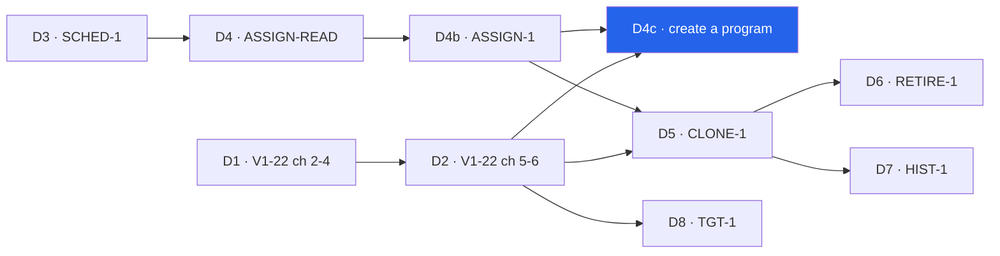

# V1-22 A4 — create a program, or start from The Daily Five

> Backlog: [plan.md](../plan.md) row **V1-22** (scope A, chunk **A4**) · Spec:
> [crud-1-fix-it-yourself.md](../specs/crud-1-fix-it-yourself.md) chunk **D4c** · Milestone:
> [PROG-1](../milestones/prog-1-programs-and-scheduling.md) · Branch: `feat/v1-22-a4-create-program`
> (one branch per PR in the Staging table below).
>
> **PLAN ONLY — not panelled.** Needs the engineering panel (correctness, scope, architecture, reuse,
> **db-safety** — it has a migration, **privacy** — it adds a free-text column) **and** the UX panel
> (interaction + first-run, a11y + 360px, trust + data entry) before any code. Written against
> `origin/main@27847ca`. Every `path:line` below was opened on that commit; anything that could not be
> opened (the plans for D4, D4b and ONB-2 do not exist yet) is marked **unverified**.

## Goal

A parent can make a program without the maintainer: a name, one to three **workouts**, each with a
label the parent types ("Workout A" until renamed) and its movements, and — when started from an
athlete — the weekdays that athlete runs it. In a household that has no live program, the same step
also offers **"Start from The Daily Five"**, ONB-2's default, copied by ONB-2's own writer. Today
`PROGRAM_SEED` → `seedProgram` is the only writer of `program_blocks`
(`packages/shared/src/programming.ts:198`, `packages/db/src/seed.ts:345`), and `apps/web` may not call it
(`packages/db/src/scope.test.ts:118-124`). This is the last PROG-1 chunk before CLONE-1, and it is
gated on three earlier ones: **D4** (Today reads the athlete's _set_ of assignments — ADR 0007
decision 4: creating a block _"is safe only once Today renders the athlete's set of active
assignments"_, `docs/decisions/0007-scheduling-model.md:284-287`), **D4b** (ASSIGN-1's weekday fields,
writer and Undo) and **D2** (the editor rows and the picker this fills).

**The one design question the spec handed this plan (Q16, FE-3): where a workout's label lives.**
`DAY_ROLES` is a closed list inlined in a CHECK (`programming.ts:28`; `schema.ts:840-843`), so a typed
label has nowhere to go. Answer below under "Label storage".

## Where this sits

- **Pillar:** Authoring & Scheduling ([roadmap.md](../roadmap.md)).
- **Milestone:** [PROG-1](../milestones/prog-1-programs-and-scheduling.md), chunk D4c of
  [the spec](../specs/crud-1-fix-it-yourself.md#chunks-in-order-and-why-the-order-cannot-move).
- **This plan:** five PRs; the first is a dark migration that can land as soon as ADR 0007 authorizes it.
- **Next:** D5 CLONE-1 (copies a program this chunk can create — its copy must carry the `workouts` rows
  and `rotation_anchor_date` A4-1 adds, or a copied program loses its labels and falls back to the legacy
  rotation) and D8 TGT-1 (typed targets on it).



## Acceptance

Verbatim from the spec, the criteria this chunk carries:

- **33.** _When the household has no live program — after ONB-2 that happens only when every program
  has been archived — that step shall offer exactly two paths, "Start from The Daily Five" and "Create a
  program". The Daily Five shall be copied by ONB-2's household-creation writer, never from
  `PROGRAM_SEED`, with no load or per-athlete target (it has none by construction), and only once its
  doses carry the maintainer's sign-off. Where the athlete is an adult, the step shall say The Daily
  Five was written for young athletes._
- **35.** _When a created program is saved, its rotation anchor shall be the save day, so its first
  workout falls on that day._ (See disagreement D-3: true only when the save day is scheduled.)
- **36** (the D4c half). _Wherever a parent is asked to choose a program — the assignment sheet, the add
  flow's last step, and the "No program yet" state on the athlete's day page and program page — "Create
  a program" shall be one tap away._
- **42** (the D4c half). _A created program [is shown] by a label the parent types, defaulting to
  "Workout A", "Workout B". The editor's add control shall read "+ Add another workout" and shall stop
  at `DAY_ROLES`' strength roles (three) without a CHECK migration. No screen shall say "Day A"._
- **45** (the D4c half). _Undo after "Create a program" from an athlete's page shall take the athlete
  off it and keep the program._
- **49.** _If a created program is saved with a workout that has no movements, then the save shall be
  refused with the workout named and focus on its "+ Add a movement" control, and each workout after the
  first shall have a Remove control._ (The spec tags it D4b; see D-1.)

Concrete "done when":

1. From the household's program list, **"+ New program"** opens an empty editor; Save writes one
   `program_blocks` row, one `workouts` row per workout, and its `prescriptions`, in **one transaction**,
   with nobody assigned.
2. From an athlete (the "No program yet" card, the assignment sheet's "None of these fit?", the add
   flow's last step), the same editor also shows ASSIGN-1's weekday fields; Save additionally opens one
   assignment via ASSIGN-1's writer **in the same transaction**, and lands on that athlete's day with an
   Undo that removes the assignment and keeps the program.
3. Save is refused, with nothing written, for: no name; zero or more than `MAX_WORKOUTS` workouts; a
   workout with no movements (named, focus on its add control); two workouts whose names match ignoring
   case and surrounding/inner whitespace runs; an athlete-scoped save with no weekday; a movement id
   outside the household's reach; a name already used by a live program in the household.
4. The created program's rotation is **its own** — anchor = the save day (request-local, the same `today`
   Today renders, `apps/web/app/p/[profileId]/page.tsx:64-65`), slots = its workouts in key order — and
   every block that has no `workouts` rows (the YDP, ONB-2's blocks) resolves **byte-identically** to
   before.
5. Today, the editor, the assignment sheet's preview and the program list show a created workout by its
   typed label; seeded programs keep `DAY_ROLE_LABELS` (`programming.ts:82-87`).
6. **The editor never loses what was typed** (the prototype bug M25, stated as a requirement): the
   program name, every workout label, every movement and every sets/reps value survive adding a
   movement, opening and closing the picker, adding or removing a workout, and a refused save.
7. In a household with no live program, the athlete step offers exactly the two paths of criterion 33;
   "Start from The Daily Five" copies ONB-2's rows (zero `prescription_targets`), opens the assignment,
   and its Undo soft-hides the copy and the assignment together (FE-8); an adult sees the caution first.

## Staging

| PR    | Branch                                   | What                                                                                                                                                                                                                                    | ~lines | Gate                                                                                                                                                          |
| ----- | ---------------------------------------- | --------------------------------------------------------------------------------------------------------------------------------------------------------------------------------------------------------------------------------------- | ------ | ------------------------------------------------------------------------------------------------------------------------------------------------------------- |
| A4-1  | `db/v1-22-a4-1-workouts`                 | **The one migration**, shipped dark: `workouts`, `program_blocks.rotation_anchor_date`, `program_blocks.client_id` + its unique index; `schema.ts`; the shared consts; `db:verify`; privacy inventory; the household-deletion statement | ~350   | ADR 0007's "does not authorize" table amended to authorize these two shapes (Risk 1), and every earlier migration in flight merged (numbering is serial)      |
| A4-2  | `feat/v1-22-a4-2-rotation-and-labels`    | The read side: one pure `blockRotation` + `workoutLabel`, threaded into D4's read and ASSIGN-1's resolver call; the legacy-equivalence proof; the `program_blocks.deleted_at` reader audit                                              | ~300   | A4-1 **observed applied** in prod (the migrate log, not the merge) + D4b merged                                                                               |
| A4-3a | `feat/v1-22-a4-3a-create-program-writer` | `programCreateSchema`, the writer, the DAL, `createProgramAction`, `undoProgramStartAction`, every boundary test and the `db:verify` writer proofs. No UI                                                                               | ~400   | A4-2 + D2 merged (reuses its prescription field schemas) + the engineering panel                                                                              |
| A4-3b | `feat/v1-22-a4-3b-create-program-editor` | The editor page and client component, the three entry points, the Undo line on the day page, the a11y route + e2e                                                                                                                       | ~400   | A4-3a + **the UX panel** + C1's picker on `main`                                                                                                              |
| A4-4  | `feat/v1-22-a4-4-start-from-daily-five`  | `programFromDefaultSchema`, `startDefaultProgramAction` (ONB-2's writer + ASSIGN-1's put-on, one transaction), its Undo, the no-live-program step and the adult caution                                                                 | ~300   | A4-3b + **ONB-2 merged** — ONB-2 cannot merge without the dose sign-off (`docs/programs/daily-five-default.md:7-10`), so its presence on `main` _is_ the gate |

One migration in the whole chunk (A4-1). A DB PR does not share review with a UI PR. A4-4 is separable
on purpose: if ONB-2 has not shipped, A4-1…A4-3b still deliver "Create a program", and the
no-live-program step shows that one path until A4-4 lands — criterion 33 stays **open** until then, and
the PR descriptions say so.

## Label storage (Q16, FE-3) — the decision

**Chosen: a block-owned `workouts` table, keyed `(block_id, slug)` where `slug` is the
`prescriptions.day_role` the workout owns, restricted today to `strength_a | strength_b | strength_c`.
The prescriptions keep `day_role` as their key and are not touched.**

```
workouts
  id            bigint identity PK
  public_id     uuid NOT NULL UNIQUE                     -- server-minted (newId), anti-IDOR; the handle M24's pin will FK to
  block_id      bigint NOT NULL → program_blocks.id      -- + idx_workouts_block (covering)
  slug          text NOT NULL  CHECK (slug IN ('strength_a','strength_b','strength_c'))  -- pinned to WORKOUT_DAY_ROLES by db:verify
  name          text NOT NULL  CHECK (char_length(btrim(name)) BETWEEN 1 AND 30)          -- the label; 30 = WORKOUT_NAME_MAX, pinned
  created_at / updated_at / deleted_at  (the shared `timestamps`)
  uq_workouts_block_slug  UNIQUE (block_id, slug) WHERE deleted_at IS NULL

program_blocks  (+2 nullable columns)
  rotation_anchor_date  date NULL      -- NULL = legacy block: rotation is the shipped const, labels are DAY_ROLE_LABELS
  client_id             uuid NULL      -- set only by the app's create paths; seeded / ONB-2 rows stay NULL
  uq_program_blocks_client_id  UNIQUE (client_id)            -- NOT partial: a hidden (undone) block keeps its client_id
```

Why this shape, against each alternative:

| Option                                                                               | Verdict    | Why                                                                                                                                                                                                                                                                                                                                                                                                                                                                                                      |
| ------------------------------------------------------------------------------------ | ---------- | -------------------------------------------------------------------------------------------------------------------------------------------------------------------------------------------------------------------------------------------------------------------------------------------------------------------------------------------------------------------------------------------------------------------------------------------------------------------------------------------------------- |
| **A. `workouts(block_id, slug, name)`, slug ∈ the three strength roles** (chosen)    | **chosen** | It is ADR 0007 decision 3's recorded shape — block-owned, `(block_id, slug)` unique, a display name beside a stable slug (`0007:198-212`) — landed as the **additive** first step only: no `prescriptions.workout_id`, no CHECK loosening, no `DROP`. When the six-PR arc is ever authorized (`0007:455-466`), its backfill joins on `prescriptions.day_role = workouts.slug`, which already holds, so nothing migrates twice. It gives a workout a row identity, which is what M24's pin needs (below). |
| B. Fixed labels, no DDL (the `DAY_ROLES` interim, `0007:436`)                        | rejected   | The smallest path, and ADR 0007 names it. Criterion 42 rules it out: a created workout is shown _"by a label the parent types"_ (M24, Q16).                                                                                                                                                                                                                                                                                                                                                              |
| C. Three nullable `workout_{a,b,c}_name` columns on `program_blocks`                 | rejected   | Encodes `MAX_WORKOUTS` in DDL, gives a workout no identity a pin can reference, and is a shape ADR 0007 never recorded — a third interim beside the const and the table.                                                                                                                                                                                                                                                                                                                                 |
| D. `jsonb` labels on `program_blocks`                                                | rejected   | AGENTS.md → Schema: _"JSONB only for opaque sync/device metadata"_; a label is a typed value.                                                                                                                                                                                                                                                                                                                                                                                                            |
| E. The label on every `prescriptions` row                                            | rejected   | Duplicated per movement, so the copies drift under a D2 edit; and a workout with no movements has nowhere to keep its name while it is a draft.                                                                                                                                                                                                                                                                                                                                                          |
| F. The full `workouts` arc (free slugs, `prescriptions.workout_id`, drop `day_role`) | rejected   | Six PRs, the only destructive step, two pinned CHECKs weakened, and the export's `DAY_ROLES` gate (`apps/web/lib/dal/export.ts:120`) to change (`0007:241-267`). Three workouts fit in the three unused-by-label strength roles; nothing in PROG-1 needs a fourth.                                                                                                                                                                                                                                       |

**What the key buys the CSV.** The label is display-only. `sessions.day_role` still stores
`strength_a/b/c`, so `session_type` stays the hyphenated role, never a parent's text, and a later rename
cannot rewrite a past row (the defect `0007:221-225` warns about). No label, program name or anchor
reaches any export column (`export.ts:113-133` reads `day_role`, slug, sets, reps and load only).

**The anchor** goes on `program_blocks` because ADR 0007 decision 2 puts it there — _"weekday set and
date range on the assignment; anchor and rotation list on the block"_ (`0007:150-158`). Rejected: on the
assignment (the ADR's own rejected first draft: siblings on different letters); derived from
`program_blocks.created_at` (a UTC instant, so the local "save day" would move with the viewer's zone);
on `workouts` (the wrong grain — one anchor per program). **The rotation's slot order is not stored**:
it is the workouts' slugs in `WORKOUT_DAY_ROLES` order, so the list cannot be edited out of step with
the rows (ADR 0005 decision 7's hazard does not arise while workouts cannot be added or removed after
save — out of scope below). A stored ordinal is additive later if a reorder is ever authorized.

**Not blocking labelled workouts pinned to weekdays (M24, the spec's Recurrence section).** The pin is
_"additive storage (rows keyed by assignment, workout and weekday)"_; with this table it is
`assignment_workout_weekdays(assignment_id, workout_id → workouts.id, weekday)`, a new table, no change
to this one. A2's resolver contract (below) returns **the workout due on a date** — `{ slug, name }` —
never "the next slot", so a pinned mode is a new branch in one pure function. Seeded programs have no
`workouts` rows; a pin on one would first write rows for it (an insert, not a migration).

**Why `client_id` on `program_blocks`, not a client-minted `public_id`.** A create needs idempotency
(AGENTS.md → Backend rule 6; `docs/features/write-path.md:175-176`). Using the client's UUID as the
block's `public_id` needs no DDL, but `public_id` is server-minted by convention
(`packages/shared/src/id.ts:4-8`: _"public/URL ids (server-side) and `client_id` (client-stamped)"_), and
letting a client choose a row's public identity is a precedent this repo does not have. Nullable,
because the seed and ONB-2 have no client; **not partial**, because ADR 0008 decision 3 says a replay
never resolves onto a hidden row as if it were live and never inserts a second one — a partial index
would free the key the moment A4-4's Undo hides a copy (the exact hazard B0 exists for). One index on a
table of a handful of rows; `require-concurrent-index-creation` is excluded repo-wide (`.squawk.toml`)
and the lock is momentary. **Flagged for the db-safety lens.**

## The data contract (this chunk's)

The spec's `programCreateSchema` (`crud-1-fix-it-yourself.md`, "The data contract") is extended here,
because as written it carries no movements and could not express a save (D-2):

```
packages/shared/src/programming.ts
  WORKOUT_DAY_ROLES  = ['strength_a','strength_b','strength_c'] as const satisfies readonly DayRole[]
                       — NOT STRENGTH_DAY_ROLES, which has FOUR members ('strength' too: programming.ts:51-71)
  MAX_WORKOUTS       = WORKOUT_DAY_ROLES.length          (3)
  WORKOUT_NAME_MAX   = 30   PROGRAM_NAME_MAX = 60        — the prototype's maxlengths (index.html:3300, :3363)
  workoutNameKey(name) — trim, collapse whitespace runs, toLocaleLowerCase('en'): the ONE duplicate rule (client + server)
  defaultWorkoutName(taken: string[]) — "Workout A" | "B" | "C": the first unused letter (the prototype's
                       index.html:4667-4669 fix for "remove, then add" naming a key that still exists)
  workoutLabel(workouts, dayRole)   → workouts.find(slug).name ?? DAY_ROLE_LABELS[dayRole]
  blockRotation(block, workouts)    → rotation_anchor_date === null ? the legacy const (YDP_ROTATION, SCHED-1 1b)
                                      : { anchorDay, slots: WORKOUT_DAY_ROLES ∩ live workout slugs, in order }

  programCreateSchema {
    clientId:  uuidSchema                                   — the idempotency key (client: newId())
    name:      string trimmed 1..PROGRAM_NAME_MAX
    workouts:  Array<{
                 name:  string trimmed 1..WORKOUT_NAME_MAX
                 items: Array<{ movement: { publicId: uuid } | { newName: string },   ← C1's contract: an id,
                                sets, targetReps }>                                    or "use what I typed"
                        (1..MAX_SESSION_MOVEMENTS)          ← strength-session.ts:30; ≥1 is criterion 49
               }> (1..MAX_WORKOUTS)
    forProfilePublicId: uuid | null
    weekdays:  ASSIGN-1's field schema (weekdaySchema[], min 1, unique) — required iff forProfilePublicId
  } .superRefine: duplicate workoutNameKey → issue at workouts[j].name (the LATER duplicate)
    — sets / targetReps are V1-22's programEditSchema field schemas, DERIVED from prescriptionSeedRowSchema
      (programming.ts:110-117), never re-typed (V1-22 spec, data contract)
    — newName goes through findOrCreateMovement's own schema and hasCommaOrLineBreak (text.ts:38), as the
      log form's typed name does, because it becomes a movements.name that the CSV writes

  programFromDefaultSchema { clientId, defaultSlug: z.enum(DEFAULT_PROGRAM_SLUGS) /* ['daily_five'], ONB-2's const */,
                             profilePublicId, weekdays }

  programStartUndoSchema   { kind: 'create' | 'default', assignmentPublicId, assignmentUpdatedAt,
                             blockPublicId? (kind = 'default' only) }      ← FE-7: the pre-image's version

apps/web/lib  (DTOs)
  CreateProgramResult  { blockPublicId, assignment: { publicId, profilePublicId } | null }
  the D4 DTO gains     workoutName: string   (from workoutLabel; never a second label map)
```

Server-side, workout _i_ gets `WORKOUT_DAY_ROLES[i]` by position. The client never sends a slug, so a
draft that removes "Workout B" and adds another cannot address a key that the server would then
misassign.

## File-by-file changes

### A4-1 — the migration, dark (~350)

| Path                                                                        | Change | What & why                                                                                                                                                                                                                                                                                                                                                                                                                                                                                                                                                                                                                                                                                                   |
| --------------------------------------------------------------------------- | ------ | ------------------------------------------------------------------------------------------------------------------------------------------------------------------------------------------------------------------------------------------------------------------------------------------------------------------------------------------------------------------------------------------------------------------------------------------------------------------------------------------------------------------------------------------------------------------------------------------------------------------------------------------------------------------------------------------------------------ |
| `packages/db/src/schema.ts`                                                 | EDIT   | `workouts` table as above, beside `programBlocks` (`schema.ts:785-804`), with the `program_blocks` docblock idiom ("config data, no client_id" — and why `program_blocks` now has one). `programBlocks` gains `rotationAnchorDate: date('rotation_anchor_date')` and `clientId: uuid('client_id')` + `uniqueIndex('uq_program_blocks_client_id')`. The slug CHECK inlines the three literals with the "pinned by db:verify" comment `prescriptions_day_role_check` uses (`schema.ts:840-843`).                                                                                                                                                                                                               |
| `packages/db/migrations/00NN_v1_22_a4_workouts.sql`                         | NEW    | `drizzle-kit generate`d, hand-hardened in the 0015 house style: `SET lock_timeout` / `statement_timeout` first; header stating why, the locks taken (`ACCESS EXCLUSIVE` on `program_blocks` for two metadata-only `ADD COLUMN`s and the index build over a handful of rows), re-run safety (`IF NOT EXISTS`), what `db:verify` does not prove. The FK is created on an **empty** table in the same transaction: if Squawk's `adding-foreign-key-constraint` fires, the `-- squawk-ignore` goes on the line **directly** above (SCHED-1's documented trap, `docs/plans/sched-1-scheduling-model.md:388-392`). Number assigned at generation time; it is serial behind SCHED-1 1c, B0, AUTH-1 1b and V1-24 1d. |
| `packages/shared/src/programming.ts`                                        | EDIT   | `WORKOUT_DAY_ROLES`, `MAX_WORKOUTS`, `WORKOUT_NAME_MAX`, `PROGRAM_NAME_MAX`. Nothing reads them yet except `db:verify`.                                                                                                                                                                                                                                                                                                                                                                                                                                                                                                                                                                                      |
| `packages/shared/src/programming.test.ts` (or `contract.test.ts` beside it) | EDIT   | Every `WORKOUT_DAY_ROLES` member is a `DayRole` that `DAY_ROLE_TO_SESSION_TYPE` maps to `'strength'`; `MAX_WORKOUTS === WORKOUT_DAY_ROLES.length`.                                                                                                                                                                                                                                                                                                                                                                                                                                                                                                                                                           |
| `packages/db/scripts/verify.ts`                                             | EDIT   | New section (the V1-10 block's shape, `verify.ts` → `V1_10_COLUMNS`): columns of `workouts` and the two new `program_blocks` columns; `assertCheckCoversConst('workouts_slug_check', WORKOUT_DAY_ROLES)` (`verify.ts:1039`); `expectRejectedBy` for `'strength'`, `'strength_d'`, `''`, a 31-character and a whitespace-only `name`; the FK (`23503`); `uq_workouts_block_slug` duplicate rejected **and** freed by a soft delete; `uq_program_blocks_client_id` duplicate rejected **including** when the holder is soft-deleted (the non-partial choice, proved); two NULL `client_id`s accepted (the seeded rows).                                                                                        |
| `docs/privacy/data-inventory.md`                                            | EDIT   | One row for `workouts` (`name`: free text a parent types, household-scoped via `block_id`); `program_blocks` row gains `rotation_anchor_date` and `client_id` (neither personal). The table count in its header moves by one. Required by AGENTS.md → Privacy ("update it in the same PR").                                                                                                                                                                                                                                                                                                                                                                                                                  |
| `docs/runbooks.md` → "Delete a household and everyone in it"                | EDIT   | **A `DELETE FROM workouts` before the `program_blocks` statement**, or household deletion fails `23503` once one workout exists. If PRIV-3's runner has landed, the same statement goes in it and its `db:verify` proof gains a household with a created program. (This plan may not edit `runbooks.md`; the A4-1 PR must.)                                                                                                                                                                                                                                                                                                                                                                                  |
| `docs/architecture.md`                                                      | EDIT   | §4 ERD: `workouts` under `program_blocks`; the PR description embeds the same view.                                                                                                                                                                                                                                                                                                                                                                                                                                                                                                                                                                                                                          |
| `docs/decisions/0007-scheduling-model.md`                                   | EDIT   | **Only if the amendment has not already landed with SCHED-1 1c's sign-off:** the "does not authorize" table's two rows become _"authorized by V1-22 A4 (D4c), additive step only"_, with a link here. Otherwise this PR cites that amendment.                                                                                                                                                                                                                                                                                                                                                                                                                                                                |

No `docs/features/` guide owns `schema.ts` or `migrations/` (the SCHED-1 panel verified this,
`sched-1-scheduling-model.md:739`); `packages/shared/src/programming.ts` is owned by
[programming.md](../features/programming.md), which this PR edits (a line under invariant 3c: workouts
now have labels for created programs; the seeded A/B reuse stands).

### A4-2 — rotation and labels on the read side (~300)

| Path                                                                                         | Change | What & why                                                                                                                                                                                                                                                                                                                                                                                                                                                                            |
| -------------------------------------------------------------------------------------------- | ------ | ------------------------------------------------------------------------------------------------------------------------------------------------------------------------------------------------------------------------------------------------------------------------------------------------------------------------------------------------------------------------------------------------------------------------------------------------------------------------------------- |
| `packages/shared/src/programming.ts` (or `schedule.ts` if SCHED-1 1b put the resolver there) | EDIT   | `workoutLabel`, `blockRotation`, `workoutNameKey`, `defaultWorkoutName`. Pure. `blockRotation` is the **only** place that chooses between the legacy const and the rows.                                                                                                                                                                                                                                                                                                              |
| D4's assignment read (`packages/db/src/queries/…`, path per D4's plan — **unverified**)      | EDIT   | LEFT JOIN `workouts` on `(block_id, slug = prescriptions.day_role)` and `isNull(workouts.deletedAt)`; select `rotation_anchor_date`. The household predicate is the read's existing one — `workouts` carries no `household_id` and is reached only through an already-authorized block, the `prescription_targets` precedent (V1-22 spec, "targets … within the already-authorized block").                                                                                           |
| ASSIGN-1's resolver call site (path per its plan — **unverified**)                           | EDIT   | Passes `blockRotation(block, workouts)` instead of the global rotation. The weekday set and `phase_offset` stay ASSIGN-1's inputs; this PR changes only where `{anchorDay, slots}` comes from.                                                                                                                                                                                                                                                                                        |
| `apps/web/app/p/[profileId]/page.tsx`, `program-reference.tsx:77`, D4's Today card           | EDIT   | The workout's display name comes from the DTO's `workoutName`, never `DAY_ROLE_LABELS[…]` directly (today `page.tsx:157` and `program-reference.tsx:77` index the map). Criterion 30's "program alone when it has one workout" is D4/ASSIGN-1's rule and is not re-implemented here.                                                                                                                                                                                                  |
| `apps/web/lib/programming/*.test.ts`                                                         | EDIT   | **The legacy-equivalence proof:** for a block with `rotation_anchor_date = NULL` and no `workouts` rows, `blockRotation` returns the legacy const **by identity**, and the resolved workout for every date in SCHED-1 1b's ±30,000-day span equals the pre-PR resolver's — so the YDP and every ONB-2 household are provably unchanged. Plus a created three-workout block anchored on a fixed day: day 0 → `strength_a`, day 1 → `strength_b`, day 3 → `strength_a` (seven-day set). |
| `packages/db/scripts/verify.ts`                                                              | EDIT   | A household-B `workouts` row named `"LEAK"` on a block of B never appears in A's read; a soft-deleted `workouts` row falls back to `DAY_ROLE_LABELS`; a soft-deleted **block** with an open assignment renders nothing. A `db:mutations` patch that drops the `isNull(workouts.deletedAt)` conjunct must turn `db:verify` red (`packages/db/scripts/mutations/` idiom).                                                                                                               |
| `docs/features/programming.md`                                                               | EDIT   | Invariant 3/3b: a block's rotation is `blockRotation`'s answer; the legacy const is the fallback for blocks with no anchor. Invariant 4 gains its fifth level (`workouts`), as ADR 0007 cost 5 predicted (`0007:263-267`). `owns:` gains any new query file.                                                                                                                                                                                                                          |

**The `program_blocks.deleted_at` reader audit** (in the A4-2 PR description, as a table): A4-4's Undo is
the **first** writer of `program_blocks.deleted_at` in shipped code, and ADR 0008's mechanical rule
allows a hide only if every resolver of the namespace filters it. Known today: `programDayRows`
(`packages/db/src/queries/program-day.ts:83`) and `seedProgram`'s block arbiter and re-resolve
(`seed.ts:428`, `:438`) filter it. To check on the day: D4's read, ASSIGN-1's program lists, V1-22
chunk 4's editor DTO, ONB-2's writer, CLONE-1's source list if it has landed. Each gets a `db:verify`
case or a cited one.

### A4-3a — the writer and the actions (~400)

| Path                                                                                                                                                                                  | Change | What & why                                                                                                                                                                                                                                                                                                                                                                                                                                                                                                                                                                                                                                                                                                                                                                                                                                                                                                                                                                                                                                                                                                                                                                                                                                                                                                                                                            |
| ------------------------------------------------------------------------------------------------------------------------------------------------------------------------------------- | ------ | --------------------------------------------------------------------------------------------------------------------------------------------------------------------------------------------------------------------------------------------------------------------------------------------------------------------------------------------------------------------------------------------------------------------------------------------------------------------------------------------------------------------------------------------------------------------------------------------------------------------------------------------------------------------------------------------------------------------------------------------------------------------------------------------------------------------------------------------------------------------------------------------------------------------------------------------------------------------------------------------------------------------------------------------------------------------------------------------------------------------------------------------------------------------------------------------------------------------------------------------------------------------------------------------------------------------------------------------------------------------- |
| `packages/shared/src/programming.ts`                                                                                                                                                  | EDIT   | `programCreateSchema`, `programStartUndoSchema` (the contract above).                                                                                                                                                                                                                                                                                                                                                                                                                                                                                                                                                                                                                                                                                                                                                                                                                                                                                                                                                                                                                                                                                                                                                                                                                                                                                                 |
| `packages/db/src/writers/program-create.ts`                                                                                                                                           | NEW    | `createProgram(exec: Executor, scope, input, today)`. In one transaction: (1) `INSERT program_blocks … ON CONFLICT (client_id) DO NOTHING RETURNING id` with `slug = movementSlug(name)`, `rotation_anchor_date = today`; (2) on an empty `RETURNING`, re-select by `client_id` **and** `inHousehold(scope)` (`ownership.ts:113`): a live row → **replay**, return the stored result; a hidden row → typed `undone`; no row in scope (another household's key) → typed `not_found`, the same envelope an unknown profile gets, so the response is no oracle; (3) a `23505` on `uq_program_blocks_household_slug` → typed `name_taken`; (4) `workouts` rows by position; (5) each item's movement: a `publicId` resolved with `movementInHousehold(scope)` (`ownership.ts:176`) — global or this household's, else `movement_not_found`; a `newName` via `findOrCreateMovement` (`writers/movement-catalog.ts:63`) **inside the same transaction**, so a typo becomes a row only if the program saves (criterion 34's rule); (6) `prescriptions` with `idx` 0..n per slug; (7) if `forProfilePublicId`, resolve it with `isLiveProfile(…, scope)` (`ownership.ts:118`) and call **ASSIGN-1's put-on writer** with the same executor. Writes **no** `prescription_targets` — loads are set afterwards in D2's editor, as the prototype's hint says (`index.html:3317`). |
| `packages/db/src/index.ts`                                                                                                                                                            | EDIT   | Export the writer.                                                                                                                                                                                                                                                                                                                                                                                                                                                                                                                                                                                                                                                                                                                                                                                                                                                                                                                                                                                                                                                                                                                                                                                                                                                                                                                                                    |
| `apps/web/lib/dal/programs.ts`                                                                                                                                                        | NEW    | `server-only`. `createProgramForHousehold(input)` and `undoProgramStart(token)`: `getHouseholdScope()` (`lib/dal/household.ts:68`), `null` → typed refusal; `today` from `getActiveTimeZone()` + `localDayIso` — the same `today` Today renders (`page.tsx:64-65`), so "the save day" and "from today" agree with what the athlete sees (criterion 21's rule). Returns `CreateProgramResult`, never a row. `householdHasLiveProgram()` for criterion 33's branch.                                                                                                                                                                                                                                                                                                                                                                                                                                                                                                                                                                                                                                                                                                                                                                                                                                                                                                     |
| the programs action module — `apps/web/app/p/programs-actions.ts` under [WP-1](./wp-1-shard-actions.md)'s rule for a household-level action (draft; **unverified** until WP-1 merges) | NEW    | `'use server'`, a module of its own (the spec's shard recommendation, "The critical path"; WP-1 → `write-path.md` gains it in `owns:`). `createProgramAction` and `undoProgramStartAction`, each the seven points: Sentry `withServerActionInstrumentation`; session + household re-checked inside (whatever AUTH-1 1c made the rule — see "After AUTH-1 1c"); the mutation limiter; one hidden `program` JSON field parsed in a `try` (the `editRoutineAction` idiom, `actions.ts:595-631`) → zod → field errors; DAL; `revalidatePath` for the program list, `/p/<id>` and `/p/<id>/program`; the `ActionState` envelope with `fieldErrors` keyed by the zod path.                                                                                                                                                                                                                                                                                                                                                                                                                                                                                                                                                                                                                                                                                                  |
| the action registry (`apps/web/app/p/[profileId]/mutating-actions.ts:26-34`, app-wide after WP-1, or 1c's successor)                                                                  | EDIT   | Register both actions, grouped under the module's comment heading (WP-1), so the unauth / wrong-household suites in `actions.test.ts` cover them by construction.                                                                                                                                                                                                                                                                                                                                                                                                                                                                                                                                                                                                                                                                                                                                                                                                                                                                                                                                                                                                                                                                                                                                                                                                     |
| `undoProgramStart` (in the DAL + writer)                                                                                                                                              | —      | `kind = 'create'`: ASSIGN-1's **undo of a put-on** for that assignment (its plan settles the mechanics — a same-day row cannot be closed to yesterday without violating `active_to >= active_from`, criterion 21), guarded by `assignmentUpdatedAt`: a mismatch → `AMEND_ERROR_COPY.staleWrite` (FE-7). The block is untouched — criterion 45 _"keep the program"_. A replayed undo is a no-op returning the same result.                                                                                                                                                                                                                                                                                                                                                                                                                                                                                                                                                                                                                                                                                                                                                                                                                                                                                                                                             |
| tests (below)                                                                                                                                                                         | NEW    | `program-create.test.ts` (schema), the action boundary suite, `db:verify` writer proofs.                                                                                                                                                                                                                                                                                                                                                                                                                                                                                                                                                                                                                                                                                                                                                                                                                                                                                                                                                                                                                                                                                                                                                                                                                                                                              |
| `docs/features/write-path.md`                                                                                                                                                         | EDIT   | `owns:` gains the new actions module; the file map gains the writer; a line under invariant 5 on the one parent short-circuit (Risk 4).                                                                                                                                                                                                                                                                                                                                                                                                                                                                                                                                                                                                                                                                                                                                                                                                                                                                                                                                                                                                                                                                                                                                                                                                                               |

### A4-3b — the editor (~400)

| Path                                                                     | Change   | What & why                                                                                                                                                                                                                                                                                                                                                                                                                                                                                                                                                                                                                                                     |
| ------------------------------------------------------------------------ | -------- | -------------------------------------------------------------------------------------------------------------------------------------------------------------------------------------------------------------------------------------------------------------------------------------------------------------------------------------------------------------------------------------------------------------------------------------------------------------------------------------------------------------------------------------------------------------------------------------------------------------------------------------------------------------- |
| `apps/web/app/programs/new/page.tsx`                                     | NEW      | RSC. The page guard (1c's), `searchParams.for` validated with `uuidSchema` and resolved in scope — unknown or another household's → `notFound()` (ADR 0006's 404). Passes the athlete's name and `PROFILE_KIND` (for nothing here — the adult caution is A4-4's) and ASSIGN-1's last-used days, if any, to the client editor. **No model call, no load field.**                                                                                                                                                                                                                                                                                                |
| `apps/web/components/programs/new-program-editor.tsx`                    | NEW      | `'use client'`. **The M25 requirement, by construction:** one `useReducer` draft — `{ name, workouts: [{ draftId, name, items: [{ draftId, movement, sets, targetReps }] }], weekdays }` — and every input **controlled from it**; list keys are `draftId`s from `newId()`, **never indexes**; the picker sheet (U0/C1) renders beside the form, never as a parent that remounts it; the action state from `useActionState` only adds errors and is never copied back into the draft; there is no `key={gen}` remount (the log form's reset, `strength-form.tsx`) because success navigates away. Submit serializes the draft into one hidden `program` field. |
| `apps/web/components/programs/workout-fields.tsx`                        | NEW      | One workout: its name input (`<label>` "Workout 1 name" … via `htmlFor`, `maxLength={WORKOUT_NAME_MAX}`), "n of 12 movements" (`MAX_SESSION_MOVEMENTS`), the movement rows (D2's row component in its draft mode — see Risk 9), "+ Add a movement to {name}" (opens C1's picker, marks movements already in this workout, criterion 34), and, for workouts after the first, **Remove workout** (criterion 49).                                                                                                                                                                                                                                                 |
| ASSIGN-1's weekday fields component (path per its plan — **unverified**) | REUSE    | Rendered only when started from an athlete, with "Saving puts {name} on it." above it (`index.html:3305-3315`). Its RRULE review line is the prototype's flag, not app copy.                                                                                                                                                                                                                                                                                                                                                                                                                                                                                   |
| the household program list (ASSIGN-1's or the settings shell's)          | EDIT     | **"+ New program"** first in the list (`index.html:3647`).                                                                                                                                                                                                                                                                                                                                                                                                                                                                                                                                                                                                     |
| ASSIGN-1's "No program yet" card and the assignment sheet                | EDIT     | "Create a program" beside "Choose a program" (`index.html:2567-2572`) and "None of these fit? Create a new program" under the sheet's list (`index.html:4053`) — links to `/programs/new?for=<id>` (criterion 36).                                                                                                                                                                                                                                                                                                                                                                                                                                             |
| `apps/web/app/p/[profileId]/page.tsx` + a small `program-started.tsx`    | EDIT/NEW | After a create from an athlete, the action redirects to `/p/<id>?started=<assignmentPublicId>`. The page renders _"{program} saved. {name} is on it {days}, from today."_ with an **Undo** button **only if** that assignment is in scope, live, opened today and unchanged — read server-side, never trusted from the URL; its `updated_at` rides in the Undo form as the FE-7 version. A stale or foreign id renders nothing. Undo's result replaces the line (_"Undone. {name} is off it; {program} is kept in Programs."_, `index.html:4954-4960`).                                                                                                        |
| `apps/web/lib/constants.ts`                                              | EDIT     | `NEW_PROGRAM_PATH`, the copy strings (refusals, the started line), one home each.                                                                                                                                                                                                                                                                                                                                                                                                                                                                                                                                                                              |
| `apps/web/e2e/a11y.spec.ts`, a new `apps/web/e2e/create-program.spec.ts` | EDIT/NEW | The new route and the editor with the picker sheet open, added to the scan (unowned 8); the e2e: create from an athlete → day page names the program and workout → Undo → athlete has no program, program still listed. (This plan may not edit `apps/web/e2e/`; A4-3b must.)                                                                                                                                                                                                                                                                                                                                                                                  |
| `docs/features/programming.md`                                           | EDIT     | `owns:` gains `apps/web/components/programs/` and `apps/web/app/programs/`; the file map row; a trap: "the editor's state lives in one reducer; do not derive an input's value from props" (M25).                                                                                                                                                                                                                                                                                                                                                                                                                                                              |

**Behaviour, from the prototype** (`docs/prototypes/crud-1/index.html`, v9, approved; screens
`programs`, `program` in its new-program mode, `add-empty`):

- The editor opens with one workout, "Workout A", no movements, and the program name blank from the
  program list or _"{athlete}'s program"_ from an athlete (`index.html:4774`). "+ Add another workout"
  appends the first unused default name and moves focus to its name input; it is **disabled with a
  visible hint** "Up to 3 workouts for now." at `MAX_WORKOUTS` (`index.html:3405-3415`).
- Remove moves focus to "+ Add another workout" and announces "{name} removed." from a `role="status"`
  region mounted with the editor (criterion 46's rule, applied here although the editor is a page).
- **Save refusals, in this order, each beside its field and `aria-describedby`'d (A11Y-2), with focus
  moved to it and no `role="alert"` racing the focus move:** no movements anywhere → focus the first
  "+ Add a movement"; a workout with none → _"{name} has no movements. Add one, or remove that
  workout."_, focus its add control (criterion 49); duplicate names → _"Two workouts are called
  "{name}". Give each its own name."_, focus the later one; no day → _"Pick at least one day."_, focus
  the first day toggle (`index.html:4685-4717`). The client runs the **same** `programCreateSchema`;
  the server is the authority and returns the same paths.
- Program-list save lands on the list: _"{program} saved. Nobody is on it yet."_ — no Undo, which
  criterion 45 does not ask for there (`index.html:4747`).
- **Unsaved changes warn on leaving** — FE-14's mechanism from D2, reused.

**360px width math.** `main` is `px-4` inside `max-w-2xl`, so 328px of content at a 360px viewport
(V1-22 plan, "The editing surface"). Inputs are full width at 44px. The workout meta row is "12 of 12
movements" (≈ 18 chars × 7px ≈ 126px at 14px) + `gap-2` (8px) + **Remove workout** (≈ 14 × 7 ≈ 98px +
`px-3` × 2 = 122px) = **256px ≤ 328** — so the visible text is "Remove workout" and the name goes in its
`aria-label` ("Remove workout Upper", which keeps the visible words first for WCAG 2.5.3). The add
button cannot fit on one line: "+ Add a movement to " (≈ 140px) + a 30-character name (≈ 210px) + 24px
padding = **374px > 328**, so it is `w-full` with `whitespace-normal text-left h-auto min-h-11` and
wraps to two lines (≈ 64px) rather than truncating the name the parent just typed. "+ Add another
workout" ≈ 150 + 24 = 174px. The weekday toggles are ASSIGN-1's (criterion 37's arithmetic). The movement
rows are D2's (V1-22 plan: one card per prescription, fields stacked inside 302px).

### A4-4 — Start from The Daily Five (~300)

| Path                                                               | Change             | What & why                                                                                                                                                                                                                                                                                                                                                                                                                                                                                                                                         |
| ------------------------------------------------------------------ | ------------------ | -------------------------------------------------------------------------------------------------------------------------------------------------------------------------------------------------------------------------------------------------------------------------------------------------------------------------------------------------------------------------------------------------------------------------------------------------------------------------------------------------------------------------------------------------- |
| `packages/shared/src/programming.ts`                               | EDIT               | `programFromDefaultSchema`; `defaultSlug` is ONB-2's const (`DEFAULT_PROGRAM_SLUGS`, **unverified** — named by ONB-2's plan), never a second list.                                                                                                                                                                                                                                                                                                                                                                                                 |
| `packages/db/src/writers/…` (ONB-2's writer)                       | REUSE / small EDIT | ONB-2's household-creation writer, called with D4c's executor, scope and `client_id`. **Requirement on ONB-2's plan:** the writer is a `packages/db` function `(exec, scope, args)` — not inline in household creation — so it composes in this transaction; if ONB-2 ships it inline, A4-4 extracts it first (a refactor inside the write-path guide). It must never read `PROGRAM_SEED` (`beta-1.md:352-354`).                                                                                                                                   |
| `apps/web/lib/dal/programs.ts`                                     | EDIT               | `startDefaultProgram(input)`: one transaction — ONB-2's writer, then ASSIGN-1's put-on. A `name_taken` (a live `daily_five` already in the household) is a typed refusal, never a 500.                                                                                                                                                                                                                                                                                                                                                             |
| the programs action module                                         | EDIT               | `startDefaultProgramAction`, the same seven points; registered in the enumeration.                                                                                                                                                                                                                                                                                                                                                                                                                                                                 |
| `undoProgramStart`, `kind = 'default'`                             | EDIT               | **FE-8:** in one transaction, ASSIGN-1's put-on undo **and** `UPDATE program_blocks SET deleted_at = now()` on the copy, both version-guarded. Nothing hard-deletes. The non-partial `client_id` index keeps a replay of the original start from inserting a second copy.                                                                                                                                                                                                                                                                          |
| ASSIGN-1's add-flow last step (path per its plan — **unverified**) | EDIT               | The **no-live-program** branch (`householdHasLiveProgram() === false`): heading "No program yet", exactly two paths — a disclosure **"Start from The Daily Five"** (ASSIGN-1's day fields inside it, "Use The Daily Five" submit) and **"Create a program"** → `/programs/new?for=<id>` — plus "Not now" (`index.html:4151-4199`). For `kind = 'adult'` the disclosure opens on the caution _"The Daily Five was written for young athletes. There is no adult default yet."_, and focus goes to it first (A11Y-4, `index.html:4176-4182, :4769`). |
| `apps/web/lib/constants.ts`                                        | EDIT               | `DAILY_FIVE_ADULT_CAUTION` and the step's copy.                                                                                                                                                                                                                                                                                                                                                                                                                                                                                                    |
| `docs/features/programming.md`, `docs/features/write-path.md`      | EDIT               | The default path, its gate, and the first `program_blocks.deleted_at` writer.                                                                                                                                                                                                                                                                                                                                                                                                                                                                      |

**What "a household with no live program" means**, written once in `householdHasLiveProgram`: no
`program_blocks` row in scope with `deleted_at IS NULL` (and, once RETIRE-1 adds its marker, not
archived — RETIRE-1's PR edits this one function). Before RETIRE-1 the state is reachable only for a
household created before ONB-2's writer existed, or one whose only program was undone by A4-4.

## Test plan

**Unit (`packages/shared`, Vitest):** `programCreateSchema` rejects 0 and `MAX_WORKOUTS + 1` workouts; a
workout with no items, with the issue path `workouts[i].items` (criterion 49's "named"); duplicate names
— `"Upper"` / `" upper "` / `"UP  PER"` vs `"Up per"` — with the issue on the **later** one; a blank and a
31-character name; `weekdays` missing **iff** `forProfilePublicId` is set; a duplicate weekday;
`MAX_SESSION_MOVEMENTS + 1` items; `sets: 0` (the V1-22 rule, reused). `defaultWorkoutName` after
"add B, remove B, add" returns `B`, and after "remove A" with B present returns `A`. `workoutLabel`
falls back to `DAY_ROLE_LABELS`. `blockRotation` legacy identity and the created-block cases (A4-2).

**`db:verify` (PGlite, local and CI):** the A4-1 DDL section; the A4-2 scope and fallback cases; and for
A4-3a, the **writer driven through the real statement**: a three-workout create writes 1 block, 3
`workouts`, n `prescriptions`, **0** `prescription_targets`, anchor = the passed day; the same
`client_id` again → one block and the identical result; a `client_id` held by household B, submitted by
A → `not_found`, nothing written, and B's row untouched; an unknown movement in workout 3 → **nothing**
written (atomicity: no block, no workouts, no assignment, and no `movements` row from a `newName` in
workout 1); a `newName` that saves → one household-owned movement; a duplicate program name → `name_taken`
(and a hidden program's name is free). A `db:mutations` patch removing `inHousehold(scope)` from the
replay re-select must turn it red — the replay lookup is the one place a foreign key could be answered
with another household's row (the bodyweight lesson, `write-path.md:191-196`).

**Action boundary tests (Vitest, the `actions.test.ts` harness — Server Actions as plain async
functions):** unauth → refused, nothing written; `forProfilePublicId` in another household or unknown →
the unknown-profile envelope (404 semantics), nothing written; a foreign `movement.publicId` →
field error; malformed JSON and a zod failure → typed envelopes with `fieldErrors`; **replay** → one
effect and an identical response; undo: unauth, foreign assignment, stale `assignmentUpdatedAt` →
`staleWrite`, replay → one effect; **criterion 45:** after undo the block is live and listed, the
assignment is not; **FE-8:** after the default's undo both are hidden, and a replay of the original
start does not create a second copy.

**Component (Vitest + Testing Library), M25:** type a program name; rename Workout A to "Upper"; add a
movement through a stubbed picker; type sets 3 and reps "8-12"; add a workout; remove it; open and close
the picker; submit and receive a refusal — **assert every value above is still in its input** and that
"+ Add a movement to Upper" uses the typed name. Plus: focus lands on the empty workout's add control on
refusal; Remove is absent on the first workout.

**e2e + a11y:** the A4-3b spec and scan above, run with `pnpm e2e:local` before the PR (AGENTS.md:
a flow the smoke covers). Screenshots at three widths via `ui-screenshot` for every new state: empty
editor, three workouts, each refusal, the started line with Undo, the no-program step for a child and
for an adult.

**Local run per PR:** `pnpm verify` (format, lint, typecheck, test, `db:verify`, `db:mutations`, …),
`pnpm guides:check`, and for A4-1 `pnpm db:generate` must leave the tree clean plus
`npx squawk-cli@2.66.0 -c .squawk.toml` on the new file, output pasted in the PR.

## Risks / rollback

| #   | Risk                                                                                                                                                                                                                                                                                                                                         | Mitigation                                                                                                                                                                                                                                                                                                          |
| --- | -------------------------------------------------------------------------------------------------------------------------------------------------------------------------------------------------------------------------------------------------------------------------------------------------------------------------------------------- | ------------------------------------------------------------------------------------------------------------------------------------------------------------------------------------------------------------------------------------------------------------------------------------------------------------------- |
| 1   | **The tables are unauthorized today.** ADR 0007 → "What this ADR does not authorize": _rotation anchor + slots — Nothing yet_; _`workouts` — Nothing yet_ (`0007:435-436`). A forward-only migration that lands against that is the ADR's whole point.                                                                                       | A4-1 is gated on the amendment. The ADR's own reason for withholding them — _"its only consumer is a household editing a rotation, which needs block creation"_ — is exactly this chunk, and the shape landed is the **additive first step** only; the destructive arc stays unauthorized. The maintainer signs it. |
| 2   | **Two sources of a rotation** — the legacy const for seeded blocks, rows for created ones.                                                                                                                                                                                                                                                   | One function chooses (`blockRotation`), with an identity test for the legacy branch and the ±30,000-day equivalence. Retiring the const means writing the YDP's anchor and workouts rows by a correction; filed as tech debt in A4-2's PR, not done here.                                                           |
| 3   | **The first writer of `program_blocks.deleted_at`** (A4-4). A reader that forgets the filter renders a program the parent undid.                                                                                                                                                                                                             | The reader audit in A4-2, each with a proof; ADR 0008's mechanical rule is the bar.                                                                                                                                                                                                                                 |
| 4   | **Idempotency short-circuits at the parent**, against `write-path.md` invariant 5 (_"no parent short-circuit"_).                                                                                                                                                                                                                             | The block and its children are written by **one submit in one transaction**, so the block's existence implies every child's; the invariant guards independently replayable graph items (sync). Stated in the guide and flagged for the correctness lens — if rejected, mint child ids client-side.                  |
| 5   | **`strength-c` reaches the CSV for the first time.** A three-workout program writes `sessions.day_role = 'strength_c'`; the contract says `strength_c` is _"plausible … never been written … must be emitted hyphenated"_ (`docs/csv-export-contract.md:133-137`).                                                                           | Insight's sign-off in A4-3a's PR, and an export test asserting `strength-c`. No existing byte changes.                                                                                                                                                                                                              |
| 6   | **Two programs on one athlete both use `strength_a`.** Created programs all start at `strength_a`, so an athlete put on a second one has two blocks prescribing the same role; the legacy export match `(day_role, movement)` empties on a duplicate (`export.ts:113-133`), and the log form's "Which day is this?" select cannot say which. | The export's resolution is D4's byte-affecting decision (ADR 0007 decision 4), made before D4 ships; new entries carry `prescribed_snapshot` (V1-22 chunk 2). The select is Open question 3. This plan adds no new collision class that D4 has not already had to settle for CLONE-1's copies.                      |
| 7   | **A household deletion breaks** once a `workouts` row exists (`23503` on `program_blocks`).                                                                                                                                                                                                                                                  | The runbook statement and PRIV-3's runner, in A4-1 (above).                                                                                                                                                                                                                                                         |
| 8   | **The anchor's day is the request's zone** (the `tz` cookie), not the athlete's device. A parent in another zone saving at 23:30 anchors on their date.                                                                                                                                                                                      | The same rule Today and criterion 21 already use; the athlete sees the same `today` on the same device. Recorded, not fixed.                                                                                                                                                                                        |
| 9   | **D2's movement row may be bound to per-row Server Actions**, so it cannot render inside an unsaved draft.                                                                                                                                                                                                                                   | A4-3b first splits the row into a presentational half (fields, labels, `inputmode`) and D2's bound half, inside the programming guide — never a second copy of the row.                                                                                                                                             |
| 10  | **"The LLM never authors loads."**                                                                                                                                                                                                                                                                                                           | Create writes no `prescription_targets` at all; The Daily Five has none by construction; no model is called anywhere in this chunk. Its doses are a model-drafted **definition** that reaches a household only through ONB-2, which cannot merge without the human sign-off.                                        |
| 11  | **Slug collisions after RETIRE-1.** An archived program keeps its slug (archive is not delete), so creating a program with the same name — or starting The Daily Five again — hits `uq_program_blocks_household_slug`.                                                                                                                       | Mapped to `name_taken` now, never a 500; RETIRE-1's plan owns the copy ("you have an archived program called …, restore it?").                                                                                                                                                                                      |

**Rollback.** A4-1 is forward-only and dark: if anything is wrong before A4-3a, the columns and table sit
unused and a fix-forward migration corrects them. A4-2 is a plain revert **until A4-3a ships**; after
that, reverting A4-2 alone would resolve created programs by the legacy rotation (wrong workouts), so
A4-2 and A4-3a are reverted together or fixed forward. A4-3b and A4-4 are UI and action reverts; programs
already created stay valid rows. Cut a Neon restore branch before A4-1's migration runs.

## After AUTH-1 1c — what to re-verify

AUTH-1 1a, 1b-bis and 1c-pre have shipped; 1b, 1c and 1d have not, and 1c is the one-way door
(`docs/plans/auth-1-clerk-google.md:549`). D4c sits behind Beta 1's gate (D3), so 1c will almost
certainly be on `main` first. Each PR re-checks, against 1c as merged:

1. **`getHouseholdScope()`** is session-derived (1c rewrites its body, `lib/dal/household.ts:68`); the new
   DAL only calls it — re-run every boundary test against 1c's fixture.
2. **The page guard**: `requireGatedPage()` (`lib/dal/gate.ts:26`) is replaced by 1c's `requireSession()`;
   `/programs/new` uses whichever 1c leaves, and `pages-are-gated.test.ts` in its post-1c form must see it.
3. **The action enumeration** (`mutating-actions.ts`) or its 1c successor lists the three new actions, so
   the unauth and wrong-household suites cover them without a hand edit.
4. **The mutation limiter** 1c adds (keyed on the Clerk user id) wraps all three actions.
5. **The role check** ADR 0005 deferred to AUTH-1 (_"AUTH-1 adds a role check rather than moving the
   route"_, V1-22 spec → Decisions): creating a program uses the same check as V1-22 chunk 4's editor.
6. **Sentry context** carries `userId` and `householdId` as 1c defines them; no program name or label is
   logged (they are free text).

## Out-of-scope / deferred

- **Renaming a program or a workout, or adding/removing a workout, after save.** Adding or removing one
  changes which workout every future date gets (ADR 0005 decision 7); renaming is easy but is its own
  editor control. A follow-up row; D2's editor edits a created program's **movements** like any other.
- **Per-athlete loads and targets at creation.** Set afterwards in D2's editor; typed targets are D8.
- **Labelled workouts pinned to weekdays** (M24) — the table above is ready for it; nothing builds it.
- **Reordering workouts**, and a stored rotation ordinal.
- **The `workouts` arc** (`prescriptions.workout_id`, free slugs, the `DROP COLUMN`) — still unauthorized.
- **An adult default program** (unowned 7).
- **The household program list itself** and its route — ASSIGN-1 (criterion 38) or the settings shell.
- **Archive** (RETIRE-1) and **copy** (CLONE-1).
- **ONB-2's writer, its catalog additions and the dose sign-off** — ONB-2's.

## Where this disagrees with the spec or the code

- **D-1.** Criterion 49 is tagged _(D4b)_ in the spec, but it is about a **created** program's save and
  Remove control, which only this chunk builds. This plan carries it.
- **D-2.** The spec's `programCreateSchema` has no movements, no idempotency key and calls the limit
  _"`STRENGTH_DAY_ROLES.length` — three today"_. `STRENGTH_DAY_ROLES` has **four** members, because
  `'strength'` maps to `'strength'` too (`programming.ts:51-71`). This plan adds `WORKOUT_DAY_ROLES`
  (three) and extends the schema; the spec's contract should be updated when this lands. It also names the
  field `label`; this plan uses `name`, the word every sibling authored row uses (`program_blocks.name`,
  `movements.name`, ADR 0005's "display name").
- **D-3.** Criterion 35 says the first workout _"falls on that day"_. Under Q13b (count **scheduled**
  days, ASSIGN-1), it falls on the **first scheduled day on or after** the save day; the two agree only
  when the save day is one of the athlete's days. Suggested wording for the spec: "…so its first workout
  is the first one due on or after that day."
- **D-4.** Criterion 30 wants The Daily Five shown as the program alone, _"so The Daily Five's A/B
  stopgap never shows as 'Strength A/B'"_; disagreement 11 says ONB-2's rows are two workouts labelled
  Strength A and Strength B. Both cannot hold for ONB-2's blocks without a rule that two identical
  workouts count as one. Open question 1.
- **D-5.** The V1-22 spec still lists A4 under Out of scope ("Creating a workout"), and ADR 0007's table
  still withholds both shapes; M6 brought A4 back. Both documents need the sentence that says so —
  the ADR before A4-1 (Risk 1), the V1-22 spec with A4-1's PR.
- **D-6.** The V1-22 plan's acceptance has _"A coach can create a block"_ while its own panel
  hard-disabled creation (`v1-22-program-editor.md:276`). This chunk is the one that lifts it, behind D4
  as that panel required.

## Open questions

1. **The Daily Five's shape when D4c copies it (D-4).** Recommended: the copy keeps ONB-2's writer
   unchanged (A/B, no `workouts` rows, legacy rotation), so "reuses ONB-2's writer" stays literal and no
   CSV byte moves; D4/ASSIGN-1 then need criterion 30's "one workout" rule to recognise it. The other
   answer — the writer gains a one-workout mode (one `strength_a` workout named "The Daily Five") — ends
   the stopgap for copies but makes those households' `session_type` constant `strength-a` instead of
   alternating, which is Insight's call. The maintainer decides before A4-4.
2. **`client_id` vs a client-minted `public_id`** for the create's idempotency — recommended `client_id`
   (above); the db-safety lens may prefer zero DDL.
3. **The log form's "Which day is this?" select** (`strength-form.tsx:597-614`) still lists
   `DAY_ROLE_LABELS`, so a workout the parent named "Upper" is chosen as "Strength A" when logging.
   Recommended: when exactly one program is due that day, pass its labels into the select as a prop
   (≈ 10 lines, A4-2, under `strength-logging.md`); with two due, keep the role labels. The UX panel
   decides whether that is in scope.
4. **The route.** This plan uses `/programs/new` (a household route, legitimate once AUTH-1 1c puts the
   household in the session — ADR 0006; the V1-22 plan said to _"promote to `/programs` when Clerk makes
   a household addressable"_). Q5 put the program list under Household settings; whichever PR first ships
   that list owns `PROGRAMS_PATH`, and this chunk nests under it.

## Feature guides and privacy

- **`docs/features/programming.md`** — A4-1 (shared consts), A4-2 (rotation, labels, invariant 4), A4-3b
  (new owned dirs, the M25 trap), A4-4.
- **`docs/features/write-path.md`** — A4-3a (the writer, the actions module, invariant 5's note), A4-4.
- **`docs/features/strength-logging.md`** — only if Open question 3 is taken.
- **`docs/privacy/data-inventory.md`** — **changes in A4-1**: a new table holding parent-typed text (and a
  program name that defaults to _"{athlete}'s program"_ — a child's name in `program_blocks.name`, which
  the inventory already lists as free text), two non-personal columns, and the retention of rows hidden
  by A4-4's Undo (kept until household deletion; the household-deletion runbook gains its statement).
  Nothing new leaves the household: no export column, no processor, no log field.

## Review-response log (adversarial panel)

_Pending: engineering panel + UX panel (round 1)._
