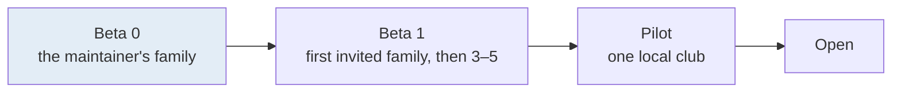

# Roadmap — the whole program, by pillar

**What this is:** the one forward-looking, cross-program view — what is in flight, what is next, and
what each thing waits on. It is a **pointer document**: every item is an id you look up in
[plan.md](./plan.md). Nothing here restates a row's scope or acceptance, because the second copy is
the one that goes stale.

**What this is not.** [plan.md](./plan.md) is the backlog (~80 rows, the full scope and acceptance of
each). [status.md](./status.md) is "where we are" plus the merged changelog — it looks **backwards**.
[milestones/](./milestones/) sequences one milestone's phases. This file is the only one that answers
"what is the state of the whole thing right now", which is the question a new session asks first.

**Updated in the same PR as the work** — the same rule as the changelog fragment and `status.md`
(AGENTS.md → "Status rides with the work"). Moving an item between columns is one line; if a PR
doesn't move one, say so in the description.

## The pillars

A pillar is **a set of owned file globs**, not a theme. That is deliberate: the question a session
actually needs answered is _"can this run in parallel with what is already in flight"_, and that is a
**file** question. Two items in different pillars whose globs overlap are **not** parallel-safe —
this milestone's chunk 2 and `v1-30b` both touch `strength-form.tsx`, and any theme-based grouping
would have called them independent.

Where a glob is already owned by a [feature guide](./features/), the guide's `owns:` frontmatter is
the authority and `pnpm guides:check` enforces it. The pillar does not re-declare it; it points.

| Pillar                      | Owns                                                                                                                                               | Ids                                                                                                                                                           |
| --------------------------- | -------------------------------------------------------------------------------------------------------------------------------------------------- | ------------------------------------------------------------------------------------------------------------------------------------------------------------- |
| **Onboarding & Access**     | `app/(landing)/`, the gate, sign-in, empty states                                                                                                  | `ONB-*` `AUTH-1` `OSS-*` `SEC-1` `SEC-6` `PRIV-1`                                                                                                             |
| **Profiles & Tenancy**      | `lib/dal/profiles.ts`, household scoping, `app/p/` shell                                                                                           | `PROF-1` `TEN-*` `DAL-*` `ID-1` _(later)_                                                                                                                     |
| **Logging & Measurement**   | [strength-logging](./features/strength-logging.md) + [write-path](./features/write-path.md) guides                                                 | `V1-19` `V1-24` `V1-26..30` `GAP-*` `SET-1` `UI-1` `DUALS-*` **`PICK-1`** `PICK-2` `AI-1` _(parked)_ `VOICE-1` `TIMER-1` `FUEL-1` `ITEM-1` `LIFE-1` _(later)_ |
| **Authoring & Scheduling**  | [programming](./features/programming.md) guide, `prescriptions`, `routine_config`                                                                  | `V1-18` `V1-20` `V1-22` `SCHED-*` `CLONE-1` `RETIRE-1` `CAT-*` `PROGS-*` `SUPERSET-*` `SHARE-1` `LADDER-1` _(later)_                                          |
| **Insight** (read & export) | `V1-16` charts, aggregation kernel, `lib/dal/export.ts`, the export format                                                                         | `V1-16` `CSV-1` `MOT-*` `DASH-1` `HIST-1` `COACH-1` `PUB-1` `SOCIAL-1` `MCP-1` `SENTINEL-1` `ASK-1` _(later)_                                                 |
| **Platform**                | `.github/workflows/`, `.claude/`, hooks, deps, the migrations runner                                                                               | `OPS-*` `DX-*` `PERF-*` `SEC-2..5c` `TEST-*` `EVAL-0` `SYNTH-1` _(later)_ _(incl. `DX-1`)_                                                                    |
| **Product & Spec**          | `docs/decisions/`, `docs/specs/`, `docs/milestones/`, `AGENTS.md`, the design system (`docs/design.md` + the tokens in `apps/web/app/globals.css`) | `UI-2..5` _(the design system; the rest are ADRs and specs, not backlog rows)_                                                                                |

Two deliberate departures from the obvious cut, both argued rather than assumed:

- **There is no "Tech Leads" pillar.** Coordination is a role, and a pillar that owns no files cannot
  be assigned, cannot be checked, and becomes the place work goes to be forgotten. The function is
  real and it already has artifacts — ADRs, specs, milestone docs, `AGENTS.md`, and the review panels
  in [`.claude/agents/`](../.claude/agents/) — so it is **Product & Spec**, which owns files.
- **Measurement sits with Logging, not with Dashboarding.** Capture (`GAP-3`'s typed quantities,
  `set-fields.tsx`) and read (`V1-16`'s charts) share no files and almost never move together.
  Grouping them would put the one glob the whole app writes through next to the one nothing writes to.

## In flight

_Refreshed 2026-11-26, after `CAT-3`'s fresh start ran, from `main`, the open PRs and the backlog
rows. A row that shipped or was overtaken left this table; it is listed once below, then drops off._

| Item                                           | Pillar                                        | State                                                                                                                                                                                                                                                                                                                                                                                                                             |
| ---------------------------------------------- | --------------------------------------------- | --------------------------------------------------------------------------------------------------------------------------------------------------------------------------------------------------------------------------------------------------------------------------------------------------------------------------------------------------------------------------------------------------------------------------------- |
| **FAM-1** — the family program                 | Authoring & Scheduling, Logging & Measurement | All 72 PRs of its chart are merged (2026-11-20). **Left:** the week of real use on the fresh household (step 16, from 2026-11-26), the maintainer's screen-reader pass over the day page, and its exit criteria. [Milestone](./milestones/fam-1-family-program.md).                                                                                                                                                               |
| **CAT-3** — the movement library               | Logging & Measurement                         | Library complete (587 movements). **The fresh start ran on 2026-11-26** as an erase: steps 0–8 of the runbook, every check zero, merges unfrozen the same day. **Next:** the four PRs after it ([plan](./plans/cat-3-after-the-fresh-start.md), #775) — lane P first, lane A's upsert after the trial week. Beside it: catalog batch 15, the household's own stretches, merged (#824). [Spec](./specs/cat-3-movement-library.md). |
| **PRIV-3** — guarded deletion                  | Platform                                      | The erasure core (#654) and the fresh start's erasure (#708, #710) are merged, and the erasure **ran in production on 2026-11-26** — the "household deletion run once end to end" in `PRIV-1`'s exit box. The notice after it merged (#816). **Next:** the deletion commands 2b, 3 and 3b ([plan](./plans/priv-3-guarded-deletion.md)).                                                                                           |
| **OSS-1** follow-up — scan every ref           | Platform                                      | [Plan](./plans/oss-1-scan-every-ref.md) approved 2026-11-21. One PR, plus three maintainer steps (written acceptance, the old screenshots, the GitHub Support ref purge). Waits on nothing.                                                                                                                                                                                                                                       |
| **PERF-3** — a ✓ that answers faster           | Logging & Measurement                         | Raised by the maintainer after the first week of use (2026-11-26). Step 1 is #821 (a ✓ no longer re-fetches every link on the page). Step 2's plan is #822, panelled; the maintainer chose to measure first, then run the page's independent reads together, then step 3. The row-only answer is deferred to v1.5.                                                                                                                |
| **LEGACY-1** — retire the legacy strength path | Platform                                      | ✅ **Closed by C2b**: A (#807), B (#814), C1 (#815), C2a (#828) and C2b deleted the legacy strength path; [plan](./plans/legacy-1-retire-strength-path.md). Leaves this table at its next refresh.                                                                                                                                                                                                                                |
| **DX-18** follow-up — mutation-proof savings   | Platform                                      | 1a, 1b and 2 shipped. The savings [plan](./plans/dx-18-mutation-savings.md) is the open part; not built.                                                                                                                                                                                                                                                                                                                          |
| **ADR 0008** — what "delete" means             | Product & Spec                                | Proposed 2026-10-18; needs a signature, not a session.                                                                                                                                                                                                                                                                                                                                                                            |

**Left this table on 2026-11-26** (shipped or overtaken): `U0`, `UI-5`, ADR 0006, `AUTH-1`, `SCALE-1`…`4`,
`OPS-2` PR 1, `DX-13`, `PERF-1` (b), `V1-22` chunks 1–2 (the rest overtaken by `FAM-1`), `CRUD-1` +
`PROG-1` (re-scoped into `FAM-1`), `PICK-1` PRs 1–3 (the picker's read now ships through `CAT-3`),
and `AI-1` (parked). Their reasoning is in their rows and in git history.

## Active milestone — Beta 0's exit

The criteria and their reasons live in [beta-1.md → Beta 0 exit criteria](./milestones/beta-1.md).
This is the progress view only.

| Step                                                        | State                                                                                                                                             |
| ----------------------------------------------------------- | ------------------------------------------------------------------------------------------------------------------------------------------------- |
| `CAT-3`'s fresh start                                       | ✅ 2026-11-26 (also the end-to-end household deletion, and no test athletes in the live app)                                                      |
| The week of real use (`FAM-1` step 16)                      | ☐ from 2026-11-26, ending in a findings note                                                                                                      |
| The phone run-through, unaided (iOS Safari, Android Chrome) | ☐ after the week                                                                                                                                  |
| `PRIV-1` sign-off                                           | ✅ 2026-11-26, the maintainer (#827): a dated line in [notice.md](./privacy/notice.md) → "About this notice". Ahead of the run-through, by choice |
| The scan of every ref, and the maintainer's three steps     | ☐ `OSS-1` follow-up                                                                                                                               |
| `DX-5(a)` required checks                                   | ☐ repo-admin; still none required on 2026-11-26                                                                                                   |
| `OPS-3`, one household restored from backup, rehearsed      | ☐ **no plan yet.** Off the trial week's path (2026-11-18), still before the first outside invite, which is Beta 0's exit                          |
| PRs beside it, all planned                                  | four `CAT-3` PRs · `PRIV-3` 2b, 3, 3b · the ref scan                                                                                              |

## Next per pillar

Each is the item that would start if that pillar got the next session.

| Pillar                 | Next                                                                                                                                          |
| ---------------------- | --------------------------------------------------------------------------------------------------------------------------------------------- |
| Onboarding & Access    | The sign-in provider's bot protection, checked before an invited parent signs up (gates the first invite). Then `OSS-2` §B.                   |
| Profiles & Tenancy     | ~~`TEN-2b-1`~~ closed as overtaken (`LEGACY-1` C1); **`TEN-2b-2`** waits for a boundary plan before it is buildable.                          |
| Logging & Measurement  | `PERF-3` (#821, then #822's order), then the four `CAT-3` PRs after the fresh start.                                                          |
| Authoring & Scheduling | `FAM-1` step 16 — the week of use and its findings note. Beta 1's plan waits on it (maintainer, 2026-11-20).                                  |
| Insight                | `V1-16` (Beta 1).                                                                                                                             |
| Platform               | The `OSS-1` ref scan · `PRIV-3` 2b → 3 → 3b · a plan for `OPS-3` · `LEGACY-1` ✅ (closed) · `DX-5(a)` (repo-admin) · `SEC-5b` · `PERF-1` (a). |
| Product & Spec         | Beta 1's plan, after Beta 0's sign-off.                                                                                                       |

⚠️ **This table is the membership test, and it has already failed once.** `AI-1`, `PRIV-1` and `DX-1`
sat in `plan.md` for weeks while belonging to **no** pillar — so this file claimed to be the
cross-program view and silently was not. A backlog row in no pillar is invisible here, which is the
one failure it cannot afford. Adding a row to `plan.md` means putting its id in a pillar above, or
saying in the row why it has none.

## The long arc — releases, and the milestones inside them

The sections above are the next step per pillar. This one is the **order across pillars**, end to
end. ⚠️ **Ids only, as everywhere in this file** — the reasoning for each gate lives in the row or
document it belongs to, linked.

**Three words, used one way** _(maintainer, 2026-11-13)_:

- **Release** — a gate defined by **who may use the app**, with exit criteria: Beta 0, Beta 1,
  Pilot, Open.
- **Milestone** — a bundle of work with an id that lands inside one release: `CRUD-1`, `PROG-1`,
  `CAT-3`, `ID-1`.
- **Row** — one backlog item in [plan.md](./plan.md).

"Block" is deliberately not one of them: it is already `program_blocks`, the program table.

| Release    | Who may use it                   | What lands in it                                                                                                                                                                                                                                                                                                                                                     | Exit                                                                                   |
| ---------- | -------------------------------- | -------------------------------------------------------------------------------------------------------------------------------------------------------------------------------------------------------------------------------------------------------------------------------------------------------------------------------------------------------------------- | -------------------------------------------------------------------------------------- |
| **Beta 0** | the maintainer's family only     | **Ops and privacy, not features**, after `FAM-1` and `CAT-3`'s fresh start (both done 2026-11-26): the week of use, the ref scan, `PRIV-3` 2b–3b, `OPS-3`, `DX-5(a)`, a phone run-through, then the `PRIV-1` sign-off (✅ 2026-11-26) — see [beta-1 → Beta 0 exit criteria](./milestones/beta-1.md)                                                                  | [beta-1 → Beta 0 exit criteria](./milestones/beta-1.md)                                |
| **Beta 1** | first invited family, then 3–5   | The rest of [CRUD-1](./milestones/crud-1-fix-it-yourself.md) (`PICK-1`, `MOV-1`, `V1-24`); [PROG-1](./milestones/prog-1-programs-and-scheduling.md) (`V1-22`, `SCHED-1`, `ASSIGN-1`, `TGT-1`, `CLONE-1`, `RETIRE-1`, `HIST-1`); `MOT-1`; `INVITE-1`; `PROGS-*`; `V1-16`; `CAT-4` and `CAT-5` (the catalog admin and variations: wanted before the pilot, not scoped) | [beta-1 → Beta 1 exit criteria](./milestones/beta-1.md)                                |
| **Pilot**  | one local club (~50–70 athletes) | `ID-1` → the club layer (`COACH-1`; clubs, challenges and a club feed have **no rows yet**) → `SHARE-1` (share a program by link)                                                                                                                                                                                                                                    | **No milestone document yet** — to be written, so the releases before it have a target |
| **Open**   | anyone                           | `SOCIAL-1`, `PUB-1`, and what the pilot teaches                                                                                                                                                                                                                                                                                                                      | —                                                                                      |

⚠️ **Re-scoped 2026-11-14 (maintainer): no family is invited until Beta 1.** A family will not use the app
until it can program its own workouts, so Beta 0 is **the maintainer's family only**, on the
multi-family-safe foundation; its exit criteria are unchanged and now mean _ready to invite_. The
first invited family arrives with Beta 1; the two-week check-in moves with it, before widening to
3–5. `ONB-2` (The Daily Five) moves to Beta 1 with the invite it served. Details:
[beta-1 → Beta 0](./milestones/beta-1.md#beta-0--one-invited-family).

⚠️ **Added 2026-11-14 (maintainer): Beta 0 ends with [`FAM-1` — the family program](./milestones/fam-1-family-program.md)**,
the thinnest slice of the PROG-1 re-scope that holds the household's real program: unlimited named
workouts on a week template, typed items, per-item instructions, a one-screen builder and logging
the new item kinds on Today. It takes `SCHED-1` 1a and 1c, A4-1's expand and a thin cut of
`ASSIGN-READ` / `ASSIGN-1`, and it owns removing `PROGRAM_SEED` from production (`OPS-2` Q3). The
rest of `PROG-1` stays in Beta 1; the draft lists what moves and proposes Beta 1's order.

`FUEL-1` (meal and water logging) is Beta 1 at the earliest, and only once its privacy questions are
answered (its row).

**Until Beta 0 ships, only Beta 0's items and P0 to P2 tech debt are worked on** _(maintainer,
2026-11-19: "lets ensure all focus goes to that and p0-p2 tech debt until finished. Then we can
kickoff beta 1 prototyping and planning")_. No Beta 1 or Insight work starts before then.

**After Beta 0, the order** _(maintainer, 2026-11-19: "queue the Insight v1 spec after Beta 0 is
complete, and BETA 1 planning is complete")_:

1. **Tech debt, alongside thorough prototypes of Beta 1**, each put to the maintainer for sign-off.
2. **Beta 1 planned in detail**, from the signed-off prototypes, as one milestone.
3. **A priorities discussion with the maintainer.**
4. **An "Insight v1" spec**: one spec for what the app shows a family back about its training. It
   unifies `DASH-1`, `V1-16`, the `MOT-*` rows, `HIST-1` and the calendar and per-movement history
   ideas, which today are separate rows. **Its open question, undecided:** insights for the
   household and for each athlete, or for each athlete only. It has no row and no spec yet, and
   nothing of it starts before 1 to 3 are done.

⚠️ **PROG-1 is re-scoped** _(maintainer, 2026-11-13; [the decisions](./specs/crud-1-fix-it-yourself.md#prog-1-re-scope-2026-11-13))_ before any of its chunks start: a program
gets a **week template** (0, 1 or many workouts per weekday, in order), **no cap on workouts**, and
items with a **tracking type**. Each affected plan carries a banner saying what changes; read it as superseded on those points until its revision lands.

**Three gates decide the order, and each is already written down** — this section points at them
rather than restating them:

1. **`MOT-1` cannot precede `SCHED-1`.** A streak that counts days-with-a-workout ends on a
   correctly-taken rest day, so it has to ask what was _due_ ([plan.md](./plan.md) → `SCHED-1`).
   And the nothing-due-day rule in [ADR 0007](./decisions/0007-scheduling-model.md) must be settled
   **before the first streak verdict is stored**: changing it later rewrites history other people
   have seen.
2. **`ID-1` precedes `SOCIAL-1`, `PUB-1` and `COACH-1`** — [plan.md](./plan.md) says so in those
   words. Following creates an adult-follows-child path, and birthdate, which decides when an
   athlete can hold their own account, is the most sensitive field this app would start holding.
3. **The share loop comes after `ID-1` and before the pilot.** A minor saving a shared program goes
   through a guardian (`SHARE-1`), and the pilot's own loop is a coach sharing a program by link.

⚠️ **Beta 0 is not "the first part of the product".** It is nearly disjoint from the feature work:
`UI-5`, `PICK-1` PR 4 and `V1-22` 4–6 are **not in its gate**. Knowing which release a PR serves is
the point of this table.

## Seams — where two pillars must agree

Pillars are disjoint **file globs**, which is what makes them parallel-safe. These are the places two
of them nonetheless touch one contract, so a change on either side is a change to both. **Each seam
has one owner**; the other pillar consumes it and does not redefine it.

| Seam                                           | Pillars                        | Owner                                                                                                                                                                                      |
| ---------------------------------------------- | ------------------------------ | ------------------------------------------------------------------------------------------------------------------------------------------------------------------------------------------ |
| The log form's submit schema + `ScaffoldRow`   | Logging ∩ Authoring            | **Logging** — `movementPublicId` arrives with PICK-1 PR 2; chunk 2 added **nothing** to it (D1, 2026-11-11)                                                                                |
| `lib/dal/` household scoping                   | Tenancy ∩ Authoring ∩ Profiles | **Tenancy** — ✅ written (`TEN-1`'s single scope seam, done 2026-10-08). Consumers call `getHouseholdScope()`; they do not redefine the seam. `AUTH-1` replaces only that function's body. |
| `packages/shared/src/units.ts` dimension words | Logging ∩ Measurement          | **Logging** (`v1-30b`'s `QUANTITY_FIELD_WORD`)                                                                                                                                             |
| `ROUTINE_CATALOG` — membership, default, offer | Authoring ∩ Insight            | **Authoring** (`CAT-1`); adherence counts consume it                                                                                                                                       |
| The byte-faithful CSV contract                 | Authoring ∩ Insight            | **Insight** (`docs/csv-export-contract.md` + golden files)                                                                                                                                 |
| The design tokens + the `.dark` class          | **every** pillar with a screen | **Product & Spec** (`UI-3` reskin, `UI-4` the switch)                                                                                                                                      |

⚠️ **A decision about a seam can sit in a different pillar from the seam.**
[ADR 0006](./decisions/0006-household-addressing.md) is filed under **Product & Spec** (it is a file in
`docs/decisions/`, and pillars are file globs) while being **chunk 0 of a Profiles & Tenancy plan**.
That is correct but not obvious, so it is said here rather than left to be rediscovered: the ADR
blocks `TEN-1`, and `TEN-1` is what writes the seam.

**A seam change does not parallelize.** When the owner changes the contract, the consuming pillar waits
— that is a sequencing decision, recorded in **In flight** with its reason, exactly as the
chunk-2/`v1-30b` collision was. `TEN-1` is the clearest live case: it introduces one household-scope
seam that every pillar's DAL calls change through, so it wants to land **before** the pillars that
consume it, not beside them.

## Standing debts worth seeing here

Not a duplicate of [tech-debt.md](./tech-debt.md) — only the items that change what a session should
do next.

- ✅ **`SEC-5` — the production audit is now a CI gate** (`audit:check` in `quality`). Four advisories
  had reached `main` with CI green, every one found by a local run during unrelated work rather than
  by CI (#182, #222, #227, #235). **Still a debt:** nothing audits the **full** tree automatically —
  that is `SEC-5b`. An unfixable production `high` now gets a reasoned, expiring exception (`SEC-5c`,
  2026-11-17) instead of redding every PR.
- **The Neon-branch migration apply is still not wired.** Do not cite it as a safety argument. And
  **re-scope it before building it** — it branches production, which with a second family would clone
  their data into a CI-reachable database; it must branch the `mat-plan-preview` project or an
  anonymized snapshot (OPS-1, [tech-debt](./tech-debt.md)).
- **`e2e` is not a required check** and branch protection is off, so "CI green" is held by review, not
  by GitHub.
- 🔴 **The notice's human sign-off is batched to [`PRIV-4`](./plan.md), not owed per PR**
  _(maintainer, 2026-11-07)_. Each PR still edits `notice.md` and
  [data-inventory.md](./privacy/data-inventory.md) **in the same PR** to keep them true — that is
  unchanged and CI-adjacent. What waits is the read-it-end-to-end pass, which happens **once, after
  CRUD-1's athlete and workout chunks and before the first outside family is invited**. A session
  that finds a notice edit owed should make it and move on, not stall for a signature. Pair the
  eventual read with `TEN-2c-1`'s re-measure and `PRIV-3`'s deletion rehearsal.
- **`verify.ts` is 7,213 lines and every DB PR appends to it.** [`DX-12`](./plan.md) is planned,
  panelled and **deferred** — its log is the artifact, and it records that the split does **not**
  unlock parallel lanes. ⚠️ **CRUD-1's lanes are orders of work, not concurrency**
  ([crud-1](./milestones/crud-1-fix-it-yourself.md)'s 2026-10-23 gate run: _"gate 1 fails for every
  pair, on the guide alone"_) — read that before proposing two tracks.
- **Screenshots come AFTER the review round** on a PR deep enough to have one (`ship-pr` §4,
  `ui-screenshot`). `PROF-1` a-r paid three capture-and-publish cycles on one screen because the
  camera came first and a six-lens panel then changed the heading, the kind block and the error copy.
  The UX panel still runs before implementation; it is the camera that waits.

## Recently landed

The full list is the [changelog](./changelog/). The last few, for orientation:

| PR                     | Pillar                 | What                                                                                                         |
| ---------------------- | ---------------------- | ------------------------------------------------------------------------------------------------------------ |
| #708, #710 + the run   | Platform               | `CAT-3`'s fresh start: the seeded household erased, the old movement list gone, run in production 2026-11-26 |
| #770                   | Logging & Measurement  | Production's seed writes the movement library                                                                |
| #724                   | Platform               | The migration snapshot chain is checked on every event                                                       |
| #809                   | Platform               | Claude sessions can no longer skip git's hooks                                                               |
| #789, #798             | Logging & Measurement  | The day page's title and a second phone's change are read to a screen reader                                 |
| #740, #731, #730       | Logging & Measurement  | Clear this day, and Restore all                                                                              |
| `FAM-1` (72 PRs)       | Authoring & Scheduling | The family program, complete 2026-11-20                                                                      |
| #713, #805             | Platform               | `PERF-1` (b): a per-route client JavaScript budget                                                           |
| #654                   | Platform               | `PRIV-3` 2a: the erasure core                                                                                |
| #592                   | Platform               | `OPS-2` PR 1: production's seed writes reference data only                                                   |
| #675, #700, #704       | Platform               | `DX-18` 2: the mutation proof runs in CI                                                                     |
| #454, #456, #458, #486 | Platform               | `SCALE-1`…`4`                                                                                                |
