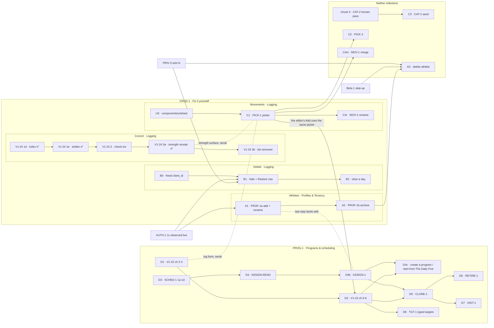

# CRUD-1 and PROG-1 — fix it yourself, then programs and scheduling

> **Status: draft for the maintainer's review, 2026-10-22. UX panel round 1, the maintainer's rounds
> 1–4 and panel round 2 (seven lenses) reconciled (logs at the bottom); prototype v6; Q1–Q16
> answered. This spec now defines two milestones** (the maintainer, round 4, M21):
>
> - **CRUD-1 — Fix it yourself** (`docs/milestones/crud-1-fix-it-yourself.md`, written after
>   sign-off, sequence step 5). Goal: [beta-1](../milestones/beta-1.md) → "The goal", item 4 —
>   _"fix their own mistakes without asking [the maintainer] to run a script"_ — and it **closes** Beta
>   1's exit box _"Every logged thing can be corrected or deleted in the app"_
>   (`beta-1.md:441`), which is why the rest of V1-24 joins it (M23).
> - **PROG-1 — Programs & scheduling** _(proposed id, unfiled)_. Goal: Beta 1's exit box _"A household
>   can edit its program and choose its days; streaks survive a rest day"_ (`beta-1.md:438`). It
>   carries every scheduling and programs decision from the maintainer's rounds 1–3.
>
> One spec, because both share one prototype, one review history and the seams between them (C1 gates
> D2; V1-22 chunk 2 gates C1). Prototype: [`docs/prototypes/crud-1/index.html`](../prototypes/crud-1/index.html).
> Procedure: [`write-spec`](../../.claude/skills/write-spec/SKILL.md).

## Why this exists

Nine backlog rows each own a piece of "a household can create, change and remove what it put in the
app", and no document connects them. A reader who asks _what is the path?_ has to read all nine,
three ADRs, one spec and one plan. The rows disagree with each other in places (listed under
[Where the rows disagree](#where-the-rows-disagree)) and five prerequisites belong to no row at all
([Unowned work](#unowned-work-this-spec-found)).

Today, measured on `origin/main@9d46547`:

| A household wants to…                    | Today                                                                                                                                                                                                                                                 |
| ---------------------------------------- | ----------------------------------------------------------------------------------------------------------------------------------------------------------------------------------------------------------------------------------------------------- |
| add / rename an athlete                  | ❌ seed only. The empty state links to GitHub (`components/onboarding/picker-empty-state.tsx` → `PickerEmptyState`; copy `PICKER_EMPTY_COPY.setupCta` in `lib/constants.ts`). The only profile-mutating action is `editRoutineAction` (`actions.ts`). |
| remove an athlete                        | ❌ the runbook's 13 hand-typed statements ([runbooks.md](../runbooks.md) → "Delete a household and everyone in it")                                                                                                                                   |
| undo a mis-logged entry                  | ❌ `db:correct` only. **Nothing in shipped code writes `deleted_at`** (grep for a `deletedAt:` setter in `apps/web` and `packages/db/src` finds only the column definition, `schema.ts` → `timestamps`)                                               |
| pick an existing movement                | ❌ a plain `<input type="text">` (`strength-form.tsx`, the Movement field); a near-miss mints a row via `findOrCreateMovement` (`packages/db/src/writers/movement-catalog.ts`)                                                                        |
| remove a mis-typed movement              | ❌ **by decision** — [ADR 0008](../decisions/0008-deletion.md) → "`movements` is exempt"; `schema.ts` above `movements` forbids setting its `deleted_at`                                                                                              |
| change a prescribed load                 | ❌ edit TypeScript and deploy ([V1-22 spec](./v1-22-authoring-program-editing.md)); chunk 1 of 6 shipped                                                                                                                                              |
| replace a program, retire it, look it up | ❌ nothing; `program_assignments` does not exist (`schema.ts`, last migration `0018`)                                                                                                                                                                 |

## Decisions already made

Each is settled. A session reopening one reads the source, not this line.

| Decision                                                                                                                                                                                                                               | Settled in                                                                                                                                             |
| -------------------------------------------------------------------------------------------------------------------------------------------------------------------------------------------------------------------------------------- | ------------------------------------------------------------------------------------------------------------------------------------------------------ |
| **Delete = hide from the whole household, restorable, purged at `N`.** No `deleted_by`. Per-item erasure is not planned; the finest erasure grain is an athlete                                                                        | [ADR 0008](../decisions/0008-deletion.md) decision 1 (signed 2026-10-18 in its decision box)                                                           |
| Restore is a **visible `Hidden on this day (n) — Restore` row**, never a toast; fallible, with a typed `slot_taken` refusal; clear-a-day restores as **one** event; restore window = purge window                                      | ADR 0008 decision 2                                                                                                                                    |
| A replay never resolves onto a hidden row (V1-24 1e adopted); `deleted_at` is never a side effect of a field upsert; **the freed `client_id` is a migration owed by whichever of V1-9b or sync lands first**                           | ADR 0008 decision 3                                                                                                                                    |
| Deletion authority = logging authority, **revisited (not inherited) at AUTH-1**                                                                                                                                                        | ADR 0008 decision 4                                                                                                                                    |
| **Mechanical rule:** a row may be hidden only if every resolver of its namespace filters `deleted_at IS NULL`; otherwise it is removed only by a correction. `movements` is therefore exempt                                           | ADR 0008 → "The general rule"                                                                                                                          |
| Delete grain is the **entry**. `entry_sets.deleted_at` exists and stays unbuilt                                                                                                                                                        | ADR 0008 → "What this does not settle" _(maintainer, 2026-10-18)_                                                                                      |
| **Archive is not delete:** its own marker, a lifecycle state a parent can see and restore from                                                                                                                                         | ADR 0008 → "What this settles", `RETIRE-1` bullet                                                                                                      |
| Programs: workouts as data, the prescription snapshotted as a rendered string, calendar-indexed rotation                                                                                                                               | [ADR 0005](../decisions/0005-programming-model.md) decisions 1–3, 5, 7                                                                                 |
| Scheduling: `program_assignments` with nullable `active_from`/`active_to` + weekday rows; **no active-block marker** (withdrawn); "create a block" waits on Today reading the athlete's **set** of assignments                         | [ADR 0007](../decisions/0007-scheduling-model.md) decisions 1, 4; "What this ADR does not authorize"                                                   |
| V1-22 scope A: six chunks, 17 acceptance criteria, `ProgramEditDTO`; authoring is profile-scoped at `/p/<id>/program`; a value edit is last-write-wins on the server clock; clearing a load is `UPDATE … NULL`, never a hide           | [V1-22 spec](./v1-22-authoring-program-editing.md) — **this spec cites it and does not restate it**                                                    |
| CLONE-1 is **per athlete**, default none; the clone grain is a **block**; household-wide replacement rejected                                                                                                                          | [plan.md → CLONE-1](../plan.md#clone-1) _(maintainer, 2026-10-07)_                                                                                     |
| PROF-1 ships **full athlete CRUD**; create/read/edit on `/p` with a **dashed "+ Add athlete" tile at the bottom of the picker**; delete is **PRIV-1's hard delete**, offers archive first, sits behind step-up                         | [plan.md → PROF-1](../plan.md) _(maintainer, 2026-09-28 and 2026-10-08)_                                                                               |
| **A new household starts on The Daily Five**, seeded at household creation (the A/B stopgap: the same rows under `strength_a` and `strength_b`), **never via `PROGRAM_SEED`**; its doses need the maintainer's sign-off before seeding | [beta-1](../milestones/beta-1.md) → ONB-2 (`beta-1.md:346-354`); [daily-five-default.md](../programs/daily-five-default.md) _(maintainer, 2026-09-30)_ |
| Household is in the session, not the URL; a wrong-household profile is a **404**                                                                                                                                                       | [ADR 0006](../decisions/0006-household-addressing.md) (accepted 2026-10-07)                                                                            |
| PICK-2 suggestions **never block**; English only; performance is a design constraint                                                                                                                                                   | [plan.md → PICK-2](../plan.md#pick-2) _(maintainer, 2026-10-08)_                                                                                       |
| CAT-2 is gated on the **human approve/deny pass** over the proposed movement list (ADR 0005 open question 3, "the 72 proposed entries") and **not** on scheduling                                                                      | [plan.md → CAT-2](../plan.md); ADR 0007 → Backlog impact, CAT-2 row                                                                                    |
| Every UI change gets the UX panel **before** implementation                                                                                                                                                                            | [AGENTS.md](../../AGENTS.md) → UI PR rules                                                                                                             |

⚠️ **Status lines are stale, not the decisions.** ADR 0005, 0007 and 0008 all still read
`Status: Proposed` in their headers. 0008's decision box is signed (2026-10-18); 0005 and 0007 are
unsigned, and the [roadmap](../roadmap.md) says 0007 needs signing **and amending** before SCHED-1 1c.
This spec relies on 0005 and 0007 as the V1-22 spec and the SCHED-1 plan already do; it does not make
them more settled than they are.

## Two milestones, five tracks, and the paths

The maintainer split the work in round 4 (M21): CRUD-1 was ~30 PRs, the size of all of Beta 1
(`beta-1.md:27`), and only the athletes, delete and correction tracks deliver "fix it yourself"; the
programs track is authoring and scheduling. Each track sits in one roadmap pillar. The pillar is a
**file** claim ([roadmap.md](../roadmap.md) → Pillars), so the tracks are also the first cut of the
parallelism question, which each milestone settles with the full glob intersection (sequence step 6).

| Milestone                                | Chunks                                                                                                         | ~PRs  |
| ---------------------------------------- | -------------------------------------------------------------------------------------------------------------- | ----- |
| **CRUD-1 — Fix it yourself**             | A1, A2 · B0, B1, B2 · U0, C1, C4r · E (V1-24 2 → 3b; 1d, 1e and 3a ✅ already on `main`)                       | 13–14 |
| **PROG-1 — Programs & scheduling**       | D1–D8 (V1-22 ch 2–6, SCHED-1 1a–1d, ASSIGN-READ, ASSIGN-1, create-a-program, CLONE-1, RETIRE-1, HIST-1, TGT-1) | ~17   |
| Specified here, in **neither** milestone | chunk 0 (starts now), A3 (delete athlete — Beta 1, step-up), C2 (PICK-2), C3 (CAT-2), C4m (MOV-1 merge)        | —     |



### Chunks, in order, and why the order cannot move

Each chunk is tagged **[CRUD-1]**, **[PROG-1]** or **[later]** (neither milestone).

| #   | Chunk                                                                                                                                                                                                                                                                                                                                          | Gated on                                                                                                                                                   | Why it cannot move                                                                                                                                                                                                                                                                                                                                                                                                                                                                                                                                                                                                                                                                                                                                                                                                                                                                                                                                                 |
| --- | ---------------------------------------------------------------------------------------------------------------------------------------------------------------------------------------------------------------------------------------------------------------------------------------------------------------------------------------------- | ---------------------------------------------------------------------------------------------------------------------------------------------------------- | ------------------------------------------------------------------------------------------------------------------------------------------------------------------------------------------------------------------------------------------------------------------------------------------------------------------------------------------------------------------------------------------------------------------------------------------------------------------------------------------------------------------------------------------------------------------------------------------------------------------------------------------------------------------------------------------------------------------------------------------------------------------------------------------------------------------------------------------------------------------------------------------------------------------------------------------------------------------ |
| 0   | **[later]** **CAT-2's human pass** — the maintainer approves/denies the proposed movement list in a spreadsheet, and assigns each kept row its picker group (see [the grouping finding](#unowned-work-this-spec-found))                                                                                                                        | nothing                                                                                                                                                    | **Start now.** It is a human step gating a code step, blocks nothing, and is unstarted — the hidden-gate pattern [parallel-work.md](../parallel-work.md) → "How many lanes?" names. The list is not committed in this repo (searched `docs/`, `packages/`, `apps/`); ADR 0005 calls it "the 72 proposed entries".                                                                                                                                                                                                                                                                                                                                                                                                                                                                                                                                                                                                                                                  |
| A1  | **[CRUD-1]** **PROF-1a** — add an athlete (dashed tile) + rename + `kind`, on `/p`. Removes the GitHub link                                                                                                                                                                                                                                    | **AUTH-1 1c observed live** (the session is what says _whose_ household the athlete joins)                                                                 | Under the gate, "add an athlete" adds to whichever household `getHouseholdScope()` resolves for a shared code — beta-1's chart puts PROF-1 after AUTH-1 for exactly this. First profile-creating endpoint. ⚠️ **Until D4, Today shows every profile the household's newest block** (`programDayRows`), so an adult added here would get the kids' program. **Q15 (maintainer, 2026-10-22): a kid-only guard until D4**, so A1 stays in Beta 0. The guard covers every reader of the newest block, not just the card _(panel round 2, FE-5)_: the card, the log form's scaffold and prefill, and the export's `prescribedFor` (`apps/web/lib/dal/export.ts:113-121`, which calls `programDayRows` per day role). No live adult profile reads the YDP card today. An adult added before D4 logs freely with no program; their own program arrives with D4c. The add flow's **last step** (put on a program) cannot exist before assignments do; it arrives with D4b. |
| A2  | **[CRUD-1]** **PROF-1b** — archive an athlete (hidden from the picker, history intact, restorable). **Ships in Beta 0 beside A1** _(panel round 2, PM-6)_: a typo'd or test athlete otherwise has no exit until Beta 1's step-up. Once assignments exist (D3), archiving closes the athlete's open assignments and Undo reopens them _(IXD-5)_ | A1 + **a marker decision** (no `archived_at` exists)                                                                                                       | Delete must offer archive first (PROF-1 row), so archive exists before delete does.                                                                                                                                                                                                                                                                                                                                                                                                                                                                                                                                                                                                                                                                                                                                                                                                                                                                                |
| A3  | **[later]** **PROF-1c** — delete an athlete: type the name, step-up, then PRIV-1's hard delete + ledger                                                                                                                                                                                                                                        | A2 + **PRIV-3's runner** (the deletion as a guarded script) + **Beta 1 step-up**                                                                           | Irreversible. Behind step-up by beta-1 → Beta 1 "Step-up". Needs the same statements the runbook types by hand, as code.                                                                                                                                                                                                                                                                                                                                                                                                                                                                                                                                                                                                                                                                                                                                                                                                                                           |
| B0  | **[CRUD-1]** **V1-9b-0** — the freed `client_id`: prove no hidden/live pair exists in prod, then re-predicate the five partial `client_id` arbiters (or record why not)                                                                                                                                                                        | nothing                                                                                                                                                    | **Must precede the first write of `deleted_at`.** `logCheckinEntries` (`lib/dal/entries.ts`) already arbitrates on `client_id WHERE deleted_at IS NULL`, so B1 arms the hazard (ADR 0008 decision 3.4). One migration per PR, and a DB PR must not share review with a UI PR.                                                                                                                                                                                                                                                                                                                                                                                                                                                                                                                                                                                                                                                                                      |
| B1  | **[CRUD-1]** **V1-9b-1** — hide one entry; the Hidden/Restore row; `slot_taken`; the `notice.md` sentence; the entry→set live-parent `db:verify` proof; the export decision                                                                                                                                                                    | B0 + **AUTH-1 1c** + **PRIV-3's plan has chosen `N`**                                                                                                      | The notice sentence B1 owes describes "hidden, then purged at `N`"; it cannot be written truthfully before `N` exists as a number. The purge **job** may come later; the **number** may not (ADR 0008 → Backlog impact, PRIV-3 row). AUTH-1: decision 4 is revisited there, so building authority before it builds against a principal that is about to change.                                                                                                                                                                                                                                                                                                                                                                                                                                                                                                                                                                                                    |
| B2  | **[CRUD-1]** **V1-9b-2** — clear a day behind typed "delete"; restores as one event                                                                                                                                                                                                                                                            | B1                                                                                                                                                         | Reuses B1's Hidden row and restore path.                                                                                                                                                                                                                                                                                                                                                                                                                                                                                                                                                                                                                                                                                                                                                                                                                                                                                                                           |
| U0  | **[CRUD-1]** **A shared sheet primitive** — `apps/web/components/ui/sheet.tsx` on Radix Dialog: full screen below 600px, a capped dialog above, pinned title and actions, focus return                                                                                                                                                         | nothing                                                                                                                                                    | _(Panel round 2, FE-13.)_ `components/ui/` holds only `button`, `card`, `empty-state`, `error-state` and `skeleton`, so the picker, the assignment sheet and every confirm would each roll their own modal. One small PR before C1; criteria 37 and 46 are its tests.                                                                                                                                                                                                                                                                                                                                                                                                                                                                                                                                                                                                                                                                                              |
| C1  | **[CRUD-1]** **PICK-1** — the picker: choosing an existing movement is the easy path                                                                                                                                                                                                                                                           | U0 + **V1-22 chunk 2 merged** (a PROG-1 chunk: the one cross-milestone gate into CRUD-1) (both edit `strength-form.tsx`, both under `strength-logging.md`) | Gate-1 collision, decided the way the roadmap decided chunk 2 vs `v1-30b`: chunk 2 is planned (#239), PICK-1 is not, so chunk 2 goes first. PICK-1 changes the log submit schema (the Logging∩Authoring seam, owner **Logging**).                                                                                                                                                                                                                                                                                                                                                                                                                                                                                                                                                                                                                                                                                                                                  |
| C2  | **[later]** **PICK-2** — suggestions before a new movement is created                                                                                                                                                                                                                                                                          | C1                                                                                                                                                         | Its own row: it extends PICK-1's picker.                                                                                                                                                                                                                                                                                                                                                                                                                                                                                                                                                                                                                                                                                                                                                                                                                                                                                                                           |
| C3  | **[later]** **CAT-2** — the approved drills become `movements` (seed, `ON CONFLICT DO NOTHING`)                                                                                                                                                                                                                                                | chunk 0                                                                                                                                                    | Seed-only; touches `catalog-movements.ts` + `seed.ts` (write-path guide). Independent of C1 in files, but the picker's groups are what make 72 more rows findable, so ship it **after** C1 if both are ready.                                                                                                                                                                                                                                                                                                                                                                                                                                                                                                                                                                                                                                                                                                                                                      |
| C4r | **[CRUD-1]** **MOV-1 rename** _(unfiled)_ — a household renames its own mis-typed movement. **C4m [later]:** merge it into another (changes past exports; needs Insight's sign-off)                                                                                                                                                            | C1 + the three-part lift at `schema.ts` above `movements`                                                                                                  | ADR 0008 leaves this gap "by decision" and names `TEN-2c-1` "or a successor" as owner. PICK-2 only stops new mis-types. **Rename ships with CRUD-1** _(panel round 2, PM-4)_: C1 makes household movements cheap to create, and a rename fixes the typo without touching a past entry's `movement_id`, so no export byte changes.                                                                                                                                                                                                                                                                                                                                                                                                                                                                                                                                                                                                                                  |
| E   | **[CRUD-1]** **V1-24 2 → 3b** (1d #210, 1e #214 and 3a #211/#212 are already on `main`, so the "1e before B1" gate is met) — correcting a logged value: the bodyweight index, the natural-key arbiter, check-ins, the strength receipt, and **removing** the "Logged entries" list (M26 — the plan said `<details>`; disagreement 12)          | per [the V1-24 plan](../plans/v1-24-form-is-the-day.md) → "Staging"                                                                                        | **Brought in by the maintainer (M23).** That plan owns the order and the content; this spec does not restate it. 1e is what ADR 0008 decision 3 adopted ("a replay never resolves onto a hidden row"), so it lands **before B1** writes a `deleted_at`. 3a and 3b edit the strength surface under `strength-logging.md`, the same files as V1-22 chunk 2 and C1, so the three serialize under gate 1.                                                                                                                                                                                                                                                                                                                                                                                                                                                                                                                                                              |
| D1  | **[PROG-1]** **V1-22 chunks 2 → 3 → 4** — the snapshot writer, the backfill, edit values                                                                                                                                                                                                                                                       | per [the V1-22 spec](./v1-22-authoring-program-editing.md)                                                                                                 | That spec owns the order (chunk 3's `--apply` recorded before 4 merges).                                                                                                                                                                                                                                                                                                                                                                                                                                                                                                                                                                                                                                                                                                                                                                                                                                                                                           |
| D2  | **[PROG-1]** **V1-22 chunks 5 → 6** — the seed guard, then add/remove/reorder                                                                                                                                                                                                                                                                  | D1 + **C1** (chunk 6's Add opens PICK-1's picker)                                                                                                          | That spec; chunk 6 owes the prescription-identity column. **(M4)** The editor's "+ Add a movement" opens the **same** picker component as the log form, so it cannot grow a second, weaker movement list; PICK-2's suggestions reach the editor when C2 lands, with no editor change.                                                                                                                                                                                                                                                                                                                                                                                                                                                                                                                                                                                                                                                                              |
| D3  | **[PROG-1]** **SCHED-1 1a → 1d** — assignments + weekday rows, seeded                                                                                                                                                                                                                                                                          | **Beta 1's gate** (family #1, two weeks, a decision to widen) + ADR 0007 signed and amended                                                                | [roadmap](../roadmap.md) → Authoring & Scheduling. Its plan owns the order.                                                                                                                                                                                                                                                                                                                                                                                                                                                                                                                                                                                                                                                                                                                                                                                                                                                                                        |
| D4  | **[PROG-1]** **ASSIGN-READ** _(unfiled)_ — Today and the export read the athlete's **assignment**, not `programDayRows`' newest block                                                                                                                                                                                                          | D3                                                                                                                                                         | CLONE-1's gate 2 names it; the SCHED-1 plan **excludes it** ("This is also why the one-block→N-assignments read is **not** in this plan") and ADR 0007 sends it to "its own plan and UX panel". **Byte-affecting** for the CSV (owner: Insight).                                                                                                                                                                                                                                                                                                                                                                                                                                                                                                                                                                                                                                                                                                                   |
| D4b | **[PROG-1]** **ASSIGN-1** _(unfiled)_ — put an athlete on a program **on chosen weekdays**, move them, change their days, or take them off, with Undo; plus A1's last step and the "No program yet" state                                                                                                                                      | D4                                                                                                                                                         | **Found by the UX panel (R1); the days added by the maintainer (M2).** CLONE-1's "move the wrong kid back", RETIRE-1's "move them first" and both Undos need a plain assignment write, and no row or screen has one. CLONE-1's "who moves" is a special case of it, so it lands first and CLONE-1 reuses it. It is also the **recurrence editor** ADR 0007 says the weekday table implies ([Recurrence](#recurrence-the-weekday-set-rrule-and-the-rotation)).                                                                                                                                                                                                                                                                                                                                                                                                                                                                                                      |
| D4c | **[PROG-1]** **V1-22 A4** — create a program; or, in a household with no live program, start from **The Daily Five** (ONB-2's default; never `PROGRAM_SEED`)                                                                                                                                                                                   | D4 + D4b + D2 (the editor it fills)                                                                                                                        | **Brought into scope by the maintainer (M6).** ADR 0007 decision 4: creating a block is _"safe only once Today renders the athlete's **set** of active assignments"_ — D4. The default reuses ONB-2's household-creation writer and inherits its sign-off gate (unowned 7). A workout's label needs storage, since `DAY_ROLES` is a closed list (`packages/shared/src/programming.ts:28`); the plan picks the shape (Q16, FE-3).                                                                                                                                                                                                                                                                                                                                                                                                                                                                                                                                   |
| D5  | **[PROG-1]** **CLONE-1** — "save as a copy" from the editor, choose who moves                                                                                                                                                                                                                                                                  | D1 (chunks 2–3) + D4b + D2 (the editor it saves from)                                                                                                      | Its row's own three gates, in that order.                                                                                                                                                                                                                                                                                                                                                                                                                                                                                                                                                                                                                                                                                                                                                                                                                                                                                                                          |
| D6  | **[PROG-1]** **RETIRE-1** — archive a program                                                                                                                                                                                                                                                                                                  | D5 + D3                                                                                                                                                    | CLONE-1 creates the pile; archive must compose with `active_to`.                                                                                                                                                                                                                                                                                                                                                                                                                                                                                                                                                                                                                                                                                                                                                                                                                                                                                                   |
| D7  | **[PROG-1]** **HIST-1** — what program an athlete ran on a past date                                                                                                                                                                                                                                                                           | D5                                                                                                                                                         | No assignment history exists before CLONE-1 moves someone.                                                                                                                                                                                                                                                                                                                                                                                                                                                                                                                                                                                                                                                                                                                                                                                                                                                                                                         |
| D8  | **[PROG-1]** **TGT-1** _(proposed)_ — typed per-athlete targets: the movement's own quantity when it is not a weight, **one** weight, and a per-movement note                                                                                                                                                                                  | D2, and V1-34 fixed                                                                                                                                        | **The maintainer (M31, revised M34):** _"maybe just a weight field and notes."_ A child table of target quantities with the same `(slot, dimension)` and `(unit, dimension)` FK pairs as `entry_set_quantities`, so a target and a logged set say the same thing; one nullable `note` on `prescriptions`. Needs the movement's declared quantity stored first (unowned 9). Schema, so it owes the DB-safety lens; the note is free text a person types, so it owes the privacy lens.                                                                                                                                                                                                                                                                                                                                                                                                                                                                               |

**Where V1-22 scope B went.** The row defines B as _"A plus assignment + a third schedule shape +
GAP-3 measurement shapes"_. Since ADR 0007, **assignment is SCHED-1's `program_assignments`** (D3) and
**choosing who runs a block is CLONE-1's "who moves"** (D5); the **third schedule shape** is YDP-1,
deferred by the maintainer (2026-09-24); the **GAP-3 shapes** are V1-22 chunk 6's _"rep-shaped items
only until GAP-3's target shapes land"_. So B has no chunk of its own here, and the V1-22 row should
say so when this spec lands ([Where the rows disagree](#where-the-rows-disagree), item 5).

### The critical path, and what is parallel

**CRUD-1, serial:** `AUTH-1 1c` → `V1-9b-1` → `V1-9b-2`, with **PRIV-3's choice of `N`** gating B1. That
number is a decision, not code, and nothing has started it; **start it now** _(panel round 2, PM-9)_, or
it becomes the milestone's critical path by default. Beside it: V1-24 2 (1d and 1e have shipped, so B1's "1e first" gate is met), and
`V1-22 ch 2 → U0 → C1 → C4r` with V1-24 3a/3b serialized against C1 on the strength surface.

**PROG-1, serial:** `SCHED-1` → `ASSIGN-READ` → `ASSIGN-1` → `CLONE-1` → `RETIRE-1`. It sits behind
Beta 1's human gate (D3), so for Beta 0 nothing in PROG-1 beyond D1 can start.

**Can start before AUTH-1 1c, because nothing it touches is an AUTH-1 file** (preliminary — the
milestone does the full intersection against AUTH-1's file table, which names `lib/dal/household.ts`,
`app/p/[profileId]/actions.ts`, four `page.tsx` files and `lib/constants.ts` for 1c):

- **chunk 0** (a spreadsheet; no repo files) — **now**.
- **B0** (`packages/db` migration + `db:verify`; no `apps/web` file) — after AUTH-1 1b's migration lands,
  because both are migrations and the numbering is serial.
- **D1** (V1-22 chunks 2–3) — already unblocked per the roadmap. ⚠️ Chunk 2 edits the log form, and
  AUTH-1 1c edits `actions.ts`; check the intersection at the time, per gate 1.
- **PICK-1's plan and panel** (docs only), not its code.
- **U0** (`components/ui/sheet.tsx`, a new file no AUTH-1 chunk names) — any time.
- ~~**V1-24 1d**~~ — shipped (#210).
- **PRIV-3's choice of `N`** (a decision) — now.

⚠️ **Every mutating chunk above touches `apps/web/app/p/[profileId]/actions.ts`, and every DAL
addition touches `lib/dal/`** — both owned by [write-path.md](../features/write-path.md), which owns
`apps/web/lib/dal/` as a whole prefix. (`mutating-actions.ts` is **not** in its `owns:`; an earlier draft
of this paragraph said it was.) So under gate 1 the action-adding tracks are **not** disjoint even when
their screens are. Splitting `actions.ts` per feature does not fix that, because every new action also
needs a DAL function under the same guide: the action-adding chunks **serialize on `write-path.md`**.
What runs first instead is **WP-1** — new actions go in per-feature modules, and the boundary-test
matrix covers every module, household-addressed actions included
([the plan](../plans/wp-1-shard-actions.md), which supersedes this spec's earlier "shard first" advice).

## Success signals

_(Panel round 2, PM.)_ How the maintainer will know CRUD-1 worked, from data the app already stores, read
during family #1's first two weeks. None is a dashboard; each is one query the milestone's close-out
runs once.

| Signal                                                                                    | Why it means "fixed it themselves"                                                                                                                                |
| ----------------------------------------------------------------------------------------- | ----------------------------------------------------------------------------------------------------------------------------------------------------------------- |
| **Zero new correction files** in `packages/db/scripts/corrections/` for family #1's data  | Every correction is a mistake the app could not fix. The milestone's stated goal, measured directly                                                               |
| **A hide followed by a re-log of the same kind on the same day, within 24h**              | The mis-tap signal: the delete was used to correct, not to discard                                                                                                |
| **Restores per hide**                                                                     | Otherwise unmeasured _(PM-7)_. A high rate means Delete is too easy to hit; near zero with no hides means nobody found it                                         |
| **Profiles created and renamed in the app** (vs. by seed)                                 | A1 replaced the GitHub link                                                                                                                                       |
| **Near-duplicate household movements** (the same name up to case, spaces and punctuation) | C1 made the existing movement the easy path; a rising count means the picker is losing to "use as typed", and C4r's rename is doing work C2 should have prevented |

## Acceptance

Criteria for rows that already have a spec or ADR **cite** them; these are the ones nothing else
writes. Each names the chunk that must carry its test. Criteria marked **(R1)** were added or changed by
the UX panel's first round; **(R2)** by panel round 2. The log at the bottom says why.

**Which milestone each criterion belongs to** follows its chunk tag: **CRUD-1** — 1–5, 7–18, 39, 41,
47, 48; **PROG-1** — 21–38, 40, 42–46, 49–51; **[later]** — 6 (A3), 19 (C2), 20 (C3).

**Athletes (A1–A3)**

1. **When** a parent submits a new athlete with a non-blank name and a `kind` from `PROFILE_KINDS`, the
   system **shall** create one profile in the **session's** household and the picker **shall** list it
   on the next render. _(A1)_
2. **If** the name is blank after trimming, longer than the limit the plan sets, or `kind` is not in
   `PROFILE_KINDS`, **then** the system **shall** return a typed field error and write nothing. _(A1)_
3. **When** an "add athlete" submit is replayed with the same idempotency key, the system **shall**
   create exactly one profile and return the same result. _(A1 — AGENTS.md backend rule 6)_
4. **If** a rename or archive names a profile outside the session's household, **then** the system
   **shall** respond as for an unknown profile (404 semantics, ADR 0006) and write nothing. _(A1, A2)_
5. **While** an athlete is archived, the picker **shall not** list them, their history **shall** still
   export, and a parent **shall** be able to restore them from a list of archived athletes. _(A2)_
6. **When** a parent starts deleting an athlete, the system **shall** offer, in order, the athlete's
   export, archive, then delete; **shall** enable delete only when the typed name matches the athlete's
   name **ignoring case and surrounding spaces**; **shall** require a fresh step-up; and **shall**
   hard-delete every row the runbook's procedure deletes, soft-deleted ones included, and write a ledger
   entry. Its copy **shall not** claim more than `notice.md` does (removed from the app now, from
   backups after their window), and the export step **shall** name what the export leaves out —
   check-ins and other life activities, readiness, notes and per-athlete targets
   (`docs/privacy/notice.md:163-165`) — never "download their data" as if it were a complete copy.
   **(R1, R2 — SUX-1)** _(A3)_
7. **When** PROF-1a ships, the empty state **shall not** link to GitHub. _(A1 — ONB-0 finding E23)_
8. Rename **shall** be reachable from the athlete's own page; archive and delete **shall** live only in
   household settings, never on the picker. **(R1)** _(A1, A2)_

**Delete (B0–B2)** — ADR 0008 is the source; these make it testable.

9. **If** an entry has been hidden and a submit replays its `client_id`, **then** the system **shall
   not** insert a second live row. _(B0 — `db:verify`, the inverse of today's partial arbiter)_
10. **When** a person taps Delete on a logged entry, the entry **shall** disappear for **every** profile
    view in the household, an untimed `<name> deleted · Undo` line **shall** take its place **in the same
    position** until the page is left, and a `Hidden on this day (n)` section **shall** appear **above
    the day's sections**, surviving a reload and a day change. Each hidden item **shall** state the date
    it stops being restorable. The section **shall** list only items hidden **before this page was
    loaded**: a hide made on this visit stays as its in-place Undo line and joins the section on the
    next load, so **no** hide inserts or resizes anything above the tapped row (a second tap must land
    where the first did). **(R1, R2 — IXD-2)** _(B1)_
11. **When** focus is on a Delete control and its row is hidden, focus **shall** move to that row's
    in-place Undo — never to another Delete. **When** an entry is restored, focus **shall** move to the
    restored row. The live region announcing either **shall** be mounted before its text changes.
    **(R1)** _(B1 — the `saved-announcer.tsx` idiom)_
12. **When** Restore is tapped and the entry's natural-key slot is free, the entry **shall** return to
    its original position; **if** the slot is taken, **then** the system **shall** return a typed
    `slot_taken` result naming what holds the slot, **never** a `23505` or a silent no-op, and **shall**
    offer one atomic "keep this one instead" (hide the holder and restore this one in one transaction),
    with leaving it as the default. **(R1)** _(B1 — the fixture: hide a weigh-in, log a new one that day,
    restore the first)_
13. **Where** the day page folds several entries into one row (calisthenics bouts, `page.tsx`), that
    row's Delete **shall** name how many entries it hides and **shall** hide them as **one** event.
    **Where** a strength session renders twice on the page, Delete **shall** appear on exactly one copy.
    **(R1)** _(B1)_
14. **When** "Clear this day" is confirmed, the Clear control **shall** stay disabled until the input
    equals `delete` ignoring case and surrounding spaces, every live entry for that athlete and day
    **shall** be hidden in **one** transaction, and the Hidden section **shall** offer to restore them
    as one event. A partial restore **shall** report which entries could not come back and why. _(B2)_
15. **While** an athlete has hidden entries on other days of the current week, the day page **shall**
    say so and link to each day. **(R1)** _(B1)_
16. **When** a profile's every entry for a month is hidden, the export path the plan chose (ADR 0008
    → "One constraint") **shall** still deliver the person their data. _(B1)_

**Movements (C1–C4)**

17. **When** an athlete picks a movement from the picker and submits a set, the stored entry **shall**
    reference that movement's id — **no** call to `findOrCreateMovement` for it — and **no** magnitude
    shall arrive prefilled. _(C1 — PICK-1's own acceptance, verbatim intent)_
18. The picker **shall** offer, in order: the athlete's recent movements, then the catalog grouped by
    the picker group, with today's prescribed movements left out (the form already fills them);
    **shall not** raise the on-screen keyboard on open on a touch device; and **shall** be operable by
    keyboard alone, with every option a ≥44px target at 360px. **(R1)** _(C1)_
19. **When** the typed text is a known alias (`RDL`), the picker **shall** offer the movement it names.
    **When** it has no exact match but a near match exists, the picker **shall** show the near match
    and a spelling suggestion **before** creating a movement, and "use what I typed" **shall** stay
    one tap and visible above the keyboard. A movement created that way **shall** be written when the set
    is saved, not when it is picked. **(R1)** _(the alias: C1, PICK-1; the near match: C2, PICK-2)_
20. **When** `db:seed` runs twice after CAT-2, the movement count **shall** be the same as after once.
    _(C3)_

**Programs (ASSIGN-1, D4–D7)** — V1-22's 17 criteria stand for D1–D2.

21. **When** a parent moves an athlete from one program to another, changes their days, or takes them
    off one, the system **shall** close the open assignment (`active_to` = the day before) and, for a
    move or a change of days, open one (`active_from` = today, athlete-local) carrying the chosen
    weekdays; **Undo** **shall** reverse exactly the rows it changed. A change of days is a new period,
    never an edit in place, so HIST-1 shows it — **except** that a change made on the day its period
    opened **shall replace** that period (update its weekdays and offset in place), because closing it
    would write `active_to < active_from` and the reopen would collide with
    `uq_program_assignments_profile_block_from` (SCHED-1 plan, the index at line 325). "Today" is the
    **athlete's** declared day, the one Today renders, never the parent's device clock. **(R1, M2, R2 —
    FE-1, FE-11)** _(ASSIGN-1)_
22. **When** a parent saves program edits, the editor **shall** offer two actions: save for the people on
    it, naming them ("Save for {names}"), and "Save as a copy…". **When** anyone besides the athlete whose
    page the editor was opened from is on the program, neither is preselected. **(R1, amended by the
    CLONE-1 panel 2026-10-23)** _(D5)_
23. **When** a copy is saved, it **shall** carry every live prescription and per-athlete target of the
    source with identical values **plus the parent's staged edits**, and the source **shall** be
    unchanged. _(D5; amended 2026-10-23)_
24. **When** a parent moves an athlete to the copy, the system **shall** behave as criterion 21 and
    **shall not** change any already-exported byte for that athlete. An athlete who was **not** on the
    source **shall** be told which program(s) they stay on, and one of three things about loads: none set
    on the copy yet, their earlier loads from the source carried over ("check them"), or nothing when they
    were already on the source. **(R1; three cases added 2026-10-23)** _(D5)_
25. **When** a copy is saved with no athletes ticked, **no** assignment **shall** change. _(D5)_
26. **While** anyone is on a program, archiving it **shall** first resolve each of them (move or take
    off) in place — or, under Q3's other answer, close their assignments and say they have no program
    in its place; **either way** Undo **shall** restore the archive **and** every assignment it closed
    as one event. **(R1)** _(D6)_
27. **While** a program is archived, it **shall not** appear in the editor's program list, the copy
    source list, or the move-to list, and every past entry against it **shall** render and export as
    before. _(D6)_
28. **When** a parent opens an athlete's program history, the system **shall** list their assignments
    newest first with start and end dates, each opening the prescriptions as snapshotted and linking to
    the days logged in that period; **and when** they pick a date, **shall** name the program(s) open on
    it, or say nothing was assigned. **(R1)** _(D7)_

**Scheduling and first programs (D4b, D4c, D2) — added by the maintainer's round 1**

29. **When** a parent saves an assignment, the system **shall** store its weekdays as
    `program_assignment_weekday` rows drawn from `WEEKDAYS` (SCHED-1 1a, `0 = Sunday`), at least one and
    no repeats; **if** none is chosen, **then** it **shall** return a field error and write nothing. The
    UI **shall** show the days Monday-first and **shall** map them through `WEEKDAYS`, never a second
    weekday list. **(M2)** _(ASSIGN-1)_
30. **When** the day is in none of the athlete's weekday sets, the Strength section **shall** say there
    is no program that day and name the days each program runs; logging **shall** still work. **When**
    it is, it **shall** name the program and the workout the resolver gives for that day — the program
    alone when it has one workout, so The Daily Five's A/B stopgap never shows as "Strength A/B".
    **(M2, M7, R2)** _(ASSIGN-1 — the read is D4's)_
31. The assignment sheet **shall** preview the next six sessions using the **same** resolver Today uses
    (`resolveRotationSlot`, SCHED-1 1b), and **shall** say so in words if the chosen days ever stop the
    workouts alternating. **(M2)** _(ASSIGN-1)_
32. **When** a parent adds an athlete and the household has a live program, the system **shall** offer
    "put them on a program" with **no** program preselected and every day chosen, and a "Not now" that
    lands on the athlete's page; that page **shall** then show "No program yet" with a way to choose one.
    **(M5)** _(ASSIGN-1, extending A1's flow)_
33. **When** the household has no live program — after ONB-2 that happens only when every program has
    been archived — that step **shall** offer exactly two paths, "Start from The Daily Five" and
    "Create a program". The Daily Five **shall** be copied by ONB-2's household-creation writer, never
    from `PROGRAM_SEED`, with **no** load or per-athlete target (it has none by construction:
    [daily-five-default.md](../programs/daily-five-default.md)), and **only** once its doses carry the
    maintainer's sign-off. **Where** the athlete is an adult, the step **shall** say The Daily Five
    was written for young athletes. **(M6, R2 — PM-1, M22)** _(D4c)_
34. **When** a parent taps "+ Add a movement" in the program editor, the system **shall** open the
    log form's picker (criteria 18–19 apply unchanged), mark movements already in that day, and write a
    movement created by "use what I typed" when the **program** is saved, not when it is picked.
    **(M4)** _(D2)_
35. **When** a created program is saved, its rotation anchor **shall** be the save day, so its first
    workout falls on that day. **(M6)** _(D4c)_
36. **Wherever** a parent is asked to choose a program — the assignment sheet, the add flow's last step,
    and the "No program yet" state on the athlete's day page and program page — "Create a program"
    **shall** be one tap away, so "none of these fit" is never a dead end. **(M8, M9)** _(ASSIGN-1,
    D4c)_
37. **Below 600px** the assignment sheet **shall** fill the screen with its title and its actions
    pinned and only the middle scrolling; **from 600px** it **shall** be a dialog capped at the viewport
    height with the same pinned actions. The weekday toggles **shall** size to their container, not the
    viewport — four then three in 294px, seven across from 468px (cells `minmax(60px, 1fr)`; amended from 496px by ASSIGN-1's UX panel, so the ≥600px dialog's 488px shows all seven) — each ≥44 × 44px. Text on a muted
    surface **shall** use the foreground token: `muted-foreground` on `muted` is 4.34:1, under AA
    (`docs/design.md:97`). **(M11, M12, R2 — CD-1)**
    _(ASSIGN-1)_
38. **When** an athlete has been taken off a program, a parent **shall** be able to put them back on it
    from **both** sides: "+ Put {name} on another program" on the athlete's program page, and "+ Put
    someone on it" on the program in the household's program list (choose who, then days) — never "+ Add
    athlete", which already means creating one. Re-adding offers the athlete's **last** days for that
    program, not every day. **(M13, R2 — PUX-2, IXD-6)**
    _(ASSIGN-1)_
39. The picker tile, the athlete form and household settings **shall** show `kind` as **Child** /
    **Adult**, from one display map beside `PROFILE_KINDS`; the stored values stay `kid` / `adult`.
    **(M10)** _(A1)_
40. **Whatever** was or was not logged, the workout due on a day **shall** be a pure function of the
    date, the program's rotation and the athlete's weekday set — a skipped session **shall never**
    shift what comes next _(maintainer, 2026-10-22, Q13)_. The rotation **shall** advance one workout
    per **scheduled** day _(maintainer, 2026-10-22, Q13b)_, and **when** all seven days are scheduled
    the result **shall** equal today's calendar count for every date — SCHED-1 1b's 60,000-date
    equivalence proof, run again against the scheduled-day count with the seven-day set. The count
    **shall** be closed-form — whole weeks × the size of the set, plus the scheduled days in the
    remainder — never a day-by-day walk, so the proof stays 60,000 evaluations, not ~900 million. A
    period opened by a change of days **shall** carry on from the workout that would have come next,
    through the period's stored offset. **(M16, M20, R2 — FE-2, FE-4)**
    _(ASSIGN-1)_
41. The app **shall not** link to the routine editor from anywhere — not the day page, not the
    athlete's edit page — until ACT-1 replaces it. A routine already saved **shall** keep rendering and
    logging on the day page; a profile with none **shall** keep the neutral default (Strength only,
    `apps/web/lib/routine/catalog.ts`, `NEUTRAL_DEFAULT_KEYS`). The `/p/[profileId]/routine` route stays
    in code, unlinked, as it was before V1-23 PR 2. **(M17, amended by M30)** _(A1)_

**Panel round 2 and the maintainer's round 4**

42. A "day" **shall** mean a weekday and nothing else. A program **shall** be made of **workouts**,
    each shown by a label: the shipped programs by `DAY_ROLE_LABELS` ("Strength A", "Strength B",
    `packages/shared/src/programming.ts:82`), a created program by a label the parent types, defaulting
    to "Workout A", "Workout B". The editor's add control **shall** read "+ Add another workout" and
    **shall** stop at `DAY_ROLES`' strength roles (three) without a CHECK migration. No screen **shall**
    say "Day A". **(R2 — PUX-1, IXD-3; M24, Q16)** _(D2, D4c)_
43. **When** two of an athlete's programs are due on the same day, Today **shall** show both, in the
    order the assignments were opened, each named. **(R2 — FE-10, IXD-9)** _(D4)_
44. **When** a parent changes an athlete's days on a program, the sheet **shall** offer only that
    program; moving to another program **shall** be its own explicit action that names both programs.
    No choice inside "change days" **shall** close or rewrite any other assignment. **(R2 — IXD-1)**
    _(ASSIGN-1)_
45. **Undo** after "Create a program" from an athlete's page **shall** take the athlete off it and keep
    the program; Undo after a copy **shall** reverse every assignment the copy wrote, including an
    athlete who was not on the source. Undo after "save for everyone" **shall** exist. **(R2 — SUX-2,
    SUX-3, IXD-6)** _(D4c, D5)_
46. **Where** a modal sheet changes text as the person edits (the next-sessions preview, the summary,
    a match count), the change **shall** be announced through a `role="status"` region **inside** that
    sheet; a live region outside a modal `<dialog>` is inert while it is open. **(R2 — A11Y-1)** _(U0,
    C1, ASSIGN-1)_
47. **When** an athlete is archived while on a program, their open assignments **shall** close the
    day before, the archived athlete **shall** drop out of every "who's on it" list, and Undo **shall**
    reopen exactly those assignments. Before D3 there is nothing to close. **(R2 — IXD-5)** _(A2)_
48. **When** an entry is logged, the day page **shall** show it in its own activity's section — the
    section it was logged in — and **nowhere else** on the page. There **shall** be no second
    "Logged entries" list. **If** an entry's activity is no longer in the athlete's activities, **then** it
    **shall** appear under an "Also logged" heading that renders only when it has rows, so no entry
    vanishes. Delete, the in-place Undo and Restore act on the row where it sits. **(M26)** _(E: V1-24 3b)_
49. **If** a created program is saved with a workout that has no movements, **then** the save **shall**
    be refused with the workout named and focus on its "+ Add a movement" control, and each workout after
    the first **shall** have a Remove control. **(M25)** _(D4b)_
50. **Where** a movement measures something other than a weight, or more than one thing, the program
    editor **shall** show one per-athlete field for each quantity the movement declares, each labelled
    with what it holds and its unit, and each opening the numeric keypad: Box Jump → box height (in) and
    weight (lb); Sled Push → weight (lb) and distance (ft); a hold → time (s). Only a movement that
    declares a single weight says "load". **(M27, M29)** _(D-track editor; storage per Q18)_
51. **When** a movement is added to a program, the editor **shall** offer, per athlete, a typed field
    for the movement's own quantity when it is not a weight (box height, distance, time), **one** typed
    weight field (a number and a mass unit), and, per movement, an optional **note** a person types
    ("dumbbell in each hand", "20 lb vest"). There **shall not** be separate held and vest fields. **If**
    a weight has letters or no unit, **then** it **shall** be refused, not stored as text; the note
    **shall** never be read as a load. **(M31, revised by M34)** _(D8)_

## The data contract

Shapes that cross a seam, so two tracks can proceed without guessing. Homes follow AGENTS.md: shared
schemas in `packages/shared`, DTOs beside their DAL in `apps/web/lib`.

```
packages/shared
  profileUpsertSchema        { name: string (trimmed, 1..PROFILE_NAME_MAX), kind: profileKindSchema }
                              — kind REUSES enums.ts PROFILE_KINDS; PROFILE_NAME_MAX is new, one home
  PROFILE_KIND_LABEL         { kid: 'Child', adult: 'Adult' } as const satisfies Record<ProfileKind, string>
                              — beside PROFILE_KINDS in enums.ts; replaces profile-tile.tsx's
                                `capitalize {profile.kind}`, which renders "Kid" (M10)
  hideEntrySchema            { profilePublicId, entryPublicId }
  restoreHiddenSchema        { profilePublicId, day, hiddenAt }       ← restores ONE hide event
  clearDaySchema             { profilePublicId, day, confirm }  ← confirm is trimmed and lower-cased,
                              THEN z.literal('delete') — the UI's matching rule and the server's agree
  hideGroupSchema            { profilePublicId, day, entryPublicIds: string[] }  ← one folded row, ONE event
  assignmentSetSchema        { profilePublicId, fromBlockPublicId | null, toBlockPublicId | null,
                               weekdays: weekdaySchema[] (min 1, unique) }
                              ← from null = put on; to null = take off; to = from = change days.
                                weekdaySchema is SCHED-1 1a's (day.ts) — REUSED, never re-declared
                              ← R2 (IXD-1): to ≠ from with both set is a MOVE, its own action in the UI;
                                "change days" sends to = from and nothing else
  programCreateSchema        { name: string (trimmed, 1..PROGRAM_NAME_MAX),
                               workouts: Array<{ label: string (trimmed, 1..WORKOUT_LABEL_MAX) }>
                                 (1..STRENGTH_DAY_ROLES.length — three today),
                               forProfilePublicId | null, weekdays }             ← D4c (Q16)
                              — day_role stays the key (strength_a/b/c in order); the label is display
                                only and needs storage, since DAY_ROLES is closed (programming.ts:28).
                                D4c's plan picks the shape (FE-3)
  programFromDefaultSchema   { defaultSlug: 'daily_five', profilePublicId, weekdays }  ← D4c (M22): the
                              ONB-2 program, never PROGRAM_SEED
  movementRenameSchema       { movementPublicId, name }  ← C4r: household-owned rows only; a catalog row
                              is a 404 (the same ownership rule as a profile)
  MOVEMENT_PICKER_GROUPS     as const — the picker's groups; see the grouping finding
  programCloneSchema         { clientId, sourceBlockPublicId, name: programNameSchema, edits,
                               moveProfilePublicIds: string[] (default []) }  ← CLONE-1 plan owns the shape

apps/web/lib  (DTOs, never raw rows)
  HiddenOnDayDTO             { count, events: Array<{ hiddenAt, restorableUntil,
                                                    items: Array<{ entryPublicId, label }> }> }
                              ← restorableUntil = hiddenAt + N (PRIV-3); computed server-side, one home
  RestoreResult              per item: { ok: true } | { ok: false, reason: 'slot_taken', heldBy: { entryPublicId, label } }
                                                     | { ok: false, reason: 'not_found' }
  MovementOptionDTO          { publicId, name, group, aliases: string[], owner: 'catalog' | 'household',
                               prescribedToday: boolean }
  ProgramEditDTO             — V1-22 spec, unchanged
  AssignmentDTO              { blockPublicId, blockName, activeFrom, activeTo | null, weekdays: Weekday[],
                               phaseOffset: number }
                              ← phaseOffset: a stored column on program_assignments (R2, FE-2), set
                                when a change of days opens a period, so "carry on from the next
                                workout" is still a pure function of the row (criterion 40)
```

Rules the contract carries:

- **A hide event's identity is its `deleted_at` value — no new column.** Postgres `now()` is the
  _transaction_ start time, so every row a clear-day hides in one transaction shares one `deleted_at`
  exactly, and two separate taps do not. `(profile, day, deleted_at)` is the event; restore takes
  `hiddenAt`. ⚠️ **This is a proposal for B1's correctness panel**, not a settled decision: it rests on
  the writer using `now()` (every shipped writer does) and never `clock_timestamp()`.
- **The picker submits an id, not a name.** C1 adds a movement public id to the log submit schema; the
  free-text name path remains only for "use what I typed". That is a change to the Logging∩Authoring
  seam (owner: Logging), so C1 and V1-22 chunk 2 — which adds a prescription public id to the **same**
  schema — must not run at once.
- **`RestoreResult` is per item**, because a cleared day restores as one event and may partly fail.
- **No authored load crosses into the log form** — `MovementOptionDTO` has no load, the same boundary
  `ScaffoldRow` keeps ([V1-22 spec](./v1-22-authoring-program-editing.md) → contract rules).
- The envelope is `ActionState` everywhere; the stale-write copy is `AMEND_ERROR_COPY.staleWrite`.

### Seams the plans settled (2026-10-23)

The plan panels found the same helper or writer specified twice, in different shapes, across sibling
plans. Each line below is the **one** home; every other plan imports it. The owning plan defines the
shape; this list names it so no plan re-derives it.

| Thing                                                                                                                  | Home                                                                                                                                                                                                                                                                                                                                                                                                         | Owner (lands first)                                                                                                 |
| ---------------------------------------------------------------------------------------------------------------------- | ------------------------------------------------------------------------------------------------------------------------------------------------------------------------------------------------------------------------------------------------------------------------------------------------------------------------------------------------------------------------------------------------------------ | ------------------------------------------------------------------------------------------------------------------- |
| Every Server Action is in the boundary matrix, by scope (`'profile'` / `'household'`)                                  | `MUTATING_ACTIONS` + `ACTION_BINDINGS`; new actions in per-feature modules: `app/p/profile-actions.ts` (PROF-1), `app/p/[profileId]/entry-actions.ts` (V1-9b), `app/p/movement-actions.ts` (MOV-1), `app/p/program-actions.ts` (V1-22 A4, CLONE-1, RETIRE-1), `app/p/assignment-actions.ts` (ASSIGN-1)                                                                                                       | [WP-1](../plans/wp-1-shard-actions.md)                                                                              |
| Name folding (accents, curly quotes, spaces, case)                                                                     | `foldName` in `packages/shared/src/text.ts`                                                                                                                                                                                                                                                                                                                                                                  | [PROF-1](../plans/prof-1-athletes.md); PICK-1 and MOV-1 import it                                                   |
| The kid-only program read until ASSIGN-READ                                                                            | one predicate in `packages/shared`, imported by `program-day.ts` and the day page                                                                                                                                                                                                                                                                                                                            | PROF-1 (a-g)                                                                                                        |
| A movement name: length, no comma or line break, at least one letter                                                   | `MOVEMENT_NAME_MAX`, `movementNameSchema` in `packages/shared/src/movements.ts`; `hasALetter` in `text.ts`                                                                                                                                                                                                                                                                                                   | [PICK-1](../plans/pick-1-movement-picker.md) PR 2; MOV-1 and V1-22 A4 import it                                     |
| "Same movement" for picker, rename collision and CSV grouping                                                          | one movement-name key exported beside the picker's search helpers                                                                                                                                                                                                                                                                                                                                            | PICK-1; MOV-1 imports it                                                                                            |
| Resolving a movement public id (global or this household's), inside a transaction                                      | one resolver taking an `Executor`; the wire key is **`movementPublicId`** everywhere (log, rename, program create)                                                                                                                                                                                                                                                                                           | PICK-1; V1-22 A4 calls it                                                                                           |
| Program name rules: `PROGRAM_NAME_MAX`, `programNameSchema`, the reserved-slug check                                   | `packages/shared/src/programming.ts`                                                                                                                                                                                                                                                                                                                                                                         | [V1-22 A4](../plans/v1-22-a4-create-program.md) (first request-created block); CLONE-1 imports                      |
| `program_blocks.client_id` and the block anchor                                                                        | A4-1's migration                                                                                                                                                                                                                                                                                                                                                                                             | V1-22 A4; CLONE-1 has no migration of its own                                                                       |
| `programBlockInHousehold(scope)`                                                                                       | `packages/db/src/writers/ownership.ts`                                                                                                                                                                                                                                                                                                                                                                       | [PROF-1](../plans/prof-1-athletes.md) a-g (ships first, Beta 0); ASSIGN-1, RETIRE-1, CLONE-1 and V1-22 A4 import it |
| Assignment writes (put on, move, change days, take off)                                                                | `applyAssignmentChange(tx, scope, { clientId, today, items, … })` in `packages/db/src/writers/program-assignments.ts`; throws `AssignmentRefusal`, mapped outside the transaction by `toAssignmentOutcome`                                                                                                                                                                                                   | ASSIGN-1; CLONE-1 and RETIRE-1 call it inside their own transaction                                                 |
| Replaying or undoing an assignment change                                                                              | table `program_assignment_changes` (+ `program_assignment_change_items`, the persisted per-item result) + `opened_by_change_id` / `closed_by_change_id`; kinds `ASSIGNMENT_CHANGE_KINDS` (`assign` · `archive_program` · `archive_athlete`); `undoAssignmentChange` / `undoAssignmentChangeAction` taking `{ changePublicId }` — one Undo, no client-held pre-image; the generic action undoes only `assign` | ASSIGN-1; RETIRE-1's and PROF-1's restores call `undoAssignmentChange` with `allowArchived`                         |
| Lock order, and the lock timeout                                                                                       | `program_blocks` → `program_assignment_changes` → `profiles` → `program_assignments`; `SET LOCAL lock_timeout = ASSIGNMENT_LOCK_TIMEOUT` as statement one (`beginAssignmentTx`); `55P03`/`40P01` → `'busy'`                                                                                                                                                                                                  | ASSIGN-1; every writer that touches two of these                                                                    |
| "Which assignments are open on day D", weekday order and labels                                                        | `isOpenOn`, `WEEKDAYS_MONDAY_FIRST`, `WEEKDAY_LABELS`, `formatWeekdaySet`; query `openAssignmentsForBlock`                                                                                                                                                                                                                                                                                                   | ASSIGN-1; HIST-1, CLONE-1, RETIRE-1 import them                                                                     |
| The athlete's "today"                                                                                                  | `getActiveLocalDay()` (`apps/web/lib/active-timezone.ts:23`) — the request's active day; there is no per-profile timezone                                                                                                                                                                                                                                                                                    | existing                                                                                                            |
| The shared sheet (`components/ui/sheet.tsx`), including the phone back gesture                                         | U0                                                                                                                                                                                                                                                                                                                                                                                                           | PICK-1 PR 1; ASSIGN-1, CLONE-1, V1-22 A4 use it                                                                     |
| The program editor: route, its edit actions, `ProgramEditDTO`                                                          | route and editor under `app/p/[profileId]/program/` (per the [V1-22 spec](./v1-22-authoring-program-editing.md), which corrected the older `/programs` route); `ProgramEditDTO` in `lib/dal/programming.ts`; create/copy/archive stay in `app/p/program-actions.ts`                                                                                                                                          | V1-22 chunk 4; TGT-1 and CLONE-1 build on it                                                                        |
| The household's program lists (Programs, editor, copy source, "which program?") and "is this program listed"           | `listHouseholdPrograms(db, { scope, mode: 'listed' \| 'archived' })` in `packages/db/src/queries/program-blocks.ts`; `programIsListed` beside it                                                                                                                                                                                                                                                             | V1-22 chunk 4 ships the query; RETIRE-1 PR b adds the archived mode and the predicate                               |
| The single per-target load renderer                                                                                    | `targetLoadText` in `packages/shared`                                                                                                                                                                                                                                                                                                                                                                        | TGT-1b; the editor, Today and the export import it                                                                  |
| The Undo line beside a change: focus to Undo, then to the restored row; one announcer, mounted before its text changes | one client component (e.g. `apps/web/components/undo-line.tsx`) plus one announce helper; a page with an existing announcer (the weigh-in's `SavedAnnouncer`) says which one owns a restore                                                                                                                                                                                                                  | PROF-1 (PR b, first to ship one); V1-9b, ASSIGN-1, V1-22 A4, RETIRE-1, CLONE-1 import it                            |
| `/settings`: athlete sections, then a list of sub-page rows other chunks append to                                     | `app/settings/page.tsx`, `SETTINGS_PATH`                                                                                                                                                                                                                                                                                                                                                                     | PROF-1 (PR b); MOV-1, RETIRE-1, V1-22 A4 add rows                                                                   |

The contract shapes above (`assignmentSetSchema`, `programCloneSchema`, `MovementOptionDTO`) are amended
by these: `assignmentSetSchema` gains `expectedAssignmentPublicId` and needs `weekdays` only when `to` is
set, and is wrapped as `{ clientId, items[] }`; `programCloneSchema` gains `clientId` and the editor's
staged `edits`; `MovementOptionDTO` drops `prescribedToday` and gains `unitDefault` and `isBodyweight`
(PICK-1). Each owning plan carries the exact shape.

## Recurrence: the weekday set, RRULE and the rotation

_(Asked for by the maintainer before either is designed further, M3.)_ The format calendar apps share is
**RRULE**, the recurrence rule of **iCalendar, RFC 5545** — what Google Calendar, Apple Calendar and
Outlook store behind "Repeat" and "Custom recurrence", e.g. `FREQ=WEEKLY;BYDAY=MO,WE,FR`.

**What is decided — cite, do not re-litigate.** ADR 0007 decision 1
([`0007:74-133`](../decisions/0007-scheduling-model.md)): recurrence is a **weekday set, stored as
rows**, _"Not RRULE, and `daily` is not a kind"_. It names what that cannot express — "every other
Tuesday", "the first Monday of the month", a one-week tournament exception — finds no case for the
first two in `plan.md` or the samples, answers the third with the assignment's date range (close one,
open another), and leaves the door open: _"an `rrule text` column beside the weekday rows is purely
additive if a case ever arrives, with the rows staying the fast path."_

**How the two fit.** The weekday set is exactly one RRULE shape, so nothing built now has to be
unbuilt:

| What the parent sees | What is stored (SCHED-1 1c)                           | The same thing as RRULE                  |
| -------------------- | ----------------------------------------------------- | ---------------------------------------- |
| "from today"         | `program_assignments.active_from`                     | `DTSTART`                                |
| take off / move      | `active_to` (the day before)                          | `UNTIL`                                  |
| Mon · Wed · Fri      | three `program_assignment_weekday` rows, `0 = Sunday` | `FREQ=WEEKLY;BYDAY=MO,WE,FR`             |
| every day            | seven rows (not a `daily` kind)                       | `FREQ=WEEKLY;BYDAY=MO,TU,WE,TH,FR,SA,SU` |
| a change of days     | close the period, open a new one                      | a new rule from today (never `EXDATE`)   |

The prototype prints that RRULE under the day toggles (a review-only flag), so the mapping can be
checked by eye.

**The rotation is not recurrence.** RRULE says **when**; it has no notion of "Strength A, then Strength B". The
rotation is the block's anchor plus an ordered list (ADR 0007 decision 2), **calendar-indexed** by the
maintainer's decision (2026-09-24; `programming.md` invariant 3b). That decision was made when every
day ran. With a weekday set they interact: on Mon/Wed/Fri the gaps are 2, 2 and 3 days, so the
Youth Daily Program runs **B, B, B, then A, A, A**.

**What the maintainer decided (Q13, 2026-10-22):** _a skipped day must not shift the program._ That is
the property calendar-indexing was chosen for, and it holds. **What the maintainer approved (Q13b,
2026-10-22):** count **scheduled** days instead of calendar days. Both counts are pure functions of the date and the
schedule, so neither ever looks at what was logged and a skip never shifts anything; but on Mon/Wed/Fri
the scheduled count alternates **B, A, B, A**. With all seven days scheduled the two are **identical**,
so today's Youth Daily Program does not change. (The prototype keeps both behind a review-bar switch
for comparison.) What the approval amends, and where each change lands:

- ADR 0007 decision 2 says the rotation stays calendar-indexed **and** that phase is _"a property of the
  program's calendar"_, not of enrollment. Under Q13b the phase depends on the athlete's weekday set,
  which lives on the **assignment** — so the resolver takes the weekdays as an input, and two athletes
  on one program with different days can be on different workouts on the same date. (They already are on
  different **days**, so this follows from decision 1.)
- **The change lands in ASSIGN-1, not SCHED-1 1b.** Until ASSIGN-1 nothing can store fewer than seven
  weekdays (1d seeds seven; there is no writer before D4b), and on seven days the two counts are
  identical. So SCHED-1 1b ships as planned, and ASSIGN-1 — the first chunk that can save a shorter set
  — makes the resolver take the weekday set, with 1b's equivalence proof re-run against the new count.
- **Changing days mid-program needs a rule.** If the count runs from the anchor with the new set, the
  next workout can jump. Decided: a new assignment period carries on from the workout that would have
  come next — and that needs **a stored `phase_offset` on `program_assignments`** _(panel round 2,
  FE-2)_, written when the period opens. Without it "carry on" depends on the previous period's history,
  and the resolver stops being a pure function of the row. SCHED-1 1c's table is not yet migrated, so
  the column can ride 1c if PROG-1's order allows, or ASSIGN-1 adds it (nullable, additive).
- **The count is closed-form** _(FE-4)_: whole weeks between the anchor and the date × the size of the
  set, plus the scheduled weekdays in the remainder. A day-by-day walk turns 1b's 60,000-date proof into
  ~900 million iterations and puts an O(days) loop on every Today render.
- ADR 0007 already has to be signed and amended before SCHED-1 1c (roadmap), so the amendment rides
  that.

**The path to full RRULE, and what triggers it.** Not in this milestone. The trigger is the first real
case of an interval, a monthly rule or a one-off exception that a date range cannot carry. Then: (1) an
additive nullable `rrule text` on `program_assignments`, with the rows staying the fast path for
dueness; (2) a "Custom…" beside the day toggles opening a rule builder (the calendar apps' pattern);
(3) expansion in the pure resolver in `packages/shared`, with a library only after the dependency review
SECURITY.md requires. An `.ics` export would be lossless from the rows today; no row asks for one.

**Labelled workouts on chosen weekdays — the next shape, not this one** _(the maintainer, round 4,
M24: "We will be able to use labeled workouts on any day recurring in the future")_. Beside the rotation
("the next workout in order on each scheduled day"), a program could pin a labelled workout to weekdays
— "Upper" every Monday, "Lower" every Thursday. In this model that is the assignment's weekday set
**partitioned by workout**: a per-workout weekday subset, resolved by the same pure resolver, with the
rotation the case where no workout is pinned. Neither milestone builds it. What it asks now:

- Nothing in ASSIGN-1 may assume every scheduled day runs the rotation: the resolver returns "the
  workout due on this date", not "the next slot", so a pinned mode is a new branch, not a rewrite.
- Workouts are addressed by their key (`day_role`) and shown by their label (criterion 42), so a pin
  can name a workout without depending on its letter.
- The pin is additive storage (rows keyed by assignment, workout and weekday), the same shape as the
  weekday rows, never a column on them.

**What this asks of ASSIGN-1 now:** the days are **one field** in the sheet, so a "Custom…" can sit
beside them later without a redesign; and the weekday origin comes from `WEEKDAYS` alone, the trap
SCHED-1's plan documents (ISO `1 = Monday` vs `localWeekday`'s `0 = Sunday`).

## Later milestones this must not get in the way of

_(The maintainer's aside, M15: a dashboard is a future milestone, kept in mind while building this.)_
Household metrics — streaks, PRs, trends, comparisons between athletes, a household view, reports —
already have homes in the backlog, all in the **Insight** pillar ([roadmap.md](../roadmap.md) →
Pillars): **V1-16** (the per-athlete progress dashboard), **MOT-1** (the one daily streak), **DASH-1**
(streaks, week/month/year-over-year, PRs, leaderboards within a household or across athletes a coach
can see) and **SOCIAL-1** (comparing with other households). None is designed here. What CRUD-1 owes
them:

- **ASSIGN-1's weekday rows are the streak's input.** DASH-1 says a streak _"needs to know which days
  were scheduled"_, and MOT-1's streak _"needs to know what is DUE today, or it breaks on a correctly-taken
  rest day"_. A day outside the weekday set must read as a rest day, never as a miss — so the
  weekday set is stored as rows and resolved by the one shared resolver (criteria 29–31), not computed
  in a screen.
- **A pinned workout must read as "due" to the streak too.** When labelled workouts on chosen weekdays
  arrive (Recurrence, M24), "what was due" becomes "which workout on which weekday"; the streak reads
  the same resolver, so it needs no change.
- **A hidden entry never counts** (Q7) — in the strip now, in every aggregate later. Risks → the
  `deleted_at` reader audit is the same list a dashboard will read from.
- **An archived athlete keeps their history** (criterion 5), so a household view must decide whether
  archived athletes appear. A2's plan records the marker the dashboard will filter on.
- **Stats are neutral, not a competition** _(maintainer, 2026-10-22)_: comparing athletes, a household
  view and per-movement bests ("max reps", "who has done the most", "longest streak") are plain numbers,
  with no emotional framing. Which stats surface is decided later, once there is data. DASH-1's row still
  frames leaderboards between children as a product decision to make deliberately; this answers it, and
  the row should say so when `plan.md` opens. **One constraint is privacy, not tone:** a child's
  bodyweight is the one privileged field (`.github/SECURITY.md:118`, "never returned outside the
  household operator"), and V1-16 already gates the trend to a parent. So a household view that shows
  another athlete's bodyweight needs the privacy lens, whatever the framing. CRUD-1 ranks nothing.

## Unowned work this spec found

No backlog row owns these. Each needs a row (or a sentence in an existing one) before its chunk starts;
**this spec does not file them** — `docs/plan.md` is off-limits until this work's PR opens.

1. **ASSIGN-READ (D4).** Today and the export reading the athlete's assignment. CLONE-1 lists it as a
   gate; the SCHED-1 plan explicitly excludes it; ADR 0007 sends it to "its own plan and UX panel". It
   is byte-affecting for the CSV contract, owned by **Insight**, so it needs that pillar's sign-off.
2. **The picker's grouping is not derivable from `pattern`.** The maintainer described a curated
   **push/pull/legs** catalog. The only classification is `movements.pattern` (11 values,
   `packages/shared/src/movements.ts` → `MOVEMENT_PATTERNS`); push/pull/legs exist only as
   `prescriptions.day_role` values. A pattern→group map covers the other 29 of the 35 catalog rows, with
   judgement calls (is `carry` legs? is Med-Ball Slam a hinge?), but **not `isolation`**, whose six members split three ways: Tricep Extensions, Lateral Raises (push);
   Barbell Curls, Hammer Curls, Rear Delt Raises (pull); Calf Raises (legs). So the group is either a
   per-row value in `MOVEMENT_SEED_ROWS` (a column, a migration) or the picker groups by pattern under
   friendlier names. **A decision for the maintainer, at chunk 0**, because that is when every row is
   already being looked at once.
3. **MOV-1 — a household's mis-typed movement.** ADR 0008 makes it unremovable "by decision" and
   names "`TEN-2c-1` or a successor" as owner. `TEN-2c-1` is a measured no-op (the 2026-10-13 census
   found zero household-owned movements), so the successor does not exist. Today the gap is latent;
   PICK-1 makes household movements cheap to create, so it becomes live after C1.
4. **Athlete archive has no marker.** `profiles` has `deleted_at` and no `archived_at`
   (`schema.ts` → `profiles`). ADR 0008's discriminator says archive is not a hide — a hide ends in
   erasure at `N` — so archiving an athlete with `deleted_at` would purge them. A2 owes a migration or a
   decision that athlete archive waits.
5. **ASSIGN-1 — moving an athlete between programs, or off one.** _(Found by the UX panel, R1.)_ Three
   recovery paths need it: undoing a copy that moved the wrong athlete, RETIRE-1's "move them first",
   and the Undo of an archive. `program_assignments` (SCHED-1 1c) is the table; no row owns a screen or
   an action that writes it outside CLONE-1's one-shot "who moves". It is chunk D4b.
6. **An athlete added in the app never gets ramp targets.** `seed.ts` expands
   `CALISTHENICS_RAMP_SCHEDULE` × **kid profiles that exist at seed time** into `ramp_targets`. The
   schedule ships empty, so this is latent today; the day it is filled, a kid created by A1 silently has
   none. A1's plan either expands targets on create or records why not.
7. **A default program for a household that has none.** _(M6; corrected by M22.)_ The default is
   **The Daily Five**, which ONB-2 already seeds at household creation
   ([beta-1](../milestones/beta-1.md) → ONB-2, `beta-1.md:346-354`) — so after ONB-2 a household has no
   live program only once it has archived every one. v5 of this spec offered `PROGRAM_SEED` (the Youth
   Daily Program) instead; that contradicted ONB-2's _"never via `PROGRAM_SEED`"_ and is withdrawn
   (disagreement 9). What is left unowned shrinks to one thing: D4c **reuses ONB-2's request-scoped
   household-creation writer** to copy The Daily Five into an existing household, rather than
   `seedProgram` (`packages/db/src/seed.ts:345`), which is script-scoped by design
   (`packages/db/src/scope.test.ts` pins that `apps/web` cannot name it). The Daily Five has no loads or
   targets by construction, and its doses are still a **model-drafted definition awaiting the
   maintainer's sign-off** ([daily-five-default.md](../programs/daily-five-default.md) → Status), so D4c
   inherits that gate. It was written for young athletes; there is still **no adult default**, and the
   step says so rather than offer it as if it fitted.
8. **The accessibility CI scans four routes and opens no dialog.** `apps/web/e2e/a11y.spec.ts:73-82`
   lists the picker, Today, the routine editor and the token sets; nothing opens a sheet, so every new
   screen and every modal in both milestones is unscanned until it is added, and `expectTapTargets`
   checks height only. The file is off-limits to this branch; U0's plan files the row, and each UI
   chunk adds its route and its open-sheet state in its own PR. _(Panel round 2, A11Y.)_

9. **A box height has nowhere typed to live in a program.** _(M27.)_ A prescription holds `sets` and a
   verbatim `target_reps` (`packages/db/src/schema.ts:829-830`); the per-athlete row holds `load` and
   `reps` as **verbatim text** (`schema.ts:870-873`). So "24 in" is storable today only as free text in
   `load`, the shape GAP-3 exists to remove from the log path. **Logging** a height already works:
   the `primary` quantity slot accepts a `length` (`packages/shared/src/quantity-slots.ts:55`) and `in`
   is a unit (`packages/shared/src/units.ts:53`). GAP-3 sited height **on the prescription, with a
   nullable set-level override** (`docs/plan.md:137`); YDP-4 still says length units do not exist
   (`plan.md:2645`), which GAP-3 has since made untrue; V1-34 is the open bug that Box Jump opens as
   Weight / lb because its `unitDefault` is null (`plan.md:2058`; `packages/shared/src/catalog-movements.ts:38-42`).
   **One movement can carry several quantities** _(maintainer, M29)_: a sled push is sets, reps, a
   weight and a distance; a box jump is sets, reps, a height and sometimes a weight. ADR 0004 already
   says so (_"The movement declares the dimension. Box jump → length. Sled → mass + length"_,
   `docs/decisions/0004-typed-measurements.md:123`; the weighted box jump is "two dimensions on one
   row", `:169-172`), and the log side has the slots: `primary` takes the movement's main quantity at its
   own dimension, `distance` a length, `vest`/`ankle`/`wrist` a worn mass
   (`packages/shared/src/quantity-slots.ts:25`, `:54-60`). **One gap:** a box jump holding dumbbells has
   no slot for the weight, because `primary` is the height and the three mass slots are all **worn**.
   **Revised (M34):** no held/vest split. A target is the movement's own quantity (if it is not a
   weight), **one weight**, and a note that says what the weight is. On the log side a box jump's weight
   still needs a mass slot that is not `primary` (the height): the plan picks between reusing an
   existing mass slot and seeding one generic weight slot. Slots are a reference table keyed
   `(code, dimension)` (`packages/db/src/schema.ts:87-103`) with no CHECK on `code`, so either is a
   seed change, not DDL. Which quantity a movement measures is meant to be **movement-declared**
   (`schema.ts:84-85`; V1-22's row), but `movements` has **no column for it today**
   (`schema.ts:544-564`); D8 depends on whichever chunk stores it.
   Criterion 50 is the label; **how it is stored is Q18**.
10. **A household cannot add an activity.** _(M28.)_ `activity_types` has **no `household_id`**
    (`schema.ts:408-431`): the activity list is one global catalog seeded from
    `packages/shared/src/catalog-activity-types.ts`, and a profile's `routine_config` is only an ordered
    list of those keys (`schema.ts:161-165`). The Activities page can therefore choose and order, never
    add, describe or remove, which fits one family and no other. Movements already solved this shape:
    TEN-2 made `movements.household_id` nullable, NULL meaning shared reference data
    (`schema.ts:556-558`), and a movement carries `video_url` and `cues` (`schema.ts:562-563`), which an
    activity does not. **"Strength" is not a program**: it is `STRENGTH_KEY`
    (`packages/shared/src/routine.ts:17`), the routine slot where the program's workout and strength
    logging appear. The proposed row is **ACT-1** (household activities: add, describe with a link, archive),
    in neither milestone — see Q17. **Decided (M30):** the editor is hidden until then (criterion 41),
    and ACT-1 opens with a written brainstorm of edge cases. **Requirements already given (M33):**
    - **The activity list is the household's own**, not shared. A household picks from a **generic
      starter list** — never this household's activities presented as a sample.
    - **Nothing this household uses ships**, except possibly a generic **"Practice"**, and that is **off
      by default**.
    - **A timed activity (practice) has a time field**: the household sets a default when configuring
      it, and each session can override it ("today ran long"). This replaces the shipped one-tap
      90 minutes.
    - **Consequence to plan for:** this household's existing activities and their logged history must
      move into its own list when ACT-1 lands, without changing what the CSV export writes.
      A starting list of edge cases, each from code or a row:
    - **A default that is one family's number:** `wrestling_practice` writes 90 minutes on one tap
      (`apps/web/lib/routine/catalog.ts:50`). A household activity needs its own default, or none.
    - **An activity that twins a movement:** the calisthenics counters double-count push-ups and pull-ups
      (CAT-1). What stops a household making "Push-ups" an activity when it is a movement?
    - **A label that misleads:** "Brush teeth" is a wrestling drill block a new coach reads as dental
      hygiene (`catalog.ts:41`). Who sees the name, and can it be renamed later without breaking history?
    - **Input shape:** done/not done, a number with a unit, a time of day, a list of sets
      (`activity_types.input_shape`, `packages/db/src/schema.ts:418`, `:428`). Can a parent choose it, and change it after entries exist?
    - **The CSV export is byte-faithful** to an existing workflow (AGENTS.md → What this is). Does a
      household activity get a column, and what does an archived one export?
    - **Archive and history:** an activity removed from a routine already lands in "Also logged"
      (criterion 48); an archived **household** activity needs the same answer.
    - **A video link is a third-party call** (privacy lens): who may add one, and is it shown to a child.
    - **Adherence:** does a household activity count toward the week strip, and per athlete or per household.
    - **Kids' activities for adults:** the shared catalog was written for one family's kids.
    - **The rows that wait on ACT-1:** V1-20 (cross-athlete routine editing) and CAT-1 edit the editor
      this hides; their rows should say so when the PR opens (disagreement 13).

Also, from the roadmap's own membership rule: **V1-9b and PRIV-3 belong to no pillar** (roadmap.md →
Pillars). This spec proposes Profiles & Tenancy for neither — V1-9b's files are `app/p/[profileId]/`
and `lib/dal/entries.ts`, which is **Logging** (write-path guide); PRIV-3 is a `packages/db/scripts`
runner, which is **Platform**. The milestone PR moves them.

## Where the rows disagree

Said rather than silently resolved.

1. **beta-1 says "PROF-1 create" in Beta 0 and "rename + archive" in Beta 1; the PROF-1 row says full
   CRUD.** Both hold: this spec puts create **and rename** in A1 (rename is a field on the same form, and
   a typo'd athlete name with no fix is the exact failure this milestone exists to remove), archive in
   A2, delete in A3. beta-1's Beta 0 / Beta 1 split stays the release cut.
2. **The V1-9b row says "no migration"; ADR 0008 decision 3.4 says V1-9b owes one** (or the sync PR
   does, whichever lands first). The ADR is later and signed; B0 is that migration.
3. **The V1-9b row and ADR 0008 name `logCheckIns`; the function is `logCheckinEntries`**
   (`lib/dal/entries.ts`). The behaviour they describe is accurate.
4. **The V1-22 spec says the household program library "waits for TEN-1".** TEN-1 is done (2026-10-08),
   so the wait is released, and CLONE-1 needs a list of programs to clone from. Whether that list lives
   at a household route or stays inside `/p/<id>/program` is **open** — the prototype shows the
   household list; the maintainer decides at review.
5. **V1-22's "scope B"** is still described in its row as one scope; after ADR 0007 it has dissolved
   into D3, D5 and two deferrals (see above).
6. **The set-fields row width.** The brief for this work says ≈275px of ≈294; the strength-logging
   guide says ~260px; neither was measured. **Measured in the prototype at a 360px viewport
   (Chromium, 2026-10-22):** a Logged-entries row and the movement fieldset both have **294px** of
   content (confirmed); the prototype's set row, built from the app's widths (`w-5` index, two `w-24`
   inputs, `gap-2`, the unit), uses **281px**. That is the prototype's approximation, not the app's
   row — the app's own number is still unmeasured, and the B1 plan measures it on the real page. A
   per-row Delete of **72px** leaves **224px** for the label; "Overhead Shoulder Press" fits on one line
   and its detail wraps to two (row height 92px).
7. **ADR 0007 says the recurrence editor belongs to SCHED-1; the SCHED-1 plan has none.** The ADR:
   _"The weekday table implies a **recurrence editor**… That editor drags a mandatory UX panel with it.
   Both belong in SCHED-1's estimate"_ (`0007:129-133`). The plan ships the tables with no reader or
   writer (1c) and seeds seven weekdays (1d), so after it the days can only change by a correction.
   **Resolved by the maintainer (M2, 2026-10-22): the editor lives in ASSIGN-1 (D4b).** The SCHED-1 plan
   and the ADR's "Backlog impact" should point at D4b when this spec lands.
8. **Four records say the rotation is calendar-indexed, and Q13b changes that for any schedule of fewer
   than seven days.** `apps/web/lib/programming/day-role-schedule.ts` (the maintainer's 2026-09-24
   quote), `docs/plan.md` → YDP-1, `docs/features/programming.md` invariant 3b, and the SCHED-1 plan's
   `YDP_ROTATION` docblock ("CALENDAR-INDEXED, DELIBERATELY"). All stay **true** until ASSIGN-1, since
   every athlete runs seven days until then. ASSIGN-1's PR updates all four in the same PR, keeping the
   2026-09-24 quote and adding the 2026-10-22 amendment beside it. The "do not fix the rotation"
   obligation in SCHED-1 1b is unaffected.

9. **This spec's v5 contradicted ONB-2.** It offered the Youth Daily Program (`PROGRAM_SEED`) as the
   default for a household with no program; ONB-2 had already decided The Daily Five, seeded at
   household creation, _"never via `PROGRAM_SEED`"_ (`beta-1.md:346-354`). Found by panel round 2
   (PM-1); **corrected by the maintainer (M22)**: The Daily Five. Criterion 33, the contract and unowned
   7 now say so.
10. **Beta 1's exit box says "corrected or deleted"; v5 of this spec put correcting out of scope.** It
    could not tick the box alone (PM-2). **Resolved by the maintainer (M23):** V1-24's remaining PRs
    join CRUD-1 as track E.
11. **ONB-2 seeds The Daily Five under `strength_a` and `strength_b`** (the A/B stopgap), so a parent
    sees two workouts with identical contents labelled "Strength A" and "Strength B". Q16 makes labels
    first-class but does not merge the two; the stopgap ends when SCHED-1 gives the household a real
    daily role (`beta-1.md:346-354`). Said, not fixed.
12. **The V1-24 plan rejected deleting the "Logged entries" list; the maintainer asks for it again.** The
    plan: _"**Rejected:** 'delete the read-only list' … It is the only mount point for `EditableSet` and
    the sole renderer of four other things. Demoted into a `<details>` instead — PR 3b"_
    (`docs/plans/v1-24-form-is-the-day.md:1107-1108`; also `:78`, `:896-905`). The maintainer, 2026-10-23:
    _"the area you log in is the Source Of Truth, there is no need to have a separate duplicated list."_
    **This spec follows the maintainer (M26, criterion 48)** and says what that costs 3b, so its plan
    cannot skip it: (a) the plan does **not** list the "four other things", so 3b's plan must name each
    one and give it a section; (b) five e2e locators key off the region name (`:898-900`), and
    re-pointing them reintroduces the documented false positive (`:903-904`); (c) an entry whose
    activity left the routine needs the "Also logged" bucket (`:904-905`); (d) 3a moves `EditableSet`
    into the receipt (`docs/plans/v1-24-3a-strength-receipt.md:237`), which removes the mount-point reason
    once 3a ships. The prototype (v7) shows the result.
13. **V1-20 and CAT-1 improve a routine editor that M30 hides.** V1-20 makes it discoverable and
    cross-athlete; CAT-1 narrows what it offers (`docs/plan.md:128`, `:131`). Neither row knows the editor is
    unlinked until ACT-1. This branch may not edit `plan.md`; the PR proposes parking both behind ACT-1.

## Open decisions — for the maintainer, at prototype review

Parallel-work gate 5: an approved prototype reads as approval of everything, so the cases it does not
settle are listed, each needing a written answer before the plans split. The **Panel (R1)** column is
the UX panel's verdict; where it overturned the first recommendation, the prototype now shows the
panel's answer.

| #    | Question                                                                                                                                                                  | Prototype shows                                                     | Recommendation                                                                                                                                                                                                                                                                                                                        | Panel (R1)                        |
| ---- | ------------------------------------------------------------------------------------------------------------------------------------------------------------------------- | ------------------------------------------------------------------- | ------------------------------------------------------------------------------------------------------------------------------------------------------------------------------------------------------------------------------------------------------------------------------------------------------------------------------------- | --------------------------------- |
| Q1   | Where do **archive and delete athlete** live?                                                                                                                             | Household settings; rename also on the athlete's page               | **Settings.** Rare, irreversible, step-up-gated; the picker is where a kid taps.                                                                                                                                                                                                                                                      | agree ×3                          |
| Q2   | Picker grouping (unowned 2)                                                                                                                                               | push / pull / legs / core / wrestling, isolation by hand            | A per-row group **plus aliases** (`RDL`), both set during chunk 0.                                                                                                                                                                                                                                                                    | agree, add aliases                |
| Q3   | Archiving a program someone is on                                                                                                                                         | both, behind the bar's toggle                                       | **Resolve in place** (Move / Take off beside each name, then archive). Undo restores the archive and the assignments as one event.                                                                                                                                                                                                    | **overturned** "close all" (I, T) |
| Q4   | HIST-1's surface                                                                                                                                                          | timeline first, date box underneath                                 | **Timeline first**; each period opens the program as it was and links to the days logged in it.                                                                                                                                                                                                                                       | **overturned** "date only" (I)    |
| Q5   | Where does the household's program list live? (disagreement 4)                                                                                                            | under Household settings                                            | One Household settings page — athletes, programs, movements — and one link to it from the picker.                                                                                                                                                                                                                                     | agree, consolidated (I)           |
| Q6   | Who may delete an athlete after AUTH-1?                                                                                                                                   | not shown                                                           | Owner only (beta-1 → Roles already lists delete as an owner act).                                                                                                                                                                                                                                                                     | agree (T)                         |
| Q7   | Does a hidden entry count in the weekly adherence strip?                                                                                                                  | not shown                                                           | No — a hide is "this did not happen" — **and** the strip marks the day as having hidden entries (criterion 15's signal).                                                                                                                                                                                                              | agree **with** the marker (I, T)  |
| Q8   | Athlete archive: a migration in A2, or defer archive?                                                                                                                     | archive shown                                                       | The migration; one nullable column, and the PROF-1 row requires the archive offer.                                                                                                                                                                                                                                                    | agree                             |
| Q9   | **New (R1).** Delete on a folded calisthenics row: all its bouts, or open the row first?                                                                                  | all bouts, one event, the count in the label                        | All bouts as one event. Entry grain holds — it is N entry hides in one transaction, restored together.                                                                                                                                                                                                                                | raised (I)                        |
| Q10  | **New (R1).** The words: "Delete" for the act, "Hidden on this day" for the list?                                                                                         | yes, plus "restorable until {date}"                                 | Keep both. The **published** notice already promises a `Hidden — Restore` row; changing the noun means editing a published notice for no gain. The date carries the honesty.                                                                                                                                                          | **partly declined** (I3)          |
| Q11  | **New (R1).** Does the 7-day cancellable pause for household deletion apply to one athlete?                                                                               | not shown                                                           | Yes — the same notice, the same fraud reasoning. A3's plan decides and updates `notice.md` in the same PR.                                                                                                                                                                                                                            | raised (T)                        |
| Q12  | **New (R1).** Typed `delete` for clear-a-day, when clear-a-day is restorable?                                                                                             | kept                                                                | Keep. The V1-9b row decided it _(maintainer)_; it is bulk, and on a phone a bulk mistake is the expensive one.                                                                                                                                                                                                                        | **declined** (I, NIT)             |
| Q13  | **New (M2).** Calendar-indexed A/B on a weekday set: on Mon/Wed/Fri the YDP runs B, B, B, then A, A, A. Does the 2026-09-24 decision still hold once days can be skipped? | v3 warns in the sheet and shows the next six sessions               | **Decided (maintainer, 2026-10-22): a skipped day must not shift the program.** Criterion 40.                                                                                                                                                                                                                                         | decided                           |
| Q13b | **New (M16).** Count **scheduled** days instead of calendar days? Same no-shift property; Mon/Wed/Fri alternates; identical when every day runs                           | v5: a switch in the review bar, "scheduled days" first              | **Approved (maintainer, 2026-10-22).** Lands in ASSIGN-1; amends ADR 0007 decision 2 with the SCHED-1 1c sign-off; a change of days carries on from the next workout ([Recurrence](#recurrence-the-weekday-set-rrule-and-the-rotation), disagreement 8).                                                                              | decided                           |
| Q14  | **New (M1).** The shipped "→ Edit {name}'s routine" link reads as scheduling                                                                                              | v5: gone from the day page; "Activities" on the athlete's edit page | **Decided (maintainer, 2026-10-22): remove it from the day page**, since another way exists. The editor itself stays — it is the only way to choose what an athlete logs besides the program — reached from "→ Edit {name}" and retitled "Activities" (criterion 41). **Superseded by Q17 (M30):** no link anywhere until ACT-1.      | decided                           |
| Q15  | **New (M5).** A1 before D4: an adult added in the app is shown the household's newest block, the kids' program. Guard or wait?                                            | v3 assumes assignments exist                                        | **Decided (maintainer, 2026-10-22): the kid-only guard.** No live adult profile reads the YDP card today. The maintainer will add their own adult profile to track their own workout: it logs freely until D4c lets it have a program. **R2 (FE-5):** the guard covers the card, the form's prefill and the export's `prescribedFor`. | decided                           |
| Q16  | **New (R2, PUX-1).** "Day" meant both a weekday and a workout; "+ Add another day" built a rotation when a parent meant Mon/Wed/Fri                                       | v6: "workout" everywhere; labels "Strength A/B", "Workout A/B"      | **Decided (maintainer, 2026-10-22, M24): workouts with labels, not "Day A/B".** The maintainer is _"not hard set on day a / b"_ and expects labelled workouts on chosen recurring weekdays later (Recurrence). Criterion 42.                                                                                                          | decided                           |

| Q17 | **New (M28).** Households add their own activities (ACT-1, unowned 10): which milestone? | v8: no Activities link anywhere; saved activities still log on the day page | **Decided (maintainer, 2026-10-23, M30): hide the editor until ACT-1**, since it only fits one household. Saved routines keep working; new households already see Strength only. ACT-1 is in neither milestone, and its **first step is a written edge-case brainstorm** (unowned 10) before any plan or panel. | decided |
| Q18 | **New (M27, M29).** Store per-athlete targets typed, or keep the one verbatim text column? | v9: Box Jump shows box height and one weight per athlete, and a note per movement | **Decided (maintainer, M31, revised M34): typed — the movement's own quantity, one weight, and a note.** No separate held and vest fields. PROG-1 chunk **D8 (TGT-1, proposed)**, criterion 51. V1-34 (`unitDefault`) is fixed first. | decided |

## Out of scope

- ~~**Editing a logged value**~~ — **now in CRUD-1 as track E** (V1-24's remaining PRs; M23).
- **Per-item erasure on demand** — ADR 0008: not planned.
- **Deleting a single set** — entry grain only (ADR 0008).
- **The purge job itself** — PRIV-3. B1 needs only its `N`.
- **Household deletion and member removal** — beta-1 → Beta 1, behind step-up.
- **Promoting household movements to the shared catalog** — the maintainer's "later analysis"; needs
  household movements to exist first (they do not: zero in prod, 2026-10-13).
- **The routine editor** (`routine_config`) — already CRUD (`/p/[profileId]/routine`); confirm-on-remove
  and restore-default are beta-1 Beta 1 items with no shared files here.
- ~~**Create a block** (V1-22 A4)~~ — **now in scope as D4c** (maintainer, 2026-10-22, M6), behind D4
  per ADR 0007 decision 4.
- **Recurrence beyond a weekday set** — intervals, monthly rules, exceptions, a "Custom…" builder, an
  `.ics` export. ADR 0007 decision 1; the trigger and the path are in
  [Recurrence](#recurrence-the-weekday-set-rrule-and-the-rotation).
- **Session-indexed rotation** (YDP-1, deferred by the maintainer) — Q13 keeps "a skip never shifts the
  program". Q13b's scheduled-day count is a different thing: it is in scope, in ASSIGN-1.
- **An adult default program** — The Daily Five was written for young athletes (unowned 7); authoring
  an adult one is a product question.
- **Labelled workouts pinned to weekdays** ("Upper" every Monday) — the maintainer's next shape (M24);
  [Recurrence](#recurrence-the-weekday-set-rrule-and-the-rotation) records what it asks of ASSIGN-1 now.
- **Merging a household movement** (C4m) — rename ships in CRUD-1; merge changes past exports and waits
  for Insight.
- **Scheduling a routine item by weekday** (e.g. Practice Mon–Fri only) and **the practice minutes
  input** — Practice is a routine item, not a program movement (M14); the minutes field is **V1-7a**,
  already filed and deferred. A routine item has no weekday set today; if streaks need one, that is
  MOT-1's question.
- **Dashboards, streaks, comparisons and reports** — V1-16, MOT-1, DASH-1, SOCIAL-1; see
  [Later milestones](#later-milestones-this-must-not-get-in-the-way-of).
- **Workout versioning, a version-compare screen** — CLONE-1 → Out of scope.

## Risks

| Risk                                                                                                                                      | Mitigation                                                                                                                                                                                         |
| ----------------------------------------------------------------------------------------------------------------------------------------- | -------------------------------------------------------------------------------------------------------------------------------------------------------------------------------------------------- |
| **Every `WHERE deleted_at IS NULL` filter has only ever been tested on PGlite fixtures** — nothing has written `deleted_at` in production | B1's plan audits every reader of `entries`, `entry_sets`, `entry_set_quantities` for the filter (the day read, the export's five, adherence, the calisthenics total), with a `db:verify` case each |
| A child hides a sibling's weigh-in, and a parent never sees it happened                                                                   | ADR 0008 decision 2's Hidden row is on the **athlete's** page, visible to any viewer (acceptance 10)                                                                                               |
| Clone + move silently blanks an exported `prescribed` cell                                                                                | D4's byte-affecting decision is made by Insight before D5 (acceptance 24)                                                                                                                          |
| A new household movement from the picker's "use what I typed" is a typo with no removal path                                              | C2 before the typo can be made cheaply; C4 (MOV-1) named so the gap is owned                                                                                                                       |
| **LLM never authors loads** — a model-drafted movement list (CAT-2) or a clone carrying a load across                                     | CAT-2's list is definitions a human approves (chunk 0); a clone copies a **human-authored** target verbatim and the UI states it is a copy                                                         |
| An athlete created in the app has no ramp targets when the ramp schedule is filled                                                        | Unowned 6; A1's plan decides                                                                                                                                                                       |
| Four tracks queue on `actions.ts` and `write-path.md`                                                                                     | Serialize the action-adding chunks on `write-path.md`; WP-1 first ([plan](../plans/wp-1-shard-actions.md))                                                                                         |
| Nobody decides `N`, and B1 waits on a number rather than on code                                                                          | Start PRIV-3's decision now (PM-9); it is on CRUD-1's critical path                                                                                                                                |
| Three modals each build their own focus trap, scroll lock and live region                                                                 | U0 first (FE-13); criteria 37 and 46 are its tests                                                                                                                                                 |

## For the implementation plans

Panel round 2 raised these against the prototype, but they are engineering choices, not product ones,
so each goes to the named chunk's plan and its engineering panel rather than into a criterion.

| Id     | For      | What the plan must settle                                                                                                                                                                                                     |
| ------ | -------- | ----------------------------------------------------------------------------------------------------------------------------------------------------------------------------------------------------------------------------- |
| FE-6   | B1       | The in-place Undo lines live in a client island **keyed by athlete and day**, so an RSC re-render or a day change cannot carry one onto the next day                                                                          |
| FE-7   | B1, D2   | An Undo is a token carrying the pre-image; replaying it after the row changed elsewhere returns `AMEND_ERROR_COPY.staleWrite`, never overwrites. The editor saves as one transaction with a version guard                     |
| FE-8   | D4c      | Undo of "start a program" soft-hides the copy; nothing in an Undo path hard-deletes                                                                                                                                           |
| FE-9   | D4b, D7  | A session logged before a move keeps the snapshot it was logged against; HIST-1 attributes by snapshot, not by today's assignment                                                                                             |
| FE-12  | C1       | Split the picker payload: the cached catalog apart from the athlete's recent and today's prescribed movements; filter with `useDeferredValue`; the prototype's `norm` and edit-distance helpers are illustrations, not a spec |
| FE-14  | D2       | Unsaved editor changes survive or warn on navigation (the prototype's stacked editors lost them, IXD-4)                                                                                                                       |
| FE-15  | B1, sync | Hide and restore carry client-generated ids so they replay safely offline                                                                                                                                                     |
| A11Y-2 | every UI | An error sits beside its field and is referenced by `aria-describedby`; focus moves to the first invalid field; no `role=alert` races a focus move                                                                            |
| A11Y-8 | U0       | Landscape (≈360px tall) and 200% zoom: the pinned header and footer must not eat the scroll area; the footer wraps                                                                                                            |
| CI     | U0       | Unowned 8: each UI chunk adds its route and its open-sheet state to the a11y scan                                                                                                                                             |

**Real-phone checks** (a browser cannot answer them; B1's and ASSIGN-1's plans own them, on VoiceOver
and TalkBack): whether a live region is silenced while a modal sheet is open; an announcement made at
the same moment focus moves; the swipe-back gesture on a full-screen sheet; whether the keyboard rises
after a movement is picked; the sheet at landscape height; and the largest system text size.

## Context read

Opened, not recalled, at `origin/main@9d46547`:

- ADRs: [0005](../decisions/0005-programming-model.md) (open question 3, item 5),
  [0006](../decisions/0006-household-addressing.md), [0007](../decisions/0007-scheduling-model.md)
  (decision 4, "What this ADR does not authorize", Backlog impact),
  [0008](../decisions/0008-deletion.md) (all)
- [V1-22 spec](./v1-22-authoring-program-editing.md);
  [SCHED-1 plan](../plans/sched-1-scheduling-model.md) (chunks; the excluded read);
  [AUTH-1 plan](../plans/auth-1-clerk-google.md) (chunk file tables)
- [plan.md](../plan.md) rows PROF-1, V1-9b, V1-22, CLONE-1, RETIRE-1, HIST-1, CAT-2, PICK-1, PICK-2,
  SCHED-1; [beta-1](../milestones/beta-1.md); [roadmap.md](../roadmap.md) (Pillars, In flight, Seams);
  [parallel-work.md](../parallel-work.md)
- Panel round 2 additions: [daily-five-default.md](../programs/daily-five-default.md);
  [V1-24 plan](../plans/v1-24-form-is-the-day.md) → Staging; `docs/privacy/notice.md:163-165`;
  `docs/design.md:97`; `apps/web/lib/dal/export.ts:113-121` → `prescribedFor`;
  `apps/web/e2e/a11y.spec.ts:73-82`; `apps/web/components/ui/`; `packages/shared/src/programming.ts:28,82`
- Guides' `owns:`: [programming](../features/programming.md),
  [strength-logging](../features/strength-logging.md), [write-path](../features/write-path.md)
- Code: `packages/db/src/schema.ts` (`timestamps`, `profiles`, `entries`, `movements` and its
  prohibition docblock, the 14 partial arbiters, `program_blocks`/`prescriptions`/`prescription_targets`);
  `packages/db/src/writers/movement-catalog.ts` → `findOrCreateMovement`;
  `packages/db/src/queries/program-day.ts` → `programDayRows`; `apps/web/lib/dal/entries.ts` →
  `listEntriesForDay`, `logCheckinEntries`; `apps/web/app/p/page.tsx`;
  `apps/web/components/profiles/profile-tile.tsx`; `apps/web/app/p/[profileId]/page.tsx` (Logged
  entries); `strength-form.tsx` (Movement field, Add movement); `packages/shared/src/catalog-movements.ts`
  (35 rows; grouped by `pattern` in this session); `packages/shared/src/enums.ts` → `PROFILE_KINDS`;
  `apps/web/app/pages-are-gated.test.ts`; `apps/web/app/globals.css`

## Review-response log

### UX panel, round 1 (2026-10-22) — against prototype v1

Three `ux-reviewer` lenses, run in parallel against `docs/prototypes/crud-1/index.html` v1:
**I** interaction + first-run, **A** a11y + 360px, **T** trust + data-entry burden. **8 BLOCKING, 18
SHOULD** raised; every one was checked against the prototype source or the app file it cited before it
was accepted or declined. Prototype v2 carries the accepted fixes, and every row marked _verified_ was
exercised in Chromium at a 360px viewport after the change (no console errors, no horizontal overflow,
no control under 44px on any of the 13 screens).

| #   | Lens  | Finding                                                                                                                                                                                                               | Verdict             | Resolution                                                                                                                                                                                                               |
| --- | ----- | --------------------------------------------------------------------------------------------------------------------------------------------------------------------------------------------------------------------- | ------------------- | ------------------------------------------------------------------------------------------------------------------------------------------------------------------------------------------------------------------------ |
| U1  | I     | **BLOCKING.** v1 drew one flat list; the real page has a bodyweight receipt, a strength receipt rendered **twice**, and calisthenics bouts folded into one row (`page.tsx`). "Where the control lives" was unanswered | accepted            | `vDay` rebuilt in the page's three shapes. Delete on the strength section's copy only (criterion 13); a folded row hides its bouts as one event (Q9). _Verified._                                                        |
| U2  | I · T | **BLOCKING.** Restore sat a screen below the mis-tap, two taps deep; a sighted kid saw a row vanish and nothing else                                                                                                  | accepted            | An untimed in-place `deleted · Undo` line (still no toast — ADR 0008 decision 2 holds); the Hidden section moved under the day nav; one item shows without an expander (criterion 10). _Verified._                       |
| U3  | A     | **BLOCKING.** Restore focused the **first** Delete in the list — a double Enter deleted an unseen row                                                                                                                 | accepted            | Restore focuses the restored row (criterion 11). _Verified:_ focus lands on `row-<id>`.                                                                                                                                  |
| U4  | A     | **BLOCKING.** The picker's ARIA was wrong: permanent `aria-expanded`, `role=option` buttons, non-option children in a `listbox`, no status                                                                            | accepted            | Plain labelled `type=search`; groups are `<section aria-labelledby>` + `<ul>` of buttons; a `role=status` count mounted with the sheet. _Verified:_ "2 matches" announced for `rdl`.                                     |
| U5  | A     | **BLOCKING.** Focus dropped to `<body>` after reorder, remove, archive, restore-program, merge; the archive card claimed `alertdialog` and never took focus; the flash status was mounted holding its text            | accepted            | Every handler names its focus target; confirms are native `<dialog>`s with focus on the title; flashes are static text announced through the one persistent live region.                                                 |
| U6  | T     | **BLOCKING.** Archive-Undo, "move them first" and a wrong clone all needed a **move-an-athlete** action no screen had                                                                                                 | accepted            | Athlete chips on Programs open Move / Take off; Undo reopens exactly the closed rows; the copy's summary offers Undo. **New chunk D4b, ASSIGN-1** (unowned 5). _Verified._                                               |
| U7  | T     | **BLOCKING.** "Delete that one first, then restore this" made a kid choose between two weigh-ins in two steps, with nothing logged between                                                                            | accepted            | One atomic "Keep 112.4 lb instead"; "Leave it" is the default (criterion 12). And the bodyweight receipt now has **Change** (V1-24 1a/1b shipped it), so correcting a weigh-in is no longer delete + re-log. _Verified._ |
| U8  | T     | **BLOCKING.** Delete-athlete copy ("gone", "cannot be undone") over-promised against `notice.md` (7-day backups, a 7-day pause) and skipped its "export before you delete"                                            | accepted            | Step 1 is the export; the copy says "removed from the app now, from backups after 7 days"; the pause for one athlete is new Q11.                                                                                         |
| U9  | I · T | No restore horizon on hidden items; the parent signal only works on the exact day                                                                                                                                     | accepted            | "Restorable until {date}" on every item (30 days is a **labelled placeholder** — `N` is PRIV-3's); an "Also hidden this week" line linking each day (criterion 15).                                                      |
| U10 | T     | A double **tap** reflowed the next row under the finger                                                                                                                                                               | accepted            | Closed by U2: the in-place line keeps the row's height and position.                                                                                                                                                     |
| U11 | A     | Focus on the **next** Delete after a hide is a held-Enter cascade                                                                                                                                                     | accepted            | Focus goes to the in-place Undo — a safe control to press twice (criterion 11). The spec's first criterion 11 was wrong and is rewritten.                                                                                |
| U12 | I     | Delete / Hidden / Clear vocabulary mixed                                                                                                                                                                              | **partly declined** | Q10: the published notice already says `Hidden — Restore`; renaming the noun means editing a published notice for nothing. The date is what was missing, and it is added.                                                |
| U13 | I     | Picker opened with the keyboard over half the sheet, led with Today's program (which the form already fills), hid "use as typed" under the keyboard, and could never reach `RDL`                                      | accepted            | No autofocus on a coarse pointer; Recent first; Today's program folded away; "use as typed" pinned in a sheet footer; aliases (Q2, criterion 19). Bottom sheet under 600px.                                              |
| U14 | T     | "Use as typed" created the movement on pick, and did not say it cannot be removed                                                                                                                                     | accepted            | Created on save; the hint says it cannot be removed yet (criterion 19).                                                                                                                                                  |
| U15 | I · T | Edit-in-place vs a 3-step clone wizard asked a parent to understand snapshots; the only hint that an edit hits a sibling was a muted "also …"                                                                         | accepted            | One editor. A banner names who the change reaches; **Save** asks "for everyone on it" vs "as a copy for [none ticked]" (criterion 22). The wizard is gone.                                                               |
| U16 | T     | ✕ removed immediately while a Save button also existed                                                                                                                                                                | accepted            | Removal is staged until Save, with Undo in place; ✕ sits 8px from ↓.                                                                                                                                                     |
| U17 | T     | A kid not on the source silently ended up on two programs with no loads                                                                                                                                               | accepted            | The row says "starts the copy and stays on …" and warns "no loads set yet"; no load is invented (criterion 24). _Verified._                                                                                              |
| U18 | T     | One-tap Merge: irreversible, fuzzy target, changes past exports                                                                                                                                                       | accepted            | **Rename** first; Merge behind a confirm naming the count, the target and the export effect, flagged for Insight sign-off. Still not a row (unowned 3).                                                                  |
| U19 | I · A | Type-the-name compared exactly while the field turned autocapitalize off — a phone never matched                                                                                                                      | accepted            | Case- and space-insensitive, `autocorrect=off`, a hint saying when the button turns on; the server schema normalizes the same way (contract).                                                                            |
| U20 | A     | The refusal re-announced on every render, and was tied to nothing                                                                                                                                                     | accepted            | Static text with an id; the Restore button's `aria-describedby` points at it; only the live region announces.                                                                                                            |
| U21 | A     | The clear-day dialog focused the input, skipping the consequence                                                                                                                                                      | accepted            | Focus on the dialog title; `aria-describedby` on the consequence.                                                                                                                                                        |
| U22 | A     | Solid white-on-red fails 1.4.3 in dark mode, and the app has no solid destructive button                                                                                                                              | accepted            | The tinted destructive treatment `components/ui/button.tsx` already uses.                                                                                                                                                |
| U23 | A     | Repeated "Edit / Archive / Restore" without the subject; `aria-pressed` plus a changing label                                                                                                                         | accepted            | Every repeated control names its athlete or program; the edit-mode toggle is gone with Q1.                                                                                                                               |
| U24 | I     | Rename moved off `/p` in the Settings variant, against the PROF-1 row                                                                                                                                                 | accepted            | "→ Edit {name}" on the athlete's page (criterion 8).                                                                                                                                                                     |
| U25 | I     | Q3 "close all" leaves a kid with an empty Today; Q4 date-only makes a parent guess dates                                                                                                                              | accepted            | Both recommendations overturned — see Open decisions.                                                                                                                                                                    |
| U26 | I     | Typed `delete` for a restorable clear-a-day cheapens the one irreversible typed confirm                                                                                                                               | **declined**        | Q12: the V1-9b row decided it _(maintainer)_. Bulk on a phone is the expensive mistake.                                                                                                                                  |
| U27 | A     | Names up to 40 characters with no break overflow the `h1` and tiles; day-nav buttons 42px wide                                                                                                                        | accepted            | `overflow-wrap: anywhere` + `min-width: 0`; `min-width: 44px`.                                                                                                                                                           |
| U28 | A     | The `--ring` focus outline is under 3:1 on white                                                                                                                                                                      | **deferred**        | True of the app's own token, not this prototype. A design-token change is a seam (Product & Spec, UI-3), not a CRUD-1 chunk.                                                                                             |
| U29 | I     | Kind radio defaulted to "kid" with no word on what it changes                                                                                                                                                         | accepted            | No default; a hint. Checking it found unowned 6 (`kind` drives ramp-target expansion at seed time).                                                                                                                      |

**Not yet settled by this round:** the device probe the a11y lens asked for — whether a focus move and a
polite announcement 60ms apart both survive VoiceOver on iOS and NVDA. A browser cannot answer it; B1's
plan owes it, on a phone.

### The maintainer, round 1 (2026-10-22) — against prototype v2

The maintainer clicked through v2 and asked three questions, then decided four things. Prototype v3
carries every change, and each row marked _verified_ was exercised in Chromium at a 360px viewport (no
script error, no horizontal overflow at 360/820/1280, no control under 44px).

| #   | Raised                                                                                             | Verdict                      | Resolution                                                                                                                                                                                                                                                                                                                                         |
| --- | -------------------------------------------------------------------------------------------------- | ---------------------------- | -------------------------------------------------------------------------------------------------------------------------------------------------------------------------------------------------------------------------------------------------------------------------------------------------------------------------------------------------- |
| M1  | Should "Edit {name}'s routine" go anywhere? It reads as the place to schedule workouts             | answered; **Q14**            | It is the shipped routine editor (`/p/[profileId]/routine`): which activities show on Today and their order, not workout days. v2's link was dead. v3 keeps the shipped label and shows that page's own subtitle as a hint. A rename is Q14. _Verified._                                                                                           |
| M2  | Where are the days a workout runs chosen — Day A / Day B, recurrences?                             | **decided: in ASSIGN-1**     | Nowhere, before this: ADR 0007 put the editor in SCHED-1's estimate and the SCHED-1 plan left it out (disagreement 7). ASSIGN-1's sheet gains "Which days?" — seven toggles, 4 + 3 at 360px (7 × 44px = 308px > 294px), seven across from 480px — and a preview of the next six sessions. Building it surfaced Q13. _Verified:_ toggles 76 × 44px. |
| M3  | Name the calendar-app recurrence format, and plan how it fits the system before designing either   | accepted                     | It is RRULE (RFC 5545). New section [Recurrence](#recurrence-the-weekday-set-rrule-and-the-rotation): the weekday set is one RRULE shape, the mapping table, the rotation kept apart, and the trigger and path to full RRULE. ADR 0007 decision 1 is cited, not reopened.                                                                          |
| M4  | Can "+ Add a movement" search, or create a movement it doesn't find?                               | **decided: the real picker** | v2's button was a stub that always added one movement. v3 opens the log form's picker: aliases, spelling fixes, "already in this day", and "use as typed" saved with the program (criterion 34). D2 now waits for C1. _Verified:_ `rdl`, `bulgarain split squats`, `Banded Face Pull`.                                                             |
| M5  | How does a newly added athlete get a program?                                                      | **decided: a last step**     | Today it would get the household's newest block whatever its kind — an adult gets the kids' program. v3: "Put {name} on a program?", nothing preselected, every day chosen, "Not now" → "No program yet · Choose a program" on their page (criterion 32). The A1-before-D4 gap is Q15. _Verified._                                                 |
| M6  | With no programs, the last step is "No program yet — Choose a default program OR Create a program" | **decided** (maintainer)     | Both built (criteria 33, 35). "Create a program" was out of scope; it is now **D4c** (V1-22 A4), behind D4 as ADR 0007 decision 4 requires. The default needs a request-scoped writer and there is no adult default (unowned 7). _Verified:_ default → undo → create → save.                                                                       |
| M7  | _(found while building M2)_ v2's strength receipt said "Day A" on 2026-10-22                       | fixed                        | The real resolver makes 2026-10-22 a **B** day (anchor 2026-09-24 is B; 28 days later is B). v3 computes it, and the Strength section says "Today: Youth Daily Program · Day B", or "No program today" on a rest day (criterion 30).                                                                                                               |

### The maintainer, round 2 (2026-10-22) — against prototype v3

Prototype v4 carries every change. _Verified_ rows were exercised in Chromium twice: a 1280px window
with the 360px device frame (the maintainer's setup) and a real 360 × 740 viewport — no script error,
no horizontal overflow on any of the 15 screens, no control under 44px.

| #   | Raised                                                                                                 | Verdict                | Resolution                                                                                                                                                                                                                                                                                                                                                                                                                                                                                                                                                     |
| --- | ------------------------------------------------------------------------------------------------------ | ---------------------- | -------------------------------------------------------------------------------------------------------------------------------------------------------------------------------------------------------------------------------------------------------------------------------------------------------------------------------------------------------------------------------------------------------------------------------------------------------------------------------------------------------------------------------------------------------------- |
| M8  | After "Choose a program", someone who wants none of those should be able to create one                 | accepted               | "None of these? Create a new program" under the list in the sheet and on the add flow's last step; it closes the sheet and opens the empty editor with the athlete named in its banner (criterion 36). _Verified._                                                                                                                                                                                                                                                                                                                                             |
| M9  | The empty program page offers "Choose a program" only                                                  | accepted               | "Create a program" beside it, on the program page **and** the day page's "No program yet" card (criterion 36). _Verified._                                                                                                                                                                                                                                                                                                                                                                                                                                     |
| M10 | Say "Child" instead of "A kid"?                                                                        | accepted               | **Child / Adult** everywhere a kind is shown — the form, the tile (which today renders `capitalize {kind}` → "Kid", `profile-tile.tsx:30`) and settings — from one display map, `PROFILE_KIND_LABEL`. The stored value stays `kid` (`enums.ts:22`): changing a stored enum is a migration for a word (criterion 39). _Verified._                                                                                                                                                                                                                               |
| M11 | The weekday toggles overflow                                                                           | **a real bug**, fixed  | Not just prototype roughness: v3 switched to seven across on a **viewport** media query (≥480px), so inside the 360px frame on a wide window the row was 7 × 76px. The real sheet is narrower than the window on a tablet too. Now `repeat(auto-fill, minmax(64px, 1fr))` sizes to the container (criterion 37). _Verified:_ two rows in the 360px frame on a 1280px window.                                                                                                                                                                                   |
| M12 | The sheet gets long; how does it handle screen sizes — full screen in some cases?                      | accepted               | Yes. **Below 600px: full screen**, title and actions pinned, only the middle scrolls, so Save is always reachable and there is no backdrop to mis-tap. **From 600px:** a dialog capped at the viewport height, the same pinned actions. The short confirms (clear a day, merge) stay small dialogs (criterion 37). _Verified:_ 360 × 740 sheet, footer at 740. Alternative weighed: a route (`/p/[id]/program/assign`) — better back-button behaviour, but it loses the context the sheet sits on; the implementation plan can choose it if the panel prefers. |
| M13 | After "Take off", how is the athlete added back?                                                       | accepted               | Undo covers the moment. After that, both sides: "+ Put {name} on another program" on the athlete's program page, and "+ Add athlete" on every program in Programs (choose who — each option says what they are on now — then days) (criterion 38). _Verified:_ take off → add back on six days.                                                                                                                                                                                                                                                                |
| M14 | Practice is logged — is it a movement with a minutes field, assigned by the parent, loggable any time? | answered               | **Not a movement.** It is the `wrestling_practice` activity (`catalog-activity-types.ts:53`, category `skill`, minutes), a **routine item** (`life:wrestling_practice`): the parent adds it to an athlete's Today through **Edit routine** — the page M1 asked about — and it is loggable any day with one tap that writes `DEFAULT_PRACTICE_MINUTES = 90` (`lib/life/life-activities.ts:32`). The minutes input is **V1-7a**, filed and deferred. Routine = what can be logged; program = which workout is due. Out of scope here.                            |
| M15 | Where will household metrics live — streaks, insights, comparing athletes, a household view?           | recorded, not designed | Future milestone. The backlog already holds it in the **Insight** pillar: V1-16, MOT-1, DASH-1, SOCIAL-1. New section [Later milestones](#later-milestones-this-must-not-get-in-the-way-of) lists what CRUD-1 owes them — chiefly that ASSIGN-1's weekday rows are the streak's "what was due" input.                                                                                                                                                                                                                                                          |

### The maintainer, round 3 (2026-10-22) — against prototype v4

| #   | Raised                                                                                                                                        | Verdict                               | Resolution                                                                                                                                                                                                                                                                                                                                                                                                                                                                                                                                   |
| --- | --------------------------------------------------------------------------------------------------------------------------------------------- | ------------------------------------- | -------------------------------------------------------------------------------------------------------------------------------------------------------------------------------------------------------------------------------------------------------------------------------------------------------------------------------------------------------------------------------------------------------------------------------------------------------------------------------------------------------------------------------------------- |
| M16 | Q13: _"if they skip a day, it shouldn't shift their entire program"_                                                                          | **decided**; Q13b proposed            | The no-shift rule is criterion 40, and calendar counting already has it. But Q13 was about **scheduled** rest days, not skips, so the answer leaves Mon/Wed/Fri at B, B, B. Proposed: count scheduled days — the same no-shift property, alternation restored, identical on seven days. v5 shows both behind a review-bar switch. Amends ADR 0007 d2, so **Q13b** waits for the maintainer. _Verified:_ MWF B,A,B,A,B,A (scheduled) vs A,B,B,B,A,A (calendar); every day equal.                                                              |
| M17 | Q14: _"Do you mean this link? why do you suggest removing it? Currently it doesn't work."_ Remove it if there are other ways to edit routines | **decided: remove from the day page** | The spec suggested a **rename**, not a removal. The link works in the app (`page.tsx:360-363`, the shipped V1-23 editor). It looked dead only because the prototype could not open a page outside itself. The routine editor is the **only** way to choose what an athlete can log besides the program (Practice, wake, habits), so the editor stays and its entry point moves to the athlete's edit page as "Activities", beside their program and days. v5 adds a stub of the page so the link lands somewhere (criterion 41). _Verified._ |
| M18 | Q15: no live adult profile reads the YDP card; the maintainer will add one to track their own workout                                         | **decided: kid-only guard**           | A1 stays in Beta 0. The maintainer's adult profile logs freely without a program until D4c ("Create a program") ships behind D4.                                                                                                                                                                                                                                                                                                                                                                                                             |
| M19 | Comparing children: _"This is not comparing as in competition, we should have no emotions about stats/weight, this isn't that kind of app."_  | **decided**                           | Recorded as a product stance under [Later milestones](#later-milestones-this-must-not-get-in-the-way-of); which stats surface is decided later. One standing constraint carried, and it is privacy, not tone: a child's bodyweight is privileged (`SECURITY.md:118`).                                                                                                                                                                                                                                                                        |
| M20 | Q13b: _"approved, count scheduled days"_                                                                                                      | **decided**                           | Criterion 40 drops its condition. Placement: the change lands in **ASSIGN-1**, the first chunk that can store fewer than seven days; SCHED-1 1b ships as planned, since the counts are identical on seven days. Disagreement 8 lists the four "calendar-indexed" records ASSIGN-1's PR must update. ADR 0007 decision 2's amendment rides the SCHED-1 1c sign-off already owed.                                                                                                                                                              |

### Panel round 2 (2026-10-22) — seven lenses against prototype v5

Seven reviewers, run in parallel, each told to find flaws: **PM** product direction, **CD** creative
direction, **FE** staff frontend engineering, **PUX** principal UX, **IXD** interaction design, **SUX**
senior UX review, **A11Y** UI engineering with accessibility. About 100 findings, 15 blocking. Every
blocking finding was checked against the prototype source or the cited repo file before it was accepted;
all held. Prototype v6 carries the accepted UI fixes; engineering-only items went to
[For the implementation plans](#for-the-implementation-plans).

**Blocking**

| #             | Finding                                                                                                                                                    | Verdict             | Resolution                                                                                   |
| ------------- | ---------------------------------------------------------------------------------------------------------------------------------------------------------- | ------------------- | -------------------------------------------------------------------------------------------- |
| PM-1          | The default program (`PROGRAM_SEED`, YDP) contradicts ONB-2's The Daily Five, "never via `PROGRAM_SEED`" (`beta-1.md:346-354`); the spec never cited ONB-2 | accepted (M22)      | Criterion 33, contract, unowned 7, disagreement 9                                            |
| PM-2          | Editing a value was out of scope, yet Beta 1's exit box says "corrected **or** deleted" (`beta-1.md:441`)                                                  | accepted (M23)      | V1-24's rest is track E in CRUD-1; disagreement 10                                           |
| PM-\*         | ~30 PRs is Beta 1-sized; programs are authoring, not "fix it yourself"                                                                                     | accepted (M21)      | Two milestones; [the split](#two-milestones-five-tracks-and-the-paths)                       |
| CD-1          | Days on program chips: `muted-foreground` on `muted`, 4.34:1 (`design.md:97`)                                                                              | accepted            | Foreground on muted; criterion 37                                                            |
| FE-1          | A second change of days on the same day writes `to < from` and collides with `uq_program_assignments_profile_block_from`                                   | accepted            | Replace a period opened today; criterion 21                                                  |
| FE-2          | "Carry on from the next workout" needs history, breaking the pure resolver                                                                                 | accepted            | Stored `phase_offset`; contract, Recurrence, criterion 40                                    |
| FE-3          | `DAY_ROLES` is closed (`programming.ts:28`); "+ Add another day" with free names needs storage                                                             | accepted            | Labels stored, `day_role` stays the key, max three; D4c's plan picks the shape; criterion 42 |
| FE-4          | A day-by-day scheduled count makes 1b's proof ~900M iterations                                                                                             | accepted            | Closed form; criterion 40                                                                    |
| PUX-1 · IXD-3 | "Day" means weekday and workout; "+ Add another day" builds an A/B/C rotation when a parent wants Mon/Wed/Fri                                              | accepted (M24, Q16) | "Workout" everywhere, labelled; "+ Add another workout"; criterion 42                        |
| IXD-1         | In "change days", tapping another program silently moves the athlete and can overwrite that program's days                                                 | accepted            | Change days shows one program; move is explicit; criterion 44                                |
| IXD-2         | The first delete inserts the Hidden bar above the list (the prototype computed the right list and rendered the other); a second tap lands on the row above | accepted            | This visit's hides stay in place; criterion 10                                               |
| SUX-1         | "Download their data first" implies a complete copy; the export excludes check-ins, readiness, notes, targets (`notice.md:163-165`)                        | accepted            | The step names the exclusions; criterion 6                                                   |
| SUX-2         | Copy Undo reverses only athletes already on the source, then says "nobody on it"                                                                           | accepted            | Undo reverses every row it wrote; criterion 45                                               |
| SUX-3         | Undo after "Create a program" on a child's page deletes the program the parent typed                                                                       | accepted            | Undo takes the athlete off and keeps the program; criterion 45                               |
| A11Y-1        | The sheet's preview is never announced: the live region sits outside the modal `<dialog>` and is inert while it is open                                    | accepted            | A `role=status` inside each sheet; criterion 46                                              |

**Should-fix and nits, by theme**

| Theme         | Ids                                                                           | Resolution                                                                                                                                                                                                                                                                                                                                                                                                                                                                                                                                                                   |
| ------------- | ----------------------------------------------------------------------------- | ---------------------------------------------------------------------------------------------------------------------------------------------------------------------------------------------------------------------------------------------------------------------------------------------------------------------------------------------------------------------------------------------------------------------------------------------------------------------------------------------------------------------------------------------------------------------------- |
| Scope         | PM-3, PM-4, PM-5, PM-6, PM-7, PM-8, PM-9                                      | PM-4 (rename-only MOV-1 → C4r), PM-6 (A2 in Beta 0), PM-7 (success signals), PM-8 (Risks refs), PM-9 (start `N` now) **accepted**. PM-3 (interim on The Daily Five's single block) **moot** under the split: PROG-1 owns it. PM-5 (say what the prototype does not approve) **accepted** as the [later] tags and the prototype's own banner                                                                                                                                                                                                                                  |
| Flows         | PUX-3, PUX-4, PUX-5, PUX-6, PUX-7, IXD-4, IXD-6, IXD-7, IXD-10, IXD-11, SUX-4 | **Accepted into v6:** one program per card with its own actions (PUX-3, IXD-4); history link with no program (PUX-4); a Programs link from the athlete's page (PUX-5); "older hidden items" reachable (PUX-6); Undo beside the change (PUX-7); re-add remembers days and "save for everyone" gets Undo (IXD-6, criteria 38, 45); duplicate names warned, archived included, and a blank rename refused (IXD-7); create asks for days (IXD-11); "saved for ." fixed (SUX-4). IXD-10 (back after add → `router.replace`) **to A1's plan**                                      |
| Edge cases    | FE-5, FE-10, FE-11, IXD-5, IXD-8, IXD-12, IXD-13, SUX-9, SUX-11               | Criteria 43, 47, 21 and the Q15 note. IXD-8 (the kind hint overclaims) and IXD-12/SUX-12 (clear-day count vs rows shown) **fixed in v6**. IXD-13 ("this week" is the last six days) **fixed** as "the last 7 days". SUX-9 (curly apostrophes and diacritics never match the typed name) **to A3's plan**: normalise both sides the same way. SUX-11 (an emoji "use as typed" mints a permanent movement) **to C1's plan**                                                                                                                                                    |
| Words         | PUX-2, PUX-8, PUX-9..15, CD-10, CD-11, SUX-5..8, SUX-13..18                   | **Accepted into v6:** "+ Put someone on it" (PUX-2); "athlete", never "profile" — `PICKER_COPY.subhead` "Pick a profile" is the shipped string A1 changes (PUX-8); one create label; no buttons phrased as questions (CD-10); one verb set — Delete, Hide, Clear (CD-11); one confirmation voice. SUX-10 (delete copy depends on Q11's pause) **stays open on Q11**                                                                                                                                                                                                          |
| Visual        | CD-2..9, CD-12                                                                | **Accepted into v6:** three callout styles, each with one meaning, red only for "your action failed" (CD-3); an amber token for warnings (CD-2); logging is the day page's primary button and the Hidden bar is quieter (CD-4); navigation rows with `›`, never radio cards (CD-5, CD-12); the edit hub's Save at the foot (CD-6); no card in a card (CD-7); pages capped at `max-w-2xl` like `p/page.tsx` (CD-8); sizes snapped to the type and radius scales (CD-9). CD's five proposed `design.md` principles **deferred** to a design-token PR (UI-3's seam), as U28 was |
| Accessibility | A11Y-2..12                                                                    | **Accepted into v6:** errors beside fields (A11Y-2, A11Y-3); disclosures with a chevron that do not skip the adult warning (A11Y-4); Undo described by what it undoes, Sets/Reps labelled with the movement (A11Y-5); removed rows legible (A11Y-6); Take off out of the footer, destructive (A11Y-7, IXD-14); wrapping for long names (A11Y-9); the focus ring on the whole card (A11Y-10); links for navigation (A11Y-11); preview as a list (A11Y-12). A11Y-8 (landscape, zoom) **to U0's plan**; the CI gap is unowned 8                                                 |
| Engineering   | FE-6..9, FE-12..15                                                            | [For the implementation plans](#for-the-implementation-plans)                                                                                                                                                                                                                                                                                                                                                                                                                                                                                                                |

### The maintainer, round 4 (2026-10-22) — the panel's four decisions

| #   | Raised                                                                                                          | Verdict     | Resolution                                                                                                                                                                                                   |
| --- | --------------------------------------------------------------------------------------------------------------- | ----------- | ------------------------------------------------------------------------------------------------------------------------------------------------------------------------------------------------------------ |
| M21 | _"Split the milestones"_                                                                                        | **decided** | CRUD-1 (fix it yourself, ~13–14 PRs) and PROG-1 (programs & scheduling, ~15 PRs) in this one spec; A3, C2, C3 and C4m in neither. [The split](#two-milestones-five-tracks-and-the-paths)                     |
| M22 | _"Go with recommendation"_ — the default program                                                                | **decided** | The Daily Five, via ONB-2's writer, never `PROGRAM_SEED`; inherits the doses' sign-off gate; the adult case says it was written for young athletes. Criterion 33, unowned 7, disagreement 9                  |
| M23 | _"Pull it in"_ — editing a logged value                                                                         | **decided** | V1-24 1d → 1e → 2 → 3a → 3b join CRUD-1 as track E, per their plan; CRUD-1 now closes Beta 1's "corrected or deleted" box                                                                                    |
| M24 | _"We will be able to use labeled workouts on any day recurring in the future, I am not hard set on day a / b."_ | **decided** | Q16: workouts with labels, "+ Add another workout", no "Day A" anywhere (criterion 42). Labelled workouts pinned to weekdays are the next scheduling shape; Recurrence records what ASSIGN-1 must not assume |

### The maintainer, round 5 (2026-10-23) — against prototype v6

| #   | Raised                                                                                                                                                              | Verdict                                          | Resolution                                                                                                                                                                                                                                                                                                                    |
| --- | ------------------------------------------------------------------------------------------------------------------------------------------------------------------- | ------------------------------------------------ | ----------------------------------------------------------------------------------------------------------------------------------------------------------------------------------------------------------------------------------------------------------------------------------------------------------------------------- |
| M25 | New program: the button says "+ Add a movement to Workout A" after renaming the workout; adding a movement clears sets and reps; the program saved as "New program" | **accepted — one prototype bug**                 | v6 rendered every typed field from stored state that typing never updated, so each re-render reset the name, the labels and the numbers. v7 keeps them; the button and the picker title use the typed name. Testing found two more: a workout with no movements saved, and there was no way to remove a workout. Criterion 49 |
| M26 | _"I wanted logs to be in place, the area you log in is the Source Of Truth, there is no need to have a separate duplicated list"_                                   | **accepted**                                     | Criterion 48; V1-24 3b now removes the list instead of folding it into `<details>`; disagreement 12 lists what that costs. v7: each activity shows its entries in its own section, "Also logged" only when needed                                                                                                             |
| M27 | _"How does something like box jumps note height etc?"_                                                                                                              | **answered; label in scope, storage is Q18**     | Unowned 9: logging a height works today, prescribing one is free text. v7 labels the per-athlete field "box height (in)" (criterion 50); Q18 recommends typed storage in its own row                                                                                                                                          |
| M28 | Activities: what is Strength, can a family add one (rice bucket), describe, edit, remove; choose-and-order only _"wont work universally"_                           | **agreed; filed as ACT-1, in neither milestone** | Unowned 10, Q17. Strength is the routine slot for program workouts and strength logging, not a program. A rice-bucket video is an activity with a link, not a movement                                                                                                                                                        |
| M29 | _"Height, distance, those are sometimes things we measure like sled push for distance and sets, reps + weight. Box jump height and weight, reps, sets"_             | **accepted**                                     | A movement shows one target field per quantity it declares (criterion 50, rewritten). ADR 0004 already models it; the one gap is a held weight on a box jump (unowned 9, Q18)                                                                                                                                                 |

### The maintainer, round 6 (2026-10-23) — Q17 and Q18

| #   | Raised                                                                                                                                                                                                                                               | Verdict     | Resolution                                                                                                                                                                                               |
| --- | ---------------------------------------------------------------------------------------------------------------------------------------------------------------------------------------------------------------------------------------------------- | ----------- | -------------------------------------------------------------------------------------------------------------------------------------------------------------------------------------------------------- |
| M30 | Q17: _"hide activities then from the app until Q17, we do not need something that not everyone can use. We may want to do further brainstorming as a first part of Q17 to think of various edge cases."_ Asked how far; answered **hide the editor** | **decided** | Criterion 41 rewritten: no link to the routine editor anywhere until ACT-1; saved routines keep logging; the route stays unlinked. Unowned 10 starts the brainstorm list; disagreement 13 (V1-20, CAT-1) |
| M31 | Q18: _"we do want to accomodate proper weights if the user is holding dumbells, or wearing a weighted vest that is a specific weight, please take note of that and plan for it."_                                                                    | **decided** | PROG-1 chunk D8 (TGT-1, proposed); criterion 51; the `held` slot is one seeded row (unowned 9)                                                                                                           |

### The maintainer, round 7 (2026-10-23) — v8 approved, and the plans asked for

| #   | Raised                                                                                                                                                                                                                                                                                                                               | Verdict                  | Resolution                                                                                                      |
| --- | ------------------------------------------------------------------------------------------------------------------------------------------------------------------------------------------------------------------------------------------------------------------------------------------------------------------------------------ | ------------------------ | --------------------------------------------------------------------------------------------------------------- |
| M32 | _"v8 approved"_                                                                                                                                                                                                                                                                                                                      | **approved**             | The prototype is signed off; v9 changes only the target fields (M34). The milestones and plans follow           |
| M33 | Q17: practice _"should have a time field"_ with a configured default and a per-session number; _"No one should ship with the activities we have, besides maybe 'Practice' and it should not be enabled by default"_; _"Activity list shouldn't be shared, you could pick from a list of activities (not my households as a sample)"_ | **recorded for ACT-1**   | Unowned 10 → requirements; ACT-1 stays in neither milestone, after its brainstorm                               |
| M34 | Q18: _"We do not need to specify both held dumbells or weighted vest, maybe just a weight field and notes."_                                                                                                                                                                                                                         | **decided; revises M31** | Criterion 51 rewritten: the movement's own quantity, one weight, a note. D8 and unowned 9 updated; prototype v9 |
