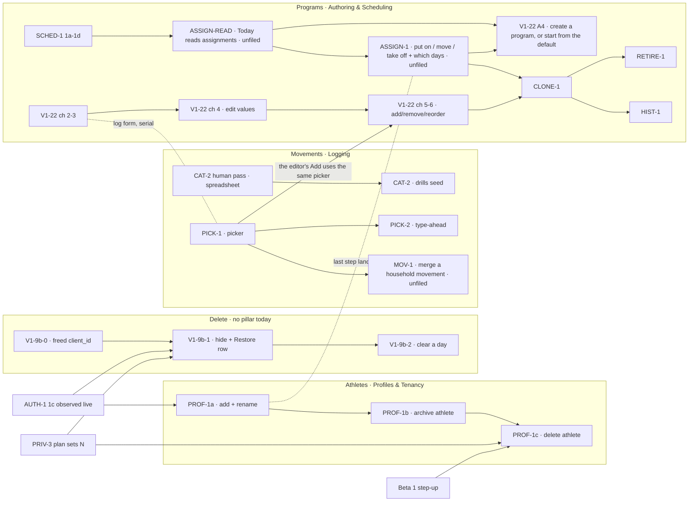

# CRUD-1 — Fix it yourself: a household corrects its own data without a script

> **Status: draft for the maintainer's review, 2026-10-22. UX panel round 1 and the maintainer's rounds 1–2 reconciled (logs at the bottom); prototype v4 awaiting the maintainer's review.** Milestone this
> defines: **Fix it yourself** (`docs/milestones/crud-1-fix-it-yourself.md`, written after the
> prototype is signed off, sequence step 5). Goal it serves: [beta-1](../milestones/beta-1.md) →
> "The goal", item 4 — _"fix their own mistakes without asking [the maintainer] to run a script"_ — and Beta 1's
> exit box _"Every logged thing can be corrected or deleted in the app."_ Prototype:
> [`docs/prototypes/crud-1/index.html`](../prototypes/crud-1/index.html). Procedure:
> [`write-spec`](../../.claude/skills/write-spec/SKILL.md).

## Why this exists

Nine backlog rows each own a piece of "a household can create, change and remove what it put in the
app", and no document connects them. A reader who asks _what is the path?_ has to read all nine,
three ADRs, one spec and one plan. The rows disagree with each other in places (listed under
[Where the rows disagree](#where-the-rows-disagree)) and five prerequisites belong to no row at all
([Unowned work](#unowned-work-this-spec-found)).

Today, measured on `origin/main@9d46547`:

| A household wants to…                    | Today                                                                                                                                                                                                                                                 |
| ---------------------------------------- | ----------------------------------------------------------------------------------------------------------------------------------------------------------------------------------------------------------------------------------------------------- |
| add / rename an athlete                  | ❌ seed only. The empty state links to GitHub (`components/onboarding/picker-empty-state.tsx` → `PickerEmptyState`; copy `PICKER_EMPTY_COPY.setupCta` in `lib/constants.ts`). The only profile-mutating action is `editRoutineAction` (`actions.ts`). |
| remove an athlete                        | ❌ the runbook's 13 hand-typed statements ([runbooks.md](../runbooks.md) → "Delete a household and everyone in it")                                                                                                                                   |
| undo a mis-logged entry                  | ❌ `db:correct` only. **Nothing in shipped code writes `deleted_at`** (grep for a `deletedAt:` setter in `apps/web` and `packages/db/src` finds only the column definition, `schema.ts` → `timestamps`)                                               |
| pick an existing movement                | ❌ a plain `<input type="text">` (`strength-form.tsx`, the Movement field); a near-miss mints a row via `findOrCreateMovement` (`packages/db/src/writers/movement-catalog.ts`)                                                                        |
| remove a mis-typed movement              | ❌ **by decision** — [ADR 0008](../decisions/0008-deletion.md) → "`movements` is exempt"; `schema.ts` above `movements` forbids setting its `deleted_at`                                                                                              |
| change a prescribed load                 | ❌ edit TypeScript and deploy ([V1-22 spec](./v1-22-authoring-program-editing.md)); chunk 1 of 6 shipped                                                                                                                                              |
| replace a program, retire it, look it up | ❌ nothing; `program_assignments` does not exist (`schema.ts`, last migration `0018`)                                                                                                                                                                 |

## Decisions already made

Each is settled. A session reopening one reads the source, not this line.

| Decision                                                                                                                                                                                                                     | Settled in                                                                                           |
| ---------------------------------------------------------------------------------------------------------------------------------------------------------------------------------------------------------------------------- | ---------------------------------------------------------------------------------------------------- |
| **Delete = hide from the whole household, restorable, purged at `N`.** No `deleted_by`. Per-item erasure is not planned; the finest erasure grain is an athlete                                                              | [ADR 0008](../decisions/0008-deletion.md) decision 1 (signed 2026-10-18 in its decision box)         |
| Restore is a **visible `Hidden on this day (n) — Restore` row**, never a toast; fallible, with a typed `slot_taken` refusal; clear-a-day restores as **one** event; restore window = purge window                            | ADR 0008 decision 2                                                                                  |
| A replay never resolves onto a hidden row (V1-24 1e adopted); `deleted_at` is never a side effect of a field upsert; **the freed `client_id` is a migration owed by whichever of V1-9b or sync lands first**                 | ADR 0008 decision 3                                                                                  |
| Deletion authority = logging authority, **revisited (not inherited) at AUTH-1**                                                                                                                                              | ADR 0008 decision 4                                                                                  |
| **Mechanical rule:** a row may be hidden only if every resolver of its namespace filters `deleted_at IS NULL`; otherwise it is removed only by a correction. `movements` is therefore exempt                                 | ADR 0008 → "The general rule"                                                                        |
| Delete grain is the **entry**. `entry_sets.deleted_at` exists and stays unbuilt                                                                                                                                              | ADR 0008 → "What this does not settle" _(maintainer, 2026-10-18)_                                    |
| **Archive is not delete:** its own marker, a lifecycle state a parent can see and restore from                                                                                                                               | ADR 0008 → "What this settles", `RETIRE-1` bullet                                                    |
| Programs: workouts as data, the prescription snapshotted as a rendered string, calendar-indexed rotation                                                                                                                     | [ADR 0005](../decisions/0005-programming-model.md) decisions 1–3, 5, 7                               |
| Scheduling: `program_assignments` with nullable `active_from`/`active_to` + weekday rows; **no active-block marker** (withdrawn); "create a block" waits on Today reading the athlete's **set** of assignments               | [ADR 0007](../decisions/0007-scheduling-model.md) decisions 1, 4; "What this ADR does not authorize" |
| V1-22 scope A: six chunks, 17 acceptance criteria, `ProgramEditDTO`; authoring is profile-scoped at `/p/<id>/program`; a value edit is last-write-wins on the server clock; clearing a load is `UPDATE … NULL`, never a hide | [V1-22 spec](./v1-22-authoring-program-editing.md) — **this spec cites it and does not restate it**  |
| CLONE-1 is **per athlete**, default none; the clone grain is a **block**; household-wide replacement rejected                                                                                                                | [plan.md → CLONE-1](../plan.md#clone-1) _(maintainer, 2026-10-07)_                                   |
| PROF-1 ships **full athlete CRUD**; create/read/edit on `/p` with a **dashed "+ Add athlete" tile at the bottom of the picker**; delete is **PRIV-1's hard delete**, offers archive first, sits behind step-up               | [plan.md → PROF-1](../plan.md) _(maintainer, 2026-09-28 and 2026-10-08)_                             |
| Household is in the session, not the URL; a wrong-household profile is a **404**                                                                                                                                             | [ADR 0006](../decisions/0006-household-addressing.md) (accepted 2026-10-07)                          |
| PICK-2 suggestions **never block**; English only; performance is a design constraint                                                                                                                                         | [plan.md → PICK-2](../plan.md#pick-2) _(maintainer, 2026-10-08)_                                     |
| CAT-2 is gated on the **human approve/deny pass** over the proposed movement list (ADR 0005 open question 3, "the 72 proposed entries") and **not** on scheduling                                                            | [plan.md → CAT-2](../plan.md); ADR 0007 → Backlog impact, CAT-2 row                                  |
| Every UI change gets the UX panel **before** implementation                                                                                                                                                                  | [AGENTS.md](../../AGENTS.md) → UI PR rules                                                           |

⚠️ **Status lines are stale, not the decisions.** ADR 0005, 0007 and 0008 all still read
`Status: Proposed` in their headers. 0008's decision box is signed (2026-10-18); 0005 and 0007 are
unsigned, and the [roadmap](../roadmap.md) says 0007 needs signing **and amending** before SCHED-1 1c.
This spec relies on 0005 and 0007 as the V1-22 spec and the SCHED-1 plan already do; it does not make
them more settled than they are.

## The four tracks and the one path

Nine rows fall into four tracks, each in one roadmap pillar. The pillar is a **file** claim
([roadmap.md](../roadmap.md) → Pillars), so the tracks are also the first cut of the parallelism
question, which the milestone settles with the full glob intersection (sequence step 6).



### Chunks, in order, and why the order cannot move

| #   | Chunk                                                                                                                                                                                                       | Gated on                                                                                             | Why it cannot move                                                                                                                                                                                                                                                                                                                                                                                                                                                                                                                    |
| --- | ----------------------------------------------------------------------------------------------------------------------------------------------------------------------------------------------------------- | ---------------------------------------------------------------------------------------------------- | ------------------------------------------------------------------------------------------------------------------------------------------------------------------------------------------------------------------------------------------------------------------------------------------------------------------------------------------------------------------------------------------------------------------------------------------------------------------------------------------------------------------------------------- |
| 0   | **CAT-2's human pass** — the maintainer approves/denies the proposed movement list in a spreadsheet, and assigns each kept row its picker group (see [the grouping finding](#unowned-work-this-spec-found)) | nothing                                                                                              | **Start now.** It is a human step gating a code step, blocks nothing, and is unstarted — the hidden-gate pattern [parallel-work.md](../parallel-work.md) → "How many lanes?" names. The list is not committed in this repo (searched `docs/`, `packages/`, `apps/`); ADR 0005 calls it "the 72 proposed entries".                                                                                                                                                                                                                     |
| A1  | **PROF-1a** — add an athlete (dashed tile) + rename + `kind`, on `/p`. Removes the GitHub link                                                                                                              | **AUTH-1 1c observed live** (the session is what says _whose_ household the athlete joins) + **Q15** | Under the gate, "add an athlete" adds to whichever household `getHouseholdScope()` resolves for a shared code — beta-1's chart puts PROF-1 after AUTH-1 for exactly this. First profile-creating endpoint. ⚠️ **Until D4, Today shows every profile the household's newest block** (`programDayRows`), so an adult added here gets the kids' program. Q15 decides: a kid-only guard on the program card, or A1 waits for D4. The add flow's **last step** (put on a program) cannot exist before assignments do; it arrives with D4b. |
| A2  | **PROF-1b** — archive an athlete (hidden from the picker, history intact, restorable)                                                                                                                       | A1 + **a marker decision** (no `archived_at` exists)                                                 | Delete must offer archive first (PROF-1 row), so archive exists before delete does.                                                                                                                                                                                                                                                                                                                                                                                                                                                   |
| A3  | **PROF-1c** — delete an athlete: type the name, step-up, then PRIV-1's hard delete + ledger                                                                                                                 | A2 + **PRIV-3's runner** (the deletion as a guarded script) + **Beta 1 step-up**                     | Irreversible. Behind step-up by beta-1 → Beta 1 "Step-up". Needs the same statements the runbook types by hand, as code.                                                                                                                                                                                                                                                                                                                                                                                                              |
| B0  | **V1-9b-0** — the freed `client_id`: prove no hidden/live pair exists in prod, then re-predicate the five partial `client_id` arbiters (or record why not)                                                  | nothing                                                                                              | **Must precede the first write of `deleted_at`.** `logCheckinEntries` (`lib/dal/entries.ts`) already arbitrates on `client_id WHERE deleted_at IS NULL`, so B1 arms the hazard (ADR 0008 decision 3.4). One migration per PR, and a DB PR must not share review with a UI PR.                                                                                                                                                                                                                                                         |
| B1  | **V1-9b-1** — hide one entry; the Hidden/Restore row; `slot_taken`; the `notice.md` sentence; the entry→set live-parent `db:verify` proof; the export decision                                              | B0 + **AUTH-1 1c** + **PRIV-3's plan has chosen `N`**                                                | The notice sentence B1 owes describes "hidden, then purged at `N`"; it cannot be written truthfully before `N` exists as a number. The purge **job** may come later; the **number** may not (ADR 0008 → Backlog impact, PRIV-3 row). AUTH-1: decision 4 is revisited there, so building authority before it builds against a principal that is about to change.                                                                                                                                                                       |
| B2  | **V1-9b-2** — clear a day behind typed "delete"; restores as one event                                                                                                                                      | B1                                                                                                   | Reuses B1's Hidden row and restore path.                                                                                                                                                                                                                                                                                                                                                                                                                                                                                              |
| C1  | **PICK-1** — the picker: choosing an existing movement is the easy path                                                                                                                                     | **V1-22 chunk 2 merged** (both edit `strength-form.tsx`, both under `strength-logging.md`)           | Gate-1 collision, decided the way the roadmap decided chunk 2 vs `v1-30b`: chunk 2 is planned (#239), PICK-1 is not, so chunk 2 goes first. PICK-1 changes the log submit schema (the Logging∩Authoring seam, owner **Logging**).                                                                                                                                                                                                                                                                                                     |
| C2  | **PICK-2** — suggestions before a new movement is created                                                                                                                                                   | C1                                                                                                   | Its own row: it extends PICK-1's picker.                                                                                                                                                                                                                                                                                                                                                                                                                                                                                              |
| C3  | **CAT-2** — the approved drills become `movements` (seed, `ON CONFLICT DO NOTHING`)                                                                                                                         | chunk 0                                                                                              | Seed-only; touches `catalog-movements.ts` + `seed.ts` (write-path guide). Independent of C1 in files, but the picker's groups are what make 72 more rows findable, so ship it **after** C1 if both are ready.                                                                                                                                                                                                                                                                                                                         |
| C4  | **MOV-1** _(unfiled)_ — a household removes or merges its own mis-typed movement                                                                                                                            | C1 + the three-part lift at `schema.ts` above `movements`                                            | ADR 0008 leaves this gap "by decision" and names `TEN-2c-1` "or a successor" as owner. PICK-2 only stops new mis-types.                                                                                                                                                                                                                                                                                                                                                                                                               |
| D1  | **V1-22 chunks 2 → 3 → 4** — the snapshot writer, the backfill, edit values                                                                                                                                 | per [the V1-22 spec](./v1-22-authoring-program-editing.md)                                           | That spec owns the order (chunk 3's `--apply` recorded before 4 merges).                                                                                                                                                                                                                                                                                                                                                                                                                                                              |
| D2  | **V1-22 chunks 5 → 6** — the seed guard, then add/remove/reorder                                                                                                                                            | D1 + **C1** (chunk 6's Add opens PICK-1's picker)                                                    | That spec; chunk 6 owes the prescription-identity column. **(M4)** The editor's "+ Add a movement" opens the **same** picker component as the log form, so it cannot grow a second, weaker movement list; PICK-2's suggestions reach the editor when C2 lands, with no editor change.                                                                                                                                                                                                                                                 |
| D3  | **SCHED-1 1a → 1d** — assignments + weekday rows, seeded                                                                                                                                                    | **Beta 1's gate** (family #1, two weeks, a decision to widen) + ADR 0007 signed and amended          | [roadmap](../roadmap.md) → Authoring & Scheduling. Its plan owns the order.                                                                                                                                                                                                                                                                                                                                                                                                                                                           |
| D4  | **ASSIGN-READ** _(unfiled)_ — Today and the export read the athlete's **assignment**, not `programDayRows`' newest block                                                                                    | D3                                                                                                   | CLONE-1's gate 2 names it; the SCHED-1 plan **excludes it** ("This is also why the one-block→N-assignments read is **not** in this plan") and ADR 0007 sends it to "its own plan and UX panel". **Byte-affecting** for the CSV (owner: Insight).                                                                                                                                                                                                                                                                                      |
| D4b | **ASSIGN-1** _(unfiled)_ — put an athlete on a program **on chosen weekdays**, move them, change their days, or take them off, with Undo; plus A1's last step and the "No program yet" state                | D4                                                                                                   | **Found by the UX panel (R1); the days added by the maintainer (M2).** CLONE-1's "move the wrong kid back", RETIRE-1's "move them first" and both Undos need a plain assignment write, and no row or screen has one. CLONE-1's "who moves" is a special case of it, so it lands first and CLONE-1 reuses it. It is also the **recurrence editor** ADR 0007 says the weekday table implies ([Recurrence](#recurrence-the-weekday-set-rrule-and-the-rotation)).                                                                         |
| D4c | **V1-22 A4** — create a program; or, in a household with none, start from the default (`PROGRAM_SEED`, copied with no loads)                                                                                | D4 + D4b + D2 (the editor it fills)                                                                  | **Brought into scope by the maintainer (M6).** ADR 0007 decision 4: creating a block is _"safe only once Today renders the athlete's **set** of active assignments"_ — D4. The default needs a request-scoped writer (unowned 7).                                                                                                                                                                                                                                                                                                     |
| D5  | **CLONE-1** — "save as a copy" from the editor, choose who moves                                                                                                                                            | D1 (chunks 2–3) + D4b + D2 (the editor it saves from)                                                | Its row's own three gates, in that order.                                                                                                                                                                                                                                                                                                                                                                                                                                                                                             |
| D6  | **RETIRE-1** — archive a program                                                                                                                                                                            | D5 + D3                                                                                              | CLONE-1 creates the pile; archive must compose with `active_to`.                                                                                                                                                                                                                                                                                                                                                                                                                                                                      |
| D7  | **HIST-1** — what program an athlete ran on a past date                                                                                                                                                     | D5                                                                                                   | No assignment history exists before CLONE-1 moves someone.                                                                                                                                                                                                                                                                                                                                                                                                                                                                            |

**Where V1-22 scope B went.** The row defines B as _"A plus assignment + a third schedule shape +
GAP-3 measurement shapes"_. Since ADR 0007, **assignment is SCHED-1's `program_assignments`** (D3) and
**choosing who runs a block is CLONE-1's "who moves"** (D5); the **third schedule shape** is YDP-1,
deferred by the maintainer (2026-09-24); the **GAP-3 shapes** are V1-22 chunk 6's _"rep-shaped items
only until GAP-3's target shapes land"_. So B has no chunk of its own here, and the V1-22 row should
say so when this spec lands ([Where the rows disagree](#where-the-rows-disagree), item 5).

### The critical path, and what is parallel

**Serial, and the milestone ships when it ships:** `AUTH-1 1c` → `V1-9b-1` → `V1-9b-2`, and `SCHED-1`
→ `ASSIGN-READ` → `ASSIGN-1` → `CLONE-1` → `RETIRE-1`. The second chain sits behind Beta 1's human gate, so for Beta
0 the CRUD critical path is **AUTH-1 → V1-9b**.

**Can start before AUTH-1 1c, because nothing it touches is an AUTH-1 file** (preliminary — the
milestone does the full intersection against AUTH-1's file table, which names `lib/dal/household.ts`,
`app/p/[profileId]/actions.ts`, four `page.tsx` files and `lib/constants.ts` for 1c):

- **chunk 0** (a spreadsheet; no repo files) — **now**.
- **B0** (`packages/db` migration + `db:verify`; no `apps/web` file) — after AUTH-1 1b's migration lands,
  because both are migrations and the numbering is serial.
- **D1** (V1-22 chunks 2–3) — already unblocked per the roadmap. ⚠️ Chunk 2 edits the log form, and
  AUTH-1 1c edits `actions.ts`; check the intersection at the time, per gate 1.
- **PICK-1's plan and panel** (docs only), not its code.

⚠️ **Every mutating chunk above touches `apps/web/app/p/[profileId]/actions.ts` and
`mutating-actions.ts`, and every DAL addition touches `lib/dal/`** — all owned by
[write-path.md](../features/write-path.md). So under gate 1 the tracks are **not** disjoint even when
their screens are: two tracks adding Server Actions collide on `actions.ts` and on the guide. The
milestone must either serialize the action-adding chunks or shard `actions.ts` per feature first (a
refactor, filed as a row — [parallel-work.md](../parallel-work.md) → "When a gate fails"). This spec
recommends the shard, as one small refactor PR before A1, because four tracks would otherwise queue on
one file.

## Acceptance

Criteria for rows that already have a spec or ADR **cite** them; these are the ones nothing else
writes. Each names the chunk that must carry its test. Criteria marked **(R1)** were added or changed by
the UX panel's first round; the log at the bottom says why.

**Athletes (A1–A3)**

1. **When** a parent submits a new athlete with a non-blank name and a `kind` from `PROFILE_KINDS`, the
   system **shall** create one profile in the **session's** household and the picker **shall** list it
   on the next render. _(A1)_
2. **If** the name is blank after trimming, longer than the limit the plan sets, or `kind` is not in
   `PROFILE_KINDS`, **then** the system **shall** return a typed field error and write nothing. _(A1)_
3. **When** an "add athlete" submit is replayed with the same idempotency key, the system **shall**
   create exactly one profile and return the same result. _(A1 — AGENTS.md backend rule 6)_
4. **If** a rename or archive names a profile outside the session's household, **then** the system
   **shall** respond as for an unknown profile (404 semantics, ADR 0006) and write nothing. _(A1, A2)_
5. **While** an athlete is archived, the picker **shall not** list them, their history **shall** still
   export, and a parent **shall** be able to restore them from a list of archived athletes. _(A2)_
6. **When** a parent starts deleting an athlete, the system **shall** offer, in order, the athlete's
   export, archive, then delete; **shall** enable delete only when the typed name matches the athlete's
   name **ignoring case and surrounding spaces**; **shall** require a fresh step-up; and **shall**
   hard-delete every row the runbook's procedure deletes, soft-deleted ones included, and write a ledger
   entry. Its copy **shall not** claim more than `notice.md` does (removed from the app now, from
   backups after their window). **(R1)** _(A3)_
7. **When** PROF-1a ships, the empty state **shall not** link to GitHub. _(A1 — ONB-0 finding E23)_
8. Rename **shall** be reachable from the athlete's own page; archive and delete **shall** live only in
   household settings, never on the picker. **(R1)** _(A1, A2)_

**Delete (B0–B2)** — ADR 0008 is the source; these make it testable.

9. **If** an entry has been hidden and a submit replays its `client_id`, **then** the system **shall
   not** insert a second live row. _(B0 — `db:verify`, the inverse of today's partial arbiter)_
10. **When** a person taps Delete on a logged entry, the entry **shall** disappear for **every** profile
    view in the household, an untimed `<name> deleted · Undo` line **shall** take its place **in the same
    position** until the page is left, and a `Hidden on this day (n)` section **shall** appear **above
    the day's sections**, surviving a reload and a day change. Each hidden item **shall** state the date
    it stops being restorable. **(R1)** _(B1)_
11. **When** focus is on a Delete control and its row is hidden, focus **shall** move to that row's
    in-place Undo — never to another Delete. **When** an entry is restored, focus **shall** move to the
    restored row. The live region announcing either **shall** be mounted before its text changes.
    **(R1)** _(B1 — the `saved-announcer.tsx` idiom)_
12. **When** Restore is tapped and the entry's natural-key slot is free, the entry **shall** return to
    its original position; **if** the slot is taken, **then** the system **shall** return a typed
    `slot_taken` result naming what holds the slot, **never** a `23505` or a silent no-op, and **shall**
    offer one atomic "keep this one instead" (hide the holder and restore this one in one transaction),
    with leaving it as the default. **(R1)** _(B1 — the fixture: hide a weigh-in, log a new one that day,
    restore the first)_
13. **Where** the day page folds several entries into one row (calisthenics bouts, `page.tsx`), that
    row's Delete **shall** name how many entries it hides and **shall** hide them as **one** event.
    **Where** a strength session renders twice on the page, Delete **shall** appear on exactly one copy.
    **(R1)** _(B1)_
14. **When** "Clear this day" is confirmed, the Clear control **shall** stay disabled until the input
    equals `delete` ignoring case and surrounding spaces, every live entry for that athlete and day
    **shall** be hidden in **one** transaction, and the Hidden section **shall** offer to restore them
    as one event. A partial restore **shall** report which entries could not come back and why. _(B2)_
15. **While** an athlete has hidden entries on other days of the current week, the day page **shall**
    say so and link to each day. **(R1)** _(B1)_
16. **When** a profile's every entry for a month is hidden, the export path the plan chose (ADR 0008
    → "One constraint") **shall** still deliver the person their data. _(B1)_

**Movements (C1–C4)**

17. **When** an athlete picks a movement from the picker and submits a set, the stored entry **shall**
    reference that movement's id — **no** call to `findOrCreateMovement` for it — and **no** magnitude
    shall arrive prefilled. _(C1 — PICK-1's own acceptance, verbatim intent)_
18. The picker **shall** offer, in order: the athlete's recent movements, then the catalog grouped by
    the picker group, with today's prescribed movements folded away (the form already fills them);
    **shall not** raise the on-screen keyboard on open on a touch device; and **shall** be operable by
    keyboard alone, with every option a ≥44px target at 360px. **(R1)** _(C1)_
19. **When** the typed text is a known alias (`RDL`), the picker **shall** offer the movement it names.
    **When** it has no exact match but a near match exists, the picker **shall** show the near match
    and a spelling suggestion **before** creating a movement, and "use what I typed" **shall** stay
    one tap and visible above the keyboard. A movement created that way **shall** be written when the set
    is saved, not when it is picked. **(R1)** _(C2)_
20. **When** `db:seed` runs twice after CAT-2, the movement count **shall** be the same as after once.
    _(C3)_

**Programs (ASSIGN-1, D4–D7)** — V1-22's 17 criteria stand for D1–D2.

21. **When** a parent moves an athlete from one program to another, changes their days, or takes them
    off one, the system **shall** close the open assignment (`active_to` = the day before) and, for a
    move or a change of days, open one (`active_from` = today, athlete-local) carrying the chosen
    weekdays; **Undo** **shall** reverse exactly the rows it changed. A change of days is a new period,
    never an edit in place, so HIST-1 shows it. **(R1, M2)** _(ASSIGN-1)_
22. **When** a parent saves program edits and anyone else is on the program, the system **shall** ask
    whether to change it for everyone on it or save it as a copy, naming who is on it. **(R1)** _(D5)_
23. **When** a copy is saved, it **shall** carry every live prescription and per-athlete target of the
    source with identical values, and the source **shall** be unchanged. _(D5)_
24. **When** a parent moves an athlete to the copy, the system **shall** behave as criterion 21 and
    **shall not** change any already-exported byte for that athlete. An athlete who was **not** on the
    source **shall** be told which program(s) they stay on, and that they have no loads on the copy yet.
    **(R1)** _(D5)_
25. **When** a copy is saved with no athletes ticked, **no** assignment **shall** change. _(D5)_
26. **While** anyone is on a program, archiving it **shall** first resolve each of them (move or take
    off) in place — or, under Q3's other answer, close their assignments and say they have no program
    in its place; **either way** Undo **shall** restore the archive **and** every assignment it closed
    as one event. **(R1)** _(D6)_
27. **While** a program is archived, it **shall not** appear in the editor's program list, the copy
    source list, or the move-to list, and every past entry against it **shall** render and export as
    before. _(D6)_
28. **When** a parent opens an athlete's program history, the system **shall** list their assignments
    newest first with start and end dates, each opening the prescriptions as snapshotted and linking to
    the days logged in that period; **and when** they pick a date, **shall** name the program(s) open on
    it, or say nothing was assigned. **(R1)** _(D7)_

**Scheduling and first programs (D4b, D4c, D2) — added by the maintainer's round 1**

29. **When** a parent saves an assignment, the system **shall** store its weekdays as
    `program_assignment_weekday` rows drawn from `WEEKDAYS` (SCHED-1 1a, `0 = Sunday`), at least one and
    no repeats; **if** none is chosen, **then** it **shall** return a field error and write nothing. The
    UI **shall** show the days Monday-first and **shall** map them through `WEEKDAYS`, never a second
    weekday list. **(M2)** _(ASSIGN-1)_
30. **When** the day is in none of the athlete's weekday sets, the Strength section **shall** say there
    is no program that day and name the days each program runs; logging **shall** still work. **When**
    it is, it **shall** name the program and the workout the resolver gives for that day. **(M2, M7)**
    _(ASSIGN-1 — the read is D4's)_
31. The assignment sheet **shall** preview the next six sessions using the **same** resolver Today uses
    (`resolveRotationSlot`, SCHED-1 1b), and **shall** say so in words when the chosen days stop the
    workouts alternating (Q13). **(M2)** _(ASSIGN-1)_
32. **When** a parent adds an athlete and the household has a live program, the system **shall** offer
    "put them on a program" with **no** program preselected and every day chosen, and a "Not now" that
    lands on the athlete's page; that page **shall** then show "No program yet" with a way to choose one.
    **(M5)** _(ASSIGN-1, extending A1's flow)_
33. **When** the household has no live program, that step **shall** offer exactly two paths — "Choose a
    default program" and "Create a program" — and a default **shall** be copied into the household with
    every prescription and **no** load or per-athlete target (the LLM-never-authors-loads rule; the
    seed's loads are per-kid fixtures). **Where** the athlete is an adult and no adult default exists,
    the step **shall** say so. **(M6)** _(D4c)_
34. **When** a parent taps "+ Add a movement" in the program editor, the system **shall** open the
    log form's picker (criteria 18–19 apply unchanged), mark movements already in that day, and write a
    movement created by "use what I typed" when the **program** is saved, not when it is picked.
    **(M4)** _(D2)_
35. **When** a created program is saved, its rotation anchor **shall** be the save day, so its first
    workout falls on that day. **(M6)** _(D4c)_
36. **Wherever** a parent is asked to choose a program — the assignment sheet, the add flow's last step,
    and the "No program yet" state on the athlete's day page and program page — "Create a program"
    **shall** be one tap away, so "none of these fit" is never a dead end. **(M8, M9)** _(ASSIGN-1,
    D4c)_
37. **Below 600px** the assignment sheet **shall** fill the screen with its title and its actions
    pinned and only the middle scrolling; **from 600px** it **shall** be a dialog capped at the viewport
    height with the same pinned actions. The weekday toggles **shall** size to their container, not the
    viewport — four then three in 294px, seven across from 496px — each ≥44 × 44px. **(M11, M12)**
    _(ASSIGN-1)_
38. **When** an athlete has been taken off a program, a parent **shall** be able to put them back on it
    from **both** sides: "+ Put {name} on another program" on the athlete's program page, and "+ Add
    athlete" on the program in the household's program list (choose who, then days). **(M13)**
    _(ASSIGN-1)_
39. The picker tile, the athlete form and household settings **shall** show `kind` as **Child** /
    **Adult**, from one display map beside `PROFILE_KINDS`; the stored values stay `kid` / `adult`.
    **(M10)** _(A1)_

## The data contract

Shapes that cross a seam, so two tracks can proceed without guessing. Homes follow AGENTS.md: shared
schemas in `packages/shared`, DTOs beside their DAL in `apps/web/lib`.

```
packages/shared
  profileUpsertSchema        { name: string (trimmed, 1..PROFILE_NAME_MAX), kind: profileKindSchema }
                              — kind REUSES enums.ts PROFILE_KINDS; PROFILE_NAME_MAX is new, one home
  PROFILE_KIND_LABEL         { kid: 'Child', adult: 'Adult' } as const satisfies Record<ProfileKind, string>
                              — beside PROFILE_KINDS in enums.ts; replaces profile-tile.tsx's
                                `capitalize {profile.kind}`, which renders "Kid" (M10)
  hideEntrySchema            { profilePublicId, entryPublicId }
  restoreHiddenSchema        { profilePublicId, day, hiddenAt }       ← restores ONE hide event
  clearDaySchema             { profilePublicId, day, confirm }  ← confirm is trimmed and lower-cased,
                              THEN z.literal('delete') — the UI's matching rule and the server's agree
  hideGroupSchema            { profilePublicId, day, entryPublicIds: string[] }  ← one folded row, ONE event
  assignmentSetSchema        { profilePublicId, fromBlockPublicId | null, toBlockPublicId | null,
                               weekdays: weekdaySchema[] (min 1, unique) }
                              ← from null = put on; to null = take off; to = from = change days.
                                weekdaySchema is SCHED-1 1a's (day.ts) — REUSED, never re-declared
  programCreateSchema        { name: string (trimmed, 1..PROGRAM_NAME_MAX), workoutLabels: string[] (min 1),
                               forProfilePublicId | null }                       ← D4c
  programFromDefaultSchema   { defaultSlug: 'youth_daily_program', profilePublicId, weekdays }  ← D4c
  MOVEMENT_PICKER_GROUPS     as const — the picker's groups; see the grouping finding
  programCloneSchema         { sourceBlockPublicId, name, moveProfilePublicIds: string[] (default []) }

apps/web/lib  (DTOs, never raw rows)
  HiddenOnDayDTO             { count, events: Array<{ hiddenAt, restorableUntil,
                                                    items: Array<{ entryPublicId, label }> }> }
                              ← restorableUntil = hiddenAt + N (PRIV-3); computed server-side, one home
  RestoreResult              per item: { ok: true } | { ok: false, reason: 'slot_taken', heldBy: { entryPublicId, label } }
                                                     | { ok: false, reason: 'not_found' }
  MovementOptionDTO          { publicId, name, group, aliases: string[], owner: 'catalog' | 'household',
                               prescribedToday: boolean }
  ProgramEditDTO             — V1-22 spec, unchanged
  AssignmentDTO              { blockPublicId, blockName, activeFrom, activeTo | null, weekdays: Weekday[] }
```

Rules the contract carries:

- **A hide event's identity is its `deleted_at` value — no new column.** Postgres `now()` is the
  _transaction_ start time, so every row a clear-day hides in one transaction shares one `deleted_at`
  exactly, and two separate taps do not. `(profile, day, deleted_at)` is the event; restore takes
  `hiddenAt`. ⚠️ **This is a proposal for B1's correctness panel**, not a settled decision: it rests on
  the writer using `now()` (every shipped writer does) and never `clock_timestamp()`.
- **The picker submits an id, not a name.** C1 adds a movement public id to the log submit schema; the
  free-text name path remains only for "use what I typed". That is a change to the Logging∩Authoring
  seam (owner: Logging), so C1 and V1-22 chunk 2 — which adds a prescription public id to the **same**
  schema — must not run at once.
- **`RestoreResult` is per item**, because a cleared day restores as one event and may partly fail.
- **No authored load crosses into the log form** — `MovementOptionDTO` has no load, the same boundary
  `ScaffoldRow` keeps ([V1-22 spec](./v1-22-authoring-program-editing.md) → contract rules).
- The envelope is `ActionState` everywhere; the stale-write copy is `AMEND_ERROR_COPY.staleWrite`.

## Recurrence: the weekday set, RRULE and the rotation

_(Asked for by the maintainer before either is designed further, M3.)_ The format calendar apps share is
**RRULE**, the recurrence rule of **iCalendar, RFC 5545** — what Google Calendar, Apple Calendar and
Outlook store behind "Repeat" and "Custom recurrence", e.g. `FREQ=WEEKLY;BYDAY=MO,WE,FR`.

**What is decided — cite, do not re-litigate.** ADR 0007 decision 1
([`0007:74-133`](../decisions/0007-scheduling-model.md)): recurrence is a **weekday set, stored as
rows**, _"Not RRULE, and `daily` is not a kind"_. It names what that cannot express — "every other
Tuesday", "the first Monday of the month", a one-week tournament exception — finds no case for the
first two in `plan.md` or the samples, answers the third with the assignment's date range (close one,
open another), and leaves the door open: _"an `rrule text` column beside the weekday rows is purely
additive if a case ever arrives, with the rows staying the fast path."_

**How the two fit.** The weekday set is exactly one RRULE shape, so nothing built now has to be
unbuilt:

| What the parent sees | What is stored (SCHED-1 1c)                           | The same thing as RRULE                  |
| -------------------- | ----------------------------------------------------- | ---------------------------------------- |
| "from today"         | `program_assignments.active_from`                     | `DTSTART`                                |
| take off / move      | `active_to` (the day before)                          | `UNTIL`                                  |
| Mon · Wed · Fri      | three `program_assignment_weekday` rows, `0 = Sunday` | `FREQ=WEEKLY;BYDAY=MO,WE,FR`             |
| every day            | seven rows (not a `daily` kind)                       | `FREQ=WEEKLY;BYDAY=MO,TU,WE,TH,FR,SA,SU` |
| a change of days     | close the period, open a new one                      | a new rule from today (never `EXDATE`)   |

The prototype prints that RRULE under the day toggles (a review-only flag), so the mapping can be
checked by eye.

**The rotation is not recurrence.** RRULE says **when**; it has no notion of "Day A, then Day B". The
rotation is the block's anchor plus an ordered list (ADR 0007 decision 2), **calendar-indexed** by the
maintainer's decision (2026-09-24; `programming.md` invariant 3b). That decision was made when every
day ran. With a weekday set they interact: on Mon/Wed/Fri the gaps are 2, 2 and 3 days, so the
Youth Daily Program runs **B, B, B, then A, A, A**. The prototype shows this in the sheet's preview and
warns. Nothing here changes the rotation; **Q13** asks whether the decision still holds.

**The path to full RRULE, and what triggers it.** Not in this milestone. The trigger is the first real
case of an interval, a monthly rule or a one-off exception that a date range cannot carry. Then: (1) an
additive nullable `rrule text` on `program_assignments`, with the rows staying the fast path for
dueness; (2) a "Custom…" beside the day toggles opening a rule builder (the calendar apps' pattern);
(3) expansion in the pure resolver in `packages/shared`, with a library only after the dependency review
SECURITY.md requires. An `.ics` export would be lossless from the rows today; no row asks for one.

**What this asks of ASSIGN-1 now:** the days are **one field** in the sheet, so a "Custom…" can sit
beside them later without a redesign; and the weekday origin comes from `WEEKDAYS` alone, the trap
SCHED-1's plan documents (ISO `1 = Monday` vs `localWeekday`'s `0 = Sunday`).

## Later milestones this must not get in the way of

_(The maintainer's aside, M15: a dashboard is a future milestone, kept in mind while building this.)_
Household metrics — streaks, PRs, trends, comparisons between athletes, a household view, reports —
already have homes in the backlog, all in the **Insight** pillar ([roadmap.md](../roadmap.md) →
Pillars): **V1-16** (the per-athlete progress dashboard), **MOT-1** (the one daily streak), **DASH-1**
(streaks, week/month/year-over-year, PRs, leaderboards within a household or across athletes a coach
can see) and **SOCIAL-1** (comparing with other households). None is designed here. What CRUD-1 owes
them:

- **ASSIGN-1's weekday rows are the streak's input.** DASH-1 says a streak _"needs to know which days
  were scheduled"_, and MOT-1's streak _"needs to know what is DUE today, or it breaks on a correctly-taken
  rest day"_. A day outside the weekday set must read as a rest day, never as a miss — so the
  weekday set is stored as rows and resolved by the one shared resolver (criteria 29–31), not computed
  in a screen.
- **A hidden entry never counts** (Q7) — in the strip now, in every aggregate later. Risks → the
  `deleted_at` reader audit is the same list a dashboard will read from.
- **An archived athlete keeps their history** (criterion 5), so a household view must decide whether
  archived athletes appear. A2's plan records the marker the dashboard will filter on.
- **Comparison is a product decision first.** DASH-1 already warns that ranking siblings by
  bodyweight or load has obvious failure modes. "Who did the most", "max weight", "longest streak"
  across children wait for that decision, opt-in and household-only by default; nothing in CRUD-1 ranks
  anyone.

## Unowned work this spec found

No backlog row owns these. Each needs a row (or a sentence in an existing one) before its chunk starts;
**this spec does not file them** — `docs/plan.md` is off-limits until this work's PR opens.

1. **ASSIGN-READ (D4).** Today and the export reading the athlete's assignment. CLONE-1 lists it as a
   gate; the SCHED-1 plan explicitly excludes it; ADR 0007 sends it to "its own plan and UX panel". It
   is byte-affecting for the CSV contract, owned by **Insight**, so it needs that pillar's sign-off.
2. **The picker's grouping is not derivable from `pattern`.** The maintainer described a curated
   **push/pull/legs** catalog. The only classification is `movements.pattern` (11 values,
   `packages/shared/src/movements.ts` → `MOVEMENT_PATTERNS`); push/pull/legs exist only as
   `prescriptions.day_role` values. A pattern→group map covers the other 29 of the 35 catalog rows, with
   judgement calls (is `carry` legs? is Med-Ball Slam a hinge?), but **not `isolation`**, whose six members split three ways: Tricep Extensions, Lateral Raises (push);
   Barbell Curls, Hammer Curls, Rear Delt Raises (pull); Calf Raises (legs). So the group is either a
   per-row value in `MOVEMENT_SEED_ROWS` (a column, a migration) or the picker groups by pattern under
   friendlier names. **A decision for the maintainer, at chunk 0**, because that is when every row is
   already being looked at once.
3. **MOV-1 — a household's mis-typed movement.** ADR 0008 makes it unremovable "by decision" and
   names "`TEN-2c-1` or a successor" as owner. `TEN-2c-1` is a measured no-op (the 2026-10-13 census
   found zero household-owned movements), so the successor does not exist. Today the gap is latent;
   PICK-1 makes household movements cheap to create, so it becomes live after C1.
4. **Athlete archive has no marker.** `profiles` has `deleted_at` and no `archived_at`
   (`schema.ts` → `profiles`). ADR 0008's discriminator says archive is not a hide — a hide ends in
   erasure at `N` — so archiving an athlete with `deleted_at` would purge them. A2 owes a migration or a
   decision that athlete archive waits.
5. **ASSIGN-1 — moving an athlete between programs, or off one.** _(Found by the UX panel, R1.)_ Three
   recovery paths need it: undoing a copy that moved the wrong athlete, RETIRE-1's "move them first",
   and the Undo of an archive. `program_assignments` (SCHED-1 1c) is the table; no row owns a screen or
   an action that writes it outside CLONE-1's one-shot "who moves". It is chunk D4b.
6. **An athlete added in the app never gets ramp targets.** `seed.ts` expands
   `CALISTHENICS_RAMP_SCHEDULE` × **kid profiles that exist at seed time** into `ramp_targets`. The
   schedule ships empty, so this is latent today; the day it is filled, a kid created by A1 silently has
   none. A1's plan either expands targets on create or records why not.
7. **A default program for a household that has none.** _(M6.)_ The only program the app ships is
   `PROGRAM_SEED` (`packages/shared/src/programming.ts`), and the only writer that expands it is
   `seedProgram` (`packages/db/src/seed.ts:345`), which is **script-scoped by design** — it takes
   `householdScopeForScript`, and `apps/web` cannot name it (`packages/db/src/scope.test.ts` pins
   that). So "Choose a default program" needs a **request-scoped** writer that copies the structure
   and drops every load and target. And **there is no adult default**: the prototype says so rather than
   offer a kids' program as if it fitted. D4c owns both; whether an adult default is ever authored is a
   product question, not this milestone's.

Also, from the roadmap's own membership rule: **V1-9b and PRIV-3 belong to no pillar** (roadmap.md →
Pillars). This spec proposes Profiles & Tenancy for neither — V1-9b's files are `app/p/[profileId]/`
and `lib/dal/entries.ts`, which is **Logging** (write-path guide); PRIV-3 is a `packages/db/scripts`
runner, which is **Platform**. The milestone PR moves them.

## Where the rows disagree

Said rather than silently resolved.

1. **beta-1 says "PROF-1 create" in Beta 0 and "rename + archive" in Beta 1; the PROF-1 row says full
   CRUD.** Both hold: this spec puts create **and rename** in A1 (rename is a field on the same form, and
   a typo'd athlete name with no fix is the exact failure this milestone exists to remove), archive in
   A2, delete in A3. beta-1's Beta 0 / Beta 1 split stays the release cut.
2. **The V1-9b row says "no migration"; ADR 0008 decision 3.4 says V1-9b owes one** (or the sync PR
   does, whichever lands first). The ADR is later and signed; B0 is that migration.
3. **The V1-9b row and ADR 0008 name `logCheckIns`; the function is `logCheckinEntries`**
   (`lib/dal/entries.ts`). The behaviour they describe is accurate.
4. **The V1-22 spec says the household program library "waits for TEN-1".** TEN-1 is done (2026-10-08),
   so the wait is released, and CLONE-1 needs a list of programs to clone from. Whether that list lives
   at a household route or stays inside `/p/<id>/program` is **open** — the prototype shows the
   household list; the maintainer decides at review.
5. **V1-22's "scope B"** is still described in its row as one scope; after ADR 0007 it has dissolved
   into D3, D5 and two deferrals (see above).
6. **The set-fields row width.** The brief for this work says ≈275px of ≈294; the strength-logging
   guide says ~260px; neither was measured. **Measured in the prototype at a 360px viewport
   (Chromium, 2026-10-22):** a Logged-entries row and the movement fieldset both have **294px** of
   content (confirmed); the prototype's set row, built from the app's widths (`w-5` index, two `w-24`
   inputs, `gap-2`, the unit), uses **281px**. That is the prototype's approximation, not the app's
   row — the app's own number is still unmeasured, and the B1 plan measures it on the real page. A
   per-row Delete of **72px** leaves **224px** for the label; "Overhead Shoulder Press" fits on one line
   and its detail wraps to two (row height 92px).
7. **ADR 0007 says the recurrence editor belongs to SCHED-1; the SCHED-1 plan has none.** The ADR:
   _"The weekday table implies a **recurrence editor**… That editor drags a mandatory UX panel with it.
   Both belong in SCHED-1's estimate"_ (`0007:129-133`). The plan ships the tables with no reader or
   writer (1c) and seeds seven weekdays (1d), so after it the days can only change by a correction.
   **Resolved by the maintainer (M2, 2026-10-22): the editor lives in ASSIGN-1 (D4b).** The SCHED-1 plan
   and the ADR's "Backlog impact" should point at D4b when this spec lands.

## Open decisions — for the maintainer, at prototype review

Parallel-work gate 5: an approved prototype reads as approval of everything, so the cases it does not
settle are listed, each needing a written answer before the plans split. The **Panel (R1)** column is
the UX panel's verdict; where it overturned the first recommendation, the prototype now shows the
panel's answer.

| #   | Question                                                                                                                                                                  | Prototype shows                                                    | Recommendation                                                                                                                                                                                                                                                                                                              | Panel (R1)                        |
| --- | ------------------------------------------------------------------------------------------------------------------------------------------------------------------------- | ------------------------------------------------------------------ | --------------------------------------------------------------------------------------------------------------------------------------------------------------------------------------------------------------------------------------------------------------------------------------------------------------------------- | --------------------------------- |
| Q1  | Where do **archive and delete athlete** live?                                                                                                                             | Household settings; rename also on the athlete's page              | **Settings.** Rare, irreversible, step-up-gated; the picker is where a kid taps.                                                                                                                                                                                                                                            | agree ×3                          |
| Q2  | Picker grouping (unowned 2)                                                                                                                                               | push / pull / legs / core / wrestling, isolation by hand           | A per-row group **plus aliases** (`RDL`), both set during chunk 0.                                                                                                                                                                                                                                                          | agree, add aliases                |
| Q3  | Archiving a program someone is on                                                                                                                                         | both, behind the bar's toggle                                      | **Resolve in place** (Move / Take off beside each name, then archive). Undo restores the archive and the assignments as one event.                                                                                                                                                                                          | **overturned** "close all" (I, T) |
| Q4  | HIST-1's surface                                                                                                                                                          | timeline first, date box underneath                                | **Timeline first**; each period opens the program as it was and links to the days logged in it.                                                                                                                                                                                                                             | **overturned** "date only" (I)    |
| Q5  | Where does the household's program list live? (disagreement 4)                                                                                                            | under Household settings                                           | One Household settings page — athletes, programs, movements — and one link to it from the picker.                                                                                                                                                                                                                           | agree, consolidated (I)           |
| Q6  | Who may delete an athlete after AUTH-1?                                                                                                                                   | not shown                                                          | Owner only (beta-1 → Roles already lists delete as an owner act).                                                                                                                                                                                                                                                           | agree (T)                         |
| Q7  | Does a hidden entry count in the weekly adherence strip?                                                                                                                  | not shown                                                          | No — a hide is "this did not happen" — **and** the strip marks the day as having hidden entries (criterion 15's signal).                                                                                                                                                                                                    | agree **with** the marker (I, T)  |
| Q8  | Athlete archive: a migration in A2, or defer archive?                                                                                                                     | archive shown                                                      | The migration; one nullable column, and the PROF-1 row requires the archive offer.                                                                                                                                                                                                                                          | agree                             |
| Q9  | **New (R1).** Delete on a folded calisthenics row: all its bouts, or open the row first?                                                                                  | all bouts, one event, the count in the label                       | All bouts as one event. Entry grain holds — it is N entry hides in one transaction, restored together.                                                                                                                                                                                                                      | raised (I)                        |
| Q10 | **New (R1).** The words: "Delete" for the act, "Hidden on this day" for the list?                                                                                         | yes, plus "restorable until {date}"                                | Keep both. The **published** notice already promises a `Hidden — Restore` row; changing the noun means editing a published notice for no gain. The date carries the honesty.                                                                                                                                                | **partly declined** (I3)          |
| Q11 | **New (R1).** Does the 7-day cancellable pause for household deletion apply to one athlete?                                                                               | not shown                                                          | Yes — the same notice, the same fraud reasoning. A3's plan decides and updates `notice.md` in the same PR.                                                                                                                                                                                                                  | raised (T)                        |
| Q12 | **New (R1).** Typed `delete` for clear-a-day, when clear-a-day is restorable?                                                                                             | kept                                                               | Keep. The V1-9b row decided it _(maintainer)_; it is bulk, and on a phone a bulk mistake is the expensive one.                                                                                                                                                                                                              | **declined** (I, NIT)             |
| Q13 | **New (M2).** Calendar-indexed A/B on a weekday set: on Mon/Wed/Fri the YDP runs B, B, B, then A, A, A. Does the 2026-09-24 decision still hold once days can be skipped? | v3 warns in the sheet and shows the next six sessions              | **Keep it for now; it is the maintainer's call, not this spec's.** Session-indexing is YDP-1, deferred by the maintainer. The warning makes the effect visible; ASSIGN-1's plan carries the question to the maintainer before it ships.                                                                                     | not yet panelled                  |
| Q14 | **New (M1).** Rename the shipped "→ Edit {name}'s routine" link, which reads as scheduling?                                                                               | v3 keeps the shipped label, with its page's own subtitle as a hint | A hint now; a rename (e.g. "→ Choose {name}'s activities") is a copy change to `page.tsx`, which several chunks touch, so it rides the first of them rather than its own PR.                                                                                                                                                | not yet panelled                  |
| Q15 | **New (M5).** A1 before D4: an adult added in the app is shown the household's newest block, the kids' program. Guard or wait?                                            | v3 assumes assignments exist                                       | **A kid-only guard on the program card until D4**, so A1 stays in Beta 0 as beta-1 plans. ⚠️ The seed has only kids (`seed.ts:164-183`); **if the live household has an adult profile that reads the YDP card today, the guard takes it away**, and only the maintainer knows whether it does. If it does: A1 waits for D4. | not yet panelled                  |

## Out of scope

- **Editing a logged value** — V1-24 2 (check-ins) and 3a-iii/3b (sets). Correction is a sibling of this
  milestone, not part of it; Beta 1's exit box needs both.
- **Per-item erasure on demand** — ADR 0008: not planned.
- **Deleting a single set** — entry grain only (ADR 0008).
- **The purge job itself** — PRIV-3. B1 needs only its `N`.
- **Household deletion and member removal** — beta-1 → Beta 1, behind step-up.
- **Promoting household movements to the shared catalog** — the maintainer's "later analysis"; needs
  household movements to exist first (they do not: zero in prod, 2026-10-13).
- **The routine editor** (`routine_config`) — already CRUD (`/p/[profileId]/routine`); confirm-on-remove
  and restore-default are beta-1 Beta 1 items with no shared files here.
- ~~**Create a block** (V1-22 A4)~~ — **now in scope as D4c** (maintainer, 2026-10-22, M6), behind D4
  per ADR 0007 decision 4.
- **Recurrence beyond a weekday set** — intervals, monthly rules, exceptions, a "Custom…" builder, an
  `.ics` export. ADR 0007 decision 1; the trigger and the path are in
  [Recurrence](#recurrence-the-weekday-set-rrule-and-the-rotation).
- **Changing the rotation** — calendar-indexed by the maintainer's decision; Q13 asks, it does not
  change it.
- **An adult default program** — unowned 7 says there is none; authoring one is a product question.
- **Scheduling a routine item by weekday** (e.g. Practice Mon–Fri only) and **the practice minutes
  input** — Practice is a routine item, not a program movement (M14); the minutes field is **V1-7a**,
  already filed and deferred. A routine item has no weekday set today; if streaks need one, that is
  MOT-1's question.
- **Dashboards, streaks, comparisons and reports** — V1-16, MOT-1, DASH-1, SOCIAL-1; see
  [Later milestones](#later-milestones-this-must-not-get-in-the-way-of).
- **Workout versioning, a version-compare screen** — CLONE-1 → Out of scope.

## Risks

| Risk                                                                                                                                      | Mitigation                                                                                                                                                                                         |
| ----------------------------------------------------------------------------------------------------------------------------------------- | -------------------------------------------------------------------------------------------------------------------------------------------------------------------------------------------------- |
| **Every `WHERE deleted_at IS NULL` filter has only ever been tested on PGlite fixtures** — nothing has written `deleted_at` in production | B1's plan audits every reader of `entries`, `entry_sets`, `entry_set_quantities` for the filter (the day read, the export's five, adherence, the calisthenics total), with a `db:verify` case each |
| A child hides a sibling's weigh-in, and a parent never sees it happened                                                                   | ADR 0008 decision 2's Hidden row is on the **athlete's** page, visible to any viewer (acceptance 9)                                                                                                |
| Clone + move silently blanks an exported `prescribed` cell                                                                                | D4's byte-affecting decision is made by Insight before D5 (acceptance 19)                                                                                                                          |
| A new household movement from the picker's "use what I typed" is a typo with no removal path                                              | C2 before the typo can be made cheaply; C4 (MOV-1) named so the gap is owned                                                                                                                       |
| **LLM never authors loads** — a model-drafted movement list (CAT-2) or a clone carrying a load across                                     | CAT-2's list is definitions a human approves (chunk 0); a clone copies a **human-authored** target verbatim and the UI states it is a copy                                                         |
| An athlete created in the app has no ramp targets when the ramp schedule is filled                                                        | Unowned 6; A1's plan decides                                                                                                                                                                       |
| Four tracks queue on `actions.ts` and `write-path.md`                                                                                     | Shard `actions.ts` before A1 (see "The critical path")                                                                                                                                             |

## Context read

Opened, not recalled, at `origin/main@9d46547`:

- ADRs: [0005](../decisions/0005-programming-model.md) (open question 3, item 5),
  [0006](../decisions/0006-household-addressing.md), [0007](../decisions/0007-scheduling-model.md)
  (decision 4, "What this ADR does not authorize", Backlog impact),
  [0008](../decisions/0008-deletion.md) (all)
- [V1-22 spec](./v1-22-authoring-program-editing.md);
  [SCHED-1 plan](../plans/sched-1-scheduling-model.md) (chunks; the excluded read);
  [AUTH-1 plan](../plans/auth-1-clerk-google.md) (chunk file tables)
- [plan.md](../plan.md) rows PROF-1, V1-9b, V1-22, CLONE-1, RETIRE-1, HIST-1, CAT-2, PICK-1, PICK-2,
  SCHED-1; [beta-1](../milestones/beta-1.md); [roadmap.md](../roadmap.md) (Pillars, In flight, Seams);
  [parallel-work.md](../parallel-work.md)
- Guides' `owns:`: [programming](../features/programming.md),
  [strength-logging](../features/strength-logging.md), [write-path](../features/write-path.md)
- Code: `packages/db/src/schema.ts` (`timestamps`, `profiles`, `entries`, `movements` and its
  prohibition docblock, the 14 partial arbiters, `program_blocks`/`prescriptions`/`prescription_targets`);
  `packages/db/src/writers/movement-catalog.ts` → `findOrCreateMovement`;
  `packages/db/src/queries/program-day.ts` → `programDayRows`; `apps/web/lib/dal/entries.ts` →
  `listEntriesForDay`, `logCheckinEntries`; `apps/web/app/p/page.tsx`;
  `apps/web/components/profiles/profile-tile.tsx`; `apps/web/app/p/[profileId]/page.tsx` (Logged
  entries); `strength-form.tsx` (Movement field, Add movement); `packages/shared/src/catalog-movements.ts`
  (35 rows; grouped by `pattern` in this session); `packages/shared/src/enums.ts` → `PROFILE_KINDS`;
  `apps/web/app/pages-are-gated.test.ts`; `apps/web/app/globals.css`

## Review-response log

### UX panel, round 1 (2026-10-22) — against prototype v1

Three `ux-reviewer` lenses, run in parallel against `docs/prototypes/crud-1/index.html` v1:
**I** interaction + first-run, **A** a11y + 360px, **T** trust + data-entry burden. **8 BLOCKING, 18
SHOULD** raised; every one was checked against the prototype source or the app file it cited before it
was accepted or declined. Prototype v2 carries the accepted fixes, and every row marked _verified_ was
exercised in Chromium at a 360px viewport after the change (no console errors, no horizontal overflow,
no control under 44px on any of the 13 screens).

| #   | Lens  | Finding                                                                                                                                                                                                               | Verdict             | Resolution                                                                                                                                                                                                               |
| --- | ----- | --------------------------------------------------------------------------------------------------------------------------------------------------------------------------------------------------------------------- | ------------------- | ------------------------------------------------------------------------------------------------------------------------------------------------------------------------------------------------------------------------ |
| U1  | I     | **BLOCKING.** v1 drew one flat list; the real page has a bodyweight receipt, a strength receipt rendered **twice**, and calisthenics bouts folded into one row (`page.tsx`). "Where the control lives" was unanswered | accepted            | `vDay` rebuilt in the page's three shapes. Delete on the strength section's copy only (criterion 13); a folded row hides its bouts as one event (Q9). _Verified._                                                        |
| U2  | I · T | **BLOCKING.** Restore sat a screen below the mis-tap, two taps deep; a sighted kid saw a row vanish and nothing else                                                                                                  | accepted            | An untimed in-place `deleted · Undo` line (still no toast — ADR 0008 decision 2 holds); the Hidden section moved under the day nav; one item shows without an expander (criterion 10). _Verified._                       |
| U3  | A     | **BLOCKING.** Restore focused the **first** Delete in the list — a double Enter deleted an unseen row                                                                                                                 | accepted            | Restore focuses the restored row (criterion 11). _Verified:_ focus lands on `row-<id>`.                                                                                                                                  |
| U4  | A     | **BLOCKING.** The picker's ARIA was wrong: permanent `aria-expanded`, `role=option` buttons, non-option children in a `listbox`, no status                                                                            | accepted            | Plain labelled `type=search`; groups are `<section aria-labelledby>` + `<ul>` of buttons; a `role=status` count mounted with the sheet. _Verified:_ "2 matches" announced for `rdl`.                                     |
| U5  | A     | **BLOCKING.** Focus dropped to `<body>` after reorder, remove, archive, restore-program, merge; the archive card claimed `alertdialog` and never took focus; the flash status was mounted holding its text            | accepted            | Every handler names its focus target; confirms are native `<dialog>`s with focus on the title; flashes are static text announced through the one persistent live region.                                                 |
| U6  | T     | **BLOCKING.** Archive-Undo, "move them first" and a wrong clone all needed a **move-an-athlete** action no screen had                                                                                                 | accepted            | Athlete chips on Programs open Move / Take off; Undo reopens exactly the closed rows; the copy's summary offers Undo. **New chunk D4b, ASSIGN-1** (unowned 5). _Verified._                                               |
| U7  | T     | **BLOCKING.** "Delete that one first, then restore this" made a kid choose between two weigh-ins in two steps, with nothing logged between                                                                            | accepted            | One atomic "Keep 112.4 lb instead"; "Leave it" is the default (criterion 12). And the bodyweight receipt now has **Change** (V1-24 1a/1b shipped it), so correcting a weigh-in is no longer delete + re-log. _Verified._ |
| U8  | T     | **BLOCKING.** Delete-athlete copy ("gone", "cannot be undone") over-promised against `notice.md` (7-day backups, a 7-day pause) and skipped its "export before you delete"                                            | accepted            | Step 1 is the export; the copy says "removed from the app now, from backups after 7 days"; the pause for one athlete is new Q11.                                                                                         |
| U9  | I · T | No restore horizon on hidden items; the parent signal only works on the exact day                                                                                                                                     | accepted            | "Restorable until {date}" on every item (30 days is a **labelled placeholder** — `N` is PRIV-3's); an "Also hidden this week" line linking each day (criterion 15).                                                      |
| U10 | T     | A double **tap** reflowed the next row under the finger                                                                                                                                                               | accepted            | Closed by U2: the in-place line keeps the row's height and position.                                                                                                                                                     |
| U11 | A     | Focus on the **next** Delete after a hide is a held-Enter cascade                                                                                                                                                     | accepted            | Focus goes to the in-place Undo — a safe control to press twice (criterion 11). The spec's first criterion 11 was wrong and is rewritten.                                                                                |
| U12 | I     | Delete / Hidden / Clear vocabulary mixed                                                                                                                                                                              | **partly declined** | Q10: the published notice already says `Hidden — Restore`; renaming the noun means editing a published notice for nothing. The date is what was missing, and it is added.                                                |
| U13 | I     | Picker opened with the keyboard over half the sheet, led with Today's program (which the form already fills), hid "use as typed" under the keyboard, and could never reach `RDL`                                      | accepted            | No autofocus on a coarse pointer; Recent first; Today's program folded away; "use as typed" pinned in a sheet footer; aliases (Q2, criterion 19). Bottom sheet under 600px.                                              |
| U14 | T     | "Use as typed" created the movement on pick, and did not say it cannot be removed                                                                                                                                     | accepted            | Created on save; the hint says it cannot be removed yet (criterion 19).                                                                                                                                                  |
| U15 | I · T | Edit-in-place vs a 3-step clone wizard asked a parent to understand snapshots; the only hint that an edit hits a sibling was a muted "also …"                                                                         | accepted            | One editor. A banner names who the change reaches; **Save** asks "for everyone on it" vs "as a copy for [none ticked]" (criterion 22). The wizard is gone.                                                               |
| U16 | T     | ✕ removed immediately while a Save button also existed                                                                                                                                                                | accepted            | Removal is staged until Save, with Undo in place; ✕ sits 8px from ↓.                                                                                                                                                     |
| U17 | T     | A kid not on the source silently ended up on two programs with no loads                                                                                                                                               | accepted            | The row says "starts the copy and stays on …" and warns "no loads set yet"; no load is invented (criterion 24). _Verified._                                                                                              |
| U18 | T     | One-tap Merge: irreversible, fuzzy target, changes past exports                                                                                                                                                       | accepted            | **Rename** first; Merge behind a confirm naming the count, the target and the export effect, flagged for Insight sign-off. Still not a row (unowned 3).                                                                  |
| U19 | I · A | Type-the-name compared exactly while the field turned autocapitalize off — a phone never matched                                                                                                                      | accepted            | Case- and space-insensitive, `autocorrect=off`, a hint saying when the button turns on; the server schema normalizes the same way (contract).                                                                            |
| U20 | A     | The refusal re-announced on every render, and was tied to nothing                                                                                                                                                     | accepted            | Static text with an id; the Restore button's `aria-describedby` points at it; only the live region announces.                                                                                                            |
| U21 | A     | The clear-day dialog focused the input, skipping the consequence                                                                                                                                                      | accepted            | Focus on the dialog title; `aria-describedby` on the consequence.                                                                                                                                                        |
| U22 | A     | Solid white-on-red fails 1.4.3 in dark mode, and the app has no solid destructive button                                                                                                                              | accepted            | The tinted destructive treatment `components/ui/button.tsx` already uses.                                                                                                                                                |
| U23 | A     | Repeated "Edit / Archive / Restore" without the subject; `aria-pressed` plus a changing label                                                                                                                         | accepted            | Every repeated control names its athlete or program; the edit-mode toggle is gone with Q1.                                                                                                                               |
| U24 | I     | Rename moved off `/p` in the Settings variant, against the PROF-1 row                                                                                                                                                 | accepted            | "→ Edit {name}" on the athlete's page (criterion 8).                                                                                                                                                                     |
| U25 | I     | Q3 "close all" leaves a kid with an empty Today; Q4 date-only makes a parent guess dates                                                                                                                              | accepted            | Both recommendations overturned — see Open decisions.                                                                                                                                                                    |
| U26 | I     | Typed `delete` for a restorable clear-a-day cheapens the one irreversible typed confirm                                                                                                                               | **declined**        | Q12: the V1-9b row decided it _(maintainer)_. Bulk on a phone is the expensive mistake.                                                                                                                                  |
| U27 | A     | Names up to 40 characters with no break overflow the `h1` and tiles; day-nav buttons 42px wide                                                                                                                        | accepted            | `overflow-wrap: anywhere` + `min-width: 0`; `min-width: 44px`.                                                                                                                                                           |
| U28 | A     | The `--ring` focus outline is under 3:1 on white                                                                                                                                                                      | **deferred**        | True of the app's own token, not this prototype. A design-token change is a seam (Product & Spec, UI-3), not a CRUD-1 chunk.                                                                                             |
| U29 | I     | Kind radio defaulted to "kid" with no word on what it changes                                                                                                                                                         | accepted            | No default; a hint. Checking it found unowned 6 (`kind` drives ramp-target expansion at seed time).                                                                                                                      |

**Not yet settled by this round:** the device probe the a11y lens asked for — whether a focus move and a
polite announcement 60ms apart both survive VoiceOver on iOS and NVDA. A browser cannot answer it; B1's
plan owes it, on a phone.

### The maintainer, round 1 (2026-10-22) — against prototype v2

The maintainer clicked through v2 and asked three questions, then decided four things. Prototype v3
carries every change, and each row marked _verified_ was exercised in Chromium at a 360px viewport (no
script error, no horizontal overflow at 360/820/1280, no control under 44px).

| #   | Raised                                                                                             | Verdict                      | Resolution                                                                                                                                                                                                                                                                                                                                         |
| --- | -------------------------------------------------------------------------------------------------- | ---------------------------- | -------------------------------------------------------------------------------------------------------------------------------------------------------------------------------------------------------------------------------------------------------------------------------------------------------------------------------------------------- |
| M1  | Should "Edit {name}'s routine" go anywhere? It reads as the place to schedule workouts             | answered; **Q14**            | It is the shipped routine editor (`/p/[profileId]/routine`): which activities show on Today and their order, not workout days. v2's link was dead. v3 keeps the shipped label and shows that page's own subtitle as a hint. A rename is Q14. _Verified._                                                                                           |
| M2  | Where are the days a workout runs chosen — Day A / Day B, recurrences?                             | **decided: in ASSIGN-1**     | Nowhere, before this: ADR 0007 put the editor in SCHED-1's estimate and the SCHED-1 plan left it out (disagreement 7). ASSIGN-1's sheet gains "Which days?" — seven toggles, 4 + 3 at 360px (7 × 44px = 308px > 294px), seven across from 480px — and a preview of the next six sessions. Building it surfaced Q13. _Verified:_ toggles 76 × 44px. |
| M3  | Name the calendar-app recurrence format, and plan how it fits the system before designing either   | accepted                     | It is RRULE (RFC 5545). New section [Recurrence](#recurrence-the-weekday-set-rrule-and-the-rotation): the weekday set is one RRULE shape, the mapping table, the rotation kept apart, and the trigger and path to full RRULE. ADR 0007 decision 1 is cited, not reopened.                                                                          |
| M4  | Can "+ Add a movement" search, or create a movement it doesn't find?                               | **decided: the real picker** | v2's button was a stub that always added one movement. v3 opens the log form's picker: aliases, spelling fixes, "already in this day", and "use as typed" saved with the program (criterion 34). D2 now waits for C1. _Verified:_ `rdl`, `bulgarain split squats`, `Banded Face Pull`.                                                             |
| M5  | How does a newly added athlete get a program?                                                      | **decided: a last step**     | Today it would get the household's newest block whatever its kind — an adult gets the kids' program. v3: "Put {name} on a program?", nothing preselected, every day chosen, "Not now" → "No program yet · Choose a program" on their page (criterion 32). The A1-before-D4 gap is Q15. _Verified._                                                 |
| M6  | With no programs, the last step is "No program yet — Choose a default program OR Create a program" | **decided** (maintainer)     | Both built (criteria 33, 35). "Create a program" was out of scope; it is now **D4c** (V1-22 A4), behind D4 as ADR 0007 decision 4 requires. The default needs a request-scoped writer and there is no adult default (unowned 7). _Verified:_ default → undo → create → save.                                                                       |
| M7  | _(found while building M2)_ v2's strength receipt said "Day A" on 2026-10-22                       | fixed                        | The real resolver makes 2026-10-22 a **B** day (anchor 2026-09-24 is B; 28 days later is B). v3 computes it, and the Strength section says "Today: Youth Daily Program · Day B", or "No program today" on a rest day (criterion 30).                                                                                                               |

### The maintainer, round 2 (2026-10-22) — against prototype v3

Prototype v4 carries every change. _Verified_ rows were exercised in Chromium twice: a 1280px window
with the 360px device frame (the maintainer's setup) and a real 360 × 740 viewport — no script error,
no horizontal overflow on any of the 15 screens, no control under 44px.

| #   | Raised                                                                                                 | Verdict                | Resolution                                                                                                                                                                                                                                                                                                                                                                                                                                                                                                                                                     |
| --- | ------------------------------------------------------------------------------------------------------ | ---------------------- | -------------------------------------------------------------------------------------------------------------------------------------------------------------------------------------------------------------------------------------------------------------------------------------------------------------------------------------------------------------------------------------------------------------------------------------------------------------------------------------------------------------------------------------------------------------- |
| M8  | After "Choose a program", someone who wants none of those should be able to create one                 | accepted               | "None of these? Create a new program" under the list in the sheet and on the add flow's last step; it closes the sheet and opens the empty editor with the athlete named in its banner (criterion 36). _Verified._                                                                                                                                                                                                                                                                                                                                             |
| M9  | The empty program page offers "Choose a program" only                                                  | accepted               | "Create a program" beside it, on the program page **and** the day page's "No program yet" card (criterion 36). _Verified._                                                                                                                                                                                                                                                                                                                                                                                                                                     |
| M10 | Say "Child" instead of "A kid"?                                                                        | accepted               | **Child / Adult** everywhere a kind is shown — the form, the tile (which today renders `capitalize {kind}` → "Kid", `profile-tile.tsx:30`) and settings — from one display map, `PROFILE_KIND_LABEL`. The stored value stays `kid` (`enums.ts:22`): changing a stored enum is a migration for a word (criterion 39). _Verified._                                                                                                                                                                                                                               |
| M11 | The weekday toggles overflow                                                                           | **a real bug**, fixed  | Not just prototype roughness: v3 switched to seven across on a **viewport** media query (≥480px), so inside the 360px frame on a wide window the row was 7 × 76px. The real sheet is narrower than the window on a tablet too. Now `repeat(auto-fill, minmax(64px, 1fr))` sizes to the container (criterion 37). _Verified:_ two rows in the 360px frame on a 1280px window.                                                                                                                                                                                   |
| M12 | The sheet gets long; how does it handle screen sizes — full screen in some cases?                      | accepted               | Yes. **Below 600px: full screen**, title and actions pinned, only the middle scrolls, so Save is always reachable and there is no backdrop to mis-tap. **From 600px:** a dialog capped at the viewport height, the same pinned actions. The short confirms (clear a day, merge) stay small dialogs (criterion 37). _Verified:_ 360 × 740 sheet, footer at 740. Alternative weighed: a route (`/p/[id]/program/assign`) — better back-button behaviour, but it loses the context the sheet sits on; the implementation plan can choose it if the panel prefers. |
| M13 | After "Take off", how is the athlete added back?                                                       | accepted               | Undo covers the moment. After that, both sides: "+ Put {name} on another program" on the athlete's program page, and "+ Add athlete" on every program in Programs (choose who — each option says what they are on now — then days) (criterion 38). _Verified:_ take off → add back on six days.                                                                                                                                                                                                                                                                |
| M14 | Practice is logged — is it a movement with a minutes field, assigned by the parent, loggable any time? | answered               | **Not a movement.** It is the `wrestling_practice` activity (`catalog-activity-types.ts:53`, category `skill`, minutes), a **routine item** (`life:wrestling_practice`): the parent adds it to an athlete's Today through **Edit routine** — the page M1 asked about — and it is loggable any day with one tap that writes `DEFAULT_PRACTICE_MINUTES = 90` (`lib/life/life-activities.ts:32`). The minutes input is **V1-7a**, filed and deferred. Routine = what can be logged; program = which workout is due. Out of scope here.                            |
| M15 | Where will household metrics live — streaks, insights, comparing athletes, a household view?           | recorded, not designed | Future milestone. The backlog already holds it in the **Insight** pillar: V1-16, MOT-1, DASH-1, SOCIAL-1. New section [Later milestones](#later-milestones-this-must-not-get-in-the-way-of) lists what CRUD-1 owes them — chiefly that ASSIGN-1's weekday rows are the streak's "what was due" input.                                                                                                                                                                                                                                                          |
