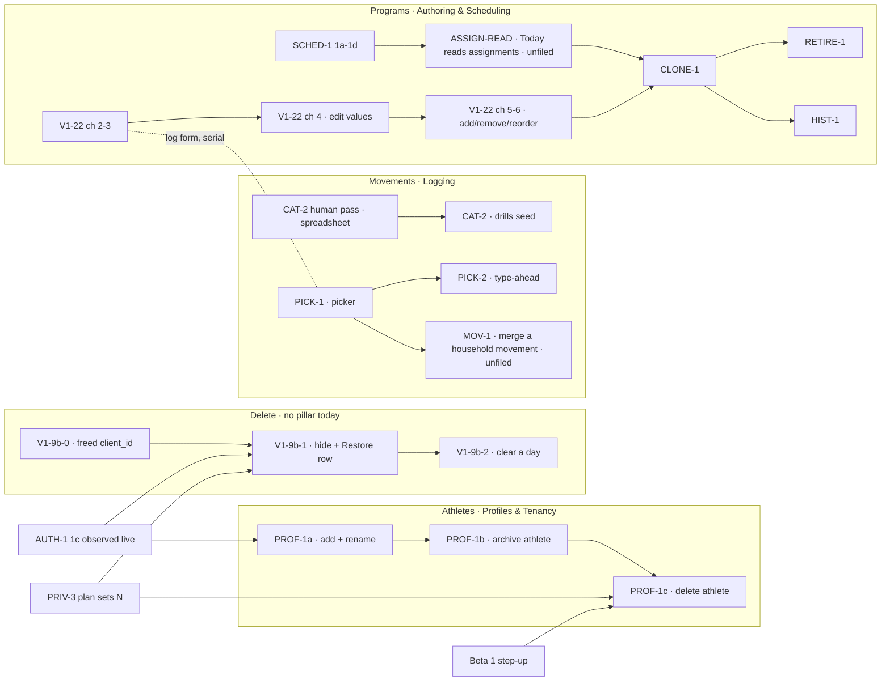

# CRUD-1 — Fix it yourself: a household corrects its own data without a script

> **Status: draft for the maintainer's review, 2026-10-22. Not yet panelled.** Milestone this
> defines: **Fix it yourself** (`docs/milestones/crud-1-fix-it-yourself.md`, written after the
> prototype is signed off, sequence step 5). Goal it serves: [beta-1](../milestones/beta-1.md) →
> "The goal", item 4 — _"fix their own mistakes without asking Ray to run a script"_ — and Beta 1's
> exit box _"Every logged thing can be corrected or deleted in the app."_ Prototype:
> [`docs/prototypes/crud-1/index.html`](../prototypes/crud-1/index.html). Procedure:
> [`write-spec`](../../.claude/skills/write-spec/SKILL.md).

## Why this exists

Nine backlog rows each own a piece of "a household can create, change and remove what it put in the
app", and no document connects them. A reader who asks _what is the path?_ has to read all nine,
three ADRs, one spec and one plan. The rows disagree with each other in places (listed under
[Where the rows disagree](#where-the-rows-disagree)) and four prerequisites belong to no row at all
([Unowned work](#unowned-work-this-spec-found)).

Today, measured on `origin/main@9d46547`:

| A household wants to…                    | Today                                                                                                                                                                                                                                                 |
| ---------------------------------------- | ----------------------------------------------------------------------------------------------------------------------------------------------------------------------------------------------------------------------------------------------------- |
| add / rename an athlete                  | ❌ seed only. The empty state links to GitHub (`components/onboarding/picker-empty-state.tsx` → `PickerEmptyState`; copy `PICKER_EMPTY_COPY.setupCta` in `lib/constants.ts`). The only profile-mutating action is `editRoutineAction` (`actions.ts`). |
| remove an athlete                        | ❌ the runbook's 13 hand-typed statements ([runbooks.md](../runbooks.md) → "Delete a household and everyone in it")                                                                                                                                   |
| undo a mis-logged entry                  | ❌ `db:correct` only. **Nothing in shipped code writes `deleted_at`** (grep for a `deletedAt:` setter in `apps/web` and `packages/db/src` finds only the column definition, `schema.ts` → `timestamps`)                                               |
| pick an existing movement                | ❌ a plain `<input type="text">` (`strength-form.tsx`, the Movement field); a near-miss mints a row via `findOrCreateMovement` (`packages/db/src/writers/movement-catalog.ts`)                                                                        |
| remove a mis-typed movement              | ❌ **by decision** — [ADR 0008](../decisions/0008-deletion.md) → "`movements` is exempt"; `schema.ts` above `movements` forbids setting its `deleted_at`                                                                                              |
| change a prescribed load                 | ❌ edit TypeScript and deploy ([V1-22 spec](./v1-22-authoring-program-editing.md)); chunk 1 of 6 shipped                                                                                                                                              |
| replace a program, retire it, look it up | ❌ nothing; `program_assignments` does not exist (`schema.ts`, last migration `0018`)                                                                                                                                                                 |

## Decisions already made

Each is settled. A session reopening one reads the source, not this line.

| Decision                                                                                                                                                                                                                     | Settled in                                                                                           |
| ---------------------------------------------------------------------------------------------------------------------------------------------------------------------------------------------------------------------------- | ---------------------------------------------------------------------------------------------------- |
| **Delete = hide from the whole household, restorable, purged at `N`.** No `deleted_by`. Per-item erasure is not planned; the finest erasure grain is an athlete                                                              | [ADR 0008](../decisions/0008-deletion.md) decision 1 (signed 2026-10-18 in its decision box)         |
| Restore is a **visible `Hidden on this day (n) — Restore` row**, never a toast; fallible, with a typed `slot_taken` refusal; clear-a-day restores as **one** event; restore window = purge window                            | ADR 0008 decision 2                                                                                  |
| A replay never resolves onto a hidden row (V1-24 1e adopted); `deleted_at` is never a side effect of a field upsert; **the freed `client_id` is a migration owed by whichever of V1-9b or sync lands first**                 | ADR 0008 decision 3                                                                                  |
| Deletion authority = logging authority, **revisited (not inherited) at AUTH-1**                                                                                                                                              | ADR 0008 decision 4                                                                                  |
| **Mechanical rule:** a row may be hidden only if every resolver of its namespace filters `deleted_at IS NULL`; otherwise it is removed only by a correction. `movements` is therefore exempt                                 | ADR 0008 → "The general rule"                                                                        |
| Delete grain is the **entry**. `entry_sets.deleted_at` exists and stays unbuilt                                                                                                                                              | ADR 0008 → "What this does not settle" _(maintainer, 2026-10-18)_                                    |
| **Archive is not delete:** its own marker, a lifecycle state a parent can see and restore from                                                                                                                               | ADR 0008 → "What this settles", `RETIRE-1` bullet                                                    |
| Programs: workouts as data, the prescription snapshotted as a rendered string, calendar-indexed rotation                                                                                                                     | [ADR 0005](../decisions/0005-programming-model.md) decisions 1–3, 5, 7                               |
| Scheduling: `program_assignments` with nullable `active_from`/`active_to` + weekday rows; **no active-block marker** (withdrawn); "create a block" waits on Today reading the athlete's **set** of assignments               | [ADR 0007](../decisions/0007-scheduling-model.md) decisions 1, 4; "What this ADR does not authorize" |
| V1-22 scope A: six chunks, 17 acceptance criteria, `ProgramEditDTO`; authoring is profile-scoped at `/p/<id>/program`; a value edit is last-write-wins on the server clock; clearing a load is `UPDATE … NULL`, never a hide | [V1-22 spec](./v1-22-authoring-program-editing.md) — **this spec cites it and does not restate it**  |
| CLONE-1 is **per athlete**, default none; the clone grain is a **block**; household-wide replacement rejected                                                                                                                | [plan.md → CLONE-1](../plan.md#clone-1) _(maintainer, 2026-10-07)_                                   |
| PROF-1 ships **full athlete CRUD**; create/read/edit on `/p` with a **dashed "+ Add athlete" tile at the bottom of the picker**; delete is **PRIV-1's hard delete**, offers archive first, sits behind step-up               | [plan.md → PROF-1](../plan.md) _(maintainer, 2026-09-28 and 2026-10-08)_                             |
| Household is in the session, not the URL; a wrong-household profile is a **404**                                                                                                                                             | [ADR 0006](../decisions/0006-household-addressing.md) (accepted 2026-10-07)                          |
| PICK-2 suggestions **never block**; English only; performance is a design constraint                                                                                                                                         | [plan.md → PICK-2](../plan.md#pick-2) _(maintainer, 2026-10-08)_                                     |
| CAT-2 is gated on the **human approve/deny pass** over the proposed movement list (ADR 0005 open question 3, "the 72 proposed entries") and **not** on scheduling                                                            | [plan.md → CAT-2](../plan.md); ADR 0007 → Backlog impact, CAT-2 row                                  |
| Every UI change gets the UX panel **before** implementation                                                                                                                                                                  | [AGENTS.md](../../AGENTS.md) → UI PR rules                                                           |

⚠️ **Status lines are stale, not the decisions.** ADR 0005, 0007 and 0008 all still read
`Status: Proposed` in their headers. 0008's decision box is signed (2026-10-18); 0005 and 0007 are
unsigned, and the [roadmap](../roadmap.md) says 0007 needs signing **and amending** before SCHED-1 1c.
This spec relies on 0005 and 0007 as the V1-22 spec and the SCHED-1 plan already do; it does not make
them more settled than they are.

## The four tracks and the one path

Nine rows fall into four tracks, each in one roadmap pillar. The pillar is a **file** claim
([roadmap.md](../roadmap.md) → Pillars), so the tracks are also the first cut of the parallelism
question, which the milestone settles with the full glob intersection (sequence step 6).



### Chunks, in order, and why the order cannot move

| #   | Chunk                                                                                                                                                                                                       | Gated on                                                                                    | Why it cannot move                                                                                                                                                                                                                                                                                                                                              |
| --- | ----------------------------------------------------------------------------------------------------------------------------------------------------------------------------------------------------------- | ------------------------------------------------------------------------------------------- | --------------------------------------------------------------------------------------------------------------------------------------------------------------------------------------------------------------------------------------------------------------------------------------------------------------------------------------------------------------- |
| 0   | **CAT-2's human pass** — the maintainer approves/denies the proposed movement list in a spreadsheet, and assigns each kept row its picker group (see [the grouping finding](#unowned-work-this-spec-found)) | nothing                                                                                     | **Start now.** It is a human step gating a code step, blocks nothing, and is unstarted — the hidden-gate pattern [parallel-work.md](../parallel-work.md) → "How many lanes?" names. The list is not committed in this repo (searched `docs/`, `packages/`, `apps/`); ADR 0005 calls it "the 72 proposed entries".                                               |
| A1  | **PROF-1a** — add an athlete (dashed tile) + rename + `kind`, on `/p`. Removes the GitHub link                                                                                                              | **AUTH-1 1c observed live** (the session is what says _whose_ household the athlete joins)  | Under the gate, "add an athlete" adds to whichever household `getHouseholdScope()` resolves for a shared code — beta-1's chart puts PROF-1 after AUTH-1 for exactly this. First profile-creating endpoint.                                                                                                                                                      |
| A2  | **PROF-1b** — archive an athlete (hidden from the picker, history intact, restorable)                                                                                                                       | A1 + **a marker decision** (no `archived_at` exists)                                        | Delete must offer archive first (PROF-1 row), so archive exists before delete does.                                                                                                                                                                                                                                                                             |
| A3  | **PROF-1c** — delete an athlete: type the name, step-up, then PRIV-1's hard delete + ledger                                                                                                                 | A2 + **PRIV-3's runner** (the deletion as a guarded script) + **Beta 1 step-up**            | Irreversible. Behind step-up by beta-1 → Beta 1 "Step-up". Needs the same statements the runbook types by hand, as code.                                                                                                                                                                                                                                        |
| B0  | **V1-9b-0** — the freed `client_id`: prove no hidden/live pair exists in prod, then re-predicate the five partial `client_id` arbiters (or record why not)                                                  | nothing                                                                                     | **Must precede the first write of `deleted_at`.** `logCheckinEntries` (`lib/dal/entries.ts`) already arbitrates on `client_id WHERE deleted_at IS NULL`, so B1 arms the hazard (ADR 0008 decision 3.4). One migration per PR, and a DB PR must not share review with a UI PR.                                                                                   |
| B1  | **V1-9b-1** — hide one entry; the Hidden/Restore row; `slot_taken`; the `notice.md` sentence; the entry→set live-parent `db:verify` proof; the export decision                                              | B0 + **AUTH-1 1c** + **PRIV-3's plan has chosen `N`**                                       | The notice sentence B1 owes describes "hidden, then purged at `N`"; it cannot be written truthfully before `N` exists as a number. The purge **job** may come later; the **number** may not (ADR 0008 → Backlog impact, PRIV-3 row). AUTH-1: decision 4 is revisited there, so building authority before it builds against a principal that is about to change. |
| B2  | **V1-9b-2** — clear a day behind typed "delete"; restores as one event                                                                                                                                      | B1                                                                                          | Reuses B1's Hidden row and restore path.                                                                                                                                                                                                                                                                                                                        |
| C1  | **PICK-1** — the picker: choosing an existing movement is the easy path                                                                                                                                     | **V1-22 chunk 2 merged** (both edit `strength-form.tsx`, both under `strength-logging.md`)  | Gate-1 collision, decided the way the roadmap decided chunk 2 vs `v1-30b`: chunk 2 is planned (#239), PICK-1 is not, so chunk 2 goes first. PICK-1 changes the log submit schema (the Logging∩Authoring seam, owner **Logging**).                                                                                                                               |
| C2  | **PICK-2** — suggestions before a new movement is created                                                                                                                                                   | C1                                                                                          | Its own row: it extends PICK-1's picker.                                                                                                                                                                                                                                                                                                                        |
| C3  | **CAT-2** — the approved drills become `movements` (seed, `ON CONFLICT DO NOTHING`)                                                                                                                         | chunk 0                                                                                     | Seed-only; touches `catalog-movements.ts` + `seed.ts` (write-path guide). Independent of C1 in files, but the picker's groups are what make 72 more rows findable, so ship it **after** C1 if both are ready.                                                                                                                                                   |
| C4  | **MOV-1** _(unfiled)_ — a household removes or merges its own mis-typed movement                                                                                                                            | C1 + the three-part lift at `schema.ts` above `movements`                                   | ADR 0008 leaves this gap "by decision" and names `TEN-2c-1` "or a successor" as owner. PICK-2 only stops new mis-types.                                                                                                                                                                                                                                         |
| D1  | **V1-22 chunks 2 → 3 → 4** — the snapshot writer, the backfill, edit values                                                                                                                                 | per [the V1-22 spec](./v1-22-authoring-program-editing.md)                                  | That spec owns the order (chunk 3's `--apply` recorded before 4 merges).                                                                                                                                                                                                                                                                                        |
| D2  | **V1-22 chunks 5 → 6** — the seed guard, then add/remove/reorder                                                                                                                                            | D1                                                                                          | That spec; chunk 6 owes the prescription-identity column.                                                                                                                                                                                                                                                                                                       |
| D3  | **SCHED-1 1a → 1d** — assignments + weekday rows, seeded                                                                                                                                                    | **Beta 1's gate** (family #1, two weeks, a decision to widen) + ADR 0007 signed and amended | [roadmap](../roadmap.md) → Authoring & Scheduling. Its plan owns the order.                                                                                                                                                                                                                                                                                     |
| D4  | **ASSIGN-READ** _(unfiled)_ — Today and the export read the athlete's **assignment**, not `programDayRows`' newest block                                                                                    | D3                                                                                          | CLONE-1's gate 2 names it; the SCHED-1 plan **excludes it** ("This is also why the one-block→N-assignments read is **not** in this plan") and ADR 0007 sends it to "its own plan and UX panel". **Byte-affecting** for the CSV (owner: Insight).                                                                                                                |
| D5  | **CLONE-1** — copy a block, edit the copy, choose who moves                                                                                                                                                 | D1 (chunks 2–3) + D4 + D2 (the editor that edits the copy)                                  | Its row's own three gates, in that order.                                                                                                                                                                                                                                                                                                                       |
| D6  | **RETIRE-1** — archive a program                                                                                                                                                                            | D5 + D3                                                                                     | CLONE-1 creates the pile; archive must compose with `active_to`.                                                                                                                                                                                                                                                                                                |
| D7  | **HIST-1** — what program an athlete ran on a past date                                                                                                                                                     | D5                                                                                          | No assignment history exists before CLONE-1 moves someone.                                                                                                                                                                                                                                                                                                      |

**Where V1-22 scope B went.** The row defines B as _"A plus assignment + a third schedule shape +
GAP-3 measurement shapes"_. Since ADR 0007, **assignment is SCHED-1's `program_assignments`** (D3) and
**choosing who runs a block is CLONE-1's "who moves"** (D5); the **third schedule shape** is YDP-1,
deferred by the maintainer (2026-09-24); the **GAP-3 shapes** are V1-22 chunk 6's _"rep-shaped items
only until GAP-3's target shapes land"_. So B has no chunk of its own here, and the V1-22 row should
say so when this spec lands ([Where the rows disagree](#where-the-rows-disagree), item 5).

### The critical path, and what is parallel

**Serial, and the milestone ships when it ships:** `AUTH-1 1c` → `V1-9b-1` → `V1-9b-2`, and `SCHED-1`
→ `ASSIGN-READ` → `CLONE-1` → `RETIRE-1`. The second chain sits behind Beta 1's human gate, so for Beta
0 the CRUD critical path is **AUTH-1 → V1-9b**.

**Can start before AUTH-1 1c, because nothing it touches is an AUTH-1 file** (preliminary — the
milestone does the full intersection against AUTH-1's file table, which names `lib/dal/household.ts`,
`app/p/[profileId]/actions.ts`, four `page.tsx` files and `lib/constants.ts` for 1c):

- **chunk 0** (a spreadsheet; no repo files) — **now**.
- **B0** (`packages/db` migration + `db:verify`; no `apps/web` file) — after AUTH-1 1b's migration lands,
  because both are migrations and the numbering is serial.
- **D1** (V1-22 chunks 2–3) — already unblocked per the roadmap. ⚠️ Chunk 2 edits the log form, and
  AUTH-1 1c edits `actions.ts`; check the intersection at the time, per gate 1.
- **PICK-1's plan and panel** (docs only), not its code.

⚠️ **Every mutating chunk above touches `apps/web/app/p/[profileId]/actions.ts` and
`mutating-actions.ts`, and every DAL addition touches `lib/dal/`** — all owned by
[write-path.md](../features/write-path.md). So under gate 1 the tracks are **not** disjoint even when
their screens are: two tracks adding Server Actions collide on `actions.ts` and on the guide. The
milestone must either serialize the action-adding chunks or shard `actions.ts` per feature first (a
refactor, filed as a row — [parallel-work.md](../parallel-work.md) → "When a gate fails"). This spec
recommends the shard, as one small refactor PR before A1, because four tracks would otherwise queue on
one file.

## Acceptance

Criteria for rows that already have a spec or ADR **cite** them; these are the ones nothing else
writes. Each names the chunk that must carry its test.

**Athletes (A1–A3)**

1. **When** a parent submits a new athlete with a non-blank name and a `kind` from `PROFILE_KINDS`, the
   system **shall** create one profile in the **session's** household and the picker **shall** list it
   on the next render. _(A1)_
2. **If** the name is blank after trimming, longer than the limit the plan sets, or `kind` is not in
   `PROFILE_KINDS`, **then** the system **shall** return a typed field error and write nothing. _(A1)_
3. **When** an "add athlete" submit is replayed with the same idempotency key, the system **shall**
   create exactly one profile and return the same result. _(A1 — AGENTS.md backend rule 6)_
4. **If** a rename or archive names a profile outside the session's household, **then** the system
   **shall** respond as for an unknown profile (404 semantics, ADR 0006) and write nothing. _(A1, A2)_
5. **While** an athlete is archived, the picker **shall not** list them, their history **shall** still
   export, and a parent **shall** be able to restore them from a list of archived athletes. _(A2)_
6. **When** a parent confirms deleting an athlete, the system **shall** require the athlete's name typed
   exactly and a fresh step-up, **shall** offer archive before delete, and **shall** hard-delete every
   row the runbook's procedure deletes, soft-deleted ones included, and write a ledger entry. _(A3)_
7. **When** PROF-1a ships, the empty state **shall not** link to GitHub. _(A1 — ONB-0 finding E23)_

**Delete (B0–B2)** — ADR 0008 is the source; these make it testable.

8. **If** an entry has been hidden and a submit replays its `client_id`, **then** the system **shall
   not** insert a second live row. _(B0 — `db:verify`, the inverse of today's partial arbiter)_
9. **When** a person taps Delete on a logged entry, the entry **shall** disappear from the day's list
   for **every** profile view in the household, and a `Hidden on this day (n)` row **shall** appear on
   that athlete's day page, surviving a reload and a day change. _(B1)_
10. **When** Restore is tapped and the entry's natural-key slot is free, the entry **shall** return; **if**
    the slot is taken, **then** the system **shall** return a typed `slot_taken` result naming what
    holds the slot, **never** a `23505` or a silent no-op. _(B1 — the fixture: hide a weigh-in, log a
    new one that day, restore the first)_
11. **When** focus is on a row's Delete control and the row is hidden, focus **shall** move to the next
    row's Delete control, or to the Hidden row's Restore control if it was the last row; the live region
    announcing it **shall** be mounted before its text changes. _(B1 — the `saved-announcer.tsx`
    idiom)_
12. **When** "Clear this day" is confirmed, the Clear control **shall** stay disabled until the input
    equals `delete`, every live entry for that athlete and day **shall** be hidden in **one**
    transaction, and the Hidden row **shall** offer to restore them as one event. A partial restore
    **shall** report which entries could not come back and why. _(B2)_
13. **When** a profile's every entry for a month is hidden, the export path the plan chose (ADR 0008
    → "One constraint") **shall** still deliver the person their data. _(B1)_

**Movements (C1–C4)**

14. **When** an athlete picks a movement from the picker and submits a set, the stored entry **shall**
    reference that movement's id — **no** call to `findOrCreateMovement` for it — and **no** magnitude
    shall arrive prefilled. _(C1 — PICK-1's own acceptance, verbatim intent)_
15. The picker **shall** offer, in order: today's prescribed movements, the athlete's recent movements,
    then the catalog grouped by the picker group; and **shall** be operable by keyboard alone, with every
    option a ≥44px target at 360px. _(C1)_
16. **When** the typed name has no exact catalog match but a near match exists, the system **shall**
    show the near match and a spelling suggestion **before** creating a movement, and "use what I typed"
    **shall** remain one tap. _(C2)_
17. **When** `db:seed` runs twice after CAT-2, the movement count **shall** be the same as after once.
    _(C3)_

**Programs (D4–D7)** — V1-22's 17 criteria stand for D1–D2.

18. **When** a block is cloned, the copy **shall** carry every live prescription and per-athlete target
    of the source with identical values, and the source **shall** be unchanged. _(D5)_
19. **When** a parent moves an athlete to the copy, the system **shall** close their open assignment
    (`active_to` = the day before) and open one on the copy (`active_from` = today, athlete-local), and
    **shall not** change any already-exported byte for that athlete. _(D5)_
20. **When** a clone is saved with no athletes selected, **no** assignment **shall** change. _(D5)_
21. **While** a program is archived, it **shall not** appear in the editor's program list, the clone
    source list, or the assign list, and every past entry against it **shall** render and export as
    before. _(D6)_
22. **When** a parent asks what program an athlete ran on a past date, the system **shall** return the
    assignment(s) open on that date and that day's prescriptions as snapshotted, or a statement that
    nothing was assigned. _(D7)_

## The data contract

Shapes that cross a seam, so two tracks can proceed without guessing. Homes follow AGENTS.md: shared
schemas in `packages/shared`, DTOs beside their DAL in `apps/web/lib`.

```
packages/shared
  profileUpsertSchema        { name: string (trimmed, 1..PROFILE_NAME_MAX), kind: profileKindSchema }
                              — kind REUSES enums.ts PROFILE_KINDS; PROFILE_NAME_MAX is new, one home
  hideEntrySchema            { profilePublicId, entryPublicId }
  restoreHiddenSchema        { profilePublicId, day, hiddenAt }       ← restores ONE hide event
  clearDaySchema             { profilePublicId, day, confirm: z.literal('delete') }
  MOVEMENT_PICKER_GROUPS     as const — the picker's groups; see the grouping finding
  programCloneSchema         { sourceBlockPublicId, name, moveProfilePublicIds: string[] (default []) }

apps/web/lib  (DTOs, never raw rows)
  HiddenOnDayDTO             { count, events: Array<{ hiddenAt, items: Array<{ entryPublicId, label }> }> }
  RestoreResult              per item: { ok: true } | { ok: false, reason: 'slot_taken', heldBy: label }
                                                     | { ok: false, reason: 'not_found' }
  MovementOptionDTO          { publicId, name, group, owner: 'catalog' | 'household',
                               prescribedToday: boolean }
  ProgramEditDTO             — V1-22 spec, unchanged
  AssignmentDTO              { blockPublicId, blockName, activeFrom, activeTo | null }
```

Rules the contract carries:

- **A hide event's identity is its `deleted_at` value — no new column.** Postgres `now()` is the
  _transaction_ start time, so every row a clear-day hides in one transaction shares one `deleted_at`
  exactly, and two separate taps do not. `(profile, day, deleted_at)` is the event; restore takes
  `hiddenAt`. ⚠️ **This is a proposal for B1's correctness panel**, not a settled decision: it rests on
  the writer using `now()` (every shipped writer does) and never `clock_timestamp()`.
- **The picker submits an id, not a name.** C1 adds a movement public id to the log submit schema; the
  free-text name path remains only for "use what I typed". That is a change to the Logging∩Authoring
  seam (owner: Logging), so C1 and V1-22 chunk 2 — which adds a prescription public id to the **same**
  schema — must not run at once.
- **`RestoreResult` is per item**, because a cleared day restores as one event and may partly fail.
- **No authored load crosses into the log form** — `MovementOptionDTO` has no load, the same boundary
  `ScaffoldRow` keeps ([V1-22 spec](./v1-22-authoring-program-editing.md) → contract rules).
- The envelope is `ActionState` everywhere; the stale-write copy is `AMEND_ERROR_COPY.staleWrite`.

## Unowned work this spec found

No backlog row owns these. Each needs a row (or a sentence in an existing one) before its chunk starts;
**this spec does not file them** — `docs/plan.md` is off-limits until this work's PR opens.

1. **ASSIGN-READ (D4).** Today and the export reading the athlete's assignment. CLONE-1 lists it as a
   gate; the SCHED-1 plan explicitly excludes it; ADR 0007 sends it to "its own plan and UX panel". It
   is byte-affecting for the CSV contract, owned by **Insight**, so it needs that pillar's sign-off.
2. **The picker's grouping is not derivable from `pattern`.** The maintainer described a curated
   **push/pull/legs** catalog. The only classification is `movements.pattern` (11 values,
   `packages/shared/src/movements.ts` → `MOVEMENT_PATTERNS`); push/pull/legs exist only as
   `prescriptions.day_role` values. A pattern→group map covers the other 29 of the 35 catalog rows, with
   judgement calls (is `carry` legs? is Med-Ball Slam a hinge?), but **not `isolation`**, whose six members split three ways: Tricep Extensions, Lateral Raises (push);
   Barbell Curls, Hammer Curls, Rear Delt Raises (pull); Calf Raises (legs). So the group is either a
   per-row value in `MOVEMENT_SEED_ROWS` (a column, a migration) or the picker groups by pattern under
   friendlier names. **A decision for the maintainer, at chunk 0**, because that is when every row is
   already being looked at once.
3. **MOV-1 — a household's mis-typed movement.** ADR 0008 makes it unremovable "by decision" and
   names "`TEN-2c-1` or a successor" as owner. `TEN-2c-1` is a measured no-op (the 2026-10-13 census
   found zero household-owned movements), so the successor does not exist. Today the gap is latent;
   PICK-1 makes household movements cheap to create, so it becomes live after C1.
4. **Athlete archive has no marker.** `profiles` has `deleted_at` and no `archived_at`
   (`schema.ts` → `profiles`). ADR 0008's discriminator says archive is not a hide — a hide ends in
   erasure at `N` — so archiving an athlete with `deleted_at` would purge them. A2 owes a migration or a
   decision that athlete archive waits.

Also, from the roadmap's own membership rule: **V1-9b and PRIV-3 belong to no pillar** (roadmap.md →
Pillars). This spec proposes Profiles & Tenancy for neither — V1-9b's files are `app/p/[profileId]/`
and `lib/dal/entries.ts`, which is **Logging** (write-path guide); PRIV-3 is a `packages/db/scripts`
runner, which is **Platform**. The milestone PR moves them.

## Where the rows disagree

Said rather than silently resolved.

1. **beta-1 says "PROF-1 create" in Beta 0 and "rename + archive" in Beta 1; the PROF-1 row says full
   CRUD.** Both hold: this spec puts create **and rename** in A1 (rename is a field on the same form, and
   a typo'd athlete name with no fix is the exact failure this milestone exists to remove), archive in
   A2, delete in A3. beta-1's Beta 0 / Beta 1 split stays the release cut.
2. **The V1-9b row says "no migration"; ADR 0008 decision 3.4 says V1-9b owes one** (or the sync PR
   does, whichever lands first). The ADR is later and signed; B0 is that migration.
3. **The V1-9b row and ADR 0008 name `logCheckIns`; the function is `logCheckinEntries`**
   (`lib/dal/entries.ts`). The behaviour they describe is accurate.
4. **The V1-22 spec says the household program library "waits for TEN-1".** TEN-1 is done (2026-10-08),
   so the wait is released, and CLONE-1 needs a list of programs to clone from. Whether that list lives
   at a household route or stays inside `/p/<id>/program` is **open** — the prototype shows the
   household list; the maintainer decides at review.
5. **V1-22's "scope B"** is still described in its row as one scope; after ADR 0007 it has dissolved
   into D3, D5 and two deferrals (see above).
6. **The set-fields row width.** The brief for this work says ≈275px of ≈294; the strength-logging
   guide says ~260px; neither was measured. **Measured in the prototype at a 360px viewport
   (Chromium, 2026-10-22):** a Logged-entries row and the movement fieldset both have **294px** of
   content (confirmed); the prototype's set row, built from the app's widths (`w-5` index, two `w-24`
   inputs, `gap-2`, the unit), uses **281px**. That is the prototype's approximation, not the app's
   row — the app's own number is still unmeasured, and the B1 plan measures it on the real page. A
   per-row Delete of **72px** leaves **224px** for the label; "Overhead Shoulder Press" fits on one line
   and its detail wraps to two (row height 92px).

## Open decisions — for the maintainer, at prototype review

Parallel-work gate 5: an approved prototype reads as approval of everything, so the cases it does not
settle are listed, each needing a written answer before the plans split.

| #   | Question                                                                                 | Prototype shows                                                   | Recommendation                                                                                    |
| --- | ---------------------------------------------------------------------------------------- | ----------------------------------------------------------------- | ------------------------------------------------------------------------------------------------- |
| Q1  | Where does **delete athlete** live?                                                      | both: an Edit toggle on `/p`, or a household settings page        | **Settings.** Rare, irreversible, step-up-gated; the picker is where a kid taps.                  |
| Q2  | Picker grouping (finding 2)                                                              | push / pull / legs / core / wrestling, with isolation hand-placed | A per-row group, set during chunk 0.                                                              |
| Q3  | Archiving a program an athlete is still on: refuse, or close their assignment?           | both, behind a toggle                                             | **Close, with the names shown.** Refusing sends a parent to a second screen to do the same thing. |
| Q4  | HIST-1's surface: timeline, or a date on the program page?                               | both                                                              | **The date on the program page** — it answers "what was she doing in March" in one step.          |
| Q5  | Where does the household's program list live? (disagreement 4)                           | a `Programs` link at the bottom of `/p`                           | Household route, after AUTH-1.                                                                    |
| Q6  | Who may delete an athlete after AUTH-1 — any member, or the owner?                       | not shown                                                         | Owner only (beta-1 → Roles already lists delete as an owner act).                                 |
| Q7  | Does a hidden entry still count in the weekly adherence strip?                           | not shown                                                         | No — a hide is "this did not happen".                                                             |
| Q8  | Athlete archive: a migration in A2, or defer archive and let delete offer only "cancel"? | archive shown                                                     | The migration; it is one nullable column and the PROF-1 row requires the archive offer.           |

## Out of scope

- **Editing a logged value** — V1-24 2 (check-ins) and 3a-iii/3b (sets). Correction is a sibling of this
  milestone, not part of it; Beta 1's exit box needs both.
- **Per-item erasure on demand** — ADR 0008: not planned.
- **Deleting a single set** — entry grain only (ADR 0008).
- **The purge job itself** — PRIV-3. B1 needs only its `N`.
- **Household deletion and member removal** — beta-1 → Beta 1, behind step-up.
- **Promoting household movements to the shared catalog** — the maintainer's "later analysis"; needs
  household movements to exist first (they do not: zero in prod, 2026-10-13).
- **The routine editor** (`routine_config`) — already CRUD (`/p/[profileId]/routine`); confirm-on-remove
  and restore-default are beta-1 Beta 1 items with no shared files here.
- **Create a block** (V1-22 A4) — ADR 0007 decision 4; CLONE-1 is the one way a new block is born here,
  and it is safe only after D4.
- **Workout versioning, a version-compare screen** — CLONE-1 → Out of scope.

## Risks

| Risk                                                                                                                                      | Mitigation                                                                                                                                                                                         |
| ----------------------------------------------------------------------------------------------------------------------------------------- | -------------------------------------------------------------------------------------------------------------------------------------------------------------------------------------------------- |
| **Every `WHERE deleted_at IS NULL` filter has only ever been tested on PGlite fixtures** — nothing has written `deleted_at` in production | B1's plan audits every reader of `entries`, `entry_sets`, `entry_set_quantities` for the filter (the day read, the export's five, adherence, the calisthenics total), with a `db:verify` case each |
| A child hides a sibling's weigh-in, and a parent never sees it happened                                                                   | ADR 0008 decision 2's Hidden row is on the **athlete's** page, visible to any viewer (acceptance 9)                                                                                                |
| Clone + move silently blanks an exported `prescribed` cell                                                                                | D4's byte-affecting decision is made by Insight before D5 (acceptance 19)                                                                                                                          |
| A new household movement from the picker's "use what I typed" is a typo with no removal path                                              | C2 before the typo can be made cheaply; C4 (MOV-1) named so the gap is owned                                                                                                                       |
| **LLM never authors loads** — a model-drafted movement list (CAT-2) or a clone carrying a load across                                     | CAT-2's list is definitions a human approves (chunk 0); a clone copies a **human-authored** target verbatim and the UI states it is a copy                                                         |
| Four tracks queue on `actions.ts` and `write-path.md`                                                                                     | Shard `actions.ts` before A1 (see "The critical path")                                                                                                                                             |

## Context read

Opened, not recalled, at `origin/main@9d46547`:

- ADRs: [0005](../decisions/0005-programming-model.md) (open question 3, item 5),
  [0006](../decisions/0006-household-addressing.md), [0007](../decisions/0007-scheduling-model.md)
  (decision 4, "What this ADR does not authorize", Backlog impact),
  [0008](../decisions/0008-deletion.md) (all)
- [V1-22 spec](./v1-22-authoring-program-editing.md);
  [SCHED-1 plan](../plans/sched-1-scheduling-model.md) (chunks; the excluded read);
  [AUTH-1 plan](../plans/auth-1-clerk-google.md) (chunk file tables)
- [plan.md](../plan.md) rows PROF-1, V1-9b, V1-22, CLONE-1, RETIRE-1, HIST-1, CAT-2, PICK-1, PICK-2,
  SCHED-1; [beta-1](../milestones/beta-1.md); [roadmap.md](../roadmap.md) (Pillars, In flight, Seams);
  [parallel-work.md](../parallel-work.md)
- Guides' `owns:`: [programming](../features/programming.md),
  [strength-logging](../features/strength-logging.md), [write-path](../features/write-path.md)
- Code: `packages/db/src/schema.ts` (`timestamps`, `profiles`, `entries`, `movements` and its
  prohibition docblock, the 14 partial arbiters, `program_blocks`/`prescriptions`/`prescription_targets`);
  `packages/db/src/writers/movement-catalog.ts` → `findOrCreateMovement`;
  `packages/db/src/queries/program-day.ts` → `programDayRows`; `apps/web/lib/dal/entries.ts` →
  `listEntriesForDay`, `logCheckinEntries`; `apps/web/app/p/page.tsx`;
  `apps/web/components/profiles/profile-tile.tsx`; `apps/web/app/p/[profileId]/page.tsx` (Logged
  entries); `strength-form.tsx` (Movement field, Add movement); `packages/shared/src/catalog-movements.ts`
  (35 rows; grouped by `pattern` in this session); `packages/shared/src/enums.ts` → `PROFILE_KINDS`;
  `apps/web/app/pages-are-gated.test.ts`; `apps/web/app/globals.css`

## Review-response log

_Empty until the panels run (sequence steps 3 and 5)._
