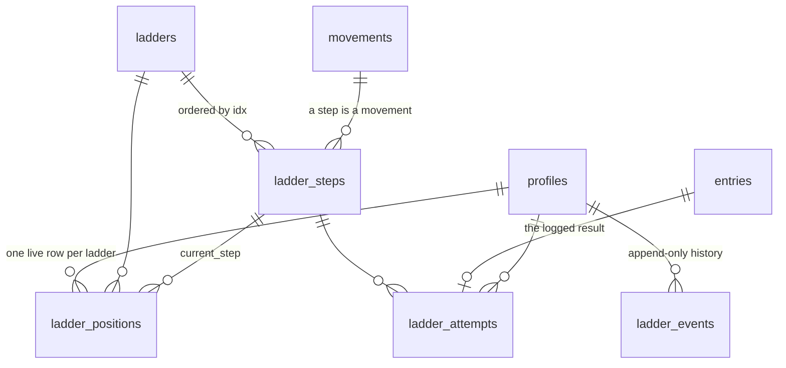

# LADDER-1 — Strength Ladder: an adaptive calisthenics progression (feasibility)

> **Status: proposed, future, NOT scheduled.** This is a **feasibility assessment** against `main` at
> `9ab6d7f` (2026-10-11), filed so the idea is not rediscovered from scratch. It is **not yet a
> `write-spec` spec**: it has no acceptance criteria and the model is not settled. When LADDER-1 is
> picked up, the order is: an ADR for the ladder model (§3) → rewrite this file through
> [`write-spec`](../../.claude/skills/write-spec/SKILL.md) → one plan per PR through
> [`plan-with-panel`](../../.claude/skills/plan-with-panel/SKILL.md). Backlog row:
> [plan.md → Later → LADDER-1](../plan.md#later--ideas-captured-not-scoped).
>
> Citations are `path` → `symbol`, not line numbers. Line numbers drift between branches, and the
> derivation-traps table in `write-spec` explains why that matters.

## The idea, in one paragraph

Each movement family (push, pull, squat, hinge/bridge, core, plus wrestling-specific bridge, sprawl,
bear crawl) is an **ordered ladder of steps**. A step has a **standard** (sets × reps, or sets × hold
seconds), coaching cues and a regression. Each athlete has a **current step per ladder**. A day-one
**placement test** puts them on the highest step they do cleanly. A deterministic rule moves them:
**hit the standard on every set in two consecutive sessions, then a parent or coach form check, then
advance.** Two misses in a row means **suggest a regression**. Several athletes (a parent and the
kids) can train one ladder together, each at their own step. Volume flexes with mat load: full on light
days, maintenance on heavy practice days, nothing the day before a competition. It must also work as a
**standalone** calisthenics progression for someone with no wrestling schedule.

## Verdict

**Viable, and it fits the architecture's intent.** The repo already reserved this space:
[`docs/spec.md`](../spec.md) §4 sketches `ladder` + `rung` + `progression_state`, ADR 0002 kept
`ramp_targets` separate so "the ladder model [arrives] cleanly in V2", and the v2 backlog row names
"ladders/rungs + in-UI suggestions". The results side, which is the hard part of most logging features,
**is already built**: a step's attempt is an ordinary logged entry with typed quantities.

**But most of what the brief assumes does not exist yet.** There is no session composer, the
progression engine is empty, no load or scheduling data has a writer, there is no MCP server, and the
"content pipeline" is a manual doc convention. LADDER-1 is a **build**, not an extension. It sits in
**v2**, behind Beta 0 (TEN-2 → AUTH-1) and ideally behind SCHED-1.

## 1. What the codebase actually has

The brief named six components. Each one checked against the code:

| Brief assumed                      | What exists                                                                                                                                                                                                                                                                                                                                                                                                                                                                                                                               |
| ---------------------------------- | ----------------------------------------------------------------------------------------------------------------------------------------------------------------------------------------------------------------------------------------------------------------------------------------------------------------------------------------------------------------------------------------------------------------------------------------------------------------------------------------------------------------------------------------- |
| Deterministic session composer     | **None.** The day is _read_, not composed. `program_blocks → prescriptions → prescription_targets` (`packages/db/src/schema.ts`) is authored only by the `PROGRAM_SEED` const (`packages/shared/src/programming.ts`). Today's role is `resolveDayRole(day)`, epoch-day parity with no athlete or history input (`apps/web/lib/programming/day-role-schedule.ts`). `programDayRows` returns **one** block per day role, newest by id ([programming guide](../features/programming.md)).                                                    |
| Progression engine                 | **Placeholder.** `packages/engine/src/index.ts` is `export {};` ("the real engine + golden vectors land at v2"). The only golden vectors in the repo are for `foldAggregation` (`packages/shared/src/aggregation.ts`). The nearest design is the Daily Five feedback loop, docs only and marked deferred ([daily-five-default.md](../programs/daily-five-default.md)).                                                                                                                                                                    |
| Athlete profiles, parent-operated  | `households` + `profiles` (`schema.ts`). `profiles.kind` is `kid \| adult` (`PROFILE_KINDS`, `packages/shared/src/enums.ts`). There is **no sport/"wrestler" attribute, no program assignment and no membership table yet** (`household_members` is AUTH-1's, unbuilt). Per-athlete state exists only as `prescription_targets` (per prescription) and `ramp_targets` (per metric per week). **Nothing is keyed (profile, movement).** Beta decision: parents and coaches sign in, no child accounts ([beta-1](../milestones/beta-1.md)). |
| Load management / scheduling       | **Decided in part, not built.** [ADR 0007](../decisions/0007-scheduling-model.md) authorizes `program_assignments` + weekday rows (SCHED-1, plan in flight on its own branch). `day_readiness.gate_color` (`GATE_COLORS`, `packages/shared/src/readiness.ts`) exists **with no writer**. There is no practice or competition model; light/heavy-day and tournament-week rules live only in a source doc (`docs/plans/v1-10-two-week-program-source.md`). No cron or job infrastructure.                                                   |
| Content generation + CSCS sign-off | **A convention, not a pipeline.** No LLM SDK is in the code, and "CSCS" appears nowhere. The one instance is [daily-five-default.md](../programs/daily-five-default.md): "model-drafted definition, not yet confirmed — [a qualified coach] signs off each dose before it is seeded; the seed PR cites the sign-off" (ONB-2). Sign-off is prose in a doc and a PR, with no approval table or status column.                                                                                                                               |
| MCP server                         | **None.** Planned for v3 ("MCP/REST API so Claude fetches from the app", [plan.md → v3](../plan.md)). The token rule exists only in [SECURITY.md](../../.github/SECURITY.md): an org-scoped, least-privilege, revocable key, reads plus one narrow write, never the human session, kid bodyweight excluded by default.                                                                                                                                                                                                                    |

What **is** built and reusable as-is:

- **The write path.** Action → DAL → writer, ownership via `isLiveProfile(publicId, scope)`
  (`packages/db/src/writers/ownership.ts`), idempotency by client UUIDv7 + partial UNIQUE + `ON
CONFLICT` ([write-path guide](../features/write-path.md)). `writeStrengthSession`
  (`packages/db/src/writers/strength-session.ts`) already writes a session of movement entries with
  per-set rows.
- **Typed results.** `entry_sets` + `entry_set_quantities` (GAP-3 / [ADR 0004](../decisions/0004-typed-measurements.md)):
  reps on the set, a hold as a `primary` quantity in the `time` dimension (`sec`), and distance in the
  `length` dimension (`m`, `yd`, … in `UNIT_CODES`, `packages/shared/src/units.ts`). Checking "every
  set hit the standard" is a pure function over rows that already exist.
- **The movement catalog.** `movements` has `pattern` (`MOVEMENT_PATTERNS`, `packages/shared/src/movements.ts`),
  `is_bodyweight`, `unit_default`, and **`cues` + `video_url` columns that nothing seeds yet**. Since
  TEN-2a it has a nullable `household_id`: null is the global catalog.
- **Prescription snapshot.** `entries.prescribed_snapshot` records what was asked for as a rendered
  string ([ADR 0005](../decisions/0005-programming-model.md) decision 5). A ladder attempt can reuse it.
- **Per-athlete targets on shared content.** `prescription_targets` already models "both kids do this,
  at different values". Shared ladders are the same shape.

## 2. Fit: reuse, extend, missing, conflicts

**Reuse unchanged:** the write path and its boundary tests, typed quantities, the movement catalog
(each step **is** a movement row: `incline_push-up`, `push-up`, …), `prescribed_snapshot`, the
household scope seam, `localDayIso` for "which day is this".

**Extend:**

- `movements`: seed `cues` (the column exists). Steps need movements that do not exist yet, such as
  regressions. They are pure data and global rows.
- `packages/engine`: give it its first real functions (§4) and its first golden vectors.
- The Today page: a third card beside the routine and the program.

**Missing (net-new):** ladder content tables, per-athlete position + history, a recorded per-attempt
verdict, a placement flow, a human confirm step, any source of "day load", and multi-athlete logging.

**Architectural conflicts.** None is fatal. Each one decides a design choice:

1. **Plan-side values are verbatim TEXT, by invariant.** `prescriptions.target_reps` and
   `prescription_targets.load` must not be "fixed into numbers" ([programming guide](../features/programming.md),
   invariant 2). A ladder standard has to be machine-checkable. **So ladders must not reuse
   `prescriptions`.** They get their own typed table. That keeps the invariant intact rather than
   eroding it.
2. **The day model is calendar parity + one active block.** A ladder session is generated from
   **history** (where the athlete is now), which is the session-indexed shape the maintainer has
   explicitly deferred for the YDP (YDP-1, "do not fix without asking",
   `day-role-schedule.ts`). **So a ladder is a separate axis**, as the routine and program axes already
   "co-exist permanently" (programming guide). It does not change `resolveDayRole` or `programDayRows`.
   _Whether_ a ladder is due today is a scheduling question (SCHED-1). _What_ the ladder prescribes is
   an engine question.
3. **Sessions are single-profile.** `sessions.profile_id` is NOT NULL. **So a shared session is a UI
   composition, not a table:** one screen, N athletes, each writing their own session and entries under
   their own client ids. Every row passes its own `isLiveProfile`. A `session_group` table can wait
   until something reads it.
4. **The routine already counts calisthenics.** `pushups` / `pullups` metrics twin the movements, and
   CAT-1 exists because adherence double-counts. A push-up ladder makes a third way to log push-ups.
   **The ladder must own its movements' attempts, and the routine counter must not also count them.**
   That has to be decided in the ADR, not discovered in review.
5. **"The LLM never authors loads" applies here.** A step's standard for a child **is** a
   prescription, even with no external load. **So the model may draft ladder definitions** (steps,
   standards, cues) for human sign-off. It **never** places, advances or regresses an athlete. Only the
   deterministic engine **suggests**, and only a human tap **commits**. MVP steps carry no external
   load at all, so weighted progressions are out of scope (§7).

## 3. Proposed data model

This refines `docs/spec.md` §4's sketch: `rung` → `ladder_steps`, and `progression_state` → a position
row plus an append-only event log. The sketch's `current_target` is dropped, because the standard lives
on the step. **The naming (step vs rung) is the ADR's to settle**, and `spec.md` is updated to match in
the same PR.



Conventions follow [AGENTS.md → Schema](../../AGENTS.md): bigint identity PK, UUIDv7 `public_id`,
`timestamps` group with soft delete, text + CHECK from a `packages/shared` const, an FK + index on
every reference, and a partial UNIQUE `WHERE deleted_at IS NULL`.

**Content (global catalog, seeded):**

- **`ladders`**: `slug` (unique, live), `name`, `family` (text + CHECK over a new `LADDER_FAMILIES`
  const: `push | pull | squat | hinge | core | bridge | sprawl | crawl`), `household_id` nullable
  (null = global; same rule as `movements` after TEN-2a), `content_version` int, `signoff_ref` text
  (the PR/doc that carries the human sign-off; NOT NULL for a seeded global ladder). Wrestling
  families are ordinary rows. Nothing about a ladder says "wrestling".
- **`ladder_steps`**: `ladder_id` FK, `idx` int (unique per ladder, live), `movement_id` FK →
  `movements`, `standard_sets` int > 0, `standard_reps` int null, `standard_seconds` int null,
  `per_side` bool, `notes` text. **CHECK `(standard_reps IS NOT NULL) <> (standard_seconds IS NOT
NULL)`**, the tagged-union pattern AGENTS.md already uses. The regression is `idx - 1` by
  construction, so there is no regression column to drift. Cues live on `movements.cues`, which exists.

**Per-athlete state (personal data, minors):**

- **`ladder_positions`**: `profile_id` FK, `ladder_id` FK, `current_step_id` FK, `placed_on` date.
  **Unique `(profile_id, ladder_id)` where live.** This is the denormalized "where am I now", the one
  row the composer reads.
- **`ladder_events`**: append-only. `profile_id`, `ladder_id`, `from_step_id` null, `to_step_id`,
  `kind` (text + CHECK over `LADDER_EVENT_KINDS`: `placed | advanced | regressed | manual_set |
form_check_failed`), `decided_on` date (local), `client_id` UUIDv7 unique (idempotency),
  `confirmed_by` (null until AUTH-1 gives an identity, then the member). **Recorded, not recomputed**:
  the lesson ADR 0007 and SCHED-1 requirement 3 already paid for. If a standard is later edited, the
  history still says why each move happened.
- **`ladder_attempts`**: `profile_id`, `ladder_step_id`, `entry_id` FK unique, `activity_date`,
  `day_load` (text + CHECK `full | maintenance`), `standard_snapshot` (sets/reps/seconds copied at
  write time), `met` bool. **Written in the same transaction as the entry** by the writer. `met` comes
  from a pure engine function, so the verdict is recorded at the moment it was judged.

**Not added, deliberately:** a `sport` or `is_wrestler` flag on `profiles` (standalone mode is
expressed by _which ladders are assigned_, §6), a `session_groups` table (conflict 3), and a
content-approval table (the sign-off stays a cited ref until a second author exists; §5).

### Migration sketch

Expand-only, new tables, nothing touches a hot table. Follows the `db-migration` skill:

1. **Migration A (content):** `ladders` + `ladder_steps` + the CHECKs, `SET lock_timeout` /
   `statement_timeout`, `IF NOT EXISTS`. Indexes on new empty tables need no `CONCURRENTLY`. Seed is
   `ON CONFLICT DO NOTHING` from a `LADDER_SEED` const in `packages/shared` (the `PROGRAM_SEED`
   pattern), plus any new step movements in `catalog-movements.ts`. `db:verify` proofs: the tagged-union
   CHECK rejects both/neither, `idx` is unique per ladder, and `assertCheckCoversConst` covers
   `LADDER_FAMILIES`.
2. **Migration B (state):** `ladder_positions`, `ladder_events`, `ladder_attempts`, each FK indexed,
   with equality-first `(profile_id, ladder_id)` / `(profile_id, activity_date)` hot-path indexes.
   `db:verify` proofs: the position is unique per (profile, ladder) while live, an event `client_id`
   replay is one row, and attempt ↔ entry is 1:1. Plus a `db:mutations` patch per proof, so a proof
   that cannot go red is caught.
3. **Same PR as B:** [data-inventory.md](../privacy/data-inventory.md) gains three §1a rows (the table
   count changes from 18), `ladder_steps.notes` / any free text in §3, export coverage in §6, retention
   in §8, and the deletion runbook ("Delete a household and everyone in it") gains the three new
   `profile_id` FKs.

## 4. The composer and load gating

All new logic is **pure TS in `packages/engine`**, `(state, inputs) => decision`, with language-agnostic
golden vectors (JSON fixtures). This is the engine's first real content, which makes LADDER-1 a natural
**v2 opener**.

```ts
type DayLoad = 'full' | 'maintenance' | 'none';

composeLadderSession(input: {
  positions: { ladderId; currentStep: Step }[];
  dayLoad: DayLoad;
}): LadderSessionPlan;            // per ladder: step, sets, reps|seconds, cues — or nothing

evaluateAttempt(step: Step, sets: SetResult[]): { met: boolean };

evaluateProgression(input: {
  step: Step;
  recentAttempts: Attempt[];      // this step only, newest first, full-load days only
  lastEventOnLadder: LadderEvent;
}): 'hold' | 'advance_eligible' | 'suggest_regress';

placeFromTest(ladder: Step[], results: PlacementResult[]): Step;
```

**The rule, made precise** (each line becomes a golden vector):

- **Hit** = every set ≥ the standard's reps (or seconds). **Miss** = any set below. An attempt is
  judged against the step **current at the time**, from `standard_snapshot`.
- **Consecutive** counts **attempts at this step on `full` days**, not calendar days. A skipped day
  breaks nothing. A `maintenance` attempt is recorded but **neither hits nor misses**, so a hard practice
  week cannot trigger a regression from fatigue.
- Two consecutive hits → `advance_eligible`. The UI asks for the **form check**. Pass → an `advanced`
  event. Fail → a `form_check_failed` event, which **resets the streak** (an open question below).
- Two consecutive misses → `suggest_regress`, and a human confirms. The engine never writes.
- Counting restarts after any event on that ladder.

**Load gating.** `dayLoad` is an **input** to the composer, never derived inside it:

| `dayLoad`     | Composer output                                                                                                           |
| ------------- | ------------------------------------------------------------------------------------------------------------------------- |
| `full`        | Every assigned ladder at its current step, full standard                                                                  |
| `maintenance` | Current step, `ceil(standard_sets / 2)` sets (open question: same step, or one below?). Does not count toward progression |
| `none`        | No ladder card at all (the day before a competition, a rest day)                                                          |

**Where `dayLoad` comes from is the real dependency.** Nothing today records practice load or
competitions:

- **MVP:** default `full`, with a one-tap **parent override** for the day (Full / Light / Off). It is
  honest and cheap, and the override is the data a later model is built from.
- **Later:** derived from SCHED-1's assignment + weekday rows **plus a new practice/competition
  calendar**. A `practice_load` per day and `competition` dates feed a pure `deriveDayLoad(calendar,
day)`. This is a new model, so it needs its own ADR. It should also be the first writer
  `day_readiness` has ever had, or that table should be retired. Two "how hard is today" sources is the
  drift AGENTS.md forbids.

## 5. Content: drafting and sign-off

There is no pipeline to plug into, so LADDER-1 uses the **Daily Five convention** and builds no new
machinery:

1. A model session drafts each ladder as a doc in `docs/programs/` (steps, standards, cues,
   regressions), headed **"model-drafted definition, not yet confirmed"**.
2. A qualified coach (CSCS) reviews it, and the sign-off is recorded in the doc and the PR, by role
   and date, never by name ([AGENTS.md](../../AGENTS.md)).
3. The seed PR transcribes it into `LADDER_SEED` and sets `signoff_ref`. **No ladder reaches an athlete
   without that ref**, and `db:verify` can assert it is non-null on every global ladder.

**Originality rule (copyright).** Generic exercise progressions are common knowledge (wall → incline
→ knee → full push-up). **Published programs' written ladders and standards are not.** No step list,
step count, naming scheme, standard or cue text is taken from _Convict Conditioning_, _Hybrid
Calisthenics_ or any other published program. Each drafting doc carries a **provenance line** ("authored
from general exercise science; no published ladder consulted for standards"), and the coach's
sign-off covers it. Do not give the model those books as reference material.

**A promotion trigger, recorded now:** if a second author appears (households authoring their own
ladders, or V1-22 authoring extended to ladders), the cited-ref model stops scaling. That is when a
`content_status` (`draft | approved`) column and an approval write path earn their keep.

**Safety note for the content doc, not the code:** neck bridging (the wrestling bridge) puts load on a
child's cervical spine. The ladder may need to start at, or stay at, glute/back bridges for kids, and
the coach's sign-off should say so explicitly.

## 6. Standalone mode

The athlete is calisthenics-only, with no wrestling schedule. Because the model has no sport flag,
**almost nothing changes:**

- **Which ladders:** assign push / pull / squat / hinge / core and not bridge / sprawl / crawl.
  Assignment is the switch.
- **When:** without SCHED-1, "is a ladder due" defaults to every day at `full`, and the parent
  override still works. With SCHED-1, a ladder assignment is a program assignment with weekday rows
  (e.g. Mon/Wed/Fri). The "rest day" is a weekday that is not assigned, not a `none` load.
- **Load:** always `full`, unless overridden. There are no practice or competition inputs, so the
  composer's load path simply never fires.
- **Who:** `profiles.kind = 'adult'` already exists, so a solo adult is a one-profile household. No
  new tenancy shape is needed.
- **First run:** placement **is** the onboarding. That overlaps with **ONB-2's Daily Five default**.
  Whether a standalone household gets the Daily Five, ladders, or a choice is a product question, open
  below.

## 7. MCP

**Nothing to add until v3's MCP exists**, and the ladder should not be its reason to exist. When it
lands, the ladder is a good, low-risk surface:

- **Resources (read):** `ladders` catalog (non-personal; steps, standards, cues), a profile's
  `ladder_positions` + recent `ladder_events` (personal data about a minor, so the scoped token
  and SECURITY.md's default exclusions apply).
- **Tools:** `get_ladder_history(profile, ladder)` for the "explain why" adapter in v3.
- **Writes: none on athlete state.** Placing, advancing or regressing through MCP would let the model
  author a prescription. At most, a later `draft_ladder` tool writes a **draft** for human sign-off
  (after `content_status` exists, §5). That would be SECURITY.md's "one narrow write" spent on
  content, not on a child's training.

## 8. Phases, effort, order

Estimates are build hours at the project's ~4 h/week, including the plan, panels and tests the repo's
process requires. Sign-off latency (the coach) is outside them.

| Phase                        | Delivers                                                                                                                                                                                                                        | Hours | Gated on                                        |
| ---------------------------- | ------------------------------------------------------------------------------------------------------------------------------------------------------------------------------------------------------------------------------- | ----- | ----------------------------------------------- |
| **0 · Model + content**      | ADR 0008 (ladder model, naming, routine-overlap rule, the advancement rule), `spec.md` §4 reconciled, three drafted ladder docs (push, pull, squat), coach sign-off                                                             | 8–10  | Beta 0 done; a coach available                  |
| **1 · MVP** (4–5 PRs)        | Migration A + seed · engine functions + golden vectors · Migration B + privacy inventory/runbook · placement flow · ladder card on Today: log through the existing writer, record the attempt, suggest, confirm advance/regress | 30–40 | Phase 0; TEN-2 (step movements are global rows) |
| **2 · Together + load**      | Shared session screen (N athletes, one screen, per-athlete writes) · the Full/Light/Off parent override → `dayLoad` · maintenance semantics                                                                                     | 15–20 | Phase 1; UX panel (44px, 360px with N athletes) |
| **3 · Wrestling + schedule** | Bridge / sprawl / crawl ladders (signed off) · ladder assignment through SCHED-1 weekday rows · a practice/competition calendar ADR → `deriveDayLoad`                                                                           | 25–35 | SCHED-1 landed; its own ADR                     |
| **4 · Standalone + reach**   | Standalone onboarding (placement as first run; the ONB-2 decision) · ladder history on V1-16's dashboard · MCP read resources                                                                                                   | 15–25 | AUTH-1/self-serve; v3 MCP                       |

Roughly **70–130 hours, or 4–8 months at 4 h/week**. The MVP alone is about 10 weeks.

**Recommended MVP:** _one household, any athlete, three ladders (push, pull, squat), placement on day
one, a ladder card that logs through the existing strength writer, a recorded verdict per attempt, and
a deterministic advance/regress **suggestion** that a parent confirms (form check included)._ Every
day is `full`. There is no shared screen, no load gating and no wrestling ladders. It proves the one
new thing, **history-driven prescription with a human gate**, on rails that already exist.

## 9. Risks

| Risk                                                                                  | Mitigation                                                                                                                     |
| ------------------------------------------------------------------------------------- | ------------------------------------------------------------------------------------------------------------------------------ |
| A child advances to a step they cannot do safely                                      | Advance is never automatic: two hits + a **human form check**. Signed-off content only. Steps are bodyweight-only in the MVP   |
| Double counting with the routine's calisthenics counters (CAT-1's trap, a third time) | The ADR decides ownership before any code: a ladder movement's attempt is counted by the ladder, not the routine               |
| Verdicts recomputed from current standards rewrite history                            | `ladder_attempts.met` + `standard_snapshot` and `ladder_events` are **recorded**                                               |
| Fatigue on heavy practice days reads as "miss" → wrongful regression                  | Maintenance attempts do not count. Regress is a suggestion, never automatic                                                    |
| Copyright: content drifts toward a published program's ladder                         | Originality rule + provenance line + sign-off covers it (§5)                                                                   |
| Neck loading in the wrestling bridge for kids                                         | Coach sign-off must address it explicitly. Possibly no neck bridge on kid ladders                                              |
| Scope: this is a v2 subsystem at 4 h/week                                             | The MVP is cut to one new idea. Phases 2–4 are each independently shippable or droppable                                       |
| New per-minor tables in a public repo                                                 | `privacy-reviewer` on every PR. Inventory, export and deletion runbook in the same PR as Migration B. Synthetic seed data only |

## 10. Open questions (for the maintainer)

1. **Form check fails:** reset the two-hit streak, or require one more hit?
2. **Maintenance dose:** the current step at half the sets, or one step down at full sets?
3. **Advancement cap:** at most one step per ladder per week, as a guard against a lucky fortnight?
4. **Routine overlap:** does a push-up ladder replace the routine's push-up counter for that athlete,
   or do both exist (CAT-1)?
5. **Standalone first run:** Daily Five, ladders, or a choice (ONB-2)?
6. **Who confirms a form check** before AUTH-1 gives identities: any gate holder, recorded as a role?
7. **Ladder vs program:** is a ladder a kind of program (one SCHED-1 assignment) or its own
   assignment? SCHED-1's in-flight plan should be checked before the ADR, so the two do not mint
   parallel assignment concepts.
8. **Step vs rung:** `docs/spec.md` says rung; the brief says step. Pick one in the ADR.

## Context read

- [AGENTS.md](../../AGENTS.md), [docs/spec.md](../spec.md) §4, [docs/plan.md](../plan.md) (v2, v3,
  SCHED-1, CAT-1, ONB-2, Later), [roadmap.md](../roadmap.md)
- ADRs [0002](../decisions/0002-calisthenics-ramp-targets.md), [0004](../decisions/0004-typed-measurements.md),
  [0005](../decisions/0005-programming-model.md), [0006](../decisions/0006-household-addressing.md),
  [0007](../decisions/0007-scheduling-model.md)
- Guides: [programming](../features/programming.md), [write-path](../features/write-path.md),
  [strength-logging](../features/strength-logging.md)
- [daily-five-default.md](../programs/daily-five-default.md), [data-inventory.md](../privacy/data-inventory.md),
  [SECURITY.md](../../.github/SECURITY.md), [beta-1](../milestones/beta-1.md)
- Code: `packages/db/src/schema.ts`, `packages/engine/src/index.ts`, `packages/shared/src/{programming,movements,units,readiness,enums,catalog-movements,ramp-schedule}.ts`,
  `packages/db/src/writers/{strength-session,ownership}.ts`, `apps/web/lib/programming/day-role-schedule.ts`
